<!-- OWN-PATCH(P-065) begin: this README describes own-open-code; OpenCode's own is at https://github.com/anomalyco/opencode -->

[English](README.md) | **한국어**

# own-open-code

own-open-code는 [OpenCode](https://github.com/anomalyco/opencode)를 바탕으로 만든 Windows용 코딩 에이전트 작업 공간이에요. 내 계정과 API 키, 로컬 모델을 연결해 두고 대화마다 하나씩 골라 써요. 에이전트는 이 PC에서도, SSH로 연결한 Linux 서버에서도 일하고, 자리를 비우면 휴대폰으로 이어서 볼 수 있어요.

<picture>
  <source media="(prefers-color-scheme: light)" srcset="own/readme/ko/hero-light.webp">
  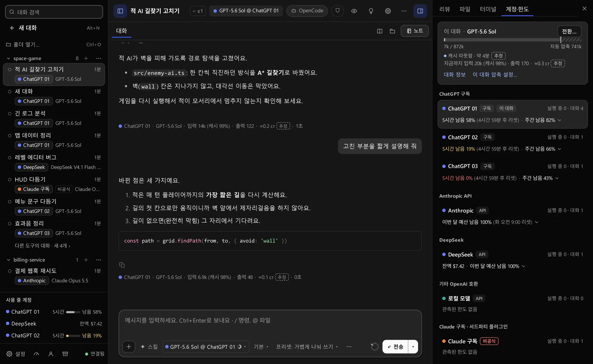
</picture>

> [!IMPORTANT]
> 독립적으로 만든 포크예요. OpenCode 팀, OpenAI, Anthropic, DeepSeek을 비롯해 여기 나오는 어느 회사와도 **관계가 없고, 보증이나 지원을 받지 않아요.** 계정과 키는 직접 준비해야 하고, 연결한 **서비스의 약관을 지키는 책임은 쓰는 사람에게 있어요.** 공식 방식이 아닌 연결은 앱이 따로 표시해요([위험은 쓰는 사람의 몫이에요](#위험은-쓰는-사람의-몫이에요)). OpenCode라는 이름과 로고는 그 소유자의 것이에요.
>
> 설치 파일은 배포하지 않아요. [직접 빌드해서](own/BUILDING.ko.md) 써요.

그림에 나오는 이름, 계정, 프로젝트, 숫자는 모두 지어낸 데모 데이터예요.

## 왜 쓰나요

- **계정을 한곳에서 써요.** 구독과 API 키, 로컬 모델이 나란히 있어요. 대화마다 어느 모델과 계정으로 도는지, 계정마다 한도가 얼마나 남았는지 늘 보여요.
- **바꾸기 전에 비용부터 보여요.** 긴 대화를 다른 계정으로 옮기면 새 계정이 처음부터 다시 읽어요. 앱이 그 비용을 먼저 어림하고, 압축 직후처럼 더 싼 때를 알려 줘요.
- **모델에 맞는 에이전트 방식을 골라요.** Codex, Pi, DeepSeek(dsh), oh-my-opencode, OpenCode 기본 방식 가운데 대화마다 하나를 골라요.
- **일을 나눠 맡길 수 있어요.** 대화마다 Git 워크트리를 따로 주거나, 팀이 프로젝트를 영역으로 나눠 맡고 검사를 통과한 일만 합쳐요.
- **어디서나 같은 앱이에요.** 창을 닫아도 에이전트는 계속 일해요. Android 휴대폰이나 다른 PC에서 이어 보고, 키는 PC에 둔 채 서버에서 돌릴 수 있어요.
- **몰래 보내는 것이 없어요.** 사용 통계, 충돌 보고, 오류 보고가 없어요.

## 기능

### 계정, 모델, 한도

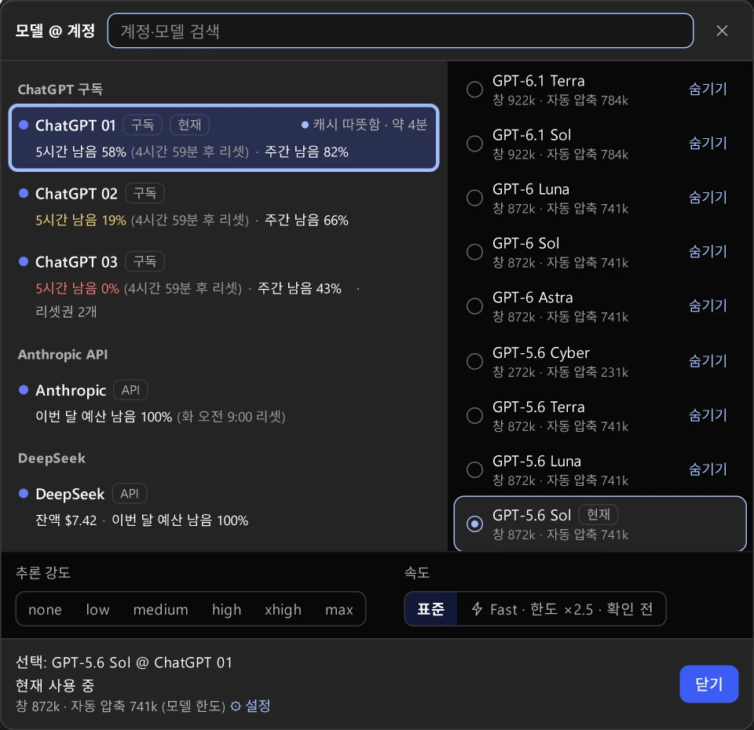

- **계정 종류:** ChatGPT 구독, Sign in with ChatGPT, OpenAI·Anthropic·DeepSeek·xAI·OpenRouter API 키, OpenAI 호환 주소, Ollama·LM Studio·vLLM·llama.cpp 같은 로컬 모델 서버, Claude Agent(내 Claude Code 로그인), 그리고 서드파티 플러그인을 거치는 Claude 구독이에요. 마지막 것은 앱이 `비공식`이라고 표시해요. 이 플러그인은 자신을 Claude Code라고 밝히는 방식이라, 이 프로젝트가 읽기로는 Anthropic 약관과 어긋나요. 연결하기 전에는 쓰이지 않고, 쓸지 말지와 그 위험은 쓰는 사람의 몫이에요.
- **대화마다 따로:** `Ctrl+.`로 `모델 @ 계정`을 고르고, 추론 강도와 속도, 도우미 에이전트를 어디서 얼마나 쓸지 정하는 프리셋도 골라요.
- **한도:** 5시간·주간 한도, 이번 달 예산, 선불 잔액을 보여요. 실제로 받은 값인지 어림한 값인지도 표시해요.
- **자격 증명:** 추가한 키와 ChatGPT 로그인은 이 PC에 Windows DPAPI로 암호화해 둬요. Claude 로그인은 Claude Code가 그대로 관리해요.

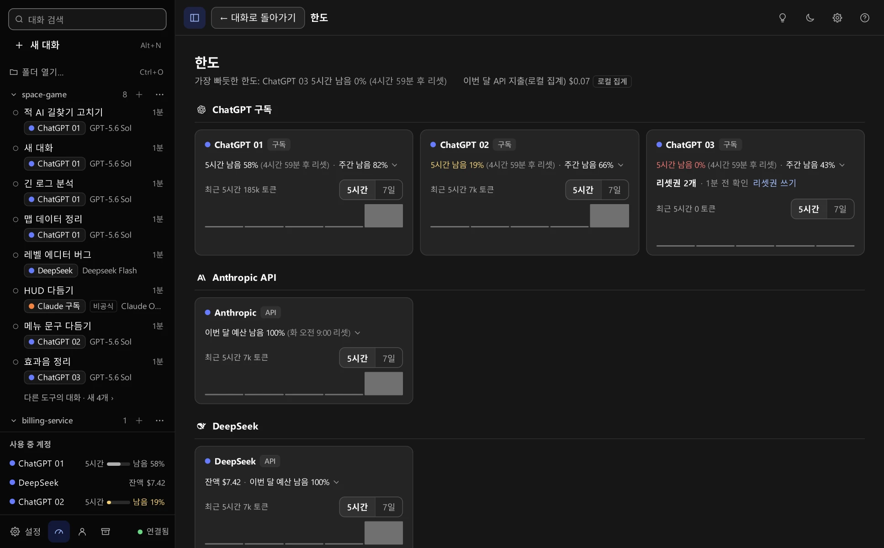

### 위험은 쓰는 사람의 몫이에요

일부 연결은 공개 API가 아니라 각 회사의 자체 도구처럼 동작해요. 공식 방식이 아니고 어느 회사의 보증도 받지 않았어요. **서비스 약관을 어길 수 있고, 그 회사가 이런 연결에 쓴 계정을 제한하거나 정지하거나 차단할 수 있어요.** 쓰는 책임은 전적으로 쓰는 사람에게 있어요.

- **Claude 구독 플러그인:** 요청을 Claude Code의 요청처럼 보내는 서드파티 플러그인이에요(User-Agent, 청구 헤더, 시스템 첫 줄).
- **ChatGPT 구독:** Codex CLI의 client id로 로그인하고, 모델 목록을 최신 Codex CLI 버전으로 받아요.
- **ChatGPT 리셋권:** 리셋권을 읽고, 확인을 누르면 ChatGPT 내부 API로 하나를 사용해요.
- **구독 계정 사이 전환:** 한도가 차면 대화를 내 다른 구독 계정으로 옮겨요.

API 키와 로컬 모델은 이 중 어느 것도 쓰지 않아요. Claude 플러그인은 앱이 `비공식`으로 표시하고, Claude 계정과 함께 위험 안내를 보여 줘요.

### 에이전트 방식과 승인

<p>
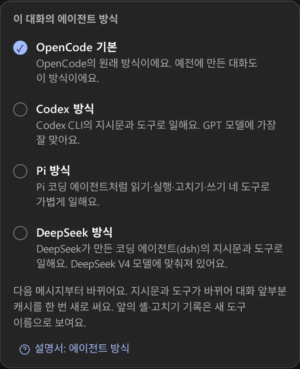
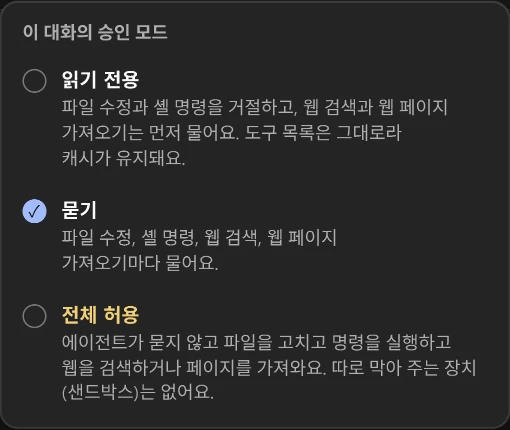
</p>

- **에이전트 방식:** Codex CLI, Pi, DeepSeek의 dsh, OpenCode의 지시문과 도구를 따라요. oh-my-opencode는 자기 플러그인으로 돌고, Claude Agent 계정에는 Claude Code 방식이 더 있어요. 지시문은 앱에서 읽고 고치고 비교할 수 있어요.
- **승인 모드:** 읽기 전용, 묻기, 전체 허용을 대화마다 정해요. 워크트리를 합칠 때는 전체 허용에서도 물어요.
- **보호하는 경로:** SSH 키, 브라우저 프로필, 지갑, 다른 도구의 로그인, 이 앱의 키 보관함은 어느 모드에서도 에이전트의 파일 도구로 열 수 없어요. 내 목록도 더할 수 있어요. 그런 경로가 적힌 셸 명령은 먼저 물어요. 다만 샌드박스는 아니에요. 전체 허용에서는 명령이 내 권한으로 그대로 돌아요.

### 큰 일: 팀 모드와 워크트리

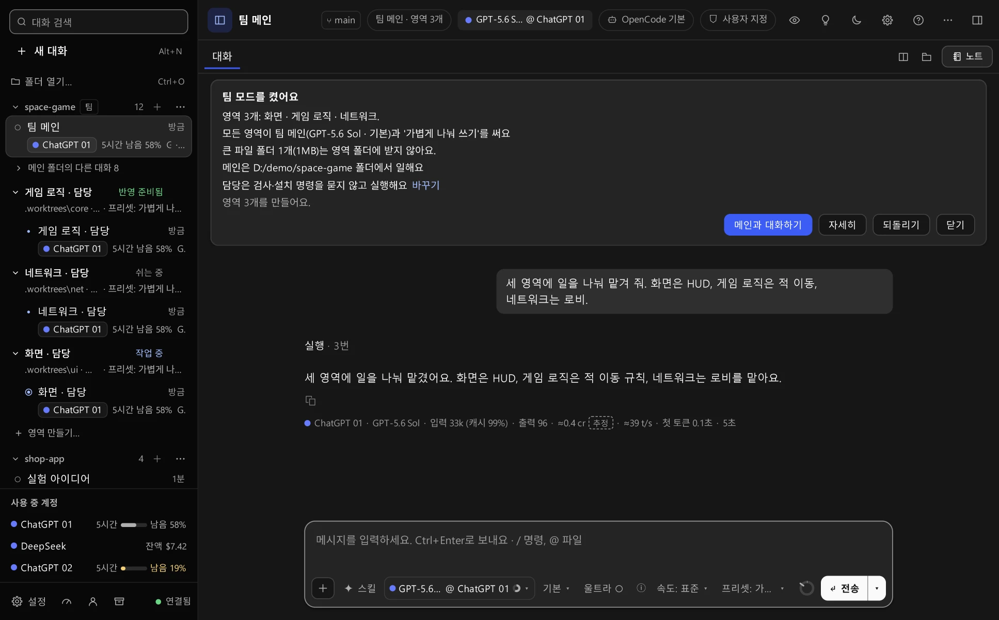

**팀 모드.** 메인 대화가 프로젝트를 영역으로 나눠요. 영역마다 담당 대화가 있고, 워크트리와 모델, 역할이 따로예요. 끝난 일은 검사용 폴더에서 먼저 합쳐 보고, 정해 둔 검사 명령을 통과해야 내 브랜치에 들어가요. 되돌릴 수도 있어요.

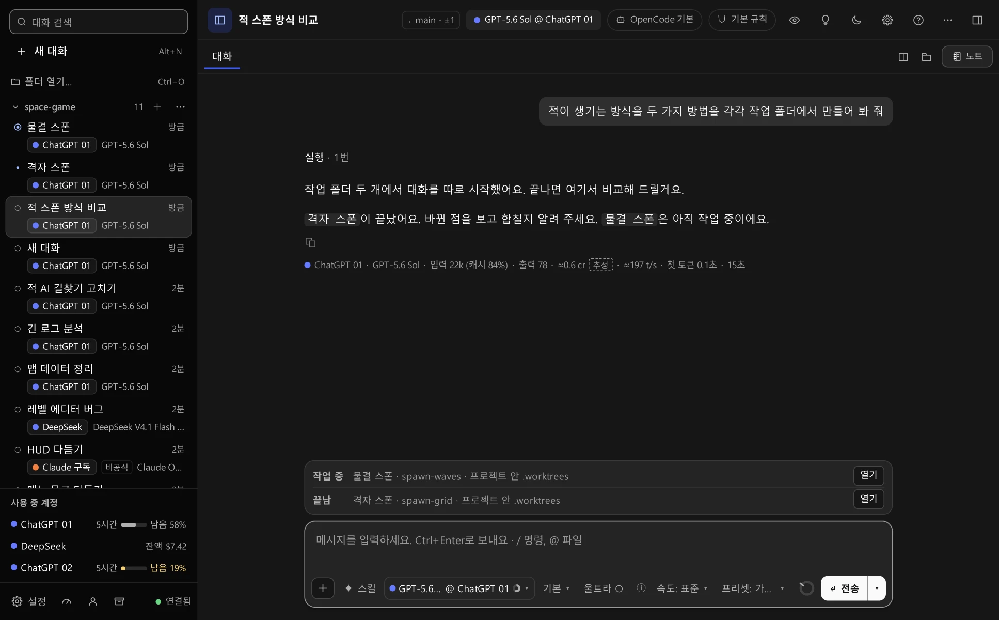

**워크트리 대화.** "워크트리에서 해 줘"라고 하면 에이전트가 새 브랜치와 작업 폴더를 만들고 거기서 새 대화를 시작해요. 입력창 위 줄에서 작업 중인지, 답을 기다리는지, 끝났는지 보여요. 내 브랜치에 합칠 때는 먼저 묻고, push는 하지 않아요.

### SSH 서버에서

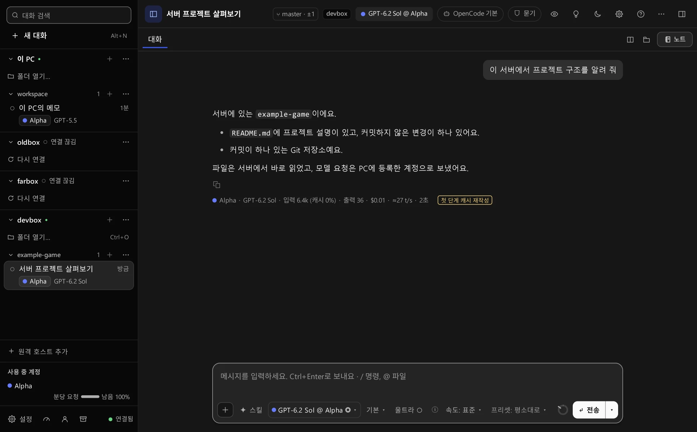

- 에이전트와 셸, 터미널, Git이 Linux 서버(x64, arm64)에서 돌아요. root 권한은 필요 없어요. 앱은 호스트 키 지문과 무엇을 설치할지 먼저 보여 주고 시작해요.
- **계정 키는 PC에 있어요.** 서버는 요청마다 SSH 연결로 잠깐 쓰는 출입증만 받아요. 이 PC의 로컬 모델도 서버 대화에서 쓸 수 있어요.
- 팀 모드, 워크트리, 앱 안 브라우저(이때 `localhost`는 그 서버예요), GitHub push도 서버에서 돼요.

### 휴대폰과 다른 PC에서

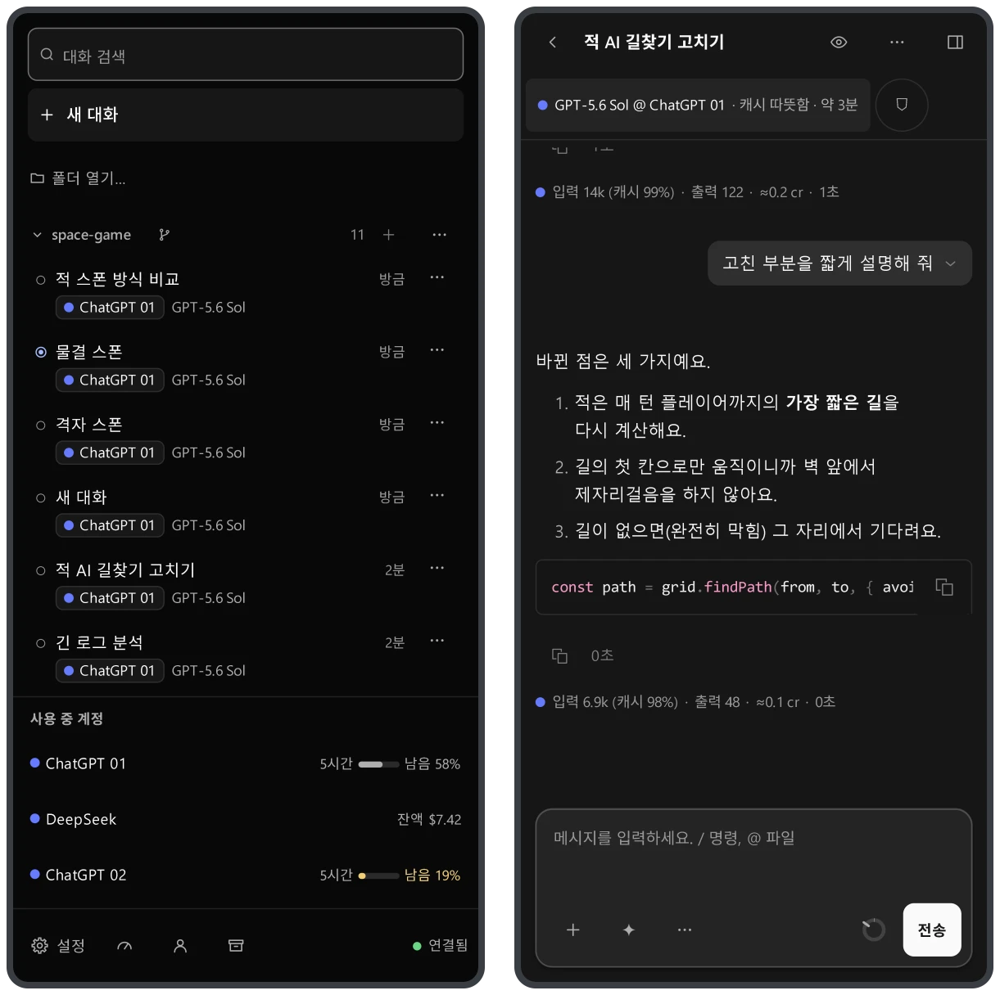

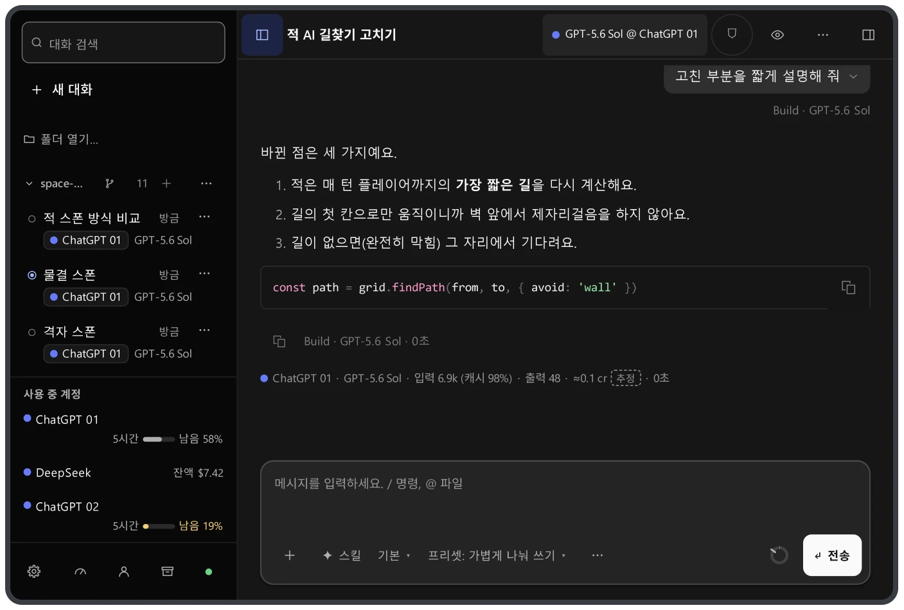

- Android 앱과 다른 PC용 데스크톱 클라이언트가 있어요. QR이나 링크로 한 번 연결하고, 양쪽 화면의 번호가 같으면 PC에서 허용해요. 기기마다 권한과 만료가 따로 있고 언제든 끊을 수 있어요.
- 앱은 내 PC 인증서의 지문만 믿어요. 서비스는 `127.0.0.1`에서만 열리고, 밖에서 들어오는 길(Tailscale이나 직접 하는 포트 포워딩)은 사용자가 준비해요.
- 휴대폰에서 앱 안 브라우저를 보고 조작하고, 말로 입력하고, 승인 요청에 답할 수 있어요.

### 브라우저, 컴퓨터 사용, 도구

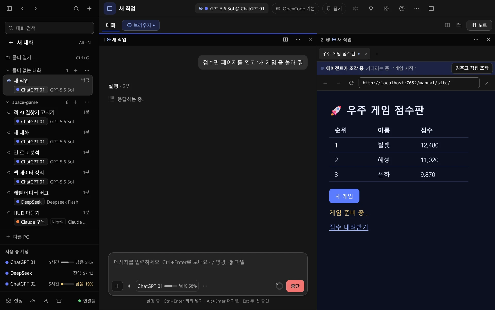

- **앱 안 브라우저**가 대화 옆에 있어요. 에이전트가 무엇을 누르는지 보고, 멈추고, 넘겨받아요.
- **컴퓨터 사용** *(실험)*: 에이전트가 Windows 화면을 보고 마우스와 키보드를 써요. 기본은 꺼져 있고 대화마다 켜요. 어디서나 듣는 정지 단축키가 있어요.
- **내 브라우저 사용** *(실험)*: OpenCode의 Browse로 에이전트가 내 브라우저에서 일해요. 기본은 꺼져 있어요.
- **이미지 만들기:** 모델이 내 OpenAI 키로 그림을 만들고 고쳐요. 기본은 꺼져 있어요.
- **MCP 서버와 스킬:** 더하고, Codex와 Claude Code에서 가져오고, MCP 레지스트리에서 찾고, 프로젝트마다 켜고 꺼요.
- **웹 검색:** 검색 서비스를 고르거나 여러 곳에 함께 물어요. 내 키를 쓸 수 있어요.
- **GitHub:** 계정을 여러 개 두고 프로젝트, 영역, 대화마다 골라 도구와 `git push`에 써요.
- **Creator 모드:** 대화가 이 앱의 확장을 만들어요. 지시문 조각, 명령 도구, 도구 규칙, 스킬, 샌드박스에서 도는 MCP 서버 같은 것이에요. 코드 플러그인은 기본으로 꺼져 있어요.

### 매일 쓰면서

<p>
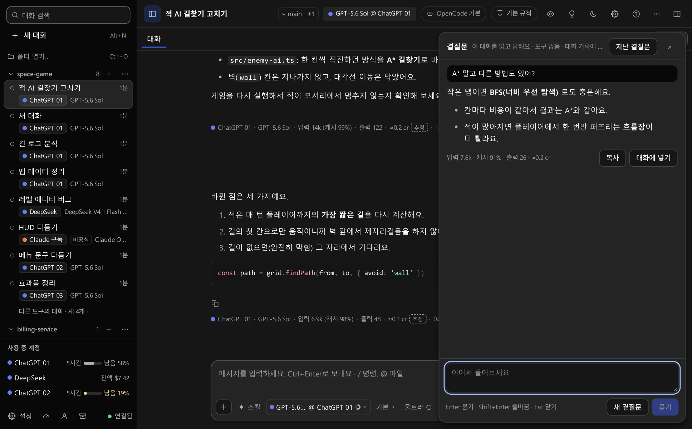
</p>

- **사이드바:** 이 PC, SSH 호스트, 다른 PC가 한 목록에 있어요. 프로젝트와 서버를 마우스로 끌거나 길게 누르거나 키보드로 옮겨 순서를 정하고, 프로젝트를 맨 위에 고정해요. 프로젝트 순서와 고정은 그 서버의 서비스에 남아서 휴대폰에서도 같아요.
- **곁질문:** 에이전트가 일하는 동안 `/btw`로 대화에 대해 물어요. 답은 도구를 쓰지 않고 대화 기록에도 남지 않아요.
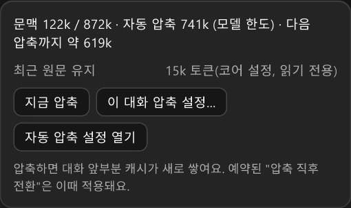

- **문맥:** 문맥 계기가 있고, 자동 압축을 계정·모델·대화마다 정해요. 압축할 때 무엇이 남았는지 보고, 같은 대화에서 문맥을 비울 수도 있어요.
- 메시지를 대기열에 넣거나 끼워 넣고, 되감고, 복제하고, 한 창을 네 칸까지 나누고, 메모를 남기고, 내 음성 인식 키로 말해서 입력해요.
- Codex와 Claude Code의 대화를 가져와 이어서 해요. 원본 파일은 읽기만 해요.

## OpenCode와의 관계

own-open-code는 OpenCode v2를 따라가며 새 릴리스를 합쳐요. 서버, 세션, 플러그인 체계는 OpenCode의 것이에요. 여기에 own 패키지(`packages/own-*`)와 다른 데스크톱·웹 화면, 그리고 기록해 둔 소수의 코어 패치([원장](own/ledger/core-patches.yaml))를 더했어요. 이름과 포트, 데이터베이스가 따로라서 OpenCode와 나란히 설치해도 서로 건드리지 않아요.

공식 앱을 원하면 [OpenCode](https://opencode.ai)를 쓰세요. 이 포크의 문제는 OpenCode 팀에 알리지 말아 주세요.

## 필요한 것

| 무엇 | 어디서 되나요 |
|---|---|
| 데스크톱 앱과 서비스 | Windows 11 x64 |
| 다른 PC용 클라이언트 | Windows x64. Windows ARM64는 클라이언트만 돼요. ARM64 빌드는 정적 검사를 통과했지만 **아직 ARM64 PC에서 돌려 보지 못했어요** |
| 서버 | OpenSSH로 접속하는 Linux x64, arm64 |
| 휴대폰 | Android 10 이상 |
| 빌드 | Git, Bun, Node.js, Rust, MSVC 빌드 도구. 휴대폰 앱에는 JDK와 Android SDK |

macOS와 Linux 데스크톱은 빌드하지도 시험하지도 않아요.

## 빌드와 설치

버전과 자주 겪는 문제까지 적은 안내는 [own/BUILDING.ko.md](own/BUILDING.ko.md)에 있어요. 줄이면 이래요.

```powershell
git clone https://github.com/NA-DEGEN-GIRL/own-open-code.git C:\src\own-open-code
cd C:\src\own-open-code
bun install --frozen-lockfile
powershell -NoProfile -ExecutionPolicy Bypass -File own\scripts\build-desktop.ps1
```

설치 파일은 `own\.out\build\<버전>\desktop\`에 생겨요. 탐색기에서 실행하세요. 지금 사용자에게만 설치되고 관리자 권한은 필요 없어요.

**빌드한 파일은 서명되어 있지 않아요.** Windows가 모르는 파일이라고 경고할 수 있고, 스마트 앱 컨트롤은 아예 막을 수 있어요. 이 앱 때문에 그 보호를 끄지는 마세요. 어떻게 하면 되는지는 [안내](own/BUILDING.ko.md#windows가-빌드한-파일을-막아요)에 있어요.

## 빠른 시작

1. 시작 메뉴에서 **Own OpenCode**를 열어요. 처음 화면은 한국어예요. 영어로 바꾸려면 `Ctrl+,`를 누르고 **일반** → **언어**에서 골라요.
2. 계정을 추가해요. 사이드바 아래의 사람 모양 단추 → **계정 추가**예요.
3. **폴더 열기…**(`Ctrl+O`)로 프로젝트를 고르고 거기서 대화를 시작해요.
4. `Ctrl+.`로 모델과 계정을 고르고, 할 일을 적어 `Ctrl+Enter`로 보내요.
5. 에이전트가 허락을 구하면 입력창 위에서 답해요. 나머지는 모두 `Ctrl+K`에서 찾을 수 있어요.

**서버 더하기:** 사이드바나 *설정 → SSH 원격 호스트*의 **원격 호스트 추가**에서 `~/.ssh/config`의 호스트를 골라요.
**휴대폰 더하기:** *설정 → 휴대폰·다른 PC* → 게이트웨이와 앱 연결 켜기 → 화면 안내대로 Tailscale이나 포트 포워딩 준비 → **새 기기 연결**이에요.

전체 설명서는 앱 안(머리줄의 `?`)과 [own/docs/manual](own/docs/manual/README.md)에 있어요.

## 개인정보

사용 통계, 충돌 보고, 오류 보고가 없고 이 포크를 만든 사람에게 가는 것도 없어요. 대화와 계정, 로그는 내 기기에 남아요. 밖으로 나가는 것은 이것뿐이에요.

- **직접 고른** 모델 제공자, 검색 서비스, 서버로 가는 요청. 그 제공자에게 사용량과 모델 목록을 묻는 것도 들어가요.
- OpenCode의 **공개 모델 목록**(`models.opencode.ai`)을 5분마다 받아요. 식별자는 보내지 않아요. `OPENCODE_DISABLE_MODELS_FETCH=1`로 꺼요.
- 하루 한 번 npm과 GitHub에서 **새 버전 확인**. 설정에서 끌 수 있어요.
- Chromium의 **맞춤법 사전**을 한 번 받아요.

메시지에 든 다른 사이트의 그림은 링크로 보이고, 열 때만 불러와요. 로그인 없이 쓰는 OpenCode 모델은 꺼져 있어요. 출시하는 소스에 알려진 텔레메트리 서비스가 나타나면 [시험](own/scripts/test/telemetry-off.test.ts)이 실패하고, [`own/scripts/net-observe.ts`](own/scripts/net-observe.ts)로 격리해 설치한 앱이 어디에 접속하는지 직접 확인할 수 있어요. 연결한 제공자와 도구에는 각자의 개인정보 규칙이 있어요.

## 상태와 지원

한 사람이 매일 쓰는 도구를 그대로 공개한 것이에요. 자주 바뀌고, OpenCode 릴리스를 따라가며, 깨질 수 있어요. 쓰기 전에 알아 두세요.

- **Windows 먼저예요.** 데스크톱 앱은 Windows 11 x64에서 빌드하고 시험해요.
- **한국어 먼저예요.** 화면은 한국어와 영어를 지원해요. 서비스와 데스크톱 셸, Android 앱이 직접 쓰는 글(일부 오류와 알림, 트레이 메뉴, 휴대폰 앱 자체 화면)과 설명서, 설계 문서는 한국어예요.
- **배포 파일, 서명, 자동 업데이트가 없어요.**
- **이슈와 풀 리퀘스트는 꺼 두었어요.** 개인 프로젝트를 그대로 공개한 것이라 지원도 없어요. 중요한 작업은 백업해 두세요.
- 에이전트는 내 권한으로 명령을 실행하고 파일을 고쳐요. 믿기 어려운 프로젝트에서는 `읽기 전용`이나 `묻기`를 쓰세요.

## 라이선스와 감사

OpenCode는 MIT 라이선스예요([LICENSE](LICENSE)). 이 저장소의 OpenCode 파일도 그대로 따라요.

이 포크가 더한 코드(`own/`, `packages/own-*`)도 MIT 라이선스예요. [LICENSE](LICENSE)에 두 저작권 줄이 함께 있어요.

다른 프로젝트에서 가져오거나 옮긴 부분에는 각자의 라이선스와 고지가 남아 있어요. 목록은 [own/THIRD-PARTY-NOTICES.md](own/THIRD-PARTY-NOTICES.md)에 있어요.

- **[OpenCode](https://github.com/anomalyco/opencode)** (MIT): 모든 것의 바탕이에요.
- **[OpenAI Codex](https://github.com/openai/codex)** (Apache-2.0): Codex 방식의 지시문, 도구 문구, 문법과 이미지 스킬이에요.
- **[Pi](https://github.com/earendil-works/pi)** (MIT), **[DeepSeek Harness](https://github.com/deepseek-ai/deepseek-harness)** (MIT): Pi 방식과 DeepSeek 방식이에요.
- **oh-my-opencode** (Sustainable Use License 1.0, [own/vendor/oh-my-opencode](own/vendor/oh-my-opencode)): omo 방식이에요. 오픈 소스 라이선스가 *아니에요*. 회사 안에서, 개인적으로, 비상업적으로 쓸 수 있고, 나눌 때는 비상업적인 목적으로 무료로만 돼요.
- **opencode-claude-auth-v2** (MIT): Claude 구독 플러그인이에요. 빌드할 때 패치해요.
- **[Git LFS](https://github.com/git-lfs/git-lfs)** (MIT), **[Electron](https://github.com/electron/electron)** (MIT), 그리고 `bun.lock`의 패키지들이에요.

OpenCode라는 이름과 로고는 그 소유자의 것이에요. 앱은 OpenCode의 아이콘을 업스트림이 낸 그대로 써요. ChatGPT, Codex, Claude, DeepSeek 같은 이름도 각 소유자의 것이고, 무엇에 연결되는지 말할 때만 썼어요.

<!-- OWN-PATCH(P-065) end -->
