<!-- OWN-PATCH(P-065) begin: this README describes own-open-code; OpenCode's own is at https://github.com/anomalyco/opencode -->

**English** | [한국어](README.ko.md)

# own-open-code

own-open-code is a desktop workbench for coding agents on Windows, built on [OpenCode](https://github.com/anomalyco/opencode). You connect your own accounts, keys and local models, choose one for each conversation, and let agents work on your projects: on this PC, on a Linux server over SSH, and from your phone when you are away from the desk.

<picture>
  <source media="(prefers-color-scheme: light)" srcset="own/readme/en/hero-light.webp">
  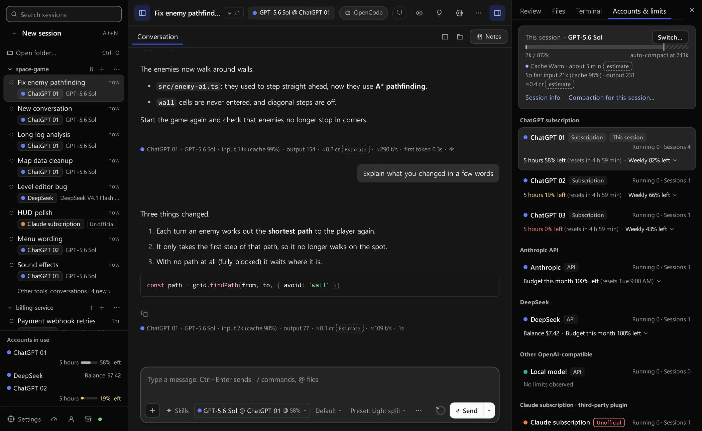
</picture>

> [!IMPORTANT]
> This is an independent fork. It is **not affiliated with, endorsed by or supported by** the OpenCode team, OpenAI, Anthropic, DeepSeek or any other vendor named here. You bring your own accounts and keys, and **you are responsible for following each provider's terms** when you connect one. The app marks the connections that are unofficial; see [Use at your own risk](#use-at-your-own-risk). The OpenCode name and logos belong to their owners.
>
> No installers are published. You [build it yourself](own/BUILDING.md).

All names, accounts, projects and numbers in the pictures are made-up demo data.

## Why use it

- **One place for every account.** Subscriptions, API keys and local models sit side by side. Each conversation shows which model and account it runs on, and each account shows what is left of its limits.
- **The cost of switching, before you switch.** Moving a long conversation to another account means the new one reads it all again. The app estimates that first and offers cheaper moments, such as right after a compaction.
- **The right agent style for the model.** Codex, Pi, DeepSeek (dsh), oh-my-opencode or OpenCode's own way of working: a setting of the conversation, not of the installation.
- **Work that fans out.** Start conversations in their own Git worktrees, or let a team split a project into areas and merge only what passes your checks.
- **The same app everywhere.** Agents keep running when you close the window. Follow them from an Android phone or another PC, or run them on a server while the keys stay on your PC.
- **Nothing sent home.** No analytics, crash reports or error reports.

## Features

### Accounts, models and limits

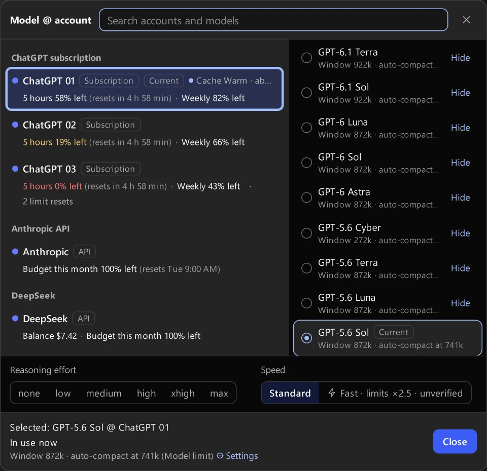

- **Account kinds:** ChatGPT subscription, Sign in with ChatGPT, OpenAI, Anthropic, DeepSeek, xAI and OpenRouter API keys, any OpenAI-compatible endpoint, local model servers such as Ollama, LM Studio, vLLM and llama.cpp, Claude Agent (your own Claude Code login), and a Claude subscription through a third-party plugin that the app labels *Unofficial*. That plugin presents itself as Claude Code, which conflicts with Anthropic's terms as this project reads them: nothing uses it until you connect it, and whether to is your decision and your risk.
- **Per conversation:** pick `model @ account` with `Ctrl+.`, plus reasoning effort, speed and a preset that says where helper agents run and how much they get to do.
- **Limits:** five-hour and weekly windows, monthly budgets and prepaid balances, with a mark that says whether a number was measured or estimated.
- **Credentials:** keys and ChatGPT sign-ins you add are encrypted with Windows DPAPI on this PC. Claude logins stay with Claude Code.

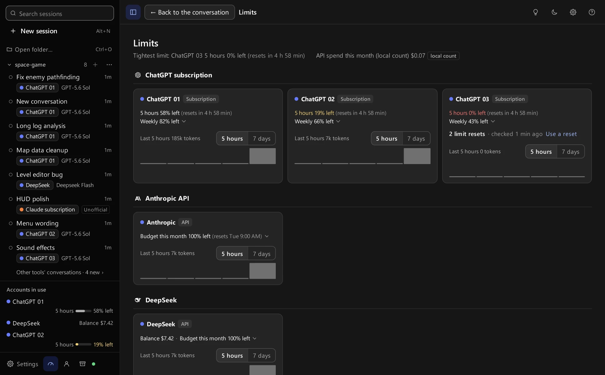

### Use at your own risk

Some connections work the way the vendors' own tools do, not through a public API. They are unofficial and not endorsed by any provider. **They may violate the provider's terms, and the provider may limit, suspend or ban the accounts you use with them.** You alone are responsible for using them.

- **Claude subscription plugin:** a third-party plugin that presents its requests as Claude Code (its user agent, billing header and first system line).
- **ChatGPT subscription:** signs in with the Codex CLI's client id and asks for the model list as the newest Codex CLI version.
- **ChatGPT limit reset credits:** reads them and, after you confirm, redeems one through ChatGPT's internal API.
- **Switching between subscriptions:** moves a conversation from one of your subscription accounts to another when a limit runs out.

API keys and local models use none of this. The app labels the Claude plugin *Unofficial* and shows its risk notice with the Claude accounts.

### Agent styles and approvals

<p>
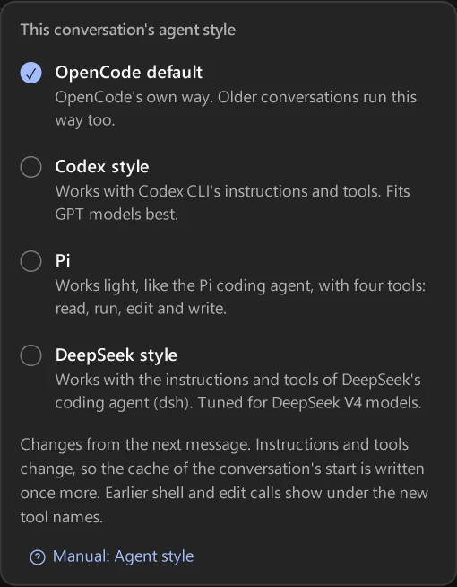
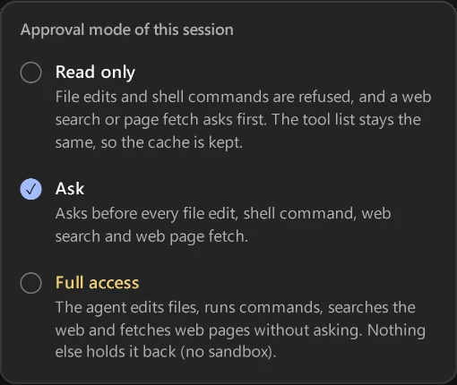
</p>

- **Styles** follow the instructions and tools of the Codex CLI, Pi, DeepSeek's dsh or OpenCode; oh-my-opencode runs as its own plugin, and Claude Agent accounts add Claude Code's own style. Read, edit and compare the instructions in the app.
- **Approval modes:** read only, ask, or full access, for each conversation. Merging a worktree asks even under full access.
- **Protected paths:** SSH keys, browser profiles, wallets, other tools' logins and the app's own vault are closed to the agent's file tools in every mode, and you can add your own. A shell command that names one asks first. This is a guard, not a sandbox: full access runs commands as you.

### Bigger work: teams and worktrees

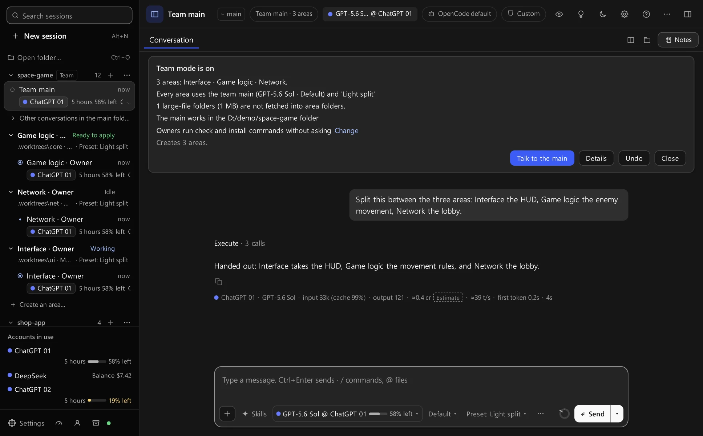

**Team mode.** A main conversation splits a project into areas. Each area has an owner conversation with its own worktree, model and role. Finished work is merged into a separate check folder first and reaches your branch only after your check commands pass, with an undo.

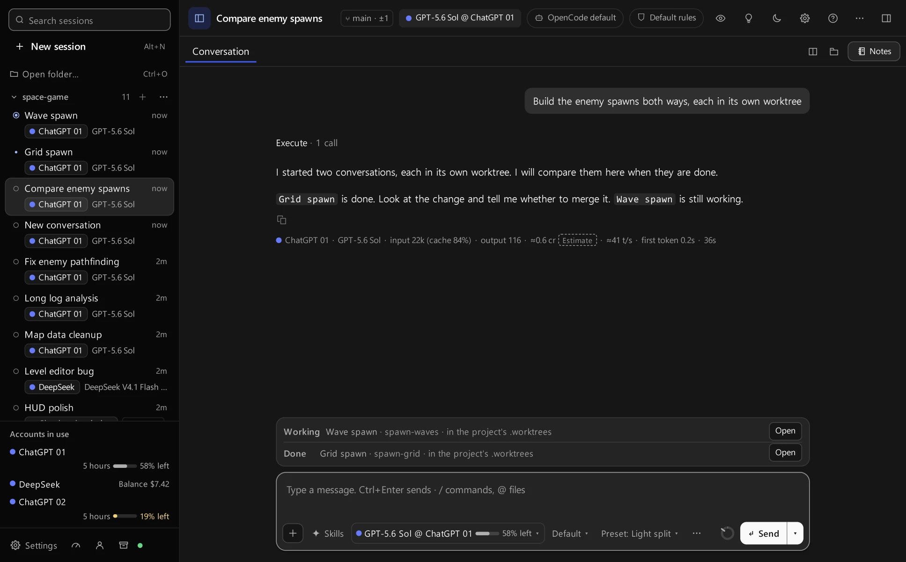

**Worktree conversations.** Ask for something "in its own worktree" and the agent opens a new conversation there, on its own branch. The dock shows which are working, waiting for you or done. Merging into your branch asks you first, and nothing is pushed.

### On a server over SSH

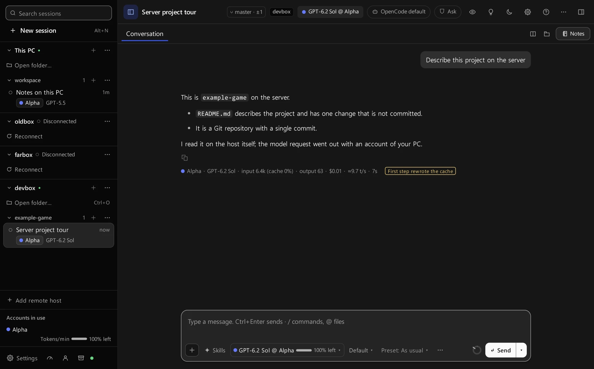

- Agents, shell, terminal and Git run on the Linux host (x64 or arm64, no root needed). The app shows the host key fingerprint and what it will install before it does anything.
- **Account keys stay on your PC.** The host gets short-lived credentials for each request through the SSH connection. This PC's local models work there too.
- Team mode, worktrees, the in-app browser (where `localhost` is the server) and GitHub pushes work on hosts as well.

### From your phone or another PC

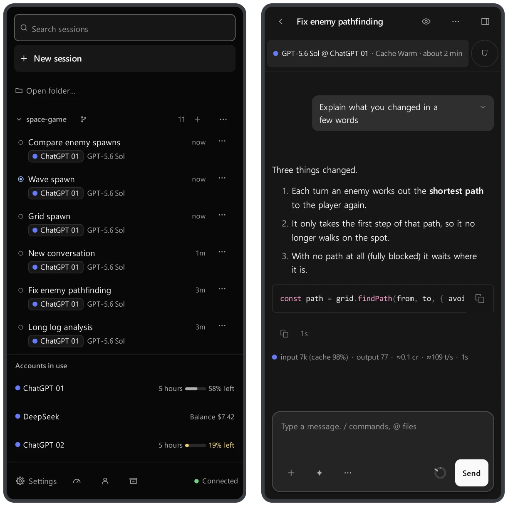

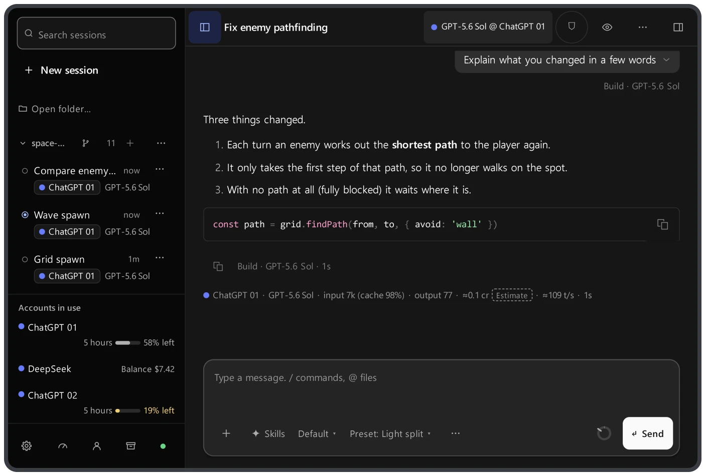

- An Android app and a desktop client for another PC. Pair once with a QR code or a link, compare the number on both screens, and allow it on the PC. Each device has its own permissions and expiry and can be revoked.
- The apps trust only your PC's certificate fingerprint. The service listens on `127.0.0.1` only; the way in (Tailscale, or your own port forwarding) is something you set up yourself.
- Watch and steer the in-app browser from the phone, dictate messages, and answer approvals.

### Browser, computer use and tools

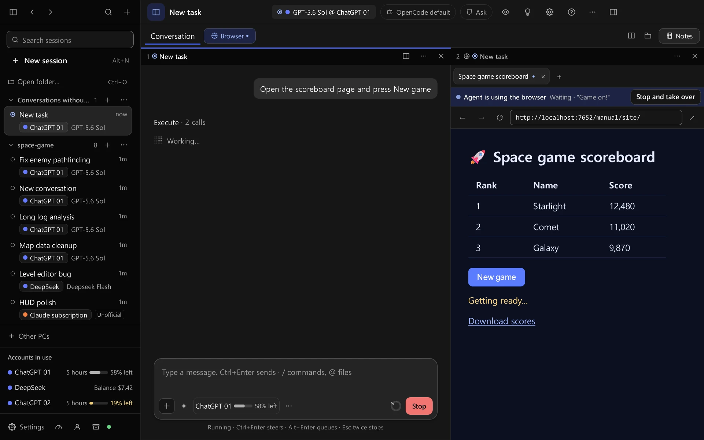

- **In-app browser** beside the conversation. See what the agent clicks, stop it, or take over.
- **Computer use** *(experimental)*: the agent sees the Windows screen and uses the mouse and keyboard. Off by default, switched on for each conversation, with a global stop key.
- **My browser** *(experimental)*: agents work in your own browser through OpenCode's Browse. Off by default.
- **Images:** models can make and edit pictures with your OpenAI key. Off by default.
- **MCP servers and skills:** add, import from Codex and Claude Code, search the MCP registry, and switch each one on or off by project.
- **Web search:** choose the service, or ask several at once, with your own keys.
- **GitHub:** several accounts, chosen by project, area or conversation, for tools and for `git push`.
- **Creator mode:** a conversation builds extensions for the app itself, such as extra instructions, command tools, tool rules, skills and sandboxed MCP servers. Code plugins are off by default.

### Day to day

<p>
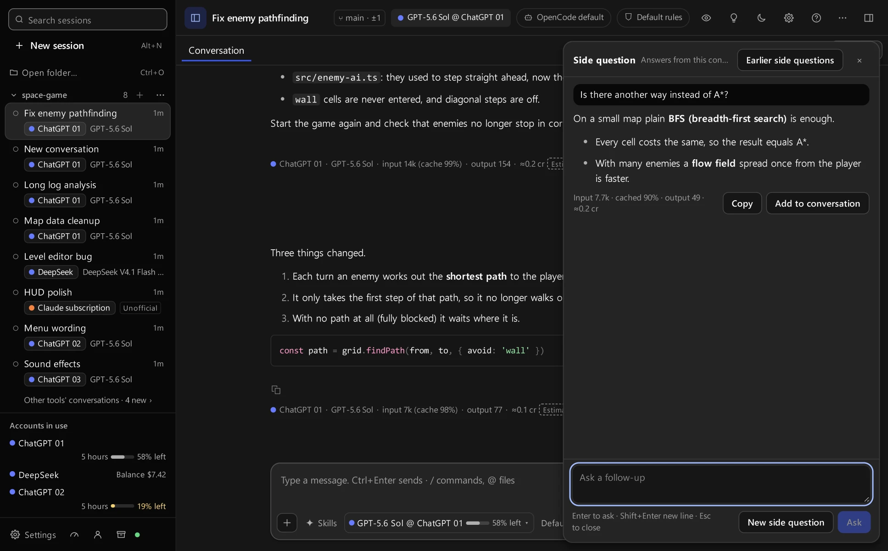
</p>

- **Sidebar:** this PC, SSH hosts and other PCs in one list. Drag projects and servers into your own order, by mouse, long press or keyboard, and pin projects to the top. Project order and pins are kept by each server's service, so the phone shows the same.
- **Side questions:** `/btw` asks about the conversation while the agent keeps working. The answer uses no tools and never enters the history.
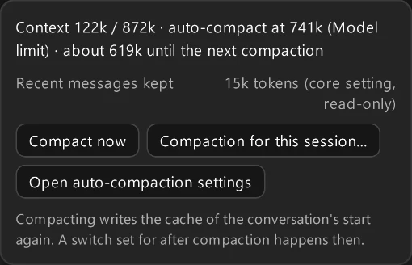

- **Context:** a meter, auto-compaction per account, model or conversation, a view of what each compaction kept, and a context reset in the same conversation.
- Queue or steer messages, rewind, fork, split the window into up to four panes, keep notes, and dictate with your own speech-to-text key.
- Bring over conversations from Codex and Claude Code. Their files are only read.

## How it relates to OpenCode

own-open-code follows OpenCode v2 and merges its releases. The server, the sessions and the plugin system are OpenCode's. This fork adds its own packages (`packages/own-*`), a different desktop and web interface, and a small set of recorded patches to the core ([ledger](own/ledger/core-patches.yaml)). It uses its own names, ports and database, so it can be installed next to OpenCode without touching it.

If you want the official app, use [OpenCode](https://opencode.ai). Please do not report problems with this fork to the OpenCode team.

## Requirements

| What | Where it runs |
|---|---|
| Desktop app and service | Windows 11, x64 |
| Client for another PC | Windows x64, or Windows ARM64 as a client only. The ARM64 build passes its static checks but **has not been run on an ARM64 PC yet** |
| Server hosts | Linux x64 or arm64, over OpenSSH |
| Phone | Android 10 or newer |
| Building | Git, Bun, Node.js, Rust and the MSVC build tools; a JDK and the Android SDK for the phone app |

macOS and Linux desktops are not built or tested.

## Build and install

The full guide, with versions and common problems, is in [own/BUILDING.md](own/BUILDING.md). In short:

```powershell
git clone https://github.com/NA-DEGEN-GIRL/own-open-code.git C:\src\own-open-code
cd C:\src\own-open-code
bun install --frozen-lockfile
powershell -NoProfile -ExecutionPolicy Bypass -File own\scripts\build-desktop.ps1
```

The installer appears in `own\.out\build\<version>\desktop\`. Start it from Explorer. It installs for the current user, without administrator rights.

**Builds are not signed.** Windows may warn about a file it does not know, and Smart App Control can block it entirely. Do not switch those protections off for this app; [the guide](own/BUILDING.md#windows-blocks-the-built-files) says what is left to do.

## Quick start

1. Open **Own OpenCode** from the Start menu. The app starts in Korean: press `Ctrl+,` and choose **일반** → **언어** → **English**.
2. Add an account: the person icon at the bottom of the sidebar → **Add account**.
3. **Open folder…** (`Ctrl+O`), choose a project and start a conversation there.
4. Choose the model and account with `Ctrl+.`, write what you want and send it with `Ctrl+Enter`.
5. Approve what the agent asks for above the message box. `Ctrl+K` finds everything else.

**Add a server:** choose **Add remote host** in the sidebar or in *Settings → SSH remote hosts*, and pick a host of your `~/.ssh/config`.
**Add a phone:** *Settings → Phone & other PCs* → turn the gateway and app connections on → set up Tailscale or port forwarding as the page says → **Connect a new device**.

The complete manual is inside the app (`?` in the header) and in [own/docs/manual](own/docs/manual/README.md). It is written in Korean.

## Privacy

There are no analytics, crash or error reports, and nothing is sent to the author of this fork. Conversations, accounts and logs stay on your machines. What does leave them:

- requests to the **providers, search services and servers you chose**, including reading your usage and model list from them;
- the **public model catalog** of OpenCode (`models.opencode.ai`) every five minutes, without an identifier (`OPENCODE_DISABLE_MODELS_FETCH=1` turns it off);
- **version checks** once a day against npm and GitHub (a switch in Settings);
- Chromium's **spelling dictionaries**, once.

Pictures from other hosts in a message are shown as links and load only when you open them. OpenCode's signed-out models are off. A [test](own/scripts/test/telemetry-off.test.ts) fails when a known telemetry service shows up in the shipped sources, and [`own/scripts/net-observe.ts`](own/scripts/net-observe.ts) records what an isolated installation connects to, so you can check for yourself. Providers and tools you connect have their own privacy rules.

## Status and support

This is one person's daily tool, shared as it is. It changes often, follows OpenCode's releases, and may break. Know this before you rely on it:

- **Windows first.** The desktop app is built and tested on Windows 11 x64.
- **Korean first.** The interface is in Korean and English. What the service, the desktop shell and the Android app say themselves (some errors and notices, the tray menu and the phone app's own screens) is still Korean, and so are the manual and the design documents.
- **No published builds, no signatures, no automatic updates.**
- **Issues and pull requests are off.** This is a personal project shared as is, without support. Keep a backup of work that matters.
- Agents run commands and change files with your rights. Use *Read only* or *Ask* for projects you do not trust.

## Licence and acknowledgements

OpenCode is MIT licensed ([LICENSE](LICENSE)); OpenCode's files in this repository stay under it.

The code this fork adds (`own/` and `packages/own-*`) is MIT licensed too; [LICENSE](LICENSE) carries both copyright lines.

Parts taken or adapted from other projects keep their own licences and notices, listed in [own/THIRD-PARTY-NOTICES.md](own/THIRD-PARTY-NOTICES.md):

- **[OpenCode](https://github.com/anomalyco/opencode)** (MIT): everything here is built on it.
- **[OpenAI Codex](https://github.com/openai/codex)** (Apache-2.0): instructions, tool texts and grammar of the Codex style, and the image skill.
- **[Pi](https://github.com/earendil-works/pi)** (MIT) and **[DeepSeek Harness](https://github.com/deepseek-ai/deepseek-harness)** (MIT): the Pi and DeepSeek styles.
- **oh-my-opencode** (Sustainable Use License 1.0, in [own/vendor/oh-my-opencode](own/vendor/oh-my-opencode)): the omo style. It is *not* an open-source licence: it allows internal business, personal and non-commercial use, and sharing only free of charge for non-commercial purposes.
- **opencode-claude-auth-v2** (MIT): the Claude subscription plugin, patched at build time.
- **[Git LFS](https://github.com/git-lfs/git-lfs)** (MIT), **[Electron](https://github.com/electron/electron)** (MIT) and the packages in `bun.lock`.

The OpenCode name and logos belong to their owners; the app keeps OpenCode's icons as upstream ships them. ChatGPT, Codex, Claude, DeepSeek and other names belong to their owners and are used only to say what the app connects to.

<!-- OWN-PATCH(P-065) end -->
