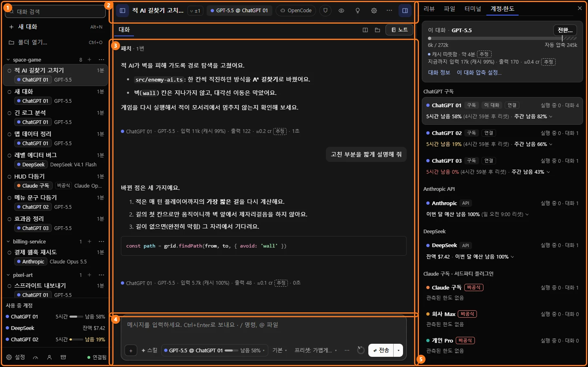

# 1. 이 앱은 무엇인가요

**한 줄 요약**: own-open-code는 AI **에이전트**가 내 프로젝트 폴더에서 코드를 읽고, 고치고, 명령을 실행하게 하는 데스크톱 앱이에요. 대화 하나를 여러 회사·여러 계정의 AI가 이어서 쓸 수 있고, 계정을 바꾸기 전에 드는 값과 계정마다 남은 한도를 한곳에서 보여 줘요.

> **용어** 에이전트: 대화만 하는 AI가 아니라, 내 프로젝트 폴더의 파일을 읽고 고치고 명령을 실행하는 **일꾼 AI**예요. "적 AI가 벽에 부딪혀요, 고쳐 줘"라고 시키면 코드를 찾아 읽고, 고치고, 테스트를 돌린 뒤 결과를 알려 줘요. 파일을 고치거나 명령을 실행하기 전에는 먼저 허락을 물어요([4장](04-first-conversation.md), [8장](08-approvals.md)).

## 1.1 어떤 앱이에요?

- **OpenCode**라는 공개 AI 코딩 앱(2판)을 바탕으로, 이 PC 주인에게 필요한 기능을 더한 개인용 판이에요.
- 에이전트는 **이 PC**에서 일해요. SSH로 연결한 Linux 서버에서 일하게 할 수도 있어요([22장](22-ssh-remote.md)).
- 일은 **대화(세션)** 단위로 해요. 대화마다 어느 회사의 어느 모델을, 어느 계정으로 쓸지 골라요. 이것을 `모델 @ 계정`이라고 불러요.

## 1.2 이 앱만의 세 가지

| 무엇 | 쉽게 말하면 | 자세히 |
|---|---|---|
| **대화 하나를 여러 계정이 이어서** | ChatGPT 구독으로 시작한 대화를 DeepSeek나 Claude로 이어 갈 수 있어요. 한 계정의 한도가 바닥나도 대화를 버리지 않아요 | [6장](06-model-account.md), [11장](11-cache-switch-cost.md) |
| **바꾸기 전에 값부터** | 계정을 바꾸면 새 계정이 대화를 처음부터 다시 읽어서 돈(또는 한도)이 들어요. 앱이 그 값을 먼저 보여 주고, 싸게 바꿀 때를 고르게 도와줘요 | [11장](11-cache-switch-cost.md), [13장](13-auto-compaction.md) |
| **한도를 한눈에** | 계정이 여러 개여도 5시간·주간 한도, 이번 달 지출, 잔액을 한 화면에서 비교해요. 어느 대화가 어느 계정을 쓰는지도 늘 보여요 | [7장](07-usage.md), [12장](12-multiple-accounts.md) |

<figure class="diagram">
<svg class="dg-wide" viewBox="0 0 680 210" role="img" aria-label="대화 하나가 ChatGPT 01에서 시작해 압축 직후 DeepSeek로 옮겨 가고, 다시 ChatGPT 01로 돌아오는 모습" xmlns="http://www.w3.org/2000/svg" font-family="inherit" style="width:100%;height:auto;max-width:680px">
<text x="10" y="20" font-size="13" fill="currentColor" fill-opacity="0.75">대화 하나 · 시간 →</text>
<g fill="currentColor" fill-opacity="0.07" stroke="currentColor" stroke-opacity="0.45" stroke-width="1.5">
<rect x="10" y="34" width="232" height="66" rx="10"/>
<rect x="250" y="34" width="210" height="66" rx="10"/>
<rect x="468" y="34" width="202" height="66" rx="10"/>
</g>
<g fill="currentColor" text-anchor="middle">
<text x="126" y="62" font-size="14.5" font-weight="700">ChatGPT 01 · GPT-5.5</text>
<text x="126" y="86" font-size="12.5" fill-opacity="0.75">설계와 큰 수정</text>
<text x="355" y="62" font-size="14.5" font-weight="700">DeepSeek · V4.1 Flash</text>
<text x="355" y="86" font-size="12.5" fill-opacity="0.75">반복 작업을 싸게</text>
<text x="569" y="62" font-size="14.5" font-weight="700">ChatGPT 01 · GPT-5.5</text>
<text x="569" y="86" font-size="12.5" fill-opacity="0.75">마무리 검토</text>
</g>
<g stroke="#E8711A" stroke-width="2.5"><line x1="246" y1="28" x2="246" y2="112"/><line x1="464" y1="28" x2="464" y2="112"/></g>
<g fill="#E8711A" font-size="12.5" text-anchor="middle" font-weight="700">
<text x="246" y="130">압축하고 전환</text>
<text x="464" y="130">전환</text>
</g>
<g fill="currentColor" font-size="12" text-anchor="middle" fill-opacity="0.85">
<text x="246" y="150">압축 직후라 바꾸는 값이 거의 없어요</text>
<text x="464" y="150">바꾸기 전에 값을 먼저 보여 줘요</text>
</g>
<text x="340" y="190" font-size="12.5" text-anchor="middle" fill="currentColor" fill-opacity="0.8">대화 기록은 그대로 이어지고, 바뀌는 것은 "누가 읽고 답하느냐"뿐이에요</text>
</svg>
<svg class="dg-narrow" viewBox="0 0 320 400" role="img" aria-label="대화 하나가 ChatGPT 01에서 시작해 압축 직후 DeepSeek로 옮겨 가고, 다시 ChatGPT 01로 돌아오는 모습" xmlns="http://www.w3.org/2000/svg" font-family="inherit" style="width:100%;height:auto;max-width:360px">
<text x="10" y="18" font-size="13" fill="currentColor" fill-opacity="0.75">대화 하나 · 시간 ↓</text>
<g fill="currentColor" fill-opacity="0.07" stroke="currentColor" stroke-opacity="0.45" stroke-width="1.5">
<rect x="10" y="30" width="300" height="62" rx="10"/>
<rect x="10" y="168" width="300" height="62" rx="10"/>
<rect x="10" y="306" width="300" height="62" rx="10"/>
</g>
<g fill="currentColor" text-anchor="middle">
<text x="160" y="57" font-size="14.5" font-weight="700">ChatGPT 01 · GPT-5.5</text>
<text x="160" y="79" font-size="12.5" fill-opacity="0.75">설계와 큰 수정</text>
<text x="160" y="195" font-size="14.5" font-weight="700">DeepSeek · V4.1 Flash</text>
<text x="160" y="217" font-size="12.5" fill-opacity="0.75">반복 작업을 싸게</text>
<text x="160" y="333" font-size="14.5" font-weight="700">ChatGPT 01 · GPT-5.5</text>
<text x="160" y="355" font-size="12.5" fill-opacity="0.75">마무리 검토</text>
</g>
<g fill="#E8711A" font-size="12.5" font-weight="700">
<text x="20" y="118">▼ 압축하고 전환</text>
<text x="20" y="256">▼ 전환</text>
</g>
<g fill="currentColor" font-size="12" fill-opacity="0.85">
<text x="34" y="140">압축 직후라 바꾸는 값이 거의 없어요</text>
<text x="34" y="278">바꾸기 전에 값을 먼저 보여 줘요</text>
</g>
<text x="160" y="392" font-size="12" text-anchor="middle" fill="currentColor" fill-opacity="0.8">대화 기록은 그대로, 바뀌는 것은 답하는 쪽뿐</text>
</svg>
<figcaption>그림: 대화 하나를 여러 계정이 이어서 쓰는 모습이에요(실제 화면이 아니에요). 바꿀 때마다 앱이 값을 먼저 보여 줘요.</figcaption>
</figure>

그 밖에도 이런 기능이 있어요.

| 기능 | 한 줄 설명 | 장 |
|---|---|---|
| 자동 압축 | 대화가 모델이 한 번에 읽을 수 있는 양에 가까워지면 앞부분을 요약해 줄여요 | [13장](13-auto-compaction.md) |
| 프리셋·울트라·속도 | 도우미 AI(하위 에이전트)를 어디서 얼마나 쓸지, 한 번 세게 일하게 할지, 더 빠르게 돌릴지 정해요 | [14장](14-presets.md), [15장](15-ultra.md), [16장](16-speed.md) |
| 팀 모드 | 큰 일을 여러 대화가 나눠 맡고, 검사를 통과한 일만 본 코드에 넣어요 | [17장](17-team-mode.md) |
| 컴퓨터 사용 | 에이전트가 Windows 화면을 보고 마우스·키보드로 다른 앱을 다뤄요 | [18장](18-computer-use.md) |
| 앱 안 브라우저 | 에이전트가 쓰는 브라우저를 앱 안에서 지켜보고 넘겨받아요 | [19장](19-browser-pane.md) |
| 다른 도구의 대화 | Codex·Claude Code로 나눈 대화를 찾아 보고 이어서 해요 | [21장](21-import-other-tools.md) |
| 원격·모바일 | Linux 서버에서 일하게 하고, 휴대폰이나 다른 PC에서 이어서 써요 | [22장](22-ssh-remote.md)–[25장](25-mobile-preview.md) |

## 1.3 세 부분: 서비스, 데스크톱 앱, `own` 명령

이 앱은 세 부분으로 돼 있어요. 식당에 비유하면 이래요.

| 부분 | 비유 | 하는 일 |
|---|---|---|
| **서비스** | 주방 | 화면 뒤에서 실제로 일하는 프로그램이에요. 에이전트의 대화와 일은 모두 여기서 돌아요 |
| **데스크톱 앱** (`Own OpenCode` 창) | 홀 | 우리가 보는 창이에요. 서비스에 붙어서 화면을 보여 줘요 |
| **`own` 명령** | 주방 불 스위치 | PowerShell에서 서비스를 켜고(`own start`), 끄고(`own stop`), 상태를 봐요(`own status`) |

- **창을 닫아도 일은 계속돼요.** 홀(창)을 닫아도 주방(서비스)은 하던 요리(턴)를 끝까지 해요. 다시 열면 결과가 그대로 있어요.
- **X를 누르면 앱은 트레이로 들어가요.** 작업 표시줄 오른쪽 알림 영역(시계 옆 작은 아이콘)에 남아서 알림을 계속 받아요. 앱만 끄려면 `앱 종료`, 서비스까지 모두 끄려면 `완전 종료`를 골라요([5.10](05-screen-tour-theme.md)).
- **모든 연결은 이 PC 안(`127.0.0.1`)에서만 열려요.** 다른 PC나 인터넷에 스스로 문을 열지 않아요. 그래서 Windows 방화벽이 허락을 물어도 허용할 필요가 없어요.
- **원래 OpenCode와 나란히 둘 수 있어요.** 이름, 데이터 파일, 포트가 모두 달라요.

> **용어** PowerShell: Windows에 들어 있는 명령 창이에요. 시작 메뉴에서 "PowerShell"을 찾아 열면 돼요. `own` 명령은 여기에 적고 `Enter`를 눌러요.

## 1.4 화면 한눈에

- 화면의 계정, 대화, 폴더 경로(`D:\demo\space-game`)는 모두 가짜 데모 데이터예요. 숫자(한도 %, 금액)도 예시예요.
- 처음에는 어두운 테마예요. 밝게 바꾸는 법은 [5장](05-screen-tour-theme.md)에 있어요.

## 1.5 먼저 알아 둘 낱말 일곱

| 낱말 | 뜻 | 자세히 |
|---|---|---|
| **세션** | 대화 하나예요. 사이드바의 한 줄이 세션 하나예요 | [4장](04-first-conversation.md) |
| **프로바이더** | AI 모델을 빌려 주는 회사예요(OpenAI, Anthropic, DeepSeek 등) | [3장](03-first-account.md) |
| **계정** | 로그인 하나 또는 API 키 하나예요. 같은 회사 계정을 여러 개 둘 수 있어요 | [3장](03-first-account.md), [12장](12-multiple-accounts.md) |
| **모델** | 실제로 답을 쓰는 AI예요(GPT-5.5, Claude Opus 5.5 등) | [6장](06-model-account.md) |
| **캐시** | 회사가 대화 앞부분을 기억해 두는 것이에요. 기억이 남아 있으면 싸고, 시간이 지나면 식어요 | [11장](11-cache-switch-cost.md) |
| **압축** | 대화 앞부분을 요약 한 장으로 바꿔 짧게 만드는 일이에요 | [13장](13-auto-compaction.md) |
| **하위 에이전트** | 에이전트가 일을 나눠 맡기는 도우미 AI예요 | [14장](14-presets.md) |

더 많은 낱말은 [부록 A 용어 사전](90-glossary.md)에 있어요.

> **팁** 이 설명서는 **앱 안에서도** 열려요. 세션 헤더의 `?` 단추(`설명서 열기`), `설정` 목록 아래의 `설명서` ↗, 명령 팔레트(`Ctrl+K`)의 `설명서 열기`를 눌러요. 앱 위에 화면 가득 열리고, 인터넷 없이 읽어요. 닫을 때는 오른쪽 위 `×`나 `Esc`를 눌러요.

## 1.6 무엇부터 읽을까요?

| 이럴 때 | 읽을 곳 |
|---|---|
| 처음 설치해요 | [2장](02-install-update.md) → [3장](03-first-account.md) → [4장](04-first-conversation.md) |
| 매일 쓰는 법을 익히고 싶어요 | [5장](05-screen-tour-theme.md)–[10장](10-conversation-tools.md) |
| 돈과 한도가 걱정돼요 | [7장](07-usage.md), [11장](11-cache-switch-cost.md)–[13장](13-auto-compaction.md) |
| 큰 일을 여럿이 나눠 하고 싶어요 | [14장](14-presets.md), [17장](17-team-mode.md) |
| 밖에서도 쓰고 싶어요 | [24장](24-phone-other-pc.md) |
| 문제가 생겼어요 | [26장](26-troubleshooting.md) |

## 1.7 내가 직접 할 일

이 앱은 Claude(이 저장소에서 일하는 AI)가 만들고 고쳐요. 하지만 몇 가지는 **언제나 내가 직접** 해요.

- 설치 파일 실행(탐색기에서 두 번 누르기)
- 실제 API 키와 로그인 입력
- 방화벽, 사용자 계정 컨트롤(UAC), SmartScreen 같은 Windows 보안 창
- Tailscale 설치와 공유기 설정

자세한 구분은 [부록 C](92-claude-and-you.md)에 있어요.

## 더 알아보기

- 설치: [2장](02-install-update.md)
- 설계 문서: [01 구성·서비스](../01-architecture.md), [02 계정·프로바이더·캐시](../02-accounts-providers-cache.md)
