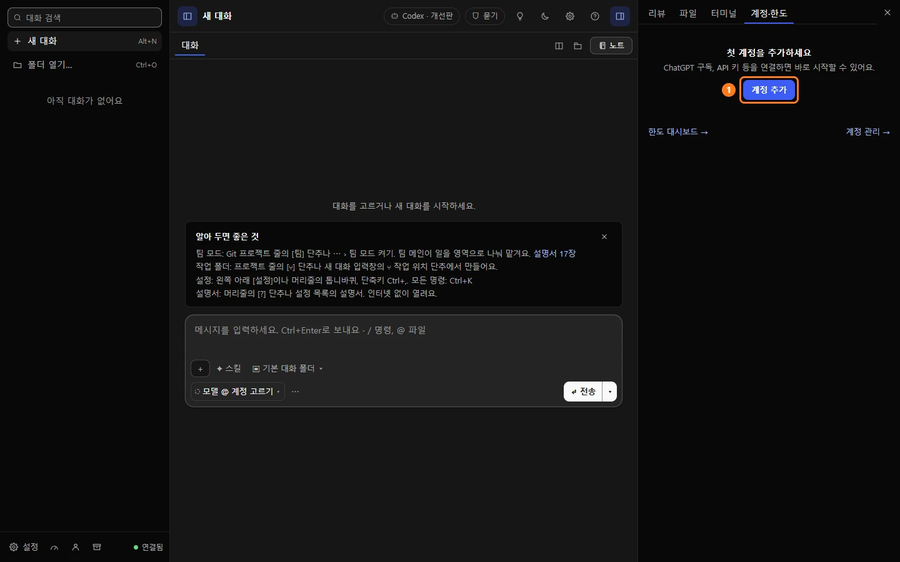
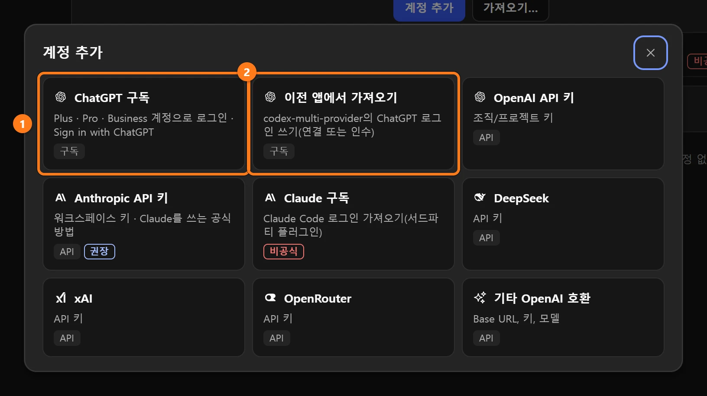
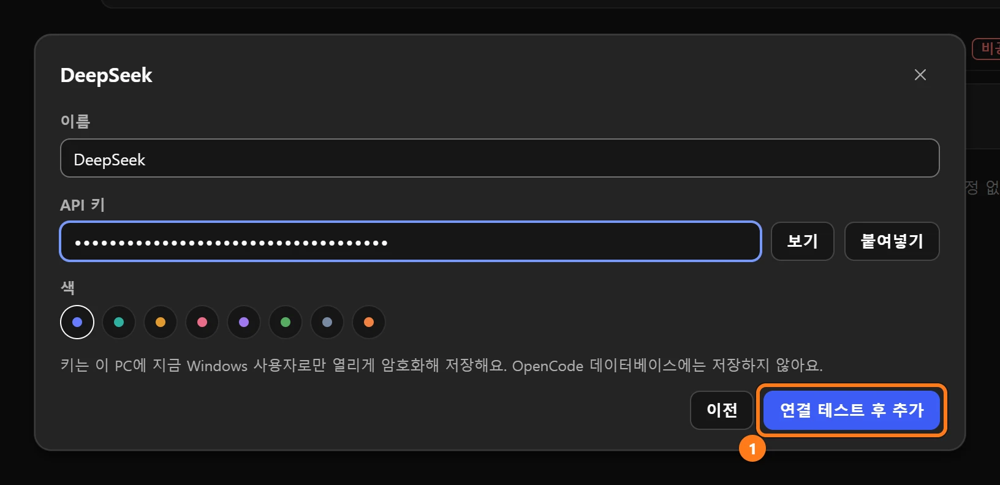
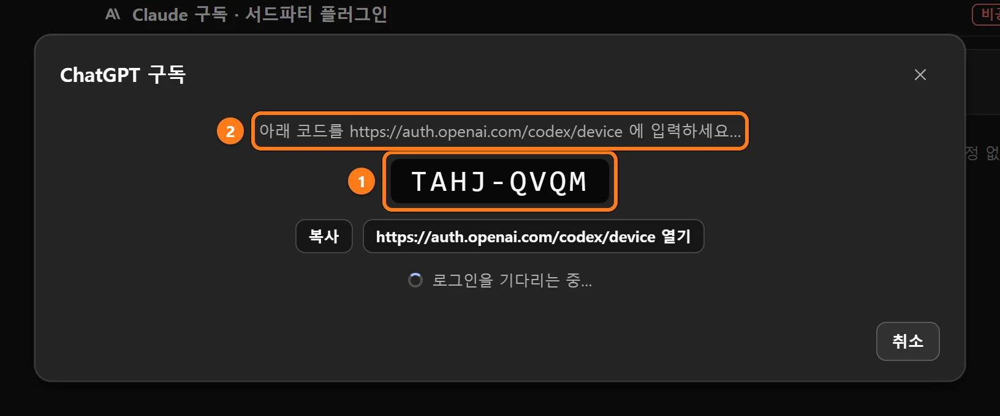

# 3. 첫 계정 연결하기

**한 줄 요약**: `계정 추가`를 누르고 종류 카드를 골라요. API 키는 붙여 넣고 `연결 테스트 후 추가`, ChatGPT 구독은 `코드로 로그인`, 이전 앱의 로그인은 `연결`로 가져오면 돼요.

## 3.1 계정이 뭐예요?

> **용어** 계정: **로그인 하나** 또는 **API 키 하나**예요. 열쇠꾸러미의 열쇠 하나라고 생각하면 쉬워요. 같은 회사 열쇠를 여러 개 걸어 둘 수도 있어요(ChatGPT 01, ChatGPT 02처럼).

> **용어** 프로바이더: AI 모델을 빌려 주는 회사예요. OpenAI(ChatGPT), Anthropic(Claude), DeepSeek, xAI, OpenRouter 같은 곳이에요.

계정에는 크게 두 종류가 있어요. 교통카드에 비유하면 이래요.

| 종류 | 비유 | 돈과 한도 |
|---|---|---|
| **구독** (ChatGPT Plus·Pro 같은 것) | 정기권 | 매달 정해진 요금. 대신 “5시간에 얼마”, “일주일에 얼마” 같은 한도가 있어요 |
| **API 키** | 쓴 만큼 내는 후불 카드 | 쓴 토큰만큼 돈이 나가요. 예산을 정해 둘 수 있어요 |

> **용어** 토큰: 모델이 글을 읽고 쓰는 양을 세는 단위예요. 글자 조각 하나쯤으로 생각하면 돼요. 대화가 길수록 한 번에 읽는 토큰이 많아져요.

- 대화마다 **어느 계정의 어느 모델**로 일할지 골라요. 이것을 이 설명서에서는 `모델 @ 계정`이라고 불러요.
- 계정을 더하거나 바꿔도 **이미 실행 중인 대화는 바뀌지 않아요.**
- 계정 추가, 키 교체, 가져오기는 **이 PC의 창에서만** 돼요. 휴대폰이나 다른 기기에서는 `이 기기에서는 계정을 추가하거나 바꿀 수 없어요 — PC의 창에서 하세요.`가 보여요.

## 3.2 어디서 추가해요?

처음 열면 오른쪽 `계정·한도` 탭에 `첫 계정을 추가하세요`가 보여요.

추가하는 길은 두 가지예요.

1. 첫 화면의 ① `계정 추가`를 눌러요.
2. 또는 사이드바 맨 아래의 사람 모양 아이콘(`계정`)을 누르고, `계정` 화면 오른쪽 위의 `계정 추가`를 눌러요.

## 3.3 종류 고르기

`계정 추가`를 누르면 종류 카드가 보여요.

카드 아래 작은 배지가 종류를 알려 줘요.

| 배지 | 뜻 |
|---|---|
| `구독` | 월정액 구독 계정이에요 |
| `API` | 쓴 만큼 돈이 나가는 API 키예요 |
| `권장` | 공식적으로 권하는 방법이에요(Claude를 쓸 때는 `Anthropic API 키`) |
| `비공식` | 공식 방법이 아니에요. 약관 위험이 있어요(3.7) |

어떤 카드를 고를지 모르겠다면 이렇게 골라요.

| 이런 상황이면 | 고를 카드 | 이 장의 절 |
|---|---|---|
| ChatGPT Plus·Pro·Business를 쓰고 있어요 | `ChatGPT 구독` | 3.5 |
| 예전 앱(codex-multi-provider)에 이미 로그인해 두었어요 | `이전 앱에서 가져오기` | 3.6 |
| DeepSeek, OpenAI, Anthropic, xAI, OpenRouter의 API 키가 있어요 | 그 회사 카드 | 3.4 |
| 내 PC나 집 안 서버의 모델(Ollama, LM Studio, llama.cpp, vLLM)을 쓰고 싶어요 | `로컬 모델` | [20.9](20-account-kinds.md) |
| 사내 서버나 다른 회사의 OpenAI 호환 서버를 쓰고 싶어요 | `기타 OpenAI 호환` | 3.4 |
| Claude Pro·Max 구독을 꼭 쓰고 싶어요 | `Claude 구독` (위험을 알고) | 3.7 |
| 내 PC에 설치된 Claude Code로 Claude 구독을 쓰고 싶어요 | `Claude Agent` | [20.8](20-account-kinds.md) |

## 3.4 API 키로 추가하기

DeepSeek를 예로 들어요. 다른 회사도 순서가 같아요.

1. 회사 카드(여기서는 `DeepSeek`)를 눌러요.
2. `이름`에 알아보기 쉬운 이름을 적어요. 예: “DeepSeek”, “회사 OpenAI”.
3. `API 키` 칸에 키를 붙여 넣어요. `붙여넣기` 버튼을 써도 되고, `보기`로 잠깐 확인할 수 있어요.
4. `색`을 골라요. 사이드바와 입력창에서 이 색으로 계정을 알아봐요.
5. ① `연결 테스트 후 추가`를 눌러요. 앱이 키로 한 번 요청해 보고, 되면 추가해요.
6. `계정이 추가되었어요. 실행 중인 대화는 바뀌지 않아요.`가 보이면 끝이에요.

키가 틀리면 `키가 거부되었어요 (401). 키와 워크스페이스를 확인하세요.`처럼 이유가 보여요. 괄호 안 숫자는 회사 서버가 돌려준 상태 번호예요.

**회사마다 더 적는 칸**

| 카드 | 더 적는 것 |
|---|---|
| `OpenAI API 키` | `조직 ID (선택)`, `프로젝트 ID (선택)` |
| `Anthropic API 키` | `워크스페이스 이름 (선택)`. 화면 표시용이에요. Claude를 쓰는 **공식** 방법이에요 |
| `DeepSeek`, `xAI`, `OpenRouter` | 없어요 |
| `기타 OpenAI 호환` | 서버 주소(Base URL), `모델` id, 모델마다 `문맥 한도(토큰)`, `그림 입력`·`도구`(`자동`·`켬`·`끔`, 처음은 `자동`), `요율`(선택). 요율이 없으면 금액 대신 토큰 수만 보여요. `그림 입력`과 `도구`는 [20장](20-account-kinds.md) 20.6에 있어요 |

**키는 이렇게 지켜요**

- 키는 이 PC에 **Windows DPAPI로 암호화**해 저장해요. 지금 Windows 사용자만 풀 수 있어요.
- 대화 기록 데이터베이스에는 저장하지 않아요.
- 한 번 저장한 키는 어떤 화면에도 다시 나오지 않아요. **끝 4자리만** 보여요.

> **팁** 같은 회사 키를 여러 개 넣어도 돼요. 같은 조직의 키라면 앱이 알려 줘요. 같은 조직이면 한도 여유는 늘지 않아요. 자세한 내용은 [12장](12-multiple-accounts.md)에 있어요.

> **참고** 환경 변수(`OPENAI_API_KEY` 같은 것)에 넣어 둔 키는 **일부러 쓰지 않아요.** 어느 대화가 어느 키로 도는지 늘 분명하게 하려고요. 키는 꼭 여기서 계정으로 추가해요.

## 3.5 ChatGPT 구독으로 로그인하기

ChatGPT Plus·Pro·Business 구독을 쓸 수 있어요.

1. `ChatGPT 구독` 카드를 눌러요.
2. `로그인 방식`을 골라요. 처음에는 `코드로 로그인`이 골라져 있어요(아래 표).
3. `로그인 시작`을 눌러요.
4. 화면에 ① 코드가 보여요. `복사`로 복사해 둬요.
5. ② `https://auth.openai.com/codex/device 열기`를 눌러 그 주소를 열고, 코드를 입력해 ChatGPT에 로그인해요.
   - 이 주소는 **다른 기기(휴대폰 등)의 브라우저**에서 열어도 돼요.
6. 로그인이 끝나면 앱에 `… 확인됨`이 보여요. `이름`과 `색`을 정해요.
7. `계정 추가`를 눌러요.

**로그인 방식 세 가지**

| 방식 | 어떻게 | 언제 |
|---|---|---|
| `코드로 로그인` (기본) | 화면의 코드를 주소에 입력해요 | 대부분 이걸로 충분해요 |
| `브라우저로 로그인` | 이 PC의 브라우저가 열리고 바로 로그인해요 | 코드를 옮겨 적기 싫을 때. Codex CLI 로그인과 포트(1455)가 겹칠 수 있어요 |
| `Sign in with ChatGPT` | OpenAI 공식 연동이에요. ChatGPT 요금제 사용량으로 동작해요 | 공식 연동을 쓰고 싶을 때. 별도 계정으로 추가돼요 |

- `Sign in with ChatGPT`는 브라우저의 동의 화면에서 **이 앱의 요금제 사용을 허용**해야 해요. 허용하지 않으면 `동의 후 다시 시도`가 보여요.
- 로그인 정보(토큰)는 이 PC에 암호화해 저장하고, 만료되기 전에 이 앱이 알아서 갱신해요.

> **팁** 이미 추가한 ChatGPT 계정으로 다시 로그인하면, 새 계정을 만들지 않고 `기존 계정 로그인 갱신`을 권해요. 로그인이 풀렸을 때 이렇게 다시 로그인하면 돼요.

> **주의** 다시 로그인할 때 **다른** ChatGPT 계정으로 로그인하면 거절해요. 원래 계정의 로그인은 그대로 남아요.

## 3.6 이전 앱(codex-multi-provider)에서 가져오기

예전에 쓰던 이전 앱(codex-multi-provider)에 ChatGPT 로그인이 있으면, 다시 로그인하지 않고 가져올 수 있어요.

> **참고** 여기서 가져오는 것은 **로그인(계정)**이에요. Codex나 Claude Code로 나눈 **대화**를 가져오는 것은 다른 기능이에요([21장](21-import-other-tools.md)).

 또는 ② 인수를 골라요. ③ 이전 앱의 API 키는 연결만 돼요.")

1. 종류 카드에서 `이전 앱에서 가져오기`를 눌러요. `계정` 화면 위쪽의 `이전 앱에서 가져오기…`를 눌러도 돼요.
2. 찾은 로그인 목록이 보여요(`이전 앱(codex-multi-provider)에서 ChatGPT 로그인 2개를 찾았어요.`). 상태가 `가져올 수 있음`인 줄에 체크해요.
   - 목록이 오래됐으면 `다시 찾기`를 눌러요.
3. `방식`을 골라요. 보통은 ① `연결 (권장)`이에요(아래 표).
4. `다음 →`을 눌러요.
5. 확인 화면에서 `이름`과 `색`을 정하고, 알림 문구를 읽어요.
6. `연결하기`(또는 `인수하기`)를 눌러요. 여러 개를 골랐다면 하나씩 차례로 확인해요. 넘기려면 `건너뛰기`를 눌러요.

**연결과 인수는 무엇이 다를까요?**

열쇠에 비유하면 이래요. **연결**은 이전 앱이 관리하는 열쇠를 **같이 쓰기만** 해요. **인수**는 열쇠를 **넘겨받아** 이 앱이 관리해요.

| | ① `연결 (권장)` | ② `인수` |
|---|---|---|
| 로그인을 갱신하는 쪽 | 이전 앱만 | 이 앱만 |
| 이전 앱 | 그대로 계속 쓰면 돼요 | 그 프로필은 다시 로그인해야 할 수 있어요 |
| 이전 앱을 오래 안 켜면 | 이 계정이 멈춰요(`이전 앱 갱신 대기`). 이전 앱에서 그 프로필을 열면 1분 안에 다시 돼요 | 상관없어요 |
| 이럴 때 | 이전 앱도 계속 쓸 때 | 이전 앱을 그만 쓸 때 |

- 연결한 계정도 나중에 계정의 `⋯` 메뉴에서 `이 앱으로 인수…`로 바꿀 수 있어요.
- 이 앱에서 연결 계정을 지워도 이전 앱의 로그인 파일은 건드리지 않아요.

**이전 앱에 저장된 API 키 (DeepSeek 등)**

같은 창 아래쪽 ③ `API 키`에 이전 앱이 저장한 키가 보여요.

1. 그 줄의 `연결…`을 눌러요.
2. `이름`을 확인하고 `연결하기`를 눌러요. 확인용으로 요청을 한 번 보내요.

- **연결만 돼요.** 키를 이 앱에 복사하지 않고, 요청할 때마다 이전 앱의 키 파일을 읽기만 해요.
- 그래서 이전 앱에서 키를 바꾸면 여기서도 바뀌어요. 이 계정에는 `키 교체`가 없어요.

> **팁** 이전 앱을 계속 켜 두는 동안은 `연결`, 이전 앱을 거의 안 켠다면 `인수`가 편해요. 더 자세한 비교와 문제 해결은 [20장](20-account-kinds.md)에 있어요.

## 3.7 Claude 구독 (비공식 슬롯)

> **주의** Claude Pro·Max **구독**을 이 앱에서 쓰는 것은 **공식 방법이 아니에요.** Anthropic 약관은 다른 앱이 Claude 구독 로그인을 쓰는 것을 허용하지 않아요. **계정이 제한되거나 정지될 수 있어요.** Claude를 쓰는 공식 방법은 `Anthropic API 키`예요(3.4).

그래도 쓰고 싶다면, 다른 사람이 만든 플러그인 `opencode-claude-auth-v2`(버전 `0.4.0-beta.5`)로 쓰는 **빈자리**(슬롯)가 있어요. 이 앱이 만든 코드가 아니에요.

이 플러그인은 **앱에 들어 있고 늘 켜져 있어요.** 따로 받거나 설치하거나 동의할 것이 없어요. Claude 계정을 연결하기 전에는 아무 요청도 보내지 않아요. 새 버전은 앱을 업데이트할 때만 함께 들어와요.

**먼저 알아야 할 위험 (위험 안내의 10가지를 줄였어요)**

1. 약관 위반이라 계정이 제한·정지될 수 있어요.
2. 플러그인은 요청을 Claude Code가 보낸 것처럼 표시해요.
3. Anthropic은 2026-04-04부터 서드파티 도구의 구독 사용을 구독 한도가 아니라 **추가 사용량**(종량제)으로 청구한다고 알렸어요. 이 앱의 요청도 그렇게 청구되거나, 추가 사용량이 꺼져 있으면 거절될 수 있어요. 그래서 이 앱은 비용을 `비용 알 수 없음`으로 보여요. 확인하는 법은 [20장](20-account-kinds.md)에 있어요.
4. 로그인 토큰이 대화 기록 데이터베이스에 **암호화 없이** 저장돼요(플러그인의 방식).
5. 토큰 갱신이 실패하면 플러그인이 Claude Code를 실행해 새로 받아요. 이것도 사용량에서 빠져요.
6. Claude Code와 로그인을 함께 써요. 동시에 쓰면 다시 로그인해야 할 수 있어요.
7. 이 앱은 이 플러그인을 조금 고친 판을 **앱에 넣어 함께 배포하고 늘 켜 둬요.** 그래서 Claude 계정 여러 개를 대화마다 따로 쓸 수 있고, 한 계정이 다른 계정의 로그인을 빌려 쓰지 않아요. 계정을 연결하기 전에는 아무 요청도 보내지 않아요.
8. Claude 구독 계정 여러 개를 한 PC에서 쓰고 한도가 차면 다른 계정으로 바꾸는 것은 Anthropic이 쉽게 알아챌 수 있어요. 한도를 피하는 것으로 보여 여러 계정이 함께 제한·정지될 수 있어요.
9. 새로 추가하는 계정은 이 앱 전용 로그인 폴더를 써요. 계정을 바꾸면 캐시는 처음부터 다시 쌓여요.
10. 공식 방법은 Anthropic API 키예요.

위험 안내는 동의를 받지 않고 **보여 주기만** 해요. 연결하기 전에 한 번 보이고, 나중에는 `계정` 화면의 Claude 카드에서 `위험 안내 보기`를 눌러 다시 볼 수 있어요.

**순서**

1. **Claude Code에서 먼저 로그인**해 둬요(`claude auth login`).
2. `계정 추가` → `Claude 구독` 카드를 눌러요.
   - `계정` 화면의 Claude 카드에 `연결 없음`이 보이면 그 옆의 `연결…`을 눌러도 같아요.
3. 위험 안내를 끝까지 읽어요.
   - 마음이 바뀌면 안내 마지막 줄의 `API 키로 추가하기`를 눌러요(`계정 추가`에서 열었을 때).
4. `Claude Code 구독 가져오기`를 눌러요. 이 PC의 Claude Code 로그인을 가져와요. 끝나면 `다음`을 눌러요.
5. `Claude 구독 슬롯을 연결했어요. 이 슬롯에는 어디서나 비공식 배지가 붙어요.`가 보이면 `닫기`를 눌러요.

**그 뒤에는 이렇게 보여요**

- 이 계정에는 어디서나 `비공식` 배지가 붙어요. Claude 카드 머리에는 `앱에 포함 · 항상 켜짐`과 `비공식/서드파티 플러그인 — 약관 위험`이 붙어요.
- 다른 회사 계정과는 자동으로 바꾸지 않아요. 이 PC의 Claude 계정끼리만 한도가 차면 바꿔요(아래).
- **Claude 계정을 더 쓰려면**: `계정` 화면의 Claude 묶음 아래 `Claude 계정 추가`를 눌러요. 이 PC에 Claude Code 로그인 창이 뜨고, 브라우저에서 로그인만 마치면 돼요. 앱은 비밀번호나 토큰을 보지 않아요. 이 PC의 Claude Code에 이미 로그인해 둔 계정은 `이 PC의 기존 Claude Code 로그인 가져오기`로 가져와요. 패치나 서비스 다시 시작은 필요 없어요. 자세한 순서는 [20장](20-account-kinds.md)에 있어요.
- **로그인이 풀리면**: 카드에 `이 계정의 로그인이 없거나 만료됐어요 — [다시 로그인]을 누르세요.`가 보여요. `다시 로그인`을 누르면 그 계정의 Claude Code 로그인 창이 이 PC에 다시 열려요([20장](20-account-kinds.md)).
- SSH 원격 호스트에서도 쓸 수 있어요. 호스트마다 `Claude 구독` 카드의 `SSH 원격 호스트에서 쓰기`에서 따로 켜고, 처음 켤 때 원격 사용 고지에 한 번 동의해요([22장](22-ssh-remote.md)). 이 동의는 이 PC에 기록돼요.
- **플러그인은 뺄 수 없어요.** Claude를 쓰지 않으려면 계정을 연결하지 않거나, 더한 계정을 카드 `⋯` → `계정 빼기…`로 빼요. 로그인이 없으면 슬롯은 아무것도 보내지 않아요.

> **참고** Claude Code 로그인은 **내가 직접** 해요. Claude에게 맡기지 않아요. 플러그인은 앱에 들어 있어서 따로 받거나 설치하지 않아요. 더 자세한 내용은 [20장](20-account-kinds.md)에 있어요.

## 3.8 추가한 뒤에는

- 추가한 계정은 사이드바의 사람 모양 아이콘(`계정`) 화면과 오른쪽 `계정·한도` 탭에 카드로 보여요.
- 카드에서 한도(구독), 이번 달 지출(API 키), 잔액(DeepSeek)을 한눈에 봐요([7장](07-usage.md)).
- 이제 대화를 시작할 수 있어요. 다음은 [4장 첫 대화 보내기](04-first-conversation.md)예요.

## 알아 두면 좋아요

- 계정 카드의 `⋯` 메뉴에서 `이름 바꾸기`, `색 바꾸기`, `연결 테스트`, `키 교체`, `예산 설정…`, `이 종류의 기본 계정으로`, `삭제…` 같은 일을 해요([12장](12-multiple-accounts.md)).
- `삭제…`를 누르면 두 가지 중에서 골라요.
  - `계정과 이 PC에 저장된 키 삭제`: 키까지 지워요. 되돌릴 수 없어요.
  - `끄기만 하기`: 키는 남겨 두고 잠시 쓰지 않아요. 나중에 `⋯` → `다시 켜기`로 돌릴 수 있어요.
- 계정을 지우거나 끄면, 그 계정을 쓰던 대화는 다음 턴에 다른 계정을 골라야 해요.

## 조심하세요

> **주의** API 키와 로그인은 **내가 직접** 넣어요. 실제 키나 비밀번호를 Claude에게 대신 입력해 달라고 하지 마세요.

> **주의** `삭제…`에서 `계정과 이 PC에 저장된 키 삭제`를 고르면 키가 지워져요. **되돌릴 수 없어요.** 잠시 쉬게 하려면 `끄기만 하기`를 고르세요.

> **주의** `Claude 구독` 슬롯은 약관 위험이 있어요. 계정이 정지되면 곤란한 Claude 계정이라면 `Anthropic API 키`를 쓰세요.

## 더 알아보기

- 계정 종류별 자세한 내용(Codex 가져오기, DeepSeek, Claude 구독): [20장](20-account-kinds.md)
- 한 회사에 계정 여러 개, 자동 전환: [12장](12-multiple-accounts.md)
- 설계 문서: [02 계정·프로바이더·캐시](../02-accounts-providers-cache.md), [03 화면 §5.4 계정 관리](../03-ui-ux.md)
