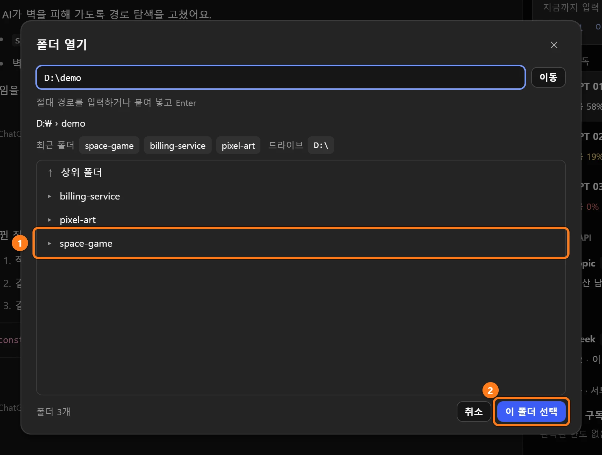
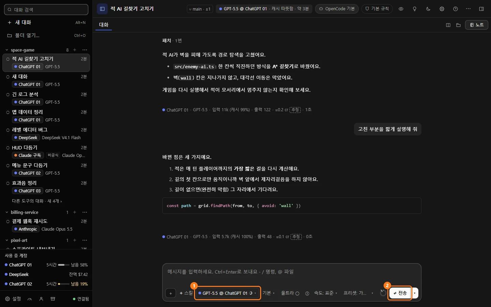
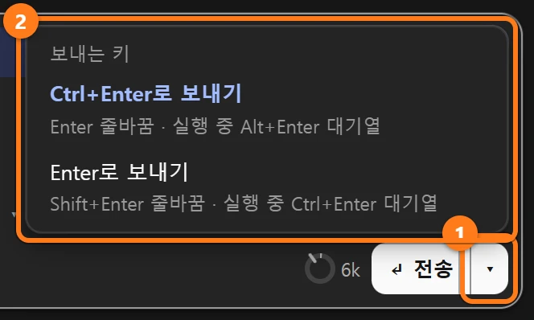
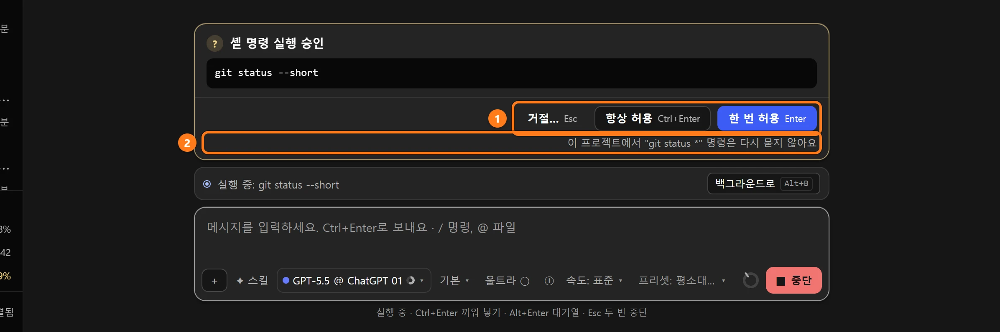
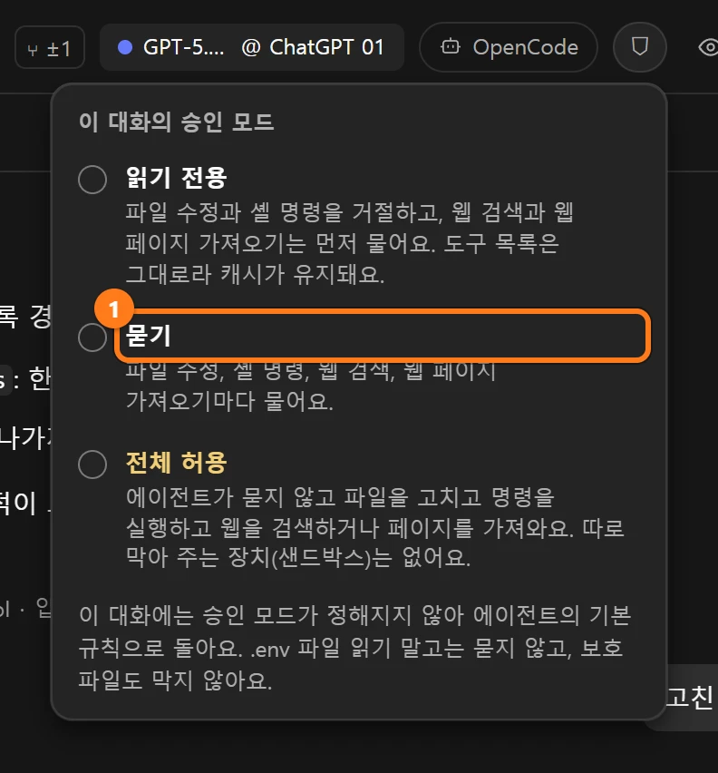

# 4. 첫 대화 보내기

**한 줄 요약**: 그냥 물어볼 것이 있으면 폴더를 고르지 않고 바로 보내요(기본 대화 폴더에서 대화해요). 프로젝트 일을 맡기려면 프로젝트 폴더를 열고(`Ctrl+O`), 입력창에서 `모델 @ 계정`을 고른 뒤 메시지를 보내요. 에이전트가 명령을 실행하거나 파일을 고치려 하면 입력창 위에서 허락을 물어요.

**한눈에 보기**: 새 대화 → (폴더 없이 그대로, 또는 폴더 열기) → 모델 @ 계정 고르기 → 메시지 보내기 → 승인 요청에 답하기 → 결과 확인

> **용어** 세션: **대화 하나**예요. 카카오톡의 대화방 하나처럼, 주고받은 내용이 한곳에 쌓여요. 세션은 늘 폴더 하나에 속해요. 폴더를 고르지 않은 대화는 **기본 대화 폴더**에 속해요.

> **용어** 턴: 내가 메시지를 하나 보내고, 에이전트가 그 일을 **끝낼 때까지**의 한 번이에요. 에이전트는 한 턴 안에서 파일을 읽고, 고치고, 명령을 여러 번 실행할 수 있어요.

## 4.1 프로젝트 폴더 열기

에이전트는 **열어 둔 폴더 안에서** 일해요. 프로젝트 일을 맡기려면 먼저 그 폴더를 열어요. 그냥 물어볼 것만 있으면 폴더를 고르지 않아도 돼요(아래 “폴더 없이 바로 대화하기”).

1. 사이드바의 `폴더 열기…`(`이 PC` 바로 아래)를 누르거나 `Ctrl+O`를 눌러요. SSH 서버가 있으면 서버마다 같은 자리에 `폴더 열기…`가 있고, `Ctrl+O`는 지금 보는 서버의 폴더를 열어요.
2. 폴더를 골라요.
   - **데스크톱 앱**에서는 Windows의 폴더 선택 창이 떠요. 폴더를 고르고 “폴더 선택”을 누르면 바로 그 폴더의 새 대화 화면이 열려요.
   - 창은 `폴더 열기 시작 위치`에서 열려요. 처음 값은 **마지막으로 연 폴더의 상위 폴더**예요(예: `D:\projects\space-game`을 열었으면 `D:\projects`). 연 폴더가 아직 없으면 홈 폴더예요. `설정` > `일반`에서 늘 같은 폴더로 정할 수 있어요([5장](05-screen-tour-theme.md)).
   - 창이 뜨는 데 몇 초 걸릴 수 있어요. 그동안 단추가 `여는 중…`으로 바뀌고, 여러 번 눌러도 창은 하나만 떠요.
   - **브라우저로 열었거나 원격 호스트**라면 앱 안의 `폴더 열기` 창이 떠요(아래 그림).
3. 새 대화 화면이 열리면 준비 끝이에요. 세션은 첫 메시지를 보낼 때 만들어져요.
   - 새 대화 화면에서는 `대화를 고르거나 새 대화를 시작하세요.` 한 줄, `알아 두면 좋은 것` 안내, 입력창이 화면 가운데에 한 묶음으로 모여 있어요. 첫 메시지를 보내면 보통 대화 화면(대화는 위, 입력창은 아래)으로 바뀌어요.
   - 휴대폰에서는 입력창이 처음부터 화면 아래에 있어요.

앱 안의 `폴더 열기` 창은 이렇게 써요.

1. 위쪽 칸에 경로를 붙여 넣고 `Enter`를 누르거나, 아래 목록에서 폴더를 찾아 들어가요.
   - `최근 폴더`와 `드라이브` 단추로 빨리 옮겨 갈 수 있어요.
   - `상위 폴더`로 한 단계 위로 올라가요.
2. 작업할 폴더(그림의 ① `space-game`)를 고르고 ② `이 폴더 선택`을 눌러요.
3. `이 폴더에서 시작할까요?` 확인 카드가 보여요. 경로와 `Git 저장소 · main` 같은 정보를 확인해요.
4. `이 폴더에서 새 대화`을 눌러요. 다른 폴더를 고르려면 `다른 폴더 고르기`를 눌러요.

**다른 길도 있어요**

- `새 대화`(`Alt+N`)를 누르고, 입력창 아래 줄의 프로젝트 선택기(처음에는 `기본 대화 폴더`)에서 최근 프로젝트를 골라도 돼요.
- 사이드바 프로젝트 이름 옆의 `+`를 누르면 그 프로젝트의 새 대화 화면이 바로 열려요.

**폴더 없이 바로 대화하기**

다른 채팅 앱처럼 폴더를 고르지 않고 바로 대화해도 돼요.

1. `새 대화`(`Alt+N`)를 눌러요. 입력창 아래 줄의 프로젝트 선택기가 `기본 대화 폴더`로 보이고, 옆에 그 폴더의 경로가 흐리게 보여요(휴대폰은 아래 줄). 좁으면 경로의 앞쪽이 `…`로 줄어요. 마우스를 올리면 전체 경로가 보여요.
2. 할 말을 적고 `Ctrl+Enter`를 눌러요.
   - 대화는 **기본 대화 폴더**에서 일해요. 처음 값은 `%USERPROFILE%\Documents\Own OpenCode`(문서 폴더 안의 `Own OpenCode`)예요. 에이전트가 만든 파일도 여기에 생겨요.
   - 이 폴더는 처음 보낼 때 만들어져요.
3. 사이드바에서는 이런 대화가 맨 위의 `폴더 없는 대화` 묶음에 모여요. 마우스를 올리면 폴더 경로가 보여요.

- 프로젝트 화면에서 폴더 없이 하고 싶으면 프로젝트 선택기를 눌러 맨 위의 `폴더 없이 대화`를 골라요. 반대로 폴더 없는 화면에서 선택기의 최근 프로젝트를 고르면 그 프로젝트의 새 대화가 돼요.
- 기본 대화 폴더는 `설정` > `일반` > `기본 대화 폴더`에서 바꾸고, `기본값으로`로 되돌려요([5장](05-screen-tour-theme.md)). 바꾸면 다음 대화부터 새 폴더에서 일해요.
- 기본 대화 폴더에서는 팀 모드와 작업 폴더(워크트리)를 쓸 수 없어요. 폴더 없는 대화가 모두 함께 쓰는 Git이 아닌 폴더라서예요(Git 저장소로 만들지도 않아요). 그런 일은 프로젝트 폴더를 열어서 해요. 대화 머리줄 `⋯`의 `프로젝트 폴더 열기…`로도 열 수 있어요([17장](17-team-mode.md)).

**SSH 서버에서 폴더 없이 대화하기**

SSH 원격 호스트([22장](22-ssh-remote.md))가 있으면 입력창 아래 줄 맨 앞에 서버 단추(`이 PC`, 앞에 ⌂)가 보여요.

1. 서버 단추를 눌러 호스트(예: `build-host`)를 골라요. 줄마다 `연결됨`·`연결 끊김` 같은 상태와, 연결된 서버는 그 서버의 기본 대화 폴더 경로가 보여요. 고르면 프로젝트 선택기의 경로도 그 호스트의 것으로 바뀌어요.
2. 할 말을 적고 `Ctrl+Enter`를 눌러요. 대화는 **그 호스트의 기본 대화 폴더**에서 일해요. 새 호스트는 서버의 홈 바로 아래 `~/own-chats`예요(처음 보낼 때 만들어요).
3. 한 번 고르면 기억해요. 다음부터 `새 대화`(`Alt+N`)가 그 호스트의 화면을 열어요. 이 PC로 돌아오려면 서버 단추에서 `이 PC`를 골라요.

- 명령 팔레트(`Ctrl+K`)의 `build-host에서 새 대화`, `이 PC에서 새 대화`도 같아요.
- 연결이 끊긴 호스트를 고르면 바로 연결을 시작해요. 인증이나 업데이트가 필요하면 화면이 무엇을 할지 단추와 함께 알려 줘요.
- 호스트의 기본 대화 폴더는 `설정` > `SSH 원격 호스트` > 호스트 이름 > `새 대화 폴더`에서 바꿔요([22장](22-ssh-remote.md)).

> **참고** 휴대폰에서 `새 대화`를 누르면 PC의 기본 대화 폴더에서 대화해요. 서버 단추에서 호스트를 고른 뒤로는 그 호스트예요. 2.2.6-own.15까지 호스트를 쓰던 서버에 `~/Documents/Own OpenCode`(또는 `~/Own OpenCode`) 폴더가 이미 있으면 그 서버는 그 폴더를 계속 써요.

> **참고** 기본 대화 폴더를 만들지 못하면 `기본 대화 폴더를 만들지 못했어요: …` 안내가 뜨고 적은 글은 입력창에 남아요. Windows 보안의 “제어된 폴더 액세스”가 문서 폴더를 막고 있을 수 있어요. `설정` > `일반`에서 다른 폴더를 골라요([26장](26-troubleshooting.md)).

> **참고** 드라이브 전체(`D:\`)나 홈 폴더 전체는 프로젝트로 열 수 없어요. 그 아래의 프로젝트 폴더를 골라요.

> **참고** Git 저장소가 아닌 폴더도 열 수 있어요. 다만 리뷰 탭에서는 마지막 턴의 변경만 볼 수 있어요([9장](09-work-panel.md)).

> **주의** 처음 보는 저장소에 승인하지 않은 프로젝트 플러그인이 있으면 `승인되지 않은 프로젝트 플러그인 …개가 있어요` 경고가 떠요. 이 폴더의 대화에는 계정 인증을 보내지 않아요. `플러그인 확인…`을 눌러 살펴보고, 믿을 수 없는 저장소라면 승인하지 마세요([8장](08-approvals.md)).

## 4.2 모델 @ 계정 고르기

입력창 아래 줄의 칩(처음에는 `모델 @ 계정 고르기`)을 누르거나 `Ctrl+.`을 눌러요.

1. 목록에서 계정을 고르고, 그 계정의 모델을 골라요. 예: `GPT-5.5 @ ChatGPT 01`.
2. 고르면 칩이 그 이름으로 바뀌어요. 도구줄에 자리가 있으면 칩 안에 그 계정의 남은 한도도 작은 막대와 `남음 58%`처럼 보여요. 작업 패널을 닫은 창에서는 자리가 모자라 한도를 접어요([6장](06-model-account.md)).

- **새 대화에서는 바꿔도 비용이 없어요.** 아직 주고받은 내용이 없기 때문이에요.
- 대화가 길어진 뒤에 바꾸면 비용이 들 수 있어요. 그때는 앱이 먼저 알려 줘요([6장](06-model-account.md), [11장](11-cache-switch-cost.md)).

> **팁** 쓸 수 없는 계정(한도 도달, 로그인 만료 등)은 목록에서 흐리게, 이유와 함께 보여요.

## 4.3 메시지 보내기

입력창에 할 일을 적고 `Ctrl+Enter`를 눌러요(macOS는 `⌘+Enter`). 그냥 `Enter`는 줄을 바꿔요.

**입력창 기본 키**

| 하고 싶은 것 | 키 |
|---|---|
| 보내기 | `Ctrl+Enter` (또는 ② `전송`) |
| 줄 바꾸기 | `Enter` (`Shift+Enter`도 돼요) |
| 파일 첨부 | `Ctrl+U` (또는 `+` 단추) |
| 명령 고르기 | 맨 앞에 `/` |
| 파일 이름을 대화에 넣기 | `@` 다음에 파일 이름 |
| 지난 입력 다시 쓰기 | `↑` / `↓` |

**보내는 키 바꾸기(Enter로 보내고 싶다면)**

처음에는 `Ctrl+Enter`로 보내요. 여러 줄을 적다가 `Enter`를 눌러도 쓰던 메시지가 나가지 않게 하려고요. 입력창이 비어 있으면 안내 글도 `메시지를 입력하세요. Ctrl+Enter로 보내요 · / 명령, @ 파일`이에요. 다른 채팅 앱처럼 `Enter`로 보내고 싶으면 ② `전송` 오른쪽의 작은 `▾`를 눌러 `보내는 키` 메뉴를 열어요.

| 고르면 | 보내기 | 줄 바꾸기 | 실행 중 다른 쪽으로 보내기 |
|---|---|---|---|
| `Ctrl+Enter로 보내기`(처음 값) | `Ctrl+Enter` | `Enter`(`Shift+Enter`도 돼요) | `Alt+Enter` |
| `Enter로 보내기` | `Enter` | `Shift+Enter` | `Ctrl+Enter` |

- 고르면 바로 바뀌고 `Enter로 보내요. Shift+Enter는 줄바꿈이에요.`처럼 바뀐 키가 잠깐 떠요. `전송`에 마우스를 올리면 지금 키가 보여요. `Enter로 보내기`에서는 입력창 안내 글에 키 안내가 없어요.
- `설정` > `일반` > `보내는 키`나 명령 팔레트(`Ctrl+K`)의 `보내는 키 바꾸기`에서도 바꿔요.
- 이 기기(브라우저)에 저장돼요. 같은 PC의 다른 창도 바로 따라 바뀌어요. 휴대폰·다른 PC는 그 기기에서 따로 정해요.
- 2026-10-23 판부터 처음 값이 `Ctrl+Enter로 보내기`예요. 그 전에 `Enter로 보내기`를 골라 두었던 기기도 한 번은 `Ctrl+Enter로 보내기`로 시작해요. `Enter`로 보내고 싶으면 한 번 다시 골라 주세요. 그다음부터는 고른 대로 남아요.
- 대화 입력창에만 적용돼요. 대화 메모, 아이디어 적기 같은 다른 칸은 원래 키 그대로예요.
- 휴대폰처럼 손가락으로 쓰는 화면에서는 `▾`가 보이지 않아요. `전송` 단추는 언제나 보내고, 화면 키보드의 Enter 키는 고른 설정을 따라요(처음 값이면 줄바꿈).

**답이 끝나면 아래에 한 줄이 붙어요**

그림의 답 아래 흐린 줄에는 이 턴을 처리한 계정·모델, 읽은 양(입력)과 그중 캐시로 싸게 읽은 비율, 쓴 양(출력), 추정 비용, 출력 속도(`t/s`)와 첫 토큰까지 걸린 시간(알 수 있을 때), 걸린 시간이 보여요. 읽는 법은 [7장](07-usage.md)에 있어요. 이 줄이 거슬리면 헤더의 눈 모양 `보기` 단추로 숨겨요([5장](05-screen-tour-theme.md)).

**입력창 아래 줄의 다른 단추들**

① 칩 오른쪽에는 `기본`(추론 강도), `울트라` 스위치와 ⓘ, `속도: 표준`, 프리셋 단추가 있어요. 처음에는 그대로 두면 돼요. 각각 [6장](06-model-account.md), [15장](15-ultra.md), [16장](16-speed.md), [14장](14-presets.md)에서 설명해요.

- **새 대화 화면에서 속도도 미리 골라요.** 첫 메시지를 보낼 때 그 대화에 적용돼요. 울트라는 대화를 시작한 뒤에 켤 수 있어요.

> **팁** 한국어 글자를 조합하는 중에 `Ctrl+Enter`를 눌러도 괜찮아요. 마지막 글자를 완성한 뒤 **딱 한 번** 보내요. 마지막 음절이 빠지거나 두 번 보내지지 않아요. 조합 중 `Enter`는 글자만 완성하고 보내지 않아요. `Enter로 보내기`로 바꿨다면 조합 중 `Enter`가 마지막 글자를 완성한 뒤 한 번 보내요. 단, `모델 @ 계정` 고르기와 명령 팔레트의 검색 칸에서는 조합을 끝내는 `Enter`는 글자만 완성하고, 한 번 더 눌러야 골라져요.

## 4.4 승인 요청에 답하기

에이전트가 셸 명령을 실행하거나 파일을 고치려 하면, 입력창 바로 위에 **승인 요청 상자**가 떠요. 에이전트가 “이거 해도 될까요?” 하고 묻는 거예요.

| 버튼 | 키 | 뜻 |
|---|---|---|
| `한 번 허용` | `Enter` | 이번 한 번만 허락해요 |
| `항상 허용` | `Ctrl+Enter` | 이 프로젝트에서 같은 종류는 다시 묻지 않아요 |
| `거절…` | `Esc` | 하지 말라고 해요. 이유를 적을 수 있어요 |

- 상자 안에 실행할 명령이나 고칠 내용이 그대로 보여요. **읽어 보고** 고르세요.
- ② `항상 허용` 아래에는 저장될 범위가 미리 보여요. 예: `이 프로젝트에서 "git status *" 명령은 다시 묻지 않아요`.
- 다른 곳에 포커스가 있을 때는 `Ctrl+Shift+Enter`로 승인 상자로 바로 갈 수 있어요.

**거절할 때**

1. `거절…`을 누르면 `거절 사유(에이전트에게 전달돼요)` 칸이 열려요.
2. 이유를 적고 `Enter`(또는 `거절 보내기`)를 눌러요.
   - **이유를 쓰면** 에이전트가 그 이유를 보고 다른 방법으로 계속해요.
   - **이유 없이**(빈 칸에서 `Esc`) 거절하면 이번 턴이 멈춰요.

> **팁** 저장된 `항상 허용` 규칙은 `설정` > `승인·권한`에서 보고 `취소`할 수 있어요. 취소하면 다음부터 다시 물어요.

> **참고** 하위 에이전트(에이전트가 일을 나눠 맡긴 작은 에이전트)의 승인 요청도 이 상자에 함께 떠요. `열기 →`로 그 하위 에이전트의 대화를 볼 수 있어요.

## 4.5 승인 모드 정하기

세션 헤더(화면 위쪽 줄)의 방패 모양 알약을 누르면 `이 대화의 승인 모드`를 고를 수 있어요. 단축키는 `Ctrl+Shift+A`예요.

| 모드 | 비유 | 하는 일 |
|---|---|---|
| `읽기 전용` | 구경만 | 파일 수정과 셸 명령을 모두 거절해요. `Codex 방식`에서는 간단한 읽기를 앱이 직접 읽어 답해요. 코드를 읽고 설명만 듣고 싶을 때 |
| `묻기` (기본) | 매번 확인 | 파일 수정과 셸 명령마다 물어요. `Codex 방식`에서는 간단한 읽기는 묻지 않고 앱이 직접 읽어 답해요 |
| `전체 허용` | 알아서 | 묻지 않고 파일을 고치고 명령을 실행해요. 켤 때 한 번 확인해요(`전체 허용으로 바꾸기`) |

- 알약에 `기본 규칙`이 보이면 승인 모드가 따로 정해지지 않은 세션이에요(이 앱 밖에서 만든 세션 등). `묻기`와 달리 `.env` 파일을 읽을 때만 묻고, 파일 수정과 셸 명령은 묻지 않고 해요. 보호 파일도 막지 않으니 모드를 하나 골라 주세요.
- 새 대화의 처음 모드는 `설정` > `승인·권한`의 `새 대화의 기본 승인 모드`에서 정해요.

> **주의** `전체 허용`에는 **OS 수준의 보호막(샌드박스)이 없어요.** 에이전트가 실행하는 명령은 내 PC에서 그대로 돌아요. 믿을 수 있는 작업에만 쓰세요. 자세한 내용은 [8장](08-approvals.md)에 있어요.

## 4.6 멈추기, 실행 중에 더 말하기

에이전트가 일하는 동안 입력창 아래에 `실행 중 · Ctrl+Enter 끼워 넣기 · Alt+Enter 대기열 · Esc 두 번 중단` 안내가 보여요. 보내는 키를 `Enter로 보내기`로 바꿨다면 `실행 중 · Enter 끼워 넣기 · Ctrl+Enter 대기열 · Esc 두 번 중단`이에요. 아래 설명의 `Ctrl+Enter`는 `Enter`로, `Alt+Enter`는 `Ctrl+Enter`로 읽으면 돼요.

- **멈추기**: `Esc`를 두 번 누르거나 빨간 `중단` 단추를 눌러요.
- **실행 중에 한마디 더 하기**: 그냥 적고 `Ctrl+Enter`를 누르면 지금 턴 안에 **끼워 넣어요.** 에이전트가 하던 단계를 마치고 다음 단계에서 바로 읽어요.
- **다음 차례로 미루기**: `Alt+Enter`를 누르면 **대기열**에 넣어, 지금 턴이 끝난 뒤 보내요.
- 오래 걸리는 명령이 돌면 `실행 중: …` 줄과 `백그라운드로` 단추(`Alt+B`)가 보여요. 누르면 그 명령을 뒤에서 돌리고 에이전트는 다른 일을 계속해요.

자세한 내용은 [10장](10-conversation-tools.md)에 있어요.

## 알아 두면 좋아요

- **창을 닫아도 턴은 계속돼요.** 다시 열면 결과가 그대로 있어요. 멈추려면 `Esc` 두 번이나 `중단`을 써요.
- 입력창 맨 앞에 `!`를 붙이면 에이전트를 깨우지 않고 셸 명령만 실행해요. 실행도 보내는 키(`Ctrl+Enter`)로 하고, 입력창의 안내 글 `셸 명령 — Ctrl+Enter로 실행 · 에이전트를 깨우지 않아요`에 그 키가 보여요.
- `Ctrl+K`를 누르면 명령 팔레트가 열려요. 앱의 모든 기능을 이름으로 찾을 수 있어요(한글 초성 검색도 돼요).
- `Ctrl+/`를 누르면 단축키 전체를 볼 수 있어요([부록 B](91-shortcuts.md)).

## 조심하세요

> **주의** 승인 요청 상자의 명령은 **꼭 읽고** 허락하세요. 특히 파일을 지우거나(`rm`, `del`), 인터넷에 무언가 올리는 명령은 한 번 더 확인하세요.

> **주의** `항상 허용`은 이 프로젝트 전체에 저장돼요. 범위 문구를 읽고, 너무 넓으면 `한 번 허용`을 쓰세요.

## 더 알아보기

- 승인 모드와 안전장치: [8장](08-approvals.md)
- 실행 중 끼워 넣기·대기열·복원·포크: [10장](10-conversation-tools.md)
- 설계 문서: [03 화면 §4.4 세션 헤더, §4.6 입력창, §5.1 새 대화(폴더 없이 대화), §18.3 폴더 열기](../03-ui-ux.md)
