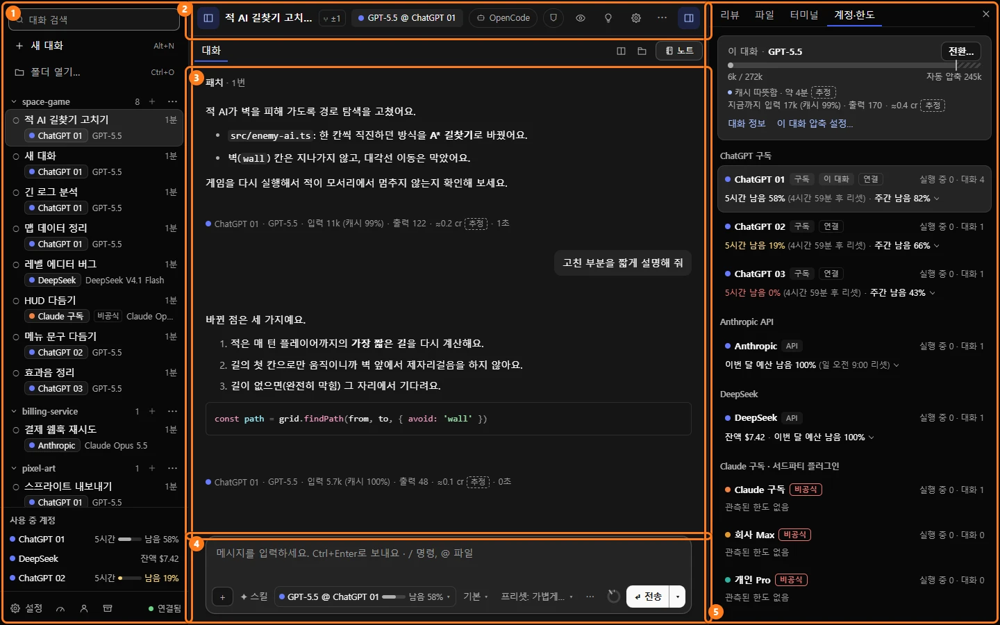
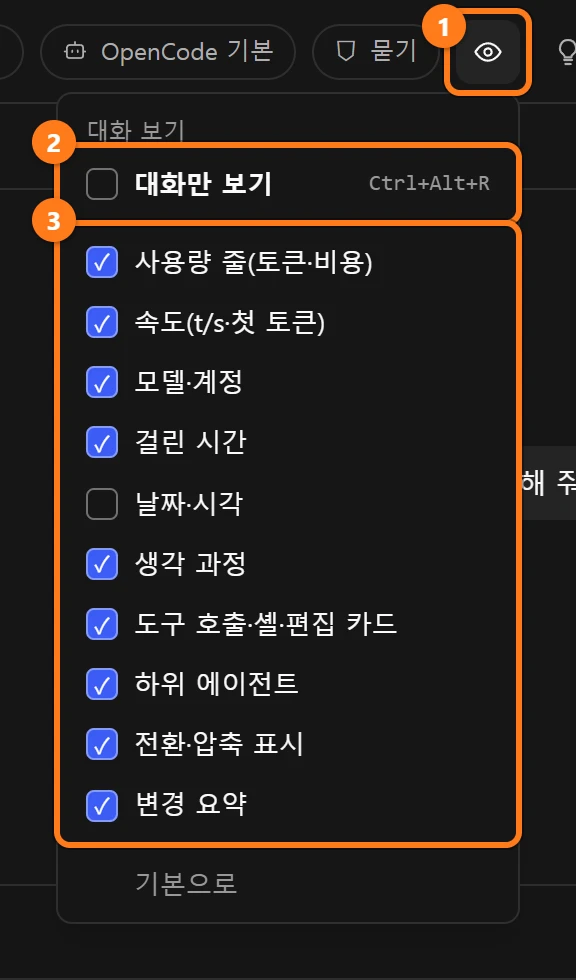
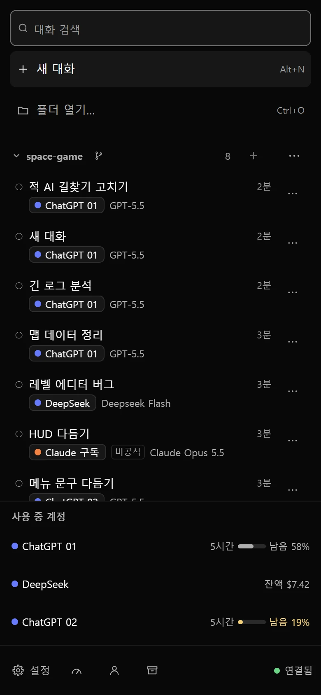
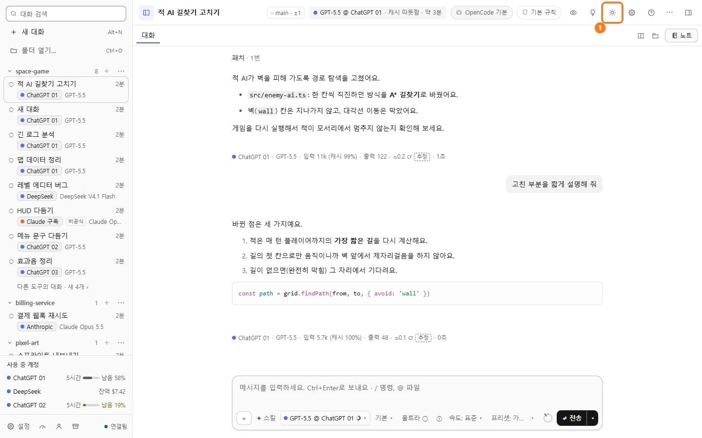
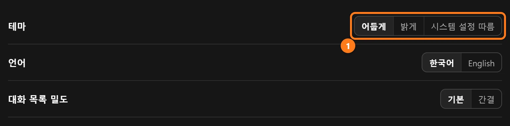
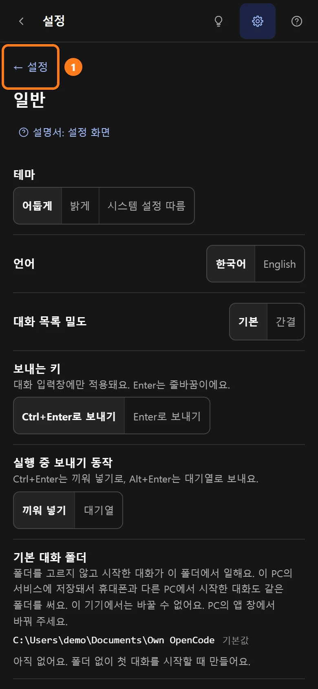

# 5. 화면 한 바퀴와 테마

**한 줄 요약**: 화면은 ① 사이드바, ② 세션 헤더, ③ 대화, ④ 입력창, ⑤ 작업 패널의 다섯 부분이에요. 테마는 헤더의 테마 단추(처음에는 달 모양)를 누를 때마다 `어둡게` → `밝게` → `시스템 설정 따름` 순서로 바뀌어요.

## 5.1 다섯 부분 한눈에 보기

식당에 비유하면 이래요. ① 사이드바는 **메뉴판**(어느 대화로 갈지), ② 헤더는 **주문표**(이 대화의 설정), ③ 대화는 **식탁**, ④ 입력창은 **주문하는 곳**, ⑤ 작업 패널은 **옆 서랍장**(도구와 계기판)이에요.

| 번호 | 부분 | 여기서 하는 일 |
|---|---|---|
| ① | 사이드바 | 프로젝트와 세션 목록, 지금 쓰는 계정의 남은 한도, 설정·한도·계정 화면으로 가기 |
| ② | 세션 헤더 | 이 대화의 제목, `모델 @ 계정`, 캐시 상태, 승인 모드, 보기, 아이디어 노트, 테마, 설정, 설명서, 메뉴 |
| ③ | 대화 | 주고받은 메시지, 도구 실행 결과, 턴마다 쓴 양과 속도 |
| ④ | 입력창 | 메시지 쓰기, `모델 @ 계정`·추론 강도·울트라·속도·프리셋 고르기 |
| ⑤ | 작업 패널 | `리뷰`·`파일`·`터미널`·`계정·한도` 탭 |

## 5.2 ① 사이드바

위(검색, 새 대화)와 아래(추가 단추, 사용 중 계정, 설정 줄)는 늘 같은 자리에 있고, 가운데 목록만 스크롤돼요. 위에서 아래로 이렇게 있어요.

- `대화 검색`: 세션 제목으로 찾아요. SSH 서버의 대화도 함께 찾아요.
- `새 대화` (`Alt+N`). 지금 보는 서버에서 시작해요.
- **서버 묶음**: SSH 서버나 다른 PC를 추가하면 `이 PC`, 서버, 다른 PC가 같은 모양의 묶음으로 보여요. 머리줄을 누르면 접고 펴요. 점이 초록이면 연결된 거예요. 연결되지 않았을 때만 `연결 끊김` 같은 글이 붙어요. 머리줄의 `+`는 그 서버에서 새 대화예요.
- `폴더 열기…` (`Ctrl+O`): 묶음마다 첫 줄이에요. 서버가 끊겼으면 그 자리에 `다시 연결`이 있어요.
- **`폴더 없는 대화`**: 폴더를 고르지 않고 시작한 대화가 모이는 묶음이에요. 프로젝트 묶음보다 먼저 보이고, 마우스를 올리면 기본 대화 폴더의 경로가 보여요. `+`는 폴더 없는 새 대화예요([4장](04-first-conversation.md)).
- **프로젝트 묶음**: 프로젝트 이름, 세션 수, `+`(이 프로젝트에 새 대화), `⋯`(프로젝트 메뉴).
  - 마우스를 올리면(지금 연 프로젝트는 늘) `팀` 단추와 `⑂` 단추도 보여요. `팀`은 팀 모드([17장](17-team-mode.md)), `⑂`는 작업 폴더(워크트리) 메뉴예요. Git 저장소가 아닌 폴더에서는 두 단추가 흐리게 보이고, 누르면 `Git 저장소로 만들기…`를 고를 수 있어요.
- **세션 줄**: 두 줄로 보여요.
  - 첫 줄: 상태 기호(고리 안의 점은 실행 중, ○는 쉬는 중), 제목, 마지막으로 움직인 시각. 실행 중 표시는 움직이지 않아요. 모델 알약 앞과 분할 칸 제목에도 같은 표시가 붙어요.
  - 둘째 줄: **계정 칩**(색 점과 계정 이름)과 **모델 이름**. 어느 대화가 어느 계정·모델로 도는지 여기서 바로 보여요.
  - 다른 회사가 만든 플러그인 계정을 쓰면 칩 옆에 `비공식`이 붙어요.
- 프로젝트 목록 끝의 `다른 도구의 대화 · 새 3개`: 그 폴더에서 Codex·Claude Code로 나눈, 아직 가져오지 않은 대화가 있을 때만 보여요([21장](21-import-other-tools.md)).
- `보관함 · 2 ›`: 보관한 세션이 있을 때만 세션 목록 아래에 보여요. 누르면 보관함이 열려요(아래 "세션 보관과 삭제").
- `사용 중 계정`: 최근 24시간 안에 쓴 계정을 3개까지, 가장 빠듯한 한도가 얼마나 남았는지 한도 이름(5시간), 막대, `남음 58%`로 보여요. DeepSeek는 잔액(`$7.42`)이에요. 계정 이름은 좁아져도 다 사라지지 않아요. 한도를 `자세히`로 보면 이름 아래에 한도 두 줄이 막대를 나란히 맞춰 놓여요([7장](07-usage.md)). 누르면 오른쪽 `계정·한도` 탭이 열려요.
- **맨 아래 줄**(왼쪽부터): 톱니바퀴와 글자가 함께 있는 `설정` 단추(`Ctrl+,`), 계기판 `한도`, 사람 모양 `계정`, 상자 모양 `보관함 보기`.
  - `설정`, `한도`, `계정`은 누르면 그 화면이 열리고 단추가 눌린 모양이 돼요. **같은 단추를 한 번 더 누르면** 화면이 닫히고 보던 대화로 돌아가요. 머리줄의 `← 대화로 돌아가기`와 같아요.
- 맨 오른쪽의 점과 `연결됨`: 이 PC의 서비스와 잘 연결돼 있다는 표시예요. 점이 초록이면 정상이에요. 누르면 `이 PC` · `연결됨`과 서비스 버전 같은 상태를 보여 줘요. 데스크톱 앱에서는 그 아래에 `앱 종료`와 `완전 종료…` 단추가 있어요(5.10).

> **팁** 세션 줄의 `⋯`로 `고정`(맨 위에 붙이기), `보관`(목록에서 치우기), `분할해서 열기`(옆 칸에 열기, [19장](19-browser-pane.md)), `삭제…`를 해요.

### 순서 바꾸기와 고정

서버 묶음끼리, 그리고 한 서버 안의 프로젝트끼리 순서를 바꿀 수 있어요. 다른 서버로 옮길 수는 없어요.

| 하고 싶은 것 | 이렇게 해요 |
|---|---|
| 끌어서 옮기기 | 머리줄을 마우스로 끌어요. 휴대폰에서는 머리줄을 **길게 누른 채** 움직여요. 파란 선이 놓일 자리예요. 그만두려면 `Esc` |
| 한 칸씩 옮기기 | 머리줄의 `⋯` → `위로 이동` / `아래로 이동`, 또는 머리줄에서 `Ctrl+Shift+↑` / `Ctrl+Shift+↓` |
| 프로젝트를 늘 위에 두기 | 프로젝트 `⋯` → `고정`. 핀 표시가 붙고 다른 프로젝트보다 먼저 보여요. 고정한 것끼리도 끌어서 순서를 바꿔요 |
| 처음처럼 되돌리기 | `⋯` → `기본 순서로 되돌리기`. 고정은 그대로예요 |

- 끄는 동안에는 목록이 머리줄만 남게 접혀서 놓을 곳이 한눈에 보여요. 놓으면 다시 펴져요.
- 순서를 정한 뒤에 **새로 연 프로젝트는 맨 위**에 와요. 자리를 정해 주면 그대로 있어요.
- 프로젝트 순서와 고정은 그 서버에 저장돼요. 이 PC의 다른 창과 휴대폰에서도 같아요(SSH 서버는 다른 창이 다시 연결할 때 따라와요). 서버 묶음의 순서와 접힘은 기기마다 따로예요.
- 서버의 앱이 옛 버전이면 순서가 이 브라우저에만 저장되고, 서버를 업데이트하면 자동으로 옮겨 가요.

### 세션 보관과 삭제

**보관**은 목록에서 잠시 치우는 거예요. 대화는 그대로 남고 언제든 돌려놓아요. **삭제**는 영구히 지우는 거예요.

| 하고 싶은 것 | 이렇게 해요 |
|---|---|
| 세션 보관 | 세션 줄에 마우스를 올리면 `⋯` 왼쪽에 보이는 상자 단추, 또는 `⋯` → `보관`, 또는 대화를 연 채 `Ctrl+Alt+Backspace` |
| 보관 취소 | 보관하자마자 뜨는 알림의 `보관 취소` |
| 보관한 세션 보기 | 세션 목록 아래 `보관함 · 2 ›`, 맨 아래 상자 단추(`보관함 보기`), 또는 명령 팔레트의 `보관함 보기` |
| 세션 삭제 | 세션 줄이나 세션 헤더의 `⋯` → `삭제…`, 또는 명령 팔레트의 `대화 삭제…` |
| 프로젝트를 통째로 치우기 | 프로젝트 `⋯` → `프로젝트 보관`. 그 프로젝트의 세션이 모두 보관함으로 가요. 돌려놓을 때는 보관함에서 프로젝트 `⋯` → `프로젝트 복원` |
| 프로젝트를 목록에서 지우기 | 프로젝트 `⋯` → `목록에서 빼고 대화 삭제…` |

- `Ctrl+Alt+Backspace`는 지금 연 대화를 보관하거나, 보관한 대화면 다시 꺼내요. 입력창에 포커스가 있으면 동작하지 않아요.
- **삭제 창**: `대화를 삭제할까요?`가 뜨고, 처음에는 `취소`에 포커스가 있어요. `삭제`를 눌러야 지워요.
  - 하위 에이전트 대화도 함께 지워요. 작업 폴더의 파일은 건드리지 않아요. 실행 중인 세션은 먼저 멈춘 뒤 지워요.
  - 보관하지 않은 세션 하나를 지울 때는 "나중에 다시 볼 수도 있다면 삭제 대신 보관하세요"라고 한 번 더 알려 줘요.
- **보관함에서 여러 개 고르기**: 보관함 위쪽의 `선택`을 누르면 줄마다 체크 상자가 생겨요. `모두 선택`, `선택한 2개 보관 해제`, `선택한 2개 삭제…`를 써요. 끝나면 `완료`. `보관함 비우기…`는 보관함의 세션을 모두 영구히 지워요.
- **프로젝트 목록에서 삭제**는 그 프로젝트의 세션을 모두(보관한 것까지) 영구히 지워요. `대화 4개가 영구히 삭제된다는 것을 확인했어요`처럼 개수를 확인하는 칸에 체크해야 단추가 눌려요. 디스크의 파일과 폴더는 지우지도 바꾸지도 않아요.
- 팀 모드가 켜진 프로젝트는 보관하거나 목록에서 지울 수 없어요. 팀의 대화(메인·담당·동료)도 지울 수 없어요. 먼저 `팀 모드 끄기…`를 해요([17장](17-team-mode.md)).
- 휴대폰·다른 PC에서는 그 기기의 권한에 따라 삭제 단추가 보이지 않아요([24장](24-phone-other-pc.md)).

> **주의** 삭제는 **되돌릴 수 없어요.** 지울지 망설여지면 보관하세요.

## 5.3 ② 세션 헤더

화면 맨 위 줄이에요. 데스크톱 앱에서는 이 줄이 창 제목 줄도 겸해요. 빈 곳을 끌면 창이 움직여요.

왼쪽부터 이렇게 있어요.

1. `사이드바` 단추: 사이드바를 접고 펴요(`Ctrl+B`).
2. **제목**: 눌러서 이름을 바꿀 수 있어요. 머리줄이 좁아져도 제목 자리는 남겨요. 제목이 줄어들면 마우스를 올려 전체 제목을 봐요.
3. **브랜치 칩**: 예를 들어 `main · ±1`이 보이면, 이 프로젝트가 기록의 줄기(브랜치) `main` 위에 있고, 아직 저장(커밋)하지 않고 바뀐 파일이 1개 있다는 뜻이에요. 누르면 리뷰 탭이 열려요. Git 낱말은 [9장](09-work-panel.md)에서 쉽게 풀어요.
4. **실행 위치 알약**: 예를 들어 `GPT-5.5 @ ChatGPT 01` · `캐시 따뜻함 · 약 4분`. 이 대화가 쓰는 `모델 @ 계정`과 캐시 상태예요. 누르면 모델 @ 계정 고르기가 열려요. 일하는 중이면 알약 앞에 작은 회전 표시가 붙어요.
5. **에이전트 방식 알약**: 작은 로봇 아이콘과 `Codex 방식`, `Pi 방식`, `DeepSeek 방식`, `OpenCode 기본` 중 하나예요. 이 대화의 에이전트가 어떤 지시문과 도구로 일하는지예요. 누르면 바꿀 수 있어요([10.12](10-conversation-tools.md)).
6. **승인 모드 알약**: `묻기`, `읽기 전용`, `전체 허용`, 또는 `기본 규칙`([4장](04-first-conversation.md)).
7. **눈 모양 `보기` 단추**: 대화 주변에 무엇을 보일지 골라요(아래 "대화 보기").
8. **전구 단추**: `아이디어 노트`를 열어요. 프로젝트와 상관없이 떠오른 생각을 적어 두는 곳이에요(`Ctrl+Alt+I`, [10장](10-conversation-tools.md)).
9. **테마 단추**: 지금 테마의 아이콘(달, 해, 모니터)이 보여요(5.8).
10. **톱니바퀴 단추**: `설정`을 열어요(`Ctrl+,`, 5.9).
11. `?` 단추: 이 설명서를 앱 안에서 열어요(`설명서 열기`).
12. `⋯`(`대화 동작`): 이 대화의 메뉴예요. 포크(대화 복제), `내보내기`, `대화 메모`, `고정`, `보관`, `에이전트 방식 바꾸기…`, `팀 모드 켜기…`, 컴퓨터 사용, `삭제…` 같은 항목이 있어요.
13. `작업 패널` 단추: 오른쪽 작업 패널을 열고 닫아요(`Ctrl+Alt+B`).

설정이나 계정 화면처럼 대화가 아닌 화면에서도 전구, 테마, 톱니바퀴, `?` 단추는 같은 자리에 있어요. 이런 화면에서는 오른쪽 작업 패널이 숨고 `작업 패널` 단추도 없어요. 대화로 돌아가면 패널이 다시 그대로 열려요.

**머리줄이 좁을 때.** 사이드바와 작업 패널을 함께 열면 대화 화면의 머리줄이 좁아져요. 그때는 덜 쓰는 것부터 숨어서 겹치지 않아요: 먼저 알약의 캐시 글자(머리줄 폭 1099px 이하, 전환기와 `이 대화` 카드에 있어요), 다음에 테마 단추(`설정` > `일반`과 명령 팔레트에도 있어요), 에이전트 방식 알약은 짧은 이름(`Codex`)이 되고 브랜치 칩은 이름을 숨기고 `⑂`와 바뀐 파일 수만 보이며 `?` 단추가 숨고(`설정`에 있어요) 승인 모드 알약은 기호(`⛉`)만 남아요(마우스를 올리면 모드가 보여요. `전체 허용`은 글자가 남아요). 그래도 제목은 일곱 글자쯤, 모델 알약의 계정 이름은 다 보여요. 모델 이름이 먼저 줄어요. 머리줄이 더 붐비면(팀 메인 대화의 팀 알약과 컴퓨터 사용 칩, 긴 제목) 계정 이름이 다 보일 때까지 차례로 더 줄여요. 알약의 캐시 글자가 먼저 숨어요 → 컴퓨터 사용 칩이 화면 모양 아이콘만 남고 `멈추기`는 빨간 네모가 돼요 → 팀 알약이 `영역 3개`처럼 앞말을 빼요 → 승인 모드 알약이 기호만 남아요 → 에이전트 방식 알약이 아이콘만 남아요 → 브랜치 칩이 숨어요 → 제목이 네 글자쯤까지, 그래도 모자라면 두 글자와 말줄임표(예: 장바…)까지 줄어요 → 그래도 모자랄 때만 맨 마지막에 빨간 네모 `멈추기`도 숨어요. 단, 숨겨서 계정 이름이 다 보일 때만이에요. 계정 이름을 아주 길게 바꿔서 숨겨도 다 보이지 않으면 `멈추기`는 남고 계정 이름 끝이 말줄임표(…)로 줄어요. 줄어든 것도(제목과 계정 이름도) 마우스를 올리면 전체 이름과 지금 상태가 보여요. `멈추기`가 숨어도 `Ctrl+Alt+Shift+Q`로 언제든 멈출 수 있어요([18장](18-computer-use.md)). 더 좁으면(휴대폰 등) 에이전트 방식 알약과 브랜치 칩도 숨어요(브랜치는 작업 패널의 `리뷰` 탭에 있어요). 숨은 에이전트 방식은 `⋯` → `에이전트 방식 바꾸기…`로 바꿔요. 새 대화 화면에서는 에이전트 방식 알약이 숨지 않아요.

헤더 바로 아래 줄에는 이런 것이 있어요.

- `대화` 탭: 대화 화면이에요.
- `브라우저` 단추(**데스크톱 앱에만**): 에이전트가 쓰는 앱 안 브라우저를 대화 **옆 칸에** 열고 닫아요(`Ctrl+Shift+B`). 오른쪽 작업 패널이 아니에요([19장](19-browser-pane.md)).
- `오른쪽에 분할` 단추: 대화 칸을 하나 더 열어 두 대화를 나란히 봐요. 그 옆 단추로 `탭으로 보기`와 `나란히 보기`를 오가요([19장](19-browser-pane.md)).
- 오른쪽 `노트` 단추: 이 프로젝트의 **프로젝트 노트**를 열어요. 이 대화에만 붙는 메모는 `⋯` → `대화 메모`예요([10장](10-conversation-tools.md)).

### 대화 보기: 보일 정보 고르기

대화 주변의 정보가 많아 보이면 헤더의 눈 모양 `보기` 단추를 눌러요.

- `대화만 보기`(`Ctrl+Alt+R`): 내 메시지와 답만 남기고 나머지를 모두 숨겨요. 한 번 더 누르면 전에 보던 대로 돌아와요.
- 하나씩 끄고 켜는 항목: `사용량 줄(토큰·비용)`, `속도(t/s·첫 토큰)`, `모델·계정`, `걸린 시간`, `날짜·시각`, `생각 과정`, `도구 호출·셸·편집 카드`, `하위 에이전트`, `전환·압축 표시`, `변경 요약`.
- `걸린 시간`은 답에 걸린 시간(`42초`)이고, `날짜·시각`은 그 메시지를 보낸 날짜와 시간이에요. `날짜·시각`만 처음에 꺼져 있어요. 켜면 내 메시지 위에 “10월 18일 오후 3:42”가, 답 아래 줄 끝에 답을 마친 시각이 보여요. 마우스를 올리면 초와 요일까지 보여요. 날짜는 오늘 메시지에도 붙고, 올해가 아니면 연도도 붙어요. 둘은 따로라서 하나만 켜도 돼요.
- `기본으로`: 처음 상태로 돌려요(`날짜·시각`은 꺼져요). 메뉴는 하나를 고를 때마다 닫히지 않아서 여러 개를 연달아 바꿀 수 있어요.
- 숨긴 것이 있으면 눈 아이콘이 감긴 눈으로 바뀌어요. 마우스를 올리면 (정보 2개 숨김)처럼 몇 개를 숨겼는지 보여요.
- **화면에만** 적용돼요. 모델에게 보내는 내용은 바뀌지 않아요. 이 기기(브라우저)에만 기억해요. 같은 항목이 `설정` > `일반` > `대화 보기`에도 있어요.

> **용어** 캐시 상태: `따뜻함 · 약 4분`은 “프로바이더가 이 대화의 앞부분을 아직 기억하고 있어서, 약 4분 안에 다시 보내면 싸게 읽어요”라는 뜻이에요. 시간이 지나면 `식는 중` → `차가움`이 돼요. 모두 추정값이에요. 자세한 내용은 [11장](11-cache-switch-cost.md)에 있어요.

## 5.4 ③ 대화와 ④ 입력창

**③ 대화**

- 내 메시지는 오른쪽, 에이전트의 답은 왼쪽에 보여요.
- 에이전트가 파일을 고치거나 명령을 실행하면 그 기록이 카드로 보여요.
- 답이 끝날 때마다 아래에 흐린 한 줄이 붙어요. 이 턴을 처리한 계정·모델, 읽은 양(입력)과 캐시 비율, 쓴 양(출력), 추정 비용, 출력 속도(`42 t/s`), 첫 토큰까지 걸린 시간, 걸린 시간이에요([7장](07-usage.md)).
- 계정을 바꾸거나 대화를 압축하면 대화 중간에 가로줄 표시가 남아요([11장](11-cache-switch-cost.md)).

**④ 입력창**

입력창 아래 도구 줄에는 왼쪽부터 이런 것이 있어요.

| 단추 | 하는 일 | 자세히 |
|---|---|---|
| `+` | 파일 첨부(`Ctrl+U`) | [4장](04-first-conversation.md) |
| ✦ `스킬` | 미리 만들어 둔 작업 방법(스킬) 고르기, 다른 도구의 스킬 가져오기 | [10장](10-conversation-tools.md) |
| `모델 @ 계정` 칩 | 이 대화의 모델과 계정 고르기(`Ctrl+.`). 계정의 가장 빠듯한 한도 하나(예: `남음 58%`)가 함께 보여요. 자리가 모자라면 한도가 작은 고리로 줄고(사라지지는 않아요), 더 좁으면 모델 이름이 줄어요. 계정 이름은 남아요 | [6장](06-model-account.md) |
| `기본` | 추론 강도(얼마나 깊이 생각할지). 고른 강도 이름(`high`, `xhigh` 등)이 단추에 보여요 | [6장](06-model-account.md) |
| `울트라` ○와 ⓘ | 한 번에 세게 일하게 하는 스위치. ⓘ는 설명 카드예요 | [15장](15-ultra.md) |
| `속도: 표준` | Fast·Ultrafast 같은 속도. 고를 수 없으면 회색이고, 마우스를 올리면 이유가 보여요 | [16장](16-speed.md) |
| 프리셋 단추 | 하위 에이전트를 어디서, 얼마나 쓸지 | [14장](14-presets.md) |
| 작은 고리와 `6k` | 문맥 계기. 대화가 얼마나 찼는지(옆 숫자는 지금 문맥 크기. 도구줄이 좁으면 칩의 한도에 자리를 내주고 숨어요), 언제 자동 압축되는지 | [13장](13-auto-compaction.md) |
| `전송` | 보내기(`Ctrl+Enter`, 바꾸는 법은 [4장](04-first-conversation.md)). 실행 중에는 `중단`으로 바뀌어요 | [4장](04-first-conversation.md) |

## 5.5 ⑤ 작업 패널

오른쪽에 열리는 도구 서랍이에요. 탭마다 단축키가 있어요.

| 탭 | 단축키 | 하는 일 |
|---|---|---|
| `리뷰` | `Ctrl+Shift+R` | 바뀐 코드 보기, 줄 코멘트, Git 동작 |
| `파일` | `Ctrl+\` | 프로젝트 파일 트리와 보기 |
| `터미널` | `` Ctrl+` `` | 프로젝트 폴더에서 여는 터미널 |
| `계정·한도` | `Ctrl+Shift+U` | 이 대화의 상태와 모든 계정의 한도 |

- 패널은 `Ctrl+Alt+B`로 열고 닫아요. `리뷰`·`파일`·`터미널`은 [9장](09-work-panel.md)에서 자세히 다뤄요.
- 앱 안 브라우저는 이 패널에 없어요. 대화 위 줄의 `브라우저` 단추로 대화 옆 칸에 열어요(5.3).

**`계정·한도` 탭 맨 위의 `이 대화` 카드**

- 첫 줄에 `이 대화`와 모델 이름(GPT-5.5)이 보이고, 오른쪽 끝에 `전환…`(모델 @ 계정 바꾸기)이 있어요. 계정은 바로 아래 계정 목록에서 `이 대화` 꼬리표가 붙은 줄이에요.
- 그 아래 막대가 문맥 크기예요(예: ChatGPT 구독의 GPT-5.5면 `6k / 272k`). 오른쪽의 `자동 압축 245k`가 자동 압축 지점이에요. 막대에서 지점 너머의 빗금 칸은 압축한 뒤에만 쓰여요.
- 그다음 흐린 한 줄에 `캐시 따뜻함 · 약 4분`, `지금까지 입력 17k (캐시 100%) · 출력 170`, 비용이 보여요.
- 맨 아래 `대화 정보`(`Ctrl+I`)와 `이 대화 압축 설정…` 링크가 있어요.
- 그 아래에는 계정마다 한도 요약 한 줄이 있어요. 처음에는 가장 빠듯한 한도 둘과 맨 앞 한도의 리셋만 보여요(예: 5시간 `남음 58%` 뒤에 괄호로 `4시간 53분 후 리셋`, 그다음 주간 `남음 82%`). 그 줄을 누르면 `5시간`·`주간` 막대, API 키의 이번 달 예산, DeepSeek의 `잔액`, 그리고 숫자를 얼마나 믿을 수 있는지 알려 주는 `실측 · 1분 전` 같은 꼬리표가 펼쳐져요([7장](07-usage.md)).

> **팁** 터미널을 대화 아래에 두고 싶으면 `설정` > `화면 배치` > `터미널 위치`에서 `대화 아래`를 골라요. 사이드바나 작업 패널 폭을 끌어서 바꿨다가 처음으로 돌리려면 `사이드바·작업 패널 폭 초기화`를 눌러요. 대화와 브라우저, 여러 대화를 한 창에 나란히 볼지 탭으로 볼지는 같은 페이지의 `워크스페이스 보기`에서 골라요([19장](19-browser-pane.md)).

## 5.6 창 폭에 따라 바뀌는 배치

창을 좁히면 배치가 알아서 바뀌어요. 입력 중인 글은 그대로 남아요.

| 창 폭 | 사이드바 | 작업 패널 |
|---|---|---|
| 1440px 이상 (큰 모니터) | 늘 보여요 | 옆에 붙어서 열려요. 처음부터 열려 있어요 |
| 1280–1439px | 늘 보여요 | 옆에 붙어서 열려요. 처음에는 닫혀 있어요 |
| 1100–1279px | 늘 보여요 | 대화 위에 겹쳐서 열려요 |
| 600–1099px (태블릿) | 서랍처럼 꺼내요 | 위에 겹치는 시트로 열려요 |
| 600px 미만 (휴대폰) | 첫 화면이 세션 목록이에요 | 화면 전체로 열려요 |

입력창이 좁으면 도구 줄이 두 단계로 줄어요. 사이드바와 작업 패널을 함께 연 창(1440px 창 등)에서는 울트라, 속도 단추와 문맥 고리 옆 숫자가 접히고 `모델 @ 계정` 칩이 짧아져요. 자주 바꾸는 추론 강도와 프리셋은 남아요. 휴대폰 폭처럼 더 좁으면 추론 강도와 프리셋도 접혀 도구 줄이 한 줄이 돼요. 줄 끝의 `⋯`(`도구 더 보기`)를 누르면 접힌 단추가 아래 줄에 펼쳐져요. 휴대폰 폭에서는 `전송`과 `중단` 앞의 기호(↵, ■)도 빠져요. 칩 안의 한도는 창 크기가 아니라 남은 자리만큼 막대, 고리와 %, 고리만으로 줄어요([7장](07-usage.md)). 휴대폰에서 이 PC에 연결하는 방법은 [24장](24-phone-other-pc.md)에 있어요.

> **참고** 대화를 여러 칸으로 나눠 보는 분할은 넓은 창에서만 돼요. 태블릿·휴대폰 폭이거나 칸이 들어갈 자리가 없으면 탭으로 바뀌고 `창이 좁아 탭으로 보여요`가 보여요([19장](19-browser-pane.md)).

## 5.7 확대·축소(화면 크기)

글자가 작거나 크면 화면 크기를 바꿔요. 데스크톱 앱은 바꾼 크기를 기억해서, 앱을 닫았다 다시 열어도 그대로예요. 이 PC의 앱 창 모두에 같이 적용돼요.

| 하고 싶은 것 | 데스크톱 앱 |
|---|---|
| 크게 | `Ctrl+=` (또는 `Ctrl` + 숫자패드 `+`), `Ctrl`을 누른 채 휠을 위로 |
| 작게 | `Ctrl+-`, `Ctrl`을 누른 채 휠을 아래로 |
| 원래대로(100%) | `Ctrl+0` |

- 한 번에 한 단계씩 바뀌어요: 50, 67, 75, 80, 90, 100, 110, 125, 150, 175, 200%. 크롬과 같은 단계예요. 50%보다 작게, 200%보다 크게는 안 돼요.
- 100%가 아니면 창 오른쪽 위, 창 단추(최소화·최대화·닫기) 바로 왼쪽에 지금 크기가 `110%`처럼 보여요. 누르면 `−`, 지금 크기, `+`, `초기화(100%)`가 있는 작은 상자가 열려서 거기서도 바꿀 수 있어요. 바깥을 누르거나 `Esc`를 누르면 닫혀요.
- 키나 휠로 바꾸면 같은 상자가 잠깐 떴다가 저절로 닫혀요. 100%로 돌아가면 크기 표시도 사라져요.
- `설정` > `일반` > `화면 크기`에서도 같은 단추로 바꿔요.
- 브라우저나 휴대폰으로 열었을 때는 브라우저의 확대·축소를 써요(휴대폰은 두 손가락으로 벌리기). 이때는 크기 표시와 `화면 크기` 줄이 없어요.

## 5.8 테마: 어둡게, 밝게, 시스템 설정 따름

**처음에는 어두운 테마예요.** 눈이 편한 어두운 화면이 기본이에요.

**헤더 단추로 바꾸기**

헤더의 ① 테마 단추를 누를 때마다 이 순서로 바뀌어요.

1. `어둡게` (달 아이콘)
2. `밝게` (해 아이콘)
3. `시스템 설정 따름` (모니터 아이콘): Windows의 밝은/어두운 모드를 그대로 따라가요. Windows에서 모드를 바꾸면 앱도 같이 바뀌어요.

단추 위에 마우스를 올리면 `테마: 어둡게`처럼 지금 테마가 보여요.

**설정에서 바꾸기**

`설정` > `일반` > `테마`에서 세 가지 중 하나를 눌러도 돼요.

- 테마는 **앱이나 브라우저마다** 따로 기억해요. 데스크톱 앱의 창들은 모두 같은 테마를 쓰고, Edge로 연 화면이나 휴대폰 브라우저는 각자의 선택을 따로 기억해요.
- 테마를 바꿔도 대화나 비용에는 아무 영향이 없어요.

> **팁** 밤에는 `어둡게`, 낮에 밝은 곳에서는 `밝게`가 보기 편해요. 매번 바꾸기 귀찮다면 `시스템 설정 따름`을 고르고 Windows의 모드만 바꾸세요.

## 5.9 설정 화면과 `일반` 설정

**설정을 여는 곳**은 네 군데예요. 어디서 열어도 같은 화면이에요.

- 사이드바 맨 아래 `설정` 단추
- 세션 헤더의 톱니바퀴 단추
- `Ctrl+,`
- 명령 팔레트(`Ctrl+K`)의 `설정 열기`. `설정: 자동 전환`처럼 페이지 이름으로 바로 가도 돼요. `휴대폰`, `QR`, `하네스`, `다크`, `검색`처럼 찾는 낱말을 쳐도 그 페이지가 나와요.

와 ?(설명서) 단추예요.")

- **넓은 창**: 왼쪽에 설정 목록, 오른쪽에 고른 페이지가 나란히 보여요. 둘은 따로 스크롤돼요. 목록에서 `↑`/`↓`로 옮기고 `Enter`로 열어요.
- **목록은 다섯 묶음이에요.**
  - `기본`: `일반`, `화면 배치`, `단축키`, `음성 입력`, `데스크톱 앱`
  - `모델·계정`: `계정` →(계정 화면), `프리셋`, `자동 전환`, `자동 압축`, `출력 상한`, `웹 검색`, `이미지 만들기`
  - `에이전트`: `에이전트 방식`, `승인·권한`, `스킬`, `MCP 서버`, `팀 모드`, `셸·터미널`, `컴퓨터 사용 (실험)`
  - `연결`: `휴대폰·다른 PC`, `SSH 원격 호스트`, `GitHub`, `서비스 상태`
  - `고급`: `플러그인`, `다른 도구의 대화`, `확장`, `업데이트`
- `데스크톱 앱`은 데스크톱 앱에서만, `휴대폰·다른 PC`, `다른 도구의 대화`, `확장`, `업데이트`는 이 PC의 창에서만 보여요. 페이지마다 한 줄 설명이 있어요(넓은 창에서는 마우스를 올리면, 휴대폰에서는 이름 아래에 보여요).
- 목록 맨 아래에는 `설명서` ↗(이 설명서)가 있어요. 대부분의 페이지 제목 아래에도 그 페이지를 설명하는 장으로 가는 `설명서:` 링크가 있어요.
- 2026-10-16에 이름이 바뀌었어요: `레이아웃` → `화면 배치`, `전환 정책` → `자동 전환`, `팀` → `팀 모드`, `MCP` → `MCP 서버`, `다른 도구` → `다른 도구의 대화`, `원격 호스트` → `SSH 원격 호스트`, `서버 연결` → `서비스 상태`, `데스크톱` → `데스크톱 앱`, `기기` → `휴대폰·다른 PC`, `실험` → `컴퓨터 사용 (실험)`. 이미지 만들기 도구는 2026-11-08에 `컴퓨터 사용 (실험)`에서 따로 나와 `이미지 만들기` 페이지가 됐어요([10.17](10-conversation-tools.md#1017-이미지-만들기-그림-만들기와-고치기)).
- **휴대폰·좁은 창**: 처음에는 설정 목록만 보여요. 줄을 누르면 그 페이지가 화면 가득 열리고, 맨 위 `← 설정`으로 목록에 돌아가요.

**`일반` 페이지**에는 테마 말고도 이런 것이 있어요.

| 항목 | 고를 수 있는 것 | 뜻 |
|---|---|---|
| `언어` | `한국어`, English | 화면 언어 |
| `화면 크기` | `−`, `+`, `초기화(100%)` | 데스크톱 앱의 확대·축소. 이 PC의 앱 창 모두에 같고 다시 열어도 그대로예요(5.7). 데스크톱 앱에서만 보여요 |
| `대화 목록 밀도` | `기본`, `간결` | `간결`을 고르면 사이드바 세션 줄이 한 줄로 줄어 더 많이 보여요 |
| `보내는 키` | `Ctrl+Enter로 보내기`(처음 값), `Enter로 보내기` | 대화 입력창에서 보내는 키. 처음 값이면 `Enter`가 줄바꿈이에요([4장](04-first-conversation.md)) |
| `실행 중 보내기 동작` | `끼워 넣기`, `대기열` | 에이전트가 일하는 중에 보내는 키(`Ctrl+Enter`, 또는 `Enter`)로 보낸 메시지가 어디로 갈지. 다른 쪽 키(`Alt+Enter`, 또는 `Ctrl+Enter`)는 반대쪽으로 가요. 아래 설명 줄에 두 키가 지금 어디로 가는지 보여요(`Ctrl+Enter는 끼워 넣기로, Alt+Enter는 대기열로 보내요.`, [10장](10-conversation-tools.md)) |
| `새 대화의 에이전트 방식` | `Codex 방식`, `Pi 방식`, `DeepSeek 방식`, `OpenCode 기본` | 새 대화가 시작하는 방식. 고른 방식의 한 줄 설명이 아래에 보여요. 이 PC의 서비스에 저장돼 팀 모드 대화, 휴대폰·다른 PC에서 만든 대화에도 같아요([10.12](10-conversation-tools.md)) |
| `지시문` | `개선판`(처음 값), `원본` | Codex·Pi·DeepSeek 방식이 보내는 지시문([10.12](10-conversation-tools.md)) |
| `기본 대화 폴더` | 경로, `바꾸기…`, `기본값으로` | 폴더를 고르지 않고 시작한 대화가 일하는 폴더. 처음 값은 `%USERPROFILE%\Documents\Own OpenCode`이고 처음 쓸 때 만들어요. 데스크톱 앱에서는 `바꾸기…`가 폴더 선택 창을, 휴대폰·브라우저에서는 경로 칸을 열어요. 이 PC의 서비스에 저장돼 휴대폰·다른 PC에서 시작한 대화도 같아요([4장](04-first-conversation.md)) |
| `폴더 열기 시작 위치` | `마지막으로 연 폴더의 상위 폴더`(처음 값), `직접 지정` | `폴더 열기` 창이 처음 보여 줄 폴더. 아래에 `지금은 이 폴더에서 열려요: …`가 보여요. `직접 지정`을 고르면 폴더를 정하고, `기본값으로`로 되돌려요 |
| `한도 표시` | 값 `남은 양`·`쓴 양`, 밀도 `자세히`·`간단히`·`아주 간단히` | 한도를 남은 양으로 볼지 쓴 양으로 볼지, 얼마나 자세히 볼지([7장](07-usage.md)) |
| `대화 보기` | 항목마다 켬·끔, `대화만 보기`, `기본으로` | 대화 주변에 보일 정보(5.3의 "대화 보기"와 같아요) |

### `출력 상한` 페이지

`설정` > `모델·계정` > `출력 상한`은 모델이 **한 번 답할 때 생각과 답을 합쳐 넘지 않을 양**이에요. 모델이 읽을 수 있는 양(문맥 창, [13장](13-auto-compaction.md))과는 달라요. 처음 값을 그대로 두면 이 앱이 원래 하던 대로 보내요.

> **용어** 출력 상한: 답 한 번의 **원고지 매수 제한**이에요. 책상(문맥 창)이 아무리 넓어도, 한 번에 써 낼 수 있는 원고는 이만큼이에요. 넘으면 답이 그 자리에서 끊겨요.

| 고르는 것 | 하는 일 |
|---|---|
| `이 값을 넘기지 않기`(처음 값, `최대 256,000 토큰`) | 모델이 한 번에 쓸 수 있는 양과 이 값 중 작은 쪽을 보내요. 대화가 문맥 창을 거의 채웠으면 남은 자리만큼만 보내요. 4,096에서 1,000,000 사이로 바꿀 수 있어요. 예: DeepSeek V4는 한 번에 393,216까지 쓸 수 있으니, 끝까지 쓰게 하려면 393,216 이상으로 올려요 |
| `출력 상한 보내지 않기` | 값을 보내지 않고 모델이나 회사가 정한 기본값에 맡겨요. 적어 둔 수는 기억해 둬요 |

`출력 상한 보내지 않기`를 고르면 회사마다 이렇게 돼요.

| 회사 | 되는 일 |
|---|---|
| Claude(구독, API 키) | 회사 API가 값을 꼭 요구해서 32,000을 보내요. 모델 최대나 남은 자리가 더 작으면 그만큼만 보내요 |
| DeepSeek | 생각을 켜면 서버 기본값(64K, 노력 최대는 128K)을 써요. 생각을 끄면 서버 기본값 8K가 너무 짧아 65,536을 보내요 |
| ChatGPT 구독, OpenAI API 키, OpenRouter | **어느 쪽을 골라도 보내지 않아요.** ChatGPT는 값을 받지 않고, OpenAI와 OpenRouter는 요청한 양만큼 한도나 잔액을 미리 잡기 때문이에요 |
| 그 밖의 회사, 직접 붙인 서버 | 그쪽 기본값을 써요(보통 모델 최대나 남은 문맥 창까지) |

- 숫자 칸에는 `256,000`, `256000`, `256k`, `1M`처럼 넣고 `Enter`나 `저장`을 눌러요. 범위를 벗어나면 `4,096에서 1,000,000 사이의 숫자로 넣어 주세요.`가 보여요.
- `기본으로`를 누르면 처음 값(`256,000`을 넘기지 않기)으로 돌아가요.
- 대화 요약(자동 압축)은 어느 쪽이든 32,000을 넘기지 않고, 제목 만들기 같은 작은 요청은 이 설정을 따르지 않아요.
- 이 PC의 서비스에 저장돼서 모든 창, 휴대폰·다른 PC, SSH 원격 호스트의 대화에 같이 적용돼요. 다음 요청부터 바뀌어요.

> **참고** 바꿔도 보내는 대화 내용은 그대로라 캐시가 깨지지 않아요. 다만 생각 예산을 직접 정하는 Claude 모델(4.5 이하)은 예산이 이 값의 절반을 넘지 못해서, 그런 대화는 다음 요청에서 캐시를 한 번 다시 써요([11장](11-cache-switch-cost.md)).

> **주의** 너무 작게 두면 긴 답이나 큰 파일 쓰기가 중간에 끊겨요. 비용을 줄이려는 목적이라면 출력 상한보다 추론 강도를 낮추는 쪽이 나아요. 요금은 실제로 쓴 양만큼이라, 크게 둔다고 요금이 더 나오지는 않아요.

## 5.10 창 닫기, 트레이, 두 가지 종료 (데스크톱 앱)

**X를 누르면 앱은 꺼지지 않고 트레이로 들어가요.** 트레이는 작업 표시줄 오른쪽, 시계 옆의 작은 아이콘 칸(알림 영역)이에요. 서비스가 뒤에서 계속 돌기 때문에, 앱도 거기 남아서 알림을 받아요. 하던 턴, 앱 안 브라우저 탭도 그대로예요.

- 처음 트레이로 들어갈 때 한 번 `창을 닫아도 트레이(…)에서 계속 돌아요` 알림이 떠요.
- 아이콘이 안 보이면 작업 표시줄의 `^`(숨겨진 아이콘 표시)를 눌러요. Windows 11은 새 아이콘을 거기에 넣어요. 늘 보이게 하려면 Windows `설정` > 개인 설정 > 작업 표시줄 > 기타 시스템 트레이 아이콘에서 `Own OpenCode`를 켜요.
- 아이콘에 마우스를 올리면 `서비스 실행 중`처럼 상태가 보여요. 대화가 돌고 있으면 그 수도 함께 보여요.
- **아이콘을 누르면**(한 번이든 두 번이든) 창이 다시 열려요. 시작 메뉴에서 Own OpenCode를 다시 눌러도 같아요.

**아이콘을 오른쪽 클릭하면** 이 메뉴가 나와요.

| 메뉴 | 하는 일 |
|---|---|
| `열기` | 창을 다시 열어요 |
| `앱 종료 (서비스는 계속 실행)` | **앱만** 꺼요. 묻지 않아요. 서비스는 계속 돌아서 실행 중인 대화, 휴대폰·다른 PC 연결은 그대로예요. 다음에 앱을 열면 바로 붙어요 |
| `완전 종료…` | 앱과 **이 PC의 서비스까지** 꺼요. 먼저 물어봐요 |

**`완전 종료…`를 고르면** `완전 종료할까요?` 창이 떠서 무엇이 멈추는지 알려 줘요.

- `앱과 이 PC의 백그라운드 서비스를 모두 꺼요.`
- 실행 중인 대화가 있으면 `실행 중인 대화 2개가 멈춰요. 다음에 앱을 열면 이어서 돌지만 캐시는 새로 쌓여요.` 멈춘 대화는 다음에 서비스가 켜질 때 이어서 돌아요. 다만 캐시가 비어 첫 요청은 조금 비쌀 수 있어요([11장](11-cache-switch-cost.md)).
- 휴대폰·다른 PC 연결을 켜 두었으면 `휴대폰과 다른 PC의 연결이 끊겨요.`([24장](24-phone-other-pc.md))
- 단추는 `완전 종료`, `앱만 종료`, `취소`예요. 처음 선택은 `취소`라서 `Enter`나 `Esc`를 잘못 눌러도 아무것도 멈추지 않아요.

> **참고** `완전 종료`는 이 앱이 설치한 서비스만 꺼요. 개발용 서비스나 다른 버전의 서비스가 돌고 있으면 `이 서비스는 끄지 않아요`라고 알리고 `앱만 종료`만 할 수 있어요. 그 서비스는 PowerShell에서 `own stop`으로 꺼요.

**앱 안에서도** 같은 두 종료를 쓸 수 있어요.

- 사이드바 맨 아래 `이 PC` · `연결됨`을 누르면 뜨는 창의 아래 줄
- `설정` > `데스크톱 앱`의 `종료` 줄
- 명령 팔레트(`Ctrl+K`)에서 `앱 종료`나 `완전 종료`(`끄기`, `종료`로 찾아도 돼요)
- `Ctrl+Q`: `완전 종료할까요?` 창을 열어요(터미널 안에서는 터미널의 키예요)

**X를 누르면 바로 꺼지게 하려면** `설정` > `데스크톱 앱` > `창을 닫으면`에서 `앱 종료`를 골라요. 처음 값은 `트레이로 숨기기`예요. `앱 종료`를 골라도 서비스는 계속 돌아요.

- Windows에서 로그아웃하거나 PC를 끌 때는 트레이가 막지 않아요. 앱은 그냥 꺼지고, 서비스의 대화는 다음에 켤 때 이어서 돌아요.
- 트레이에 숨은 동안에도 창은 메모리를 써요. 아끼고 싶으면 `앱 종료`를 써요.

## 알아 두면 좋아요

- `Ctrl+K`(명령 팔레트)로 화면의 거의 모든 기능을 이름으로 찾을 수 있어요.
- 새 대화 화면의 입력창 위에 `알아 두면 좋은 것` 카드가 보이면, 팀 모드·작업 폴더·설정·설명서를 어디서 여는지 짧게 알려 주는 안내예요. `안내 닫기`로 닫고, 다시 보려면 명령 팔레트의 `처음 안내 다시 보기`를 써요.
- 이 설명서는 헤더의 `?` 단추로 앱 안에서 열려요. 인터넷이 없어도 돼요.
- `Ctrl+/`를 누르면 단축키 전체가 보여요. 단축키는 `설정` > `단축키`에서 바꿀 수 있어요([부록 B](91-shortcuts.md)).
- 한국어를 조합하는 중에는 보내는 키(`Ctrl+Enter`, 또는 `Enter`)를 뺀 단축키가 모두 무시돼요. 글자가 엉키지 않게 하려고요.

## 더 알아보기

- 한도와 사용량 읽는 법: [7장](07-usage.md)
- 작업 패널의 리뷰·파일·터미널: [9장](09-work-panel.md)
- 설계 문서: [03 화면 §4 레이아웃](../03-ui-ux.md)
