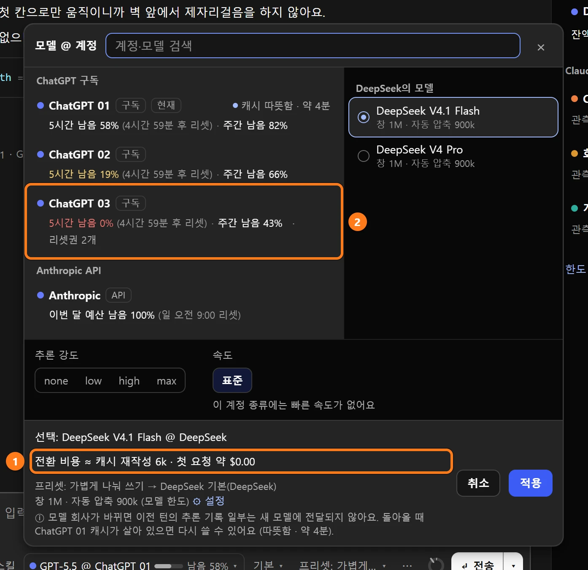
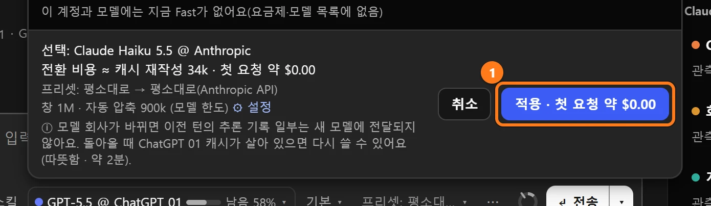
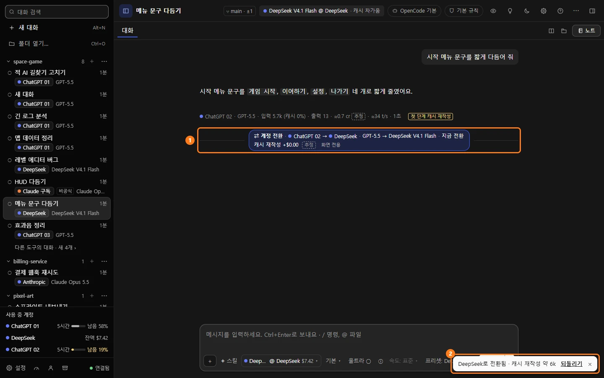

# 6. 모델 @ 계정 바꾸기

**한 줄 요약**: 대화마다 "어느 계정으로, 어떤 모델을 쓸지"를 입력창의 `모델 @ 계정` 단추(`Ctrl+.`)에서 골라요. 바꾸기 전에 비용이 먼저 보여요. 짧은 대화는 바로 바뀌고, 비싼 전환일 때만 한 번 더 물어요.

## 6.1 `모델 @ 계정`이 뭐예요?

> **용어** 모델: 실제로 답을 쓰는 AI예요. GPT-5.5, DeepSeek V4.1 Flash, Claude Opus 5.5 같은 이름이에요.

> **용어** 세션: 대화 하나예요. 사이드바의 한 줄이 세션 하나예요. 이 설명서에서는 "대화"와 같은 뜻으로 써요.

식당에 비유하면 **모델은 요리사**, **계정은 계산할 카드**예요. `GPT-5.5 @ ChatGPT 01`은 "ChatGPT 01 계정으로 GPT-5.5에게 일을 시킨다"는 뜻이에요.

- 같은 대화를 하다가 요리사(모델)나 카드(계정)를 바꿀 수 있어요. 대화 내용은 그대로 이어져요.
- 다른 대화에는 영향이 없어요. 대화마다 따로 정해요.

입력창 아래 줄에서 지금 조합을 볼 수 있어요.


① 단추에는 이런 것이 보여요.

- 계정 색 점: 계정마다 정한 색이에요.
- `GPT-5.5 @ ChatGPT 01`: 지금 모델과 계정이에요. 입력창이 좁으면 옆의 한도가 먼저 작은 고리로 줄고, 그래도 모자라면 모델 이름이 `GPT… @ ChatGPT 01`처럼 줄어요. 계정 이름은 남아요. 휴대폰에서는 계정 이름만 보여요(모델은 위쪽 머리줄에 있어요).
- 작은 막대와 `남음 58%`: 그 계정의 **가장 빠듯한 한도**가 얼마나 남았는지예요. 한도 표시 밀도와 상관없이 늘 하나예요(나머지는 마우스를 올리거나 전환기에서 봐요). 도구줄에 남은 자리만큼 보여요: 그림처럼 작업 패널을 닫아 모든 단추가 다 나와 있을 때는 작은 고리만(남은 양은 마우스를 올리면 보이고, 화면 읽기 프로그램도 읽어요), 작업 패널을 열어 몇 단추가 `⋯` 뒤로 들어가면 막대와 `남음 58%`예요. 고리는 사라지지 않아요. 남은 양이 30% 이하면 노란색, 10% 이하면 빨간색이 돼요. 쓴 양으로 보고 싶으면 `설정` > `일반` > `한도 표시`에서 `쓴 양`을 골라요([7장](07-usage.md)).

## 6.2 전환기 열기

아래 셋 중 아무거나 쓰면 돼요.

1. 입력창의 ① `모델 @ 계정` 단추를 눌러요.
2. `Ctrl+.`(또는 `Ctrl+'`)를 눌러요.
3. 오른쪽 `계정·한도` 탭의 `전환…`을 눌러요. 계정을 펼친 뒤 `이 대화를 여기로 전환`을 누르면 그 계정이 골라진 채로 열려요.



전환기는 이렇게 생겼어요.

| 자리 | 보이는 것 |
|---|---|
| 맨 위 | `계정·모델 검색` 칸. 계정 이름이나 모델 이름 일부를 치면 걸러져요. 최근에 쓴 조합은 `최근` 줄에 보여요 |
| 왼쪽 | 계정 목록. 종류별로 묶여 있어요(ChatGPT 구독, Anthropic API, DeepSeek, Claude 구독 …) |
| 계정 한 줄 | 색 점과 이름, 배지(`구독`·`API`·`비공식`), 지금 쓰는 계정이면 `현재`, 캐시 상태(작은 점과 `캐시 따뜻함 · 약 4분`. 지금 쓰는 계정은 늘, 다른 계정은 캐시가 남아 있을 때만 보여요), 한도 요약 줄(가장 빠듯한 한도 둘과 리셋, 마우스를 올리면 모든 한도, [7장](07-usage.md)). 한도는 그 계정을 고르면 쓸 모델로 봐요: 내가 고른 모델이 그 계정에 있으면 그 모델, 없으면 그 계정 묶음의 기본 모델이에요. 내가 고른 모델은 처음에는 대화의 모델이고, 오른쪽 열에서 모델이나 추론 강도를 고르면 그것으로 바뀌어요. 계정 사이를 오가는 것만으로는 바뀌지 않아요. 그래서 어느 줄이 골라져 있든 줄의 글은 그대로예요. 예를 들어 Opus 대화에서 Claude 1 → ChatGPT → Claude 2로 가도 Claude 2 줄은 Opus로 보이고, Claude 1로 돌아오면 다시 Opus가 골라져요 |
| 오른쪽 | 고른 계정의 모델 목록(`DeepSeek의 모델`)과 모델마다 `창 1M · 자동 압축 900k` |
| 두 열 아래 띠 | `추론 강도`와 `속도`(16장). 모델 목록이 길어도 늘 보여요 |
| 아래 | `선택: DeepSeek V4.1 Flash @ DeepSeek`, ① 비용 줄, 프리셋이 어떻게 바뀌는지, 창과 자동 압축 지점(`설정`을 누르면 13장의 설정으로 가요), 안내 문장 |
| 단추 | `취소`, `적용`. 지금과 같은 조합이면 `닫기` 하나만 있어요 |

> **용어** 캐시: 회사(프로바이더)가 "이 대화 앞부분은 이미 읽었어요" 하고 기억해 두는 것이에요. 같은 계정·같은 모델로 계속 쓰면 앞부분을 싸게 다시 읽어요. 계정이나 모델을 바꾸면 이 기억이 없어서 처음부터 다시 읽어요. 자세한 이야기는 [11장](11-cache-switch-cost.md)에 있어요.

**쓸 수 없는 계정**은 흐리게 보이고 이유가 붙어요.

| 이유 문구 | 뜻과 할 일 |
|---|---|
| `한도 도달 · … 리셋` | 한도를 다 썼어요. 적힌 시각에 다시 쓸 수 있어요. 시각은 하루 안이면 `2시간 14분 후 리셋`, 그 뒤면 `월 오전 9:00 리셋`처럼 요일이나 날짜와 함께 보여요([7장](07-usage.md)) |
| `인증 만료 — 다시 로그인` | 로그인이 풀렸어요. 계정 `⋯` → `다시 로그인` |
| `설정 오류 — 계정 관리에서 확인` | 키가 거부되거나 설정이 틀렸어요. `계정 관리…`로 가서 확인해요 |
| `플러그인 없음` | Claude 구독 플러그인이 없어요([20장](20-account-kinds.md)) |

> **참고** 한도가 `남음 0%`여도, 앱이 아직 "다 썼다"고 판단하기 전이면 흐려지지 않을 수 있어요. 빨간 막대가 보이면 그 계정은 피하는 것이 좋아요.

## 6.3 비용 줄 읽기

전환기 아래 ① 줄이 이번 전환의 값이에요.

```text
전환 비용 ≈ 캐시 재작성 6k · 첫 요청 약 $0.00
```

| 부분 | 뜻 |
|---|---|
| 캐시 재작성 6k | 새 계정이 처음부터 다시 읽을 양 |
| 첫 요청 약 $0.00 | 그 값(돈 또는 한도) |

- **캐시 재작성 6k**: 새 계정이 대화를 처음부터 다시 읽어야 하는 양이에요. 6k는 약 6천 토큰이에요.
- **금액**: 그냥 지금 계정에 머물 때보다 **더 드는** 값이에요.
  - 같은 단위면 `+$0.21`, `+1.3 cr`처럼 차이를 보여요.
  - 단위가 다르면(ChatGPT의 credits에서 DeepSeek의 달러로 갈 때) 둘을 더할 수 없어요. 그래서 `첫 요청 약 $0.04`처럼 새 계정의 첫 요청 값만 보여요.
  - 구독 계정은 금액 대신 한도 %로 보일 수 있어요(예: “5시간 남은 한도 −3%”, 쓴 양으로 보게 했으면 “5시간 한도 +3%”). 아직 계산 비율을 모르면 `보정 중`이에요.
- 그 밖의 문구
  - `현재 사용 중`: 지금 쓰는 조합을 골랐어요.
  - `새 대화 — 전환 비용 없음`: 아직 아무 말도 안 한 대화라 공짜예요.
  - `비용 계산 중…`: 잠깐 기다리면 숫자가 나와요.

> **용어** 토큰: AI가 글을 세는 단위예요. 한글은 대략 한 글자에 0.65토큰쯤이에요. 1k는 1,000토큰, 1M은 100만 토큰이에요.

> **용어** credits(cr): ChatGPT 구독 계정이 쓰는 내부 단위예요. 구독 한도를 얼마나 쓰는지 가늠하는 숫자예요. 앞에 `≈`가 붙고 모두 추정이에요.

## 6.4 언제 바로 바뀌고, 언제 물어요?

비용이 작으면 그냥 바꾸고, 크면 한 번 더 물어요. 처음 값은 이래요(`설정` > `자동 전환`에서 바꿀 수 있어요, [12장](12-multiple-accounts.md)).

| 상황 | 앱이 하는 일 |
|---|---|
| 아직 말을 한 번도 안 한 새 대화 | 바로 바꿔요. 비용이 없어요 |
| 다시 읽을 양이 20k 토큰 미만 | 바로 바꾸고, 알림에 `되돌리기`를 둬요 |
| 20k–100k 토큰 | `적용` 단추가 `적용 · 첫 요청 약 $0.07`처럼 바뀌어요. 금액을 보고 한 번 더 눌러요 |
| 100k 토큰 이상, 또는 구독 한도의 5% 이상, 또는 $0.50 이상 | 단추가 `적용…`이 되고, 누르면 **전환 비용 창**이 열려요([11장](11-cache-switch-cost.md)) |
| 지금 계정의 캐시가 이미 식었음(오래 쉰 대화) | 어차피 다시 읽어야 하니 바로 바꿔요. 알림에 `현재 계정 캐시도 이미 식어 추가 비용이 거의 없어요`가 붙어요 |



바로 바뀐 전환은 대화에 표시가 남고, 오른쪽 아래에 알림이 떠요.



- ① 표시: `계정 전환 · ChatGPT 02 → DeepSeek`, 바뀐 모델, 고른 방법(`지금 전환`), 다시 쓴 비용이 보여요. 양쪽 계정은 바꾸기 전과 뒤에 실제로 요청을 보낸 계정이에요. 여러 Claude 계정을 써도 “AC-03 → 개인 Pro”, “모델 전환 · AC-02”처럼 그때의 계정이 보여요.
  - 옆의 `화면 전용`은 "이 표시는 모델에게 보내지 않아요"라는 뜻이에요.
  - 바꾼 뒤 첫 턴 아래 줄에는 `첫 단계 캐시 재작성` 표시가 붙어요. 그 턴이 처음부터 다시 읽었다는 뜻이에요. 계정이 바뀐 턴이면 `계정이 바뀌어서 캐시가 비었어요`로 보여요.
- ② 알림: `DeepSeek로 전환됨 · 캐시 재작성 약 6k`와 `되돌리기`.
  - `되돌리기`는 **새 계정으로 첫 요청을 보내기 전까지만** 돼요. 되돌리면 `되돌렸어요 · 이전 계정 캐시를 그대로 써요`가 보여요. 원래 계정의 캐시가 살아 있어 비용이 없어요.
  - 이미 보냈다면 `되돌릴 수 없어요 — 새 계정으로 이미 요청을 보냈어요`가 떠요. 그때는 전환기로 다시 바꿔요.

## 6.5 대화가 도는 중에 바꾸면

계정은 **턴 도중에는 절대 바뀌지 않아요.** 지금 하는 일이 끝난 뒤에 바뀌어요.

> **용어** 턴: 내가 메시지를 하나 보낸 뒤, 에이전트가 일을 마치고 멈출 때까지예요. 한 턴 안에서 모델에게 여러 번 요청할 수 있어요. 그 한 번 한 번을 **단계**라고 불러요.

1. 도는 중에 전환기를 열면 `적용` 단추가 `대기`로 바뀌어요.
2. 누르면 알림 `현재 턴이 끝나면 적용돼요`가 떠요.
3. 입력창 위에 `현재 턴이 끝나면: DeepSeek V4.1 Flash @ DeepSeek` 같은 칩이 보여요. 칩의 `취소`로 그만둘 수 있어요.
4. 턴이 끝나면 저절로 바뀌어요.

여러 Claude 계정을 쓰면 칩, 헤더, 사이드바, 대기열, 바뀐 뒤의 알림이 모두 실제로 옮겨 갈 Claude 계정을 보여요. ChatGPT 대화에서 `AC-03`을 골라 기다리면 `현재 턴이 끝나면: … @ AC-03`이에요.

그 사이에 메시지를 보내면 이렇게 돼요.

- 전환을 기다리는 동안 새로 보낸 메시지는 `Ctrl+Enter`든 `Alt+Enter`든(보내는 키가 `Enter`면 `Enter`든 `Ctrl+Enter`든) **대기열**에 들어가요. 턴이 끝나고 계정이 바뀐 **뒤에** 새 계정으로 실행돼요. 칩에 `지금 보내면 현재 턴이 끝난 뒤 DeepSeek로 실행돼요`가 보여요.
- 전환을 고르기 **전에** 이미 끼워 넣어 둔 메시지는 지금 턴 안에서 **지금 계정으로** 실행돼요. 대기열 줄에 `지금 계정(ChatGPT 01)으로 실행`처럼 보여요.

> **참고** 끼워 넣기와 대기열은 [10장](10-conversation-tools.md)에서 자세히 다뤄요.

## 6.6 추론 강도만 바꿀 때

> **용어** 추론 강도: 모델이 답하기 전에 얼마나 오래 "생각"할지예요. 회사가 부르는 이름 그대로 영어로 보여요. `none`, `minimal`, `low`, `medium`, `high`, `xhigh`, `max` 중 모델이 지원하는 것만 있어요. `기본`은 모델이 정한 값이에요.

입력창의 ② 단추(`기본`)나 전환기 아래 띠의 `추론 강도`에서 바꿔요.

- 강도를 높이면 더 꼼꼼하지만 느리고, 토큰(돈·한도)을 더 써요.
- **모델에 따라 강도만 바꿔도 캐시가 깨져요.** 전환기가 알려 줘요.
  - `이 모델은 추론 강도만 바꾸면 캐시가 유지돼요.` → 비용 줄이 `전환 비용 없음 (추론 강도만 변경)`이고, 바로 바뀌어요. 알림은 `추론 강도: high · 전환 비용 없음`처럼 떠요.
  - `이 모델은 추론 강도를 바꿔도 캐시를 새로 써요.` → 계정을 바꿀 때와 같은 규칙으로 비용을 보이고, 크면 `추론 강도 변경: …` 창이 열려요.
- 요즘 나온 일부 모델만 강도를 바꿔도 캐시가 남아요. GPT-5 계열, DeepSeek 같은 모델은 강도를 바꾸면 처음부터 다시 읽어요. 외울 필요 없이 화면 문구를 보면 돼요.

## 6.7 새 대화는 어떤 조합으로 시작해요?

새 대화는 이 순서로 처음 조합을 정해요. 앞의 것이 있으면 뒤의 것은 보지 않아요.

1. 새 대화에서 전환기로 **직접 고른 것**.
2. **그 폴더에서 마지막으로 쓴** 대화의 모델과 계정.
3. 그 폴더에 대화가 없으면, **가장 최근 대화가 쓴 회사 종류**의 기본 계정(그 계정 `⋯` → `이 종류의 기본 계정으로`로 정한 계정). 모델은 그 계정 묶음의 "새 대화 기본 모델"(`설정` > `프리셋`, [14장](14-presets.md))이에요.
4. 기본 계정이 없거나 지금 쓸 수 없으면 가장 최근 대화의 계정, 그것도 안 되면 목록에서 처음으로 쓸 수 있는 계정이에요.

> **참고** 그래서 `이 종류의 기본 계정으로`는 "그 회사 종류로 새 대화를 시작할 때"만 효과가 있어요. 예를 들어 ChatGPT 02를 기본 계정으로 정해도, 가장 최근 대화가 DeepSeek였거나 그 폴더에 이미 대화가 있으면 ChatGPT 02로 시작하지 않아요. 확실하게 하려면 새 대화에서 전환기로 직접 고르세요. 새 대화에서는 바꿔도 값이 들지 않아요.

새 대화에서는 언제 바꿔도 **비용이 없어요.** 처음에 마음에 드는 조합으로 맞춰 두면 좋아요.

## 알아 두면 좋아요

- 지금 대화의 조합은 여러 곳에서 보여요: 입력창 단추, 세션 헤더의 알약(모델 @ 계정과 `캐시 차가움` 같은 캐시 상태), 사이드바 대화 줄, 턴 아래 한 줄([7장](07-usage.md)).
- 계정을 더하거나 바꿔도 이미 도는 대화는 바뀌지 않아요. 대화마다 직접 바꿔야 해요.
- 하위 에이전트가 돌고 있을 때 메인 계정을 바꾸면, 그 하위 에이전트들은 원래 계정으로 끝까지 돌아요(`하위 에이전트 2개는 기존 계정으로 계속 실행돼요`처럼 보여요).
- 다른 회사로 바꾸면(예: GPT → DeepSeek) 프리셋도 그 회사 묶음 것으로 바뀌어요. 전환기에 `프리셋: 평소대로 → DeepSeek 기본(DeepSeek)`처럼 보여요. 프리셋 바뀜은 비용이 없어요.
- 휴대폰처럼 전환 권한이 없는 기기에서는 `이 기기에서는 전환할 수 없어요`가 보여요([24장](24-phone-other-pc.md)).

## 조심하세요

> **주의** 긴 대화에서 계정이나 모델을 바꾸면 **대화 전체를 처음부터 다시 읽는 값**이 들어요. 대화가 길수록 비싸요. 큰 전환에서 열리는 전환 비용 창에서는 선택지마다 값이 보여요. 보통은 `지금 전환`이 기본이고, 급하지 않으면 `캐시가 식은 뒤 전환`으로 싼 때를 기다릴 수 있어요. `압축 후 전환`은 다시 읽을 양을 줄이는 대신 앞부분이 요약으로 바뀌어 자세한 내용 일부를 잃어요. 값과 잃는 것을 견주어 골라요([11장](11-cache-switch-cost.md)).

> **주의** 다른 회사 모델로 바꾸면 이전 턴의 "생각 기록" 일부는 새 모델에 넘어가지 않아요. 대화 글은 그대로 넘어가니 보통은 문제없어요.

> **주의** 팀 모드 대화에서 팀이 쓰는 구독 계정을 바꾸면, 이 전환기 대신 팀 전체를 바꾸는 창이 열려요([17장](17-team-mode.md)).

## 더 알아보기

- 전환 비용 창과 싸게 바꾸는 법: [11장](11-cache-switch-cost.md)
- 한도와 사용량 보는 곳: [7장](07-usage.md)
- 설계 문서: [03 화면 §5.2 전환기, §6.2 언제 물을 것인가](../03-ui-ux.md), [02 §5 전환 상태 머신](../02-accounts-providers-cache.md)
