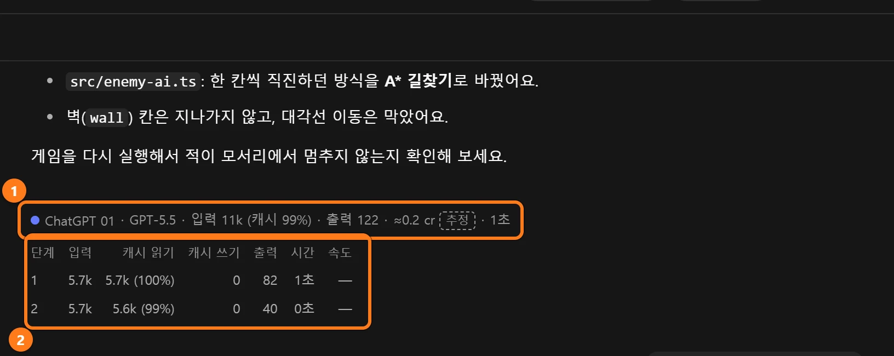
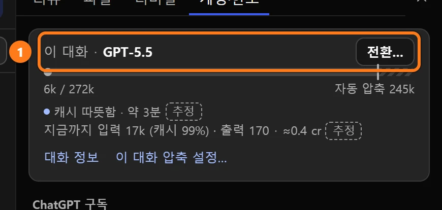
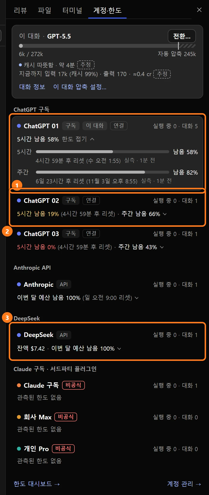
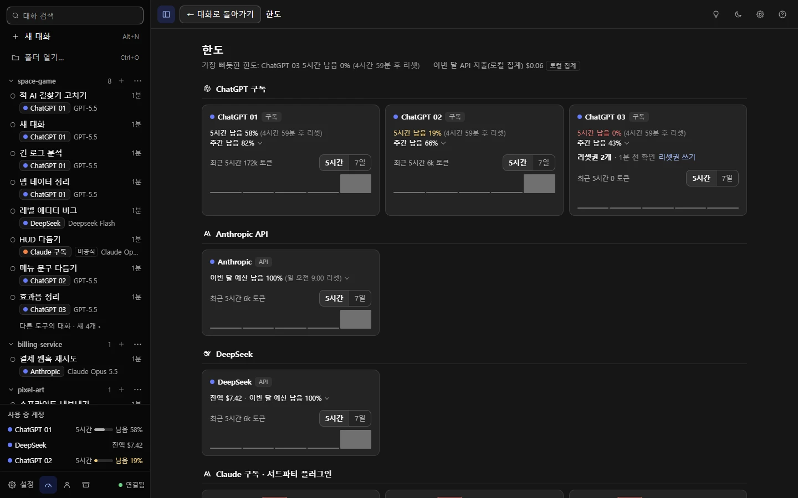
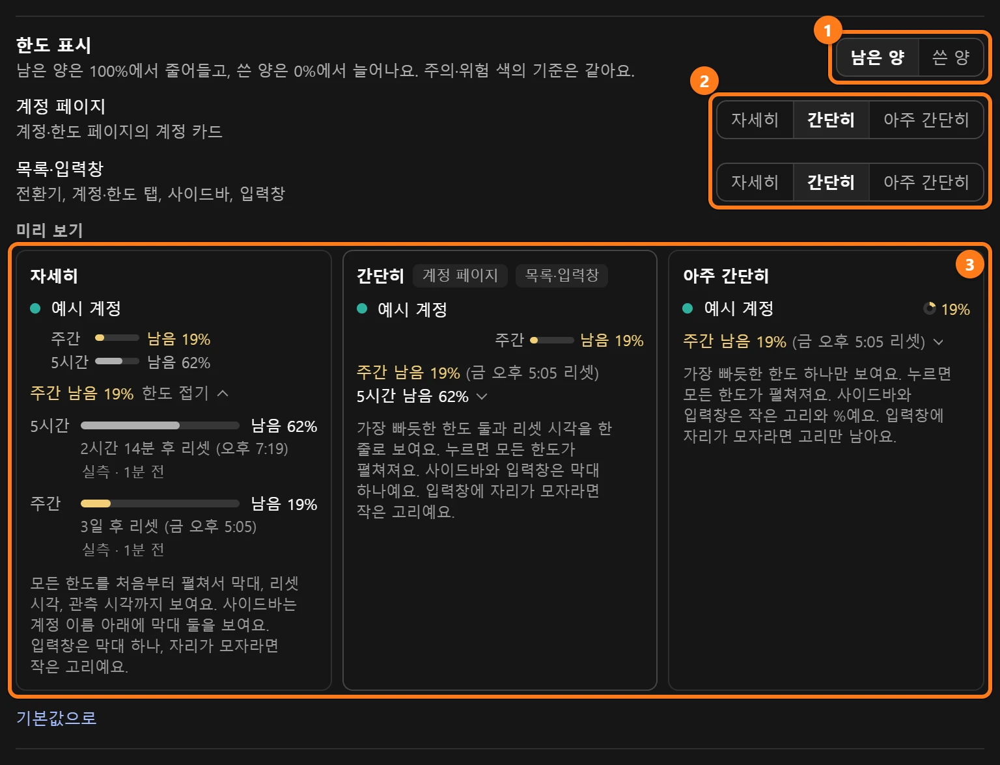

# 7. 한도와 사용량 한눈에 보기

**한 줄 요약**: 어느 대화가 어느 계정·모델로 도는지, 계정마다 한도가 얼마나 남았는지를 사이드바, 입력창, 턴 아래 줄, 오른쪽 `계정·한도` 탭(`Ctrl+Shift+U`)에서 봐요. 숫자 옆 작은 태그가 "얼마나 믿을 만한 값인지"를 알려 줘요.

## 7.1 이 대화는 어느 계정·모델로 돌고 있나요?

다섯 군데에서 볼 수 있어요. 가장 빠른 곳부터 적었어요.

| 어디 | 보이는 것 |
|---|---|
| 사이드바 대화 줄 | 대화 제목 아래 **계정 칩**(색 점 + 계정 이름)과 **모델 이름** |
| 사이드바 아래 `사용 중 계정` | 지금 대화들이 쓰는 계정과 그 계정의 가장 빠듯한 한도가 얼마나 남았는지(예: 5시간 막대와 `남음 58%`) |
| 입력창 `모델 @ 계정` 단추 | 지금 조합과 가장 빠듯한 한도 하나([6장](06-model-account.md)) |
| 턴 아래 한 줄 | 그 턴을 실제로 처리한 계정·모델과 쓴 양 |
| `계정·한도` 탭의 `이 대화` 카드 | 모델, 문맥 막대, 캐시 상태와 누계(계정은 바로 아래 `이 대화` 꼬리표가 붙은 줄) |

과 모델(GPT-5.5)이 보여요. ② 사용 중 계정에서 계정마다 한도가 얼마나 남았는지 봐요.")

- ① 대화 줄: “적 AI 길찾기 고치기” 아래 `ChatGPT 01`과 `GPT-5.5`가 보여요. Claude 구독 계정에는 `비공식` 배지가 함께 붙어요.
- ② `사용 중 계정`: 계정 이름 옆의 한도 이름(5시간), 막대, `남음 58%`가 그 계정의 **가장 빠듯한 한도**예요. 이 예시에서 ChatGPT 02는 `남음 19%`라 노란색이에요. DeepSeek처럼 잔액이 먼저인 계정은 막대 없이 잔액(`$7.42`)을, 다 쓴 한도는 빈 막대와 `차단`을 보여요. 사이드바가 좁아도 계정 이름은 사라지지 않아요: 이름이 먼저 줄다가 더 좁으면 한도가 이름 아래 줄로 내려가요. 계정 카드와 `계정·한도` 탭의 요약 줄 맨 앞과 같은 한도예요.
- 처음에는 **남은 양**으로 보여요. 막대는 꽉 찬 채로 시작해서 쓸수록 줄어요. 쓴 양으로 보고 싶으면 7.7의 `한도 표시`에서 바꿔요.

### 턴 아래 한 줄

에이전트가 답을 마치면 그 아래에 작은 한 줄이 남아요.



```text
ChatGPT 01 · GPT-5.5 · 입력 11k (캐시 99%) · 출력 122 · ≈0.2 cr (추정) · 42 t/s · 첫 토큰 1.2초 · 6초
```

| 부분 | 뜻 |
|---|---|
| ChatGPT 01 | 이 턴을 처리한 계정 |
| GPT-5.5 | 이 턴을 처리한 모델 |
| 입력 11k (캐시 99%) | 모델이 읽은 양과, 그중 캐시로 싸게 읽은 비율 |
| 출력 122 | 모델이 쓴 양 |
| ≈0.2 cr (추정) | 이 턴의 값(추정) |
| 42 t/s | 출력 속도: 1초에 나온 토큰 수예요. 첫 출력부터 응답 끝까지 잰 값이고, 첫 토큰을 기다린 시간과 도구 실행 시간은 빼요 |
| 첫 토큰 1.2초 | 요청을 보내고 첫 토큰이 오기까지 걸린 시간이에요. 알 수 있을 때만 보여요 |
| 6초 | 걸린 시간 |

- **캐시 비율**이 높을수록 싸게 읽은 거예요. 계정을 바꾼 직후에는 0%에 가깝고 `첫 단계 캐시 재작성`이 붙어요. 바로 앞 단계와 다른 계정에서 돈 턴이면 `계정이 바뀌어서 캐시가 비었어요`가 붙어요. 캐시는 계정마다 따로라서 그래요.
- 맨 앞의 계정은 그 턴에 **실제로 요청을 보낸 계정**이에요. 여러 Claude 계정을 오가도 턴마다 그때의 계정(예: `AC-03`, `AC-01`, `AC-02`)이 보여요. 한 턴 안에서 계정이 바뀌었으면(한도 때문에 자동으로 바뀐 경우) 단계별 표에 `계정` 칸이 생겨요.
- 값은 ChatGPT 구독이면 `≈0.2 cr`(credits), API 키면 달러예요. Claude 구독처럼 모르면 `비용 알 수 없음`이에요.
- 속도 앞에 `≈`가 붙으면(예: `≈38 t/s`) 요청 시작부터 응답 끝까지로 잰 **어림값**이에요. 첫 토큰을 기다린 시간이 들어가서 실제보다 조금 낮게 보여요. 마우스를 올리면 설명이 떠요.
- 출력이 없는 턴에는 속도가 보이지 않아요. 그림처럼 데모의 가짜 모델은 답을 한꺼번에 보내서 속도가 `—`예요.
- ② `단계별 사용량 보기`를 누르면 표가 펼쳐져요: `단계`, `입력`, `캐시 읽기`, `캐시 쓰기`, `출력`, `시간`, `속도`.
  - 한 턴 안에서 모델에게 여러 번 요청하면 단계가 여러 줄이에요.
  - `캐시 쓰기`는 다음에 싸게 읽으려고 새로 기억시킨 양이에요.

### `이 대화` 카드



- ① `이 대화`와 GPT-5.5: 지금 모델이에요. 오른쪽 `전환…`으로 전환기를 열어요. 계정은 바로 아래 계정 목록에서 `이 대화` 꼬리표가 붙은 줄이에요(7.2).
- 막대 `6k / 272k`와 `자동 압축 245k`: 지금 문맥 크기, 모델 창 크기, 자동 압축 지점이에요([13장](13-auto-compaction.md)). 막대에서 지점 너머의 빗금 칸은 압축한 뒤에만 쓰여요. 이 대화만 다른 지점을 정했으면 `자동 압축 200k (이 대화)`처럼 괄호로 알려 줘요.
- 흐린 한 줄: `캐시 따뜻함 · 약 3분` `추정`(지금 계정의 캐시가 살아 있는 시간, [11장](11-cache-switch-cost.md)), `지금까지 입력 17k (캐시 99%) · 출력 170`(이 대화의 누계), `≈0.3 cr`(추정 비용). 좁으면 다음 줄로 넘어가요.
- Claude 구독 계정이면 비용 대신 `비용 알 수 없음 — 추가 사용량(API 요금)으로 청구될 수 있음`이 따로 한 줄에 노란색으로 보여요.
- 링크: `대화 정보`(`Ctrl+I`, 대화의 자세한 정보), `이 대화 압축 설정…`.

> **팁** 대화 주변의 정보가 많아 보이면 세션 헤더의 눈 모양 `보기` 단추에서 숨길 것을 골라요. 사용량 줄, 속도, 시간 같은 것을 하나씩 끄고 켜요([5장](05-screen-tour-theme.md)).

## 7.2 `계정·한도` 탭: 모든 계정을 한 화면에

오른쪽 작업 패널의 `계정·한도` 탭이에요. `Ctrl+Shift+U`로 바로 열어요. 사이드바 `사용 중 계정`을 눌러도 돼요.



- 맨 위는 `이 대화` 카드(7.1)예요.
- 그 아래 계정이 종류별로 묶여 있어요. 이 대화의 계정, 쓰는 중인 계정, 나머지 순서예요.
- 계정 한 줄에는 이름, 배지(`구독`·`API`·`비공식`), 이 대화의 계정이면 `이 대화`, 가져온 로그인이면 `연결` 또는 `인수`, 그리고 `실행 중 0 · 대화 4`가 보여요.
  - `실행 중`: 지금 이 계정으로 일하는 중인 대화 수예요.
  - `대화`: 이 계정을 쓰는 대화 수예요.
- 처음에는 계정마다 **한도 요약 한 줄**이 보여요(`간단히`). 가장 빠듯한 한도 둘이고, 맨 앞 한도의 리셋은 그 한도 바로 뒤 괄호 안에 흐리게 보여요. 예:

  ```text
  주간 남음 42% (수 오후 5:33 리셋) · 5시간 남음 88% ▾
  ```
  - 줄이 좁아 넘치면 한도 단위로 다음 줄로 넘어가요. 줄이 `·`로 시작하거나 끝나지 않아요.
  - 맨 앞이 가장 빠듯한 한도예요. 다 쓴 한도가 있으면 그것이 맨 앞이고, 없으면 남은 양이 가장 적은 한도예요. 5시간이 넉넉해도 주간이 빠듯하면 주간이 먼저 보여요. 사이드바, 입력창, 전환기, 계정 카드, 대시보드 어디서나 맨 앞 한도는 같아요.
  - 모델 하나에만 따로 세는 주간 한도(`주간 · Fable`, `주간 · Opus`, `주간 · Sonnet`)는 그 모델만 막아요. 그래서 그 모델로 쓰는 대화에서만 맨 앞에 올 수 있어요(입력창, 그 대화의 `계정·한도` 탭, 그 계정에서 그 모델을 쓸 전환기 줄). 그 한도가 다 차면 그 모델의 대화만 기다리거나 다른 계정으로 가고, 같은 계정의 다른 모델 대화는 그대로 써요. `리셋까지 대기`도 그 모델의 한도가 풀리는 시각까지 기다려요. 계정 카드와 대시보드처럼 대화가 없는 곳은 계정 전체 한도만 세요. 펼치거나 마우스를 올리면 늘 보여요.
  - 그 줄을 누르면(또는 Tab으로 가서 Enter·Space) 그 자리에서 **모든 한도**가 펼쳐져요. 한도마다 막대, 남은 양, `3시간 19분 후 리셋 (오후 8:45)`처럼 시각까지 쓴 리셋, `실측 · 1분 전` 같은 꼬리표가 보여요. 꼬리표에 마우스를 올리면 받은 시각이 나와요. 펼친 동안 맨 윗줄에는 가장 빠듯한 한도 하나와 `한도 접기`만 남아요. 그 줄을 다시 누르면 접혀요.
- 계정 이름 줄을 누르면 그 계정의 자세한 것이 펼쳐져요: 분당 요청 한도, 마지막 관측 시각, 자동 압축 설정, `이 계정을 쓰는 대화` 목록, `이 대화를 여기로 전환` 단추.
- 맨 아래 `한도 대시보드 →`와 `계정 관리 →`로 큰 화면에 갈 수 있어요.

### 계정 종류마다 보이는 막대

| 계정 종류 | 막대 | 메모 |
|---|---|---|
| ChatGPT 구독 | `5시간`, `주간` | 5시간마다, 일주일마다 차오르는 사용 한도예요. 요금제에 따라 `주간` 하나만 있을 수 있어요. 크레딧이 남아 있으면 아래에 “크레딧” 줄이 보여요. 크레딧이 없거나 값을 모르면 줄을 보이지 않아요(맨 앞 한도이거나 막혔을 때는 보여요). 대화할 때마다 갱신되고, 대화가 없을 때는 앱이 15분마다 직접 읽어 와요 |
| Sign in with ChatGPT | (없음) | 지금까지 이 로그인 방식의 응답에는 요금제 한도가 오지 않아서 보통 막대가 없어요. 대신 `아직 받은 한도 정보가 없어요 · 이 로그인 방식(토큰 공유)은 한도를 알려 주지 않는 것으로 보여요 · ChatGPT 설정 > 사용량에서 확인하세요`가 보이고, 계정 카드의 `사용량 관리`로 ChatGPT 설정의 사용량 페이지를 열 수 있어요. 한도에 닿으면 대화에 띠가 떠요. 그 응답이 리셋 시각을 알려 주면 `사용량 한도` 막대와 리셋 시각도 보여요([20장](20-account-kinds.md)) |
| Claude 구독 | `5시간`, `주간`, 있으면 `주간 · Fable`·`주간 · Opus`·`주간 · Sonnet`, `추가 사용량` | 응답이 올 때마다 갱신돼요. `주간 · Fable`은 모델 하나에만 따로 세는 주간 한도로, 그 한도를 알려 주는 계정에만 보여요. 이 한도가 차도 다른 모델은 그대로 쓸 수 있어요. 리셋 시각 없이 받은 값은 15분이 지나면 `오래됨`으로 흐려지고 더는 맨 앞에 오지 않아요. `주간 · Opus`·`주간 · Sonnet`은 응답이 그 한도를 가리킬 때만 생기고 %없이 `허용`·`주의`·`차단`과 리셋만 보여요. 5시간 한도가 없는 계정(Anthropic이 2026-10-30부터 5시간 한도를 없앤, 인증된 Ultra 요금제)은 `5시간`이 아예 보이지 않고 `주간`이 맨 앞이에요. 그 계정의 응답이 5시간 한도를 더는 알려 주지 않으면 앱이 예전에 받은 `5시간` 값을 지워요. 다시 알려 주면 다시 보여요. `추가 사용량` 줄은 상태(`차단` 등)와 응답이 알려 준 이유(예: `꺼져 있어요`)예요. 추가 사용량은 요금제 한도를 넘었을 때 쓰는 여유라서 그것만으로는 맨 앞에 오지 않고, 계정을 한도 소진으로 만들지도 않아요. 그 대화의 모델을 막는 한도가 다 찼을 때만(그 한도를 추가 사용량이 덮거나 덮지 못했을 때) 요약 줄 끝에 `추가 사용량으로 청구 중`·`추가 사용량 거절됨`이 붙어요. 그 밖에는 펼친 줄에 조용히 적혀 있어요([20장](20-account-kinds.md)). 아직 받은 값이 없으면 `관측된 한도 없음` |
| Anthropic API, OpenAI API | `이번 달 예산` | 예산을 정했을 때만 보여요(7.5). 회사가 알려 주는 “분당 요청”·“분당 입력 토큰” 같은 요청 한도도 함께 보여요 |
| DeepSeek | `잔액` | 충전해 둔 돈이 얼마 남았는지예요. 프로모션 크레딧이 있으면 “보너스” 줄이 따로 보여요([20장](20-account-kinds.md)). 막대가 없어서 `간단히`에서도 `잔액` 옆에 금액(예: ¥12.30)으로 보여요 |
| xAI, OpenRouter, OpenAI 호환 | `이번 달 예산` | 이 PC에서 센 지출이에요. 잔액 조회는 아직 없어요 |

**막대 색**

| 남은 양 | 색 |
|---|---|
| 30%보다 많음 | 회색(보통) |
| 30% 이하 | 노란색(주의) |
| 10% 이하, 또는 막힘 | 빨간색(위험) |

색의 기준은 `쓴 양`으로 볼 때도 같아요(쓴 양 70% 이상이 노란색, 90% 이상이 빨간색).

**리셋 시각**은 막대 아래에 이렇게 보여요.

- 하루 안이면 `4시간 59분 후 리셋`처럼 남은 시간.
- 6일 안이면 `목 오후 5:33 리셋`처럼 요일과 시각.
- 그보다 멀거나 다음 주의 오늘 요일이면 `11월 1일 오전 9:00 리셋`처럼 날짜와 시각. 요일만으로는 이번 주인지 다음 주인지 헷갈릴 수 있어서예요.
- 펼친 요약에서는 남은 시간과 시각을 함께 써요: `4시간 59분 후 리셋 (오후 9:25)`, 오늘이 아니면 `2일 17시간 후 리셋 (화 오전 9:00)`.
- 시각은 어디서나 오전 9:00처럼 같은 모양이에요. 마우스를 올리면 보이는 날짜와 시각(`2026-10-24 (토) 오후 3:25 관측`)도 그래요.
- 리셋 시각이 지났는데 새 값을 아직 못 받았으면 `리셋됨(추정)`이고 막대가 빗금이에요.
- 지금 쓰는 속도를 보고 `현재 속도면 약 … 뒤 한도 도달 (추정)`을 보여 줄 때도 있어요.

## 7.3 이 숫자를 얼마나 믿을까요? (작은 태그)

한도 값은 대부분 **회사가 응답에 실어 보내 준 값**이에요. 앱이 따로 회사에 물어보지 않아요(DeepSeek 잔액만 예외). 그래서 값이 언제 온 것인지가 중요해요. 숫자 옆 태그가 그걸 알려 줘요.

| 태그 | 뜻 | 모양 |
|---|---|---|
| `실측 · 방금` | 2분 안에 받은 값이에요. 가장 믿을 만해요 | 흐린 글자 |
| `실측 · 1분 전` | 15분 안에 받은 값이에요 | 흐린 태그 |
| `오래됨 · 40분 전` | 받은 지 15분이 넘었어요 | 막대가 흐려져요 |
| `추정` | 앱이 계산한 값이에요(리셋 뒤 예상, 남은 시간 예상) | 점선 태그, 빗금 막대 |
| `보정 중` | 전환 비용을 한도 %로 바꾸는 비율을 아직 배우는 중이에요. %대신 credits만 보여요 | 점선 태그 |
| `로컬 집계` | 이 PC의 사용 기록으로 센 값이에요 | 흐린 태그 |
| `— 알 수 없음` | 값이 없어요 | 막대 없음 |

> **팁** 쉬고 있는 구독 계정이 `오래됨`이 되는 것은 **정상**이에요. 구독 한도는 그 계정으로 요청을 보낼 때만 새로 알 수 있어요. 한 번 쓰면 다시 `실측`이 돼요.

> **참고** 금액과 credits는 **모두 이 PC의 기록으로 계산한 추정**이에요. 다른 기기나 다른 앱(예: 웹의 ChatGPT, Claude Code)에서 쓴 양은 들어가지 않아요. 화면에도 `비용과 credits는 이 PC가 센 추정값이에요. 다른 기기나 앱에서 쓴 양은 들어가지 않아요.`라고 적혀 있어요.

## 7.4 `계정` 페이지와 `한도` 대시보드

사이드바 맨 아래 아이콘 줄에서 사람 모양은 `계정`, 계기판 모양은 `한도`예요.

### `계정` 페이지

를 나란히 비교할 수 있어요. ChatGPT 01은 한도 요약을 펼쳤고, ChatGPT 02는 접힌 한 줄이에요.")

- 카드 오른쪽 위: 상태, `실행 중 0 · 대화 4`, `⋯` 메뉴. 상태는 그 계정의 맨 앞 한도(요약 줄의 첫 한도와 같아요)를 말해요: 다 썼으면 `한도 소진 · 5시간`, 막대가 노랗거나 빨가면(30% 이하 남음) `주의 · 5시간 남음 19%`, 아니면 `정상`이에요. 모델 하나에만 따로 세는 주간 한도와 추가 사용량은 카드 상태를 바꾸지 않아요.
- 카드에도 `계정·한도` 탭과 같은 한도 요약 한 줄이 있어요(가장 빠듯한 한도 둘과 맨 앞 한도의 리셋). 누르면 모든 한도 막대가 남은 양, 시각까지 쓴 리셋, 태그와 함께 펼쳐져요. 처음부터 펼쳐 두고 싶으면 7.7의 `계정 페이지`를 `자세히`로 바꿔요.
- 아래 설명 줄
  - `캐시 단위: 이 계정 · 자동 전환: 제공 안 함(구독)`: 이 계정의 캐시는 이 계정만 써요. 구독 계정이라 앱이 저절로 다른 계정으로 돌리지 않아요([12장](12-multiple-accounts.md)).
  - `연결 · 이전 앱 프로필 "회사 Plus" (읽기 전용, 이전 앱이 갱신)`: 이전 앱에서 가져온 로그인이에요([20장](20-account-kinds.md)).
  - `자동 압축: 모델 한도 · 창의 85%`와 `바꾸기…`: 이 계정의 자동 압축 기준이에요([13장](13-auto-compaction.md)).
- 계정 관리(이름·색·키·제거 등)는 [12장](12-multiple-accounts.md)에서 다뤄요.

### `한도` 대시보드



- 맨 위: `가장 빠듯한 한도: ChatGPT 03 5시간 남음 0% (… 후 리셋)`와 `이번 달 API 지출(로컬 집계)`.
- 계정 카드: 한도 요약 한 줄(누르면 분당 한도까지 모두 펼쳐져요)과, `사용 추이` 작은 그래프(`5시간`·`7일` 중 고름, 예: `최근 5시간 172k 토큰`).
- 아래 표 `계정별 대화 사용량`: 대화마다 `대화`, `프로젝트`, `계정`, `모델`, `입력(캐시 %)`, `출력`, `비용/credits`, `전환`(계정을 바꾼 횟수), `마지막 활동`.
  - `기간`은 `24시간`, `7일`, `30일` 중에서 골라요.
  - `계정` 거르기로 한 계정만 볼 수 있어요(`모든 계정`).
- `범례`를 펼치면 태그 뜻과 데이터 출처가 나와요.

## 7.5 API 키에 이번 달 예산 정하기

API 키는 쓴 만큼 돈이 나가요. 예산을 정해 두면 얼마나 썼는지 막대로 보여요.

1. `계정` 페이지에서 API 키 계정의 `⋯` → `예산 설정…`을 눌러요.
2. `이번 달 예산 (USD)`에 금액을 적고 `저장`을 눌러요.
   - `비우거나 0이면 예산 없음. 지출은 이 PC의 로컬 집계예요.`
3. 카드와 `계정·한도` 탭에 `이번 달 예산` 막대가 생겨요. 예: `$0.03 / 예산 $20`.
   - 막대는 쓸 때마다 바로 줄어요. 예산이 가장 빠듯한 한도이면 요약 줄의 맨 앞에 서고, 30% 이하로 남으면 카드 상태도 화면을 새로 고치지 않아도 `주의 · 이번 달 예산 남음 8%`처럼 바뀌어요.

- 예산은 매달 1일(한국 시간 오전 9시)에 0부터 다시 세요. 막대 옆 리셋 표시가 그 시각이에요.
- 예산을 다 쓰면 막대가 빨개져요. 돈이 드는 하위 에이전트(14장)는 예산 안에서만 돌아서 그때 멈춰요.

> **주의** 예산은 **이 PC가 센 값으로 보여 주는 선**이에요. 메인 대화를 확실히 막는 장치로 믿지 마세요. 진짜 결제 한도는 각 회사 사이트(OpenAI, Anthropic 콘솔 등)에서 정해 두세요.

## 7.6 DeepSeek 잔액은 앱이 물어봐요

- DeepSeek는 공식 잔액 주소에 **앱이 직접 물어봐요.** 잔액 조회가 켜진 DeepSeek 계정마다 **15분에 한 번** 물어요. 그 계정을 쓰는지, 화면에 보이는지와 상관없어요. 새로 추가한 DeepSeek 계정은 처음부터 켜져 있어요.
- xAI와 OpenRouter는 아직 묻지 않아요. 메뉴에 같은 항목이 보여도 지금은 DeepSeek만 실제로 물어봐요.
- 묻고 싶지 않으면 계정 `⋯` → `잔액·키 조회 끄기`.
- Claude 구독은 따로 묻지 않아요. 응답에 실려 오는 값만 써요. ChatGPT 구독은 대화가 한도를 알려 주지 않는 동안에만 15분에 한 번 사용량을 물어요. 리셋권 수(7.8)도 그때 같이 와요.

## 7.7 한도 표시 바꾸기: 남은 양·쓴 양과 밀도

`설정` > `일반` > `한도 표시`에서 한도를 어떻게 보일지 골라요. 아래 미리 보기가 고르는 대로 바뀌어요.



| 항목 | 고를 수 있는 것 | 처음 값 |
|---|---|---|
| `값` | `남은 양`(100%에서 줄어요), `쓴 양`(0%에서 늘어요) | `남은 양` |
| `계정 페이지`(계정·한도 페이지의 계정 카드) | `자세히`, `간단히`, `아주 간단히` | `간단히` |
| `목록·입력창`(전환기, 계정·한도 탭, 사이드바, 입력창) | `자세히`, `간단히`, `아주 간단히` | `간단히` |

- `자세히`: 한도 요약을 처음부터 펼쳐서 모든 한도의 막대, 리셋 시각, `실측` 같은 꼬리표까지 보여요. 사이드바는 계정 이름 아래에 가장 빠듯한 한도 둘을 한 줄씩 보여요(막대가 계정마다 같은 자리에 맞춰 놓여요). 입력창은 막대 하나예요.
- `간단히`: 가장 빠듯한 한도 둘과 리셋을 한 줄로 보여요. 누르면 모든 한도가 펼쳐져요. 사이드바는 한도 이름과 막대 하나, %(5시간 막대와 `남음 58%`), 입력창은 막대 하나와 %예요.
- `아주 간단히`: 가장 빠듯한 한도 하나만 한 줄로 보여요. 누르면 모든 한도가 펼쳐져요. 사이드바와 입력창은 작은 고리와 %예요.
- 입력창의 한도는 도구줄에 남은 자리만큼 보여요. 밀도대로 들어가면 그대로, 모자라면 작은 고리와 %, 더 모자라면 문맥 고리 옆 숫자(`6k`)가 먼저 비켜 주고, 그래도 모자라면 고리만 남아요(남은 양은 화면 읽기 프로그램이 그대로 읽어요). 고리는 어느 창 크기에서도 사라지지 않고, `모델 @ 계정`의 글자는 그 전까지 잘리지 않아요. 예를 들어 1024px 창이나 작업 패널을 닫은 1440px 창의 ChatGPT 대화에서는 보통 고리만, 작업 패널을 연 1440px 창에서는 막대가 보여요. 새 대화 화면은 도구줄이 두 줄이라 늘 밀도대로 보여요([6장](06-model-account.md)).
- 처음 값은 두 묶음 모두 `간단히`예요(2026-10-24부터. 그전에는 계정 페이지가 `자세히`였어요).
- 전환기의 계정 줄은 누를 자리가 계정 고르기라서 펼치지 않아요. 마우스를 올리면 모든 한도가 한 줄씩 떠요.
- 주의·위험 색의 기준은 어느 쪽으로 봐도 같아요(남은 양 30%·10% = 쓴 양 70%·90%).
- `기본값으로`를 누르면 처음 값으로 돌아가요. 이 기기(브라우저)에만 기억해요.

## 7.8 리셋권 보기와 쓰기

ChatGPT는 구독 계정에 가끔 **리셋권**을 줘요. 하나를 쓰면 지금 쓰고 있는 사용 한도(5시간, 주간)가 다시 차요. 앱은 ChatGPT 구독 계정의 리셋권 수를 보여 주고, 여러분이 확인했을 때만 하나를 써요. 앱이 스스로 쓰는 일은 없어요(한도에 닿아도, 계정을 바꿔도, 팀이나 울트라가 돌아도요).

### 어디에 보이나요

- `계정` 페이지의 ChatGPT 구독 카드와 `한도` 대시보드 카드: 한도 요약 바로 아래에 `리셋권 2개`가 보이고, 그 뒤에 기한(예: 11월 3일 오후 5:00까지)과 흐린 글자로 확인한 때(예: 3분 전 확인)가 붙어요. 그 옆의 `리셋권 쓰기`로 써요.
  - 기한은 가장 먼저 끝나는 리셋권의 것이에요. 리셋권 목록을 한 번 불러온 뒤에 보여요.
  - 확인한 때는 앱이 ChatGPT에서 그 수를 마지막으로 읽은 때예요.
  - 수를 아직 모르면 아무것도 없어요. 요약을 펼치면 `리셋권 확인`이 있어서 눌러 물어볼 수 있어요.
  - 0개면 요약을 펼쳤을 때만 `리셋권 없음`이 보여요.
- 전환기의 계정 줄: 한도 줄 뒤에 `리셋권 2개`가 붙어요.
- 한도에 닿은 대화: 대화 위에 `ChatGPT 01의 한도에 도달했어요` 배너가 뜨고, 리셋권이 있으면 `리셋권 쓰기`와 `다른 계정으로 전환…`을 줘요.

### 쓰는 순서

1. 카드나 배너에서 `리셋권 쓰기`를 눌러요. 앱이 리셋권 목록을 불러와요.
2. 쓸 리셋권을 골라요. 이름이 없는 것은 `전체 리셋`(`지금 사용 한도를 리셋해요`)으로 보이고, 기한이 없는 것은 `기한 없음`이에요.
   - 목록을 받지 못하고 수만 알 때는 선택지가 하나예요. 어느 리셋권을 쓸지는 ChatGPT가 골라서, 기한은 `기한 모름`으로 보여요.
3. `이 리셋권을 쓸까요?`가 나와요. 계정, 리셋권, 기한, 지금 한도를 확인해요. `쓰면 되돌릴 수 없어요.`
   - 처음에는 `취소`가 골라져 있어요. Enter를 누르면 취소돼요.
   - 아직 어느 한도에도 닿지 않았으면 `아직 한도에 닿지 않았어요. 그래도 쓸까요?`가 더 나와요. 한도에 닿기 전에 쓰면 남은 양을 버리는 셈이에요.
4. `리셋권 쓰기`를 누르면 `리셋하는 중…`이 나오고, 끝나면 결과를 알려 줘요.

| 결과 문구 | 뜻 |
|---|---|
| `한도를 리셋했어요 · 리셋권 1개 남았어요` | 한도가 다시 찼어요. 카드와 막대도 바로 바뀌어요 |
| `지금은 리셋할 한도가 없어요 · 리셋권은 그대로예요` | 쓴 양이 없어서 리셋권을 쓰지 않았어요 |
| `쓸 수 있는 리셋권이 없어요` | 남은 리셋권이 없어요 |
| `그 리셋권은 더 이상 쓸 수 없어요 · 새로 고쳐 주세요` | 고른 리셋권이 그사이 쓰였거나 끝났어요. `새로 고침`을 눌러 다시 골라요 |
| `리셋하지 못했어요` | ChatGPT가 답하지 않았어요. `다시 시도`를 눌러요 |
| `계정이 지워져서 보내지 않았어요 · 리셋권은 쓰이지 않았어요` | 그사이 다른 창에서 계정을 지워서, 앱이 ChatGPT에 아무것도 보내지 않았어요. 리셋권은 그대로예요 |
| `리셋 결과를 알 수 없어요 · 다시 확인해 주세요` | 쓰는 도중 앱과의 연결이 끊겨서, 리셋권이 쓰였는지 알 수 없어요. `다시 확인`을 눌러 남은 리셋권을 다시 불러와요 |

- `다시 시도`는 처음과 **같은 요청**을 보내요. ChatGPT는 같은 요청을 한 번만 처리하니까, 답을 못 받았던 시도가 사실은 됐더라도 리셋권이 두 번 쓰이지 않아요.
- 답을 못 받은 뒤 대화상자를 닫았다가 바로 다시 열어도 앱은 ChatGPT에 리셋권 목록을 새로 물어요. 그사이 쓰인 리셋권을 또 고르는 일이 없어요.
- `리셋하지 못했어요` 아래에 `HTTP 401`이 보이면 ChatGPT가 이 계정의 로그인을 받지 않은 거예요. 다시 시도해도 같으니 `다시 시도`는 없어요. 다시 로그인한 뒤 처음부터 해요.
- 한도를 리셋했는데 남은 수를 다시 읽지 못하면 결과는 `한도를 리셋했어요`만 나오고, 카드의 리셋권 수도 지워져요(쓰기 전의 수를 남은 수로 보이지 않아요). 요약을 펼쳐 `리셋권 확인`을 누르면 다시 물어봐요.
- 확인 화면을 10분 넘게 두면 `확인한 지 10분이 지났어요 · 처음부터 다시 해 주세요`가 나와요. `처음부터`를 눌러요.
- 로그인을 지금 그대로 쓸 수 없으면 쓸 수 없어요. 앱은 리셋권 때문에 로그인을 새로 받지 않아요. 대화상자가 까닭을 말해 줘요.
  - 로그인이 끝났거나 곧 끝나요(`이 계정의 로그인이 만료됐거나 곧 만료돼 지금은 쓸 수 없어요.`): 그 계정으로 메시지를 한 번 보내거나 다시 로그인한 뒤 해 보세요.
  - `이 계정은 다시 로그인해야 해요. 계정 카드에서 다시 로그인한 뒤 해 주세요.` 또는 `이 계정에 저장된 로그인이 없어요. 다시 로그인한 뒤 해 주세요.`: 계정 카드의 `다시 로그인`으로 로그인해요.
  - `이전 앱이 이 계정의 로그인을 갱신하지 않았어요. 이전 앱에서 이 프로필을 한 번 연 뒤 해 주세요.`: 이전 앱에 연결한 계정이에요. 이전 앱에서 그 프로필을 열면 돼요.

> **참고** 리셋권은 이 PC의 창에서만 쓸 수 있어요. 휴대폰이나 다른 PC에서는 수만 보이고 `리셋권은 이 PC 화면에서만 쓸 수 있어요`가 나와요.

> **참고** Sign in with ChatGPT 계정에는 리셋권이 보이지 않아요. 그 로그인 방식으로는 ChatGPT의 사용량 정보를 묻지 않아요.

### Claude 계정은요?

Claude 카드에는 리셋권 수가 없어요. 한도 요약을 펼치거나 Claude 대화가 한도에 닿으면 `Claude 리셋권은 claude.ai 설정 > 사용량에서 확인하고 쓸 수 있어요`가 보여요. 누르면 claude.ai의 사용량 페이지가 열려요. Claude의 리셋권은 claude.ai나 Claude 데스크톱 앱에서만 다뤄요.

## 알아 두면 좋아요

- 남은 한도가 30% 아래로 내려가면 그 계정으로 긴 일을 시작하기 전에 다른 계정을 생각해 보세요. 같은 회사 계정이 여러 개라면 [12장](12-multiple-accounts.md)을 보세요.
- 같은 대화가 계정을 여러 번 바꿨다면, 턴 아래 줄마다 그 턴을 처리한 계정이 따로 보여요. 대시보드 표의 `전환` 열은 바꾼 횟수예요.
- 사이드바의 `사용 중 계정`과 입력창 막대는 처음에는 **가장 빠듯한 창 하나**만 보여요. 자세한 것은 `계정·한도` 탭에서 그 계정의 한도 요약 줄을 눌러 봐요.

## 조심하세요

> **주의** 앱이 보여 주는 금액은 추정이에요. 실제 청구서와 조금 다를 수 있어요. 정확한 금액은 각 회사 사이트에서 확인하세요.

> **주의** 같은 계정을 다른 앱(웹 ChatGPT, Claude Code, 다른 PC)에서도 쓰면, 그쪽에서 쓴 양은 이 앱의 지출 집계에 들어가지 않아요. 구독 한도 %는 회사가 알려 주는 값이라 남은 양이 함께 줄어든 것이 보여요.

## 더 알아보기

- 모델 @ 계정 바꾸기: [6장](06-model-account.md)
- 한 회사에 계정 여러 개: [12장](12-multiple-accounts.md)
- 설계 문서: [03 화면 §7 한도 시각화](../03-ui-ux.md)(리셋권은 §7.1.1), [02 §7 한도와 사용량](../02-accounts-providers-cache.md)(리셋권은 §7.1.1)
