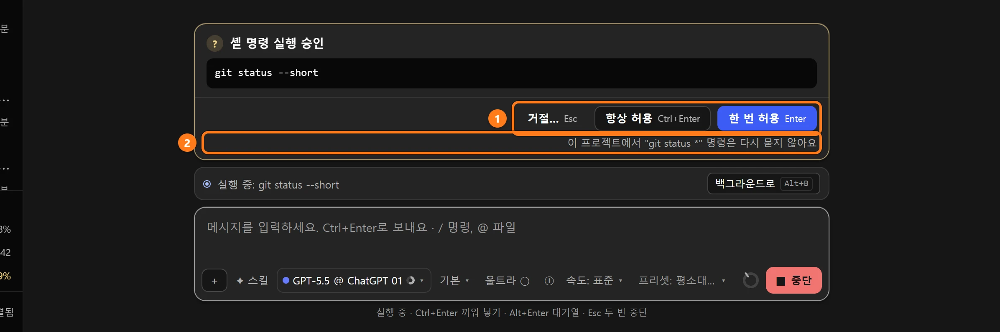
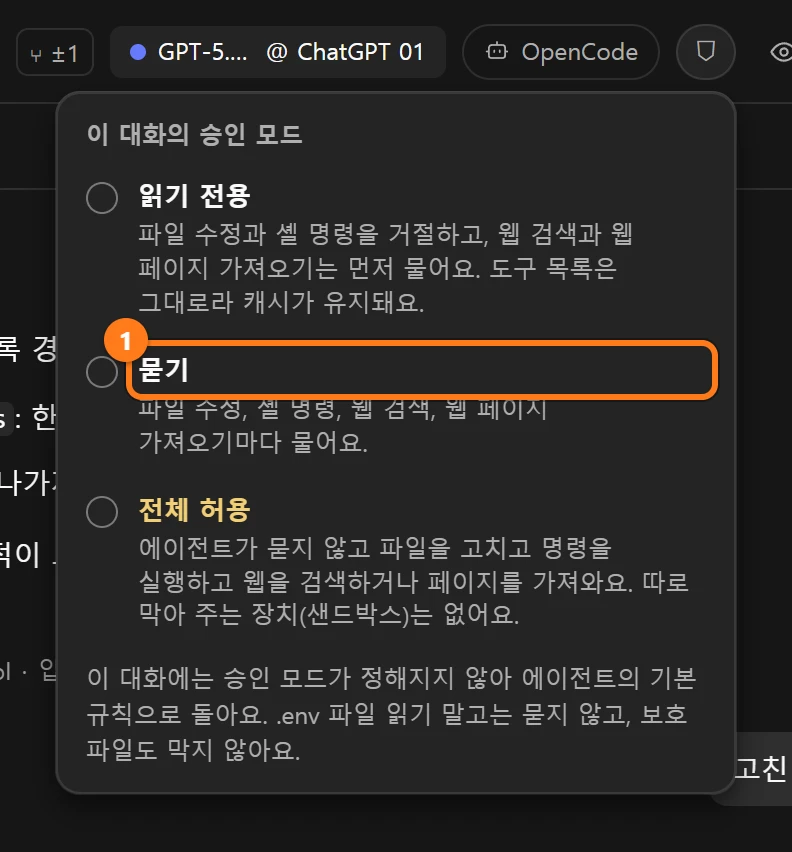
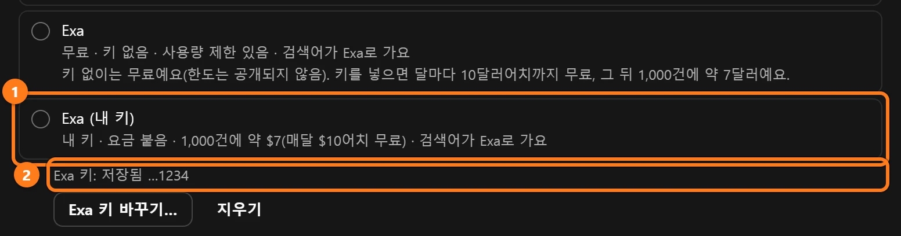
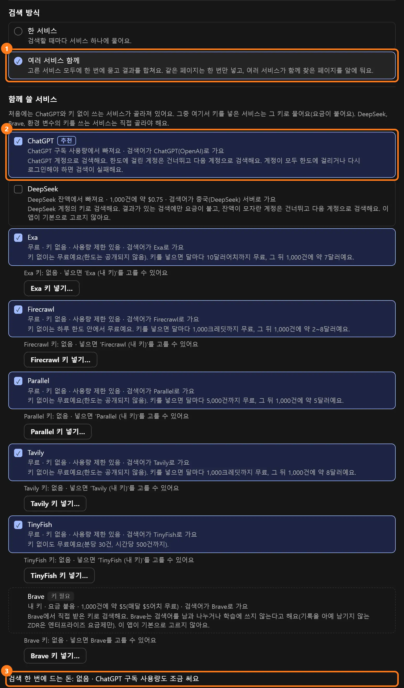

# 8. 승인 모드와 안전장치

**한 줄 요약**: 에이전트가 파일을 고치거나 명령을 실행하거나 웹 페이지를 가져오기 전에 물을지는 **승인 모드**로 정해요. 처음 값은 `묻기`예요. `항상 허용`으로 저장한 규칙은 `설정` > `승인·권한`에서 언제든 취소해요. SSH 키, 다른 앱의 로그인, 지갑처럼 비밀이 든 파일과 폴더는 어느 모드에서도 에이전트가 열지 못하고, 내 목록도 더할 수 있어요(8.5). 처음 보는 저장소의 플러그인은 승인하기 전까지 계정 인증을 받지 못해요.

## 왜 필요해요?

- 에이전트는 **내 PC에서 진짜로** 파일을 고치고 명령을 실행해요. 실수로 파일을 지우거나, 인터넷에 무언가 올리는 명령을 실행할 수도 있어요.
- 그래서 위험할 수 있는 일은 먼저 물어보게 해요. 얼마나 자주 물을지는 일의 성격에 따라 고르면 돼요.
- 비유하면 승인 모드는 **집 열쇠를 맡기는 방식**이에요. `읽기 전용`은 구경만, `묻기`는 문 열 때마다 전화, `전체 허용`은 열쇠를 통째로 맡기는 것이에요.

## 8.1 승인 요청 상자

에이전트가 허락이 필요한 일을 하려 하면 입력창 바로 위에 **승인 요청 상자**가 떠요. 쓰는 법은 [4장](04-first-conversation.md)에 있어요. 여기서는 한 번 더 정리해요.

| 버튼 | 키 | 뜻 |
|---|---|---|
| `한 번 허용` | `Enter` | 이번 한 번만 허락해요 |
| `항상 허용` | `Ctrl+Enter` | 이 프로젝트에서 같은 종류는 다시 묻지 않아요. 저장될 범위가 버튼 아래에 미리 보여요 |
| `거절…` | `Esc` | 하지 말라고 해요. 이유를 쓰면 에이전트가 그 이유를 보고 다른 방법으로 계속해요. 이유 없이 거절하면 이번 턴이 멈춰요 |

**어떤 일을 묻나요?** 상자 제목에 무엇을 하려는지 적혀 있어요.

| 제목 | 에이전트가 하려는 일 |
|---|---|
| `셸 명령 실행 승인` | 명령을 실행해요(테스트, 설치, 파일 지우기 등) |
| `파일 편집 승인` | 파일을 고쳐요. `변경 보기`로 바뀌는 줄을 미리 봐요 |
| `파일 읽기 승인` | 규칙상 묻게 된 파일을 읽어요 |
| `작업 폴더 밖 접근 승인` | 프로젝트 폴더 밖의 파일에 손대요. 기본으로는 이 상자가 뜨지 않아요(8.8) |
| `웹 페이지 가져오기 승인` | 인터넷의 웹 페이지를 읽어요. 에이전트가 코드 안에서 웹 요청을 보낼 때(Code Mode의 `fetch`)도 같은 상자가 떠요. `전체 허용`이 아니면 늘 물어요(8.2) |
| `웹 검색 승인` | 검색어로 웹을 검색해요. 상자에 검색어가 보여요. `전체 허용`이 아니면 늘 물어요(8.2) |

> **용어** 변경 보기(diff): 파일의 **바뀌기 전 줄과 바뀐 뒤 줄을 나란히 비교해** 보여 주는 화면이에요. 지워지는 줄은 빨강, 더해지는 줄은 초록으로 보여요.

- 요청이 여러 개 쌓이면 상자에 `다른 요청 2개`처럼 보여요. 하나를 거절하면 그 세션에서 기다리던 다른 요청도 함께 거절된다고 알려 줘요.
- 하위 에이전트(도우미 AI)의 요청도 이 상자에 함께 떠요. `열기 →`를 누르면 그 도우미의 대화로 가요.
- 다른 곳에 포커스가 있어도 `Ctrl+Shift+Enter`로 상자에 바로 가요.
- 휴대폰이나 다른 PC에서는 `한 번 허용`과 거절만 돼요. `항상 허용`은 이 PC의 창에서만 해요([24장](24-phone-other-pc.md)).

## 8.2 승인 모드 세 가지

세션 헤더의 방패 모양 알약을 누르거나 `Ctrl+Shift+A`를 누르면 `이 대화의 승인 모드` 메뉴가 열려요.

| 모드 | 비유 | 하는 일 | 이럴 때 |
|---|---|---|---|
| `읽기 전용` | 구경만 | 파일 수정과 셸 명령을 모두 거절해요. 웹 검색과 웹 페이지 가져오기는 먼저 물어요. `Codex 방식`과 `Pi 방식`에서는 파일 보기·폴더 목록·내용 검색 같은 간단한 읽기를 앱이 명령 없이 직접 읽어 답해요 | 코드를 읽고 설명만 듣고 싶을 때, 처음 보는 저장소를 살펴볼 때 |
| `묻기` (처음 값) | 문 열 때마다 전화 | 파일 수정, 셸 명령, 웹 검색, 웹 페이지 가져오기마다 물어요. `Codex 방식`과 `Pi 방식`에서는 `읽기 전용`과 같은 간단한 읽기는 묻지 않고 앱이 직접 읽어 답해요 | 보통은 이것 |
| `전체 허용` | 열쇠를 통째로 | 묻지 않고 파일을 고치고 명령을 실행하고 웹을 검색하거나 페이지를 가져와요. `.env` 파일을 읽을 때는 그래도 물어요. 켤 때 한 번 확인해요(`전체 허용으로 바꾸기`) | 믿을 수 있는 일을 오래 맡기고 자리를 비울 때 |

- 알약에 `기본 규칙`이 보이면 승인 모드가 따로 정해지지 않은 세션(앱 밖에서 만든 세션 등)이에요. 에이전트의 기본 규칙대로 `.env` 파일을 읽을 때만 묻고, 파일 수정과 셸 명령은 묻지 않고 해요. 8.5의 파일은 이때도 막아요. 모드를 하나 고르면 그 모드대로 돌아요.
- `사용자 지정`이 보이면 그 세션의 규칙을 누가 직접 바꾼 거예요. 모드를 고르면 앱의 규칙 묶음만 바뀌고 나머지는 남아요.
- 모드를 바꾸면 **지금 돌고 있는 하위 에이전트에도** 적용돼요(알림 끝에 “하위 에이전트 2개에도 적용”처럼 붙어요).
- `읽기 전용`으로 바꿔도 에이전트가 쓸 수 있는 도구 목록은 그대로예요. 그래서 대화 앞부분 캐시가 깨지지 않아요. 도구를 쓰려 하면 그때 거절돼요.
- `Codex 방식`·`Pi 방식` 대화가 `읽기 전용`이나 `묻기`이면, 에이전트가 파일을 보거나(`Get-Content`, `cat`) 폴더를 훑거나(`Get-ChildItem`, `ls`) 내용을 찾을(`rg`, `Select-String`) 때 앱이 명령을 실행하지 않고 파일을 직접 읽어 답해요. 승인 상자는 뜨지 않아요. 폴더를 통째로 찾는 검색은 프로젝트 폴더 안에서만 해요. 그 밖의 명령은 `읽기 전용`에서는 모두 거절하고, `묻기`에서는 물어요. `Pi 방식`은 bash 모양(`cat`, `head`, `tail`, `ls`, `rg`)만 받아요.
- 하위 에이전트 `탐색`(explore)은 어느 승인 모드에서나 셸 명령을 못 써요. 그래도 어느 에이전트 방식에서나 폴더를 훑고 파일을 읽고 내용을 찾아요. `Codex 방식`과 `Pi 방식`에서는 위의 간단한 읽기를 앱이 직접 읽어 답하고, 다른 방식에서는 읽기·찾기 도구를 써요. 파일은 고치지 못해요. 다른 하위 에이전트(`일반` 등)는 부모 대화의 승인 모드대로 읽고 고쳐요.
- `읽기 전용`으로 바꾸면 그 전에 띄워 둔 프로그램에도 더는 입력을 보내지 않아요. 다만 그 프로그램은 끝날 때까지 계속 돌아요.
- **웹 요청은 `전체 허용`에서만 묻지 않아요.** 에이전트가 읽은 웹 페이지나 파일에 숨은 지시(프롬프트 인젝션)가 있으면, 에이전트가 그 지시대로 웹 요청에 내 코드나 비밀을 실어 밖으로 보낼 수 있어요. 검색어에도 그런 내용을 실을 수 있어요. 그래서 `읽기 전용`과 `묻기`에서는 웹 페이지를 가져올 때마다 주소를, 웹을 검색할 때마다 검색어를 보여 주고 물어요. `항상 허용`을 누르면 그 프로젝트의 웹 요청은 **어느 주소든**, 웹 검색은 **어느 검색어든** 다시 묻지 않으니, 하나씩 보고 싶으면 `한 번 허용`을 쓰세요(취소는 8.4).
- 읽기만 하는 도우미(탐색 `explore`, 리뷰 `own-review`)도 웹 검색과 웹 페이지 가져오기 전에 물어요. 대화가 `전체 허용`이면 도우미도 묻지 않아요.
- 이 규칙이 생기기 전에 만든 `읽기 전용`·`묻기` 대화도 웹 검색과 웹 페이지 가져오기 전에 똑같이 물어요. 모드 이름도 그대로예요. 그전에 만든 `전체 허용` 대화에서는 도우미가 웹 검색 전에 물을 수 있어요. 모드를 한 번 다시 고르면 묻지 않아요.
- `Codex 방식`에서도 `읽기 전용`과 `묻기`는 웹 검색 전에 물어요. 이때 검색은 `설정` > `웹 검색`에서 고른 서비스로 가요(8.6). `전체 허용`에서는 Codex처럼 OpenAI의 웹 검색을 바로 써요.
- 설정 파일(`opencode.json`의 `permission`)에서 막은 웹 검색과 웹 페이지 가져오기는 어느 모드에서도 막혀요. `전체 허용`이어도 묻지 않고 거절해요.

> **주의** `전체 허용`에는 **운영체제 수준의 보호막(샌드박스)이 없어요.** 에이전트가 실행하는 명령은 내 PC에서 내 권한으로 그대로 돌아요. 믿을 수 있는 저장소, 믿을 수 있는 일에만 쓰세요.

> **주의** 작업 폴더 밖의 파일은 **어느 모드에서나 묻지 않고 읽어요**(8.5의 파일은 막고, `.env` 파일은 물어요). 비밀이 든 파일은 에이전트가 읽을 수 있다고 여기고 다루세요.

## 8.3 새 대화의 처음 모드

`설정` > `승인·권한`의 `새 대화의 기본 승인 모드`에서 정해요.

- 이 창에서 새로 만드는 세션에 첫 메시지 전에 넣어요. 창마다(데스크톱 앱, 브라우저) 따로 기억해요.
- 이미 있는 세션은 바뀌지 않아요. 세션마다 헤더 알약으로 바꿔요.

## 8.4 저장된 `항상 허용` 규칙 보기와 취소

`항상 허용`을 누를 때마다 규칙이 하나씩 쌓여요. `설정` > `승인·권한`에서 모아 봐요.

1. `설정`(`Ctrl+,`) → `승인·권한`을 열어요.
2. 저장된 규칙마다 `동작`(예: 셸 명령), `범위`(예: `git status *`), `프로젝트`가 보여요.
3. 필요 없는 규칙 옆의 취소 단추를 눌러요. `규칙을 취소했어요. 다음부터 다시 물어요.`가 떠요.

> **팁** 범위에 `*`가 붙은 규칙은 "그 명령으로 시작하는 것 모두"라는 뜻이에요. 예를 들어 `bun test *`는 `bun test`에 무엇을 붙여도 다시 묻지 않아요. 너무 넓다 싶으면 취소하고 `한 번 허용`을 쓰세요.

## 8.5 에이전트가 못 여는 파일·폴더

어느 승인 모드에서나 에이전트의 **파일 도구**(읽기, 편집, 검색, 그림 보기)는 아래 파일과 폴더를 읽거나 고칠 수 없어요. `전체 허용`이어도, 모드를 정하지 않은 `기본 규칙` 대화여도, 하위 에이전트여도 같아요. 목록은 `설정` > `승인·권한`의 `에이전트가 못 여는 파일·폴더`에서 봐요.

- 같은 파일을 다르게 적어도 막아요. 대소문자, `/`와 `\`, 프로젝트 안의 링크(심볼릭 링크·정션), Windows의 짧은 이름(`SSH~1`), `\\?\`·`\\.\`로 시작하는 경로, `\\localhost\C$` 같은 관리 공유, `::$DATA` 같은 스트림 이름이 모두 같은 파일로 읽혀요.
- 이 폴더 안을 작업 폴더로 삼는 셸 명령(`cd ~/.ssh && …`, 작업 폴더를 그 안으로 정한 명령)도 거절해요.

**앱이 기본으로 막는 것.** 빼거나 바꿀 수 없어요. 설정에는 항목마다 경로와 이유가 보여요.

| 무엇 | 예 | 왜 |
|---|---|---|
| 이 앱 | 계정 키 보관함(vault), 계정 목록·설정 파일, 세션 DB(`opencode-own.db`), 서비스 비밀번호 파일(`service-own.json`), 이전 앱 프로필 | API 키, 로그인 토큰, 모든 대화 기록이 들어 있어요 |
| SSH·GPG 키 | `~/.ssh`, `~/.gnupg` | 서버에 접속하는 개인 키예요 |
| 다른 AI 도구 | `~/.claude.json`(백업 포함), Claude Code·Codex(`~/.codex/auth.json`)·Gemini CLI·Qwen Code·GitHub Copilot·Grok CLI·다른 OpenCode의 로그인 파일 | 로그인 토큰과 계정 정보예요. 스킬, `AGENTS.md`, `CLAUDE.md` 같은 파일은 막지 않아요 |
| 개발 도구 로그인 | `~/.git-credentials`, GitHub CLI(`gh`), `.netrc`, 홈 폴더의 `.npmrc`, `.pypirc`, Docker, AWS, Azure, Kubernetes, crates.io, adb 키, Android 에뮬레이터 토큰 | 저장된 비밀번호와 토큰이에요 |
| 운영체제 자격 증명 | Windows 자격 증명 관리자와 그 키(DPAPI), macOS 키체인, GNOME 키링 | 저장된 비밀번호를 푸는 열쇠예요 |
| 브라우저 | Chrome, Edge, Brave, Firefox, 웨일 등의 프로필 | 저장된 비밀번호, 쿠키(로그인), 지갑 확장이 있어요 |
| 암호화폐 지갑 | Bitcoin, Electrum, Exodus, Ethereum keystore, Atomic, Ledger Live, Trezor Suite, Monero, Wasabi, Solana 등 | 지갑 키예요 |
| 명령 기록 | `.bash_history`, `.zsh_history`, PowerShell 기록 | 붙여 넣은 비밀번호나 토큰이 남아 있을 수 있어요 |

**내가 더하기**

1. `설정`(`Ctrl+,`) → `승인·권한` → `에이전트가 못 여는 파일·폴더`로 가요.
2. 경로를 적고 `추가`를 눌러요. `~`는 홈 폴더예요(예: `~/wallet-backups`, `D:\keys`). 데스크톱 앱에서는 `폴더 고르기…`나 `파일 고르기…`로 골라도 돼요.
3. 폴더를 더하면 그 안의 모든 것이 막혀요. 지금 열려 있는 대화에도 다음 도구 호출부터 바로 적용돼요.
4. 빼려면 그 줄의 `빼기`를 눌러요.

- **홈 폴더에서 찾은 것**: 홈 폴더 맨 위에 이름이 민감해 보이는 것(wallet, backup, seed, mnemonic, keystore, secret, password, keys, `.kdbx` 등)이 있으면 `추가` 단추와 함께 보여요. 앱이 저절로 더하지는 않아요.
- 드라이브 전체, 홈 폴더 전체, `*`나 `?`가 든 경로는 더할 수 없어요.
- **SSH 원격 호스트**는 목록을 따로 가져요. 서버가 둘 이상이면 `서버`에서 호스트를 고르고 그 호스트의 경로를 적어요(고르기 단추는 이 PC에만 보여요). 기본 목록도 그 호스트의 홈 폴더를 기준으로 해요([22장](22-ssh-remote.md)).
- 휴대폰과 다른 PC에서는 목록을 보기만 해요. 더하고 빼는 것은 이 PC의 창에서 해요([24장](24-phone-other-pc.md)).

**셸 명령은 먼저 물어요.** 셸 명령에 이 파일이나 폴더의 경로가 적혀 있으면 `전체 허용`이어도 `셸 명령 실행 승인` 상자가 떠요. 상자에 “이 명령은 에이전트가 못 여는 파일·폴더(~\.ssh)를 가리켜요: …”처럼 어느 경로인지 보여요. 명령을 보고 괜찮을 때만 허용하세요. 이 상자에는 `항상 허용`이 없어요. 이런 명령은 매번 다시 묻기 때문이에요.

- `~`, `$HOME`, `$env:USERPROFILE`, `%USERPROFILE%`, `%APPDATA%`처럼 홈 폴더나 앱 데이터 폴더를 가리키는 꼴, 따옴표(`"$HOME"/.ssh`처럼 나눠 적어도), `/`와 `\`, 대소문자(Windows)가 달라도 알아봐요. 홈 폴더로 옮긴 뒤 적은 짧은 경로(`cd ~ && cat .ssh/…`)도 알아봐요.
- 경로를 화면에 찍기만 하는 명령(`echo`, `printf`, `Write-Output`)과 커밋·PR 메시지(`git commit -m "…"`, `gh pr create --title/--body`) 안의 경로는 묻지 않아요. 찍은 결과를 파일로 보내거나(`>`) 다른 명령에 넘기면(`|`) 물어요.
- `Codex 방식`이 `읽기 전용`이나 `묻기`에서 직접 읽어 줄 때도, 에이전트가 그림을 볼 때도 이 파일들은 읽지 못해요. 이 파일들 안에서 글자를 찾는 검색도 거절해요.
- 검색 도구(`grep`·`glob`)도 이 파일들을 결과에 넣지 않아요. `grep`은 `.env`처럼 읽을 때 묻는 파일의 줄도 빼고 몇 개를 뺐는지만 알려요. 그 파일이 필요하면 에이전트가 읽기 도구로 다시 물어요.

> **주의** 셸 명령은 경로가 **그대로 적혀 있을 때만** 알아봐요. 변수나 와일드카드로 만든 경로(`~/.ss*`), 스크립트 파일 안의 경로, 위 폴더 전체를 훑는 명령(`rg password ~`)은 묻지 않고 지나갈 수 있어요. 에이전트가 예약해 둔 확인 코드처럼 사람이 없을 때 도는 셸 명령은 답할 사람이 없어서 이 상자 없이 실행될 수 있어요. 그래서 이것은 보조 장치예요. `전체 허용`은 믿는 일에만 쓰는 것이 가장 확실한 안전장치예요.

## 8.6 웹 검색 서비스

에이전트가 웹에서 찾아볼 때 쓰는 **검색 서비스**는 `설정` > `웹 검색`(목록의 `모델·계정` 묶음)에서 보고 바꿔요. 서비스 하나를 고르거나(`한 서비스`), 여러 서비스에 함께 묻게 할 수 있어요(`여러 서비스 함께`, 아래). 검색어가 그 서비스로 가기 때문에, 지금 어느 서비스가 검색하는지와 비용이 어디서 나가는지가 페이지 맨 위에 늘 보여요. 이 PC의 서비스에 하나만 정하는 설정이라 모든 대화와 모델에 함께 적용되고, 승인 모드와는 따로예요.

- **지금 쓰는 서비스**: 이름 옆 `기본값`은 고른 적이 없어서 이 앱이 정한 것이에요(ChatGPT 계정이 있으면 ChatGPT). `직접 고름`은 여기서 고른 것이에요. 그 아래에 비용(`ChatGPT 구독 사용량에서 빠져요`, `무료 · 키 없음 · 사용량 제한 있음`)과 `검색어가 … 가요`가 있어요.
- **검색 서비스 고르기**(`검색 방식`이 `한 서비스`일 때): 서버에 있는 서비스가 모두 나와요. 하나를 고르고 `저장`을 눌러요.
  - `ChatGPT`(추천): ChatGPT 계정으로 검색하고 그 구독 사용량을 조금 써요. 어느 모델(DeepSeek, Claude 등)과 대화하든 쓸 수 있어요. 한도에 걸린 계정은 건너뛰고 다음 계정으로 검색해요.
  - `Exa`, `Firecrawl`, `Parallel`, `Tavily`, `TinyFish`: 키 없이 쓰는 무료 서비스예요. 사용량 제한이 있고 검색어가 그 회사로 가요. 줄마다 무료 범위와, 키를 넣을 때의 값이 적혀 있어요. 내 키를 넣으면 바로 아래에 `Exa (내 키)` 같은 줄이 하나 더 생겨요(아래 '내 키로 검색하기').
  - `DeepSeek`, `Brave`: 이 앱이 더하는 유료 서비스예요(아래 표).
  - `목록의 서비스 중 하나(자동)`: 검색할 때마다 목록에서 하나를 골라요. 어느 서비스로 갈지 미리 알 수 없어요.
  - `웹 검색 끄기`: **모든 대화에서** 웹 검색이 빠져요. 다른 항목을 골라 저장하면 다시 켜져요.
- **`기본으로`**: 여기서 고른 것을 지우고 이 앱의 기본(ChatGPT 계정이 있으면 ChatGPT)으로 돌아가요.
- **검색 카드**: 대화의 검색 카드 제목이 답한 서비스를 말해요. `ChatGPT로 검색`, `Parallel로 검색 (무료)`처럼요. 카드 아래 `검색 서비스 바꾸기`를 누르면 이 페이지가 열려요. 명령 팔레트(`Ctrl+K`)의 `웹 검색 서비스 바꾸기`, `설정` > `승인·권한`의 `웹 검색 설정 열기`도 같은 곳으로 가요.
- **한 번 뜨는 안내**: ChatGPT 계정이 있는데 검색이 무료 서비스로 갔다면, 입력창 위에 `웹 검색이 무료 서비스(Parallel)로 가고 있어요 · ChatGPT 구독으로 바꿀까요?`가 한 번 떠요. `ChatGPT로 바꾸기`를 누르면 바뀌고, `닫기`를 누르면 다시 뜨지 않아요. 앱이 스스로 바꾸지는 않아요.

`DeepSeek`과 `Brave`는 이 앱이 더하는 유료 검색 서비스예요. 둘 다 **저절로 기본이 되지 않아요**. 직접 고르거나 목록 전체를 허용했을 때만 써요.

| 서비스 | 목록에 나오는 때 | 알아 둘 것 |
|---|---|---|
| `DeepSeek` | DeepSeek 계정을 연결해 두었을 때 | 검색어가 중국(DeepSeek) 서버로 가요. 결과가 나온 검색 1,000건에 약 $0.75가 그 DeepSeek 계정의 잔액에서 빠져요(결과가 없거나 실패한 검색은 무료). 계정이 여러 개면 잔액이 모자란 계정은 건너뛰고 다음 계정으로 검색해요 |
| `Brave` | Brave에서 받은 키를 넣었을 때 | Brave 요금으로 1,000건에 약 $5예요(매달 $5만큼은 무료). Brave는 검색어를 남과 나누거나 학습에 쓰지 않는다고 해요. 기록을 아예 남기지 않는 것(ZDR)은 엔터프라이즈 요금제에서만이에요 |

- 고르는 곳의 서비스 이름 아래와 처음 검색할 때 묻는 상자의 `… 검색 허용` 아래에 비용과 검색어가 가는 곳이 보여요(`DeepSeek 잔액에서 빠져요 · 1,000건에 약 $0.75`, `검색어가 중국(DeepSeek) 서버로 가요`). 검색 카드 제목은 `DeepSeek로 검색 (잔액)`, `Brave로 검색 (내 키)`예요. `목록의 서비스 중 하나(자동)`나 `… 검색 허용`은 목록의 서비스 중 아무것이나 쓸 수 있어서 이 둘도 뽑힐 수 있어요. 중국으로 보내고 싶지 않으면 서비스 하나를 직접 골라 두세요.
- Brave 키는 이 페이지의 `Brave` 줄 바로 아래 `Brave 키 넣기…`를 눌러 넣어요. 키가 없을 때 `Brave` 줄에는 `키 필요`가 붙어 있고 고를 수 없어요. `Brave Search API 키` 칸에 붙여 넣고 `저장`을 누르면 `Brave 키` 옆에 `저장됨 …1234`처럼 끝 네 글자만 보이고, `Brave`를 고를 수 있게 돼요. 키는 이 PC의 키 저장소에만 저장되고 다시 보이지 않아요. 휴대폰·다른 PC에서는 넣거나 바꿀 수 없어요. 지우려면 `지우기`를 누르고 한 번 더 `지우기`를 눌러요.

> **팁** `Codex 방식`에서 ChatGPT·OpenAI 계정의 GPT 모델은 이 설정과 상관없이 OpenAI의 자체 검색을 써요.

> **주의** 키 없이 쓰는 무료 서비스는 한도가 차면 결과를 비워서 돌려줄 때가 있어요. 카드 아래에 `결과가 없어요. 키 없이 쓰는 Exa의 무료 한도가 찼을 수도 있어요.`가 보이면 다른 서비스를 고르거나, 그 서비스에 내 키를 넣어 보세요.

### 내 키로 검색하기

`Exa`, `Firecrawl`, `Parallel`, `Tavily`, `TinyFish`는 키 없이도 쓰지만, 그 회사에서 받은 내 키를 넣으면 한도가 넉넉해지고 키 없는 쓰기의 한도가 찬 때도 검색할 수 있어요. 키는 Brave 키처럼 **이 PC의 키 저장소에만** 저장돼요.

1. `설정` > `웹 검색`에서 서비스 줄(예: `Exa`) 바로 아래 `Exa 키` 줄의 `Exa 키 넣기…`를 눌러요.
2. `Exa API 키` 칸에 키를 붙여 넣고 `저장`을 눌러요.
3. 키 없는 `Exa` 바로 아래에 `Exa (내 키)` 줄이 생겨요. 그 줄에 `내 키 · 요금 붙음 · 1,000건에 약 $7(매달 $10어치 무료)`처럼 요금이 적혀 있고, `Exa 키` 줄은 그 아래로 옮겨 `저장됨 …1234`처럼 끝 네 글자만 보여요.
4. `Exa (내 키)`를 고르고 `저장`을 누르면 그 키로 검색해요. 검색 카드 제목은 `Exa로 검색 (내 키)`예요.

| 서비스 | 내 키를 넣었을 때 |
|---|---|
| `Exa (내 키)` | 1,000건에 약 $7(매달 $10어치 무료) |
| `Parallel (내 키)` | 1,000건에 약 $5(매달 5,000건 무료) |
| `Tavily (내 키)` | 1,000건에 약 $8(매달 1,000크레딧 무료) |
| `Firecrawl (내 키)` | 1,000건에 약 $2~8(매달 1,000크레딧 무료) |
| `TinyFish (내 키)` | 지금은 요금 없음(2026-05-04부터 무료) |

- 키 없는 `Exa` 줄은 그대로 있고 계속 무료예요. 둘 중 어느 것을 쓸지는 직접 골라요. 이 앱이 저절로 `(내 키)`로 바꾸지 않아요.
- `여러 서비스 함께`에서는 서비스마다 한 줄이에요. 키를 넣은 서비스는 `Exa (내 키)` 줄로 보이고 그 키로 물어요. 처음 체크에도 들어 있고 아래 비용 줄에 그 요금이 더해져요. 요금이 싫으면 체크를 빼세요.
- 키를 지우려면 키 줄의 `지우기`를 누르고 한 번 더 `지우기`를 눌러요. `Exa (내 키)` 줄이 빠지고 키 없는 `Exa`만 남아요.
- 키는 휴대폰·다른 PC에서는 넣거나 바꿀 수 없고, 앱에 다시 보이지 않아요(끝 네 글자만). 로그와 대화 기록에도 남지 않아요.

> **팁** 키의 남은 크레딧이나 사용량은 앱이 몰라요. 그 회사의 대시보드에서 보세요. 키가 거절되면 검색 카드가 실패로 보여요.

### 여러 서비스 함께 쓰기

검색 서비스 하나 대신 여러 개에 한 번에 물을 수 있어요. 같은 페이지는 한 번만 넣고, 여러 서비스가 함께 찾은 페이지를 앞에 둬요. 무료 서비스를 여러 개 쓰면 돈을 더 들이지 않고 더 넓게 찾을 수 있어요.

1. `설정` > `웹 검색`의 `검색 방식`에서 `여러 서비스 함께`를 눌러요.
2. `함께 쓸 서비스`에서 쓸 서비스를 체크해요. 처음에는 ChatGPT와 키 없이 쓰는 서비스가 체크되어 있어요. 그중 여기서 내 키를 넣은 서비스는 `(내 키)` 줄로 그 키를 써요(요금이 붙어요). 돈이 드는 `DeepSeek`, `Brave`는 직접 체크해야 해요.
3. 아래 줄에서 검색 한 번에 드는 돈을 확인해요. 무료 서비스만 고르면 `검색 한 번에 드는 돈: 없음`이고, 유료 서비스를 체크하면 `검색 한 번에 최대 약 $0.00075 (1,000번이면 약 $0.75)`처럼 바뀌어요. 내 키를 넣은 서비스는 처음 체크에서도 요금이 들어가요(Exa 키면 `검색 한 번에 최대 약 $0.007 (1,000번이면 약 $7)`).
4. `저장`을 눌러요. `지금 쓰는 서비스`가 `여러 서비스 함께`로 바뀌고, 어느 서비스에 묻는지와 검색어가 어디로 가는지가 보여요.

- 검색 카드 제목은 `여러 서비스로 검색 · ChatGPT·Exa·Parallel`처럼 결과를 찾은 서비스를 말해요. 카드 아래에는 `결과를 찾은 서비스: ChatGPT 4 · Exa 3`처럼 서비스마다 찾은 결과 수가 보여요.
- 모든 서비스가 답하면 바로, 아니면 첫 결과가 온 뒤 8초까지 기다려요. ChatGPT는 검색이 오래 걸려서 최대 25초까지 기다려요.
- 실패하거나 빈 결과만 준 서비스는 잠시 쉬게 하고 나머지로 검색해요. 모든 서비스가 실패하면 검색이 실패하고 서비스마다 이유를 알려 줘요.
- `한 서비스`로 돌아가도 체크해 둔 서비스는 남아 있어서, 다시 `여러 서비스 함께`를 고르면 그대로 쓸 수 있어요.

> **팁** `목록의 서비스 중 하나(자동)`는 검색마다 하나를 뽑아서 돈이 드는 서비스도 뽑힐 수 있어요. 무료 서비스 여러 개를 쓰고 싶다면 `여러 서비스 함께`가 나아요.

### 처음 검색할 때 묻는 상자

ChatGPT 계정이 없고 아무것도 고르지 않았다면, 에이전트가 처음 웹 검색을 쓰려 할 때 `웹 검색에 쓸 검색 서비스를 고르세요` 상자가 떠요.

- `… 검색 허용`: 목록의 서비스로 검색해요.
- `다른 검색 서비스 고르기…`: 다른 서비스를 골라요. 목록에 ChatGPT가 있으면 맨 위에 추천으로 있어요.
- `웹 검색 끄기`: **모든 대화에서** 웹 검색이 꺼져요. 다시 켜려면 `설정` > `웹 검색`에서 다른 항목을 골라요.
- 답하지 않고 닫으면 이번 웹 검색 호출만 실패해요.
- `웹 검색 설정 열기`: `설정` > `웹 검색`을 열어요.

> **팁** 이것은 권한 요청이 아니라 **이 서버에서 한 번만 정하는 설정**이에요. `전체 허용`이어도 한 번은 물어요. 한 번 고르면 어느 대화, 어느 모델, 어느 계정에서도 다시 묻지 않아요. 모델을 바꾼 뒤 이 상자가 떴다면 그 서버에서 웹 검색을 처음 쓴 것이고, 승인 모드가 풀린 것이 아니에요.

ChatGPT 계정을 연결해 두었다면 이 상자는 뜨지 않아요. 아무것도 고르지 않았을 때는 `ChatGPT` 검색 서비스가 기본으로 쓰여요.

## 8.7 프로젝트 플러그인과 믿을 수 없는 저장소

> **용어** 프로젝트 플러그인: 저장소 안(`.opencode` 폴더)에 들어 있는 플러그인이에요. 그 저장소를 열면 앱 안에서 실행될 수 있는 **남이 만든 코드**예요.

처음 보는 저장소에 승인하지 않은 프로젝트 플러그인이 있으면 이렇게 돼요.

- 경고: `승인되지 않은 프로젝트 플러그인 2개가 있어요. 승인하기 전에는 이 폴더의 대화에 계정 인증을 보내지 않아요.`와 `플러그인 확인…`.
- 그 폴더의 대화를 보내면 `이 프로젝트에 승인되지 않은 플러그인이 있어 계정 인증을 보내지 않아요.`가 떠요. 키가 새어 나가지 않게 막은 거예요.

할 일은 둘 중 하나예요.

1. **믿는 플러그인이면** `플러그인 확인…`(또는 `설정` > `플러그인`)에서 살펴보고 승인해요.
2. **믿을 수 없는 저장소면** 승인하지 말고, PowerShell에서 `own restart --untrusted`를 실행해요. 서비스가 **모든 프로젝트의** 프로젝트 설정과 플러그인을 끈 채 다시 켜져요. 이때는 저장소의 `AGENTS.md`(하위 폴더의 것 포함), 프로젝트 스킬·명령·에이전트·MCP도 함께 읽지 않아요. 다 살펴본 뒤 평소대로 돌아가려면 `own restart`를 실행해요.

## 8.8 승인 모드와 따로 묻는 것

| 무엇 | 어떻게 물어요 | 장 |
|---|---|---|
| Git 동작(커밋, 푸시, 파일 되돌리기 등) | 승인 모드와 상관없이 언제나 `Git 명령 확인` 상자에 실행할 명령을 먼저 보여 줘요 | [9장](09-work-panel.md) |
| 컴퓨터 사용 | 세션마다 켤 때 한 번 동의해요 | [18장](18-computer-use.md) |
| 웹 검색 서비스 | `설정` > `웹 검색`에서 보고 바꿔요. ChatGPT 계정이 있으면 묻지 않고, 없으면 처음 한 번 물어요. 모델을 바꿔도 다시 묻지 않아요 | 8.6 |
| 작업 폴더 밖 파일 | 따로 묻지 않아요. 읽기는 어느 모드에서나 바로 하고, 고치기는 승인 모드를 따라요 | 8.2 |
| `.env` 파일 읽기 | `전체 허용`이어도 물어요 | 8.1 |
| 팀 모드의 검사·설치 명령 | 팀 설정에 따라 묻지 않고 실행해요 | [17장](17-team-mode.md) |
| 원격 호스트의 프로젝트 설정 | 호스트마다 `끔`·`지시 파일만 (AGENTS.md)`·`켬` 가운데 하나예요. 새 호스트는 저장소의 `AGENTS.md`만 읽고, 플러그인·MCP·에이전트·명령·스킬은 `켬`에서만 읽어요 | [22장](22-ssh-remote.md) |

## 조심하세요

> **주의** 승인 요청 상자의 명령은 **꼭 읽고** 허락하세요. 파일을 지우는 명령(`rm`, `del`), 인터넷에 올리는 명령(`git push`, `npm publish`)은 한 번 더 보세요.

> **주의** `항상 허용`은 그 프로젝트 전체에 저장돼요. 범위가 넓으면 `한 번 허용`을 쓰세요.

> **주의** 처음 보는 저장소에서는 `전체 허용`을 쓰지 마세요. 저장소 안의 스크립트가 에이전트를 속여 위험한 명령을 실행하게 할 수 있어요.

## 더 알아보기

- 첫 승인 요청에 답하기: [4장](04-first-conversation.md)
- 설계 문서: [01 구성 §5.3 서비스를 띄우는 곳(--untrusted)](../01-architecture.md), [03 화면 §18.1 권한 승인, §18.8 승인 모드와 저장된 규칙](../03-ui-ux.md)
