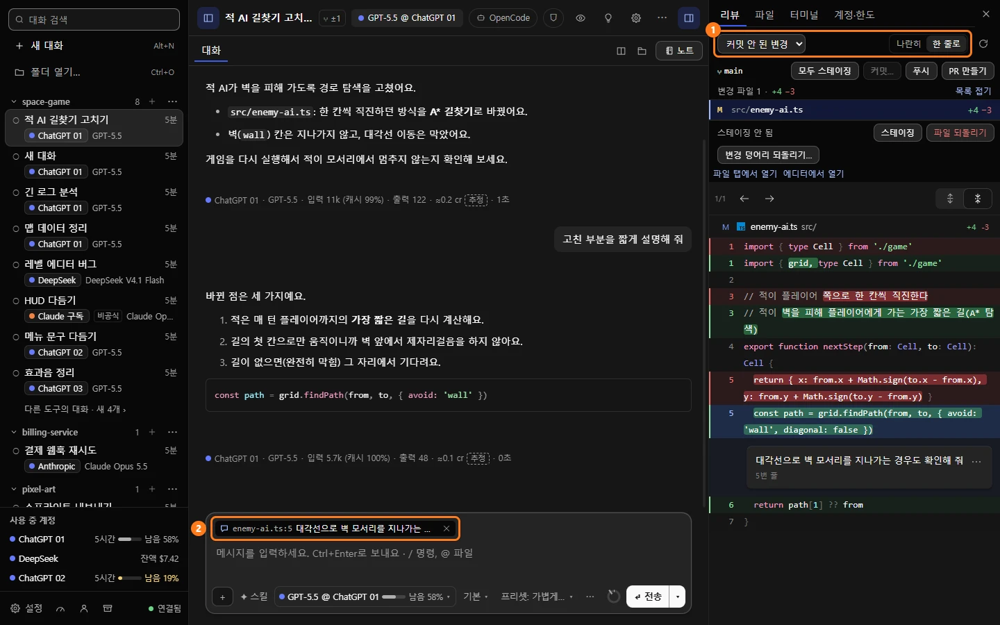
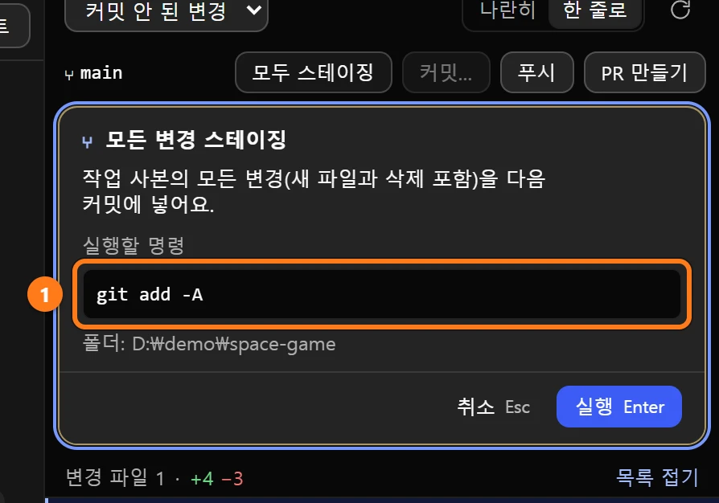
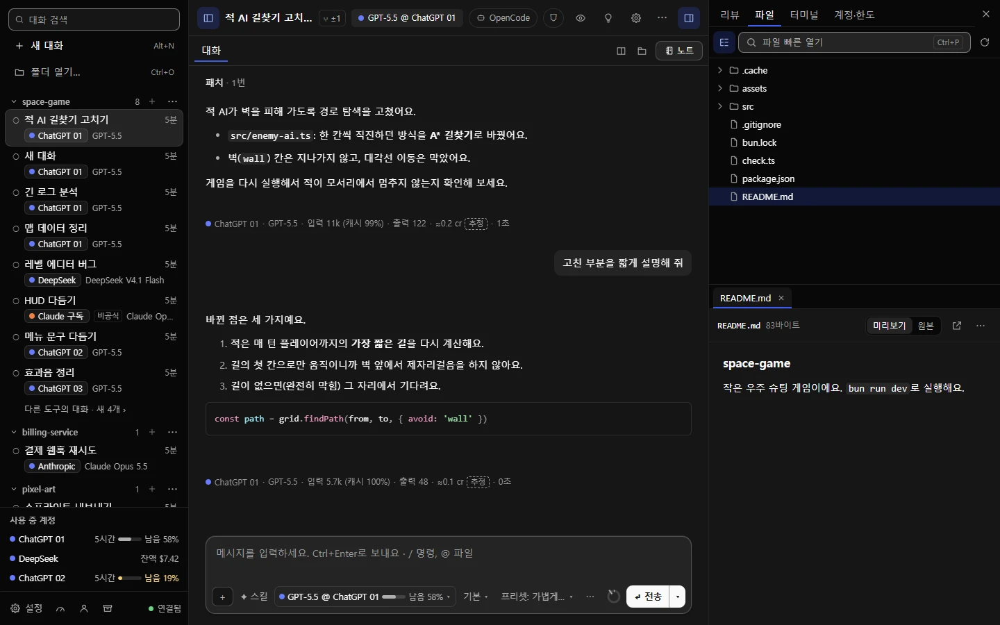

# 9. 작업 패널: 리뷰·Git·파일·터미널

**한 줄 요약**: 화면 오른쪽 **작업 패널**(`Ctrl+Alt+B`)에서 에이전트가 바꾼 코드를 보고(`리뷰`), Git으로 저장하고, 파일을 열어 보고(`파일`), 터미널을 써요. Git 동작은 언제나 실행할 명령을 먼저 보여 준 뒤에만 실행해요.

## 패널 열고 닫기

- 헤더 오른쪽 끝의 `작업 패널` 단추나 `Ctrl+Alt+B`로 열고 닫아요.
- 탭은 `리뷰`, `파일`, `터미널`, `계정·한도` 넷이에요. 탭마다 단축키가 있어요(아래 표).
- 앱 안 브라우저는 이 패널이 아니라 대화 옆 칸에 열려요(대화 위 줄의 `브라우저` 단추, [19장](19-browser-pane.md)).
- `계정·한도` 탭은 [7장](07-usage.md)에서 다뤄요.

| 탭 | 단축키 |
|---|---|
| `리뷰` | `Ctrl+Shift+R` |
| `파일` | `Ctrl+\` (파일 빠른 열기는 `Ctrl+P`) |
| `터미널` | `` Ctrl+` `` (새 터미널은 `Ctrl+Alt+T`) |
| `계정·한도` | `Ctrl+Shift+U` |

## 9.1 리뷰: 바뀐 코드 보기

에이전트가 고친 내용을 확인하는 곳이에요. 헤더의 브랜치 칩(예: `main · ±1`)을 눌러도 열려요.

> **용어** 브랜치 칩 `main · ±1`: 지금 이 프로젝트가 Git 브랜치 `main` 위에 있고, 아직 저장 지점(커밋)에 넣지 않은 바뀐 파일이 1개 있다는 뜻이에요. Git과 브랜치는 아래 9.2에서 쉽게 풀어요.

**① 무엇을 볼지 고르기**

| 선택 | 보여 주는 것 |
|---|---|
| `커밋 안 된 변경` | 아직 저장 지점에 넣지 않은 모든 변경 |
| `브랜치 대 …` | 이 브랜치가 기준 브랜치(예: `main`)와 다른 점 전체 |
| `마지막 턴` | 에이전트가 방금 한 턴에서 바꾼 것 |
| `이 대화 전체` | 이 대화에서 바꾼 것 전부 |

- 보는 방식은 `나란히`(왼쪽 전, 오른쪽 후) 또는 `한 줄로`(위아래로 섞어서)예요.
- Git 저장소가 아닌 폴더에서는 `마지막 턴`만 볼 수 있어요.

**② 줄에 코멘트 달기**

1. 바뀐 줄을 눌러 코멘트를 적고 “댓글 달기”를 눌러요.
2. 코멘트가 입력창 위에 칩으로 모여요.
3. 다음 메시지를 보낼 때 함께 가요. 예: “대각선으로 벽 모서리를 지나가는 경우도 확인해 줘.”

> **팁** 코드에서 몇 줄을 고른 뒤 `Ctrl+Shift+L`을 누르면 그 줄들이 입력창에 칩으로 들어가요. "이 부분 설명해 줘"처럼 짧게 물을 때 편해요.

## 9.2 Git: 저장 지점 만들기와 올리기

> **용어** Git 저장소: 파일이 바뀐 기록을 차곡차곡 남겨 두는 폴더예요. 폴더 안에 숨은 `.git` 폴더가 있으면 Git 저장소예요. 기록 한 칸을 **커밋**(이 설명서의 팀 모드 장에서는 "저장 지점")이라고 하고, 기록의 줄기 하나를 **브랜치**라고 해요. Git 저장소가 아니면 팀 모드와 작업 폴더를 쓸 수 없고, 리뷰도 `마지막 턴`만 돼요. 사이드바 프로젝트 줄의 흐린 `팀` 단추나 프로젝트 `⋯` 메뉴의 `Git 저장소로 만들기…`로 Git 저장소와 첫 커밋을 만들어요([17장](17-team-mode.md)).

리뷰 탭 위쪽 줄과 파일마다 Git 단추가 있어요.

| 단추 | 하는 일 |
|---|---|
| `모두 스테이징` | 바뀐 파일 모두를 다음 커밋에 넣을 준비를 해요(스테이징) |
| `스테이징`, `스테이징 취소` | 이 파일만 넣거나 빼요 |
| `커밋…` | 스테이징한 변경을 저장 지점 하나로 남겨요. 메시지를 적어요 |
| `푸시` | 커밋을 원격 저장소(GitHub 같은 곳)에 올려요 |
| `PR 만들기` | 검토 요청을 만들어요(`gh` 명령이 깔려 있을 때) |
| `파일 되돌리기` | 이 파일의 커밋 안 된 변경을 버려요. **되돌릴 수 없어요** |
| `변경 덩어리 되돌리기…` | 바뀐 부분 중 고른 덩어리만 버려요 |

**모든 Git 동작은 실행할 명령을 먼저 보여 줘요.**

1. 단추를 누르면 `Git 명령 확인` 상자가 떠요.
2. 무엇을 하는지 설명과 `실행할 명령`, 그리고 어느 폴더에서 실행하는지가 보여요.
3. `실행`(`Enter`)을 눌러야 실행돼요. 그만두려면 `취소`(`Esc`).

- 이 확인은 **승인 모드와 상관없이 언제나** 떠요([8장](08-approvals.md)).
- `파일 되돌리기`의 설명에는 `되돌릴 수 없어요.`가 붙어요. 꼭 읽고 누르세요.

## 9.3 파일: 트리와 보기

- 위쪽 `파일 빠른 열기` 칸(`Ctrl+P`)에 파일 이름 일부를 치면 바로 찾아요.
- 트리에서 파일을 누르면 아래에 열려요. 코드, Markdown, 그림(mermaid 포함), 사진, PDF를 볼 수 있어요. Markdown은 `미리보기`와 `원본`을 바꿔 봐요.
- 대화 속 파일 이름을 눌러도 여기로 열려요.
- `에디터에서 열기`: 평소 쓰는 편집기로 열어요. 어떤 편집기를 쓸지는 `설정` > `데스크톱 앱` > `에디터`에 적어요(예: `code`, `cursor`).
- `탐색기에서 보기`: Windows 탐색기로 그 파일이 있는 폴더를 열고 그 파일을 골라 줘요(데스크톱 앱에서만). 파일을 실행하거나 다른 프로그램으로 열지는 않아요. 리뷰 탭에서 고른 파일의 머리줄에도 같은 단추가 있어요.
- 트리의 **폴더** 줄을 오른쪽 클릭하면(키보드는 `Shift+F10`) `탐색기에서 열기`와 `경로 복사`가 나와요(데스크톱 앱에서만).
- 방금 만든 파일은 10초쯤 뒤에 검색돼요.

### 작업 폴더를 탐색기에서 열기

지금 대화가 일하는 폴더를 Windows 탐색기로 바로 열 수 있어요. 에이전트가 만든 파일을 다른 프로그램으로 끌어다 놓거나 폴더째 살펴볼 때 써요.

| 무엇을 | 어디서 |
|---|---|
| 지금 대화의 작업 폴더 | 대화 헤더 `⋯` → `탐색기에서 열기`, 또는 명령 팔레트(`Ctrl+K`)에서 `탐색기에서 열기` |
| 프로젝트 폴더 | 사이드바 프로젝트 줄의 `⋯` → `탐색기에서 열기` |
| 파일 탭의 폴더 | 트리의 폴더 줄을 오른쪽 클릭 → `탐색기에서 열기` |
| 파일 하나 | 파일 탭의 파일 줄 오른쪽 클릭이나 보기 위 `⋯` → `탐색기에서 보기`, 리뷰 탭의 `탐색기에서 보기` |

- 따로 만든 작업 폴더에서 하는 대화면 그 작업 폴더가 열려요(프로젝트 원래 폴더가 아니에요).
- **데스크톱 앱에서만** 보여요. 브라우저로 연 화면, 휴대폰, 다른 PC를 보는 `원격 PC` 창에는 이 항목이 없어요. 폴더가 지금 보는 기기가 아니라 앱이 도는 PC에 있기 때문이에요.
- 앱에서 열어 둔 프로젝트 폴더와 작업 폴더 **안**만 열어요. 그 밖의 경로는 `앱에서 열어 둔 폴더 밖이라 열지 않았어요`라고 알려요.
- 사람이 누를 때만 열려요. 에이전트는 이 기능을 쓸 수 없어요.
- **SSH 호스트에서 하는 대화**는 Windows 탐색기 대신 내가 고른 SSH 파일 탐색기 프로그램으로 열어요. 고르는 방법은 [22장](22-ssh-remote.md)의 `SSH 파일 탐색기 프로그램`에 있어요.

## 9.4 터미널

- `` Ctrl+` ``로 열어요. 새 터미널은 `Ctrl+Alt+T`예요.
- 터미널은 **프로젝트 폴더**에서 열리고, 세션을 바꿔도 그대로 남아요.
- 어디에 둘지: `설정` > `화면 배치` > `터미널 위치`에서 `작업 패널 탭` 또는 `대화 아래`를 골라요. 태블릿·휴대폰 폭에서는 아래에서 올라오는 시트로 열려요.
- 어떤 셸을 쓸지: `설정` > `셸·터미널` > `기본 셸`에서 골라요(PowerShell 7, Windows PowerShell, Git Bash, cmd 중 이 PC에 있는 것).

> **팁** 입력창 줄 맨 앞에 `!`를 붙이면 에이전트를 깨우지 않고 **셸 명령만** 실행해요. 예: `!git status`를 적고 `Ctrl+Enter`(보내는 키를 `Enter로 보내기`로 바꿨다면 `Enter`). `Ctrl+Shift+X`로 셸 모드에 들어가고, 빈 입력창에서 `Esc`(또는 `Ctrl+Shift+E`)로 나와요.

## 알아 두면 좋아요

- 패널 폭은 경계를 끌어서 바꿔요. 처음으로 돌리려면 `설정` > `화면 배치`의 `사이드바·작업 패널 폭 초기화`를 눌러요.
- 창 폭이 좁으면 패널이 대화 위에 겹치거나 시트로 열려요([5장](05-screen-tour-theme.md)).
- 터미널이나 앱 안 브라우저에 포커스가 있으면 앱 단축키 대부분이 그쪽으로 가요. `Ctrl+K`, `Ctrl+Alt+B`, 패널 탭 단축키, 분할 칸 옮기기(`Ctrl+Alt+1`–`4`, `F6`)만 앱이 받아요([부록 B](91-shortcuts.md)).

## 조심하세요

> **주의** `파일 되돌리기`와 `변경 덩어리 되돌리기…`는 **되돌릴 수 없어요.** 버리기 전에 리뷰에서 내용을 한 번 더 보세요.

> **주의** `푸시`와 `PR 만들기`는 코드를 인터넷(원격 저장소)에 올려요. 올리면 남이 볼 수 있어요. 비밀 값이 들어 있지 않은지 먼저 확인하세요.

## 더 알아보기

- 에이전트가 바꾼 것을 되돌리기: [10장](10-conversation-tools.md)
- 설계 문서: [03 화면 §4.7 작업 패널, §18.5 리뷰, §18.6 터미널](../03-ui-ux.md)
