# 10. 대화 다루기: 끼워 넣기·대기열·복원·문맥 비우기·포크·찾기·노트·음성 입력·스킬·에이전트 방식·MCP 서버·이미지 만들기·곁질문

**한 줄 요약**: 에이전트가 일하는 중에도 `Ctrl+Enter`로 한마디 **끼워 넣거나** `Alt+Enter`로 **대기열**에 넣을 수 있어요. 잘못 간 대화는 `이 지점으로 복원`으로 되감고, 다른 길을 시험하려면 **포크**로 복제해요. 같은 대화에서 앞 대화 없이 새로 시작하려면 `/reset-context`로 **문맥을 비우고**, 마음이 바뀌면 `되돌리기`로 돌아와요. 앱의 모든 기능은 `Ctrl+K` 명령 팔레트에서 이름으로 찾아요. 메모는 **대화 메모**, **프로젝트 노트**, **아이디어 노트**(`Ctrl+Alt+I`) 중 알맞은 곳에 적고, 길게 칠 말은 **음성 입력**(`Ctrl+Alt+V`)로 말해서 넣어요. Codex·Claude Code에서 쓰던 **스킬**과 **MCP 서버**도 `설정`에서 가져와 써요. 모델에게 그림을 그려 달라고 하려면 `설정 > 이미지 만들기`에서 **이미지 만들기** 도구를 켜요. 일하는 중에 잠깐 물을 것은 `/btw`로 **곁질문**해요. 기록에 남지 않아요.

## 10.1 실행 중에 더 말하기: 끼워 넣기와 대기열

에이전트가 일하는 동안 입력창 아래에 `실행 중 · Ctrl+Enter 끼워 넣기 · Alt+Enter 대기열 · Esc 두 번 중단`이 보여요.

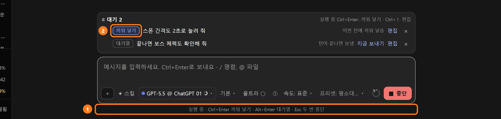

| 키 | 이름 | 언제 가나요 | 이럴 때 |
|---|---|---|---|
| `Ctrl+Enter` | `끼워 넣기` | **지금 턴 안에서**, 에이전트가 하던 단계를 마치고 다음 단계에서 바로 읽어요 | "그 파일 말고 이 파일이야"처럼 방향을 바로잡을 때 |
| `Alt+Enter` | `대기열` | **지금 턴이 끝난 뒤** 새 턴으로 보내요 | "끝나면 이것도 해 줘"처럼 다음 일을 미리 줄 세울 때 |

- 보낸 메시지는 입력창 위 `대기 2` 목록에 모여요. 줄마다 `끼워 넣기`·`대기열` 배지와 `편집`, `지금 보내기`(대기열 줄), `×`(취소)가 있어요.
- 대기열 첫 메시지는 `Ctrl+↑`로 바로 고쳐요.
- 끼워 넣었지만 아직 에이전트가 읽지 않은 메시지는 대화 끝에도 흐린 말풍선(`끼워 넣기 대기`)으로 보여요. 말풍선의 `⌄`를 눌러 `대기열로 옮기기`나 `대기 메시지 취소`를 골라요.
- 보내는 키를 `Enter로 보내기`로 바꿨다면([4.3](04-first-conversation.md)) 끼워 넣기는 `Enter`, 대기열은 `Ctrl+Enter`예요. 안내 줄과 `대기 2` 목록 머리도 그 키로 보여요.
- 두 키의 역할을 바꾸고 싶으면 `설정` > `일반` > `실행 중 보내기 동작`에서 `대기열`을 골라요. 그 아래 설명 줄이 두 키가 지금 어디로 가는지 알려 줘요(`Ctrl+Enter는 대기열로, Alt+Enter는 끼워 넣기로 보내요.`).
- 끼워 넣은 메시지는 **지금 계정**으로 실행돼요. 계정 전환을 기다리는 동안 보낸 메시지는 전환 뒤 새 계정으로 가요([6장](06-model-account.md)).

## 10.2 멈추기와 백그라운드

- **멈추기**: `Esc`를 두 번 누르거나 빨간 `중단` 단추를 눌러요. 그때까지 한 일(고친 파일, 실행한 명령)은 그대로 남아요.
  - `Codex 방식`에서 GPT-6 계열 모델이 돌리던 스크립트(`exec` 카드)도 함께 멈춰요. 앞에서 뒤로 돌려 둔 스크립트와, 스크립트 안에서 아직 첫 출력을 기다리던 명령도 끝나요. 스크립트가 저장해 둔 값은 남아서 다음 스크립트가 다시 쓸 수 있어요.
- **백그라운드로**: 오래 걸리는 명령이나 하위 에이전트가 돌면 `실행 중: …` 줄과 `백그라운드로` 단추가 보여요. 누르거나 `Alt+B`를 누르면 그 일을 뒤에서 돌리고 에이전트는 다른 일을 계속해요.
- 팀 모드의 담당 대화를 멈추면 그 영역의 `메인 멈춤`이 저절로 켜져요([17장](17-team-mode.md)).

## 10.3 이 지점으로 복원: 대화 되감기

대화가 엉뚱한 쪽으로 갔으면, 그 앞의 내 메시지로 되감을 수 있어요. 파일 변경도 함께 되돌릴 수 있어요.

1. 되돌아갈 **내 메시지**에 마우스를 올리고 말풍선 오른쪽 위의 `⌄`를 눌러 `이 지점으로 복원`을 골라요. 휴대폰에서는 `⌄`가 늘 보여요.
2. 확인 창에서 `파일 변경도 되돌리기`를 고를지 정하고 확인해요.
3. 입력창 위에 `복원 대기: 이 메시지 뒤 턴 1개와 파일 변경 0개를 되돌렸어요` 띠가 떠요. 그 메시지는 입력창에 다시 들어가요.

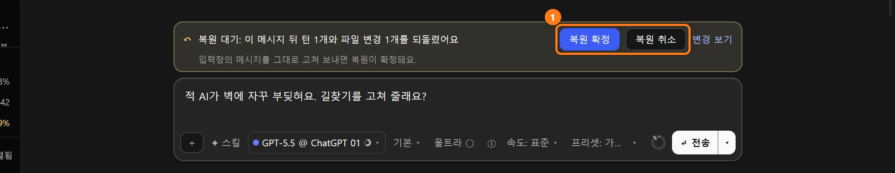

4. 둘 중 하나를 골라요.
   - `복원 확정`: 되감기를 끝내요. 입력창의 메시지를 고쳐서 그대로 보내도 확정돼요(`입력창의 메시지를 그대로 고쳐 보내면 복원이 확정돼요.`).
   - `복원 취소`: 없던 일로 해요. 대화와 파일이 원래대로 돌아와요.
   - `변경 보기`로 되돌린 파일 변경을 먼저 볼 수 있어요.

알아 둘 것

- 복원 대기 중에는 압축할 수 없어요(`복원 대기 중 — 압축하면 복원이 확정돼요`, [13장](13-auto-compaction.md)).
- 복원은 **계정을 되돌리지 않아요.** 되감은 범위에 계정 전환이 있어도 지금 쓰는 `모델 @ 계정`은 그대로예요.
- 대기열에 있던 메시지는 취소돼요. 되감은 대화를 기준으로 쓴 메시지라서예요.
- 복원한 다음 요청은 캐시를 처음부터 다시 쓸 수 있어요. 대화가 길면 조금 비쌀 수 있어요.
- 마지막 턴만 빨리 되감으려면 입력창에 `/undo`(파일 포함), 되감기를 취소하려면 `/redo`를 써요.
- 문맥을 비운 바로 뒤에 `/undo`를 치면 `문맥 비우기 되돌리기`와 `마지막 턴 복원` 중에서 골라요(10.14).

## 10.4 포크: 대화 복제

> **용어** 포크: 지금까지의 대화를 **새 대화로 복제**하는 것이에요. 원래 대화는 그대로 두고, 복제한 쪽에서 다른 길을 시험해요.

- 대화 전체: 세션 헤더 `⋯` → `포크`, 또는 입력창에 `/fork`.
- 어느 메시지에서: 세션 헤더 `⋯` → `이 메시지에서 포크…` → `메시지에서 포크` 창에서 메시지를 고르고 `여기서 포크`. 고른 메시지 **앞까지**가 새 대화로 복제되고, 고른 메시지는 새 대화의 입력창에 들어가요. 고쳐서 보내면 돼요.
- 끝나면 `포크했어요 · 원 대화는 그대로예요`가 떠요.

> **팁** 포크한 대화는 원래 대화의 캐시를 물려받아요. **같은 계정·같은 모델**로 이어 가면 앞부분을 싸게 읽어요. 포크한 쪽만 다른 계정으로 돌리면 원래 대화의 캐시는 그대로 남아요. 이것이 전환 비용 창의 `곁가지 포크`예요([11장](11-cache-switch-cost.md)).

## 10.5 세션 안에서 찾기

- `Ctrl+F`로 지금 대화에서 낱말을 찾아요. 결과 사이를 오가며 그 자리로 가요.
- 대화 목록에서 제목으로 찾으려면 사이드바 맨 위 `대화 검색` 칸을 써요.

## 10.6 명령 팔레트

`Ctrl+K`를 누르면 명령 팔레트가 열려요. 앱의 거의 모든 기능을 이름으로 찾아 실행해요.

.")

- **한글 초성 검색**이 돼요. “ㅈㅎ”만 쳐도 `전환`이 든 항목이 나와요.
- 항목 오른쪽에 단축키가 있으면 함께 보여요. 자주 쓰는 것은 단축키를 외워 두면 빨라요.
- `↑`/`↓`로 고르고 `Enter`로 실행, `Esc`로 닫아요.

## 10.7 슬래시 명령

입력창 맨 앞에 `/`를 치면 명령 목록이 떠요.

| 명령 | 하는 일 |
|---|---|
| `/new` | 새 대화 |
| `/btw <질문>` | 곁질문 — 일을 멈추지 않고 이 대화에 대해 물어봐요. 기록에 남지 않아요(10.18). `/곁질문`으로 쳐도 돼요 |
| `/compact` | 지금 압축 — 대화를 요약해 문맥을 줄여요 |
| `/reset-context` | 문맥 비우기 — 같은 대화에서 새로 시작해요. 되돌릴 수 있어요(10.14). `/문맥비우기`로 쳐도 돼요 |
| `/fork` | 이 지점에서 포크 |
| `/undo`, `/redo` | 마지막 턴 복원(파일 포함), 복원 취소 |
| `/export` | 세션 내보내기(JSON 파일) |
| `/model` | 모델 @ 계정 전환기 |
| `/goal` | 목표 — 이룰 때까지 이어서 일해요. `/goal` 뒤에 목표를 써서 정하고, 뒤에 `pause`·`resume`·`clear`를 쓰면 멈추고, 다시 하고, 지워요. 아무것도 없이 보내면 지금 목표와 쓴 양을 보여요 |

- 프로젝트나 MCP 서버가 더한 명령도 같은 목록에 보여요.
- `/goal`은 에이전트 방식마다 달라요. `Codex 방식` 대화에서는 Codex의 목표예요. 정하면 바로 일을 시작하고, 모델이 목표를 이뤘다고 표시할 때까지 이어 가요(목록 줄 `Codex 목표`). 다른 방식에서는 OpenCode의 목표예요. 한 턴이 끝날 때마다 검토해 이어 갈지 정해요(목록 줄 `목표`). Codex 방식의 목표에는 글만 넣을 수 있어요. 파일이나 스킬은 목표를 정한 뒤에 보내요.

## 10.8 그 밖의 대화 동작

- **이전·다음 메시지로**: `Ctrl+Alt+[` / `Ctrl+Alt+]`.
- **이전·다음 세션으로**: `Alt+↑` / `Alt+↓`.
- **세션 정보**: `Ctrl+I`. 이 대화의 모델 @ 계정, 쓴 양 같은 자세한 정보를 봐요([7장](07-usage.md)).
- **고정·보관·삭제**: 사이드바 세션 줄의 `⋯`에서 `고정`(맨 위에 붙이기), `보관`(목록에서 치우기), `삭제…`(영구히 지우기). 지금 연 대화는 `Ctrl+Alt+Backspace`로 보관해요. 보관한 세션은 세션 목록 아래 `보관함 · 2 ›`나 사이드바 맨 아래 `보관함 보기`에서 다시 꺼내요([5장](05-screen-tour-theme.md)).
- **메모**: 이 대화에만 붙는 메모는 헤더 `⋯` → `대화 메모`, 프로젝트의 메모는 대화 위 줄의 `노트` 단추, 아무 데나 떠오른 생각은 헤더의 전구 단추예요(아래 10.9).

## 10.9 노트: 대화 메모·프로젝트 노트·아이디어 노트

메모를 적는 곳은 세 군데예요. **어디에 붙는 메모인지**로 골라요.

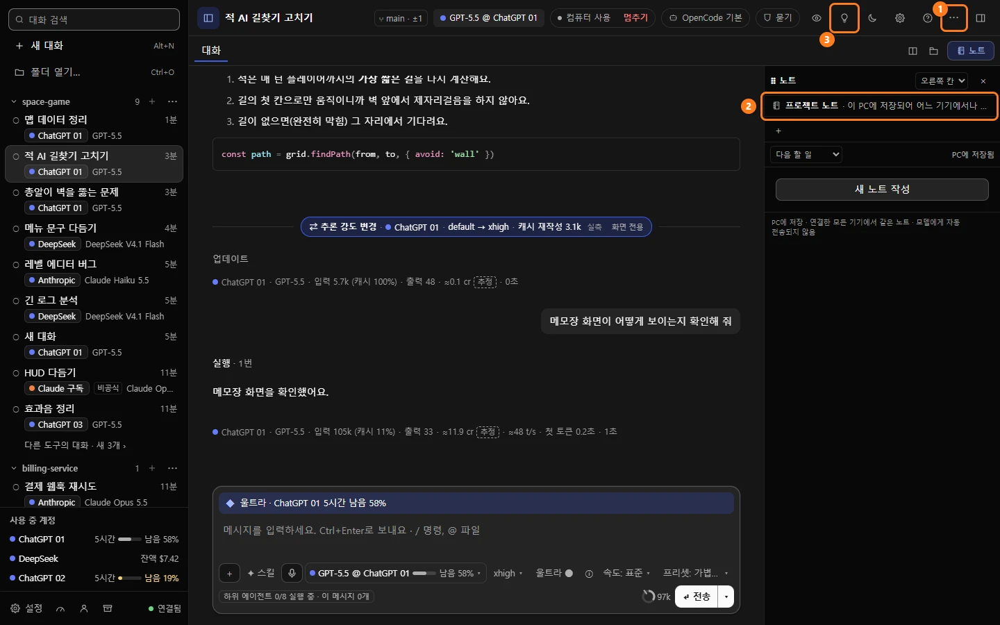

| | ① 대화 메모 | ② 프로젝트 노트 | ③ 아이디어 노트 |
|---|---|---|---|
| 붙는 곳 | 대화 하나 | 프로젝트(폴더) 하나 | 어디에도 안 붙어요(전체에 하나) |
| 이럴 때 | "이 대화에서 내일 확인할 것" | 할 일 목록, 버그 메모처럼 프로젝트에 두고 볼 것 | 일하다 떠오른 생각을 빨리 적어 둘 때 |
| 여는 곳 | 헤더 `⋯` → `대화 메모`, 명령 팔레트의 `대화 메모 열기` | 대화 위 줄의 `노트` 단추, 명령 팔레트의 `프로젝트 노트 열기` | 헤더의 전구 단추, `Ctrl+Alt+I`, 명령 팔레트의 `아이디어 적기`·`아이디어 노트 열기` |
| 개수와 길이 | 대화마다 하나, 4,000자까지 | 프로젝트마다 200개, 하나에 200,000자까지 | 1,000개까지, 하나에 2,000자까지 |
| 모델이 보나요? | 처음에는 안 봐요. `모델에게도 보이기`를 켜면 봐요 | 안 봐요 | 안 봐요 |
| 어느 기기에서 보이나요? | 그 대화를 여는 모든 기기 | 연결한 모든 기기 | 연결한 모든 기기 |

세 곳 모두 이 PC의 서비스에 저장돼요. 그래서 데스크톱 앱, 휴대폰, 다른 PC 어디서 열어도 같은 내용이 보여요.

### 대화 메모: 이 대화에만 붙는 메모

1. 대화 헤더의 `⋯`를 누르고 `대화 메모`를 눌러요.
2. `대화 메모` 창에 적어요(①). `Ctrl+Enter`나 `저장`을 누르면 저장돼요. 고친 것을 버리려면 `변경 취소`를 눌러요.
3. 저장되면 아래에 `저장했어요`가 떠요.

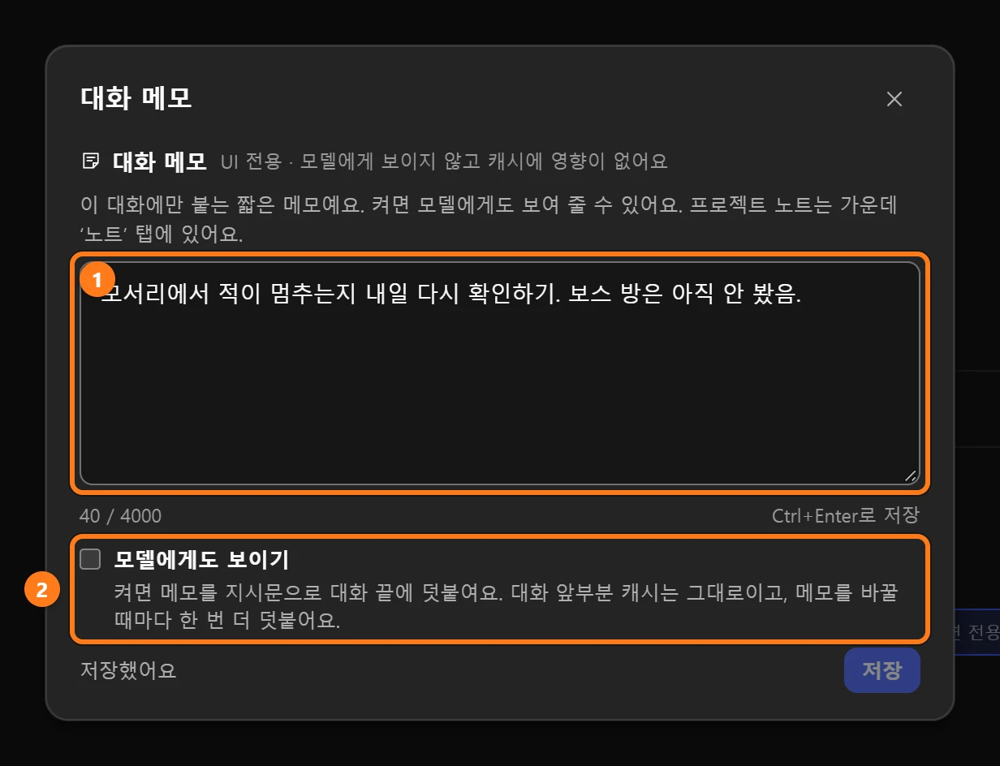

- 처음에는 **나만 보는 메모**예요. 제목 옆에 `UI 전용 · 모델에게 보이지 않고 캐시에 영향이 없어요`가 보여요. 모델에게 가지 않으니 비용도 들지 않아요.
- `모델에게도 보이기`를 켜면(②) 다음 요청 때 이 메모를 대화 끝에 덧붙여요(`다음 요청에서 이 메모가 대화 끝에 더해져요`). 대화 앞부분의 캐시는 그대로예요. 메모를 고칠 때마다 한 번 더 덧붙어요. 끄면 다음 요청에서 모델에게 이 메모를 더는 쓰지 않는다고 알려요.
- 4,000자까지 쓸 수 있어요. 넘으면 `메모는 4000자까지 쓸 수 있어요`가 떠요.
- 다른 창이나 기기에서 같은 메모를 바꿨으면 `다른 곳에서 메모가 바뀌었어요`와 `새 내용 불러오기`가 떠요.
- `메시지 보내기` 권한이 없는 기기에서는 `모델에게도 보이기`를 켤 수 없어요([24장](24-phone-other-pc.md)).

### 프로젝트 노트: 프로젝트의 노트 여러 개

할 일 목록, 버그 메모처럼 대화와 상관없이 프로젝트에 두고 보는 노트예요. 머리에 `프로젝트 노트 · 이 PC에 저장되어 어느 기기에서나 같아요`가 보여요.

1. 대화 위 줄 오른쪽의 `노트` 단추를 눌러요(`프로젝트 노트 열기 · 드래그하여 배치`). 처음에는 오른쪽 열에 열려요.
2. 노트가 하나도 없으면 `새 노트`가 바로 열려요. `노트 제목`과 내용을 적으면 돼요. 따로 저장할 필요 없이 적는 대로 저장돼요(`Ctrl+S`로 바로 저장할 수도 있어요).
3. 노트를 더하려면 노트 탭 줄의 `+`(`새 노트`)를 눌러요(①). 탭의 `×`는 탭만 닫아요. 노트는 지워지지 않아요.
4. 닫은 노트는 `저장된 노트 (2)` 목록에서 골라 다시 열어요.

, ② 저장 상태(PC에 저장됨), ③ 어디에 저장되는지 알려 주는 줄이에요. 위 오른쪽의 노트 단추로 열고 닫아요.")

- 저장 상태(②): `저장 중…` → `PC에 저장됨`. 저장이 안 되면 `저장 실패`와 `다시 저장`이 보여요.
- 맨 아래 줄(③): `PC에 저장 · 연결한 모든 기기에서 같은 노트 · 모델에게 자동 전송되지 않음`. 노트 내용을 모델에게 쓰게 하려면 입력창에 붙여 넣어요.
- **놓을 자리**: 노트 머리의 `노트 위치`에서 `왼쪽 칸`, `탭으로`, `오른쪽 칸`을 골라요. 머리를 끌어 옮겨도 돼요. `탭으로`을 고르면 가운데 위에 `대화`, `노트` 탭이 생겨요(데스크톱 앱에서는 `대화`, `브라우저`, `노트`). 놓을 자리는 창마다 따로 기억해요.
- **지우기**: `노트 삭제` → `이 노트를 지울까요? 연결한 모든 기기에서 사라져요.` → `지우기`. 모든 기기에서 사라지니 조심하세요.
- **한도**: 프로젝트마다 노트 200개, 노트 하나에 200,000자, 제목 200자까지예요. 넘으면 `노트는 워크스페이스마다 200개까지 만들 수 있어요`, `노트는 200000자까지 쓸 수 있어요`가 떠요.

**두 곳에서 같은 노트를 고치면.** 저장할 때 다른 곳의 변경이 먼저 들어가 있으면 덮어쓰지 않고 물어요.

에서 같은 노트를 먼저 저장한 경우예요. ① 어느 쪽을 남길지 골라요.")

- `새 내용 불러오기`: 다른 곳의 내용을 받아요. 이 창에서 적은 것은 버려요.
- `내 내용으로 저장`: 이 창의 내용으로 덮어써요.
- 다른 곳에서 노트를 지웠으면 `다른 곳에서 이 노트를 지웠어요`와 `내 내용 버리기`, `내 내용으로 저장`이 보여요.

**권한이 없는 기기.** `메시지 보내기` 권한이 없는 휴대폰·다른 PC에서는 노트를 읽기만 해요(`이 기기에는 노트를 바꿀 권한이 없어 읽기만 해요`). `+`, `노트 삭제`, 마이크 단추가 보이지 않아요([24장](24-phone-other-pc.md)).

**예전 노트 옮기기.** 이 기능 전에는 노트 탭이 그 브라우저(창)에만 저장됐어요. 새 버전에서 프로젝트의 노트 탭을 처음 열 때, PC에 그 프로젝트의 노트가 아직 없으면 예전 노트를 PC로 한 번 옮겨요. 예전 사본은 그 브라우저에 그대로 남아요. PC에 이미 노트가 있으면 합치지 않아요. 너무 커서 못 옮긴 노트가 있으면 `이전 노트 1개는 너무 커서 PC로 옮기지 못했어요. 이 브라우저에 그대로 남아 있어요.`처럼 알려 줘요.

> **참고** 프로젝트를 열지 않은 화면의 노트는 PC에 갈 곳이 없어서 예전처럼 그 기기에만 저장돼요. 머리에 `프로젝트 폴더가 없어 이 기기에만 저장돼요`가 보여요.

### 아이디어 노트: 떠오른 생각을 빨리 적는 보드

프로젝트와 상관없이 일하다 떠오른 생각을 포스트잇처럼 붙여 두는 곳이에요. 앱 전체에 보드 하나예요.

**빨리 적기**

1. 어느 화면에서든 `Ctrl+Alt+I`를 눌러요. 입력창에 글을 쓰던 중이어도 돼요. 쓰던 글과 포커스는 그대로 남아요.
2. 작은 칸이 뜨면 적고 `Enter`(또는 `붙이기`)를 눌러요. 줄을 바꾸려면 `Shift+Enter`예요.
3. `아이디어를 붙였어요`가 떠요. 알림의 `보드 보기`로 바로 보드를 열 수 있어요.

예요.")

- `Esc`를 누르면 닫혀요. 적던 글은 버리지 않고 다음에 열 때 그대로 있어요. `Ctrl+Alt+I`를 한 번 더 눌러도 닫혀요.
- 글에 “#레벨”처럼 `#`을 붙이면 태그가 돼요. 보드에서 태그로 걸러 봐요.
- 마이크 단추로 받아써서 적어도 돼요(10.10).

**보드 보기**

헤더의 전구 단추나 명령 팔레트의 `아이디어 노트 열기`로 보드를 열어요.

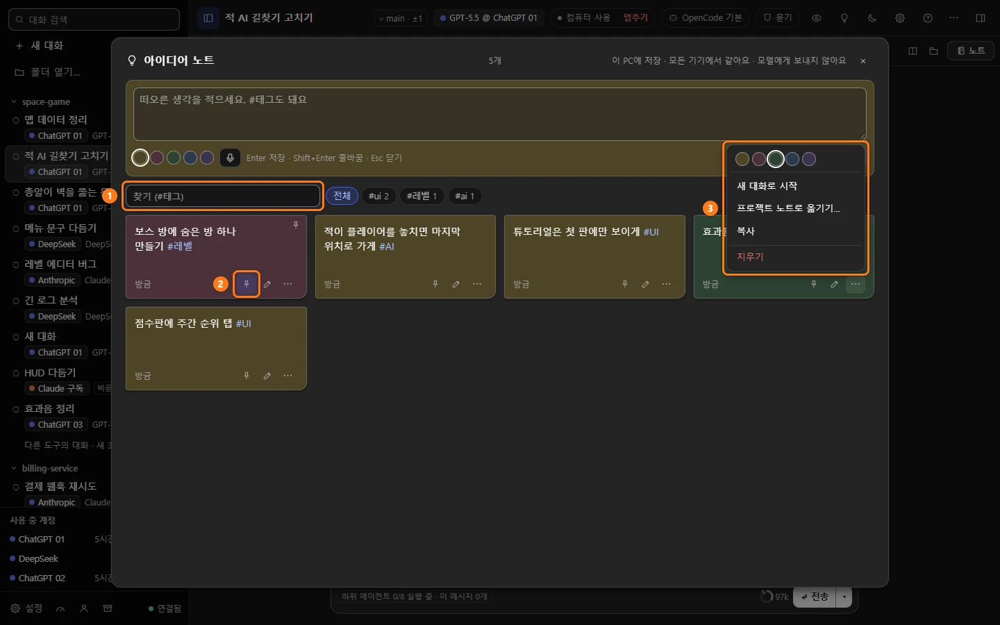

- **찾기**: `찾기 (#태그)` 칸에 낱말이나 태그를 적어요. 태그 단추를 눌러도 걸러져요. `전체`로 돌아가요.
- **순서**: 고정한 쪽지가 맨 앞, 그다음은 새로 적은 것부터예요.
- **쪽지 단추**(마우스를 올리면 이름이 보여요): 압정 `맨 위에 고정`/`고정 풀기`, 연필 `고치기`. 글을 두 번 눌러도 고쳐요. 고칠 때는 `Ctrl+Enter`로 저장, `Esc`로 취소예요.
- **`⋯` 메뉴**: 색(`노랑`, `분홍`, `초록`, `파랑`, `보라`), `새 대화로 시작`, `프로젝트 노트로 옮기기…`, `복사`, `지우기`.
  - `새 대화로 시작`: 새 대화 입력창에 이 아이디어를 넣어 줘요. 보내지는 않아요.
  - `프로젝트 노트로 옮기기…`: 고른 프로젝트의 노트 탭에 새 노트로 들어가고, 보드에서는 빠져요.
  - `지우기`: 묻지 않고 지우는 대신 8초 동안 `아이디어를 지웠어요`와 `되돌리기`가 보여요.
- **휴대폰**: 보드가 화면 가득 열리고, 오른쪽 아래 `+` 단추로 바로 적어요.
- 보드 아래에 `이 PC에 저장 · 모든 기기에서 같아요 · 모델에게 보내지 않아요`가 보여요. 모델에게 쓰게 하려면 `새 대화로 시작`이나 복사해서 붙여 넣어요.
- 두 기기에서 같은 쪽지를 고치면 `다른 기기에서 먼저 고쳤어요. 위는 그 내용이고, 내 글은 아래에 남겨 뒀어요.`가 떠요. `내 글로 저장`으로 내 글을 남겨요.
- `메시지 보내기` 권한이 없는 기기에서는 읽기만 해요(`이 기기는 아이디어를 읽기만 할 수 있어요`).

## 10.10 음성 입력: 말로 입력하기

> **용어** 음성 입력: 마이크로 말한 내용을 글자로 바꿔 입력창이나 노트의 커서 자리에 넣는 기능이에요. 글자로 바꾸는 일은 OpenAI나 Deepgram의 인식 서비스가 해요. 쓴 만큼 돈이 드는 API 키가 따로 필요해요.

### 처음 켜기

처음에는 꺼져 있어요. `설정` > `음성 입력`에서 켜요.

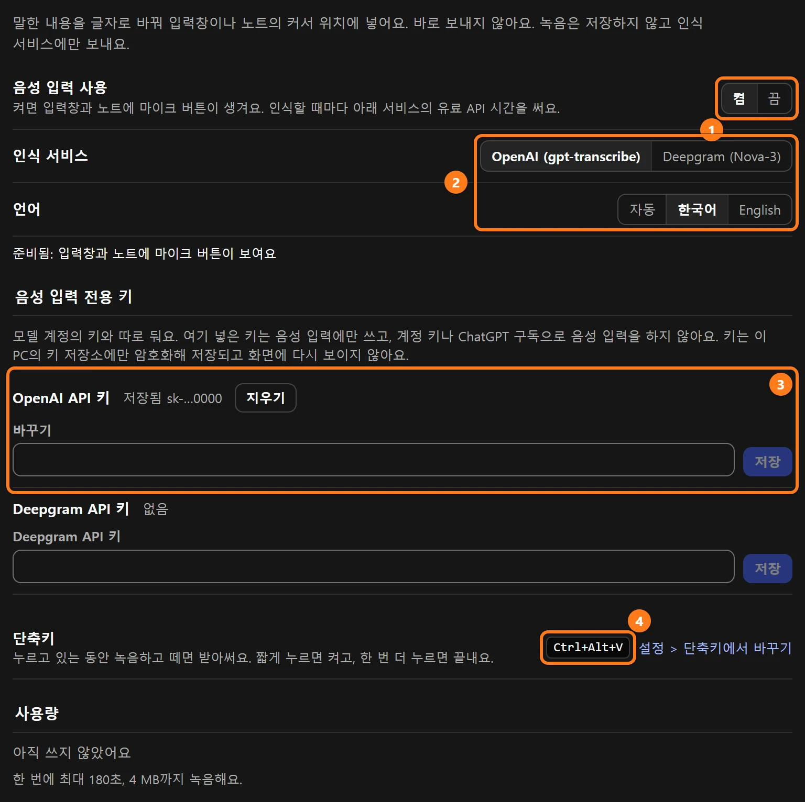

1. `음성 입력 사용`을 `켬`으로 바꿔요(①).
2. `인식 서비스`를 골라요(②). `OpenAI (gpt-transcribe)`가 처음 값이고, `Deepgram (Nova-3)`도 있어요. `언어`는 `자동`, `한국어`(처음 값), `English` 중에서 골라요.
3. `음성 입력 전용 키`에 고른 서비스의 키를 넣고 `저장`을 눌러요(③). 저장하면 키는 다시 보이지 않고 `저장됨 sk-…1234`처럼 앞뒤 몇 글자만 보여요.
4. 위에 `준비됨: 입력창과 노트에 마이크 버튼이 보여요`가 뜨면 끝이에요.

- **모델 계정과 따로예요.** `계정`에 OpenAI API 키 계정을 더해도 음성 입력은 켜지지 않아요. 음성 입력은 여기 넣은 키만 쓰고, 계정의 키나 ChatGPT 구독으로 음성 입력을 하지 않아요.
- 키는 이 PC의 키 저장소에만 저장되고 PC 밖으로 나가지 않아요. 휴대폰·다른 PC에서는 키를 넣거나 바꿀 수 없어요(`키는 이 PC의 창에서만 넣고 바꿀 수 있어요`).
- `사용량`에 달마다 서비스별로 쓴 분과 횟수가 보여요(`아직 쓰지 않았어요`). 한 번에 최대 180초, 4 MB까지 녹음해요.
- 단축키(④)는 `설정` > `단축키`의 `음성 입력(누르고 말하기)`에서 바꿔요.

### 말하기

1. 입력창에서 글을 넣을 자리에 커서를 둬요.
2. 마이크 단추(`음성 입력`)를 누르거나 `Ctrl+Alt+V`를 눌러요.
3. 녹음 막대가 보이면 말해요(①). 시간(`0:04 / 3:00`)과 소리 크기 막대가 움직여요.
4. 다 말했으면 `완료`를 눌러요. 그만두려면 `취소`를 눌러요.
5. `받아쓰는 중…` 뒤에 글자가 커서 자리에 들어가요(`받아쓴 글을 넣었어요`). 고른 글자가 있으면 그 자리를 바꿔요.

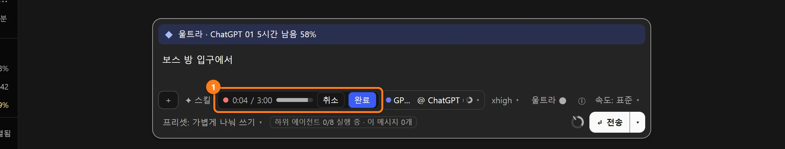

- **누르고 말하기**: `Ctrl+Alt+V`를 누르고 있는 동안 녹음하고, 떼면 받아써요. 짧게 한 번 누르면 녹음이 켜지고, 한 번 더 누르면 끝나요.
- **절대 저절로 보내지 않아요.** 받아쓴 글은 입력창에 들어가기만 해요. 읽어 보고 고친 뒤 직접 보내요.
- 한국어 글자를 조합하는 중이면 조합이 끝난 뒤에 넣어요(`글자 조합이 끝나면 넣어요`).
- 3분이 되면 녹음이 저절로 끝나요. 알아들은 말이 없으면 `알아들은 말이 없어요`가 떠요.
- 녹음은 저장하지 않고 인식 서비스에만 보내요. 음성 입력이 끝나거나 취소하면 버려요.
- **노트에서도 돼요.** 대화 메모, 프로젝트 노트, 아이디어 적기 칸에도 같은 마이크 단추가 있어요. `Ctrl+Alt+V`는 포커스가 노트에 있으면 노트에, 아니면 입력창에 넣어요.

### 다른 기기와 마이크 권한

- 휴대폰·다른 PC도 그 기기에 `메시지 보내기` 권한이 있으면 음성 입력을 쓸 수 있어요. 음성 입력은 이 PC의 서비스가 이 PC의 키로 해요. 녹음과 음성 키는 SSH 원격 서버로 가지 않아요.
- **데스크톱 앱**은 따로 묻지 않고 이 앱 화면에만 마이크를 허락해요(카메라·화면 캡처는 허락하지 않아요). Windows `설정` > 개인 정보 > 마이크에서 데스크톱 앱의 마이크 사용이 꺼져 있으면 녹음이 안 돼요.
- **Android 앱**은 처음 한 번 마이크 권한을 물어요. 휴대폰 브라우저(PWA)는 브라우저가 사이트마다 물어요.
- 마이크 권한을 거절했으면 `마이크 권한이 없어요. …`가 떠요. 안내된 곳에서 허용한 뒤 `다시 시도`를 눌러요.

> **주의** 음성 입력은 쓸 때마다 고른 인식 서비스의 **유료 API 시간**을 써요. 요금은 그 서비스의 계정에서 나가요. 이 앱의 `사용량`은 이 PC가 센 분이에요.

## 10.11 스킬: 고르기와 다른 도구에서 가져오기

> **용어** 스킬: "이런 일은 이렇게 해"를 적어 둔 작업 방법 묶음이에요. 폴더 하나에 `SKILL.md`와 도움 파일이 들어 있어요. 에이전트가 필요할 때 읽고 따라 해요.

입력창 도구 줄의 ✦ `스킬`을 누르면 스킬 창이 열려요. 탭은 둘이에요.

- `목록`: own에서 쓸 수 있는 스킬이에요. 골라서 이번 메시지에 넣어요. 에이전트가 스스로 부를 수 있는 스킬에는 `스스로 불러옴`, 앱에 들어 있는 스킬에는 `기본 제공`이 붙어요. 줄마다 있는 `끄기`로 그 스킬을 이 프로젝트에서만 꺼요(아래 "스킬 창에서 이 프로젝트에서 끄기").
- `가져오기`: 이 PC의 Codex와 Claude Code에 있는 스킬을 own으로 가져와요(이 PC의 창에서만 보여요).

탭 줄 오른쪽의 `설정에서 스킬 관리`를 누르면 `설정` > `스킬`로 가요.

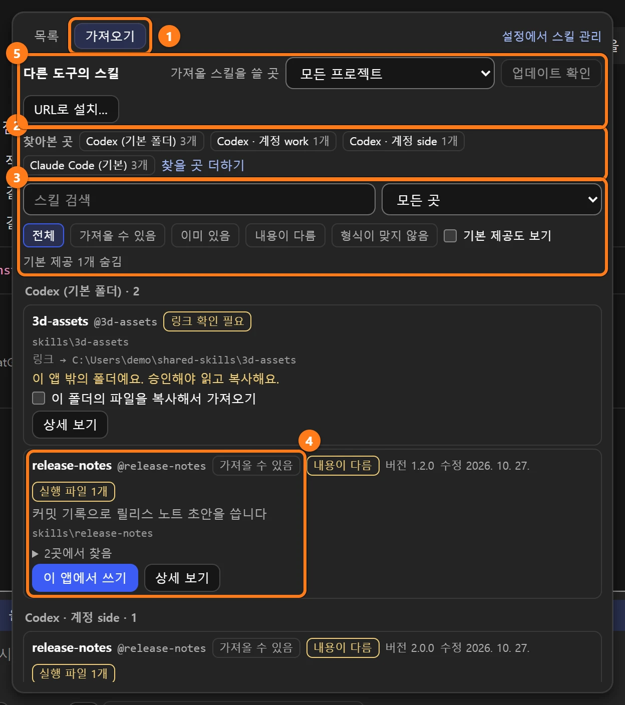

**가져오기 탭 읽는 법**

- 맨 위 `찾아본 곳`에 이 앱이 스킬을 찾은 폴더가 이름으로 보여요. `Codex (기본 폴더)`, `Claude Code (기본)`, codex-multi-provider의 계정은 `Codex · 계정` 뒤에 계정 별칭(예: `Codex · 계정 work`, 별칭이 없으면 `Codex · 계정 03`), 직접 더한 폴더는 `Codex · 폴더` 뒤에 그 폴더 이름(예: `Codex · 폴더 work`)이에요. 그래서 계정 별칭과 폴더 이름이 같아도 헷갈리지 않아요. Claude 앱이 동기화한 스킬은 `Claude Code · 계정` 뒤에 내 Claude 계정 이름이 붙어요. 칩에 마우스를 올리면 전체 경로가 보여요.
- 찾을 폴더를 더하려면 `찾을 곳 더하기`를 눌러요(`설정` > `다른 도구`로 가요, 21장).
- 스킬은 찾은 곳별로 묶여 보여요. 줄마다 이름, 상태, 설명, 그 곳 아래의 폴더(`skills\release-notes`)가 있어요.
- `스킬 검색`에 낱말을 넣으면 이름, 설명, 찾은 곳, 폴더에서 찾아요. 칩으로 `가져올 수 있음`, `이미 있음`, `내용이 다름`, `형식이 맞지 않음`만 볼 수 있고, `모든 곳`을 바꾸면 한 곳의 스킬만 보여요.
- Codex에 들어 있는 기본 스킬은 처음엔 숨겨요(`기본 제공 N개 숨김`). 보려면 `기본 제공도 보기`에 체크해요.

| 상태 | 뜻 | 할 일 |
|---|---|---|
| `확인 중…` | 이 앱이 쓰는 스킬을 아직 불러오는 중이에요 | 잠깐 기다려요. 다 불러오면 상태가 바뀌고 `이 앱에서 쓰기`를 누를 수 있어요 |
| `가져올 수 있음` | own에 아직 없어요 | `이 앱에서 쓰기` |
| `이미 쓰는 중` | own이 그 폴더를 이미 읽어요(Claude Code의 개인 스킬 폴더 등) | 할 일 없어요 |
| `이미 쓰는 중 (Claude Code (기본))`, `이미 쓰는 중 (전역)`, `이미 쓰는 중 (프로젝트)` | 같은 내용의 스킬을 다른 곳에서 이미 읽어요. `전역`은 이 앱의 스킬 폴더(직접 넣은 것도)나 `~/.agents/skills`, `프로젝트`는 이 프로젝트의 스킬 폴더예요 | 할 일 없어요. 같은 스킬을 하나 더 만들지 않아요 |
| `이미 쓰는 중`과 `같은 내용이 translate로 이미 있어요` | 폴더 이름만 다르고 내용이 같은 스킬을 이미 써요 | 할 일 없어요. 같은 내용을 다른 이름으로 또 가져오지 않아요 |
| `이 앱에 있음` | 이미 가져왔어요 | — |
| `원본이 바뀜` | 가져온 뒤 원본이 바뀌었어요 | `다시 가져오기` |
| `링크 확인 필요` | 스킬이 이 앱이 찾는 곳 밖의 폴더를 가리켜요 | 아래 "링크가 있는 스킬" |
| `형식이 맞지 않음` | own이 그대로 쓸 수 없는 스킬이에요(예: Claude Code 플러그인 전용 경로를 씀). 이유가 함께 보여요 | 가져올 수 없어요 |

너무 큰 스킬은 어느 한도를 넘었는지 보여요: `SKILL.md가 너무 큼(1.2 MB, 1 MiB까지)`, `파일이 500개 넘음`, `파일이 너무 큼(23 MB, 20 MiB까지)`, `폴더가 너무 깊음(8단계까지)`.

**같은 스킬이 여러 곳에 있을 때**

codex-multi-provider처럼 계정마다 Codex 폴더를 따로 두면 같은 스킬이 여러 곳에 있어요. 이 앱은 내용이 똑같은 스킬을 한 줄로 보여요.

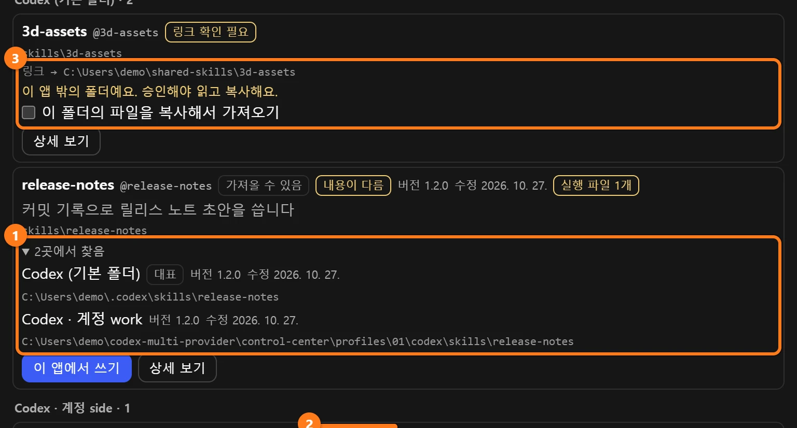

- `2곳에서 찾음`을 누르면 그 스킬이 있는 곳이 모두 보여요. 곳마다 이름, 폴더, 수정 날짜, 버전이 있고, 가져올 때 쓰는 사본에 `대표`가 붙어요. 대표는 이미 쓰는 사본, 가져온 사본, 기본 폴더의 사본, 가장 최근에 고친 사본 순으로 골라요.
- 이름은 같은데 내용이 다르면 따로 보이고 `내용이 다름`과 `버전`, `수정 날짜`가 붙어요. 원하는 쪽을 가져와요. 이미 같은 이름의 스킬이 있으면 다른 이름으로 가져오라고 물어요.
- 한 계정의 스킬 폴더가 다른 폴더를 같이 쓰면(링크) `찾아본 곳`에 `<이름>의 스킬 폴더를 같이 써요`라고 보여요. 그 스킬은 한 번만 보여요.

**링크가 있는 스킬**

스킬 폴더나 그 안의 파일이 다른 곳을 가리키는 링크(심볼릭 링크·junction)일 수 있어요. 이 앱은 링크를 만들지 않고, 링크가 가리키는 파일을 복사해서 가져와요.

- 링크가 찾는 곳 안(같은 스킬 폴더 등)이나 이 앱이 이미 읽는 스킬 폴더를 가리키면 그대로 복사해요(`링크는 가리키는 파일을 복사해요`).
- 그 밖의 폴더를 가리키면 `링크 확인 필요`와 `링크 → <폴더>`가 보여요. 이 앱은 그 폴더를 아직 열지 않아요. 믿을 수 있는 폴더면 `이 폴더의 파일을 복사해서 가져오기`에 체크해요. 그러면 내용을 읽어 설명과 실행 파일을 보여 주고, `이 앱에서 쓰기`로 가져올 수 있어요. 이 체크는 이 PC의 창에서만 할 수 있어요(휴대폰이나 다른 PC는 승인을 보내지 못해요).
- 링크가 없는 곳, 자기 자신, 네트워크 위치, 로그인 정보처럼 열지 않는 곳을 가리키면 `쓸 수 없는 링크(심볼릭 링크·junction)가 있음`과 이유가 보여요.
- 가져온 뒤 링크가 다른 곳을 가리키게 바뀌면 `링크가 가리키는 곳이 바뀌었어요. 다시 확인하고 승인해요.`가 떠요.

> **참고** 전에는 `형식이 맞지 않음`이던 Codex 스킬도 이제 가져올 수 있는 경우가 많아요. 링크, `.env.example` 같은 예시 설정 파일, `uv.lock` 같은 잠금 파일, `node_modules`·`.venv` 폴더(빼고 복사해요), 코드 블록 안의 예시는 더 이상 문제가 아니에요. Codex 스킬에 Claude Code 전용 문법이 있어도 Codex처럼 글 그대로 두고 가져와요.

> **주의** `SKILL.md`의 첫 줄이 `---js`처럼 `---` 뒤에 언어 이름을 달고 있으면 `머리말이 YAML이 아님(---js 같은 다른 언어)`으로 `형식이 맞지 않음`이에요. 이런 머리말은 프로그램 코드로 실행될 수 있어서, 이 앱은 그 파일을 읽지 않고 가져오지도 않아요. `---yaml`이나 `---yml`은 YAML이라 그대로 읽어요. 상세 보기에서는 파일을 글 그대로만 보여요.

**상세 보기**

줄마다 있는 `상세 보기`를 누르면 그 스킬을 가져오기 전에 자세히 볼 수 있어요. `목록으로`를 누르면 돌아와요.

, ③ 본문, ④ 파일과 크기, 내용 해시예요. 화면의 스킬은 데모용이에요.")

- `찾은 곳`: 이 스킬이 있는 모든 곳이에요.
- `머리말(SKILL.md)`: 이름, 설명, 버전, 미리 허용한 도구 같은 항목이 모두 보여요. 값이 아주 길면 앞부분만 보이고 `…`로 끝나요. YAML 별칭(`*`)으로 값을 끝없이 불리는 머리말은 그 값 대신 `YAML 별칭(*)이 너무 많이 펼쳐져서 보여 주지 않아요`가 보여요(이 앱이 멈추지 않게 막는 거예요).
- `본문`: 에이전트가 읽는 내용이에요. 보기만 하고 아무것도 실행하지 않아요. 인터넷에 있는 그림은 처음엔 모두 가려요. 보통 그림뿐 아니라 표의 배경 그림, 동영상 표지, SVG 그림, 스타일 속 그림도 가리고 `원격 그림 N개를 가렸어요`에 함께 세요. 가린 동안에는 그 주소에 아무 요청도 가지 않아요. `원격 그림 보기`를 누를 때만 그림으로 보이고, 이때도 이 앱의 주소(referrer)는 보내지 않아요.
- 본문이 너무 복잡해 꾸미지 못하면(꾸미는 데 몇 초가 넘게 걸리거나 실패하면) `본문을 꾸며 보여 줄 수 없어 글 그대로 보여요`와 함께 글 그대로 보여요. 그동안에도 앱은 멈추지 않아요.
- `SKILL.md`가 1 MiB보다 크면 `SKILL.md가 너무 커서 보여 줄 수 없어요(1.2 MB)`처럼 크기와 함께 알려요.
- `파일 N개`와 `내용 해시`: 들어 있는 파일과 크기, 내용이 같은지 알아보는 값이에요. 파일이 500개를 넘으면 `파일 500개 넘음`과 `앞의 500개만 보여요`가 보여요.

**가져오기**

1. 줄의 `이 앱에서 쓰기`를 눌러요.
2. 스킬에 실행 파일이 들어 있으면 경고가 먼저 떠요. 에이전트가 스킬을 따르다 그 파일을 실행할 수 있어요. 내용을 보고 `내용을 확인했고 이 스킬을 믿어요`에 체크한 뒤 `가져오기`를 눌러요.
3. 이름이 겹치면 `새 이름`을 적고 `이 이름으로 가져오기`를 눌러요.
4. `모든 프로젝트에서 쓰게 가져왔어요: release-notes`가 뜨면 끝이에요. 가져온 스킬은 모든 프로젝트에서 써요.

- 한 프로젝트에서만 쓰려면 가져오기 전에 화면 위의 `가져올 스킬을 쓸 곳`에서 `이 프로젝트만 (space-game)`을 골라요. 그러면 `space-game 프로젝트에서만 쓰게 가져왔어요: release-notes`가 뜨고, 다른 프로젝트에서는 그 스킬이 보이지 않아요. 처음 값은 `모든 프로젝트`예요. `URL로 설치…`도 같아요.
- 이름이 겹친 스킬을 `바꾸기`로 덮어쓸 때도 고른 곳을 따라요. 알림이 어디서 쓰는지 말해 줘요(`space-game 프로젝트에서만 쓰게 바꿨어요: release-notes`). `모든 프로젝트`를 고르면 그 폴더에 남아 있던 `쓰는 곳` 설정도 지워요. 업데이트의 `다시 가져오기`만 쓰던 곳을 그대로 둬요.
- 스킬은 own의 스킬 폴더로 **복사**돼요. 원본 폴더는 읽기만 하고 바꾸지 않아요.
- 스스로 불러오지 않게 정해 둔 Codex 스킬은 own에서도 그렇게 바꿔 가져와요(`이 앱에 맞게 바꿈: 스스로 불러오지 않음(disable-model-invocation)`).
- `업데이트 확인`: 가져온 스킬을 원본과 비교해요. 바뀐 것이 있으면 `새 버전 보기`가 보여요.

**git 저장소에서 설치하기**

1. `URL로 설치…`를 누르고 `git 저장소 URL`에 주소를 넣어요(예: `https://github.com/owner/repo`).
2. `미리 보기`를 누르면 저장소의 파일 목록과 `SKILL.md`만 먼저 받아 보여 줘요.
3. 설치할 스킬에 체크하고, 믿을 수 있는 스킬인지 확인한 뒤 `설치`를 눌러요.

> **주의** 스킬에는 실행 파일이 들어 있을 수 있어요. 믿을 수 있는 곳의 스킬만 가져오세요. 가져오기와 설치는 이 PC의 창에서만 돼요(`가져오기와 설치는 이 PC의 창에서만 할 수 있어요`). SSH 원격 서버의 대화에는 `가져오기` 탭이 없어요.

### 설정 > 스킬: 모든 프로젝트와 프로젝트별 설정

`설정` > `스킬`(에이전트 묶음, `승인·권한` 바로 아래)에서 이 앱의 스킬을 한눈에 보고, 켜고 끄고, 다른 도구에서 가져와요. 명령 팔레트(`Ctrl+K`)의 `스킬 가져오기…`를 고르면 이 페이지의 가져오기 자리로 바로 가요. 페이지가 이미 열려 있어도 돼요.

이 앱에 넣은 스킬은 **모든 프로젝트에서 써요.** 어느 프로젝트에서 쓰지 않을 스킬만 그 프로젝트에서 꺼요. 그래서 스킬을 프로젝트마다 다시 넣을 필요가 없어요.

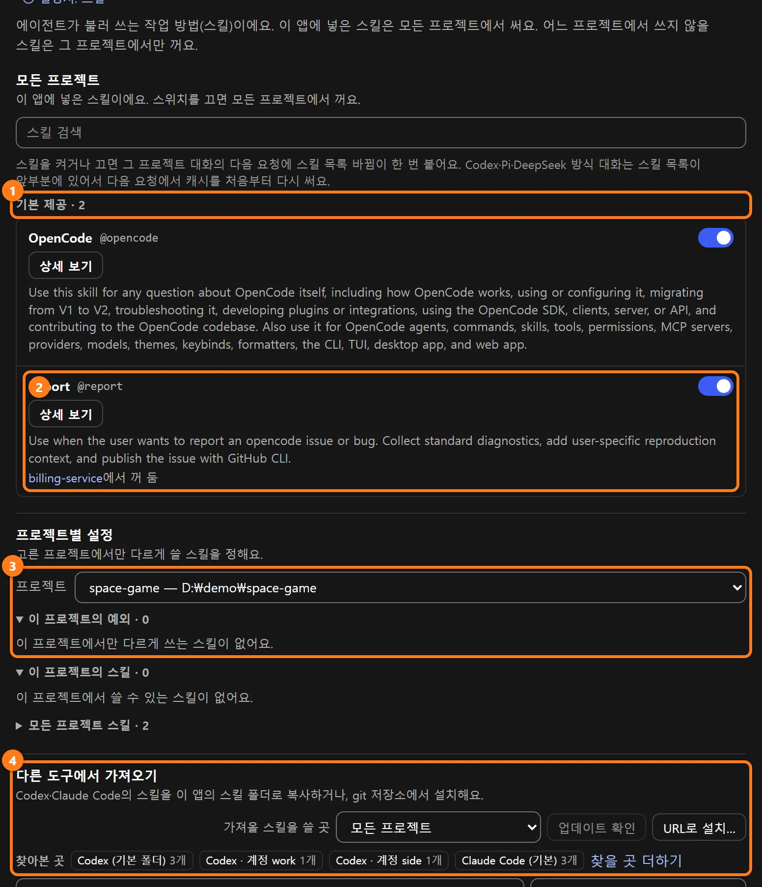

**모든 프로젝트**

- 이 앱이 모든 프로젝트에 주는 스킬이에요. 프로젝트를 고르지 않아도 보여요. 묶음은 `가져옴`(이 앱으로 가져온 것), `전역`, `Claude Code 개인`, `기본 제공` 순서예요. 줄마다 이름, `@id`, `스스로 불러옴`, 설명, 폴더가 보여요. 위의 칸에 낱말을 넣어 찾아요.
- 줄 오른쪽의 스위치를 끄면 그 스킬을 모든 프로젝트에서 꺼요. 줄에 `모든 프로젝트에서 꺼 둠`이 붙어요. `기본 제공` 스킬도 끌 수 있어요.
- 어느 프로젝트에서만 다르게 쓰면 줄 아래에 `billing-service에서 꺼 둠`이나 `space-game에서만 켬`처럼 보여요. 프로젝트는 셋까지 보이고, 더 있으면 `외 2곳`처럼 보여요. 프로젝트 이름을 누르면 아래 `프로젝트별 설정`이 그 프로젝트로 바뀌어요.
- `쓰는 곳`: `모든 프로젝트` 또는 `이 프로젝트만 (space-game)`이에요. `이 프로젝트만`을 고르면 그 스킬은 그 프로젝트(와 그 안쪽 폴더)에서만 쓰고, 이 칸에서 빠져 `프로젝트별 설정`에 보여요. 다시 `모든 프로젝트`를 고르면 돌아와요. `기본 제공` 스킬과 프로젝트 폴더의 스킬에는 없어요. 파일 하나(`.md`)로 된 스킬이 한 폴더에 여럿 있으면 그 파일 하나만 정해요. 스킬 폴더 안에 다른 스킬이 들어 있으면 그 스킬도 함께 따라가요.
- `상세 보기`: 위의 상세 보기와 같은 내용을 창으로 보여요. 다른 도구에 같은 내용의 스킬이 있으면 `찾은 곳`에 함께 보여요. 가져온 스킬이면 `가져온 원본`에 원본 폴더와 `원본과 같아요`·`원본이 바뀌었어요`가 보여요.
- `폴더 열기`(데스크톱 앱): 그 스킬의 폴더를 탐색기로 열어요.
- `지우기…`: 가져온 스킬(`가져옴` 묶음)에만 있어요. 이 앱의 스킬 폴더에서만 지우고 원래 스킬은 그대로예요. 다시 가져올 수 있어요. 그 스킬에 정한 `쓰는 곳`도 함께 지워요.
- 스킬 폴더를 손으로 지워 `쓰는 곳` 설정만 남았으면 이 칸 아래에 `이 폴더에는 지금 스킬이 없어요. 쓰는 곳 설정만 남아 있어요.`와 그 폴더가 보여요. `설정 지우기`를 누르면 `남아 있던 쓰는 곳 설정을 지웠어요.`가 뜨고, 알림의 `되돌리기`로 되돌릴 수 있어요. 같은 이름의 스킬을 `모든 프로젝트`로 다시 가져와도 저절로 지워져요.

**프로젝트별 설정**

1. `프로젝트별 설정`의 프로젝트 고르기에서 프로젝트를 골라요. 고르지 않으면 `프로젝트를 고르면 그 프로젝트의 예외를 정할 수 있어요.`가 보여요.
2. 묶음을 펼쳐 봐요.
   - `이 프로젝트의 예외`: 이 프로젝트에서만 다르게 쓰는 스킬이에요. `이 프로젝트에서 꺼 둠`이나 `이 프로젝트에서만 켬`이 붙어요. `되돌리기`를 누르면 모든 프로젝트 설정을 따라요.
   - `이 프로젝트의 스킬`: 이 프로젝트 폴더의 스킬과 `이 프로젝트만`으로 정한 스킬이에요(`이 프로젝트만`이 붙어요).
   - `모든 프로젝트 스킬`: 이 앱의 스킬마다 이 프로젝트의 스위치가 있어요. 끄면 이 프로젝트에서만 꺼져요.
   - `다른 프로젝트에서만 쓰는 스킬`: 다른 프로젝트에서만 쓰도록 정한 스킬이에요.
3. 스위치를 바꾸면 `pdf 스킬을 이 프로젝트에서 껐어요.`처럼 떠요. 바로 되돌리려면 알림의 `되돌리기`를 눌러요.

- 지운 스킬의 설정이 남아 있으면 `지금은 없는 스킬이에요`와 `설정 지우기`가 보여요.
- 켜고 끈 것은 모든 창과 휴대폰에 바로 알려요. 다른 프로젝트의 대화나 다른 창에서도 입력창의 `@` 목록, ✦ `스킬` 창은 다음에 열 때 바뀐 목록을 보여 줘요. 꺼 둔 스킬은 고를 수 없고, 다시 켜면 다시 보여요.
- 스킬을 켜고 끌 수 없는 연결(휴대폰 등)에서는 `이 연결에서는 스킬을 켜고 끌 수 없어요.`가 보여요. 보기만 할 수 있어요.

> **알아 두세요** 스킬을 켜거나 끄면 그 프로젝트 대화의 다음 요청에 스킬 목록 바뀜이 한 번 붙어요. Codex·Pi·DeepSeek 방식 대화는 스킬 목록이 앞부분에 있어서 다음 요청에서 캐시를 처음부터 다시 써요([11장](11-cache-switch-cost.md)). 자주 바꾸지 말고 한 번 정해 두는 게 좋아요.

**스킬 창에서 이 프로젝트에서 끄기**

입력창의 ✦ `스킬` 창에서도 바로 꺼요(이 PC의 서비스에서).

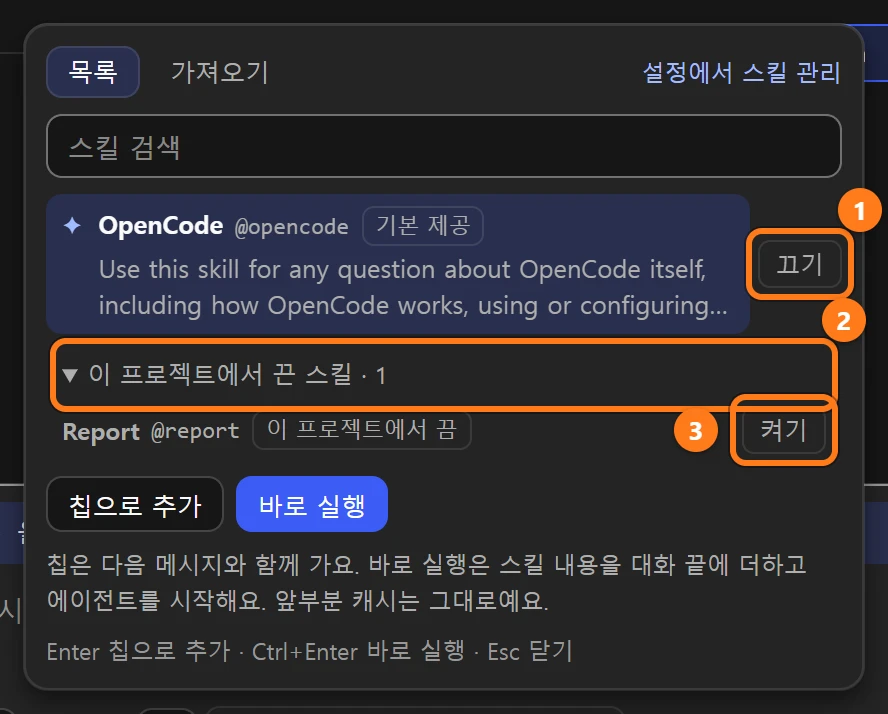

1. 끌 스킬 줄의 `끄기`를 눌러요(마우스를 올리면 `이 프로젝트에서 끄기`). `pdf 스킬을 이 프로젝트에서 껐어요.`가 뜨고 그 스킬은 목록에서 빠져요.
2. 끈 스킬은 목록 아래 `이 프로젝트에서 끈 스킬 · 1`을 펼쳐 봐요. 왜 꺼졌는지(`이 프로젝트에서 끔`, `모든 프로젝트에서 꺼 둠`, `다른 프로젝트에서만 써요`)가 붙어요.
3. `켜기`를 누르면 이 프로젝트에서 다시 켜져요. 모든 프로젝트에서 꺼 둔 스킬도 이 프로젝트에서만 켤 수 있어요. 다른 프로젝트에서만 쓰도록 정한 스킬은 `설정에서 보기`로 설정을 열어요.

**다른 도구에서 가져오기**

`다른 도구에서 가져오기`는 위의 가져오기 탭과 같은 화면이에요(찾아본 곳, 검색, `가져올 스킬을 쓸 곳`, 가져오기, 상세 보기, `업데이트 확인`, `URL로 설치…`).

## 10.12 에이전트 방식: Codex·Pi·DeepSeek·OpenCode

> **용어** 에이전트 방식: 에이전트가 모델에게 일을 시키는 방식이에요. 어떤 지시문을 보내고 어떤 도구를 주는지가 달라요. 같은 모델과 계정이라도 방식에 따라 일하는 모습이 달라져요.

| 방식 | 무엇이 다른가요 |
|---|---|
| `Codex 방식`(처음 값) | Codex CLI의 지시문과 도구로 일해요. GPT 모델에 가장 잘 맞아요. |
| `Pi 방식` | Pi 코딩 에이전트처럼 읽기·실행·고치기·쓰기 네 도구로 가볍게 일해요. |
| `DeepSeek 방식` | DeepSeek가 만든 코딩 에이전트(dsh)의 지시문과 도구로 일해요. DeepSeek V4 모델에 맞춰져 있어요. |
| `OpenCode 기본` | OpenCode의 원래 방식이에요. 예전에 만든 대화도 이 방식이에요. |
| `omo (원본)` | oh-my-opencode(omo) 코드를 그대로 가져와 돌려요. Sisyphus가 계획하고 하위 에이전트에게 맡기며, 할 일이 남으면 이어서 해요. 메시지에 ulw를 넣으면 더 꼼꼼하게 해요. 이 PC의 서비스에 omo 플러그인이 있을 때만 보여요. |
| `Claude Agent 기본` | Claude Agent 계정에서 Claude 자신의 기본 지시문과 이 앱의 도구로 일해요. Claude Agent 계정의 모델에서만 보여요([20.8](20-account-kinds.md)). |

Codex 방식, Pi 방식, DeepSeek 방식에는 `지시문`을 하나 더 고를 수 있어요. `개선판`(처음 값)은 이 앱에 맞게 고친 판이고, `원본`은 그 도구가 보내는 지시문 그대로예요. 직접 고친 `내 지시문`도 쓸 수 있어요(10.13).

- Codex 방식의 개선판은 Claude·DeepSeek처럼 Codex 목록에 없는 모델의 지시문을 고쳐요. 이 앱과 승인 모드에 맞는 설명, 이 앱에서 파일을 고치는 방법을 알려 줘요. GPT 모델은 원본과 같은 지시문을 받아요.
- Pi 방식의 개선판은 GPT를 포함한 모든 모델에게 도구 설명을 한 줄씩으로 줄여 보내요. 요청이 작아져요.
- DeepSeek 방식의 개선판은 이 앱에 없는 dsh 샌드박스 이야기 대신 승인 모드가 실제로 하는 일을 알리고, 시간 정보에 이 PC의 시간대를 적어요.

**Codex 방식의 하위 에이전트.**

- GPT-6 계열 모델이 대화 전체를 물려주며 하위 에이전트를 만들면(처음 값), 하위 에이전트의 첫 요청이 부모가 보낸 요청과 똑같이 시작해요. 그래서 부모가 쓴 캐시를 그대로 읽고, 하위 에이전트를 만드는 비용이 줄어요([11장](11-cache-switch-cost.md)). 하위 에이전트의 하위 에이전트도 같아요.
- 에이전트가 하위 에이전트를 기다리거나 잠시 쉬는 동안 끼워 넣은 메시지는 그 기다림을 바로 끝내요. 기다림이 시작되기 바로 앞에 보낸 메시지도 마찬가지예요.

**DeepSeek 방식에서 다른 점.**

- 셸 도구는 Windows에서 `pwsh`(PowerShell), 그 밖에서는 `bash`예요. 명령마다 한 줄 설명을 달고, 2분이 지나면 명령을 종료해요(`timeoutMs`로 10분까지 늘려요). 한글 출력도 깨지지 않게 받아요.
- 파일은 `read`로 먼저 읽어야 `write`로 덮어쓰거나 `edit`로 고칠 수 있어요. 읽은 뒤 다른 곳에서 바뀐 파일은 다시 읽으라고 알려요. 이 기억은 서비스를 다시 켜면 지워져요. dsh 자체는 2026년 11월 초(0.2.2-alpha.3)부터 이 확인을 끈 채 나오지만, 이 앱은 팀 모드의 다른 에이전트나 내가 편집기에서 고친 내용을 모르고 덮어쓰지 않도록 `원본`에서도 켜 둬요.
- 파일 경로가 `~/`로 시작하면 내 홈 폴더를 뜻해요(작업 폴더에 `~` 폴더를 만들지 않아요). 작업 폴더 밖이라 다른 폴더 규칙을 따라요.
- 찾기는 `glob`(파일 이름)과 `grep`(파일 내용)이에요. `.env`처럼 읽을 때 물어보는 파일과 보호 파일의 내용은 검색 결과에 나오지 않아요.
- 할 일 목록 도구 `todo_write`가 있어요. 대화에는 도구 카드로 보여요.
- 사용자의 첫 메시지 뒤에 이 앱이 AGENTS.md(아래 "저장소의 AGENTS.md는 방식마다 조금 달라요"), 작업 폴더와 승인 정보, 스킬 목록, 지금 시각을 덧붙여요. 시각은 10분이 지날 때마다 다시 알려요.
- 같은 도구를 같은 인자로 세 번 넘게 이어 부르면 모델에게 다른 방법을 찾으라고 알려요. 막지는 않아요.
- DeepSeek 모델에서 추론 강도를 따로 고르지 않았으면 `high`로 보내요.

**omo (원본)에서 다른 점.**

- omo의 지시문과 도구를 omo가 만든 그대로 써요. 지시문 고르기, `원본`·`개선판`·`내 지시문`, 미리 보기가 없어요. `설정` > `에이전트 방식`의 `omo (원본)` 탭에는 안내 한 줄만 있어요.
- 메시지에 `ulw`나 `ultrawork`를 넣으면 omo가 그 메시지 뒤에 더 꼼꼼하게 하라는 글을 붙여요. 대화에는 내가 쓴 글만 보여요.
- 할 일 목록(`todowrite`)이 남은 채로 응답이 끝나면 omo가 `omo: 남은 할 일을 이어서 해요` 알림을 보내 이어서 해요. 그만두게 하려면 `/stop-continuation`을 보내요. 다시 켜려면 `/resume-continuation`을 보내요. 앱을 다시 켤 필요가 없고, 쉬고 있는 대화에 남은 할 일이 있으면 2초 뒤 바로 이어서 해요. omo (원본)이 아닌 대화에서 두 명령을 보내면 `omo (원본) 세션에서만 써요.`라고 나와요.
- 모델 요청이 오류(예: 요청 형식 오류 400)로 끝나면 omo는 같은 요청을 되풀이하지 않게 이어서 하기를 쉬어요. 내가 새 메시지를 보내면 그 응답이 끝날 때부터 다시 이어서 해요.
- `/reset-context`로 문맥을 비우면 omo는 비운 문맥에 이어서 하기를 넣지 않아요. 일하는 중에 비워도, 응답이 끝나고 이어서 하기 전 2초 사이에 비워도 같아요. 비우기는 그 자체로 모델 요청을 하지 않아요(10.14). 다만 할 일 목록은 남아서, 비운 뒤 내 첫 메시지의 응답이 끝날 때 아직 남은 할 일이 있으면 이어서 해요. 그때 필요 없으면 `/stop-continuation`을 보내요.
- `/compact`나 `지금 압축`으로 압축하면 omo는 압축 뒤에 이어서 하기를 넣지 않아요. 응답이 끝나고 이어서 하기 전 2초 사이에 압축해도, 압축이 실패해도 같아요. 할 일 목록은 남아서, 압축 뒤 내 첫 메시지의 응답이 끝날 때 남은 할 일이 있으면 이어서 해요.
- omo의 하위 에이전트 explore, librarian, oracle, Sisyphus-Junior가 `task` 도구로 일을 받아요. 배경으로 맡긴 일이 끝나면 `omo: 배경 작업이 끝났어요` 알림이 와요. 하위 에이전트는 모두 부모 대화의 모델로 돌고, `task` 결과에도 그 모델 이름이 나와요. 하위 대화는 지워지지 않고 남아요.
- `edit`가 고칠 글을 찾지 못하거나 같은 글이 여러 곳에 있으면, omo가 오류 뒤에 파일을 다시 읽고 고치라는 안내를 붙여요.
- 서비스가 다시 켜져 하던 응답을 이어 갈 때도 첫 요청부터 omo의 도구를 그대로 써요.
- 팀 모드의 팀 메인, 담당, 동료도 `omo (원본)`으로 돌릴 수 있어요. 다만 팀 대화에서는 남은 할 일을 이어서 하지 않아요. 언제 일할지는 팀 메인의 요청과 팀 소식이 정하기 때문이에요. 그래서 `/resume-continuation`도 팀 대화에서는 쓰지 않아요([17장](17-team-mode.md)).
- SSH로 연결한 다른 PC(Linux)에서도 `omo (원본)`을 쓸 수 있어요. 그 PC의 앱이 이 기능이 있는 버전이어야 해요.
- omo는 이 앱의 스킬 목록과 따로 스킬을 스스로도 찾아서, Sisyphus의 지시문에 이름을 적고 `task`의 `load_skills`로 하위 에이전트에게 실어 보내요. 프로젝트 스킬(`.opencode/skills`, `.agents/skills`)은 프로젝트 설정을 읽을 때만 찾아요(이 PC의 보통 모드, SSH 호스트의 `켬`). `.claude/skills`의 스킬은 이 앱의 스킬 목록에는 보이지만 omo의 `load_skills`로는 싣지 못해요(`Skills not found`). omo로 하위 에이전트에게 실어 보낼 스킬은 `.opencode/skills`나 `.agents/skills`에 두세요.
- MCP 서버, omo 스킬, omo 자체의 팀 기능(team mode), tmux는 아직 쓰지 않아요. omo의 이어서 하기 상태는 프로젝트 폴더가 아니라 `thirdparty\omo\projects\`에 둬요. 그래서 프로젝트에 `.omo` 폴더가 생기지 않아요.
- omo는 SUL-1.0 라이선스라 이 앱에서는 개인 용도로만 써요. 이 앱이 고친 곳은 서비스 폴더 `app\`의 버전 폴더 안 `plugins\own-omo\MODIFICATIONS.md`에 있어요. omo의 데이터와 기록은 `thirdparty\omo\`에 따로 두고, omo의 알림(예: `Todo Continuation`)은 `logs\own-omo.log`에 적어요([27장](27-data-logs-uninstall.md)).

**Claude Agent 기본에서 다른 점.**

- Claude Agent 계정(내 PC의 Claude Code, [20.8](20-account-kinds.md))의 모델로 새 대화를 시작하면 이 방식이 저절로 골라져요. 새 대화 화면의 알약에서 다른 방식을 고르면 그 방식으로 시작해요. 다른 방식도 Claude Agent 계정에서 쓸 수 있고, 그때는 그 방식의 지시문이 Claude에게 가요.
- Claude Code가 보내는 Claude의 기본 지시문을 그대로 쓰고, 그 뒤에 OpenCode의 에이전트 역할과 지시문이 붙어요. 지시문 고르기(`원본`·`개선판`·`내 지시문`)가 없어요. `설정` > `에이전트 방식`의 `Claude Agent 기본` 탭에서 보내는 글을 볼 수 있어요(10.13).
- 메뉴에는 Claude Agent 계정의 모델일 때만 보여요. 이 방식으로 쓰던 대화를 Claude Agent 계정이 아닌 모델로 바꾸면 `OpenCode 기본`처럼 일해요.

**저장소의 AGENTS.md는 방식마다 조금 달라요.**

| 무엇 | `OpenCode 기본`·`omo (원본)`·`Claude Agent 기본` | `Codex 방식`·`Pi 방식`·`DeepSeek 방식` |
|---|---|---|
| 대화 폴더와 그 위쪽(저장소 맨 위 폴더까지)의 `AGENTS.md` | 받아요 | 받아요 |
| 대화 폴더 **아래** 폴더의 `AGENTS.md` | 그 폴더의 파일을 읽으면 그때 더해져요 | 받지 않아요 |
| `CLAUDE.md` | 읽지 않아요 | 읽지 않아요 |
| 전역 `AGENTS.md`(이 PC는 `%USERPROFILE%\.config\own-open-code\AGENTS.md`, SSH 호스트는 그 서버의 `~/.config/own-open-code/AGENTS.md`) | 받아요 | 받아요 |

- Codex 방식, Pi 방식, DeepSeek 방식은 원래 도구(Codex CLI, Pi, dsh)처럼 대화 폴더에서 **위쪽만** 봐요. 큰 저장소를 맨 위 폴더에서 열고 `packages/x/AGENTS.md` 같은 하위 폴더 규칙이 필요하면, 그 폴더에서 대화를 열거나 규칙을 위쪽 `AGENTS.md`에 적어요.
- 이 표는 저장소의 지시 파일을 **읽는 상태일 때**예요. 이 PC를 `own restart --untrusted`로 켰거나([8.7](08-approvals.md)), SSH 호스트의 `프로젝트 설정`이 `끔`이면 어느 방식도 저장소의 `AGENTS.md`를 받지 않아요(하위 폴더의 것도요). SSH 호스트는 `지시 파일만 (AGENTS.md)`이나 `켬`이어야 받아요([22장](22-ssh-remote.md)의 "프로젝트 설정 세 가지").
- 프로젝트 스킬(`.opencode/skills`, `.claude/skills`, `.agents/skills`)은 프로젝트 설정을 읽을 때만 목록에 들어가요. 이 PC의 보통 모드와 SSH 호스트의 `켬`이 그래요. `지시 파일만 (AGENTS.md)`에서는 들어가지 않아요.

**새 대화의 처음 값 정하기.** `설정` > `일반`의 `새 대화의 에이전트 방식`과 `지시문`에서 정해요. 이 값은 이 PC의 서비스에 저장돼요. 그래서 이 창뿐 아니라 팀 모드가 새로 만드는 대화, 휴대폰과 다른 PC에서 만든 대화도 이 값으로 시작해요. 팀 모드가 대화를 이어 갈 때(담당을 새 대화로 이어가기, 나누기, 팀 메인 새 대화, 새 동료)는 앞 대화나 담당의 방식을 그대로 쓰고, 영역을 직접 만들 때는 방식을 고를 수 있어요([17장](17-team-mode.md)). 휴대폰·다른 PC 창에서는 보기만 하고 바꿀 수 없어요(`PC의 앱 창에서 바꿀 수 있어요.`). SSH 원격 호스트의 대화는 그 호스트의 처음 값(`Codex 방식`, 지시문 `개선판`)으로 시작해요.

**이번 새 대화만 다르게.** 새 대화 화면 머리줄의 에이전트 방식 알약(예: `Codex 방식`)을 누르고 골라요. 첫 메시지를 보낼 때 그 대화에만 쓰고, 다른 프로젝트나 홈의 새 대화 화면에는 쓰이지 않아요. 대화를 만들거나 다른 새 대화 화면으로 옮기면 다시 처음 값으로 돌아가요(`이번 새 대화에만 적용돼요…`). 하위 에이전트는 부모 대화의 방식을 따라요.

**쓰던 대화에서 바꾸기.**

1. 대화 머리줄의 에이전트 방식 알약을 누르거나, 머리줄이 좁아 알약이 안 보이면 대화 `⋯` > `에이전트 방식 바꾸기…`를 눌러요.
2. 방식이나 지시문을 골라요. `에이전트 방식을 Pi 방식으로 바꿨어요`가 뜨면 다음 메시지부터 바뀌어요.

- 바꾸면 지시문과 도구가 달라지므로 다음 요청에서 **대화 앞부분 캐시를 한 번 새로 써요**([11장](11-cache-switch-cost.md)). 앞의 셸·고치기 기록은 새 도구 이름으로 보여요.
- 에이전트가 실행 중일 때는 바꿀 수 없어요(`지금 실행 중이라 바꿀 수 없어요. 응답이 끝나면 다시 열어 주세요.`). 응답이 끝난 뒤 다시 열어요.
- 휴대폰·다른 PC는 그 기기에 `전환` 권한이 있어야 바꿀 수 있어요([24장](24-phone-other-pc.md)).

> **참고** 예전에는 새 대화 화면에서 고른 방식이 그 창의 처음 값으로 남았어요(2026-10-16 전). 지금은 `설정` > `일반`에서 한 번 정하면 모든 창과 기기에 같아요.

## 10.13 지시문 보기·고치기·되돌리기

> **용어** 지시문: 에이전트 방식이 모델에게 보내는 글이에요. 어떻게 일하고, 파일을 어떻게 고치고, 승인 모드가 무엇인지 알려 줘요. `원본`은 그 도구(Codex CLI, Pi)가 보내는 글 그대로, `개선판`은 이 앱에 맞게 고친 판, `내 지시문`은 내가 고친 판이에요.

`설정` > `에이전트 방식`(에이전트 묶음의 맨 위)에서 에이전트 방식마다 무엇을 보내는지 보고, 원하면 고쳐 쓸 수 있어요.

**보기.**

1. 위쪽에서 에이전트 방식(`Codex 방식` / `Pi 방식` / `DeepSeek 방식` / `OpenCode 기본`), `지시문`, `모델`, `승인 모드`를 골라요. 모델은 계정에 켜진 모델 중에서 골라요. 처음에는 새 대화가 쓸 모델로 시작하고, 고른 모델은 이 기기에 기억돼요. 같은 방식이라도 모델에 따라 받는 글이 달라요.
2. `보내는 글`에서 빈 대화의 첫 요청에 들어가는 글을 부분마다 봐요. 부분마다 이름(`기본 지시문`, `승인 모드 설명`, `작업 환경` 등), `내 지시문으로 바꿀 수 있어요` 또는 `이 앱이 만들어요`, 글자 수가 보여요. `글에서 찾기`에 낱말을 넣으면 찾은 곳이 강조되고, `복사`·`전체 복사`로 글을 가져가요.
3. 그 아래 `도구 {n}개`는 이 방식이 따로 보내는 도구와 설명이에요.
4. 맨 아래 `하위 에이전트`는 하위 에이전트에게 맡길 때 무엇이 가고 무엇이 돌아오는지예요(10.16). `OpenCode 기본`과 `omo (원본)` 탭에도 있어요.

- 실제 대화에는 여기에 AGENTS.md(읽는 상태일 때, 10.12), 스킬 목록, Code Mode 도구 목록, MCP 안내, 오늘 날짜가 더해져요. 이것들은 대화와 폴더마다 달라서 이 페이지에는 없어요.
- `OpenCode 기본`은 OpenCode가 만든 지시문을 그대로 보내요. 이 앱이 고친 곳도, 고를 지시문도 없어요.
- `Claude Agent 기본` 탭은 서비스가 이 방식을 알 때 보여요. `지시문`과 `비교`, `내 지시문`이 없고, `모델`과 `승인 모드`를 골라 `보내는 글`을 봐요. Claude Agent 계정의 모델을 고르면 Claude Code의 지시문 뒤에 OpenCode의 에이전트 역할과 지시문이 붙은 모양이 보여요.

> **참고** 서비스에 에이전트 방식 기능이 없거나 이 페이지보다 오래된 서비스면 `이 서비스에서는 지시문을 볼 수 없어요.`만 보여요. 다른 이유로 불러오지 못하면 `지시문을 불러오지 못했어요` 옆의 `다시 시도`를 눌러요. `설정` > `자동 압축`의 `압축 실패 시 대체 모델`도 그런 서비스에서는 `이 서비스에서는 대체 모델을 정할 수 없어요.`라고 알려 줘요.

**이 앱이 고친 곳.** `고친 곳`에 개선판이 고른 모델에서 원본을 어떻게 바꿨는지 항목마다 제목, 이유, 원본과 개선판 글로 보여요. 다른 모델에서만 고치는 곳은 접혀 있어요. 항목의 `자세히`를 누르면 이 설명서의 그 항목([고친 곳 하나하나](#고친-곳-하나하나))이 열려요.

| 에이전트 방식 · 모델 | 개선판이 하는 일 |
|---|---|
| Codex 방식 · Codex 목록의 GPT 모델 | 고치지 않아요. 원본과 같은 글을 보내요. OpenAI가 모델마다 맞춘 글이라서예요. |
| Codex 방식 · Claude Opus 4.8 이후, Fable, Mythos | 이 앱에 맞게 새로 쓴 짧은 기본 지시문을 보내요. 첫 요청이 절반 가까이 줄어요. |
| Codex 방식 · 그 밖의 모델(Claude Sonnet, DeepSeek 등) | Codex의 대체 지시문에서 터미널·샌드박스 이야기와 파일 고치는 방법 등 열 곳을 고쳐요. |
| Codex 방식 · 목록 밖 모든 모델 | 승인 모드 설명을 이 앱의 `전체 허용`·`묻기`·`읽기 전용`대로 쓰고, 쓰지 않는 도구 인자와 하위 에이전트 설명의 GPT 모델 목록을 빼요. |
| Pi 방식 · 모든 모델 | Pi 지시문은 그대로 두고, 덧붙는 Code Mode 도구 목록만 도구당 한 줄로 줄여요. |
| DeepSeek 방식 · 모든 모델 | dsh 지시문은 그대로 두고, dsh 샌드박스 문장을 이 앱의 승인 모드 설명으로 바꾸고, 셸 도구 설명의 샌드박스 문장을 빼고, 시간 정보에 이 PC의 시간대를 적고, Code Mode 도구 목록을 한 줄씩으로 줄여요. |

**원본과 개선판 나란히 보기.**

1. `지시문` 옆의 `비교`를 눌러요. `원본`이나 `개선판`을 고른 채로 누르면 원본과 개선판을, `내 지시문`을 고른 채로 누르면 개선판과 내 지시문을 부분마다 나란히 보여요.
2. 다른 곳은 색으로 칠해지고, 왼쪽에서 빠진 곳에는 취소선, 오른쪽에 더한 곳에는 밑줄이 그어져요. 원본과 개선판을 비교하면 왼쪽이 원본, 오른쪽이 개선판이고, 내 지시문과 비교하면 왼쪽이 개선판, 오른쪽이 내 지시문이에요. 좁은 창에서는 위아래로 쌓여요.
3. 바뀐 곳 바로 아래에 작은 글씨로 무엇을 왜 고쳤는지 한 줄이 붙어요. `자세히`를 누르면 이 설명서의 그 항목이 열려요.

- 달라진 줄바꿈과 띄어쓰기, 보이지 않는 문자는 `⏎`(줄바꿈), `·`(띄어쓰기), `→`(탭), `␍`(CR), `⍽`(줄바꿈 없는 공백), `□`(전각 공백), `¬`(소프트 하이픈), `␤`(다음 줄 문자), `⇄`(방향 제어 문자), `◌`(이체 선택자), `⌑`(태그 문자), `▯`(한글 채움 문자), `⁞`(그 밖의 폭 없는 문자), `␛`처럼 그림이 있는 제어 문자로 보여요. 기호에 마우스를 올리면 무슨 문자인지 이름과 코드 포인트가 떠요(예: 소프트 하이픈, U+00AD). 낱말 안에 넣은 보이지 않는 문자는 그 문자만 칠해져요. 고친 줄 옆에 더하거나 뺀 빈 줄도 `⏎`로 따로 보여요. 이것만 다르면 그 아래에 `줄 끝·빈 줄만 달라요`, `띄어쓰기·줄바꿈만 달라요` 또는 `보이지 않는 문자만 달라요`가 붙어요. 글을 골라 복사하면 기호 없이 실제 글이 복사되고, 줄바꿈 없는 공백도 그대로 남아요. 줄을 더하거나 뺀 곳의 빈 쪽에는 `이 자리에는 줄이 없어요`, 한쪽에 아예 없는 부분에는 `원본에는 없어요`처럼 적혀요.
- 두 글이 같은 부분은 `같음`으로 접혀 있어요. 같은 부분이 이어지면 `같은 부분 {n}개` 하나로 접혀요. 눌러서 펼쳐요. 바뀐 부분 안의 긴 같은 줄도 `같은 줄 {n}개 보기`로 접혀 있어요.
- 부분마다 `원본 복사`·`개선판 복사`로 한쪽 글을 가져가요.
- 도구 인자, 대화마다 다른 Code Mode 도구 목록처럼 이 글에 보이지 않게 고친 곳은 맨 아래 `글에 보이지 않는 곳`에 모여요.
- 저장한 내 지시문이 없으면 개선판과 내 지시문은 같은 글이에요.
- `비교`를 다시 누르면 한 판만 보는 화면으로 돌아가요.

**내 지시문 만들기.**

1. `지시문`에서 `내 지시문`을 골라요. 아직 저장한 글이 없으면 `아직 저장한 내 지시문이 없어서 개선판을 보여요…`가 떠요.
2. `개선판에서 시작` 또는 `원본에서 시작`을 눌러요. 고른 모델이 받는 글이 편집 칸에 복사돼요.
3. 글을 고치고 `저장`을 눌러요. `내 지시문을 저장했어요`가 뜨고 `보내는 글`의 기본 지시문이 바뀐 글로 보여요.

- 고칠 수 있는 곳은 한 부분뿐이에요. Codex 방식은 **기본 지시문**, Pi 방식은 **첫 문단**, DeepSeek 방식은 **모델 소개 줄**(`You are a coding agent powered by the {{model}} model.`)이에요. DeepSeek 방식의 `{{model}}`은 대화 모델의 ID로 바뀌어요. 승인 모드 설명, 도구, 작업 환경은 이 앱이 실제로 막고 허용하는 것을 알리는 글이라 이 앱이 만들어요.
- Codex 방식의 글에 있는 `{{patch}}` 자리에는 이 앱이 파일 고치는 방법을 넣어요. 지우면 모델이 패치 모양을 모를 수 있어요.
- 내 지시문은 그 방식의 **모든 모델**에 같은 글로 가요.
- 저장하지 않은 고친 내용은 `고친 내용 버리기`로 없애요. `개선판 글로 바꾸기`·`원본 글로 바꾸기`는 편집 칸을 그 글로 다시 채워요.

**대화에 쓰기.** 대화 머리줄의 에이전트 방식 알약을 눌러 `지시문`에서 `내 지시문`을 골라요(10.12). 새 대화의 처음 값으로 쓰려면 `설정` > `일반`의 `지시문`에서 골라요. 알약에는 방식 이름 뒤에 `내 지시문`이 붙어요.

> **알아 두세요** 저장하거나 지우면 **다음 요청부터** 바뀌어요. 내 지시문을 쓰는 대화는 그때 대화 앞부분 캐시를 한 번 새로 써요([11장](11-cache-switch-cost.md)). 대화가 길면 그 한 번이 조금 비쌀 수 있어요.

**기본으로 되돌리기.** `내 지시문`에서 `기본으로 되돌리기`를 누르고 `지우기`로 확인해요. 저장한 글이 지워지고, 내 지시문을 고른 대화와 새 대화는 다음 요청부터 개선판으로 일해요. 알약에도 `개선판`이 붙어요. 다시 만들면 그 대화들은 새 글로 일해요.

- 휴대폰·다른 PC에서는 보기만 하고 고칠 수 없어요(`PC의 앱 창에서 고칠 수 있어요.`).
- 내 지시문은 이 PC의 서비스에 저장돼요. SSH 원격 호스트의 대화는 그 호스트의 서비스가 따로 가져요.

### 고친 곳 하나하나

개선판이 원본에서 고친 곳을 모두 모았어요. `설정` > `에이전트 방식`의 `자세히`가 여기로 와요. 항목마다 고친 곳의 이름과 고친 까닭이에요. 원본과 개선판 글은 앱에서 `비교`를 눌러 봐요. Codex 목록의 GPT 모델은 개선판도 원본과 같은 글을 받아서 여기에 없어요.

<!-- prompt-changes:start -->
<!-- 이 목록은 packages/own-harness에서 `bun run prompt-manual`이 variant.ts로 채워요. 손으로 고치지 마세요. -->

**Codex 방식 · Codex 목록 밖의 모든 모델**

<ul class="pc-list">
<li id="pc-codex-identity"><strong>모델 이름 블록</strong>: 대체 지시문에는 모델 이름이 없어서, Codex가 빼는 OpenCode의 모델 이름 블록(# Your Model)을 남겨요. GPT 템플릿에는 모델 이름이 들어 있어요.</li>
<li id="pc-codex-permissions"><strong>승인 모드 설명</strong>: 이 앱에는 OS 샌드박스가 없어서, Codex의 샌드박스 설명 대신 전체 허용, 묻기, 읽기 전용이 실제로 하는 일과 묻지 않고 이 앱이 직접 답하는 읽기를 알려요. 폴더 경로를 넣지 않아서 다른 폴더의 대화도 이 부분을 캐시에서 읽어요.</li>
<li id="pc-codex-environment"><strong>작업 환경의 읽기 전용 폴더</strong> (승인 모드 묻기에서만): 이 앱은 .git, .agents, .codex를 막지 않아서, Codex 샌드박스가 지키는 이 읽기 전용 항목을 뺐어요. 남겨 두면 모델이 커밋을 못 한다고 여길 수 있어요.</li>
<li id="pc-codex-catalog"><strong>Code Mode 도구 목록</strong>: OpenCode의 Code Mode 목록은 도구마다 입력과 출력 타입을 모두 적어 길어서(도구 8개에 약 5,000자), 도구마다 인자 이름과 설명 한 줄로 줄여요. 목록은 대화마다 달라 여기서는 설명만 보여요.</li>
<li id="pc-codex-escalation"><strong>exec_command의 권한 상승 인자</strong>: Codex 샌드박스를 벗어나려고 쓰는 인자(sandbox_permissions, justification, prefix_rule)를 이 앱은 쓰지 않아서 도구 정의에서 뺐어요.</li>
<li id="pc-codex-spawn-effort"><strong>spawn_agent의 추론 강도 인자</strong>: 이 앱의 하위 에이전트는 reasoning_effort를 쓰지 않아 도구 정의에서 뺐어요.</li>
</ul>

**Codex 방식 · Claude Opus 4.8 이후, Fable, Mythos**

<ul class="pc-list">
<li id="pc-codex-lean"><strong>짧은 기본 지시문</strong>: Claude Opus 4.8 이후, Fable, Mythos에는 Claude Code처럼 짧은 지시문이 맞아요. 규칙 대신 판단, 예시 대신 형식으로 이 앱에 맞게 새로 썼어요. 첫 요청이 절반 가까이 줄어요.</li>
<li id="pc-codex-spawn-lean"><strong>하위 에이전트 설명(spawn_agent)</strong>: 짧은 기본 지시문에 맞춰 spawn_agent 설명도 짧게 새로 썼어요. 하위 에이전트는 같은 폴더의 같은 파일에서 일하고, 위임은 사용자나 프리셋의 위임 모드가 시킬 때만 해요.</li>
</ul>

**Codex 방식 · 그 밖의 목록 밖 모델(Claude Sonnet, DeepSeek 등)**

<ul class="pc-list">
<li id="pc-codex-base-where"><strong>어디서 일하는지</strong>: Codex CLI(터미널 도구)가 아니라 이 앱에서 일한다고 알려요. 사용자는 데스크톱 창, 브라우저, 휴대폰에서 봐요.</li>
<li id="pc-codex-base-approval-request"><strong>권한 상승 요청</strong>: 이 앱에는 벗어날 샌드박스가 없어서, 권한 상승을 요청하라는 문장 대신 승인 모드 설명을 보라고 해요. 언제 사용자에게 먼저 묻는지는 그 설명이 알려요.</li>
<li id="pc-codex-base-codex-name"><strong>Codex 이름 설명</strong>: Codex라는 이름이 무엇을 가리키는지 풀이하는 문장은 이 앱과 상관없어서 뺐어요.</li>
<li id="pc-codex-base-patch"><strong>파일 고치는 방법</strong>: 이 앱에는 Codex의 apply_patch 도구가 없어서, exec_command로 보내는 패치 모양과 문법을 알려요. 이 줄이 없을 때(2026-10-14) DeepSeek은 파일을 통째로 다시 썼어요.</li>
<li id="pc-codex-base-reread"><strong>패치 뒤 다시 읽기</strong>: apply_patch 도구를 부른다는 말 때문에 DeepSeek이 없는 도구를 불러서(2026-10-16), 패치가 됐는지는 exec_command 결과가 알려 준다고 고쳤어요.</li>
<li id="pc-codex-base-user-view"><strong>사용자가 보는 곳</strong>: 사용자는 같은 컴퓨터 앞이 아니라 앱에서, 때로는 다른 기기에서 봐요.</li>
<li id="pc-codex-base-mode-full"><strong>승인 모드 이름: 전체 허용</strong>: 이 앱에는 Codex 승인 정책(never)이 없어서 이 앱의 모드 이름을 써요.</li>
<li id="pc-codex-base-mode-ask"><strong>승인 모드 이름: 묻기</strong>: 이 앱에는 Codex 승인 정책(untrusted, on-request)이 없어서 이 앱의 모드 이름을 써요.</li>
<li id="pc-codex-base-format"><strong>답의 형식</strong>: 답은 CLI가 꾸밀 평문이 아니라 앱이 그려 주는 Markdown이에요.</li>
<li id="pc-codex-base-ansi"><strong>ANSI 색 코드</strong>: 앱은 터미널 꾸밈이 아니라 Markdown을 그려요.</li>
<li id="pc-codex-spawn-models"><strong>하위 에이전트의 모델 목록</strong>: 이 앱의 하위 에이전트는 부모 대화와 같은 회사의 모델로 돌아서, Codex 설명에 든 Codex 계정의 GPT 모델 목록을 뺐어요. 계정이 바뀔 때마다 캐시 맨 앞의 도구 글이 바뀌지 않게 다른 목록도 넣지 않아요.</li>
<li id="pc-codex-spawn-model-arg"><strong>하위 에이전트의 model 인자</strong>: model에는 부모 대화와 같은 회사의 모델 ID만 쓸 수 있어서, # Your Model의 Model ID처럼 쓰라고 알려요.</li>
<li id="pc-codex-spawn-when"><strong>위임해도 될 때</strong>: 이 앱에서는 프리셋의 위임 모드도 위임을 시킬 수 있어서, 위임해도 될 때에 그 경우를 더했어요. 프리셋의 역할, 추론 강도, 모델 묶음 이름은 spawn_agent 인자가 아니라고 함께 알려요. 묶음 이름을 model로 넘기면 하위 에이전트가 첫 요청에서 실패했어요.</li>
<li id="pc-codex-spawn-folder"><strong>하위 에이전트의 작업 폴더</strong>: Codex의 하위 에이전트는 따로 떼어 낸 작업 공간에서 고치지만, 이 앱의 하위 에이전트는 같은 폴더의 같은 파일을 고쳐요.</li>
<li id="pc-codex-spawn-review"><strong>하위 에이전트의 결과 검토</strong>: 이 앱에는 올려 보낸 변경이 따로 없어서, 하위 에이전트가 고친 파일을 보라고 알려요.</li>
</ul>

**Pi 방식 · 모든 모델**

<ul class="pc-list">
<li id="pc-pi-catalog"><strong>Code Mode 도구 목록</strong>: OpenCode의 Code Mode 목록은 도구마다 입력과 출력 타입을 모두 적어 길어서(도구 8개에 약 5,000자), Pi가 도구를 한 줄씩 소개하듯 목록도 인자 이름과 설명 한 줄로 줄여요. Pi의 지시문은 그대로예요. 목록은 대화마다 달라 여기서는 설명만 보여요.</li>
</ul>

**DeepSeek 방식 · 모든 모델**

<ul class="pc-list">
<li id="pc-dsh-policy"><strong>승인 모드 설명</strong>: 이 앱에는 dsh 파일 샌드박스도 승인 응답자도 없어서, 실행 정보의 그 설명 대신 전체 허용·묻기·읽기 전용이 실제로 하는 일을 알려요.</li>
<li id="pc-dsh-sandbox"><strong>셸 도구 설명의 샌드박스 문장</strong>: 이 앱은 [sandbox: …] 표시를 내지 않아서, 샌드박스가 막으면 그 표시가 붙는다는 dsh 셸 설명의 문장을 뺐어요.</li>
<li id="pc-dsh-zone"><strong>시간 정보의 시간대</strong>: 이 앱은 dsh가 쓰는 브라우저 시간대를 보내지 않아 원본은 시간대를 '알 수 없음'이라고 해서, 개선판은 이 앱이 도는 PC의 시간대를 적어요.</li>
<li id="pc-dsh-catalog"><strong>Code Mode 도구 목록</strong>: OpenCode의 Code Mode 목록은 도구마다 입력과 출력 타입을 모두 적어 길어서(도구 8개에 약 5,000자), Pi·Codex 개선판처럼 인자 이름과 설명 한 줄로 줄여요. 목록은 대화마다 달라 여기서는 설명만 보여요.</li>
</ul>

<!-- prompt-changes:end -->

## 10.14 문맥 비우기: 같은 대화에서 새로 시작하기

> **용어** 문맥 비우기: 대화는 그대로 두고, 모델이 **앞 대화를 보지 않게** 새로 시작하는 것이에요. 앞 대화는 화면에 그대로 남고, 지금 문맥의 시작인 동안에는 `되돌리기`로 돌아올 수 있어요.

한 가지 일을 끝내고 같은 폴더에서 다른 일을 시작할 때, 앞 대화가 길어 모델이 헷갈릴 때 써요. 새 대화를 여는 것과 달리 계정, 에이전트 방식, 팀 영역, 대화 메모가 그대로예요. 압축과 달리 요약을 만들지 않아서 모델 요청이 없어요.

**비우기.**

1. 입력창에 `/reset-context`를 쳐요. `/문맥비우기`로 쳐도 돼요. 헤더 `⋯` → `문맥 비우기`, 명령 팔레트의 `문맥 비우기`도 같아요.
2. 묻지 않고 바로 비워요. `문맥을 비웠어요 · 대화 부분은 캐시를 처음부터 다시 써요`와 `되돌리기`가 떠요. 멈춘 뒤 대기 목록에 남겨 둔 메시지가 있어도 먼저 비우고, 그 메시지는 새 문맥에서 기다려요.
3. 대화에 ⊘ `여기부터 새 문맥` 줄이 생기고, 그 위의 대화는 흐려져요. 모델은 이 줄 아래만 봐요.

- `/reset-context` 뒤에 글을 붙이면(예: 이번엔 설정 화면을 고쳐 줘) 비운 바로 뒤에 그 글을 보내요.
- 에이전트가 일하는 중이면 **그 턴이 끝난 뒤** 비워요(`이 턴이 끝나면 문맥을 비워요`). 입력창 위 대기 목록에 `문맥 비우기 · 이 턴이 끝나면` 줄이 생기고, `×`로 취소해요. 그동안 보낸 메시지는 `끼워 넣기`로 보내도 지금 턴에 끼지 않고 비운 뒤로 가서, 새 문맥의 첫 메시지가 돼요. 비우기를 누르기 전에 대기 목록에 넣어 둔 메시지는 앞 문맥에서 먼저 돌고, 그 턴이 끝나면 비워요. 그 턴이 시작한 백그라운드 작업(빌드, 하위 에이전트, Codex 에이전트)의 결과는 비우기를 기다리는 동안 들어와도 지금 턴에 들어가요. 에이전트가 하위 에이전트의 답을 기다리던 중이면 그 답을 받아 마친 뒤에 비워요.
- 기다리지 않으려면 알림의 `중단하고 지금 비우기`를 눌러요. 턴을 멈추고 바로 비운 뒤, 비우기를 기다리는 동안 보낸 메시지를 새 문맥에서 바로 보내요. 비우기 전에 대기 목록에 넣어 둔 메시지는 멈춘 뒤의 대기 목록처럼 새 문맥에서 기다려요. 누르기 전에 턴이 끝나 이미 비웠으면 이 알림은 저절로 닫혀요. 새 문맥의 턴을 멈추지 않아요.
- 입력창의 `중단`(TUI에서는 ESC 두 번)으로 멈춰도 그 자리에서 비워요. 모델 요청이 없어서 새 턴이 시작되지 않아요. 비우기보다 먼저 보낸 메시지(`끼워 넣기`로 보낸 것도)도 모두 새 문맥으로 가요. 대기 목록의 메시지는 멈춘 뒤라 저절로 돌지 않고, 다음에 보낼 때 새 문맥에서 돌아요. 먼저 멈추고 비워도 결과는 같아요.
- 기다리던 압축이 시작하기 전에 비우기가 되면 그 압축은 하지 않아요(`대화 제목 — 문맥을 비워서 기다리던 압축은 하지 않았어요 · 압축할 것이 없어요`). 일하는 중에 `지금 압축`을 눌러 둔 뒤 멈추거나 쉬는 중에 비울 때, 비우기를 기다리는 동안 TUI의 `/compact`나 계정 전환이 압축을 넣었을 때예요. 비운 문맥에는 요약할 것이 없기 때문이에요. 이미 압축 중이면 끝난 뒤에 비워요.
- 비우기를 기다리는 동안 `/compact`나 `지금 압축`을 누르면 압축하지 않고 `문맥 비우기가 기다리고 있어서 압축하지 않아요 · 비운 뒤에는 압축할 것이 없어요`가 떠요. 비우는 대신 압축하려면 `비우기 취소하고 압축`을 눌러요.
- 쉬는 중에 비울 때 백그라운드 작업(빌드, 하위 에이전트)이 아직 돌면 `백그라운드 작업 2개가 아직 돌아요: …`와 `작업 멈추기`가 한 번 더 떠요. 멈추지 않으면 그 결과는 나중에 들어오지만 새 턴을 시작하지 않고(새 문맥에서 일하는 중인 턴에도 끼지 않아요), 다음에 보내는 메시지와 함께 새 문맥에 가요. 비울 때 이미 들어와 아직 모델에 가지 않은 결과도, 턴이 끝나거나 멈추거나 쉬는 중에 비우면 똑같이 다음 메시지와 함께 가요. 모델은 비우기 전에 시작한 작업의 결과라는 것을 알아요. 비우기를 되돌리면 아직 들어오지 않은 결과는 보통 결과처럼 그 문맥에서 바로 턴을 시작해요. 이미 메시지와 함께 들어간 결과는 대화에 그대로 남아요.
- `이전 대화 접기`를 누르면 흐린 대화를 그 줄 안에 접어요(`이전 대화 3턴 · 모델은 보지 않아요`). `펼치기`로 다시 펴요. `Ctrl+F`로 찾으면 저절로 펼쳐져요.
- 이미 새 문맥이면 `이미 새 문맥이에요`만 떠요. 하위 에이전트 대화는 비울 수 없어요.

**되돌리기.**

- 알림의 `되돌리기`, 그 줄의 `되돌리기`, 헤더 `⋯` → `문맥 비우기 되돌리기` 중 아무거나 눌러요. 앞 대화가 다시 문맥에 들어가고, 비운 뒤에 나눈 대화는 그 뒤에 그대로 이어져요(`문맥을 되돌렸어요 · 앞 대화를 다시 보내요`). 그 줄은 흐린 `문맥 비우기를 되돌렸어요`로 남아요.
- 아직 턴이 끝나기를 기다리는 비우기는 `되돌리기`나 대기 목록의 `×`로 취소돼요(`문맥 비우기를 취소했어요`). 그동안 보낸 메시지는 비우기 없이 보낸 것처럼 지금 문맥에 들어가요. 비우기 때문에 대기 목록에 들어간 메시지는 `끼워 넣기`로 바뀌어 지금 턴에 끼고, 일부러 대기 목록에 넣은 메시지(다른 보내기 키, `대기열` 설정, `/reset-context` 뒤의 글)는 대기 목록에 남아 지금 턴이 끝난 뒤에 돌아요. 하위 에이전트의 답을 기다리던 Codex 에이전트는 지금 턴에 끼는 메시지를 받으면 기다림을 멈춰요. 대기 목록의 메시지로는 멈추지 않아요(Codex와 같아요).
- 되돌리면 앞 대화를 다시 보내므로 돈이 들 수 있어요. 그래서 이럴 때는 먼저 물어요.
  - 되돌린 문맥이 자동 압축 지점을 넘을 때: `되돌리면 문맥이 약 245k(이)가 돼서 다음 요청 전에 압축해요`
  - 앞 대화의 캐시를 다시 써야 할 때: `앞 대화 약 118k(을)를 캐시에 다시 써요`. 앞 대화의 캐시가 식었을 때, 비운 뒤에 복원을 확정했거나 포크한 대화라 앞부분이 똑같이 돌아오지 않을 때, Claude 계정에서 비운 뒤 대화가 아주 길어 앞 캐시에 닿지 않을 때예요.
- 되돌릴 수 없을 때
  - 그 뒤에 압축했으면 줄에 `그 뒤에 압축해서 되돌릴 수 없어요`가 보여요. 대신 `이 지점 전으로 포크`를 누르면 비우기 전까지의 대화를 새 대화로 복제해 이어 가요(10.4).
  - 여러 번 비웠으면 나중 것부터 되돌려요.
  - 에이전트가 일하는 중이면 `중단하고 되돌리기`를 눌러 멈춘 뒤 되돌려요. 복원 대기 중이면 먼저 복원을 확정하거나 취소해요(10.3).

> **알아 두세요** 비우거나 되돌린 다음 요청은 **대화 부분**의 캐시를 새로 써요. 지시문과 도구 부분은 그대로 캐시에서 읽어요. 되돌리면 비우기 전 요청이 그 사이에 지시문(AGENTS.md 등)이 바뀌었어도 똑같이 돌아오므로, 앞 대화의 캐시가 살아 있으면 그것을 읽어요. 문맥 계기는 다음 답이 올 때까지 숫자 대신 `—`를 보여요([11장](11-cache-switch-cost.md), [13장](13-auto-compaction.md)).

- 복원 대기 중에 비우면 복원이 확정돼요. 그래서 먼저 `복원 대기 중 — 비우면 복원이 확정돼요`와 `그래도 비우기`로 물어요.
- 업데이트하지 않은 서버(예: SSH 원격 호스트)에서는 `이 서버는 문맥 비우기를 아직 몰라요 · 앱을 업데이트하면 쓸 수 있어요`가 떠요([26장](26-troubleshooting.md)). 권한이 없는 연결이면 `이 연결에는 문맥을 비울 권한이 없어요`, 서버에 닿지 않으면 `서버에 닿지 못했어요 · 연결을 확인하고 다시 해 보세요`가 떠요.
- 휴대폰·다른 PC에서도 `메시지 보내기` 권한이 있으면 비우고 되돌려요.

## 10.15 MCP 서버: 외부 도구 더하기·가져오기·찾아서 설치

> **용어** MCP 서버: 에이전트에게 도구를 더해 주는 작은 프로그램이나 주소예요(예: GitHub 이슈 찾기, 문서 검색). 에이전트는 서버 이름을 앞에 붙여 그 도구를 써요.

`설정` > `MCP 서버`(에이전트 묶음, `스킬` 바로 아래)에서 서버를 더하고, Claude Code·Codex에서 쓰던 서버를 가져오고, 공식 MCP 레지스트리에서 찾아 설치하고, 모든 프로젝트나 한 프로젝트에서 켜고 끄고, 로그인해요. 명령 팔레트의 `MCP 서버 추가…`, `다른 도구의 MCP 서버 가져오기…`로도 바로 가요. `Ctrl+;`는 켜고 끄기와 로그인만 하는 목록 창이에요. 서버가 하나도 없으면 그 창에도 `＋ 서버 추가…`와 `다른 도구에서 가져오기…`가 보여서, 누르면 설정 페이지가 그 창과 함께 열려요. 페이지를 막 열어 대화 목록이 아직 오지 않았으면 `MCP 서버를 불러오는 중…`이 보이다가 그 대화의 프로젝트 목록으로 바뀌어요.

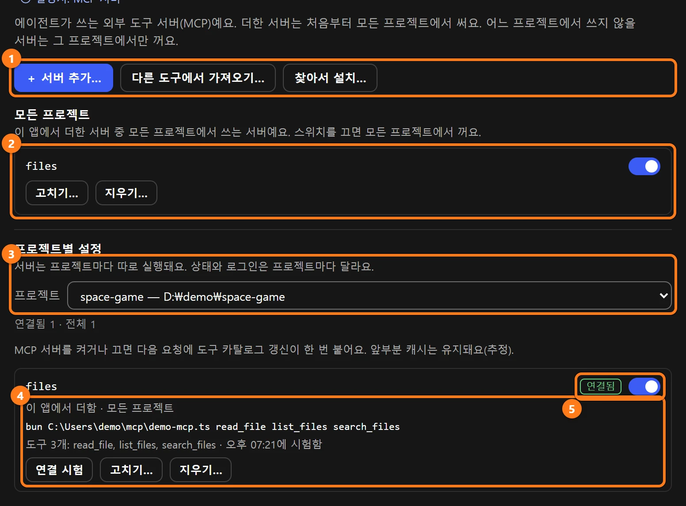

**목록 읽는 법**

- 상태는 `연결됨`, `연결 중`, `꺼짐`, `실패`, `로그인 필요`예요. `실패`면 줄의 `오류 원문`을 펼쳐 봐요.
- 줄 아래에 어디서 왔는지(`이 앱에서 더함 · 모든 프로젝트`, `이 앱에서 더함 · 이 프로젝트`, `설정 파일`과 그 경로, `Codex에서 가져옴`, `MCP 레지스트리에서 찾음` 등), 실행하는 명령이나 주소, 환경 변수 이름, 마지막 연결 시험의 도구(`도구 3개: read_file, list_files, search_files`)가 보여요.
- 값은 보이지 않아요. 긴 값은 이름 옆에 끝 네 글자만 보여요(`GITHUB_TOKEN …9fQ2`). 인자에 든 값은 `${API_KEY}`처럼, 주소에 든 값은 `••••`로 보여요. 설정 파일에 적힌 서버도 인자와 주소에 든 값은 `••••`로 보여요(예: `-e GITHUB_TOKEN=••••`, `Authorization: Bearer ••••`).
- `오류 원문`에서도 이 앱이 더한 서버의 값은 `••••`로 바뀌어요. 휴대폰·다른 PC에서는 이 앱이 더한 서버의 오류 원문이 보이지 않아요.
- 저장한 값을 키 저장소에서 읽지 못한 서버는 꺼진 채로 `저장한 값을 키 저장소에서 읽지 못해 이 서버는 꺼 두었어요.`가 보여요. 스위치로도 켜지지 않고, 키 저장소가 다시 답하면 켜져요. 앱이 잠시 뒤 저절로 다시 읽으니 기다리면 돼요(처음 1초, 늦어도 1분마다).
- 줄의 스위치는 그 프로젝트에만 적용되고, 서비스를 다시 시작해도 그대로예요. 모든 프로젝트에서 켜고 끄려면 위의 `모든 프로젝트` 칸을 써요(아래 "모든 프로젝트와 프로젝트별 설정").
- `opencode.json` 같은 설정 파일에 적힌 서버도 보이고 켜고 끌 수 있어요. 고치거나 지우려면 그 파일을 고쳐요.

**모든 프로젝트와 프로젝트별 설정**

더한 서버는 처음부터 **모든 프로젝트에서 써요**(`쓰는 곳`의 처음 값이 `모든 프로젝트`예요). 어느 프로젝트에서 쓰지 않을 서버만 그 프로젝트에서 꺼요. 페이지는 두 칸이에요.

- `모든 프로젝트`: 이 앱에서 더한 서버 중 모든 프로젝트에서 쓰는 서버예요. 프로젝트를 고르지 않아도 보여요. 스위치를 끄면 모든 프로젝트에서 꺼지고 `모든 프로젝트에서 꺼 둠`이 붙어요. `files 서버를 모든 프로젝트에서 껐어요.`가 뜨면 알림의 `되돌리기`로 바로 되돌릴 수 있어요. 어느 프로젝트에서만 다르게 쓰면 `billing-service에서 꺼 둠`, `space-game에서만 켬`처럼 보이고, 이름을 누르면 아래 칸이 그 프로젝트로 바뀌어요. `고치기…`·`지우기…`도 여기 있어요.
- `프로젝트별 설정`: 프로젝트를 고르면 그 프로젝트의 서버 목록이 보여요. 서버는 프로젝트마다 따로 실행돼요. 상태와 로그인은 프로젝트마다 달라요. 줄의 스위치는 그 프로젝트에만 적용돼요.

줄에는 그 프로젝트에서 무엇이 정했는지 붙어요.

| 표시 | 뜻 | 되돌리기 |
|---|---|---|
| `이 프로젝트에서 끔` | 이 프로젝트에서만 껐어요 | `되돌리기`를 누르면 모든 프로젝트 설정을 따라요 |
| `이 프로젝트에서만 켬` | 모든 프로젝트에서 꺼 두고 이 프로젝트에서만 켰어요 | `되돌리기`를 누르면 다시 꺼져요 |
| `모든 프로젝트에서 꺼 둠` | 모든 프로젝트 스위치가 껐어요 | 위의 `모든 프로젝트` 칸에서 켜요 |
| `이 프로젝트만` | 이 프로젝트에서만 쓰도록 더한 서버예요 | — |

`Ctrl+;` 창도 같은 표시와 `되돌리기`가 있어요. 그 창의 스위치는 이 프로젝트에만 적용돼서, 창 위에 `스위치는 이 프로젝트에만 적용돼요. 모든 프로젝트 설정은 [설정에서 관리]에서 해요.`가 보여요.

> **알아 두세요** 한 프로젝트에서 껐다가 다시 켜면 그 프로젝트의 설정은 지워져요(모든 프로젝트 설정을 따라요). 그래서 나중에 모든 프로젝트에서 끄면 그 프로젝트도 같이 꺼져요.

**서버 더하기**

1. `＋ 서버 추가…`를 눌러요.
2. 서버 설명서에 `mcpServers` 설정(JSON)이 있으면 `JSON 붙여넣기`를 펼쳐 붙여 넣고 `채우기`를 눌러요. 칸이 채워져요.
3. 아니면 직접 넣어요. `이름`, `쓰는 곳`(`모든 프로젝트` / `이 프로젝트만`), `종류`를 골라요.
   - `이 PC에서 실행(명령)`: `명령`(예: `npx`, `uvx`), `인자`(한 줄에 하나), 필요하면 `작업 폴더`와 `환경 변수`. 인자에 `${이름}`을 쓰면 그 이름의 환경 변수 값으로 바뀌어요. `${REGION:-eu}`처럼 쓰면 환경 변수 `REGION`이 없을 때 `eu`로 바뀌어요.
   - `원격 주소(HTTP)`: `주소`, 필요하면 `헤더`. 서버가 로그인을 요구하면 저장한 뒤 목록의 `로그인…`으로 로그인해요.
   - `Code Mode`는 보통 `기본` 그대로 둬요. `끄기`로 하면 도구를 직접 등록하는 서버가 돼요(켜고 끌 때 캐시를 다시 써요).
4. `연결 시험`을 눌러 `연결됐어요 · 도구 N개`가 뜨는지 봐요. 안 되면 이유가 보여요(예: `명령을 실행하지 못했어요. 명령 이름과 경로를 확인해요.`).
   서버가 남긴 글과 도구 설명에서 저장한 키 같은 비밀 값은 `••••`로 가려져요. `production` 같은 보통 낱말, `https://`, 쿼리 이름은 가리지 않아요. `us-east-1` 같은 지역, `application/json`, 폴더 경로처럼 비밀이 아닌 값도 그대로 보여요. 8자보다 짧은 값은 비밀이어도 가리지 않아요(보통 낱말까지 가려지지 않게요). `DATABASE_URL`처럼 이름이 비밀 같지 않아도 아래 꼴에 든 비밀번호와 키는 가려지고, 호스트, 사용자 이름, 데이터베이스 이름 같은 다른 부분과 `gitmcp.io/PaddlePaddle/Paddle2ONNX`, `gitmcp.io/amusi/CVPR2024-Papers-with-Code`, `huggingface.co/meta-llama/Meta-Llama-3-8B-Instruct` 같은 저장소·모델 이름, `ANTHROPIC_MODEL=claude-3-5-sonnet-20241022` 같은 모델 이름은 그대로 보여요. 이 밖의 꼴(예: Oracle의 `user/pass@ORCL` 같은 별칭, 1521 같은 리스너 포트가 아닌 `user/pass@db:8080/svc`)에 든 비밀번호는 가려지지 않으니, `DB_PASSWORD`처럼 비밀 이름의 환경 변수에 따로 넣어요.
   - 주소: `postgres://••••@db/app`, `jdbc:postgresql://db/app?password=••••`, `jdbc:sqlserver://db:1433;password=••••`, 주소의 `?` 뒤 값, 경로에 든 키(GUID와 16진 id가 든 조각(`dapi…`, `key_…`처럼 앞뒤에 글자가 붙은 것도), 낱말로 읽히지 않는 24자 이상 조각, `/`가 끼어 나뉘어도 끝의 `=` 채움이나 `+`가 있는 base64 키)
   - 연결 문자열: `Server=db;Password=••••`(따옴표 안의 `Password="••••"`, ODBC의 `PWD={••••}`도), Azure의 `SharedAccessSignature=…&sig=••••`, PostgreSQL의 `host=db password=••••`
   - Go MySQL의 `user:••••@tcp(db:3306)/app`, Oracle의 `user/••••@db:1521/svc`, `user/••••@//db/svc`, `jdbc:oracle:thin:user/••••@db:1521:ORCL19`
5. `저장`을 눌러요. 목록에 그 서버가 `연결됨`으로 보여요.

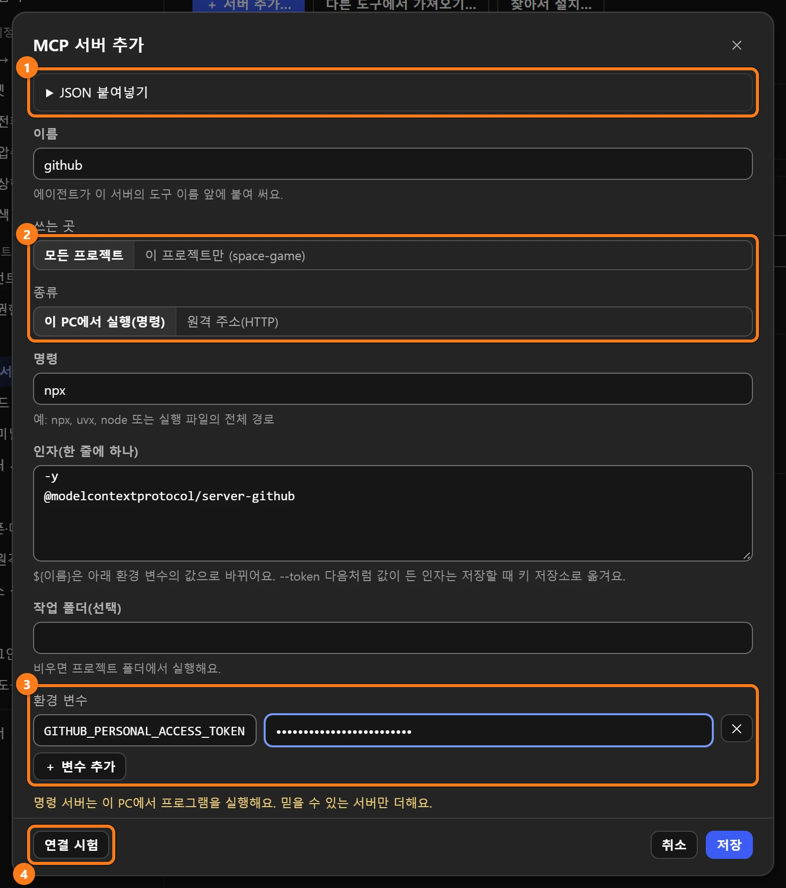

> **알아 두세요** 환경 변수와 헤더의 값, 주소의 `?` 뒤는 이 PC의 키 저장소에 넣어요. 화면과 기록에 다시 나오지 않아요. `--token`, `--api-key` 다음, `-e TOKEN=…`, `Authorization: Bearer …` 헤더, 주소의 `?key=…`처럼 인자에 값을 넣어도 저장할 때 키 저장소로 옮기고, 인자에는 `${TOKEN}`처럼 이름만 남아요. `ghp_…`, `sk-…` 같은 키는 긴 인자 안에 있어도 그 부분만 옮겨요. `--headers Authorization "Bearer …"`처럼 헤더 이름과 값을 따로 쓴 인자, `--config {"apiKey": "…"}` 같은 JSON 인자, `${API_KEY:-…}`의 기본값도 옮겨요. 연결 문자열 인자(`--dsn user:pass@tcp(…)/db`, `host=… password=…`, `user/pass@db:1521/svc`, `Server=…;Password=…`, `jdbc:sqlserver://…;password=…`)는 비밀번호만 옮기고 나머지는 그대로 둬요. 따옴표 안의 비밀번호(`Password="a""b"`)는 드라이버가 읽는 값(`a"b`)으로 넣고, 서버를 띄울 때 다시 따옴표 꼴로 써요. 그래서 고칠 때는 실제 비밀번호를 넣으면 돼요. `jdbc:postgresql://…?user=…&password=…`는 다른 주소처럼 `?` 뒤 값을 모두 옮겨요. 주소의 경로에 든 키는 생김새로 알아보므로 다 옮기지는 못해요. 무작위 키로 시험해 보니 24자 키는 백 개 중 한 개쯤 낱말처럼 읽혀 그대로 남았어요. `/`가 끼어 나뉜 base64 키는 더 자주 놓쳐서, 끝의 `=` 채움이나 `+`가 있어도 16바이트 키는 셋 중 하나꼴로, 32바이트 키는 스물다섯 중 하나꼴로 하나도 옮기지 못했어요(48바이트 이상은 백 중 하나 아래). 그런 서버가 키를 헤더나 `?` 뒤로도 받으면 그쪽에 넣어요. 반대로 짧은 대문자 약어가 많은 이름(`aws-sdk-js-v3-client-s3-2024`)은 키로 보고 가릴 수 있어요. 고칠 때 값 칸을 비워 두면 저장된 값이 그대로예요(`저장됨 …9fQ2 · 비우면 그대로`).

> **알아 두세요** 고칠 때 `쓰는 곳`은 그 서버가 원래 쓰이던 곳 그대로예요. 다른 프로젝트를 보고 있을 때 고쳐도 옮겨 가지 않아요. 바꾸고 싶을 때만 `쓰는 곳`에서 다른 것을 골라요.

> **주의** 명령 서버는 이 PC에서 프로그램을 실행해요. 믿을 수 있는 서버만 더하세요. 서버를 더하고 가져오고 찾아서 설치하는 일은 이 PC의 창에서만 돼요(`서버 추가, 가져오기, 찾아서 설치는 이 PC의 창에서만 할 수 있어요.`).

**다른 도구에서 가져오기**

1. `다른 도구에서 가져오기…`를 눌러요. Codex(`config.toml`)와 Claude Code(`.claude.json`, 프로젝트의 `.mcp.json`)에 설정된 서버가 도구별로 보여요. 이 단추를 누를 때만 읽고, 원래 파일은 바꾸지 않아요.
2. 가져올 서버에 체크해요. 필요하면 `이 앱의 이름`과 쓰는 곳을 바꿔요. 값은 이름만 보여요(`값 1개는 키 저장소에 넣어요: DOCS_API_KEY …AbCd`).
3. `고른 N개 가져오기`를 눌러요. `MCP 서버 N개를 가져왔어요.`가 뜨고 목록에 `Codex에서 가져옴`·`Claude Code에서 가져옴`으로 보여요.

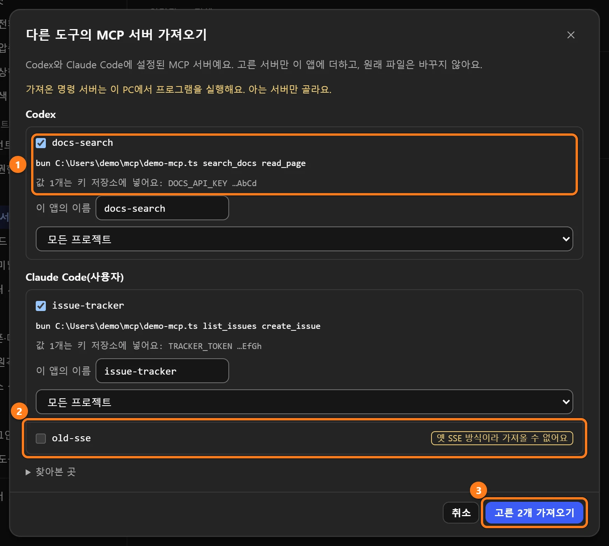

- 옛 SSE 방식 서버는 가져올 수 없어요(이 앱은 HTTP 방식만 써요).
- Codex와 Claude Code에 같은 서버가 있으면 한 줄로 보이고 `같은 서버가 있는 곳: …`이 붙어요. 곳마다 값이 다르면 `값이 달라요`가 붙어요. 체크하면 아래 고르기에서 어느 곳의 값을 가져올지 골라요(값은 이름과 끝 네 글자로만 보여요). 이 앱에 이미 같은 서버가 있으면 `이미 있음`이 붙고 체크하지 않은 채로 보여요.
- 그 도구에서 꺼 둔 서버는 체크하지 않은 채로 보여요.
- 고른 이름이 이 프로젝트의 설정 파일에 있는 서버와 같으면 `설정 파일에도 … 서버가 있어요. 가져오면 이 앱의 설정이 그 서버를 대신해요.`가 보여요.
- 시간 제한처럼 이 앱이 쓰지 않는 설정은 빠져요. 이 PC에 없는 환경 변수를 쓰는 값도 빠져요(줄 아래에 안내가 보여요). 인자나 주소에 있던 값은 키 저장소에 넣고 `${이름}`이나 `••••`로만 보여요.

**찾아서 설치: MCP 레지스트리에서 찾기**

공식 MCP 레지스트리(`registry.modelcontextprotocol.io`)에 올라온 서버를 찾아서 추가 창을 채워요. 이 PC의 서비스가 레지스트리에 물어요.

1. `찾아서 설치…`를 눌러요. 처음 서버들이 보여요. `서버 이름으로 찾기`에 이름 일부(예: `github`)를 넣고 `찾기`를 눌러요.
2. 줄에서 게시자와 버전을 보고 `▾`로 펼쳐요. `설치 방법`(npm·PyPI·Docker 패키지나 원격 주소), `이 PC에서 실행할 명령`, `필요한 값`(필수인지, 비밀 값인지, 기본값)이 보여요. `저장소` 링크로 출처를 확인해요.
3. `추가 양식에 채우기`를 눌러요. 추가 창이 명령과 인자(또는 주소), 필요한 값 줄로 채워져서 열려요.
4. `{repo}`처럼 `{ }`로 남은 부분을 알맞은 값으로 바꾸고, 필수 값을 넣어요. 남아 있으면 저장할 수 없어요.
5. 필요하면 `연결 시험`을 누르고, `저장`을 눌러요. 목록에 `MCP 레지스트리에서 찾음`과 레지스트리 이름·버전이 보여요.

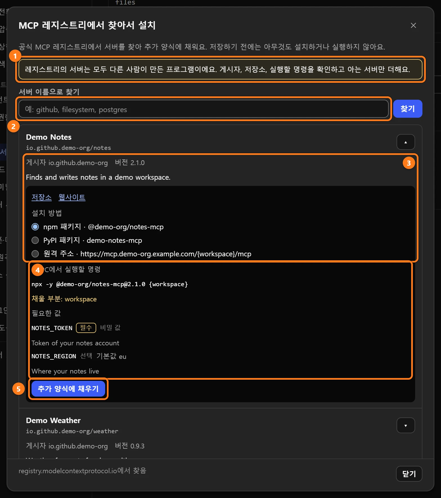

> **주의** 레지스트리의 서버는 모두 다른 사람이 만든 프로그램이에요. 게시자, 저장소, 실행할 명령을 확인하고 아는 서버만 더하세요. 이 앱은 저절로 설치하지 않아요. `저장`하기 전에는 아무것도 설치하거나 실행하지 않고, `연결 시험`은 누를 때만 실행해요. 저장한 명령 서버(`npx`, `uvx`, `docker` 등)는 에이전트가 쓸 때 그 패키지를 내려받아 실행할 수 있어요.

- 인터넷에 연결되지 않으면 `MCP 레지스트리에 연결하지 못했어요. 인터넷 연결을 확인하고 다시 찾아요.`가 보여요. `다시 찾기`를 눌러요.
- 이 앱이 바로 실행할 수 없는 방식(먼저 설치해야 하는 패키지)이나 옛 SSE 주소는 이유가 보이고 채울 수 없어요.
- 이름이나 설명이 아주 긴 서버는 창 안에서 줄을 바꿔 보여요. 명령이나 주소가 지나치게 긴 설치 방법은 목록에 나오지 않아요(잘린 명령을 실행하지 않게). 버전이 적히지 않은 서버도 채워서 저장할 수 있어요.

**고치기와 지우기.** 줄 아래의 `고치기…`로 같은 창을 열어 고치고, `지우기…`로 지워요. 지우면 저장한 값도 키 저장소에서 지워요. `연결 시험`은 지금 저장된 그대로 시험하고 도구 줄을 새로 고쳐요.

> **알아 두세요** MCP 서버를 켜거나 끄면 다음 요청에 도구 목록 갱신이 한 번 붙어요. 도구를 직접 등록하는 서버는 대화 앞부분 캐시를 처음부터 다시 쓸 수 있어요([11장](11-cache-switch-cost.md)).

- 휴대폰·다른 PC에서는 목록과 상태, 서버가 어디서 왔는지(`이 앱에서 더함 · 모든 프로젝트` 등)만 봐요. 명령과 값은 보이지 않아요. SSH 원격 호스트의 대화는 그 호스트에 설치한 서버를 써요(아래 "SSH 호스트에도 설치하기").

**SSH 호스트에도 설치하기**

이 PC에서 더하거나 가져온 서버는 SSH 원격 호스트의 대화에는 저절로 가지 않아요(이 PC의 경로와 프로그램이 호스트에는 없으니까요). SSH 호스트가 있으면 `설정` > `MCP 서버` 위쪽에 **`SSH 호스트에서 쓰기`** 칸이 보여요.

1. 호스트를 골라요. 연결된 호스트는 무엇이 있는지(node·npx, uv, python, docker 등) 스스로 확인해요. 연결 안 된 호스트는 `연결`을 눌러요.
2. 한 줄 요약을 봐요: `설치됨`, `설치 가능`, `준비 필요`, `AI 도움 필요`, `이 PC 전용`이 몇 개씩인지 나와요. `서버별로 보기`를 누르면 서버마다 줄이 펼쳐지고, `▾ 자세히`에 왜 그렇게 판단했는지(필요한 프로그램, 패키지와 판, 이 PC 경로를 호스트의 `~/…`로 바꾼 인자 등)가 나와요.
3. `설치 가능`인 서버는 `이 호스트에 설치`를 눌러요. 호스트에 등록하고, 패키지를 미리 받고(npx·uvx만), 호스트에서 연결 시험까지 해요(값을 보내기 전이라 꺼져 있는 서버는 시험하지 않아요). 한 번에 하려면 `모든 서버를 <호스트>에 설치…`를 눌러 목록을 보고 확인해요.
4. 키 같은 **값은 저절로 가지 않아요.** 값이 필요한 서버는 설치해도 `값을 보내기 전에는 호스트에서 꺼져 있어요: <이름>`이 보여요. 꺼져 있는 동안은 연결 시험 결과와 `호스트에서 연결 시험`이 보이지 않아요(호스트가 그 서버를 띄우지 않으니까요). `자세히`에서 `이 키를 <호스트>에 보내기`를 눌러야 그 서버가 켜져요. 값은 호스트의 디스크에 쓰지 않고 그 서비스의 메모리에만 두며, `보낸 값 거두기`로 언제든 거둘 수 있어요.
5. `준비 필요`(호스트에 uv나 docker가 없음 등)나 `AI 도움 필요`(이 PC의 스크립트, 호스트 PATH에 없는 프로그램 등)인 서버는 `AI에게 설치 맡기기`를 눌러요. 설명을 확인하고 `모델 고르고 시작…`을 누르면 그 호스트의 새 대화 화면으로 가서 "모델 @ 계정" 전환기가 열려요([6장](06-model-account.md)의 그 전환기예요). 지난번 모델이 골라져 있으니 그대로면 `이 모델로 시작`(Enter) 한 번이면 되고, 다른 모델이나 계정을 골라도 돼요. 목록에는 그 호스트에서 쓸 수 있는 계정만 나오고, 그 호스트에서 Claude 구독이 꺼져 있으면 이유와 고칠 곳이 보여요. 고르면 그 호스트에서 새 대화가 열리고, AI가 사용자 공간에 필요한 것을 설치한 뒤 서버를 등록하고 연결 시험을 해요. 전환기를 닫으면(Esc) 아무것도 시작하지 않고 빈 새 대화 화면에 남아요. 명령은 지금 승인 모드대로 물어요. 경로만 다른 서버는 `자세히`에서 호스트의 경로를 직접 넣고 설치할 수도 있어요.
6. 상태 폴더 같은 **비밀이 아닌 값**은 AI가 그 호스트에 맞는 값으로 정해요(이 PC의 값은 대개 이 PC의 경로라 호스트에서 맞지 않아요). 그런 값은 `자세히`에 `호스트에서 정함`과 그 값으로 보이고, 보낼 필요가 없어요. 비밀 값은 AI가 정할 수 없고 `이 키를 <호스트>에 보내기`로만 가요. 비밀이 아닌 값만 기다리며 꺼져 있는 서버에는 `AI에게 설치 맡기기`가 다시 보여요.

> **주의** 값을 보내면 그 서버가 호스트에서 도는 동안 그 호스트의 프로그램(같은 사용자와 root)은 값을 읽을 수 있어요. 믿는 호스트에만 보내세요.

- `이 PC 전용`은 Windows 프로그램(`C:\Tools\x.exe`, PowerShell 스크립트)이나 이 PC 화면을 다루는 서버, 주소가 이 PC(`localhost`)인 서버예요. 호스트에 설치할 수 없어요.
- 호스트에 설치한 서버는 own이 호스트의 `mcp.json`에 등록해요. 호스트의 OpenCode 설정 폴더(`~/.config/opencode` 등)에는 없어요. 호스트 칸 위쪽의 `<호스트>에 설치한 MCP 서버는 own이 이 파일에 등록해요(OpenCode 설정 파일이 아니에요):` 줄에 그 파일의 경로가 나와요. 설치하거나 값을 보내면 그 호스트의 새 대화는 바로 그 서버를 쓰고, 열린 대화도 다음 요청부터 써요.
- 설치된 서버의 `자세히`는 호스트에서 실제로 실행하는 명령(`호스트에서 실행`)과 이 PC의 정의를 따로 보여 줘요. 이 PC의 경로나 스크립트에 대한 설명은 설치한 뒤에는 나오지 않아요(호스트는 자기 명령을 쓰니까요).
- PC에서 서버를 고치거나 지워도 호스트는 그대로예요. 대신 줄에 `PC와 다름`이나 `PC에 없음`이 보이고, `업데이트` 한 번으로 다시 맞춰요(전에 보낸 값도 다시 보내고, 호스트에서 정한 값은 그대로 둬요). AI가 설치한 서버는 `업데이트` 대신 `AI에게 설치 맡기기`가 나와요(이 PC의 정의로 호스트의 명령을 덮지 않게).
- 호스트의 own이 예전 판이면 `호스트 최신 아님`이 보여요. `설정` > `SSH 원격 호스트`에서 업데이트한 뒤 다시 와요.
- 같은 일을 `설정` > `SSH 원격 호스트` > 호스트의 `MCP 서버 설치…`, 명령 팔레트의 `SSH 호스트에 MCP 서버 설치…`, 호스트 대화 위에 뜨는 한 줄의 `설치…`(이 PC의 서버 가운데 그 호스트에 없는 것이 있을 때 뜨고, 닫으면 그 서버 묶음이 바뀔 때까지 다시 안 보여요)에서도 시작할 수 있어요.
- 휴대폰·다른 PC에서는 호스트에 설치된 서버만 보이고, 설치와 값 보내기는 이 PC의 창에서만 해요.

## 10.16 하위 에이전트에게 가는 글과 돌아오는 글

메인 모델은 일의 한 부분을 하위 에이전트에게 맡길 수 있어요. `설정` > `에이전트 방식`의 탭마다 맨 아래 `하위 에이전트`에서, 맡길 때 무엇이 가고 무엇이 돌아오는지 봐요. 이 부분은 보기만 할 수 있어요. 보기 위해 모델에게 보내는 글이 바뀌지는 않아요.

**OpenCode 기본, Pi 방식, DeepSeek 방식, Claude Agent 기본.** 네 방식 모두 OpenCode의 `subagent` 도구로 맡겨요.

- `맡기는 도구`는 모델이 받는 도구 설명 그대로예요. 설명에 붙은 Available subagents 목록은 새 대화의 기본 에이전트가 맡길 수 있는 역할이에요. Claude Agent 계정의 모델에는 MCP 도구 이름(`mcp__opencode__subagent`)으로 가요.
- 새 하위 에이전트의 첫 메시지는 “You are a subagent spawned by another session.” 한 줄 뒤에 메인 모델이 쓴 글을 그대로 붙인 것이에요. 같은 하위 에이전트에게 이어서 맡기면 메인 모델이 쓴 글만 가요.
- 이 밖에 하위 에이전트에게 따로 붙는 지시는 없어요. 하위 에이전트도 메인과 같은 에이전트 방식의 지시문, AGENTS.md, 스킬을 받아요(메인이 받는 만큼만요. 10.12의 "저장소의 AGENTS.md는 방식마다 조금 달라요"). 다만 탐색(explore)처럼 자기 지시문이 있는 역할은 그 지시문도 받아요. 들어가는 자리는 방식마다 달라서 탭마다 적혀 있어요. 예를 들어 OpenCode 기본에서는 모델별 기본 지시문을, Pi 방식에서는 Pi 지시문의 첫 문단과 도구 목록·규칙을 대신하고, Claude Agent 계정에서는 Claude Code 지시문 뒤에 붙어요.
- 메인 모델에게 돌아오는 글은 하위 에이전트가 **마지막 단계**에 쓴 글뿐이에요. 중간 단계의 글과 도구 결과(읽은 파일, 실행한 명령의 출력)는 가지 않아요.
- 기다려서 받는 결과(포그라운드)가 2,000줄이나 50 KiB를 넘으면 **앞부분만** 남기고 잘라요. 전체는 파일로 남고 그 경로가 함께 가요. 그래서 긴 답에서는 하위 에이전트가 맨 끝에 쓴 말이 메인 모델에게 가지 않을 수 있어요.
- 백그라운드로 맡긴 하위 에이전트는 끝나면 같은 모양의 알림으로 돌아와요. 이 알림은 자르지 않아요.
- 이 앱이 결과 뒤에 붙이는 것은, 프리셋 때문에 하위 에이전트의 모델이나 추론 강도가 요청과 달라졌을 때의 한 줄 알림뿐이에요. 프리셋이 위임 모드를 정하면 메인 모델은 언제 맡길지 알려 주는 안내를 따로 받아요([14장](14-presets.md)).

**Codex 방식.** 대개 Codex의 `spawn_agent` 도구로 맡기고, 모델에 따라 도구가 두 가지예요.

- GPT-6 계열처럼 Codex 목록에서 협업 도구를 쓰는 모델: 새 하위 에이전트는 Codex의 작업 메시지(`Message Type: NEW_TASK` …) 안에 메인 모델의 글을 받고, Codex가 하위 에이전트에게 주는 역할 글도 받아요. 끝나면 마지막 답이 `FINAL_ANSWER` 메시지로 메인 모델에게 가요. `wait_agent`는 기다리기만 하고 내용을 돌려주지 않아요. 이 `spawn_agent`는 고친 파일 목록이나 검토를 따로 묻지 않아요.
- 그 밖의 모델(GPT-5.5, Claude, DeepSeek 등): 새 하위 에이전트는 메인 모델이 쓴 글을 앞에 붙는 줄 없이 그대로 받아요. 끝나면 마지막 답이 `<subagent_notification>` 알림으로 가고, `wait_agent`도 그 답을 돌려줘요. `spawn_agent`가 무엇을 묻는지는 지시문과 모델에 따라 달라요.

| 지시문 · 모델 | `spawn_agent`가 묻는 것 |
|---|---|
| `원본`(모든 모델), Codex 목록의 GPT 모델 | Codex의 원래 글이에요. 하위 에이전트에게 고친 파일 경로를 마지막 답에 적게 하고, 돌아오면 메인이 고친 것을 빠르게 검토하라고 해요. |
| `개선판` · Claude Sonnet, DeepSeek 등 | 원래 글처럼 고친 파일 경로를 적게 하고, 돌아오면 그 파일을 빠르게 검토하라고 해요. |
| `개선판` · Claude Opus 4.8 이후, Fable, Mythos | 이 앱이 새로 쓴 짧은 글이에요. 고친 파일 목록이나 검토는 묻지 않고, 맡길 때 돌려받을 결과를 적으라고만 해요. |

GPT-5.6 Luna처럼 Code Mode로 도는 모델 중 협업 도구를 쓰지 않는 모델은 예외예요. Codex의 `spawn_agent`를 받지 않고, 위 네 방식처럼 OpenCode의 `subagent` 도구로 맡겨요. 이때 탐색(explore) 같은 역할의 지시문은 Codex 지시문을 그대로 두고 developer 메시지 맨 앞에 더해져요.

**omo (원본).** omo는 `task` 도구로 맡겨요. 돌아오는 글은 omo가 만들어요. 걸린 시간, 에이전트, 하위 에이전트의 답, 이어서 맡길 때 쓸 `task_id`가 들어 있어요. 이 앱은 아무것도 더하지 않아요. 프리셋의 위임 안내도 omo 대화에는 보내지 않아요. 그 안내가 말하는 `subagent` 도구가 omo에는 없기 때문이에요.

**규칙을 하나 더하고 싶을 때.** 하위 에이전트가 끝내지 못했거나 확인하지 못한 일을 말하게 하려면, 프로젝트의 AGENTS.md에 이 한 줄을 넣어요. 대화 폴더나 그 위쪽의 AGENTS.md는 어느 에이전트 방식에서나 메인과 하위 에이전트가 함께 받아요. SSH 호스트에서는 그 호스트의 `프로젝트 설정`이 `끔`이면 읽지 않으니 `지시 파일만 (AGENTS.md)`이나 `켬`인지 확인하세요([22장](22-ssh-remote.md)).

```text
If you are working as a subagent for another agent, begin your final answer with anything you did not finish or did not check.
```

- 답의 맨 앞에 쓰게 하는 까닭: 긴 결과는 앞부분만 메인 모델에게 가요(위).
- “You are a subagent” 줄을 조건으로 삼지 마세요. Codex 방식의 하위 에이전트는 그 줄을 받지 않아요.
- 하위 에이전트가 스스로 쓴 말이라 틀릴 수 있어요. 중요한 일은 하위 에이전트의 대화를 열어 실제로 무엇을 했는지 확인하세요.

## 10.17 이미지 만들기: 그림 만들기와 고치기

`설정 > 이미지 만들기`에서 `모델에 이미지 만들기 도구 주기`를 켜면 대화의 모델이 도구(`image_generate`)로 그림을 새로 만들거나 고쳐요. OpenAI API 키 계정으로 OpenAI의 최신 이미지 모델을 쓰고, 키가 모두 바닥나면 ChatGPT 구독으로 대신 만들 수 있어요. `설정`의 `모델·계정` 묶음에서 `웹 검색` 아래에 있어요.

> **참고** 전에는 `설정`의 `컴퓨터 사용 (실험)` 페이지 아래쪽에 있었어요. 지금 그 페이지에는 `이미지 만들기 도구는 설정 > 이미지 만들기로 옮겼어요` 줄만 남아 있어요. 고른 값은 그대로예요.

> **용어** OpenAI API 키 계정: `계정 추가`에서 `OpenAI` 키를 넣은 계정이에요. 키는 앱의 금고에만 있고, 모델이나 명령 창(셸)에는 가지 않아요.

### 처음 쓰기

1. `설정 > 이미지 만들기`를 열고 맨 위의 `모델에 이미지 만들기 도구 주기`를 켜요. 기본은 꺼져 있어요.
2. 같은 페이지 `OpenAI API 키 순서` 아래의 `OpenAI API 키 추가`를 눌러요. 계정 추가 창이 OpenAI 키 입력 칸으로 바로 열려요. 이름을 정하고 키를 붙여 넣은 뒤 `연결 테스트 후 추가`를 눌러요([3장](03-first-account.md)).
3. 대화에서 "빨간 큐브 아이콘을 하나 만들어 주세요"처럼 부탁해요. 모델이 `imagegen` 스킬을 읽고 도구를 불러요.
4. 도구 카드 아래 줄에 쓴 모델, 계정, 비용, 저장한 곳과 그림이 보여요.

이미지를 만들 수 있는 계정이 하나도 없으면(모두 꺼져 있거나, 바닥났거나, 한도에 닿았거나, 실패하면) 대화에 `지금 이미지를 만들 수 있는 계정이 없어요`가 보이고, 그 아래에 계정마다 이유와 `이미지 설정 열기`(`설정 > 이미지 만들기`를 열어요), `OpenAI API 키 추가` 단추가 나와요. 이때는 요청을 하나도 보내지 않고 돈도 들지 않아요. 계정을 켜거나 키를 넣고 다시 부탁하면 돼요. 모델도 다시 시도하지 않고 이 말을 전한 뒤 멈춰요.

### 모델 고르기

`모델 (API 키)`에서 정해요.

| 선택 | 하는 일 |
|---|---|
| `gpt-image-2.6 자동 (권장)` | 기본이에요. 그림마다 AI가 골라요. 평소 그림은 `gpt-image-2.6-flare`(가장 빨라요), 얼굴·제품·로고를 지켜야 하는 정밀한 편집, 글자가 많은 그림, 여러 그림 합치기, 공들인 최종본은 `gpt-image-2.6-sunburst`예요 |
| `gpt-image-2.6-flare만`, `gpt-image-2.6-sunburst만` | 늘 그 모델만 써요 |
| `gpt-image-2만` | Codex CLI의 기본과 같아요. 투명 배경은 못 만들어요 |

전에 `gpt-image-2.5`를 골라 두었으면 같은 자리의 `gpt-image-2.6`으로 바뀌어요(자동은 자동, Flare는 Flare, Sunburst는 Sunburst). 없어진 gpt-image-1.5만을 골라 두었으면 `gpt-image-2만`으로 바뀌어요.

2.6 모델을 쓰면 AI가 그림마다 복잡도(`complexity`, 그리기 전에 얼마나 계획할지)도 정할 수 있어요. 배경만 바꾸는 것 같은 간단한 편집은 낮게, 글자가 많거나 구성이 복잡한 그림은 높게 해요. 토큰당 값은 같지만 높을수록 오래 걸릴 수 있어요.

요금은 100만 토큰당 글 입력 $5(캐시 $1.25), 이미지 입력 $8(캐시 $2), 이미지 출력 $30이에요(2026-11-06 OpenAI 요금표). 세 모델 모두 토큰당 값이 같아요. `기본 품질`을 `낮음`으로 두면 가장 싸요. `기본 크기`도 여기서 정해요.

### 키 순서와 바닥난 키

`OpenAI API 키 순서`의 위에서부터 써요. `위로`·`아래로`로 순서를 바꾸고, 체크를 끄면 그 키는 이미지에 쓰지 않아요. 순서와 상관없이 키마다 따로 켜고 꺼요.

- `API 키 쓰기`를 끄면 API 키를 하나도 쓰지 않고 바로 Codex 구독으로 만들어요. API 잔액을 아직 채우지 않았을 때 편해요. 키를 묻지도 않고 키를 넣으라는 안내도 나오지 않아요.
- 특정 키만 쓰려면 `API 키 쓰기`는 켜 두고 쓸 키만 체크해요.
- 켜고 끄는 것과 `바닥남` 표시는 따로예요. 꺼 둔 키를 다시 켜도 바닥남 표시는 그대로이고, `다시 쓰기`로만 지워져요.

- 잔액이나 한도가 바닥났다는 답(`insufficient_quota` 같은)을 받은 키는 `바닥남`과 함께 OpenAI가 준 코드와 확인한 시각이 보이고 6시간 동안 건너뛰어요. OpenAI는 잔액을 알려 주지 않아서, 이 답을 받은 때만 표시해요.
- 잔액을 채웠으면 `다시 쓰기`를 눌러요. 다음 그림부터 그 키를 다시 써요.
- 잠깐의 요청 제한(429)은 같은 키로 다시 시도해요. 건너뛰지 않아요.

### Codex 구독으로 대신 만들기

키가 모두 바닥나면 ChatGPT 구독 계정으로 대신 만들어요. 기본은 켜져 있어요.

- 남은 한도가 많은 계정부터 써요. 쓸 계정은 목록의 체크로 계정마다 정해요.
- 모델은 Codex가 정해요(지금은 `gpt-image-2`). 고른 Flare·Sunburst는 API 키에만 쓰여요.
- 돈은 들지 않고, 그 구독의 사용 한도에서 차감돼요.

> **주의** 여러 구독 계정을 번갈아 써서 한도를 피하는 건 OpenAI 이용 약관에 어긋날 수 있어요. 쓸지는 직접 정해 주세요. 끄려면 `Codex 구독으로 대신 만들기`의 체크를 꺼요.

### 그림이 저장되는 곳

- 만든 그림은 대화에 들어가서 모델도 볼 수 있어요. 파일은 `%LOCALAPPDATA%\own-open-code\images` 아래 대화마다 만든 폴더에 남아요.
- 프로젝트에 넣을 그림이면 "public/hero.png로 저장해 주세요"처럼 말해요. 그 파일을 쓰기 전에 승인 모드대로 물어요. 그림을 만드는 것 자체는 어느 승인 모드에서나 묻지 않아요.
- 고칠 그림은 첨부하거나 프로젝트 파일 경로를 알려 주세요.

### GIF·SVG와 표시해서 고치기

`gpt-image-2.6` 모델(자동, Flare, Sunburst)이면 PNG 말고도 이런 그림을 부탁할 수 있어요. 모두 OpenAI API 키로만 만들어요. Codex 구독은 PNG만 만들어서, 키가 모두 바닥났으면 카드에 `구독(Codex)으로는 GIF를 만들 수 없어요 (OpenAI API 키의 GPT Image 2.6만 돼요)`처럼 이유가 나오고 요청을 보내지 않아요.

| 부탁 | 이렇게 돼요 |
|---|---|
| 짧은 움직이는 그림("손 흔드는 고양이 GIF") | GIF 애니메이션이에요. 2~16장, 장마다 20~2000ms예요. 카드에서 움직이고, 모델은 첫 장만 봐요 |
| 아이콘·로고·단순한 그림을 SVG로 | 고칠 수 있는 벡터 그림(SVG)이에요. 글로만 만들고 그림을 넣어 고칠 수는 없어요. 카드에 그림으로만 보이고 SVG 안의 스크립트는 돌지 않아요 |
| JPEG, WebP | 사진은 JPEG가 작고, WebP는 투명 배경을 지켜요 |
| 그림에 동그라미를 그려 "여기만 파랗게" | 고칠 그림과 같은 크기의 투명 PNG에 표시만 그려 함께 주면, 표시한 곳만 고쳐요. 표시 층은 직접 주거나 모델이 만들 수 있어요 |

- GIF는 모든 장을 한 장의 큰 그림에 모아 그려서 한 장의 크기에 한도가 있어요. 그래서 기본 크기가 1024x1024여도 GIF는 그 장 수에 맞게 줄여서 만들어요: 2~9장은 960x960, 10~12장은 816x816, 13~16장은 720x720이에요(가로·세로 모양도 같은 식으로 줄어요). 줄였으면 카드에 `프레임 크기 960x960 (요청한 1024x1024보다 줄였어요)`처럼 보여요.
- GIF는 같은 크기의 PNG보다 조금 비싸요. 2026-11-09에 낮은 품질로 3장 GIF가 $0.038, 1024x1024 PNG가 $0.025였어요.
- SVG는 OpenAI가 먼저 기준 그림을 그리고, 다른 모델(`gpt-6-luna`)이 그걸 보고 SVG를 써요. 그 모델의 값도 비용 칸에 들어 있고, 카드에 `SVG 작성 gpt-6-luna: 입력 … · 출력 … 토큰 · $0.0008 (위 비용에 들어 있어요)`처럼 따로 보여요. 아이콘 하나에 모두 $0.026쯤이었어요(2026-11-09).
- 받은 형식이 부탁과 다르면 카드에 `요청한 형식 GIF · 받은 형식 PNG`처럼 보이고, 파일 이름도 받은 형식을 따라요.
- OpenAI 프로젝트에 SVG나 GIF 권한이 아직 없으면 OpenAI가 거절해요. 카드에 그 이유가 보여요.

### 비용 보기

그림 한 장마다 도구 카드 아래에 비용이 보이고, 사용량 기록에도 남아요([7장](07-usage.md)). 구독으로 만든 그림은 `구독 한도에서 차감`으로 보여요.

- 켜거나 끄면 모든 대화의 도구 목록이 바뀌어서, 대화마다 다음 요청 한 번은 캐시를 다시 써요([11장](11-cache-switch-cost.md)).
- 이 PC의 서비스에 저장돼서 모든 창과 기기, SSH 원격 호스트의 대화에 같이 적용돼요.
- 휴대폰·다른 PC에서도 같은 페이지가 보여요. 바꾸는 것은 `관리` 권한이 있는 기기에서만 돼요. 없으면 `이 기기에서는 바꿀 수 없어요. PC의 앱 창에서 바꿔 주세요.`가 보여요([24장](24-phone-other-pc.md)).

## 10.18 곁질문: 일을 멈추지 않고 물어보기

에이전트가 일하는 동안 "아까 그 파일 이름이 뭐였지?"처럼 잠깐 묻고 싶을 때 써요. **곁질문**은 지금까지의 대화를 모두 읽고 답하지만, 도구를 쓰지 않고 대화 기록에도 남지 않아요. 그래서 일하던 에이전트는 질문도 답도 보지 못하고, 하던 일을 그대로 이어 가요.

1. 입력창에 `/btw` 다음에 질문을 쓰고 보내요(예: `/btw 지금 고치는 함수 이름이 뭐야?`). `/곁질문`으로 쳐도 돼요.
2. 오른쪽에 **곁질문** 창이 열리고 답이 흘러나와요. 휴대폰에서는 아래에서 올라와요.
3. 더 물을 게 있으면 창 아래 칸에 쓰고 `Enter`를 눌러요. 같은 곁질문에서 이어서 답해요.

- 질문 없이 `/btw`만 보내거나 명령 팔레트(`Ctrl+K`)에서 `곁질문…`을 고르면 빈 창이 열려요. 휴대폰에서는 대화 위쪽의 `⋯`를 누르고 `곁질문…`을 눌러요.
- 실행 중에 `/btw`를 보내도 대기열이나 끼워 넣기로 가지 않아요. 입력창에 붙여 둔 파일·스킬 칩도 그대로 남아요.
- 답 아래 단추:
  - `복사`: 답을 복사해요.
  - `대화에 넣기`: 질문과 답을 보통 메시지로 대화에 보내요. 에이전트에게 알려 주고 싶을 때만 눌러요. 지금 일이 끝난 뒤에 전달돼요.
  - `멈추기`: 답하는 중에 멈춰요.
- `지난 곁질문`을 누르면 이 대화에서 물었던 곁질문이 나와요(12개까지). 눌러서 다시 열고, `×`로 지워요. PC·휴대폰·다른 PC에서 같은 목록이 보여요.
- 답 아래 줄은 쓴 양이에요(예: `입력 41k · 캐시 97% · 출력 120 · $0.003`). 곁질문은 대화가 이미 보낸 앞부분을 캐시에서 다시 읽어서 싸요. 쓴 양은 세션 카드와 계정 사용량에 `곁질문`으로 더해지고, 턴 아래 사용량 줄과 자동 압축에는 들어가지 않아요.
- 모델이 도구를 쓰려고 하면 거기서 멈추고 `모델이 도구를 쓰려 해서 여기서 멈췄어요.`가 보여요. 파일을 열어 봐야 답할 수 있는 질문은 대화에 직접 물어요.
- SSH 호스트의 대화에서는 곁질문도 그 호스트에서 물어요. `이 서비스는 곁질문을 몰라요`가 보이면 그 호스트를 업데이트해요([22장](22-ssh-remote.md)).
- 휴대폰이나 다른 PC에서 물으려면 그 기기에 `메시지 보내기` 권한이 있어야 해요([24장](24-phone-other-pc.md)).

## 10.19 작업 폴더 대화: 워크트리에서 따로 일 시키기

대화에 "워크트리 만들어서 거기서 작업해"라고 말하면, 에이전트가 **새 작업 폴더(워크트리)** 를 만들고 그 폴더에서 일할 **새 대화**를 시작해요. 지금 대화는 그대로 있고, 새 대화가 끝나면 알림을 받아 결과를 살펴보고 합쳐 줘요. 팀 모드를 켜지 않아도 되고, 에이전트 방식(OpenCode 기본, Codex, Pi, DeepSeek, omo, Claude Code)과 상관없이 같아요.

1. 대화에 시킬 일을 말해요. 예: `로그인 화면이랑 API 정리를 각각 워크트리에서 해 줘`
2. 에이전트가 일마다 작업 폴더와 브랜치를 만들고 새 대화를 시작해요. 새 대화는 지금 대화와 같은 `모델 @ 계정`, 에이전트 방식, 프리셋, 승인 모드로 시작하고, 첫 메시지는 에이전트가 쓴 일의 설명이에요.
3. 입력창 위에 **작업 폴더 대화** 줄이 생겨요. 줄마다 상태(`작업 중`, `답 필요`, `끝남`, `막힘`, `합침`, `지움`)와 이름, 브랜치가 보이고 `열기`로 그 대화로 가요. 대화 목록에서도 그 작업 폴더(⑂ 브랜치 이름) 아래에 보여요.
4. 새 대화가 끝나면 원래 대화가 결과를 받아요. 에이전트가 결과를 보고 더 시키거나, 합치기 전에 나에게 알려요.
5. 합치기(기준 브랜치에 넣기)는 **물어본 뒤에** 해요. 승인 카드에서 `허용`을 누르면 합쳐요. `전체 허용` 모드에서도 물어요. `항상 허용`을 누르면 그 기준 브랜치는 다음부터 묻지 않아요. 원격 저장소로 push는 하지 않아요.
6. 합친 뒤 에이전트가 작업 폴더를 지울지 물어요. 커밋하지 않은 변경이 있으면 지우지 않아요. 브랜치는 남고(다 합쳐졌고 지우라고 하면 함께 지워요), 대화는 목록에 남아요.

- 새 대화를 열어 직접 말해도 돼요. 원래 대화가 보낸 추가 지시는 "[원래 대화에서]"로 시작해요. 새 대화에서 "이거 합쳐 줘"라고 해도 합쳐요(역시 물어본 뒤에).
- 새 대화가 권한이나 질문으로 나를 기다리면 줄에 `답 필요`가 보이고 원래 대화도 알려 줘요. 그 대화를 열어 답해요.
- 지금 대화 자체를 새 작업 폴더로 옮기고 싶으면 그렇게 말해요: "이 대화를 새 워크트리로 옮겨서 거기서 해".
- 되돌리기: "방금 합친 거 되돌려 줘"라고 하면 기준 브랜치를 합치기 전으로 돌려요(그 뒤 기준 브랜치가 다른 커밋으로 움직였으면 되돌리지 않아요).
- 작업 폴더는 **프로젝트 안 `.worktrees` 폴더**에 생겨요(예: `D:\projects\app\.worktrees\login-form`). own이 그 폴더에 `.gitignore`를 두므로 프로젝트의 `git status`에는 보이지 않아요. 사이드바의 `새 작업 폴더`도 같은 곳에 만들어요. 프로젝트 설정 `opencode.json`의 `worktree.directory`를 정해 두었으면 그곳을 써요. 전에 만든 작업 폴더는 옮기지 않아요.
- SSH 호스트의 대화에서도 같아요: 작업 폴더는 호스트 프로젝트의 `.worktrees`에, 새 대화는 호스트에서 돌아요. 줄이 안 보이면 그 호스트를 업데이트해요([22장](22-ssh-remote.md)).

## 조심하세요

> **주의** `이 지점으로 복원`에서 `파일 변경도 되돌리기`를 고르면 그 뒤에 에이전트가 고친 파일이 되돌아가요. 그 사이 **내가 직접 고친** 내용도 같은 파일이면 함께 돌아갈 수 있어요. 확정하기 전에 `변경 보기`로 확인하세요.

> **주의** `대기열`에 넣은 메시지는 지금 턴이 끝나면 저절로 가요. 마음이 바뀌었으면 `×`로 지우세요.

## 더 알아보기

- 단축키 전체: [부록 B](91-shortcuts.md)
- 다른 도구의 **대화** 가져오기: [21장](21-import-other-tools.md)
- 에이전트 방식의 설계: [10 Codex 하네스 §3.8–§3.9, §3.11 지시문 보기와 내 지시문](../10-codex-harness.md), [12 Pi 하네스](../12-pi-harness.md), [13 DeepSeek 하네스](../13-dsh-harness.md), [15 omo 이식](../15-omo-port.md)
- 설계 문서: [02 §3.9 음성 입력, §9.2 노트, §9.6 이미지 만들기 도구](../02-accounts-providers-cache.md), [05 §7.8 마이크, §8.8 노트 탭](../05-desktop-and-mobile.md)
- 설계 문서: [03 화면 §18.7 메시지 복원, §18.9 대기열·끼워 넣기, §18.13 슬래시 명령, §18.18 문맥 비우기](../03-ui-ux.md), [11 압축 §7 문맥 비우기](../11-compaction-prompt.md)
