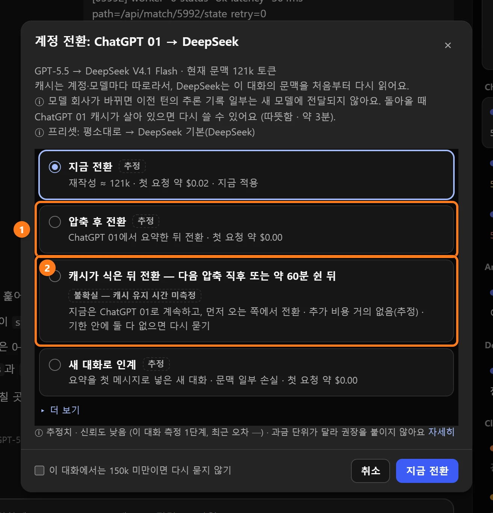
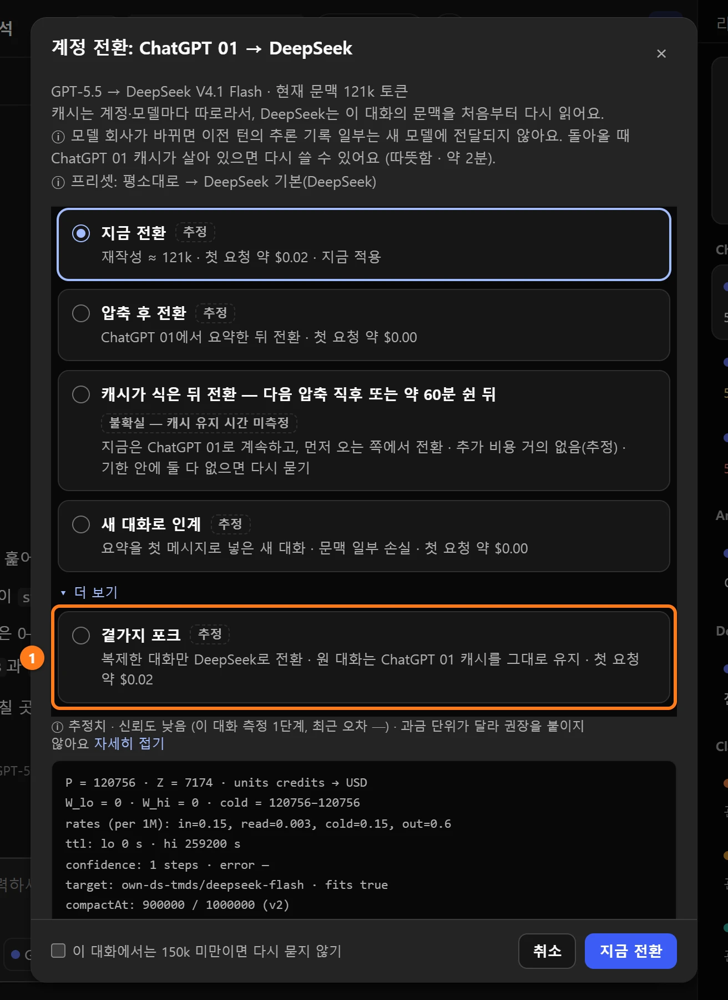
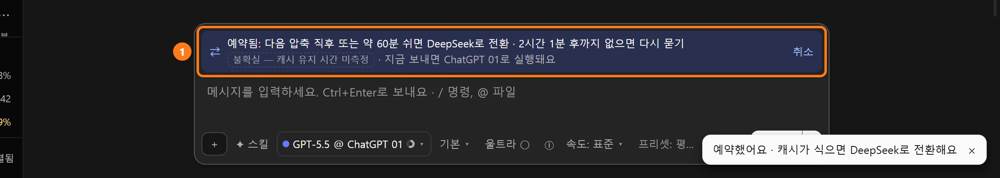
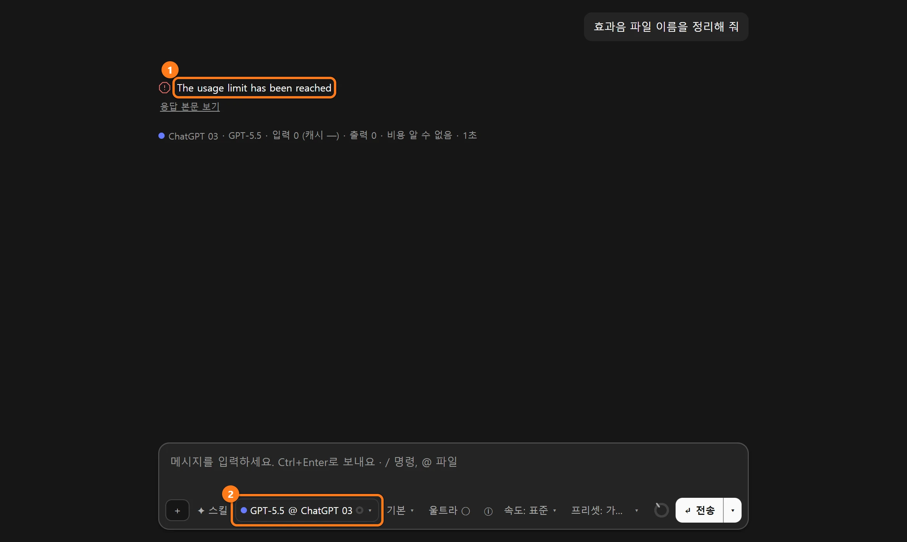

# 11. 캐시와 전환 비용: 한 대화를 여러 계정으로

**한 줄 요약**: 한 대화를 ChatGPT로 시작해 DeepSeek나 Claude로 이어 갈 수 있어요. 대신 바꿀 때마다 새 계정이 대화를 처음부터 다시 읽어서 돈(또는 한도)이 들어요. 앱은 그 값을 먼저 보여 주고, **압축 직후**나 **오래 쉰 뒤**처럼 싸게 바꿀 수 있는 때를 고르게 도와줘요.

## 왜 필요해요?

- 한 계정의 한도가 바닥나도 **대화를 버리지 않고** 다른 계정으로 이어 갈 수 있어요.
- 일에 맞는 모델로 갈아탈 수 있어요. 예: 설계는 Claude, 반복 작업은 값싼 DeepSeek.
- 하지만 아무 때나 바꾸면 긴 대화에서는 꽤 비싸요. 이 장은 **언제, 어떻게 바꾸면 싼지**를 알려 줘요.

## 11.1 캐시: 왜 바꾸면 돈이 드나요?

> **용어** 문맥: 모델이 답을 쓰려고 매번 읽는 대화 전체(내 메시지, 답, 도구 결과, 지시문)예요. 대화가 길어질수록 문맥도 커져요.

에이전트는 메시지를 보낼 때마다 **대화 전체를 처음부터 다시** 모델에게 보내요. 그래서 회사(프로바이더)들은 **캐시**를 써요.

> **용어** 캐시: 회사가 "이 대화 앞부분은 방금 읽었어요" 하고 **책갈피**를 꽂아 두는 것이에요. 같은 계정·같은 모델로 다시 보내면 책갈피 앞부분은 훑고 넘어가요. 그 부분은 정가의 10분의 1쯤으로 싸고(Claude Opus 5.5·Sonnet 5.5, GPT-6.1은 20분의 1, Claude Fable 5.1은 40분의 1), 구독 한도도 덜 써요.

책갈피는 **계정과 모델마다 따로**예요.

- 다른 계정으로 바꾸면, 그 계정에는 책갈피가 없어요. 대화 전체를 **처음부터 정독**해야 해요. 이것을 앱은 `캐시 재작성`이라고 불러요.
- 같은 회사의 다른 계정(ChatGPT 01 → ChatGPT 02)도 마찬가지예요.
- 같은 계정에서 모델만 바꿔도(GPT-5.5 → 다른 GPT) 책갈피가 없어요.

<figure class="diagram">
<svg class="dg-wide" viewBox="0 0 680 252" role="img" aria-label="같은 계정으로 보내면 앞부분을 캐시로 싸게 읽고, 다른 계정으로 바꾼 첫 요청은 앞부분을 정가로 다시 읽고, 압축한 뒤 바꾸면 요약과 최근 원문만 다시 읽는다" xmlns="http://www.w3.org/2000/svg" font-family="inherit" style="width:100%;height:auto;max-width:680px">
<rect x="220" y="6" width="18" height="12" rx="3" fill="currentColor" fill-opacity="0.3" stroke="currentColor" stroke-opacity="0.5"/>
<text x="244" y="17" font-size="12" fill="currentColor">캐시로 싸게 읽음</text>
<rect x="360" y="6" width="18" height="12" rx="3" fill="#E8711A" fill-opacity="0.15" stroke="#E8711A" stroke-width="1.5"/>
<text x="384" y="17" font-size="12" fill="currentColor">정가로 읽음</text>
<g fill="currentColor">
<text x="10" y="56" font-size="14" font-weight="700">같은 계정으로 계속 보낼 때</text>
<text x="10" y="74" font-size="12" fill-opacity="0.7">ChatGPT 01</text>
<text x="10" y="126" font-size="14" font-weight="700">다른 계정으로 바꾼 첫 요청</text>
<text x="10" y="144" font-size="12" fill-opacity="0.7">DeepSeek</text>
<text x="10" y="196" font-size="14" font-weight="700">압축한 뒤 바꾼 첫 요청</text>
<text x="10" y="214" font-size="12" fill-opacity="0.7">DeepSeek</text>
</g>
<rect x="220" y="40" width="340" height="38" rx="6" fill="currentColor" fill-opacity="0.3" stroke="currentColor" stroke-opacity="0.5"/>
<g fill="#E8711A" fill-opacity="0.15" stroke="#E8711A" stroke-width="1.5">
<rect x="566" y="40" width="104" height="38" rx="6"/>
<rect x="220" y="110" width="340" height="38" rx="6"/>
<rect x="566" y="110" width="104" height="38" rx="6"/>
<rect x="220" y="180" width="70" height="38" rx="6"/>
<rect x="296" y="180" width="110" height="38" rx="6"/>
<rect x="412" y="180" width="104" height="38" rx="6"/>
</g>
<g fill="currentColor" font-size="13" text-anchor="middle">
<text x="390" y="64">앞부분: 책갈피 덕분에 싸게</text>
<text x="618" y="64">새 부분</text>
<text x="390" y="134">앞부분: 처음부터 정가로 다시</text>
<text x="618" y="134">새 부분</text>
<text x="255" y="204">요약</text>
<text x="351" y="204">최근 원문</text>
<text x="464" y="204">새 부분</text>
</g>
<text x="220" y="242" font-size="12.5" fill="currentColor" fill-opacity="0.85">↑ 다시 읽을 양이 훨씬 적어요. 대신 앞부분은 요약으로 바뀌어요.</text>
</svg>
<svg class="dg-narrow" viewBox="0 0 320 300" role="img" aria-label="같은 계정으로 보내면 앞부분을 캐시로 싸게 읽고, 다른 계정으로 바꾼 첫 요청은 앞부분을 정가로 다시 읽고, 압축한 뒤 바꾸면 요약과 최근 원문만 다시 읽는다" xmlns="http://www.w3.org/2000/svg" font-family="inherit" style="width:100%;height:auto;max-width:360px">
<rect x="10" y="4" width="18" height="12" rx="3" fill="currentColor" fill-opacity="0.3" stroke="currentColor" stroke-opacity="0.5"/>
<text x="34" y="15" font-size="12" fill="currentColor">캐시로 싸게 읽음</text>
<rect x="160" y="4" width="18" height="12" rx="3" fill="#E8711A" fill-opacity="0.15" stroke="#E8711A" stroke-width="1.5"/>
<text x="184" y="15" font-size="12" fill="currentColor">정가로 읽음</text>
<g fill="currentColor" font-size="13" font-weight="700">
<text x="10" y="48">같은 계정으로 계속 · ChatGPT 01</text>
<text x="10" y="124">다른 계정으로 바꾼 첫 요청 · DeepSeek</text>
<text x="10" y="200">압축한 뒤 바꾼 첫 요청 · DeepSeek</text>
</g>
<rect x="10" y="58" width="220" height="34" rx="6" fill="currentColor" fill-opacity="0.3" stroke="currentColor" stroke-opacity="0.5"/>
<g fill="#E8711A" fill-opacity="0.15" stroke="#E8711A" stroke-width="1.5">
<rect x="236" y="58" width="74" height="34" rx="6"/>
<rect x="10" y="134" width="220" height="34" rx="6"/>
<rect x="236" y="134" width="74" height="34" rx="6"/>
<rect x="10" y="210" width="56" height="34" rx="6"/>
<rect x="72" y="210" width="96" height="34" rx="6"/>
<rect x="174" y="210" width="74" height="34" rx="6"/>
</g>
<g fill="currentColor" font-size="12.5" text-anchor="middle">
<text x="120" y="80">책갈피 덕분에 싸게</text>
<text x="273" y="80">새 부분</text>
<text x="120" y="156">처음부터 정가로 다시</text>
<text x="273" y="156">새 부분</text>
<text x="38" y="232">요약</text>
<text x="120" y="232">최근 원문</text>
<text x="211" y="232">새 부분</text>
</g>
<g fill="currentColor" font-size="12" fill-opacity="0.85">
<text x="10" y="268">↑ 다시 읽을 양이 훨씬 적어요.</text>
<text x="10" y="287">대신 앞부분은 요약으로 바뀌어요.</text>
</g>
</svg>
<figcaption>그림: 같은 대화를 보낼 때 무엇을 싸게, 무엇을 정가로 읽는지예요(실제 화면이 아니에요). 칸의 길이는 읽는 양을 대략 나타내요.</figcaption>
</figure>

그래서 **대화가 길수록 바꾸는 값이 커요.** 5천 토큰짜리 대화는 거의 공짜지만, 12만 토큰짜리 대화는 첫 요청 한 번이 평소의 열 배쯤 들 수 있어요.

## 11.2 캐시는 시간이 지나면 식어요

책갈피는 영원하지 않아요. 한동안 요청이 없으면 회사가 지워요. 앱은 이것을 "따뜻함 → 식음"으로 보여 줘요.

| 화면 | 뜻 |
|---|---|
| `캐시 따뜻함 · 약 4분` | 책갈피가 살아 있어요. 대략 4분 더 남았어요(추정) |
| `캐시 식는 중` | 살아 있을 수도, 지워졌을 수도 있어요 |
| `캐시 차가움` | 지워졌어요. 또는 이 대화가 그 계정을 쓴 적이 없어요 |
| `캐시 알 수 없음` | 그 회사의 유지 시간을 몰라요(ChatGPT 구독처럼) |

머리줄의 모델 알약, `계정·한도` 탭의 `이 대화` 카드, 전환기의 계정 줄에 보여요. 알약의 캐시 글자는 머리줄 폭이 1099px 이하이면 숨어요(작업 패널을 연 창, 1024px 창 등). 그때는 카드나 전환기에서 봐요. 카드와 전환기에서는 앞에 작은 점이 붙어요: 따뜻하면 강조색, 식는 중이면 노란색, 차갑거나 모르면 흐린 회색이에요. 전환기는 지금 계정 줄과, 캐시가 남아 있는(따뜻함·식는 중) 다른 계정 줄에만 보여요. 차가운 계정 줄에는 아무것도 없어요.

**회사마다 유지 시간이 달라요.** 모두 추정이에요.

| 계정 종류 | 책갈피 유지 시간(대략) |
|---|---|
| Anthropic API, Claude 구독 | 약 5분 |
| ChatGPT 구독 | 적어도 약 5분. 길게 얼마나 남는지는 몰라요 |
| OpenAI API | 약 30분(모델에 따라 더 길 수 있어요) |
| DeepSeek | 몇 시간에서 며칠 |
| xAI, OpenRouter, OpenAI 호환 | 몰라요 |

## 11.3 싸게 바꾸는 때: "어차피 다시 읽을 때"

핵심은 하나예요. **지금 계정도 어차피 처음부터 다시 읽어야 하는 순간**에 바꾸면 추가 비용이 거의 없어요. 앱은 이런 순간을 "캐시가 식은 때"라고 불러요.

1. **압축 직후**: 압축하면 대화 앞부분이 요약으로 바뀌어요. 그래서 **모든 계정의 책갈피가 한꺼번에 쓸모없어져요.** 이때 바꾸면 손해가 없어요([13장](13-auto-compaction.md)).
2. **오래 쉰 뒤**: 지금 계정의 책갈피도 이미 식었어요. 머물러도 다시 읽고, 바꿔도 다시 읽어요.

<figure class="diagram">
<svg class="dg-wide" viewBox="0 0 680 232" role="img" aria-label="마지막 요청 뒤 캐시는 따뜻함, 식는 중, 차가움 순서로 식는다. 따뜻할 때 바꾸면 비싸고 차가울 때 바꾸면 거의 공짜다. 압축 직후에는 모든 계정의 캐시가 차갑다" xmlns="http://www.w3.org/2000/svg" font-family="inherit" style="width:100%;height:auto;max-width:680px">
<defs><marker id="d11b-arrow" viewBox="0 0 10 10" refX="9" refY="5" markerWidth="7" markerHeight="7" orient="auto"><path d="M0,0 L10,5 L0,10 z" fill="currentColor"/></marker></defs>
<text x="20" y="40" font-size="12.5" fill="currentColor" fill-opacity="0.8">마지막 요청</text>
<rect x="30" y="52" width="220" height="34" rx="6" fill="#E8711A" fill-opacity="0.3"/>
<rect x="250" y="52" width="170" height="34" rx="6" fill="#E8711A" fill-opacity="0.12"/>
<rect x="420" y="52" width="240" height="34" rx="6" fill="currentColor" fill-opacity="0.06" stroke="currentColor" stroke-opacity="0.35" stroke-dasharray="5 4"/>
<g fill="currentColor" font-size="14" font-weight="700" text-anchor="middle">
<text x="140" y="74">따뜻함</text>
<text x="335" y="74">식는 중</text>
<text x="540" y="74">차가움</text>
</g>
<line x1="20" y1="96" x2="668" y2="96" stroke="currentColor" stroke-width="1.6" marker-end="url(#d11b-arrow)"/>
<circle cx="24" cy="96" r="5" fill="currentColor"/>
<text x="664" y="114" font-size="12" text-anchor="end" fill="currentColor" fill-opacity="0.8">시간</text>
<g fill="currentColor" font-size="13" text-anchor="middle">
<text x="140" y="124">↑ 여기서 바꾸면 비싸요</text>
<text x="335" y="124" font-size="12" fill-opacity="0.8">살아 있을 수도, 아닐 수도</text>
<text x="540" y="124">↑ 여기서 바꾸면 거의 공짜</text>
</g>
<line x1="20" y1="148" x2="660" y2="148" stroke="currentColor" stroke-opacity="0.2"/>
<circle cx="30" cy="178" r="7" fill="#E8711A"/>
<text x="44" y="183" font-size="14" font-weight="700" fill="#E8711A">압축</text>
<text x="88" y="183" font-size="13" fill="currentColor">압축 직후: 모든 계정의 책갈피가 한꺼번에 차가워져요 → 바꾸기 좋은 때</text>
<text x="20" y="220" font-size="12" fill="currentColor" fill-opacity="0.75">유지 시간은 회사마다 달라요: Anthropic 약 5분, OpenAI API 약 30분, DeepSeek 몇 시간~며칠(모두 추정)</text>
</svg>
<svg class="dg-narrow" viewBox="0 0 320 382" role="img" aria-label="마지막 요청 뒤 캐시는 따뜻함, 식는 중, 차가움 순서로 식는다. 따뜻할 때 바꾸면 비싸고 차가울 때 바꾸면 거의 공짜다. 압축 직후에는 모든 계정의 캐시가 차갑다" xmlns="http://www.w3.org/2000/svg" font-family="inherit" style="width:100%;height:auto;max-width:360px">
<text x="10" y="16" font-size="12.5" fill="currentColor" fill-opacity="0.8">마지막 요청 뒤, 시간이 흐르면 ↓</text>
<rect x="10" y="30" width="110" height="56" rx="8" fill="#E8711A" fill-opacity="0.3"/>
<rect x="10" y="96" width="110" height="56" rx="8" fill="#E8711A" fill-opacity="0.12"/>
<rect x="10" y="162" width="110" height="56" rx="8" fill="currentColor" fill-opacity="0.06" stroke="currentColor" stroke-opacity="0.35" stroke-dasharray="5 4"/>
<g fill="currentColor" font-size="14" font-weight="700" text-anchor="middle">
<text x="65" y="63">따뜻함</text>
<text x="65" y="129">식는 중</text>
<text x="65" y="195">차가움</text>
</g>
<g fill="currentColor" font-size="12.5">
<text x="132" y="54">바꾸면 비싸요</text>
<text x="132" y="73" fill-opacity="0.75">(책갈피가 살아 있어요)</text>
<text x="132" y="120">살아 있을 수도,</text>
<text x="132" y="139">아닐 수도 있어요</text>
<text x="132" y="186">바꾸면 거의 공짜</text>
<text x="132" y="205" fill-opacity="0.75">(어차피 다시 읽어요)</text>
</g>
<line x1="10" y1="240" x2="310" y2="240" stroke="currentColor" stroke-opacity="0.2"/>
<circle cx="20" cy="266" r="7" fill="#E8711A"/>
<text x="34" y="271" font-size="14" font-weight="700" fill="#E8711A">압축 직후</text>
<g fill="currentColor" font-size="12.5">
<text x="10" y="296">모든 계정의 책갈피가 한꺼번에</text>
<text x="10" y="315">차가워져요 → 바꾸기 좋은 때</text>
</g>
<g fill="currentColor" font-size="11.5" fill-opacity="0.75">
<text x="10" y="348">유지 시간(추정): Anthropic 약 5분,</text>
<text x="10" y="366">OpenAI API 약 30분, DeepSeek 몇 시간~며칠</text>
</g>
</svg>
<figcaption>그림: 캐시가 식는 시간과 싸게 바꾸는 때예요(실제 화면이 아니에요).</figcaption>
</figure>

> **팁** 점심 먹으러 가기 전, 회의 들어가기 전처럼 **잠시 자리를 비울 때**가 계정을 바꾸기 좋은 때예요. 전환 비용 창의 `캐시가 식은 뒤 전환`이 바로 이것을 예약해 줘요(11.5).

## 11.4 전환 비용 창 읽는 법

긴 대화에서 다른 계정이나 모델을 고르고 `적용…`을 누르면 이 창이 열려요(언제 열리는지는 [6장](06-model-account.md)).

**위쪽 설명 줄**부터 읽어요.

| 줄 | 뜻 |
|---|---|
| `계정 전환: ChatGPT 01 → DeepSeek` | 어디서 어디로 가는지예요 |
| `GPT-5.5 → DeepSeek V4.1 Flash · 현재 문맥 121k 토큰` | 모델이 어떻게 바뀌는지, 지금 대화가 얼마나 긴지예요 |
| `캐시는 계정·모델마다 따로라서, DeepSeek는 이 대화의 문맥을 처음부터 다시 읽어요.` | 왜 돈이 드는지예요(11.1) |
| `모델 회사가 바뀌면 이전 턴의 추론 기록 일부는 새 모델에 전달되지 않아요.` | 다른 회사로 갈 때만 보여요. 뒤에 "돌아올 때 ChatGPT 01 캐시가 살아 있으면 다시 쓸 수 있다"는 말과 지금 캐시 상태가 붙어요 |
| `프리셋: 평소대로 → DeepSeek 기본(DeepSeek)` | 다른 회사 묶음으로 가면 프리셋도 바뀌어요. 비용은 없어요([14장](14-presets.md)) |

### 선택지 하나씩

선택지마다 `추정` 태그와 값이 붙어 있어요. 하나를 고르면 오른쪽 아래 단추 이름이 그 선택지로 바뀌어요.

| 선택지 | 무엇을 해요? | 이럴 때 좋아요 |
|---|---|---|
| `지금 전환` | 곧바로 바꿔요(대화가 도는 중이면 턴이 끝난 뒤). 새 계정이 지금 문맥 전체를 다시 읽어요. 예: `재작성 ≈ 121k · 첫 요청 약 $0.04 · 지금 적용` | 대부분의 경우. 앱의 기본 선택이라 창이 열리면 보통 이것이 골라져 있어요. 대화가 그대로 넘어가요 |
| `압축 후 전환` | **지금 계정(책갈피가 살아 있는 쪽)에서 먼저 요약**한 뒤 바꿔요. 새 계정은 요약과 최근 부분만 읽어요. 최근 15k 토큰은 요약하지 않고 원문 그대로 둬요 | 새 계정의 창이 작거나 옮기면 곧 압축될 때(이때 앱이 `권장`을 붙여요). 또는 값을 줄이고 싶고 앞부분이 요약으로 바뀌어도 괜찮을 때. 그 뒤 요청도 작아져요(`이후 요청도 작아져요 (약 1/3). 최근 15k 토큰은 원문 유지.`처럼 보여요). 대신 **자세한 앞부분 일부를 잃어요** |
| `전환 후 압축` | 지금 계정이 한도·로그인 문제로 **요약을 못 할 때** `압축 후 전환` 대신 보여요. 먼저 바꾸고 새 계정에서 요약해요. 요약 값만큼 더 들지만, 그 뒤 요청들이 작아져요 | 지금 계정이 막혔을 때 |
| `캐시가 식은 뒤 전환` | **예약**이에요. 지금은 원래 계정으로 계속 쓰다가, 다음 압축 직후나 일정 시간 쉬면 저절로 바꿔요. `추가 비용 거의 없음(추정)` | 급하지 않을 때, 곧 자리를 비울 때 |
| `새 대화로 인계` | 지금 대화를 요약해 첫 메시지로 넣은 **새 대화**를 만들어요. 원래 대화는 그대로 남아요. `문맥 일부 손실` | 대화가 너무 길고 어수선해서 새로 시작하고 싶을 때 |
| `더 보기` → `곁가지 포크` | 대화를 **복제**해서 복제한 쪽만 새 계정으로 바꿔요. 원래 대화는 ChatGPT 01 책갈피를 그대로 지켜요 | 잠깐 다른 모델 의견을 듣고 원래 대화로 돌아올 때 |

> **용어** 압축: 대화 앞부분을 요약 한 장으로 바꿔 문맥을 줄이는 일이에요. 화면의 대화 기록은 지워지지 않고, 모델에게만 요약이 가요. 자세한 것은 [13장](13-auto-compaction.md)에 있어요.

### 값 읽는 법

- 값은 **그냥 지금 계정에 머물 때보다 더 드는 양**이에요. 원래 드는 값 전체가 아니에요.
- 단위가 같으면 차이를 보여요: `+$0.21`, `+13.5 cr`.
- **단위가 다르면 더하지 않아요.** ChatGPT(credits)에서 DeepSeek(달러)로 가면 `첫 요청 약 $0.04`처럼 새 계정의 첫 요청 값만 보여요.
- 구독 계정으로 가면 한도 %로 보일 수 있어요(“5시간 남은 한도 −3%”, 쓴 양으로 보게 했으면 “5시간 한도 +3%”). 아직 배우는 중이면 `보정 중`이에요.
- Claude 구독으로 가면 `비용 알 수 없음 — 추가 사용량(API 요금)으로 청구될 수 있음`이에요([20장](20-account-kinds.md)).
- 다시 읽을 양이 범위(`4k–66k`)로 보이면 새 계정 책갈피가 살아 있는지 확실하지 않다는 뜻이에요.

### `권장` 표시

`권장`은 "가장 싸다"는 표시가 아니라 **앱이 고른 기본 선택지**예요. 창이 열릴 때 처음 골라져 있는 것도 이 선택지예요.

- **보통은 `지금 전환`이 기본이에요.** 대화 길이만 보고 압축을 권하지 않아요. 요약하면 자세한 내용을 잃기 때문에, 값이 조금 싸다는 이유만으로는 `압축 후 전환`을 권하지 않아요.
- **`압축 후 전환`에 `권장`이 붙는 때는 둘이에요.**
  - 새 계정에서 곧 압축될 때: `대상에서 곧 자동 압축돼요`가 함께 보여요. 어차피 곧 압축될 거라면 책갈피가 살아 있는 지금 계정에서 먼저 요약하는 편이 나아서예요. 요약할 양이 아주 크면 대신 `새 대화로 인계`에 붙기도 해요.
  - 새 계정의 창(한 번에 읽을 수 있는 양)이 모자랄 때: `지금 전환`이 흐려지고 `대상 모델 문맥 한도를 넘어 전환 직후 자동 압축돼요 — 먼저 압축하세요`가 보여요. 이때는 `압축 후 전환`을, 지금 계정으로 요약할 수 없으면 `새 대화로 인계`를 권해요. 이 경우만은 과금 단위가 달라도 `권장`이 붙어요. 다른 선택지도 고를 수는 있어요.
- 지금 계정을 쓸 수 없고 대화가 새 창의 많은 부분을 채우면 `전환 후 압축`에 붙기도 해요.
- **과금 단위가 다르면**(ChatGPT의 credits와 DeepSeek의 달러처럼) 비교할 수 없어서 아무것에도 붙이지 않고, 아래에 `과금 단위가 달라 권장을 붙이지 않아요`라고 적어요. 위 그림이 그런 경우예요. 이때도 처음에는 `지금 전환`이 골라져 있어요.

### 맨 아래 줄

- `추정치 · 신뢰도 낮음 (이 대화 측정 1단계, 최근 오차 —)`: 이 대화에서 잰 자료가 많을수록 신뢰도가 `높음`이 돼요. `자세히`를 누르면 계산에 쓴 숫자가 그대로 보여요.
- `이 대화에서는 150k 미만이면 다시 묻지 않기`: 체크하면 **이 대화에서만** 그 크기보다 작은 전환은 창 없이 바로 바꿔요.
- `취소` / 고른 선택지 이름의 단추(`지금 전환` 등).

## 11.5 어떻게 고를까요? (빠른 안내)

| 이럴 때 | 먼저 볼 선택지 | 왜 |
|---|---|---|
| 대부분의 경우 | `지금 전환` | 앱의 기본 선택이에요. 대화가 그대로 넘어가고, 창에 보이는 값이 드는 전부예요 |
| 창에 `대상에서 곧 자동 압축돼요`가 보이거나 `지금 전환`이 흐려요 | `압축 후 전환` (이때는 `권장`이 붙어요) | 새 계정의 창이 작거나 곧 압축될 거라면, 책갈피가 살아 있는 지금 계정에서 먼저 요약하는 편이 나아요 |
| 값을 줄이고 싶고, 앞부분이 요약으로 바뀌어도 괜찮아요 | `지금 전환`과 `압축 후 전환`의 값을 비교 | 요약하면 다시 읽을 양이 줄지만, 자세한 앞부분 일부를 잃어요. 대화 길이로 정하지 말고 값과 잃는 것을 견주어 골라요 |
| 지금 계정이 막혔어요(한도·로그인) | `지금 전환` 또는 `전환 후 압축` | 지금 계정으로는 요약을 못 해요 |
| 급하지 않고, 곧 자리를 비워요 | `캐시가 식은 뒤 전환` (예약) | 어차피 다시 읽어야 할 때 바꾸니 추가 비용이 거의 없어요 |
| 잠깐 다른 모델 의견만 듣고 돌아올 거예요 | `더 보기` → `곁가지 포크` | 원래 대화의 책갈피를 지켜요 |
| 대화가 어수선해서 새로 시작하고 싶어요 | `새 대화로 인계` | 요약만 넘어가요(문맥 일부 손실). 원래 대화는 남아요 |

> **팁** 지금 계정이 **DeepSeek**이면 기다려도 이득이 없어요. DeepSeek 책갈피는 몇 시간에서 며칠 남아서 "식을 때"가 잘 오지 않아요. 창에도 `DeepSeek 캐시는 수 시간~수일 유지되어 기다리는 이점이 없어요`라고 보여요.

> **팁** 지금 계정이 **Anthropic**이면 `압축 후 전환`의 이득이 작을 수 있어요. 요약 요청 자체가 책갈피 없이 읽힐 수 있어서예요. 창에 `Anthropic에서는 요약 요청 자체가 캐시 없이 읽힐 수 있어 압축 이득이 작을 수 있어요`가 붙어요. 두 선택지의 값을 비교해 보고 골라요.

## 11.6 예약한 전환: `캐시가 식은 뒤 전환`

고르면 알림 `예약했어요 · 캐시가 식으면 DeepSeek로 전환해요`가 뜨고, 입력창 위에 칩이 생겨요.

- `예약됨: 다음 압축 직후 또는 약 60분 쉬면 DeepSeek로 전환 · 2시간 후까지 없으면 다시 묻기`
  - 둘 중 **먼저 오는 때**에 바꿔요.
  - 기한(`2시간 후`처럼 남은 시간이에요. 하루가 넘게 남으면 “월 오전 9:00”처럼 요일이나 날짜예요)까지 둘 다 없으면 다시 물어요.
- `불확실 — 캐시 유지 시간 미측정`: ChatGPT 구독처럼 유지 시간을 모르는 계정은 60분 쉬는 것을 기준으로 삼아요. 그래서 "불확실"이에요.
- `지금 보내면 ChatGPT 01로 실행돼요`: 예약 중에 메시지를 보내면 **원래 계정**으로 실행돼요. 쉬는 시간 시계는 처음부터 다시 세요.
- `취소`: 예약을 지워요(`대기 중인 전환을 취소했어요`).
- 예약이 실행되면 알림 `캐시가 식어 DeepSeek로 전환했어요`가 뜨고, 대화에 전환 표시가 남아요(사유 `예약(캐시가 식은 뒤)`).

다른 모양의 예약도 있어요.

- `예약됨: 쉬는 동안 DeepSeek로 전환 (ChatGPT 01 캐시 만료 후, 약 5분)`: 유지 시간을 아는 계정이면 쉬기만 기다려요.
- `예약됨: 다음 압축 직후 DeepSeek로 전환 · …까지 압축이 없으면 다시 묻기`: 압축만 기다려요.

## 11.7 `압축 후 전환`이 진행되는 모습

1. 고르면 알림 `압축을 요청했어요 · 끝나면 DeepSeek로 전환해요`.
2. 입력창 위에 `압축 후 DeepSeek로 전환하는 중 — 새 메시지는 전환이 끝난 뒤 보내요`가 보여요.
   - 그 사이에 보낸 메시지는 앱이 잠깐 들고 있어요(`보류 1개`, 줄마다 `전환 뒤 보냄`). 바뀐 뒤 새 계정으로 보내요.
3. 끝나면 알림 `압축 직후 DeepSeek로 전환했어요`.
4. 대화에 표시 두 개가 남아요.

와 ② 계정 전환 표시(압축 후 전환, 캐시 재작성 +$0.01)예요. 줄이 넘치면 다음 줄은 `·` 없이 시작해요.")

- ① `문맥 압축 · 121k → …`: 얼마에서 얼마로 줄었는지예요. 줄어든 크기는 다음 단계에서 재서 채워져요(`다음 단계에서 측정`). `ChatGPT 01에서 요약`, 사유 `전환 준비`, `요약 보기`로 요약 글을 볼 수 있어요.
- ② `계정 전환 · ChatGPT 01 → DeepSeek`: 모델 변화, 고른 방법(`압축 후 전환`), 다시 읽은 값이 보여요. `화면 전용`은 이 표시가 모델에게 가지 않는다는 뜻이에요.

요약이 실패하면 `압축 실패 — 지금 전환할까요?`가 떠요. 메시지 되돌리기(`이 지점으로 복원`)를 확정하지 않은 상태에서는 압축할 수 없어서 `복원 대기 중이라 압축할 수 없어요 — 복원을 확정하거나 취소하세요`가 보여요([10장](10-conversation-tools.md)).

## 11.8 한도에 닿았을 때

구독 계정의 5시간·주간 한도를 다 쓰면, 그 턴은 멈추고 대화에 회사가 보낸 오류 문장이 보여요. 문장은 영어일 수 있어요.

할 일은 이래요.

1. `응답 본문 보기`로 회사가 보낸 원문을 볼 수 있어요(필요할 때만).
2. `Ctrl+.`로 전환기를 열어요. 한도에 닿은 계정은 빨간 막대나 `한도 도달 · … 리셋`으로 보여요.
3. 여유 있는 다른 계정을 골라요. 대화가 길면 전환 비용 창이 열려요.
   - 지금 계정으로는 요약을 못 하니 `압축 후 전환` 대신 `전환 후 압축`이 보일 수 있어요(`현재 계정으로 압축할 수 없어 "전환 후 압축"을 보여 줘요.`).
4. 기다릴 수 있다면, 리셋 시각(`계정·한도` 탭의 `… 후 리셋`)이 지난 뒤 같은 계정으로 다시 보내도 돼요.

- 잠깐 걸리는 요청 한도(1분에 너무 많이 보냄 같은 것)는 **계정을 바꾸지 않고** 같은 계정에서 잠시 기다렸다 다시 보내요.
- 구독 계정(ChatGPT, Claude)은 앱이 **저절로 다른 계정으로 바꾸지 않아요.** 약관상 "한도 피하기"로 보일 수 있어서예요. API 키 계정끼리만 저절로 바꿀 수 있어요([12장](12-multiple-accounts.md)).
- 계정 종류별 한도 안내는 따로 있어요. Sign in with ChatGPT 계정은 `ChatGPT 사용량 한도에 도달했어요`, DeepSeek는 `… DeepSeek 잔액이 부족해요` 띠가 떠요([20장](20-account-kinds.md)).

## 11.9 돌아오는 전환과 그 밖의 규칙

- **돌아오기는 대개 싸요.** ChatGPT 01 → DeepSeek로 갔다가 금방 ChatGPT 01로 돌아오면, ChatGPT 01의 책갈피가 아직 살아 있을 수 있어요. 창의 `돌아올 때 … 캐시가 살아 있으면 다시 쓸 수 있어요` 줄이 이것을 알려 줘요.
- **턴 도중에는 바뀌지 않아요.** 도는 중에 고르면 `현재 턴이 끝나면 적용`이에요([6장](06-model-account.md)).
- **하위 에이전트는 따라오지 않아요.** 이미 돌고 있는 하위 에이전트는 원래 계정으로 끝까지 돌아요(`하위 에이전트 2개는 기존 계정으로 계속 실행돼요`).
- **같은 회사의 다른 구독 계정으로 바꿀 때** 그 회사 계정에서 하위 에이전트가 돌고 있으면, `ChatGPT 01에서 하위 에이전트 2개가 실행 중이에요`와 함께 `끝나면 바꾸기` / `멈추고 바꾸기`를 물어요. 한 대화가 같은 회사 구독 두 개를 동시에 쓰지 않게 하려는 거예요.
- **메시지 복원은 계정을 되돌리지 않아요.** 계정을 바꾼 뒤 그 앞 지점으로 복원해도 지금 쓰는 모델 @ 계정은 그대로예요(`이 범위에 계정 전환이 있어요. 복원해도 지금 쓰는 모델 @ 계정은 바뀌지 않아요.`).
- 이미지가 많은 대화를 다른 모델로 옮기면 `대상 모델에서 오래된 이미지 일부가 요청에서 빠질 수 있어요`가 보일 수 있어요.

## 알아 두면 좋아요

- 전환 표시의 숫자는 처음엔 추정이에요. 바꾼 뒤 첫 요청이 끝나면 실제로 다시 읽은 양을 재서 기록해요.
- 압축은 언제 해도 "모든 계정 책갈피가 식는 순간"이에요. 압축 직후에는 전환 비용이 거의 없으니, 압축 표시를 보면 계정을 바꿀 좋은 때라고 생각하면 돼요.
- 문맥 계기의 `다음 압축까지 약 …`를 보면 다음 "좋은 때"가 얼마나 남았는지 알 수 있어요([13장](13-auto-compaction.md)).
- 문맥을 비운 직후([10.14](10-conversation-tools.md))에는 대화 부분을 어차피 처음부터 새로 써요. 대화가 짧아서, 이때 계정을 바꾸면 새 계정이 다시 읽을 것은 지시문·도구 부분과 짧은 새 대화뿐이에요. 다만 예약한 "압축 직후 전환"은 압축 때만 실행되고, 문맥 비우기에서는 실행되지 않아요.
- 전환 비용 창이 언제 열릴지 기준은 `설정` > `자동 전환`의 `확인 대화상자 기준`에서 바꿔요([12장](12-multiple-accounts.md)).

## 조심하세요

> **주의** 화면의 값은 모두 **추정**이에요. 실제 청구와 다를 수 있어요. 특히 새 계정에서 처음 몇 번은 신뢰도가 `낮음`이에요.

> **주의** `새 대화로 인계`는 요약만 넘어가서 **문맥 일부가 사라져요.** 자세한 앞부분이 중요하면 `압축 후 전환`이나 `지금 전환`을 쓰세요. 원래 대화는 그대로 남아 있으니 필요하면 돌아가 볼 수 있어요.

> **주의** `이 대화에서는 … 미만이면 다시 묻지 않기`를 체크하면 그 크기보다 작은 전환은 묻지 않고 바로 바뀌어요. 실수로 비싼 전환을 하지 않게 숫자를 확인하고 체크하세요.

> **주의** 같은 회사 계정을 여러 개 갖고 있어도 **한도를 피하려고 구독 계정을 돌려 쓰는 것**은 약관 위반으로 볼 수 있어요. 앱이 구독 계정을 저절로 바꾸지 않는 이유예요.

## 더 알아보기

- 모델 @ 계정 바꾸기의 기본: [6장](06-model-account.md)
- 자동 압축: [13장](13-auto-compaction.md)
- 한 회사에 계정 여러 개와 자동 전환: [12장](12-multiple-accounts.md)
- 설계 문서: [02 §5 전환 상태 머신, §6 비용 모델](../02-accounts-providers-cache.md), [03 §6 전환 흐름, §7.4–7.5](../03-ui-ux.md)
