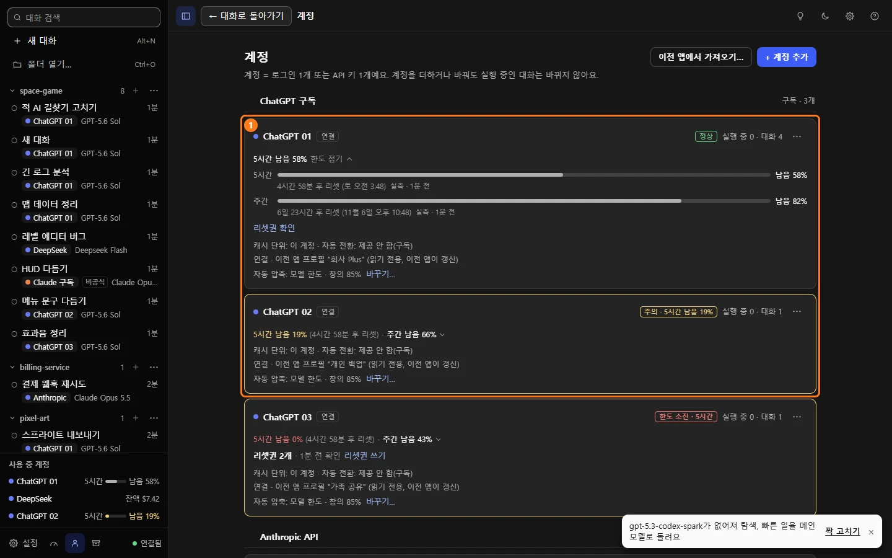
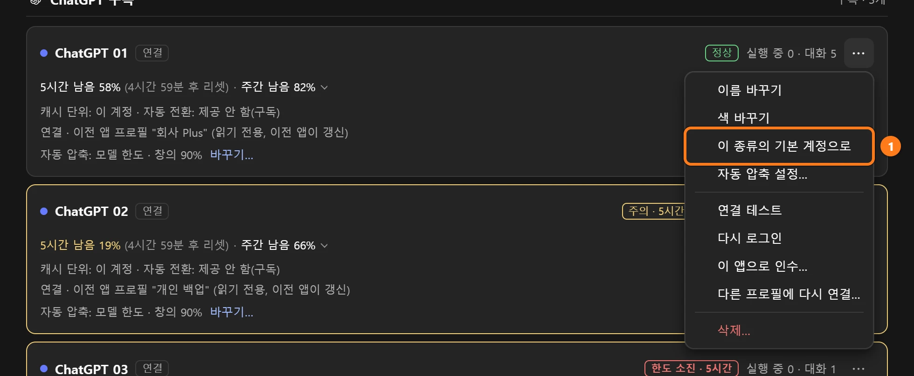
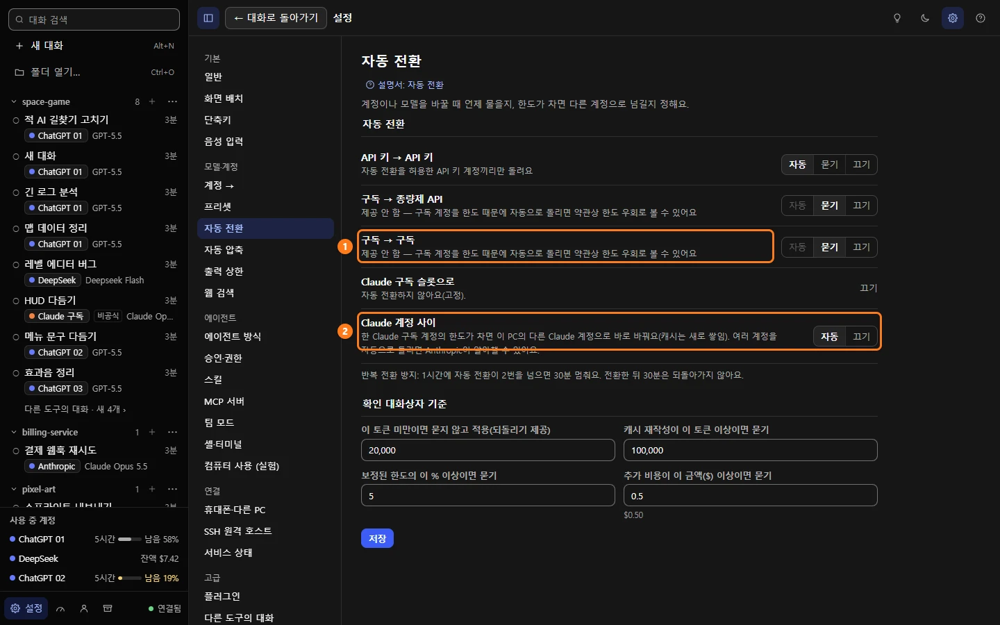

# 12. 한 회사에 계정 여러 개

**한 줄 요약**: 같은 회사 계정을 여러 개(ChatGPT 01·02·03, API 키 여러 개) 등록해 두고, 대화마다 골라 써요. 모든 계정의 한도를 한 화면에서 비교해요. 앱이 저절로 계정을 바꾸는 것(자동 전환)은 **API 키 계정끼리만** 돼요.

## 왜 필요해요?

- 한 계정의 5시간 한도가 빠듯하면, **다른 대화는 다른 계정으로** 돌릴 수 있어요.
- 회사 일과 개인 일을 계정으로 나눌 수 있어요. 사이드바와 턴 아래 줄에서 어느 대화가 어느 계정인지 바로 보여요.
- API 키를 여러 개 두면, 한 키의 잔액이 바닥났을 때 다른 키로 **저절로** 넘어가게 할 수 있어요.

## 12.1 계정 여러 개 등록하기

1. 같은 회사 카드로 [3장](03-first-account.md)처럼 계정을 하나 더 추가해요. 따로따로 별도 계정이 돼요.
2. 헷갈리지 않게 **이름과 색**을 정해요. 계정 `⋯` → `이름 바꾸기`, `색 바꾸기`.
   - 색은 `남색`, `청록`, `호박색`, `장미색`, `보라`, `초록`, `회청색`, `주황` 중에서 골라요. 사이드바 칩과 입력창 점이 이 색이에요.
3. 추가가 끝나면 `이 계정으로 새 대화`으로 바로 새 대화를 열 수도 있어요.

> **참고** 계정을 더하거나 바꿔도 **이미 도는 대화는 그대로**예요(`계정이 추가되었어요. 실행 중인 대화는 바뀌지 않아요.`). 대화마다 직접 바꿔야 해요.

## 12.2 대화마다 계정 고르기

- 대화를 열고 `Ctrl+.`로 전환기를 열어 계정을 골라요([6장](06-model-account.md)).
- 계정마다 한도 막대가 함께 보여서, 여유 있는 계정을 고르기 쉬워요.
- 새 대화에서는 계정이 둘 이상인 종류마다 한도가 가장 넉넉한 계정에 `추천`이 붙어요. 그 계정에서 쓸 모델로 봐요. 표시일 뿐이고, 목록에서 어느 계정에 있든 그대로예요. 대화를 시작한 뒤에는 붙지 않아요.
- **새 대화**의 처음 조합은 이 순서로 정해져요([6장](06-model-account.md)).
  1. 새 대화에서 전환기로 직접 고른 것.
  2. 그 폴더에서 마지막으로 쓴 `모델 @ 계정`.
  3. 그 폴더에 대화가 없으면, 가장 최근 대화가 쓴 **회사 종류의 기본 계정**.
  4. 그것도 없거나 쓸 수 없으면 가장 최근 대화의 계정, 그다음 목록에서 처음으로 쓸 수 있는 계정.
- 기본 계정은 그 계정 `⋯` → `이 종류의 기본 계정으로`로 정해요. 메뉴에 체크 표시가 생기고 `… 기본 계정으로 정했어요` 알림이 떠요.
- 기본 계정은 위 3번에서만 쓰여요. 그래서 **늘** 그 계정으로 시작하지는 않아요. 예를 들어 ChatGPT 02를 기본으로 정해도, 그 폴더에 이미 ChatGPT 01 대화가 있거나 가장 최근 대화가 DeepSeek였다면 ChatGPT 02로 시작하지 않아요. 원하는 계정이 확실하다면 새 대화에서 전환기로 직접 골라요(새 대화에서는 값이 들지 않아요).

한도는 이렇게 비교해요([7장](07-usage.md)).

- 오른쪽 `계정·한도` 탭(`Ctrl+Shift+U`): 모든 계정의 막대.
- 사이드바 `사용 중 계정`: 지금 쓰는 계정의 가장 빠듯한 한도가 얼마나 남았는지(`남음 58%`).
- 사이드바 `한도` 대시보드: 계정 카드와 대화별 사용량 표.

## 12.3 같은 회사 계정끼리 바꿔도 캐시는 새로 써요

같은 ChatGPT끼리라도 계정마다 캐시(책갈피)가 따로예요. ChatGPT 01에서 ChatGPT 02로 바꾸면 02가 대화를 처음부터 다시 읽어요. 그래서 **같은 회사 안의 전환도 전환 비용이 들어요**([11장](11-cache-switch-cost.md)).

같은 조직의 API 키라면 앱이 알려 줘요.

- 키를 추가할 때: `이 키는 "회사 OpenAI"와 같은 조직이에요. 별도 계정으로 추가해요. 같은 조직이라 한도 여유는 늘지 않아요.`
- 전환기에서: `같은 조직 — 한도 여유는 늘지 않아요`.
- 계정 카드에서: `같은 캐시 도메인: …` · `두 계정 사이 전환도 캐시를 새로 써요.`
- Anthropic 키에는 `한도·지출 상한은 조직(…) 단위, 캐시는 워크스페이스 단위`가 붙어요.

> **용어** 조직: 회사 사이트에서 API 키를 묶어 관리하는 단위예요. 같은 조직의 키 두 개는 **한도와 지출 상한을 함께 써요.** 키를 하나 더 넣는다고 여유가 두 배가 되지 않아요.

## 12.4 계정 `⋯` 메뉴

`계정` 페이지의 카드 오른쪽 위 `⋯`을 누르면 메뉴가 나와요. 계정 종류에 따라 보이는 항목이 달라요.

| 메뉴 | 하는 일 | 보이는 계정 |
|---|---|---|
| `이름 바꾸기`, `색 바꾸기` | 화면에 보이는 이름과 색을 바꿔요 | 모두 |
| `이 종류의 기본 계정으로` | 그 회사 종류로 새 대화를 시작할 때 이 계정을 먼저 써요(12.2) | Claude 구독 빼고 모두 |
| `자동 전환 허용` | 이 계정이 자동 전환에 끼도록 해요(12.5) | API 키 |
| `잔액·키 조회 끄기` | 앱이 잔액을 물어보지 않게 해요. 지금은 DeepSeek만 실제로 물어봐요(15분에 한 번) | DeepSeek, xAI, OpenRouter |
| `예산 설정…` | 이번 달 예산을 정해요([7장](07-usage.md)) | API 키 |
| `자동 압축 설정…` | 이 계정의 자동 압축 기준으로 가요([13장](13-auto-compaction.md)) | 모두 |
| `연결 테스트` | 지금 키·로그인이 되는지 확인해요. 되면 `확인됨 · 120ms`처럼 떠요 | 모두 |
| `다시 로그인` | 로그인이 풀렸을 때 다시 로그인해요 | ChatGPT 구독, Sign in with ChatGPT, Claude 구독([20장](20-account-kinds.md)) |
| `키 교체` | 새 키로 바꿔요. 계정과 기록은 그대로예요 | API 키(이전 앱에서 연결한 키는 빼고) |
| `이 앱으로 인수…`, `다른 프로필에 다시 연결…` | 이전 앱에서 가져온 로그인을 다루어요([20장](20-account-kinds.md)) | 이전 앱 연결 계정 |
| `다시 켜기` | 꺼 둔 계정을 다시 써요 | 끈 계정 |
| `삭제…` | 계정을 지우거나 꺼요(아래) | Claude 구독 빼고 모두(Claude 계정은 `계정 빼기…`, [20장](20-account-kinds.md)) |

**`삭제…`를 누르면** 창에서 둘 중 하나를 골라요.

- `계정과 이 PC에 저장된 키 삭제`: `이 PC에 저장된 키를 지워요(되돌릴 수 없어요). 지난 턴 기록은 남아요.`
- `끄기만 하기`: `끈 계정은 이 PC에 키를 남겨 두고, 나중에 다시 켤 수 있어요.`

그 계정을 쓰던 대화가 있으면 `이 계정을 쓰는 대화 2개는 다음 턴에 다른 계정을 골라야 해요.`처럼 알려 줘요.

## 12.5 자동 전환: API 키 계정끼리만

**비유로 먼저**: 회사 법인카드(API 키) 두 장은, 한 장이 한도에 걸리면 다른 카드로 결제해도 문제가 없어요. 하지만 **개인 멤버십(구독)** 여러 개를 돌려 가며 한도를 피하는 것은 회사 약관을 어기는 일로 볼 수 있어요. 그래서 앱은 **API 키끼리만** 저절로 바꿔요.

### 켜는 법

1. 자동으로 넘나들 API 키 계정 **모두**에서 `⋯` → `자동 전환 허용`을 체크해요. 카드에 `자동 전환 허용` 배지가 붙어요.
2. `설정` > `자동 전환`에서 `API 키 → API 키`를 `자동`으로 둬요(처음 값이 `자동`이에요).

| 줄 | 고를 수 있는 것 | 뜻 |
|---|---|---|
| `API 키 → API 키` | `자동` / `묻기` / `끄기` | `자동 전환을 허용한 API 키 계정끼리만 돌려요` |
| `구독 → 종량제 API` | `묻기` / `끄기`(`자동`은 막힘) | 구독 한도가 다 차도 돈이 드는 API로 저절로 넘어가지 않아요 |
| `구독 → 구독` | `묻기` / `끄기`(`자동`은 막힘) | `제공 안 함 — 구독 계정을 한도 때문에 자동으로 돌리면 약관상 한도 우회로 볼 수 있어요` |
| `Claude 구독 슬롯으로` | `끄기` 고정 | `자동 전환하지 않아요(고정).` 다른 회사 계정에서 Claude 구독으로 넘어가지 않아요 |
| `Claude 계정 사이` | `자동` / `끄기`(처음 값) | `자동`이면 한 Claude 구독 계정의 한도가 차자마자 이 PC의 다른 Claude 계정으로 바로 바꿔요. 캐시는 새로 쌓여요([20장](20-account-kinds.md)) |

- `묻기`나 `끄기`면 앱이 저절로 바꾸지 않아요. 사용자가 전환기에서 직접 골라요.
- `Claude 계정 사이`는 새로 설치하면 `끄기`예요(2026-10-31부터). 한도를 피하려고 여러 Claude 계정을 돌리는 것으로 Anthropic이 볼 수 있어서예요. 전부터 쓰던 앱에 `자동`이 저장돼 있었다면 이 판으로 처음 켤 때 한 번 `끄기`로 바꾸고 `Claude 계정 사이 자동 전환을 껐어요. …` 알림을 한 번 띄워요(전에는 설정을 하나만 바꿔도 `자동`이 저장됐어요). 그 뒤에 직접 고른 값은 그대로 둬요. 켜려면 이 줄에서 `자동`을, 다시 끄려면 `끄기`를 골라요. `API 키 → API 키`의 자동 전환은 그대로예요.
- 서버에 `자동`을 억지로 넣으려 하면 `구독 계정 자동 전환은 제공하지 않아요`로 거절해요.
- Claude Agent 계정(내 PC의 Claude Code, [20.8](20-account-kinds.md))은 자동 전환에 끼지 않아요. 여러 개여도 한도가 차면 그대로이고, 전환기나 `계정·한도` 탭에서 손으로만 바꿔요. 한도에 가까우면 `계정·한도` 탭이 여유 있는 다른 계정을 알려 줘요.

### 언제 바뀌어요?

- **그 계정을 더는 쓸 수 없을 때만** 바꿔요. 예: DeepSeek 잔액이 바닥남(402), 조직의 지출 상한에 닿음, 로그인이 계속 거부됨.
- 잠깐 걸리는 요청 한도(1분에 너무 많이 보냄)나 "남은 한도 20%" 같은 것으로는 바꾸지 않아요. 같은 계정에서 잠시 기다려요.
- 바꿀 곳은 `자동 전환 허용`을 켠 다른 API 키 계정 중에서 앱이 골라요. 전환 비용이 덜 들고 한도 여유가 많은 계정이 먼저예요. 모델이 달라질 수 있으니 바꾼 뒤 대화의 전환 표시를 한 번 확인하세요.

 ① 자동 전환을 허용한 Anthropic 키로 넘어간 표시예요.")

### 반복 전환 막기

같은 페이지 아래에 안전장치가 적혀 있어요.

- `반복 전환 방지: 1시간에 자동 전환이 2번을 넘으면 30분 멈춰요. 전환한 뒤 30분은 되돌아가지 않아요.`
- 너무 자주 바꾸면 매번 처음부터 다시 읽느라 돈만 들어요. 그래서 스스로 멈춰요.
- 직접 고르는 전환(수동)은 이 제한을 받지 않아요.

## 12.6 언제 물어볼지 정하기

같은 `자동 전환` 페이지의 `확인 대화상자 기준`에서, 계정을 바꿀 때 언제 바로 바꾸고 언제 물을지 정해요([6장](06-model-account.md)).

| 칸 | 처음 값 | 뜻 |
|---|---|---|
| `이 토큰 미만이면 묻지 않고 적용(되돌리기 제공)` | 20,000 | 이보다 작은 전환은 바로 바꾸고 알림에 `되돌리기`를 둬요 |
| `캐시 재작성이 이 토큰 이상이면 묻기` | 100,000 | 이보다 크면 전환 비용 창을 열어요 |
| `보정된 한도의 이 % 이상이면 묻기` | 5 | 구독 한도를 이만큼 이상 쓰면 물어요 |
| `추가 비용이 이 금액($) 이상이면 묻기` | 0.5 | 이만큼 이상 더 들면 물어요 |

숫자를 고치고 `저장`을 눌러요. 그 사이(20k–100k)는 `적용` 단추에 금액을 붙여 한 번 더 누르게 해요.

## 알아 두면 좋아요

- 계정을 고르는 순서에 정답은 없어요. 보통은 **한도 막대가 가장 여유 있는 계정**으로 새 대화를 시작하면 돼요.
- 계정이 많으면 `계정·한도` 탭의 계정을 눌러 펼쳐 보세요. `이 계정을 쓰는 대화` 목록으로 어느 대화가 그 계정을 쓰는지 알 수 있어요.
- 같은 ChatGPT 로그인을 `ChatGPT 구독`(코드·브라우저 로그인)과 `Sign in with ChatGPT`로 두 번 추가하면 계정이 두 개가 돼요. 캐시도 따로예요.

## 조심하세요

> **주의** 같은 회사의 **다른 구독 계정**은 하위 에이전트로 쓰지 않아요. ChatGPT 01이 메인인 대화에서 ChatGPT 02로 하위 에이전트를 돌리면, 한 대화가 구독 두 개를 동시에 쓰는 셈이라서예요([14장](14-presets.md)). 팀 모드도 회사마다 구독 계정 하나만 써요([17장](17-team-mode.md)).

> **주의** `삭제…`에서 `계정과 이 PC에 저장된 키 삭제`는 **되돌릴 수 없어요.** 잠깐 쉬게 하려면 `끄기만 하기`를 고르세요.

> **주의** 계정 추가, `키 교체`, 가져오기는 **이 PC의 창에서만** 돼요. 휴대폰이나 다른 기기에서는 `이 기기에서는 계정을 추가하거나 바꿀 수 없어요 — PC의 창에서 하세요.`가 보여요.

> **주의** 같은 조직의 키를 여러 개 넣어도 **한도는 늘지 않아요.** 한도를 늘리려면 다른 조직(또는 다른 회사)의 키가 필요해요.

## 더 알아보기

- 첫 계정 추가: [3장](03-first-account.md)
- 계정 종류별 특징: [20장](20-account-kinds.md)
- 전환 비용과 캐시: [11장](11-cache-switch-cost.md)
- 설계 문서: [02 §5.5 히스테리시스와 차단기, §5.10 구독 계정 정책](../02-accounts-providers-cache.md), [03 §5.4 계정 관리, §6.7 자동 전환 정책](../03-ui-ux.md)
