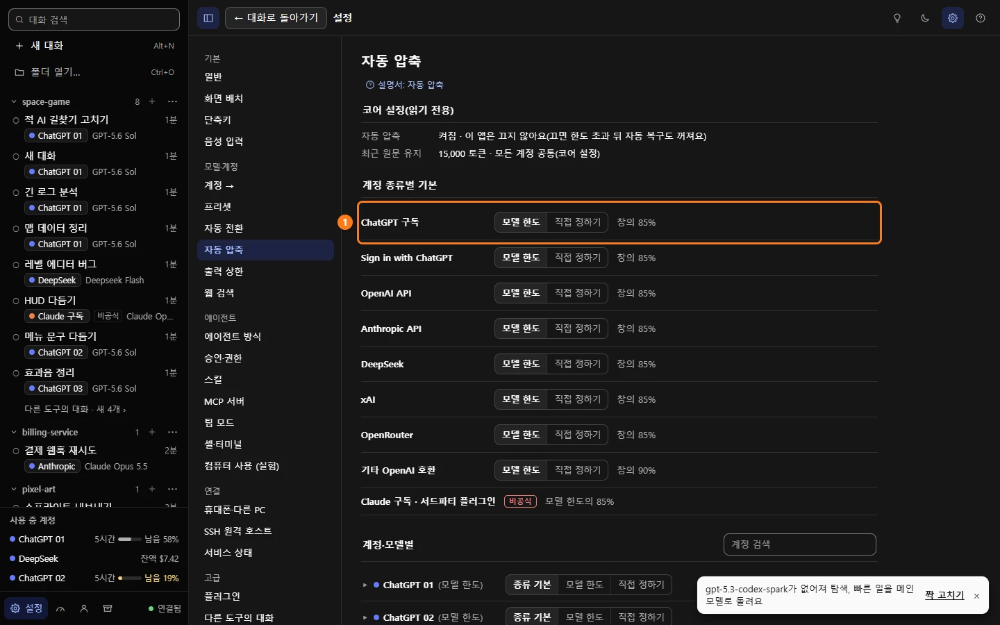
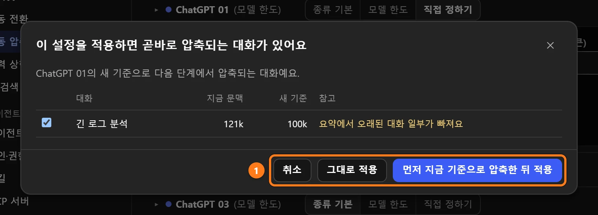
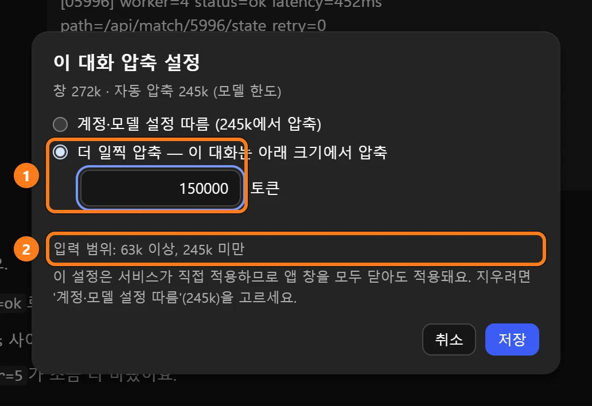

# 13. 자동 압축

**한 줄 요약**: 대화가 모델이 한 번에 읽을 수 있는 양(문맥 창)에 가까워지면, 앱이 대화 앞부분을 요약해 짧게 만들어요. 처음 값은 **모델의 전체 창을 그대로** 쓰고 끝에 10%(창이 32k 이상이면 최소 16K)만 남겨요. 더 일찍 압축하고 싶으면 회사 종류·계정·모델·대화마다 정할 수 있어요.

## 먼저 낱말 둘

> **용어** 문맥 창: 모델이 **한 번에 펼쳐 볼 수 있는 책상 크기**예요. 예: ChatGPT 구독의 GPT-5.5는 272k 토큰, DeepSeek V4.1 Flash는 1M(100만) 토큰. 대화가 책상보다 커지면 모델이 읽을 수 없어요. **같은 모델이라도 어느 계정 종류로 쓰느냐에 따라 창이 다를 수 있어요**(13.1).

> **용어** 압축: 책상이 가득 차기 전에 **오래된 서류를 요약 메모 한 장으로 바꾸는 일**이에요. 최근 서류(최근 15k 토큰)는 원문 그대로 둬요. 화면의 대화 기록은 지워지지 않고 그대로 보여요. 모델에게만 "요약 + 최근 원문"이 가요.

## 왜 필요해요?

- 대화가 창을 넘으면 회사가 요청을 거절해요. 그 전에 줄여야 일을 계속할 수 있어요.
- **언제** 압축하느냐가 품질과 비용을 바꿔요.

| | 늦게 압축(창 끝까지 씀) | 일찍 압축 |
|---|---|---|
| 좋은 점 | 원문을 오래 기억해요. 요약 횟수가 적어요 | 요청 하나하나가 작아서, 캐시가 식었을 때 첫 요청이 싸요 |
| 나쁜 점 | 요청이 커서 캐시가 식으면 첫 요청이 비싸요 | 요약을 자주 해서 요약 비용과 캐시 다시 쓰기가 늘어요. 오래된 내용이 빨리 요약으로 바뀌어요 |

- 그리고 **압축 직후는 계정을 바꾸기 가장 좋은 때**예요. 모든 계정의 캐시가 어차피 식기 때문이에요([11장](11-cache-switch-cost.md)).

## 13.1 처음 값: 모델의 창을 그대로 써요

이 앱은 창을 일부러 작게 잡지 않아요. 처음 값 `모델 한도`의 규칙은 하나예요.

> **창에서 응답과 도구 결과를 받을 자리로 15%(창이 32k 이상이면 최소 16K)를 남기고, 그 지점에서 압축해요.**

> **참고** 2.2.1-own.1부터 남기는 자리가 10%에서 15%로 늘었어요(OpenCode 2.1을 따름). 그래서 큰 창 모델은 전보다 조금 일찍(창의 90% → 85%) 압축해요. 직접 붙인 OpenAI 호환 서버는 그대로 창의 90%예요.

| 모델 창 | 압축 지점 | 메모 |
|---|---|---|
| 872k (ChatGPT 구독의 GPT-5.6 Sol) | 약 741k(741.2k) | 15%(130.8k)를 남겨요 |
| 922k (Sign in with ChatGPT·OpenAI API 키의 GPT-5.5) | 약 784k(783.7k) | 같은 계열이라도 계정 종류마다 창이 달라요 |
| 1M (Claude 예) | 850k | 15%(150k)를 남겨요 |
| 1,048,576 (DeepSeek V4 Pro) | 약 891k | 15%를 남겨요 |
| 128k (작은 API 모델) | 108.8k | 15%(19.2k)를 남겨요 |
| 100k (작은 API 모델) | 84k | 15%(15k)가 16K보다 작아 16K를 남겨요 |
| 직접 붙인 OpenAI 호환 서버 128k | 약 115k | 호환 서버는 작은 로컬 창이 많아 **창의 90%** 규칙을 써요 |
| 직접 붙인 OpenAI 호환 서버 32k | 약 29.5k | 〃 |

> **참고** 창은 모델 이름 하나가 아니라 **계정 종류와 모델의 짝**으로 정해져요. 예를 들어 GPT-6.1 Sol은 ChatGPT 구독에서는 Codex 창 872k, OpenAI API 키에서는 922k예요. 그래서 같은 모델로 계정 종류만 바꿔도 압축 지점이 달라져요. 전환기의 모델 줄(`창 1M · 자동 압축 850k` 같은 줄)에서 바로 확인할 수 있어요. ChatGPT 구독은 GPT-5.5 이하 모델을 더는 쓸 수 없어요.

- `Claude 구독`은 `모델 한도의 85%`로 고정이에요. 대화마다 "더 일찍"만 정할 수 있어요(13.4).
- `Claude Agent`는 다른 계정처럼 종류 기본과 계정마다의 기준을 정할 수 있어요. 창은 Claude Code가 알려 준 값이에요([20.8](20-account-kinds.md)).
- 화면에서는 이 처음 값을 `모델 한도`라고 불러요. 계정 카드에는 `자동 압축: 모델 한도 · 창의 85%`처럼 한 줄로 보여요.

> **참고** 예전 버전은 DeepSeek·xAI·OpenRouter를 창의 60%(최대 256k)에서, OpenAI 호환을 50%에서 일찍 압축했어요. 지금은 그런 "보수적 처음 값"이 없어요. 더 일찍 압축하고 싶으면 직접 정해요(13.3).

## 13.2 어디서 보나요: 문맥 계기

입력창 `전송` 단추 왼쪽의 **동그란 링**이 문맥 계기예요. 대화가 압축 지점에 가까워질수록 차오르고, 압축 지점의 85%쯤 오면 주의색이 돼요. 입력창이 넓으면 링 옆에 지금 대화 크기(예: `6k`)가 숫자로 보여요. 누르면 자세한 내용이 열려요. 앱이 계정 정보를 받지 못하면 모델에 적힌 한도로 그리고, 마우스를 올리면 그렇다고 알려 줘요.

예요. ② 지금 압축하거나 설정으로 가는 단추예요.")

- ① `문맥 121k / 272k · 자동 압축 245k (모델 한도)`
  - 121k: 지금 대화 크기. 272k: 모델 창. 245k: 압축 지점.
  - 괄호 안은 그 값을 정한 곳, 곧 **출처**예요: `모델 한도`, `종류 기본`, `종류·모델`, `계정`, `계정·모델`, `이 대화`.
- `다음 압축까지 약 124k`: 압축까지 남은 양이에요. 계정을 싸게 바꿀 다음 기회가 얼마나 남았는지도 돼요.
- `최근 원문 유지` `15k 토큰(코어 설정, 읽기 전용)`: 압축해도 원문으로 남기는 최근 부분이에요.
- ② 단추
  - `지금 압축`: 바로 압축해요(13.5).
  - `이 대화 압축 설정…`: 이 대화만 더 일찍 압축하게 해요(13.4).
  - `자동 압축 설정 열기`: 설정 화면으로 가요(13.3).
- 아래 안내: `압축하면 대화 앞부분 캐시가 새로 쌓여요. 예약된 "압축 직후 전환"은 이때 적용돼요.`

같은 값이 `계정·한도` 탭의 `이 대화` 카드 막대(`6k / 272k`, `자동 압축 245k`)와 전환기의 모델 줄(`창 1M · 자동 압축 900k`)에도 보여요. 카드 막대의 출처는 모델 한도가 아닐 때만 괄호로 붙어요(예: 이 대화만 정했으면 `자동 압축 200k (이 대화)`). 막대에서 압축 지점 너머의 빗금 칸은 압축한 뒤에만 쓰여요.

## 13.3 설정 단계: 뒤에 정한 것이 이겨요

압축 지점은 여러 단계에서 정할 수 있어요. 아래 표에서 **아래로 갈수록 좁은 범위이고, 좁은 쪽이 이겨요.**

| 단계(화면의 출처 이름) | 범위 | 어디서 정해요 |
|---|---|---|
| `모델 한도` | 처음 값. 모델의 전체 창 | 따로 정할 것 없어요 |
| `종류 기본` | 회사 종류 전체(예: DeepSeek 계정 모두) | `설정` > `자동 압축`의 `계정 종류별 기본` |
| `종류·모델` | 회사 종류의 모델 하나 | 화면에서는 정하지 않아요. 정책 파일(`policy.json`)을 직접 고친 경우에만 생기고, 화면에는 출처 이름으로만 보여요 |
| `계정` | 그 계정 하나(예: DeepSeek 회사 키) | `설정` > `자동 압축`의 `계정·모델별` |
| `계정·모델` | 그 계정의 그 모델 하나 | 같은 곳에서 계정을 펼친 뒤 모델 줄의 ⚙ |
| `이 대화` | 대화 하나. 더 일찍만 돼요 | 문맥 계기의 `이 대화 압축 설정…`(13.4) |

### `설정` > `자동 압축` 화면

화면은 위에서부터 이렇게 돼 있어요.

1. `코어 설정(읽기 전용)`
   - `자동 압축`: `켜짐 · 이 앱은 끄지 않아요(끄면 한도 초과 뒤 자동 복구도 꺼져요)`
   - `최근 원문 유지`: `15,000 토큰 · 모든 계정 공통(코어 설정)`
   - 둘 다 이 화면에서 바꾸지 않아요.
2. `계정 종류별 기본`: 종류마다 `모델 한도` / `직접 정하기`와 지금 값(`창의 85%`). Claude 구독 줄은 `비공식` 배지와 `모델 한도의 85%`로 고정이에요.
3. `계정·모델별`: 계정마다 한 줄. `계정 검색` 칸으로 찾아요.
   - 계정 이름 옆 괄호가 출처예요. 예: “(모델 한도)”, “(계정)”.
   - 선택지: `종류 기본`(종류 설정을 따름) / `모델 한도` / `직접 정하기`.
   - 계정을 펼치면 모델마다 `창 272k · 자동 압축 245k · 모델 한도` 줄이 나와요. 줄 끝 ⚙로 그 모델만 따로 정해요(`계정 설정 따름` / `모델 한도` / `직접 정하기`).
4. `압축 실패 시 대체 모델`: 요약이 실패했을 때 대신 요약할 모델의 순서예요.
5. `자리를 비운 사이 압축`: 켜는 선택지예요. 처음에는 `끄기`예요(13.6).
6. 맨 아래 안내: `기준은 요청 본문에 들어가지 않아 대화 앞부분 캐시는 그대로예요. …`
   - 쉬운 말로: 기준을 바꿔도 **지금 캐시는 깨지지 않아요.** 다만 기준을 지금 대화보다 낮추면 다음 단계에서 곧바로 압축되고, 너무 오래된 부분은 요약에서 빠질 수 있어요.

이 화면은 여러 곳에서 바로 열 수 있어요: 계정 카드의 `바꾸기…`, 계정 `⋯` → `자동 압축 설정…`, 전환기 아래 `설정`, 문맥 계기의 `자동 압축 설정 열기`.

### `직접 정하기`

`직접 정하기`를 고르면 칸 세 개가 나와요.

| 칸 | 뜻 |
|---|---|
| `창의 N%` 막대 | 창의 몇 %에서 압축할지예요. 10–90% 사이로 밀어요. `모델 한도`(보통 85%, 호환 서버는 90%)보다 늦게는 못 둬요 |
| `상한 (토큰)` | 아무리 창이 커도 이 크기를 넘기 전에 압축해요. 비우면 `없음` |
| `최소 여유 (토큰)` | 창에서 적어도 이만큼은 비워 둬요 |

- 아래에 미리보기가 보여요: `미리보기: "deepseek-flash @ DeepSeek"(은)는 300k에서 압축해요.`
- 요율을 아는 계정이면 비용 비교 줄도 나와요: `… 요청당 평균 비용(압축 주기 포함): 모델 한도 ≈ … · 이 설정 ≈ …` `추정`. 압축 주기까지 따진 요청 하나의 평균 값이에요. 두 값을 보고 정하면 돼요.
- 너무 일찍 두면 앱이 올려요: `압축 직후 크기보다 여유를 두려고 63k로 올렸어요`. 압축하자마자 또 압축하는 일을 막으려는 거예요.
- 창이 작은 모델은 바꿀 수 없어요: `이 모델은 창이 작아 압축 기준을 바꿀 수 없어요`.
- 범위를 벗어나면 `63k–245k 사이로 입력하세요`처럼 알려 줘요.

> **팁** 예: DeepSeek 1M 창을 그대로 쓰면 900k까지 대화가 커질 수 있어요. 캐시가 식은 뒤 그 크기를 처음부터 다시 읽으면 한 번에 꽤 들어요. 이게 걱정되면 DeepSeek 계정에 `상한 (토큰)`을 300,000쯤으로 두세요. 비용 비교 줄로 확인하고 정하면 돼요.

### 저장할 때: 곧바로 압축될 대화가 있으면

새 기준이 지금 대화 크기보다 작으면, 저장 전에 한 번 물어요.

- 제목: `이 설정을 적용하면 곧바로 압축되는 대화가 있어요`
- 표: `대화`, `지금 문맥`, `새 기준`, `참고`. 주의색 `요약에서 오래된 대화 일부가 빠져요`는, 요약을 새 기준 크기 안에 맞추느라 아주 오래된 부분을 버린다는 뜻이에요.
- 메시지 되돌리기를 확정하지 않은 대화에는 `복원 대기 중 — 압축하면 복원이 확정돼요`가 붙어요.
- 단추
  - `취소`: 저장하지 않아요.
  - `그대로 적용`: 저장해요. 그 대화들은 다음 단계에서 새 기준으로 압축돼요.
  - `먼저 지금 기준으로 압축한 뒤 적용`: 체크한 대화를 **지금 기준으로 먼저 압축**하고 저장해요(`압축 1/2`처럼 진행). 오래된 부분을 덜 잃어요. 빠지는 대화가 있으면 이게 권장이에요.
- 저장하면 `다음 단계부터 적용돼요.` 또는 `적용했어요 · 대화 2개가 다음 단계에서 압축돼요`.

> **용어** 단계: 모델에게 요청을 한 번 보내는 것이에요. 한 턴 안에 여러 단계가 있을 수 있어요. 새 기준은 바로 다음 요청부터 적용돼요.

## 13.4 이 대화만 더 일찍 압축하기

특정 대화만 일찍 줄이고 싶을 때 써요. 예: 아주 긴 로그를 읽는 대화.

1. 문맥 계기 → `이 대화 압축 설정…`(또는 `계정·한도` 탭 `이 대화` 카드의 같은 링크).
2. `더 일찍 압축 — 이 대화는 아래 크기에서 압축`을 고르고 숫자를 적어요.
3. `저장`. `이 대화 압축 설정을 저장했어요`가 떠요.

- 처음은 `계정·모델 설정 따름 (245k에서 압축)`이에요. 되돌리려면 이걸 다시 고르고 `저장`해요.
- **더 일찍만** 돼요. 이 대화만 늦추거나 끄는 기능은 없어요.
- `입력 범위: 63k 이상, 245k 미만`처럼 범위가 보여요.
  - 위쪽: 계정·모델 지점보다 늦게 둘 수 없어요.
  - 아래쪽: 압축 직후 크기(최근 원문 15k + 여유)보다 작게 둘 수 없어요.
- 대화가 그 크기에 닿으면 입력창 위에 `이 대화 설정(150k)에 따라 압축을 요청했어요` 같은 칩이 잠깐 보이고, 압축 표시의 사유는 `이 대화 설정(…)`이에요.
- 이 대화의 계정을 바꾸면, 새 계정·모델의 지점과 이 값 중 **더 이른 쪽**을 써요.
- 이 설정은 **서비스가 직접** 적용해요. 앱 창을 모두 닫아도 그 크기에 닿으면 압축해요(창 아래 문구: `이 설정은 서비스가 직접 적용하므로 앱 창을 모두 닫아도 적용돼요. …`).

## 13.5 지금 바로 압축하기

- 문맥 계기의 `지금 압축`
- 입력창에 `/compact`
- 명령 팔레트(`Ctrl+K`)에서 “지금 압축”

대화가 도는 중이면 다음 단계 사이에 끼어들어요. 메시지 되돌리기를 확정하지 않은 상태면 `복원 대기 중 — 압축하면 복원이 확정돼요`와 `그래도 압축`을 물어요.

압축이 끝나면 대화에 표시가 남아요.

- `문맥 압축 · 121k → 38k`: 얼마에서 얼마로 줄었는지예요. 끝난 직후에는 `다음 단계에서 측정`이었다가 다음 요청 뒤 숫자로 바뀌어요.
- 누가 요약했는지(`ChatGPT 01에서 요약`)와 사유: `자동`, `자동(245k 지점)`, `수동`, `이 대화 설정(…)`, `전환 준비`(압축 후 전환), `자리를 비운 사이 압축했어요`(13.6).
- `요약 보기` / `요약 접기`로 요약 글을 볼 수 있어요.
- `압축 내용 보기`로 이 대화의 압축 기록 전체를 열 수 있어요(아래).

### 압축한 내용 보기

평소에는 볼 일이 없지만, 모델이 지금 무엇을 받고 있는지 궁금하면 대화 머리의 `⋯` → `압축 내용 보기`(또는 압축 표시의 `압축 내용 보기`)를 눌러요.

- 이 대화에서 압축한 순서대로 `1번째 압축`, `2번째 압축` …이 보여요. 줄마다 언제(“10월 18일 오후 3:42”), 왜(`자동`/`수동`), 누가 요약했는지, 문맥이 얼마에서 얼마로 줄었는지, 압축 요청에 든 입력·출력이 있어요.
- 마지막 압축에는 `지금 모델이 받는 내용`이 붙어요. 모델은 이 지점부터 예전 메시지 대신 이 요약을 받아요. 그 앞의 압축은 `다음 압축에 합쳐짐`이에요.
- 압축 요청 줄 끝에 캐시 비율과 요청 모양이 붙어요. 예: `압축 요청: 입력 182k · 출력 3.9k · 캐시 99% · 대화 전체로 요청해 캐시를 이어 씀`. 앞부분만 보냈으면 `앞부분만 요청(최근 부분이 짧아 앞부분도 캐시에서 읽어서)`처럼 이유가 나와요(13.5의 "압축 요청과 캐시"). 다른 모델이 대신 요약했으면 `앞부분만 요청(다른 모델이 대신 요약해서)`이에요. 그 모델은 이 대화의 캐시를 읽지 못했거든요. 모델 없이 줄인 요약에는 요청 모양이 없어요.
- 자리를 비운 사이 압축한 것이면 `자리를 비운 사이 압축했어요` 줄이 있어요(13.6).
- `요약 보기`를 누르면 요약 글이 보여요. 읽기만 할 수 있고 `복사`로 옮길 수 있어요. 요약과 함께 다시 넣는 내 메시지와, 요약하지 않고 그대로 남긴 최근 대화도 펼쳐 볼 수 있어요.
- 회사가 자체 방식으로 압축한 경우(암호화된 압축)는 그 회사만 읽을 수 있어서 내용을 보여 줄 수 없다고 나와요. 대신 모델, 경로, 크기만 보여요. 이 앱의 계정들은 요약 압축을 쓰니 보통은 요약 글이 보여요.
- 화면에서 지운 것은 아무것도 없어요. 대화 기록은 그대로이고, 이 창은 보기만 해요.

> **팁** 압축하고 나서 계정을 바꾸고 싶다면, 전환 비용 창의 `압축 후 전환`이 압축과 전환을 한 번에, 순서대로 해 줘요. 압축하면 자세한 앞부분이 요약으로 바뀌니, 값만 보고 고르지는 마세요([11장](11-cache-switch-cost.md)).

### 압축 요청과 캐시

요약을 부탁하는 요청도 돈(또는 한도)이 들어요. 보통은 **남길 최근 부분 앞까지만** 보내요. 캐시가 따뜻하면 이 요청도 거의 전부를 캐시 값(보통 정가의 10% 안팎)으로 읽어요. 2026-10-24 실측에서 95~97%였어요.

- **대화 전체로 보내는 때**: 앞부분 요청이 캐시를 놓칠 때만이에요. Anthropic API 키와 Claude 구독에서만 하고, 이득을 실제로 잰 곳도 여기뿐이에요. 남길 최근 부분이 길고(도구 호출이 10번쯤 넘게 이어진 긴 작업) 그 앞부분을 만든 요청이 5분보다 전이면 앞부분 요청은 시스템 지시문과 도구만 맞아요. 이때 앱은 대화 전체를 직전 요청과 똑같이 보내고, 맨 끝에 "여기까지 요약하되, 이 메시지부터는 원문으로 남아요"라는 부탁을 붙여요. 실측에서 71%가 98%로 올랐어요.
  - 예: Claude Opus 5.5에서 900k 대화를 그런 긴 작업 뒤에 압축하면, 앞부분 요청은 약 $4.45, 대화 전체는 약 $0.28이에요.
  - 그 밖에는 대화 전체가 앞부분보다 조금 비싸서(최근 부분만큼 큼) 보내지 않아요. 실측의 작은 대화에서 한 번에 $0.0004~0.0016 차이였어요.
- **늘 앞부분만 보내는 계정**: ChatGPT 구독(HTTP 요청도), Sign in with ChatGPT, OpenAI GPT-5.5 이하, DeepSeek, 직접 붙인 서버, OpenRouter, xAI. 이 회사들은 가장 긴 앞부분을 스스로 캐시에서 읽어서 앞부분 요청이 이미 맞아요. ChatGPT 01 실측은 엇갈렸어요. 한 번은 캐시 비율이 89.1%에서 94.5%로 올라 입력 값이 0.29에서 0.24 크레딧으로 줄었고, 다른 한 번은 입력 값이 0.19에서 0.25 크레딧으로 늘었어요. 합계는 같거나(0.53) 요약 길이에 따라 달랐어요(0.43과 0.54). 그래서 앞부분만 보내요.
- **OpenAI API 키(GPT-5.6 이후)**: 캐시 방식은 Anthropic과 비슷하지만 대화 전체 요청을 아직 재 보지 않아서, 잴 때까지 앞부분만 보내요. 압축 내용 창에는 `앞부분만 요청(이 회사에서는 아직 실측하지 않아서)`로 나와요.
- **이런 때도 앞부분만 보내요**: 캐시가 식었을 때(마지막 요청을 보낸 지 캐시 시간이 지남), Claude 계정을 바꾼 바로 뒤(압축은 새 계정에서 도는데 캐시는 계정마다 따로라서 새 계정에는 이 대화의 캐시가 없어요. 압축 내용 창에는 `앞부분만 요청(계정이 바뀌어 그 계정에는 캐시가 없어서)`), 생각 예산이 고정된 Claude 변형(Claude 3.7·4.0–4.5, 예: Haiku 4.5의 `thinking`·`high`·`max`. 앞선 생각을 빼거나 예산이 바뀌어 캐시가 어긋나요), 모델의 창에 다 들어가지 않을 때(압축 지점을 낮춰도 실제 창으로 재요), 더 비싼 가격 구간을 넘을 때, "너무 길다" 거절 뒤의 복구 압축.
- 대화 전체로 보낸 요청이 실패하면 다시 보내지 않고 곧바로 앞부분 요청으로 넘어가요.
- 압축 뒤 모델이 받는 모양(요약 + 최근 원문)은 어느 쪽이든 같아요.

> **참고** 자동 압축은 대화가 창의 85% 근처일 때 돌아요. 그래서 창이 200k인 모델은 대화 전체가 남은 자리에 거의 들어가지 않아 앞부분 요청이 많아요. 아끼는 효과는 주로 긴 작업 뒤의 1M 창 모델과, 그런 작업 뒤 쉬었다가 직접 누른 `/compact`에서 커요.

## 13.6 자리를 비운 사이 압축(켜는 선택지)

**한 줄 요약**: 자리를 비운 동안 캐시가 식기 30초 전에 대화를 압축해요. 돌아와서 보내는 첫 요청이 대화 전체를 비싸게 다시 쓰지 않고 요약과 최근 원문만 새로 써요. **처음에는 꺼져 있어요.**

`설정` > `자동 압축` > `자리를 비운 사이 압축`에서 `켜기`를 골라요. 이 PC의 서비스에 저장돼서 모든 창과 기기에 같이 적용돼요.

- **언제 해요**: 마지막 요청을 보낸 때부터 캐시 시간이 거의 다 갔을 때(30초 전)예요. 그때까지 **20분 넘게 아무 일이 없었고** 대화가 **10만 토큰 이상**일 때만 해요. 캐시 한 번에 한 번이에요.
- **읽는 중이면 안 해요**: 그 대화를 화면에 띄워 두고 만지는 동안은 자리를 비운 것으로 보지 않아요. 창을 숨기거나 마지막으로 만진 뒤 10분(처음 값)이 지나야 자리를 비운 거예요(1분쯤 더 걸릴 수 있어요). 긴 답을 읽는 동안 대화가 요약으로 바뀌지 않아요. 이 자리 비움 감지는 처음부터 켜져 있고, 끄거나 시간을 바꾸려면 `policy.json`의 `awayDetect`(`enabled`, `hiddenMinutes`)를 고쳐요. 설정 화면의 설명도 그 시간을 따라가요.
- **어느 계정에서 돌아요**

| 계정 종류 | 캐시 시간 | 자리 비움 압축 |
|---|---|---|
| OpenAI API 키(GPT-5.6 이후) | 30분 | 해요(약 29분 30초 뒤) |
| Anthropic API 키 · Claude 구독 | 5분 | 지금은 안 해요. 5분으로는 20분 자리 비움 조건을 채우지 못해요. 1시간 캐시 모드(예정)가 생기면 약 59분 30초 뒤에 해요 |
| Claude Agent(구독 로그인) | 1시간 | 해요(약 59분 30초 뒤). 그 사이 대화를 다른 Claude Agent 계정으로 옮겼으면 안 해요. API 키로 로그인한 계정은 5분이라 안 해요 |
| ChatGPT 구독 · Sign in with ChatGPT | 모름 | 안 해요. 캐시가 언제 식는지 아직 몰라요 |
| DeepSeek | 보장 없음 | 안 해요. 다시 읽기가 싸요 |
| OpenAI GPT-5.5 이하 · OpenRouter · xAI · 직접 붙인 서버 | 더 길거나 모름 | 안 해요. 캐시가 더 오래 남을 수 있어요 |

- **건너뛰는 경우**: 하위 작업 대화, 하위 에이전트가 아직 일하는 대화, 팀 대화, 가져온 대화, 되돌리기를 확정하지 않은 대화, 대기 중인 메시지나 승인 질문이 있는 대화, 한도를 80% 넘게 쓴 구독 계정, 마지막 요청 뒤에 대화를 다른 Claude 계정으로 옮긴 경우(새 계정에는 지킬 캐시가 없어요), 노트북이 잠들어 마감을 넘긴 경우.
- **실패하면**: 대체 모델이나 코드 요약 없이 대화를 그대로 둬요.
- **표시**: 대화의 압축 표시와 압축 내용 창에 `자리를 비운 사이 압축했어요`가 보여요. 내가 직접 누른 `/compact`에는 붙지 않아요. 서비스가 다시 켜진 뒤에 돌아도 표시가 붙어요.
- **늦게 시작하게 되면 건너뛰어요**: 넣어 둔 압축이 캐시가 식은 뒤에야 시작하게 되거나(그 사이 서비스가 다시 켜진 경우 등), 내가 이미 돌아와서 그 대화에 메시지를 보냈거나 화면에서 다시 보고 있으면, 그 압축은 하지 않고 버려요. 대화에는 “세션 압축 취소됨” 줄로 남고 내용은 그대로예요.

> **용어** 본전: 압축 한 번 값이 돌아왔을 때 아끼는 값과 같아지는 지점이에요. 예: Opus 5.5에서 대화가 200k면 압축이 약 $0.13이고, 돌아와서 첫 요청이 $1.00에서 $0.18로 줄어요. 그래서 돌아올 확률이 **16%**만 넘어도 이득이에요(600k면 8%, gpt-6-astra 200k면 21%).

> **주의** 돌아오지 않으면 압축 값만 써요. 돌아오면 앞부분이 원문 대신 **요약**으로 바뀌어 있어요. 화면의 대화 기록은 그대로 남아요. 원문을 오래 들고 있고 싶으면 꺼 두세요.

## 알아 두면 좋아요

- **압축 = 모든 계정 캐시가 식는 순간**이에요. 그래서 예약해 둔 "압축 직후 전환"이 이때 실행돼요.
- 캐시 시간은 **마지막 요청을 보낸 때부터** 재요. 답을 만드는 시간도 그 안에 들어가요. 계정·한도 화면의 캐시 남은 시간도 이 기준이에요.
- 모델이 "너무 길다"고 요청을 거절하면, 앱이 한 번 자동으로 압축하고 다시 보내요(사유 표시는 자동). 그래서 압축 지점을 늦게 잡아도 대화가 멈추지 않아요.
- 직접 붙인 OpenAI 호환 서버는 거절 문구가 달라 이 자동 복구가 안 될 수 있어요. 그런 계정 카드에는 `넘침 자동 복구 확인 안 됨 · 서버 창을 정확히 적으세요`가 붙어요. 서버의 창 크기를 정확히 적어 두세요.
- 앱은 한글을 **글자당 약 0.65토큰**으로 세서 대화 크기를 추정해요. 실제보다 적게 세지 않으려고 조금 넉넉히 잡은 값이에요.
- 속도(Fast·Ultrafast)는 창이나 압축 지점을 바꾸지 않아요([16장](16-speed.md)).
- 답 한 번의 길이는 문맥 창과 따로 정해요. `설정` > `출력 상한`([5장](05-screen-tour-theme.md#출력-상한-페이지))이 바꾸는 것은 답의 길이이고, 압축 지점은 그대로예요.
- 울트라나 프리셋도 압축 지점과는 상관없어요.
- **문맥 비우기**(`/reset-context`, [10.14](10-conversation-tools.md))는 압축과 달리 요약을 만들지 않고 앞 대화를 모델에게 보내지 않아요. 비운 뒤 첫 압축은 비운 뒤의 대화만 요약해요. 비운 뒤에 압축하면 그 비우기는 되돌릴 수 없어요(`이 지점 전으로 포크`로 앞 대화를 이어 가요).
- 문맥 비우기를 되돌려 문맥이 압축 지점을 넘으면 다음 요청 전에 압축해요. 그래서 되돌리기 전에 `되돌리면 문맥이 약 …(이)가 돼서 다음 요청 전에 압축해요`로 먼저 물어요. 비우거나 되돌린 뒤 문맥 계기는 다음 답이 올 때까지 `—`예요.

## 조심하세요

> **주의** 너무 일찍 압축하게 두면 **요약을 자주 해서** 요약 비용과 캐시 다시 쓰기가 늘어요. 오래된 내용도 빨리 요약으로 바뀌어요. 비용 비교 줄을 보고 정하세요.

> **주의** 기준을 **지금 대화 크기보다 낮추면** 다음 단계에서 곧바로 압축되고, 오래된 대화 일부가 요약에서 빠질 수 있어요. 저장할 때 뜨는 창에서 `먼저 지금 기준으로 압축한 뒤 적용`을 고르면 덜 잃어요.

> **주의** 설정 파일 `opencode.jsonc`에 `compaction.buffer`를 넣지 마세요. 압축 지점이 어긋나서 설정 화면에 `이 앱의 설정 파일에 compaction.buffer가 있어 자동 압축 기준이 맞지 않아요` 띠가 떠요. 프로젝트 설정 파일이 바꾸고 있으면 `이 프로젝트의 설정 파일이 자동 압축 기준을 바꾸고 있어요 — …`가 떠요.

> **주의** `compaction.auto`를 꺼도 안 돼요. 그러면 `이 앱의 설정 파일에서 compaction.auto가 꺼져 있어 자동 압축이 일어나지 않아요`가 뜨고, "너무 길다" 거절 뒤의 자동 복구까지 꺼져요.

## 더 알아보기

- 압축과 계정 전환의 관계: [11장](11-cache-switch-cost.md)
- 한도와 문맥 막대: [7장](07-usage.md)
- 설계 문서: [02 §4.7 자동 압축 기준](../02-accounts-providers-cache.md), [03 §5.8 자동 압축 설정](../03-ui-ux.md)
