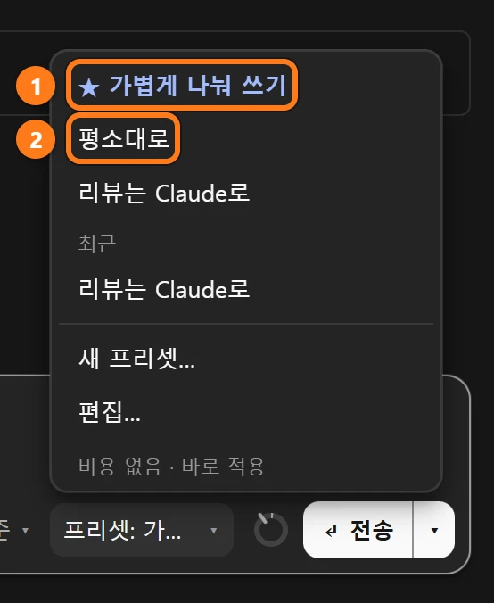
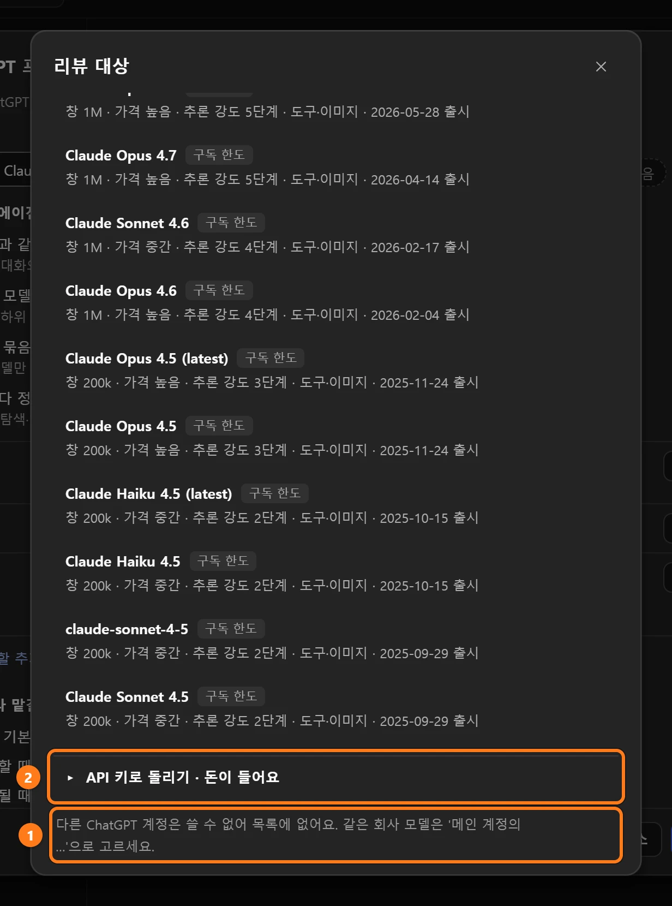
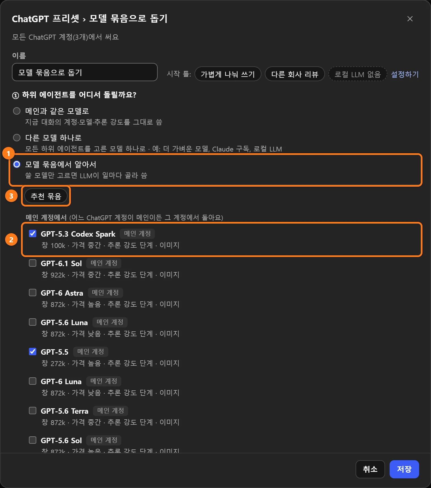

# 14. 프리셋: 하위 에이전트를 어디서, 얼마나

> **한 줄 요약** 메인(지금 대화하는 AI)은 입력창에서 고르고, 프리셋은 “도우미를 어디서 돌리고 얼마나 맡길지”만 정해요. 프리셋을 고르면 비용 없이 바로 적용돼요.

## 먼저 낱말 셋

> **용어** 메인: 지금 이 대화에서 나와 이야기하는 AI예요. 입력창의 `모델 @ 계정` 칩, 추론 강도, 속도로 정해요.

> **용어** 하위 에이전트: 메인이 일을 나눠 맡기는 도우미 AI예요. 메인이 “적 AI 코드가 어디 있는지 찾아 줘”처럼 일을 따로 시키면, 도우미가 자기 대화를 하나 열어 그 일만 하고 결과를 메인에게 돌려줘요. 이 설명서에서는 “도우미”라고도 불러요.

> **용어** 프리셋: 도우미를 어디서 돌리고, 얼마나 자주 맡기고, 한 번에 몇 개까지 쓸지 적어 둔 “일하는 방식” 묶음이에요.

식당에 비유하면 이래요.

- 메인은 **주방장**이에요. 입력창에서 누구를 주방장으로 세울지 골라요.
- 하위 에이전트는 **보조 요리사**예요.
- 프리셋은 벽에 붙은 **주방 운영표**예요. “채소 손질은 옆자리 막내에게, 맛 검사는 다른 가게 셰프에게, 보조는 한 번에 3명까지” 같은 규칙이에요.
- 주방장을 바꿔도 운영표는 그대로예요. 그래서 더 좋은 모델이 나오면 입력창의 모델만 바꾸면 돼요.

| 입력창 도구줄 | 단추 | 정하는 것 |
|---|---|---|
| **메인**: 누가 대화하나 | `모델 @ 계정`, 추론 강도, 속도 | 주방장을 누구로 세울지 |
| **일하는 방식**: 어떻게 일하나 | 프리셋, 울트라 | 주방 운영표 |

프리셋이 정하는 것은 세 가지예요.

1. 하위 에이전트를 **어디서** 돌릴까요?
2. **얼마나** 맡길까요?
3. **안전 상한**: 한 번에 몇 개까지 쓸까요?

## 왜 필요해요?

- **큰 일은 나눠 하면 빨라요.** 파일 찾기는 가볍고 싼 모델에게, 리뷰는 다른 회사 모델에게 맡기면 한도도 아끼고 다른 눈으로 다시 볼 수 있어요.
- **마구 맡기면 한도가 금방 바닥나요.** 그래서 “어디서, 얼마나, 몇 개까지”를 미리 정해 둬요.
- **프리셋 안에는 메인 모델이 없어요.** 새 모델이 나와도 프리셋을 고칠 필요가 없어요. 입력창의 모델 칩만 바꾸면 돼요.

## 입력창에서 보기

- ① **모델 @ 계정 칩**(예: GPT-5.5 @ ChatGPT 01): 메인의 모델과 계정이에요. 오른쪽에 그 계정의 남은 한도(`남음 58%`)가 보여요. [6장](06-model-account.md)에서 자세히 다뤄요.
- ② **추론 강도**(그림에서는 `기본`): 메인이 얼마나 깊이 생각할지예요. 단계 이름은 회사가 부르는 그대로 영어로 보여요(`low`, `medium`, `high`, `xhigh`, `max` 등). 모델 기본값이면 `기본`이에요.
- ③ **울트라 스위치**(`울트라` ○)와 ⓘ(`울트라 설명`): 강도 바로 옆에 있어요. [15장](15-ultra.md)에서 다뤄요.
- ④ **속도**(`속도: 표준`): 늘 보여요. 고를 수 없으면 회색이에요. [16장](16-speed.md)에서 다뤄요.
- ⑤ **프리셋 단추**(`프리셋: 가볍게 나눠 쓰기`): 이 장에서 다뤄요.

①②④를 바꾸면 캐시를 다시 써야 해서 비용 창이 뜰 수 있어요([11장](11-cache-switch-cost.md)). ⑤ 프리셋은 메인을 건드리지 않으므로 언제나 비용이 들지 않아요.

> **참고** 사이드바와 작업 패널을 함께 연 창처럼 입력창이 좁으면 ③ 울트라와 ④ 속도가 접혀요. 휴대폰 폭처럼 더 좁으면 ② 추론 강도와 ⑤ 프리셋도 접혀요. 줄 끝의 `⋯`(`도구 더 보기`)를 누르면 아래 줄에 펼쳐져요.

## 프리셋 고르기

1. 입력창의 프리셋 단추(`프리셋: …` 모양)를 눌러요.
2. 메뉴가 열려요. 맨 위에 ① 이 묶음의 ★ 프리셋, 그 아래 ② `평소대로`와 내가 만든 프리셋이 있어요. `최근` 아래에는 최근에 쓴 것이 보여요.
3. 원하는 프리셋을 눌러요. 끝이에요. 메뉴 맨 아래 문구 `비용 없음 · 바로 적용` 그대로, 대화는 끊기지 않고 이어져요.
4. 새로 만들려면 `새 프리셋…`, 지금 프리셋을 고치려면 `편집…`을 눌러요.

> **용어** `평소대로`: 묶음마다 처음부터 있는 잠긴 프리셋이에요. 그 회사의 앱(Codex, Claude Code)을 그냥 쓰는 것과 같아요. 도우미는 메인과 같게, 맡기는 정도는 모델에게 맡겨요. 고치거나 지울 수 없어요.

> **용어** ★ 프리셋: 묶음마다 하나 있는 “이 묶음에서 먼저 쓰는” 프리셋이에요. 새 대화는 이것으로 시작해요. 처음에는 `평소대로`가 ★예요.

### 프리셋은 계정이 아니라 “묶음”에 붙어요

> **용어** 프로바이더 묶음: 같은 종류의 계정 모음이에요. 예: ChatGPT, Claude 구독, DeepSeek, Anthropic API.

- ChatGPT 01, 02, 03은 모두 **같은 ChatGPT 프리셋**을 써요. 계정은 사용량과 한도만 가져요.
- 그래서 같은 묶음 안에서 계정을 바꿔도(ChatGPT 01 → 02) 프리셋은 그대로예요.
- 다른 묶음의 계정으로 바꾸면(ChatGPT 01 → DeepSeek) 그 묶음에서 **이름이 같은 프리셋**으로, 없으면 그 묶음의 **★ 프리셋**으로 바뀌어요. 전환 창에 “프리셋: 가볍게 나눠 쓰기 → 평소대로(DeepSeek)” 같은 한 줄이 보여요.
- 프리셋 메뉴에는 지금 메인 계정의 묶음 프리셋만 보여요.

## 프리셋이 정하는 세 가지

### ① 하위 에이전트를 어디서 돌릴까요?

먼저 큰 방식을 하나 골라요. 편집기에는 선택마다 이름 아래에 한 줄 설명이 있어요.

| 선택 | 뜻 |
|---|---|
| `메인과 같은 모델로` | 도우미도 지금 대화와 같은 계정, 같은 모델, 같은 추론 강도로 돌아요. 가장 단순해요. |
| `다른 모델 하나로` | 모든 도우미를 내가 고른 모델 하나로 보내요. 예: “도우미는 전부 더 가벼운 모델로”, “전부 Claude 구독으로”, “전부 로컬 LLM으로”. 처음에는 `고른 모델 없음`이라 `대상 고르기`로 골라야 저장돼요. |
| `모델 묶음에서 알아서` | 쓸 모델만 체크해 두면 메인이 일마다 그중 하나를 이름으로 골라 맡겨요. 이름을 적지 않으면 앱이 정한 규칙대로 돌려요(아래 “모델 묶음”). |
| `일마다 정하기` | 일의 종류(역할)마다 대상을 따로 정해요. 메인이 일을 맡길 때 맞는 역할을 골라요. |

> **팁** `다른 모델 하나로`의 대상 고르기 창에는 `메인과 같게`가 없어요. 도우미를 지금 대화와 같은 모델로 돌리려면 첫째 선택 `메인과 같은 모델로`를 고르세요. 예전에 `메인과 같게`를 대상으로 저장한 프리셋은 `메인과 같은 모델로`로 열려요.

`일마다 정하기`의 역할은 다섯 가지예요. 처음에는 `탐색`·`일반`·`리뷰`만 보이고, 나머지 둘은 `+ 역할 추가(빠른 일, 어려운 일)`로 꺼내요. 적지 않은 역할은 `메인과 같게`로 돌아요.

| 역할 | 하는 일 | 파일을 고치나요? |
|---|---|---|
| `탐색` | 코드와 파일을 찾아 읽어요 | 아니요. 읽기 전용이고 셸 명령도 못 써요. 폴더 목록·파일 읽기·검색은 어느 에이전트 방식에서나 해요([8장](08-approvals.md)) |
| `일반` | 무엇이든 해요. 나란히 구현할 때 | 네 |
| `리뷰` | 바뀐 코드를 검토해요 | 아니요. 파일 편집은 막혀요. 셸 명령은 승인 모드([8장](08-approvals.md))를 따라요 |
| `빠른 일` | 짧고 쉬운 일 | 네 |
| `어려운 일` | 깊이 생각해야 하는 일 | 네 |

이 표의 내용과 **지금 어느 모델·계정·강도로 도는지**는 앱 안에서도 볼 수 있어요. `설정` > `프리셋`의 묶음 탭 아래 `하위 에이전트 역할`을 펼치면 그 묶음의 ★ 프리셋 기준으로, 편집기의 `자세히`에서는 고치는 중인 프리셋 기준으로 보여요. `설정` > `에이전트 방식`의 `하위 에이전트`에도 역할과 할 수 있는 일이 나와요. 하위 에이전트는 사용자에게 묻거나 다른 하위 에이전트를 또 부르지 않아요.

그다음 역할마다 **대상**(도우미가 돌 곳)을 골라요. 대상은 두 갈래예요.

| 메인을 따라 움직이는 대상(상대) | 늘 같은 곳(고정) |
|---|---|
| `메인과 같게` | 다른 회사 구독의 특정 모델(예: Claude 구독) |
| `메인 계정의 더 가벼운 모델` | 로컬 LLM(예: Ollama, LM Studio) |
| | API 키(직접 켤 때만, 돈이 들어요) |

| 대상 | 어디서 도나 | 한도·돈 |
|---|---|---|
| `메인과 같게` | 메인 계정, 메인 모델, 메인 추론 강도 | 메인과 같은 한도 |
| `메인 계정의 더 가벼운 모델` | 메인 계정의 더 싸고 빠른 모델(데모: GPT-5.5 → GPT-5.3 Codex Spark) | 메인 계정의 한도 |
| 다른 회사 구독(고정) | 예: ChatGPT가 메인일 때 Claude 구독의 모델 하나 | 그 구독의 한도 |
| `로컬 LLM`(고정) | 이 PC에서 도는 모델 | 무료 |
| API 키(고정) | 내가 직접 켠 API 키 계정 | 돈이 들어요. 월 예산 안에서만 |

- **상대 대상은 “주방장 옆자리”예요.** 메인이 ChatGPT 02로 바뀌면 도우미도 02에서 돌아요. 메인 모델을 바꾸면 `메인과 같게`인 역할도 새 모델을 따라가요.
- **고정 대상은 “지정 업체”예요.** 내가 바꿀 때까지 그 계정, 그 모델 그대로예요.
- **한 역할에 대상을 여러 개 줄 세울 수 있어요**(1순위, 2순위). 1순위를 못 쓰면(한도 도달, 로그인 만료) 2순위로, 모두 안 되면 마지막은 늘 `메인과 같게`예요. 단, 다음 차례가 API 키(돈이 드는 대상)면 저절로 넘어가지 않고 먼저 물어요(아래 “돈이 드는 대상”).

> **용어** 가벼운 짝: `메인 계정의 더 가벼운 모델`이 실제로 어느 모델인지 정한 짝이에요(예: GPT-5.5 → GPT-5.3 Codex Spark). 처음 필요할 때 앱이 가격을 보고 한 번 정하고, 그 뒤로는 저절로 바뀌지 않아요. 메인이 이미 가장 가벼운 모델이면 `더 가벼운 모델 없음 · 메인과 같게`로 돌아요.

### ② 얼마나 맡길까요?

추론 강도와는 **따로** 정해요. 추론 강도를 올린다고 도우미를 더 쓰지는 않아요.

| 선택 | 화면 설명 |
|---|---|
| `모델 기본`(처음 값) | `GPT는 요청할 때만, 그 밖은 모델이 판단` |
| `요청할 때만` | `사용자가 시킬 때만` |
| `도움될 때` | `나눠서 빨라지거나 나아질 때` |
| `적극적으로` | `조사·탐색·리뷰를 먼저 맡김` |

> **팁** GPT 모델은 원래 시키지 않으면 도우미를 거의 쓰지 않아요. ChatGPT 메인으로 도우미를 쓰게 하려면 `도움될 때` 이상을 고르세요. 도우미를 아예 쓰지 않으려면 `자세히`에서 `안 함`을 골라요.

### 안전 상한

도우미가 한꺼번에 너무 많이 생기지 않게 막는 상한이에요. 처음 값은 이래요.

- **동시 3개**: 한꺼번에 도는 도우미 수
- **메시지 하나당 최대 6개**: 내 메시지 하나에 새로 만드는 수(`적극적으로`면 12개)
- **대화당 제한 없음**: 이 대화 전체에서 만든 수는 처음에 세기만 하고 막지 않아요

편집기에는 `안전 상한` 줄로 읽기만 할 수 있게 보이고, 숫자는 `자세히`에서 바꿔요. 대화 전체 수도 막고 싶으면 `자세히`에서 `대화당 상한 두기`를 체크하고 숫자를 적어요(체크하면 100이 먼저 들어가요). 체크를 풀면 다시 제한 없음이에요.

> **참고** 예전에는 대화당 100개가 처음 값이었어요. 그 값을 바꾸지 않은 프리셋은 이제 제한 없음으로 읽어요. 100이 아닌 숫자를 적어 둔 프리셋은 그 숫자를 그대로 써요.

넘는 요청은 기다리게 하지 않고 그 요청만 막아요. 메인은 다른 일을 하거나 돌던 도우미가 끝나기를 기다려요. 화면에는 오류가 아니라 작은 칩이 떠요(아래 “하위 에이전트 화면”).

## 프리셋 만들고 고치기

만들고 고치는 곳은 두 군데예요.

- `설정` > `프리셋`의 묶음 탭
- 입력창 프리셋 메뉴의 `새 프리셋…`, `편집…`

.")

`설정` > `프리셋` 화면은 위에서부터 이렇게 생겼어요.

- `울트라 상한`: [15장](15-ultra.md)에서 다뤄요.
- `새 대화 시작 프리셋`: 새 대화가 어떤 프리셋으로 시작할지예요. `묶음의 ★` 또는 `마지막에 쓴 것(가벼운 것만)`. “가벼운 것”은 맡기는 정도가 `안 함`·`모델 기본`·`요청할 때만` 중 하나이고 API 키 대상이 없는 프리셋이에요. 그 밖이면 ★로 시작해요.
- `모델 회사 묶음` 탭: 계정이 있는 묶음만 보여요(데모: ChatGPT, Anthropic API, DeepSeek, Claude 구독).
- ① 탭 맨 위: `모든 ChatGPT 계정(3개)에서 써요`와 `새 대화 기본 모델` 줄이에요. 새 대화 기본 모델은 프리셋이 아니라, 이 묶음 계정으로 새 대화를 열 때 처음 고르는 모델이에요. 그 폴더에서 쓰던 모델이 있으면 그것이 먼저예요.
- ② 프리셋 목록: 왼쪽 별을 누르면 그 프리셋이 ★가 되고 `★ 먼저 씀` 꼬리표가 붙어요. `편집…`으로 고치고 `지우기`로 지워요. `평소대로`에는 두 단추가 없어요.

### 새 프리셋 만들기(예: 리뷰만 다른 회사에)

데모의 “리뷰는 Claude로” 프리셋을 만드는 순서예요. ChatGPT가 메인일 때 리뷰만 Claude 구독에 맡겨요.

1. `설정` > `프리셋` > `ChatGPT` 탭에서 `새 프리셋…`을 눌러요.
2. `이름`에 알아보기 쉬운 이름을 적어요.
3. `시작 틀`을 하나 누르면 행이 미리 채워져요.
   - `가볍게 나눠 쓰기`: 탐색·빠른 일을 메인 계정의 더 가벼운 모델로
   - `다른 회사 리뷰`: 리뷰를 다른 회사 구독의 가장 강한 모델로
   - `로컬로 탐색`: 탐색을 로컬 LLM으로
   - 쓸 수 없는 틀은 흐리게 보이고 이유(`로컬 LLM 없음`)와 `설정하기`가 붙어요.
4. 이 예에서는 `다른 회사 리뷰`를 눌러요. ①이 `일마다 정하기`가 되고 `리뷰` 행이 Claude 구독으로 채워져요. 다른 모델로 바꾸려면 그 행의 `바꾸기`를 눌러요(아래 “대상 고르기 창”). 2순위를 더하려면 `자세히`의 `역할별 대상 순서`에서 `대상 추가`를 눌러요.
5. ②는 시작 틀이 `도움될 때`로 채워 둬요. 필요하면 다른 것을 골라요.
6. ③ 맨 아래 줄 “지금 메인(GPT-5.5 · 기본)이면: …”을 봐요. 지금 메인 기준으로 역할마다 실제로 어떤 모델이 쓰일지 보여 줘요.
7. `저장`을 눌러요. `프리셋을 저장했어요`가 뜨면 끝이에요.

, ② 얼마나 맡길지, ③ 지금 메인 기준으로 실제로 쓰일 모델.")

편집기에서 함께 보면 좋은 것:

- 값 옆 꼬리표 `추천`은 앱이 자동으로 채운 값, `직접 고름`은 내가 고른 값이에요.
- 리뷰 행의 “1순위 Claude 구독 · …(고정) → 2순위 DeepSeek · …(고정) → 마지막 메인과 같게”는 대상 순서예요. 1순위가 막히면 2순위, 끝은 메인이에요.
- 탐색 행의 “지금 메인 GPT-5.5 → GPT-5.3 Codex Spark”는 가벼운 짝이에요.
- 맨 위 `모든 ChatGPT 계정(3개)에서 써요`는 이 프리셋을 묶음 안의 모든 계정이 함께 쓴다는 뜻이에요.

### 대상 고르기 창

역할 행의 `바꾸기`를 누르면 열려요. 위에서부터 세 칸이에요.

- `메인 계정에서`: `메인과 같게`, `메인 계정의 더 가벼운 모델`
- `다른 회사 구독`: 예) ChatGPT가 메인이면 Claude 구독의 모델들
- `로컬 LLM`: 이 PC에서 찾은 모델들

모델마다 한 줄 카드가 붙어요. 요금 종류 꼬리표(`구독 한도`, `종량제`, `선불`, `로컬 · 무료`, `메인 계정`), 창 크기, 가격대(`가격 낮음`·`가격 중간`·`가격 높음`), 추론 강도 단계 수, 도구·이미지 지원, 출시일이에요. 도우미는 늘 도구를 쓰므로 **도구를 쓸 수 있는 모델만** 보여요. 계정에 새로 생긴 모델에는 14일 동안 `새` 꼬리표가 붙어요.

### 자세히

편집기 아래 `자세히` ▸를 펼치면 더 고칠 수 있어요. 메인 모델과 추론 강도는 여기에도 없어요.

- `역할별 추론 강도`: 역할마다 도우미가 **평소에** 쓰는 강도예요. 처음 값은 `메인과 같게`예요. 지금 메인 기준으로 실제로 보낼 단계가 함께 보여요(예: “medium → high로 보냄”). 대화가 도우미를 부를 때마다 올리거나 내릴 수 있고(아래 “대화에서 도우미 강도 정하기”), 아래 `강도 고정`을 고르면 그 값이 먼저예요. 그때는 행마다 `이 프리셋의 강도 고정(low)이 먼저라 지금은 low로 돌아요.`가 보여요.
  - 강도 단계가 없는 모델에는 고르는 칸 대신 까닭이 한 줄 보여요. 로컬 모델이나 `기타 OpenAI 호환` 계정의 모델이면 `설정` > `계정`에서 그 계정의 `모델 기능…` → `추론 강도`를 정하면 여기서 고를 수 있어요.
- `하위 에이전트 역할`: 역할 다섯 가지가 각각 무엇을 하는지, 무엇을 할 수 있는지(읽기만 / 파일을 고치지 않음 / 메인과 같은 도구), 그리고 **이 프리셋에서 지금 어디서 도는지**(`지금: Claude Sonnet 5.5 @ AC-01 · high`)와 그 값이 어디서 왔는지(`메인과 같게`, `프리셋의 역할 대상`, `모델 묶음의 기본 규칙` …)를 보여 줘요. 메인 모델을 바꾸면 이 줄도 따라 바뀌어요. 이 프리셋의 안내문이 이름을 알려 주지 않는 역할(예: `평소대로`의 `빠른 일`)에는 `이 프리셋의 안내문에 없어서 메인이 따로 고르지 않아요`가 붙어요.
- `역할별 대상 순서`: `위로`, `아래로`, `대상 추가`, `대상 빼기`.
- 맡기는 정도의 `안 함`(도우미를 쓰지 않음)은 여기에만 있어요.
- 안전 상한 숫자 셋.
- `이 프리셋의 울트라 상한`: 처음에는 전역 단계를 따라요([15장](15-ultra.md)).
- `넣는 안내문(읽기 전용)`: 이 프리셋이 메인에게 덧붙이는 안내문이에요. `평소대로`처럼 아무것도 넣지 않으면 그렇다고 적혀 있어요.
- `가벼운 짝`: 메인 모델마다 정해진 가벼운 짝과 `짝 바꾸기`.
- `★ 이 묶음에서 먼저 쓰기`, `다른 묶음에 복사…`, `수리 기록`.
- `강도 고정`: 이 프리셋을 쓰는 대화와 도우미의 추론 강도를 하나로 정해요(아래 “강도 고정”). 처음 값은 `고정 안 함(기본)`이에요. 역할과 모델 묶음의 추론 강도보다 먼저예요.
- `대화에서 하위 에이전트 강도 올리기`: 메인이 도우미를 부를 때 강도를 어디까지 올릴 수 있는지예요(아래 “대화에서 도우미 강도 정하기”).
- `모델 묶음`: ①이 `모델 묶음에서 알아서`일 때만 보여요. 넣은 모델마다의 카드와 설정이에요(아래 “모델 묶음”).

## 모델 묶음

`일마다 정하기`는 “리뷰는 이 모델”처럼 역할마다 내가 정해 둬요. `모델 묶음에서 알아서`는 쓸 모델 몇 개만 골라 두고, **어느 일에 어느 모델을 쓸지는 메인이 그때그때 정해요.** 메인은 묶음의 모델 목록과 카드(창 크기, 가격대, 잘하는 일)를 보고 일마다 이름으로 골라 불러요.

**만들기**

1. 프리셋 편집기의 ①에서 `모델 묶음에서 알아서`를 골라요.
2. 아래 목록에서 쓸 모델을 체크해요(최대 12개). 고르기 어려우면 `추천 묶음`을 눌러요(③). 메인 계정, 다른 회사 구독, 로컬 LLM에서 모델 계열마다 가장 새 모델을 골라 줘요. 돈이 드는 모델은 넣지 않아요.
3. ②, ③을 정하고 `저장`을 눌러요.

**목록의 칸**

- `메인 계정에서`: 메인 계정의 모델이에요. 옆의 `어느 ChatGPT 계정이 메인이든 그 계정에서 돌아요` 그대로, 메인이 ChatGPT 02로 바뀌면 02에서 돌아요.
- `Claude 구독`처럼 회사 이름이 붙은 칸: 다른 회사 구독의 모델이에요. 회사마다 계정 하나만 골라요. 계정 고르기 칸에는 그 회사의 계정이 모두 나와요(예: AC-01, AC-02, AC-03). Claude 구독과 Claude Agent 계정이 함께 있으면 계정 이름 뒤에 `Claude 구독`이나 `Claude Agent`가 붙어 어느 쪽인지 알려 줘요. 고른 계정은 그 대화의 도우미가 처음 쓰는 Claude 계정이 돼요. 이미 다른 Claude 계정으로 돌던 대화는 그 계정 그대로예요(대화 하나에 Claude 계정 하나). 고른 계정이 한도에 걸렸으면 기본 계정으로 시작해요.
- `로컬 모델`: 이 PC나 같은 네트워크의 서버에서 도는 모델이에요(`이 PC나 같은 네트워크의 서버에서 돌아요 · 돈이 들지 않아요`). Ollama·LM Studio 말고도 OpenAI 호환 계정의 주소가 `localhost`, `127.0.0.1`, `192.168.…` 같은 곳이면 여기에 나와요. `로컬 · 무료`가 붙고 `다른 모델로 안 될 때만 써요`가 붙지 않아요.
- `API 키로 돌리기 · 돈이 들어요`: 눌러야 펼쳐져요. 여기 모델에는 `돈이 들어요 · 다른 모델로 안 될 때만 써요`가 붙고, 월 예산 안에서만 써요.
- 같은 회사의 다른 구독 계정은 여기에도 없어요(아래 “같은 회사의 다른 구독은 왜 안 쓰나요”).

, ② 메인이 모델 이름을 적지 않을 때의 기본 규칙이에요.")

**카드 읽는 법.** 모델마다 한 줄 카드가 붙어요. 요금 종류(`메인 계정`, `구독 한도`, `종량제`, `선불`, `로컬 · 무료`), 창 크기(`창 272k`), 가격대(`가격 낮음`·`가격 중간`·`가격 높음`), `추론 강도 단계`, `이미지`(그림을 읽을 수 있음), 그리고 Codex가 알려 주는 모델 설명 한 줄이에요. 새 모델에는 `새`, 곧 없어질 모델에는 `2026-11-30 은퇴 예정(Codex)`처럼 흐린 표시가 붙어요. 메인 계정이 API 키라 쓴 만큼 돈이 들면 `메인 계정 · 종량제 · 돈이 들어요`가 보여요.

**메인이 이름을 적지 않으면: 기본 규칙.** 목록 맨 아래 `모델을 고르지 않으면: …` 줄이 기본 규칙이에요(위 그림 ②). 묶음 안에서 이렇게 골라요.

| 일 | 기본 규칙 |
|---|---|
| 탐색, 빠른 일 | 메인보다 더 가벼운 모델 |
| 리뷰 | 다른 회사의 가장 강한 모델 |
| 어려운 일 | 메인보다 더 강한 모델 |
| 일반 | 메인과 같게 |

맞는 모델이 묶음에 없으면 그 일은 메인과 같게 돌아요. 데모 묶음에서는 “탐색·빠른 일 → GPT-5.3 Codex Spark · 리뷰 → Claude Opus 5.5 · 어려운 일·일반 → 메인”이에요.

**돈이 드는 모델.** 기본 규칙은 돈이 드는 모델을 **절대 고르지 않아요.** 메인이 이름으로 직접 부를 때만 월 예산 안에서 묻지 않고 돌고, 예산을 다 쓰면 그 모델은 빠져요.

**모델이 사라지면.** 묶음의 모델이 계정에서 사라지면 수리 알림이 떠요(`모델 묶음의 …: …(이)가 없어져 고칠 때까지 고르면 기본 규칙으로 돌아요 · 프리셋 1개`). 고치기 전까지 메인이 그 이름을 불러도 기본 규칙대로 돌아요. `…로 고치기`나 `직접 고르기`로 고쳐요.

**카드는 저절로 바뀌지 않아요.** 카드는 넣을 때의 내용으로 굳어 있어요. 메인이 보는 설명이 갑자기 바뀌면 대화의 캐시가 깨지기 때문이에요. 새 정보로 바꾸려면 `자세히` → `카드 새로 고치기`를 눌러요.

**`자세히`의 모델 묶음.** 모델마다 카드와 `2026-10-10 기준` 날짜, `추론 강도` 칸 하나, `메모`(120자까지, 메인이 보는 한마디. 예: “리뷰는 다른 회사 눈으로”), `빼기`가 있어요.

`추론 강도` 칸은 두 묶음으로 나뉘어 있어요.

| 묶음 | 고르는 것 | 뜻 |
|---|---|---|
| `평소 강도 · 대화가 바꿀 수 있어요` | `메인과 같게`(처음 값), `기본`, `low` … `max` | 이 모델을 부를 때 평소에 보내는 강도예요. 메인이 부를 때마다 올리거나 내릴 수 있어요. |
| `고정 · 대화가 바꾸지 못해요` | `low 고정` … `max 고정`(그 모델에 있는 단계만) | 이 모델은 언제나 그 강도로 돌아요. 프리셋 전체의 `강도 고정`보다도 먼저예요. |

칸 아래 한 줄이 지금 어느 쪽이 적용되는지 알려 줘요: `평소에 쓰는 강도예요…`, `언제나 medium으로 돌아요. 대화가 다른 강도를 적어도 바꾸지 않아요.`, 또는 프리셋 전체를 고정했으면 `이 프리셋의 강도 고정(low)이 먼저라 지금은 low로 돌아요.` 그 아래 기본 규칙 줄과 `카드 새로 고치기`가 있어요. `넣는 안내문(읽기 전용)`에서 메인에게 실제로 가는 묶음 안내를, `수리 기록`에서 사라진 모델을 어떻게 고쳤는지 봐요.

, ② 기본 규칙 줄과 카드 새로 고치기예요.")

- **SSH 원격 대화**에서도 이 PC의 묶음과 카드가 그대로 가요. Claude 구독 모델은 그 호스트에서 Claude 구독을 켰을 때만 돌고([22장](22-ssh-remote.md)), 아니면 기본 규칙으로 돌아요.
- 메인이 묶음에 없는 모델을 부르면 막고 칩을 띄워요(아래 “하위 에이전트 화면”의 칩 표).

## 모델 숨기기

쓰지 않을 모델은 목록에서 숨겨요. 숨긴 모델은 모델 고르기(전환기)와 프리셋의 모델 목록에 나오지 않아요.

1. 모델 묶음 목록에서는 `목록에서 숨기기`를, 전환기에서는 모델 줄 오른쪽 끝의 `숨기기`를 눌러요(휴대폰에서도 손가락으로 누르기 좋은 크기예요).
2. 그 모델이 목록에서 바로 빠지고 목록 끝에 `숨긴 모델 1개`가 생겨요. 전환기 아래쪽에 `… 목록에서 숨겼어요`와 `되돌리기`가 잠깐 떠요. 고르고 있던 모델을 숨기면 바로 옆 모델이 대신 골라져요.
3. 다시 보려면 `숨긴 모델 n개`를 눌러요. 숨긴 모델이 `숨김` 표시와 함께 보이고, `다시 보이기`(전환기에서는 `보이기`)를 누르면 되돌아와요.
4. 숨긴 모델 전체는 `설정` → `프리셋` 맨 아래 `숨긴 모델`에서 보고 하나씩 `다시 보이기`로 되돌려요.

- 숨기는 단위는 묶음이에요. ChatGPT 계정에서 숨긴 모델은 모든 ChatGPT 계정에서 숨겨져요. Claude 구독, Claude Agent, API 키, 로컬 모델도 같아요(종류마다 하나의 묶음).
- 지금 대화가 쓰는 모델에는 `숨기기`가 없어요.
- 바꾸지 못하면(예: 이 창에 설정을 바꿀 권한이 없을 때) `바꾸지 못했어요: …`가 떠요.
- **이미 쓰는 곳은 그대로예요.** 숨긴 모델을 쓰는 프리셋과 대화는 그대로 돌고, 목록에 `숨김` 표시와 함께 보여요.
- `추천 묶음`은 숨긴 모델을 넣지 않아요. 계정을 바꿀 때 앱이 모델을 골라야 하면 숨긴 모델은 다른 모델이 없을 때만 골라요.
- 숨긴 목록은 앱의 설정(`policy.json`)에 저장돼요. 금고에 들어가지 않고, SSH 원격 호스트에도 같은 목록이 가요.

## 돈이 드는 대상(API 키)

API 키 계정은 쓴 만큼 돈이 나가요. 그래서 **내가 직접 켤 때만**, **월 예산 안에서만** 도우미로 써요. 앱이 추천하거나 시작 틀에 저절로 넣지 않아요.

1. 대상 고르기 창 맨 아래 `API 키로 돌리기 · 돈이 들어요`를 눌러 펼쳐요.
2. API 키 계정이 보여요. 계정마다 “월 예산 $5 · 이번 달 $0.00”처럼 예산과 이번 달 쓴 돈이 붙어요.
3. 예산이 없는 계정은 먼저 `월 예산($)`에 금액을 적고 `예산 정하기`를 눌러요. 예산 없이 쓰려면 `상한 없음`을 골라요.
4. 그다음 모델을 골라요. 편집기 행에 이번 달 쓴 돈과 예산이 함께 보여요.

이렇게 고른 대상이 있는 프리셋을 쓰면 입력창 위에 “프리셋 '…' · 종량제 대상이 있어요” 한 줄이 늘 보여요.

- 구독 대상(예: Claude 구독)이 한도에 걸려 다음 차례가 API 키면, 대화에 칩이 떠서 물어요. `이 대화에서만`을 누르면 이 대화에서만 API 키로 돌리고, `아니오`면 돌리지 않아요.
- 예산을 다 쓰면 그 계정으로는 도우미를 더 만들지 않아요.

## 강도 고정

프리셋으로 추론 강도를 아예 정해 둘 수 있어요. `자세히` → `강도 고정`에서 단계를 고르면 이 프리셋을 쓰는 대화의 메인과 모든 도우미가 그 강도로 돌아요. 처음 값은 `고정 안 함(기본)`이고, 그대로 두면 지금처럼 움직여요.

- **모델마다 가장 가까운 단계로 맞춰요.** 그 모델에 고른 단계가 없으면 바로 위 단계, 위가 없으면 가장 높은 단계로 보내요. `자세히`에 `이 모델엔 xhigh가 없어 max로 맞춰요`처럼 보여요. 강도 단계가 없는 모델은 강도 없이 돌아요.
- **모델 묶음 항목마다 따로 정할 수도 있어요.** `자세히`의 모델 묶음 항목마다 있는 `추론 강도` 칸에서 `고정` 묶음의 단계(예: `medium 고정`)를 고르면 돼요. 항목 것이 프리셋 것보다 먼저예요. `평소 강도` 묶음에서 고르면 고정이 풀리고 프리셋 것을 따라요.
- **역할과 모델 묶음의 `추론 강도`와 무엇이 달라요?** 그쪽은 평소 강도라 대화가 부를 때마다 바꿀 수 있어요. `강도 고정`은 대화가 바꾸지 못하고, 둘 다 있으면 고정이 먼저예요.
- **언제 맞추나요.** 프리셋을 고를 때(쉬고 있는 대화는 바로, 일하는 중이면 끝난 뒤), 새 대화가 그 프리셋으로 시작할 때, 메인의 계정이나 모델을 바꿀 때, 프리셋을 고쳐 저장할 때예요. 강도 갱신을 지원하지 않는 모델이면 이때 캐시 앞부분을 한 번 다시 써요.
- **입력창에서 바꿀 수 있어요.** 전환기의 강도 줄에 `프리셋 '…'이 강도를 low로 정해요`가 보여요. 다른 강도를 고르면 `지금은 직접 고른 강도예요`와 `프리셋 강도로` 단추가 붙고, 그 강도는 위의 “언제 맞추나요” 때까지 그대로예요.
- **메인이 도우미 강도를 정해 불러도** 고정된 강도로 돌아요. 메인에게는 `Note: this preset fixes reasoning effort at …` 한 줄이 가요. 그래서 강도를 고정한 프리셋에는 아래 “대화에서 도우미 강도 정하기”가 적용되지 않아요.
- 울트라를 켜면 울트라 강도가 먼저예요([15장](15-ultra.md)).
- Codex·Pi·dsh·omo 방식과 Claude Agent에서도 똑같이 돌아요(Claude Agent 대화도 입력창에 프리셋 단추가 있고, 프리셋은 `Claude Agent` 묶음 것을 써요). Codex 방식의 `spawn_agent`와 omo가 만든 도우미는 메인의 강도를 물려받아요.

## 대화에서 도우미 강도 정하기

도우미의 추론 강도는 보통 프리셋(`역할별 추론 강도`)대로예요. 그런데 대화에서 말로 정할 수도 있어요. 예를 들어 “리뷰는 최대로”, “탐색은 낮게”, “일마다 알아서”라고 말하면 메인이 도우미를 부를 때마다 강도를 정해 불러요.

- **낮추기는 언제나 돼요.**
- **올리기는 상한까지만 돼요.** 상한은 `자세히`의 `대화에서 하위 에이전트 강도 올리기`에서 정해요. 처음 값은 `max까지 허용(기본)`이고, `xhigh까지`, `high까지`, `올리지 않음`이 있어요.
- **돈이 드는 대상(API 키)은** 프리셋의 강도보다 올리지 않아요.
- 그 모델에 없는 단계면 가장 가까운 단계로 보내요(예: DeepSeek에는 `xhigh`가 없어 `max`로). 그 단계가 상한을 넘으면 상한 안으로 내려요. 강도 단계가 없는 로컬 모델은 강도 없이 보내요(`강도 단계 없음`).
- 바뀌는 것은 강도뿐이에요. 계정, 모델, 예산, 안전 상한은 프리셋 그대로예요.

이에요.")

**상한을 넘으면 칩이 떠요.** 메인이 상한보다 높은 강도로 부르면 그 요청을 막고 대화에 칩을 띄워요. 메인에게도 이유가 가서 강도를 낮춰 다시 불러요.

보다 높은 max를 요청했을 때예요. ① 칩, ② 이번 메시지만 허용이에요.")

- `이번 메시지만 허용`을 누르면 이 메시지에서만 더 높은 강도를 허용해요(`이번 메시지만 더 높은 강도를 허용했어요`). 턴이 도는 동안에만 보여요.
- 돈이 드는 대상이면 ⊘ `하위 에이전트 강도 제한: 종량제 모델은 프리셋 강도(high)까지`가 뜨고 단추는 없어요.
- 이미 일하던 도우미를 이어 부를 때 강도를 바꾸면 그 도우미의 캐시가 깨져요. 그래서 그 도우미는 원래 강도 그대로 두고, 메인에게 새 강도로 하려면 새 도우미로 시작하라고 알려 줘요.
- 도우미 대화의 입력창 자리에 보이는 강도는 **실제로 도는 강도**예요(아래 “3. 도우미의 대화”).

> **참고** 울트라를 켜도 메인이 정해 부른 강도가 먼저예요([15장](15-ultra.md)).

## 하위 에이전트 화면

도우미가 일하는 모습은 네 곳에서 보여요.

**1. 입력창 위와 도구줄.** 맡기는 정도가 `적극적으로`이거나 울트라가 켜져 있으면, 도구줄에 실행 중인 도우미 수가 보여요(예: “하위 에이전트 0/8 실행 중 · 이 메시지 0개”). 앞 숫자는 지금 도는 수와 동시 상한, 뒤 숫자는 이번 메시지에서 만든 수예요. 무거운 프리셋이면 입력창 위에 “프리셋 '…' · 적극적으로 맡겨요” 같은 한 줄도 보여요.

**2. 대화 맨 아래 도우미 줄.** 도우미가 돌고 있거나 내 답을 기다릴 때만 보여요.

| 줄에 보이는 것(예) | 뜻 |
|---|---|
| ● 하위 에이전트 explore · 적 AI 경로 코드 찾기 · `열기 →` | 탐색 도우미가 일하는 중이에요 |
| ● 하위 에이전트 own-review · 길찾기 변경 검토 · `? 1` · `열기 →` | 리뷰 도우미가 승인이나 질문 1개를 기다려요 |
| 2개 더 보기 | 도우미가 더 있어요. 눌러서 펼쳐요 |

- 앞의 기호는 상태예요: ● 실행 중, ✓ 완료, ! 실패, ■ 중단됨, ○ 대기.
- 도우미의 승인 요청은 내 대화의 승인 요청 상자(입력창 위)에도 “하위 에이전트 "…"의 요청”으로 떠서, 거기서 바로 답해도 돼요.
- `열기 →`를 누르면 그 도우미의 대화로 들어가요.

**3. 도우미의 대화.** 도우미 대화는 읽기만 해요.

| 자리 | 보이는 것(예) |
|---|---|
| 머리줄 | 적 AI 길찾기 고치기 › 하위 에이전트 explore (누구의 도우미인지) |
| 가운데 | 도우미가 한 일 |
| 입력창 자리 | ● 실행 중 · 탐색 · ChatGPT 01 · GPT-5.3 Codex Spark · medium(역할 · 계정 · 모델 · 강도) |
| 맨 아래 | 하위 에이전트 대화는 부모 대화가 제어해요 · `부모 대화로` |

- 입력창 대신 상태, 역할 · 계정 · 모델 · 강도 꼬리표, 안내가 보여요. 어느 역할이 어느 계정·모델에서 도는지 여기서 확인해요.
- 메인이 강도를 정해 불렀으면 강도 뒤에 `(요청)`이 붙어요. 예: ● 실행 중 · 리뷰 · Claude 구독 · Claude Opus 5.5 · high (요청). 보이는 강도는 실제로 도는 강도이고, (요청)은 메인이 정해 불렀다는 뜻이에요.
- `부모 대화로`를 누르면 원래 대화로 돌아가요. 머리줄의 앞부분을 눌러도 돼요.
- 도우미는 또 다른 도우미를 부르지 않아요. 한 단계만 있어요.

**4. 막힌 요청은 오류가 아니라 칩이에요.** 메인이 상한을 넘거나 프리셋 밖의 모델을 부르면, 대화에 ⊘ 칩이 떠요. 메인에게도 이유가 전달되어 다른 방법을 찾아요.

| 칩(예) | 단추 | 뜻 |
|---|---|---|
| ⊘ 하위 에이전트 대기: 3개 실행 중 | — | 동시 상한(여기서는 3개)이 찼어요. 돌던 도우미가 끝나면 메인이 다시 맡길 수 있어요 |
| ⊘ 하위 에이전트 대기: 메시지 하나당 최대 6개 | `이번 메시지만 늘리기` | 내 메시지 하나가 상한보다 많이 시켰어요. 턴이 도는 동안 누르면 이번 메시지에서만 늘려요 |
| ⊘ 하위 에이전트 요청을 막았어요: ○○는 이 모델 묶음에 없어요 | `묶음에 추가…`, `그대로` | `모델 묶음에서 알아서` 프리셋에 없는 모델이에요. `묶음에 추가…`는 그 모델이 체크된 편집기를 열고, `저장`해야 바뀌어요 |
| ⊘ 하위 에이전트 강도 제한: max 요청 · high까지 | `이번 메시지만 허용` | 강도 상한을 넘었어요(위 “대화에서 도우미 강도 정하기”) |
| ⊘ 하위 에이전트 강도 제한: 종량제 모델은 프리셋 강도(high)까지 | — | 돈이 드는 대상은 프리셋 강도보다 올리지 않아요 |
| ⊘ 하위 에이전트 요청을 막았어요: ○○는 이 프리셋에 없어요 | `하위 에이전트에 추가…`, `그대로` | 프리셋에 없는 모델이에요. 추가 단추는 그 모델이 채워진 편집기를 열고, `저장`을 눌러야 실제로 바뀌어요. `그대로`는 칩만 접어요. 같은 회사의 다른 구독이면 추가 단추가 없어요 |
| ⊘ Claude 구독 한도 대기 · 리뷰를 DeepSeek(종량제)로 돌릴까요? | `이 대화에서만`, `아니오` | 돈이 드는 대상으로 넘어갈 차례라 물어요(위 "돈이 드는 대상") |

- 그 밖에 “…의 이번 달 예산을 다 썼어요”, “이 대화는 나눠 맡기기가 '안 함'이에요” 칩도 있어요.

## 같은 회사의 다른 구독은 왜 안 쓰나요

ChatGPT 01이 메인일 때 ChatGPT 02, 03은 도우미로 고를 수 없어요. 목록에도 아예 없어요. 메인이 ChatGPT 01(구독)일 때 도우미 대상은 이래요.

| 대상 | 쓸 수 있나요 | 어디서 도나요 |
|---|---|---|
| `메인과 같게` | 돼요 | ChatGPT 01 |
| `메인 계정의 더 가벼운 모델` | 돼요 | ChatGPT 01 |
| 다른 회사 구독 | 돼요 | Claude 구독 |
| 로컬 LLM | 돼요 | 이 PC |
| API 키(직접 켬, 예산 안) | 돼요 | DeepSeek, OpenAI API … |
| ChatGPT 02, ChatGPT 03 | **안 돼요** | 같은 회사의 다른 구독이라서 목록에도 없어요 |

**이유는 약관이에요.** 구독은 “한 사람이 이만큼 쓰세요”라고 정한 한도예요. 한 대화가 ChatGPT 01과 02를 함께 쓰면, 한도를 두 배로 늘려 쓰는 셈이에요. 회사는 이것을 **한도 우회**로 볼 수 있어요. 놀이공원 자유이용권 두 장을 번갈아 찍으며 한 사람이 두 배로 타는 것과 비슷해요. 그래서 이 앱은 경고를 띄우고 허락하는 길도 두지 않고, 처음부터 길을 막았어요.

그 대신 이렇게 하면 돼요.

- 같은 회사 모델을 도우미로 쓰고 싶으면 `메인과 같게` 또는 `메인 계정의 더 가벼운 모델`을 골라요. 메인과 같은 계정, 같은 한도 안에서 돌아요.
- 다른 회사 구독(ChatGPT 메인 + Claude 구독 도우미)은 괜찮아요. 회사마다 구독 하나씩이에요.
- 같은 회사라도 API 키(예: ChatGPT 메인 + OpenAI API 키)는 쓴 만큼 내는 것이라 괜찮아요. 직접 켤 때만, 예산 안에서만 써요.

앱이 이 규칙을 지키는 곳:

- 대상 고르기 창 맨 아래에 `다른 ChatGPT 계정은 쓸 수 없어 목록에 없어요. 같은 회사 모델은 '메인 계정의 …'으로 고르세요.`가 흐리게 보여요.
- 한 프리셋에는 다른 회사 구독도 회사마다 하나만 넣을 수 있어요. 예를 들어 Claude 구독 묶음의 프리셋에 ChatGPT 01과 02를 함께 넣을 수 없어요.
- 메인 AI에게는 다른 ChatGPT 계정이 아예 보이지 않아요. 메인이 다른 계정의 모델을 직접 적어 불러도 막혀요.
- 메인을 ChatGPT 01에서 02로 직접 바꾸는 것은 괜찮아요(한 번에 하나만 쓰니까요). 그때 01에서 도우미가 돌고 있으면 전환 창이 “ChatGPT 01에서 하위 에이전트 2개가 실행 중이에요”를 보여 주고 `끝나면 바꾸기` 또는 `멈추고 바꾸기`를 물어요. 그래서 01과 02가 겹치는 순간이 없어요.
- 팀 모드에서는 팀 전체에 같은 규칙이 걸려요([17장](17-team-mode.md)).

> **참고** 같은 ChatGPT 로그인으로 만든 Sign in with ChatGPT 계정도 도우미 대상으로는 고를 수 없어요. 도우미가 메인과 같은 회사 모델을 쓰려면 언제나 메인 계정 자신이어야 해요. 구독 계정끼리 자동으로 넘어가지 않는 것도 같은 이유예요([12장](12-multiple-accounts.md)).

## 알아 두면 좋아요

- **프리셋을 바꿔도 대화는 그대로예요.** 메인이 그대로라 캐시도 그대로예요. 프리셋 안내문이 대화 끝에 한 번 붙을 뿐이에요.
- **이미 돌고 있는 도우미는 끝까지 원래대로** 가고, 다음 도우미부터 새 프리셋을 따라요.
- **새 모델이 나와도 저절로 바뀌는 것은 없어요.** 고정 대상, 가벼운 짝, 새 대화 기본 모델 모두 그대로예요. 목록에 `새` 꼬리표만 14일 동안 붙어요. 쓰려면 직접 골라요.
- **고정한 모델이 사라지면** 그 역할만 다음 대상이나 `메인과 같게`로 돌고 알림이 모델마다 한 번 떠요. 알림을 놓쳐도 프리셋 단추의 점, 메뉴 맨 위 줄, `설정` > `프리셋`의 그 탭에 남아요. 목록에는 `고칠 것 있음`이 붙어요. `고치기`는 제안된 모델로 그 자리만 바꾸고, `직접 고르기`는 편집기를 그 역할의 `자세히`로 열어요.
- **문맥 창은 언제나 모델의 전체 창이에요.** 프리셋은 압축 시점이나 대화 길이를 바꾸지 않아요([13장](13-auto-compaction.md)).
- **속도는 프리셋에 없어요.** 도우미는 메인과 같은 계정일 때만 속도를 물려받아요([16장](16-speed.md)).
- **컴퓨터 사용**은 도우미가 기본으로 쓰지 않고, `탐색`·`리뷰`는 언제나 못 써요([18장](18-computer-use.md)).
- **SSH 원격 대화**에도 이 PC의 프리셋이 따라가요. 만들고 고치는 곳은 언제나 이 PC예요. 아직 프리셋을 받지 못한 호스트에서는 `이 원격 서버에는 아직 프리셋이 없어 평소대로만 써요`가 보여요([22장](22-ssh-remote.md), [23장](23-remote-team.md)).
- **팀 모드의 영역**은 영역마다 프리셋을 따로 골라요. 담당 대화의 프리셋 메뉴에는 `이 영역의 프리셋을 바꿔요`가 붙어요([17장](17-team-mode.md)).
- **프리셋을 지우면** 그 프리셋을 쓰던 대화는 그 묶음의 ★ 프리셋으로 바뀌어요.
- `설정` > `프리셋`의 `ChatGPT` 탭 아래쪽에는 `Codex 최신 모델 자동 확인`도 있어요. 새 Codex 모델의 정보를 이 앱 업데이트 없이 받는 설정이에요([20장](20-account-kinds.md)).

## 조심하세요

> **주의** `적극적으로`와 울트라는 한도를 빨리 써요. 도우미 하나하나가 메인 계정(또는 대상 계정)의 한도를 함께 써요. 한도가 빠듯하면 `도움될 때`나 `요청할 때만`을 쓰세요.

> **주의** API 키 대상은 실제 돈이 나가요. `상한 없음`보다는 월 예산을 정해 두세요. 금액은 이 PC의 기록으로 셈한 추정이에요.

> **주의** `리뷰` 역할은 파일 편집은 못 하지만 셸 명령은 승인 모드를 따라요. `전체 허용` 모드에서는 묻지 않고 명령이 실행될 수 있어요.

> **주의** 다른 회사 구독(예: Claude 구독)을 도우미로 쓰면 그 구독의 한도도 줄어요. Claude 구독 한도는 이 PC의 Claude Code와 함께 써요.

## 더 알아보기

- 설계 문서: `own/docs/07-presets.md`의 0장(사용자용 한 페이지), 2장(프리셋 모델), 5.4(하위 에이전트 관문), 7장(화면)
- 같은 회사 구독 규칙: `own/docs/02-accounts-providers-cache.md` 5.10
- 이어서 읽기: [15장 울트라](15-ultra.md), [16장 속도](16-speed.md), [17장 팀 모드](17-team-mode.md)
