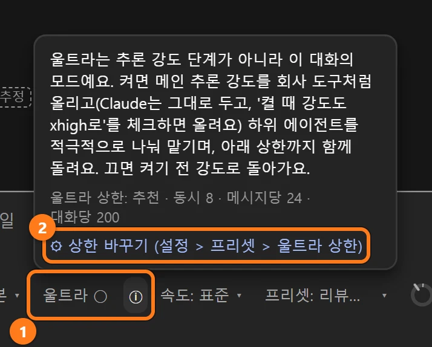
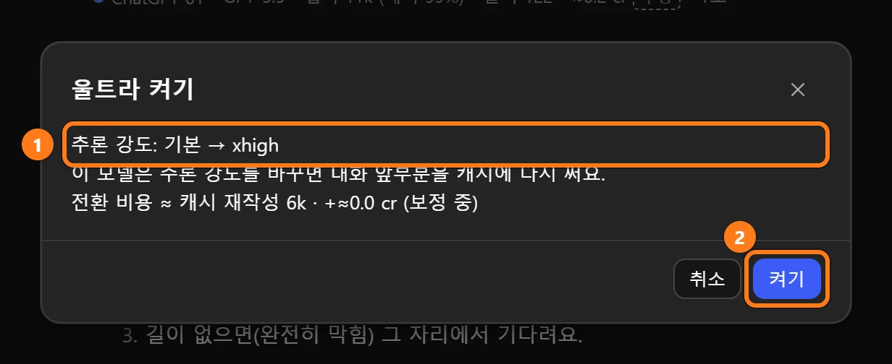
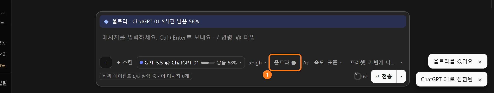
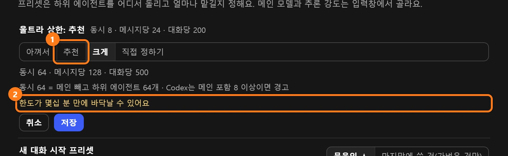

# 15. 울트라와 상한 단계

> **한 줄 요약** 입력창의 `울트라` 스위치 하나로 “더 깊이 생각하고, 도우미를 먼저 부르고, 한 번에 더 많이” 일하게 해요. 얼마나 많이 쓸지는 `울트라 상한`의 단계로 정해요. 대화마다 켜고, 새 대화에서는 늘 꺼져 있어요.

## 왜 필요해요?

- 큰 리팩터링, 여러 폴더를 훑는 조사, 꼼꼼한 리뷰처럼 **한 번 세게 밀어붙이는 게 빠른 일**이 있어요(다른 코딩 앱에도 비슷한 스위치가 있어요. 예: Codex의 Ultra, Claude Code의 ultracode).
- 프리셋을 하나하나 바꾸지 않고 **스위치 하나**로 켜고 끌 수 있어요.
- 대신 한도를 빨리 써요. 그래서 프리셋에 저장하지 않고, 새 대화에서는 언제나 꺼진 채 시작해요. 저절로 켜지는 일도 없어요.

식당에 비유하면 울트라는 **비상 근무 모드**예요(주방장·보조 요리사 비유는 [14장](14-presets.md)).

- 주방장(메인)이 더 꼼꼼히 해요. → 추론 강도가 올라가요.
- 시키기 전에 보조 요리사를 먼저 불러요. → 맡기는 정도가 `적극적으로`가 돼요.
- 보조 인원 상한을 늘려요. → 안전 상한이 울트라 상한이 돼요.
- 비상 근무가 끝나면(끄면) 원래 근무표로 돌아가요.

## 켜면 바뀌는 세 가지

| 바뀌는 것 | 울트라 ○(꺼짐) | 울트라 ●(켜짐) |
|---|---|---|
| 메인 추론 강도 | 지금 강도 | 더 높은 단계(모델마다 달라요. Claude는 그대로) |
| 맡기는 정도 | 프리셋 값 | `적극적으로` |
| 안전 상한 | 프리셋 상한 | 울트라 상한(처음 값 `추천`) |
| 도우미의 추론 강도 | 프리셋 값 | 메인과 같은 강도 |

**1. 메인 추론 강도.** 회사의 공식 도구를 따라요.

| 메인 묶음 | 울트라를 켜면 |
|---|---|
| ChatGPT, OpenAI API | 그 모델이 울트라용으로 정해 둔 단계를 쓰고, 없으면 `max`, 그것도 없으면 가장 높은 단계예요(데모의 GPT-5.5는 `xhigh`). OpenAI의 Codex 앱과 같은 규칙이에요. |
| Claude 구독, Anthropic API | 강도를 바꾸지 않아요. 울트라는 강도와 따로인 스위치로 다뤄요(Anthropic의 Claude Code도 그렇게 해요). 올리고 싶으면 스위치 옆 `켤 때 강도도 xhigh로`를 체크해요. 이름 뒤에 바뀔 강도(예: `(high → xhigh)`)가 보여요. 강도가 이미 `xhigh` 이상이면 올릴 것이 없어 흐려져요. 울트라가 켜져 있을 때 바꾸면 바로 적용돼요. 체크는 대화마다 기억하고, 강도 메뉴에도 같은 항목이 있어요(입력창이 좁아 스위치가 `⋯` 뒤로 접혀도 거기서 바꿀 수 있어요). 울트라를 켠 채 강도를 직접 바꾸면 그 강도가 내 것이 되어, 울트라를 꺼도 그대로 남아요. |
| DeepSeek 등 그 밖 | `xhigh`에 해당하는 단계로 맞춰요. DeepSeek는 `max`예요. |

**2. 맡기는 정도.** 프리셋이 무엇이든 `적극적으로`가 돼요. 프리셋이 `안 함`이어도 울트라를 켜면 도우미를 써요.

**3. 안전 상한.** 숫자 셋마다 “프리셋 상한”과 “울트라 상한 단계” 중 **큰 쪽**을 써요. 아래 “울트라 상한 단계”를 보세요.

**도우미는?** 어디서 도는지는 프리셋 그대로예요. 추론 강도는 메인과 같은 강도를 그 모델에 맞춰 보내요. 역할에 강도를 직접 적어 둔 경우만 그 값을 써요. 메인이 그 도우미의 강도를 정해 부르면([14장](14-presets.md) "대화에서 도우미 강도 정하기") 울트라보다 그 값이 먼저예요.

## 이렇게 써요

1. 대화를 열고 입력창 도구줄의 `울트라` ○를 눌러요. 추론 강도 단추 바로 오른쪽에 있어요. 마우스를 올리면 “울트라: 추론 강도를 올리고 하위 에이전트를 적극적으로 써요. …” 설명이 보여요.
   - 스위치 옆 ⓘ(`울트라 설명`)를 누르면 설명 카드가 열려요. 울트라가 무엇을 바꾸는지, 지금 `울트라 상한` 단계와 숫자, 상한을 바꾸러 가는 링크(⚙ `상한 바꾸기 (설정 > 프리셋 > 울트라 상한)`)가 있어요. `Esc`로 닫아요.

   
2. 강도가 바뀌면서 캐시를 다시 써야 하는 모델이면 `울트라 켜기` 창이 떠요.
   - ① 어떻게 바뀌는지(예: “추론 강도: 기본 → xhigh”)와 전환 비용 줄을 봐요. 비용 읽는 법은 [11장](11-cache-switch-cost.md)과 같아요.
   - ② `켜기`를 누르면 켜져요. 그만두려면 `취소`.
   - 캐시를 그대로 쓸 수 있는 모델이거나 강도가 바뀌지 않으면(Claude) 창 없이 바로 켜져요.

3. 켜지면 `울트라를 켰어요`가 뜨고 입력창이 이렇게 바뀌어요.
   - 도구줄의 스위치가 `울트라` ●가 돼요.
   - 입력창 위에 ◆ 줄이 늘 보여요. 예: “울트라 · ChatGPT 01 5시간 남음 58%”. 메인 계정과 도우미 대상 계정의 가장 빠듯한 한도가 얼마나 남았는지예요. API 키 대상이 있으면 이번 대화에 쓴 돈도 붙어요.
   - 옆에 실행 중인 도우미 수가 보여요(예: “하위 에이전트 0/8 실행 중 · 이 메시지 0개”). 8은 지금 쓰는 동시 상한이에요.
   - 추론 강도 단추도 새 강도(그림에서는 `xhigh`)로 바뀌어요.

4. 끄려면 스위치를 다시 눌러요. 추론 강도는 켜기 전 값으로 돌아가고 `울트라를 껐어요`가 떠요. 이때도 캐시를 다시 써야 하면 `울트라 끄기` 창이 먼저 떠요.

## 울트라 상한 단계

울트라가 켜져 있을 때 도우미를 얼마나 많이 쓸지 정하는 단계예요. 숫자는 차례대로 동시 · 메시지당 · 대화당이에요.

| 단계 | 동시 | 메시지당 | 대화당 | 이럴 때 |
|---|---|---|---|---|
| `아껴서` | 3 | 12 | 제한 없음 | 한도가 빠듯할 때. Codex 기본과 비슷한 수준 |
| `추천`(처음 값) | 8 | 24 | 제한 없음 | 보통은 이것 |
| `크게` | 64 | 128 | 제한 없음 | 한도가 넉넉하고 아주 큰 일을 빨리 끝내고 싶을 때 |
| `직접 정하기` | 직접 | 직접 | 원할 때만 | 숫자를 직접 적어요 |

- **동시**: 한꺼번에 도는 도우미 수예요. **메인은 빼고** 센 수예요.
- **메시지당**: 내 메시지 하나에 새로 만드는 도우미 수예요.
- **대화당**: 이 대화에서 만든 도우미 전체 수예요. 어느 단계도 막지 않아요. `직접 정하기`에서 `대화당 상한 두기`를 체크했을 때만 막아요. 울트라에서는 프리셋 상한과 단계 상한 중 큰 쪽을 써서, 둘 다 숫자일 때만 대화당 상한이 남아요.

### 단계 바꾸기

1. `설정` > `프리셋`을 열어요.
2. 맨 위 줄 “울트라 상한: 추천 · 동시 8 · 메시지당 24 · 대화당 제한 없음” 오른쪽의 `바꾸기`를 눌러요.
3. `아껴서`, `추천`, `크게`, `직접 정하기` 중 하나를 골라요. 아래에 숫자와 세는 법이 한 줄로 보여요(예: “동시 64 = 메인 빼고 하위 에이전트 64개 · Codex는 메인 포함 8 이상이면 경고”).
4. `크게`를 고르면 노란 글씨로 `한도가 몇십 분 만에 바닥날 수 있어요`가 떠요. 막지는 않아요.
5. `직접 정하기`는 동시·메시지당 숫자 칸이 열려요. 대화당은 `대화당 상한 두기`를 체크할 때만 칸이 생겨요. 1보다 작거나 정수가 아니면 `1 이상의 정수를 적으세요`가 떠요.
6. `저장`을 눌러요.

> **참고** Codex 앱은 메인까지 세어 동시 8개 이상이면 경고를 띄워요. 이 앱의 숫자는 메인을 뺀 수라서, `추천`(도우미 8 + 메인 1)도 이미 그 선을 넘어요. 그만큼 한도를 빨리 쓴다는 뜻이에요.

### 프리셋마다 다르게 두기

전역 단계 말고 그 프리셋에서만 다른 단계를 쓰고 싶으면, 프리셋 편집기의 `자세히` > `이 프리셋의 울트라 상한`에서 골라요. 처음에는 “전역 단계를 따름(추천)”이에요([14장](14-presets.md)).

울트라가 켜지면 숫자 셋마다 프리셋 상한과 울트라 단계 중 큰 쪽을 써요. 예를 들어 프리셋의 동시 상한을 10으로 올려 두었다면, `추천`(8)을 골라도 10이 그대로 쓰여요.

## 알아 두면 좋아요

- **새 대화에서는 언제나 꺼져 있어요.** `설정` > `프리셋`에도 `울트라는 새 대화에서 언제나 꺼져 있어요.`라고 적혀 있어요. 새 대화 화면에서는 스위치가 회색이고, 마우스를 올리면 `대화를 시작한 뒤 켤 수 있어요. 새 대화는 언제나 꺼진 채 시작해요`가 보여요.
- own이 관리하지 않는 계정의 모델이면 스위치가 회색이에요(`이 앱이 관리하는 계정의 모델에서만 쓸 수 있어요`).
- 입력창이 좁으면(휴대폰 폭, 또는 사이드바와 작업 패널을 함께 연 창) 스위치가 접혀요. 입력창 줄 끝의 `⋯`를 누르면 보여요. 추론 강도 메뉴 끝의 `울트라` 줄로도 켜요.
- **켠 채로 계정이나 모델을 바꾸면** 울트라는 켜진 채 남고, 새 모델에 맞는 강도를 다시 정해요. 캐시를 그대로 쓸 수 있으면 바로 바꾸고, 다시 써야 하면 입력창에 `울트라 강도 맞추기` 단추가 떠요. 누르면 같은 비용 창(`울트라 강도 맞추기`, `바꾸기`)을 거쳐 바꾸고 `울트라 추론 강도를 새 모델에 맞췄어요`가 떠요.
- **추론 강도 단추로 다른 강도를 직접 고르면 울트라가 꺼져요.** Codex에서 울트라가 강도 단계의 하나인 것과 같아요. Claude는 예외예요. 강도와 울트라가 따로라 강도를 바꿔도 켜진 채예요.
- **속도(Fast)와는 따로예요.** 울트라를 켜도 속도는 바뀌지 않아요([16장](16-speed.md)).
- **문맥 창과 자동 압축도 그대로예요**([13장](13-auto-compaction.md)).
- **팀 모드**에서 팀 메인은 켠 대화의 울트라를 물려받지 않아요. 담당 대화에서 울트라를 켜면, 팀 전체가 최악의 경우 몇 개를 동시에 돌릴 수 있는지 한 줄로 보여 줘요([17장](17-team-mode.md)).

## 조심하세요

> **주의** 울트라는 한도를 빨리 써요. 구독 계정은 5시간 한도가 금방 찰 수 있어요. 켜 있는 동안 입력창 위 ◆ 줄의 남은 한도를 자주 보세요. 일이 끝나면 꺼 두세요.

> **주의** `크게`는 도우미를 동시에 64개까지 돌려요. 한도가 몇십 분 만에 바닥날 수 있어요. 한도가 넉넉한 계정에서, 꼭 필요한 일에만 쓰세요.

> **주의** 강도가 바뀌는 모델은 켜고 끌 때마다 캐시를 다시 쓸 수 있어요. 자주 껐다 켜지 마세요. 켤 거면 대화를 처음 시작할 때나 압축 직후처럼 캐시가 어차피 차가울 때가 싸요([11장](11-cache-switch-cost.md)).

> **주의** 도우미가 다른 회사 구독(예: Claude 구독)에서 돌면 그 구독의 한도도 함께 줄어요. Claude 구독 한도는 이 PC의 Claude Code와 같이 써요.

## 더 알아보기

- 설계 문서: `own/docs/07-presets.md`의 2.6(상한), 2.9(울트라), 부록 A(Codex 울트라와의 비교)
- 이어서 읽기: [14장 프리셋](14-presets.md), [16장 속도](16-speed.md)
