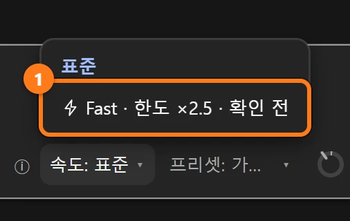
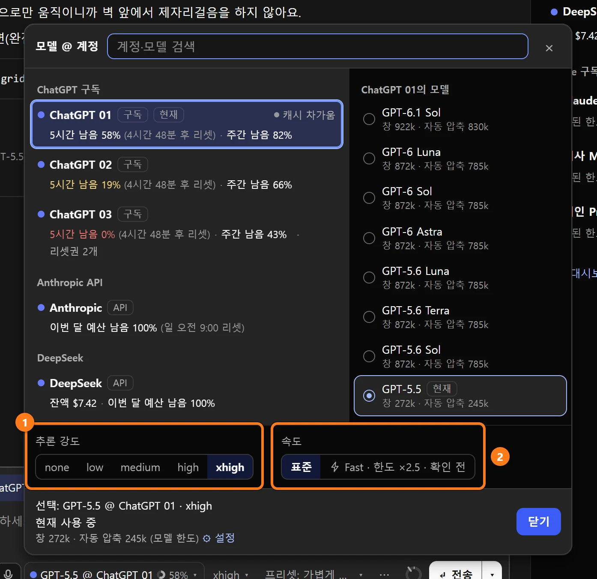
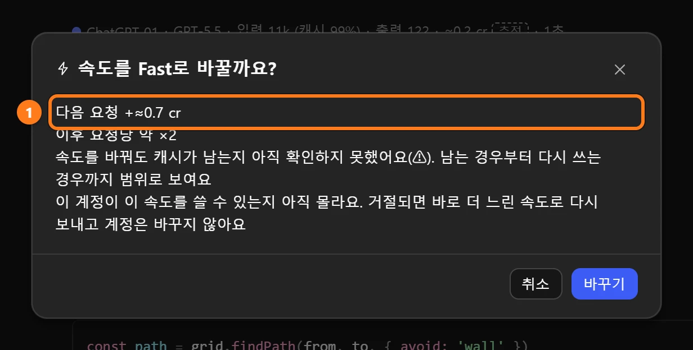
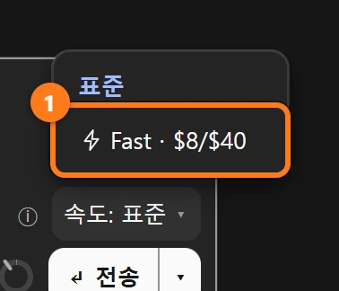

# 16. 속도: Fast · Ultrafast

**한 줄 요약**: 같은 모델을 **더 빠르게** 돌리는 대신 **한도나 돈을 더** 써요. 대화마다 입력창의 `속도: 표준` 단추에서 골라요. 새 대화는 늘 `표준`으로 시작해요.

## 왜 필요해요?

- 급한 버그를 빨리 고쳐야 할 때, 기다리는 시간이 아까울 때 써요.
- 택배의 "빠른 배송"과 같아요. **물건(답의 품질)은 같고, 빨리 오는 대신 배송비가 더 들어요.**
- 모델을 바꾸는 게 아니라서 대화를 처음부터 다시 읽지 않아요(다만 첫 Fast는 예외가 있어요, 16.4).

> **참고** 속도는 [15장의 울트라](15-ultra.md)와 달라요. 울트라는 "더 깊이 생각하고, 하위 에이전트를 많이 쓰게" 하는 스위치예요. 속도는 "같은 일을 더 빨리 처리"하는 단추예요. 둘을 같이 켤 수도 있어요.

## 16.1 어디서 골라요?

입력창 도구줄의 `속도: 표준` 단추예요. 추론 강도와 울트라 스위치 다음, 프리셋 단추 앞에 있어요.

- 단추는 늘 보여요. 지금 고를 수 있는 더 빠른 속도가 없으면 `속도: 표준`이 회색이고, 마우스를 올리면 이유가 보여요.

  | 회색일 때 보이는 이유 | 뜻 |
  |---|---|
  | `이 계정 종류에는 빠른 속도가 없어요` | DeepSeek, xAI, OpenRouter, OpenAI 호환 같은 계정이에요 |
  | `이 계정과 모델에는 지금 Fast가 없어요(요금제·모델 목록에 없음)` | 이 계정이 받은 모델 목록에 Fast가 없어요 |
  | `이 모델에는 빠른 속도가 없어요` | 그 모델 자체에 빠른 속도가 없어요 |
  | `이 앱이 이 모델 회사의 요청을 다루지 않아 속도를 고를 수 없어요` | own이 관리하지 않는 계정이에요 |
  | `대화를 만드는 중이에요` | 잠깐 기다리면 돼요 |

> **참고** DeepSeek 자체 API에는 2026-10-24 기준 더 빠른 속도가 아예 없어요. 속도를 실어 보내도 무시해요. 표준도 초당 약 290토큰으로 빠른 편이에요.
>
> "DeepSeek Ultrafast"는 Fireworks AI가 돌리는 DeepSeek V4.1 Flash예요(미리보기). 쓰려면 Fireworks에 사용 신청을 한 뒤, Fireworks 키와 Base URL `https://api.fireworks.ai/inference/v1`, 모델 `accounts/fireworks/models/deepseek-v4p1-flash-ultrafast`로 `기타 OpenAI 호환` 계정을 만들어요([20장](20-account-kinds.md)). 속도 단추가 아니라 계정·모델로 고르는 거라서, 옮기면 캐시를 처음부터 다시 만들어요([11장](11-cache-switch-cost.md)). 다른 회사가 파는 DeepSeek도 마찬가지로 `기타 OpenAI 호환` 계정이에요.

- 메뉴에는 `표준`과, 그 계정·모델이 지금 주는 속도만 보여요.
- 고른 뒤 단추는 번개 표시가 붙은 `Fast`, 속도선이 달린 번개 표시가 붙은 `Ultrafast`처럼 바뀌어요. 표준이면 `속도: 표준`이에요. 메뉴, 모델 고르기 창의 띠, 확인 창에도 같은 표시가 붙어요.

  | 표시 | 속도 |
  |---|---|
  | 번개 | `Fast` |
  | 왼쪽에 속도선 두 줄이 달린 번개 | `Ultrafast` |
- **대화마다 따로**예요. 프리셋에는 속도가 없어요. 새 대화는 언제나 `표준`이에요.
- **모델 고르기 창에서도 골라요.** `모델 @ 계정` 칩(Ctrl+.)을 열면 두 열 아래 띠에 `추론 강도`와 `속도`가 나란히 있어요. 모델 목록이 길어도 늘 보여요. 계정·모델을 옮기면 그 대상이 주는 속도로 바로 바뀌어요. 속도만 바꿔 `적용`하면 입력창 단추와 똑같이 바뀌고, 모델과 속도를 함께 바꾸면 먼저 모델을 바꾼 뒤 새 모델에서 속도를 바꿔요(비용 창이 뜨면 그때 확인해요). 새 모델에 그 속도가 없으면 `새 모델에는 Fast가 없어 표준으로 둬요`가 떠요.

  
- **새 대화 화면에서 미리 골라요.** 계정·모델을 바꾸면 속도 단추도 바로 따라가요(DeepSeek에서 ChatGPT로 바꾸면 Fast가 나타나요). 여기서 고른 속도는 첫 메시지를 보낼 때 그 대화에 적용돼요. 다음 새 대화는 다시 표준이에요.
- **좁은 입력창** 에서는 속도가 도구줄에서 접혀요. 사이드바와 작업 패널을 함께 연 창에서는 울트라·속도가, 휴대폰 폭에서는 추론 강도·프리셋까지 접혀요. `⋯`를 누르면 아래 줄에 펼쳐지고, 모델 고르기 창의 띠에서도 골라요.

## 16.2 배지 읽는 법

메뉴의 각 줄에 붙은 배지가 "얼마나 더 드는지"예요.

| 계정 | 배지 예 | 뜻 |
|---|---|---|
| ChatGPT 구독, Sign in with ChatGPT | `Fast · 한도 ×2.5` | 구독 한도를 표준보다 **2.5배 빨리** 써요 |
| ChatGPT 구독, Sign in with ChatGPT(일부 모델·요금제) | `Ultrafast · 한도 ×8` | 구독 한도를 **8배 빨리** 써요 |
| API 키(OpenAI, Anthropic) | `Fast · $8/$40` | Fast 가격이에요. 100만 토큰당 입력 $8, 출력 $40 |
| Claude 구독 | `Fast · 추가 사용량 $8/$40` | 구독 한도가 아니라 **추가 사용량(별도 요금)** 으로 내요(16.5) |

배지 뒤에 붙는 말도 있어요.

- `확인 전`: 이 계정이 정말 이 속도를 주는지 앱이 아직 몰라요. 고를 수는 있어요. 거절되면 저절로 한 단계 느린 속도로 다시 보내요(16.6).
- `42분 후까지 쉼`: Fast 한도에 걸려 잠깐 쉬는 중이에요. 그때까지는 흐리게 보이고 고를 수 없어요. 메뉴를 열어 둔 동안에도 남은 시간이 1분마다 줄어요. 하루가 넘게 남으면 `월 오전 9:00까지 쉼`처럼 요일이나 날짜로 보여요.
- `Fast 전용 모델`: 모델 자체가 Fast 전용이라 단추가 잠겨 있어요.

> **주의** ×2.5, ×8은 **빠르기가 아니라 한도를 깎는 배수**예요. 실제로 얼마나 빨라지는지는 모델마다 달라요. Ultrafast로 오래 돌리면 5시간 한도가 금방 바닥나요.

> **참고** Ultrafast는 GPT-6 Astra 같은 일부 모델과 일부 요금제(상위 Pro, 일부 기업·교육 요금제)에서만 돼요. 쓸 수 있는지는 그 계정이 받은 모델 목록이 정해요. 메뉴에 없으면 그 계정은 못 쓰는 거예요.

## 16.3 이렇게 써요

1. 입력창의 `속도: 표준`을 눌러요.
2. `Fast`(또는 `Ultrafast`)를 골라요.
3. 비용이 더 들거나 확인 안 된 것이 있으면 확인 창이 떠요.

   

   - `속도를 Fast로 바꿀까요?`
   - ① `다음 요청 +≈0.7 cr`: 다음 요청 한 번이 표준보다 얼마나 더 드는지예요.
   - `이후 요청당 약 ×2`: 그 뒤 요청마다 대략 몇 배인지예요. 이 숫자는 credits(값) 기준이라 배지의 한도 배수와 조금 다를 수 있어요.
   - 경고 줄(있을 때만)
     - `속도를 바꿔도 캐시가 남는지 아직 확인하지 못했어요(⚠). 남는 경우부터 다시 쓰는 경우까지 범위로 보여요`
     - `이 계정이 이 속도를 쓸 수 있는지 아직 몰라요. 거절되면 바로 더 느린 속도로 다시 보내고 계정은 바꾸지 않아요`
     - `요율을 몰라 금액은 보이지 않아요`
4. `바꾸기`를 눌러요. 알림 `속도: Fast`가 뜨고 단추가 번개 표시가 붙은 `Fast`가 돼요.
5. 다시 `표준`으로 돌아갈 때는 묻지 않고 바로 바뀌어요(더 싸지니까요).

API 키 대화도 같아요. 배지에 가격이 보여요.

## 16.4 처음 Fast를 켤 때 드는 값

- Claude(Anthropic API, Claude 구독)는 **한 대화에서 처음 Fast를 켜면 지금까지의 대화를 Fast 가격으로 한 번 다시 읽어요.** 그 뒤에는 끄고 켜도 캐시가 남아요. 창에 `이 대화에서 처음 Fast를 켜면 지금까지의 문맥을 Fast 가격으로 한 번 다시 써요. 그 뒤에는 끄고 켜도 캐시가 남아요(⚠)`가 보여요.
- ChatGPT 계열은 속도를 바꿔도 캐시가 남는지 **아직 확인 중**이에요. 그래서 다음 요청 값을 "남는 경우 ~ 다시 쓰는 경우" 범위로 보여 줘요.
- ⚠ 표시는 "실제 계정으로 아직 다 확인하지 못한 부분"이라는 뜻이에요. 범위의 큰 쪽을 생각하고 정하면 안전해요.

## 16.5 Claude 구독에서 Fast: 별도 요금

Claude 구독 대화에서 처음 Fast를 고르면, 한 번만 묻는 동의 카드가 떠요.

으로만 내요. ② 이해했으면 이해했고 Fast 켜기를 눌러요.")

- `Fast는 요금제 한도가 아니라 추가 사용량(usage credits)으로만 과금돼요. 추가 사용량이 꺼져 있거나 다 쓰면 표준 속도로 보내요.`
  - 쉽게 말해 **구독료 안에서 쓰는 게 아니라, 따로 충전한 돈(추가 사용량)에서 빠져요.**
  - Anthropic 계정에서 추가 사용량을 꺼 두었거나 다 썼으면, Fast 대신 표준으로 보내요.
- `Fast 가격: 100만 토큰당 입력 $8 · 출력 $40`
- `이해했고 Fast 켜기`를 누르면 동의가 기록되고 Fast가 켜져요. 다음부터는 다시 묻지 않아요. 원격 세션에서 처음 고르면 동의는 이 PC에 기록되고, 그 뒤로는 다시 묻지 않아요.

> **주의** Claude 구독 계정 자체가 비공식 방법이에요(약관 위험, [20장](20-account-kinds.md)). Fast까지 켜면 **추가 요금**이 나가요. 추가 사용량 설정을 Anthropic 사이트에서 먼저 확인하세요.

## 16.6 거절되거나 바뀌면

앱은 속도 문제로 **계정을 절대 바꾸지 않아요.** 대신 속도를 낮춰서 다시 보내요.

| 상황 | 앱이 하는 일 | 화면 |
|---|---|---|
| 계정이 그 속도를 안 줌(거절) | 곧바로 한 단계 느린 속도로 다시 보내요. Ultrafast → Fast → 표준 순서예요 | 알림에 이유가 함께 나와요. 예: `더 빠른 속도가 거절되어 Fast로 보내요(이 계정·모델에서는 지원하지 않는 속도예요). 계정은 그대로예요` |
| Fast 한도에 걸림(Claude) | 잠깐 표준으로 보내요. 쉬는 시간이 끝나면 돌아와요 | `Fast 한도에 걸려 잠시 표준 속도로 보내요` → `다시 Fast로 보내요` |
| 회사가 요청을 더 느린 속도로 처리함 | 그 요청은 처리된 속도의 요금으로 기록해요. 알림은 느린 응답이 이어지는 동안 **한 번만** 떠요. 고른 속도로 처리된 응답이 오면 다시 셀 준비를 해요 | `모델 회사가 이번 Fast 요청을 더 느린 속도로 처리했어요(그 속도의 요금). 혼잡하면 잠시 그럴 수 있어요`, 단추가 회색 |
| 한 번도 그 속도로 처리된 적이 없는 계정·모델에서 **3번 연속** 더 느리게 처리됨(API 키. ChatGPT 구독과 Sign in with ChatGPT는 아래 참고) | 이 계정·모델은 그 속도를 지원하지 않는다고 보고, 다음 요청부터 한 단계 느린 속도로 보내요(Ultrafast → Fast → 표준). 계정은 그대로예요. 계정 목록을 다시 읽을 때까지 그대로예요 | `Ultrafast 요청이 계속 더 느리게 처리되어 Fast로 보내요. 이 계정·모델은 Ultrafast를 지원하지 않는 것 같아요`, 그 뒤 단추가 회색이고 `Ultrafast를 지금 쓸 수 없어 Fast로 보내요` |
| 고른 속도를 지금 못 씀 | 단추가 회색이 되고 이유가 툴팁에 보여요. 메뉴의 그 줄에는 `모델 회사가 이 계정과 모델에서 거절했어요(…)`처럼 이유가 붙어요 | `Fast를 지금 쓸 수 없어 표준으로 보내요` |
| 바꾸기 자체가 실패함 | 그대로 둬요 | `속도를 바꾸지 못했어요: …` |

> **팁** 단추가 **회색**이면 "고른 속도와 실제로 보내는 속도가 다르다"는 뜻이에요. 마우스를 올리면 이유가 보여요.

> **참고** ChatGPT 구독과 Sign in with ChatGPT는 응답이 "어떤 속도로 처리했는지"를 알려 주지 않아요(늘 `default`라고만 적어요). 그래서 이 앱은 두 계정 모두 "더 느리게 처리됨"을 판단하지 않고, 고른 속도 그대로 보내고 그 속도로 기록해요. 실제로는 Fast가 표준보다 약 1.5~1.8배, Ultrafast가 몇 배(ChatGPT 구독 약 7~8배) 빠르게 나왔어요(2026-10-18, 2026-10-22 확인). 회사가 그 속도를 정말 거절하면(오류로 답하면) 위 표처럼 이유와 함께 한 단계 낮춰요.

## 알아 두면 좋아요

- **하위 에이전트**는 메인과 **같은 계정**이고 그 모델에도 같은 속도가 있을 때만 속도를 물려받아요. 다른 계정·다른 회사로 가는 하위 에이전트는 늘 표준이에요.
- **팀 모드**에서는 영역 대화마다 속도가 따로예요. 새 담당 대화는 표준으로 시작해요. `팀과 같게`는 모델과 강도만 따라가고 속도는 복사하지 않아요([17장](17-team-mode.md)).
- 속도는 **문맥 창과 자동 압축 지점을 바꾸지 않아요**([13장](13-auto-compaction.md)).
- 턴 아래 금액과 한도 계산은 실제로 처리된 속도의 가격으로 기록돼요. 회사가 표준으로 처리한 요청은 표준 가격이에요. ChatGPT 구독과 Sign in with ChatGPT는 처리된 속도를 알려 주지 않으니 보낸 속도로 기록해요.
- 휴대폰(앱 연결)에서도 전환 권한이 있으면 같은 단추를 써요.

## 조심하세요

> **주의** Fast·Ultrafast는 한도와 돈을 **몇 배로** 써요. 급한 일이 끝나면 `표준`으로 돌려 두세요. 새 대화는 늘 표준으로 시작하니, 켜 둔 대화만 신경 쓰면 돼요.

> **주의** `확인 전`인 속도는 계정이 실제로 주지 않을 수 있어요. 그래도 대화는 멈추지 않고 느린 속도로 이어져요. 걱정할 일은 아니지만, 기대한 만큼 빨라지지 않을 수 있어요.

> **주의** 금액은 모두 추정이에요. Claude 구독의 추가 사용량과 API 요금은 각 회사 사이트에서 실제 청구를 확인하세요.

## 더 알아보기

- 울트라와 상한 단계: [15장](15-ultra.md)
- 계정 종류별 특징: [20장](20-account-kinds.md)
- 설계 문서: [02 §4.8 속도](../02-accounts-providers-cache.md), [03 §4.6 입력창](../03-ui-ux.md)
