# 17. 팀 모드

**한 줄 요약.** 큰 일을 여러 대화가 나눠 맡아요. `팀 메인` 대화에게 할 일을 말하면 팀 메인이 일을 영역별로 나눠 각 영역의 담당 대화에게 맡겨요. 끝난 일은 검사를 통과한 뒤에만 프로젝트 본 코드에 들어가요.

> **팁** **처음 쓰는 순서** — 이것만 알면 바로 쓸 수 있어요.
>
> 1. 사이드바 프로젝트 줄의 `팀` 단추(또는 프로젝트 머리줄 `⋯` → `팀 모드 켜기…`)로 작은 창을 열어 켜요([켜기](#팀-모드-켜기)). 팀 모드는 **Git 저장소**인 폴더에서만 켜져요. `팀` 단추가 흐리게 보이면 그 단추나 대화 머리줄의 `⋯`에서 `Git 저장소로 만들기…`부터 해요(Git은 [9장](09-work-panel.md)).
> 2. 사이드바의 `팀 메인` 대화에 할 일을 말해요. 팀 메인이 영역으로 나눠 맡겨요([메인에게 일 시키기](#메인에게-일-시키기)).
> 3. 사이드바의 영역 상태를 지켜봐요. `반영 준비됨`이 되면 팀 메인이 검사한 뒤 본 코드에 넣고 카드를 보여 줘요([반영하기](#반영하기-되돌리기-충돌-예상)).
> 4. 마음에 안 들면 카드의 `되돌리기`를 눌러요.
> 5. 한 영역을 내가 직접 맡고 싶으면 그 담당 대화를 열고 말하면 돼요. 그 영역은 `직접 작업 중`이 되고 팀 메인은 기다려요. 끝나면 `메인에게 넘기기`를 눌러요([직접 작업](#직접-작업)).

이 장의 화면은 데모 프로젝트 `D:\demo\space-game`이에요. 영역 이름은 화면, 게임 로직, 네트워크예요. 받아들이기 화면만 데모 프로젝트 `shop-app`이에요.

## 왜 필요해요?

대화 하나로 큰 일을 하면 이런 일이 생겨요.

- 한 번에 한 가지씩만 진행돼요.
- 서로 다른 일의 이야기가 한 대화에 뒤섞여요.
- 두 대화가 같은 폴더를 함께 고치면 서로의 변경을 덮어쓸 수 있어요.

팀 모드는 이것을 이렇게 풀어요.

- 일을 **영역** 몇 개로 나눠 나란히 진행해요.
- 영역마다 **작업 폴더**가 따로 있어서 서로의 파일을 건드리지 않아요.
- 끝난 일은 앱 전용 검사 폴더에서 검사를 통과해야 프로젝트 본 코드에 들어가요.
- 되돌릴 수 있는 일은 묻지 않고 하고, 끝나면 요약과 `되돌리기`를 보여 줘요. 지우기, 큰 내려받기, 원격 저장소에 올리기만 물어요.
- 팀 메인에게 말로 시켜도 같은 규칙이에요. 화면 단추로 하던 일을 말로 부탁할 수 있고, 되돌리기 어렵거나 설정을 바꾸는 일은 먼저 계획을 보여 주고 내 답을 기다려요([말로 시키기](#말로-시키기)).

**비유로 보면** 집수리 현장과 같아요. 현장 소장(팀 메인)이 방마다 작업자(담당)를 하나씩 두고 일을 나눠 줘요. 작업자는 자기 방(작업 폴더)에서만 일해요. 다 고친 방은 검사를 받은 뒤 본 건물(프로젝트 본 코드)에 붙여요. 집주인(나)은 언제든 아무 방에나 들어가 작업자에게 직접 말할 수 있어요.

> **팁** 할 일이 작으면 대화 하나로 충분해요. 팀 모드는 며칠씩 걸리는 일이나 서로 다른 일을 동시에 굴릴 때 써요. 켤 때 앱이 `할 일이 작으면 대화 하나로 충분해요.`라고 알려 주기도 해요.

## 팀 메인, 영역, 담당

<figure class="diagram">
<svg class="dg-wide" viewBox="0 0 680 392" role="img" aria-label="팀 모드의 짜임. 사용자가 팀 메인에게 할 일을 말하면 팀 메인이 세 영역의 담당에게 메인 요청을 보냅니다. 사용자는 담당과 직접 대화할 수도 있습니다. 영역의 일은 검사를 통과한 뒤 프로젝트 본 코드에 반영됩니다." xmlns="http://www.w3.org/2000/svg" font-family="inherit" style="width:100%;height:auto;max-width:680px">
<defs>
<marker id="d17-arrow" viewBox="0 0 10 10" refX="9" refY="5" markerWidth="7" markerHeight="7" orient="auto"><path d="M0,0 L10,5 L0,10 z" fill="currentColor"/></marker>
<marker id="d17-arrow-accent" viewBox="0 0 10 10" refX="9" refY="5" markerWidth="7" markerHeight="7" orient="auto"><path d="M0,0 L10,5 L0,10 z" fill="#E8711A"/></marker>
</defs>
<g fill="currentColor" fill-opacity="0.06" stroke="currentColor" stroke-opacity="0.5" stroke-width="1.5">
<rect x="20" y="16" width="140" height="52" rx="10"/>
<rect x="250" y="12" width="220" height="60" rx="10" stroke="#E8711A" stroke-opacity="1"/>
<rect x="20" y="150" width="200" height="110" rx="10"/>
<rect x="240" y="150" width="200" height="110" rx="10"/>
<rect x="460" y="150" width="200" height="110" rx="10"/>
<rect x="170" y="328" width="340" height="52" rx="10"/>
</g>
<g fill="none" stroke-width="1.6">
<line x1="160" y1="42" x2="246" y2="42" stroke="currentColor" marker-end="url(#d17-arrow)"/>
<line x1="330" y1="72" x2="134" y2="146" stroke="#E8711A" marker-end="url(#d17-arrow-accent)"/>
<line x1="360" y1="72" x2="342" y2="146" stroke="#E8711A" marker-end="url(#d17-arrow-accent)"/>
<line x1="390" y1="72" x2="546" y2="146" stroke="#E8711A" marker-end="url(#d17-arrow-accent)"/>
<line x1="50" y1="68" x2="50" y2="146" stroke="currentColor" stroke-dasharray="5 4" marker-end="url(#d17-arrow)"/>
<line x1="120" y1="260" x2="246" y2="324" stroke="currentColor" marker-end="url(#d17-arrow)"/>
<line x1="340" y1="260" x2="340" y2="324" stroke="currentColor" marker-end="url(#d17-arrow)"/>
<line x1="560" y1="260" x2="434" y2="324" stroke="currentColor" marker-end="url(#d17-arrow)"/>
</g>
<g fill="currentColor" font-size="12">
<text x="203" y="34" text-anchor="middle">할 일</text>
<text x="58" y="112">직접 대화</text>
<text x="358" y="112" fill="#E8711A">메인 요청</text>
<text x="350" y="300">반영(검사 뒤)</text>
</g>
<g fill="currentColor" text-anchor="middle" font-size="14">
<text x="90" y="47" font-weight="700">나 (사용자)</text>
<text x="360" y="37" font-weight="700">팀 메인</text>
<text x="360" y="58" font-size="12" fill-opacity="0.75">메인 폴더에서 일함</text>
<text x="120" y="178" font-weight="700">영역 '화면'</text>
<text x="120" y="202" font-size="12.5" fill-opacity="0.8">작업 폴더 ui</text>
<text x="120" y="224" font-size="12.5" fill-opacity="0.8">+ 담당 대화</text>
<text x="340" y="178" font-weight="700">영역 '게임 로직'</text>
<text x="340" y="202" font-size="12.5" fill-opacity="0.8">작업 폴더 core</text>
<text x="340" y="224" font-size="12.5" fill-opacity="0.8">+ 담당 대화</text>
<text x="560" y="178" font-weight="700">영역 '네트워크'</text>
<text x="560" y="202" font-size="12.5" fill-opacity="0.8">작업 폴더 net</text>
<text x="560" y="224" font-size="12.5" fill-opacity="0.8">+ 담당 대화</text>
<text x="560" y="247" font-size="11.5" fill="#E8711A">메인 멈춤이면 요청은 기다림</text>
<text x="340" y="359" font-weight="700">프로젝트 본 코드</text>
</g>
</svg>
<svg class="dg-narrow" viewBox="0 0 320 462" role="img" aria-label="팀 모드의 짜임. 사용자가 팀 메인에게 할 일을 말하면 팀 메인이 세 영역의 담당에게 메인 요청을 보냅니다. 사용자는 담당과 직접 대화할 수도 있습니다. 영역의 일은 검사를 통과한 뒤 프로젝트 본 코드에 반영됩니다." xmlns="http://www.w3.org/2000/svg" font-family="inherit" style="width:100%;height:auto;max-width:360px">
<defs>
<marker id="d17n-arrow" viewBox="0 0 10 10" refX="9" refY="5" markerWidth="7" markerHeight="7" orient="auto"><path d="M0,0 L10,5 L0,10 z" fill="currentColor"/></marker>
<marker id="d17n-arrow-accent" viewBox="0 0 10 10" refX="9" refY="5" markerWidth="7" markerHeight="7" orient="auto"><path d="M0,0 L10,5 L0,10 z" fill="#E8711A"/></marker>
</defs>
<g fill="currentColor" fill-opacity="0.06" stroke="currentColor" stroke-opacity="0.5" stroke-width="1.5">
<rect x="180" y="8" width="130" height="40" rx="10"/>
<rect x="10" y="72" width="220" height="54" rx="10" stroke="#E8711A" stroke-opacity="1"/>
<rect x="40" y="152" width="248" height="62" rx="10"/>
<rect x="40" y="226" width="248" height="62" rx="10"/>
<rect x="40" y="300" width="248" height="74" rx="10"/>
<rect x="40" y="410" width="248" height="44" rx="10"/>
</g>
<g fill="none" stroke-width="1.6">
<line x1="205" y1="48" x2="205" y2="70" stroke="currentColor" marker-end="url(#d17n-arrow)"/>
<polyline points="24,126 24,337" stroke="#E8711A"/>
<line x1="24" y1="183" x2="38" y2="183" stroke="#E8711A" marker-end="url(#d17n-arrow-accent)"/>
<line x1="24" y1="257" x2="38" y2="257" stroke="#E8711A" marker-end="url(#d17n-arrow-accent)"/>
<line x1="24" y1="337" x2="38" y2="337" stroke="#E8711A" marker-end="url(#d17n-arrow-accent)"/>
<polyline points="302,48 302,337" stroke="currentColor" stroke-dasharray="5 4"/>
<line x1="302" y1="183" x2="290" y2="183" stroke="currentColor" marker-end="url(#d17n-arrow)"/>
<line x1="302" y1="257" x2="290" y2="257" stroke="currentColor" marker-end="url(#d17n-arrow)"/>
<line x1="302" y1="337" x2="290" y2="337" stroke="currentColor" marker-end="url(#d17n-arrow)"/>
<line x1="164" y1="374" x2="164" y2="408" stroke="currentColor" marker-end="url(#d17n-arrow)"/>
</g>
<g fill="currentColor" font-size="12">
<text x="213" y="65">할 일</text>
<text x="30" y="145" fill="#E8711A">메인 요청</text>
<text x="296" y="145" text-anchor="end" fill-opacity="0.8">직접 대화</text>
<text x="172" y="396">반영(검사 뒤)</text>
</g>
<g fill="currentColor" text-anchor="middle" font-size="14">
<text x="245" y="33" font-weight="700">나 (사용자)</text>
<text x="120" y="96" font-weight="700">팀 메인</text>
<text x="120" y="116" font-size="12" fill-opacity="0.75">메인 폴더에서 일함</text>
<text x="164" y="177" font-weight="700">영역 '화면'</text>
<text x="164" y="200" font-size="12.5" fill-opacity="0.8">작업 폴더 ui + 담당 대화</text>
<text x="164" y="251" font-weight="700">영역 '게임 로직'</text>
<text x="164" y="274" font-size="12.5" fill-opacity="0.8">작업 폴더 core + 담당 대화</text>
<text x="164" y="325" font-weight="700">영역 '네트워크'</text>
<text x="164" y="347" font-size="12.5" fill-opacity="0.8">작업 폴더 net + 담당 대화</text>
<text x="164" y="366" font-size="11.5" fill="#E8711A">메인 멈춤이면 요청은 기다림</text>
<text x="164" y="437" font-weight="700">프로젝트 본 코드</text>
</g>
</svg>
<figcaption>그림: 팀 모드의 짜임(실제 화면이 아니에요). 일은 팀 메인에게 말하고, 담당에게는 언제든 직접 말할 수 있어요.</figcaption>
</figure>

> **용어** 영역: 동시에 진행하는 일 한 줄기예요(예: 화면 손보기, 게임 로직 고치기). 영역 하나에는 작업 폴더 하나와 그 폴더를 맡은 담당 대화 하나가 있어요. 폴더 구역이 아니라 "하는 일" 단위예요. 계속 맡는 역할(예: 보스 담당)도 영역이 될 수 있어요. 개수 제한은 없어요.

> **용어** 작업 폴더: 같은 프로젝트를 한 벌 더 꺼내 둔 폴더예요. Git에서는 'worktree'라고 불러요. 새 영역의 작업 폴더는 팀 모드를 켤 때 고른 곳에 생겨요(아래 "팀 모드 켜기"의 `영역 폴더`).
>
> - `프로젝트 안`(처음 값): 메인 폴더 안의 숨은 폴더 `.worktrees`에 생겨요(예: `D:\demo\space-game\.worktrees\core`). 이 폴더는 Git이 무시하게 저장소 안쪽 설정(`.git\info\exclude`)에 적고, 영역을 만들 때 `.worktrees` 폴더 안에도 그 안을 모두 무시하는 `.gitignore`를 하나 둬요(이미 있으면 그대로 둬요. 팀 모드 켜기를 되돌려 앱이 만든 폴더가 다 지워지면 이것도 지워요). 그래서 메인 폴더에서 일하는 대화가 영역 폴더까지 훑지 않아요. 프로젝트 파일(프로젝트의 `.gitignore` 등)은 바뀌지 않고, 그 안에 둔 내 작업 폴더도 전처럼 써요.
> - `프로젝트 옆 폴더`: 메인 폴더 옆의 `-team` 폴더 안에 생겨요(예: `D:\demo\space-game-team\core`). 2026년 10월 27일 전에 켠 팀은 모두 이 자리를 그대로 써요.
> - 메인 폴더 경로에 `#`이 있으면 어느 쪽을 골라도 그 드라이브 맨 위의 `own-team` 폴더 안, 저장소 이름 폴더 아래에 생겨요(예: `D:\own-team\space-game\core`).
>
> 아래에 나오는 앱 전용 검사 폴더(`.verify`)와 큰 파일 검사 폴더(`.assets`)도 같은 곳에 생겨요.

> **용어** 팀 메인: 일을 나누고, 맡기고, 끝난 일을 반영하는 대화예요. 팀 모드를 켠 대화의 폴더에서 일해요. 이 폴더를 화면에서는 메인 폴더라고 불러요.

> **용어** 담당: 영역의 작업 폴더에 묶인 대화예요. 하위 에이전트가 아니라 보통 대화라서, 사용자가 언제든 열어 직접 말할 수 있어요.

> **용어** 반영: 영역에서 끝낸 일을 프로젝트 본 코드에 넣는 것이에요. 프로젝트 본 코드는 보통 `main`이라는 이름의 기록이에요.

> **용어** 저장 지점, 기록 이름: 팀 화면은 Git 낱말 대신 쉬운 말을 써요. 저장 지점은 Git의 '커밋', 기록 이름은 '브랜치'예요.

**"메인"이 두 가지로 쓰여요.** 헷갈리지 않게 구분해 두세요.

| 화면에 보이는 것 | 뜻 |
|---|---|
| `메인 멈춤`, `메인이 보냄`, `메인과 대화하기`처럼 혼자 쓰인 "메인" | 팀 메인 대화 |
| `모델: 팀과 같게`처럼 이름표가 붙은 줄 | 그 영역의 담당이 쓰는 계정·모델·추론 강도(14장의 "메인"과 같은 뜻) |

## 팀 모드 켜기

팀 모드는 Git 저장소인 프로젝트에서만 켤 수 있어요. Git 저장소가 아니면 프로젝트 줄의 `팀` 단추가 흐리게 보여요. 아래 "Git 저장소가 아닌 폴더에서"를 보세요.

1. 사이드바의 프로젝트 줄에 마우스를 올리고 `팀` 단추를 눌러요. 프로젝트 머리줄의 `⋯` → `팀 모드 켜기…`(①), 대화 머리줄의 `⋯` 메뉴, 명령 팔레트(`Ctrl+K`)에서도 돼요. 팀 모드가 켜진 프로젝트는 `팀` 단추를 누르면 팀 보기가 열려요.
   - 대화 메뉴에서 켜면 **그 대화의 폴더**가 메인 폴더가 돼요.
2. 작은 창이 떠요. `무엇을 하려고 하나요? (선택)`에 할 일을 적고 `켜기`를 눌러요(`Ctrl+Enter`도 돼요). 적지 않아도 켜져요.
   - 할 일을 적으면 팀 모드를 켜는 판단이 그 일을 참고해요. 다만 그 일만 보고 새 영역을 만들지는 않아요. 어떻게 나눌지는 켠 뒤 팀 메인과 함께 정해요(아래 [메인에게 일 시키기](#메인에게-일-시키기)의 "나누기 전에 상의하기").
   - `영역 폴더`에서 새 영역의 작업 폴더를 둘 곳을 골라요. `프로젝트 안`(처음 값)은 메인 폴더 안의 숨은 `.worktrees` 폴더에, `프로젝트 옆 폴더`는 메인 폴더 옆의 '메인 폴더 이름-team' 폴더(예: `space-game-team`)에 만들어요. 켠 뒤에는 바꾸지 않고, 팀 모드를 껐다 다시 켜도 처음 고른 곳을 써요. 지금 자리는 `설정` > `팀`의 `영역 폴더 위치`에서 봐요.
3. 화면 아래에 진행 문구가 차례로 보여요. `프로젝트를 살펴보는 중…` → `팀 메인을 만드는 중…` → `일을 나눌 영역을 정하는 중…` → `영역 3개를 준비하는 중…`.
4. 화면이 `팀 메인` 대화로 옮겨 가고, 맨 위에 요약 카드 `팀 모드를 켰어요`가 떠요.
5. 할 일을 적었으면 팀 메인 입력창에 상의 글이 들어가 있어요(`… 이 일을 팀에서 어떻게 나눌지 먼저 같이 정하자. 나누는 안을 보여 줘.`). **저절로 보내지 않아요.** 고친 뒤 `Ctrl+Enter`로 보내요. 화면 아래에도 `팀 모드를 켰어요. 적은 내용을 팀 메인 입력창에 넣었어요. 보내면 상의를 시작해요`가 떠요.

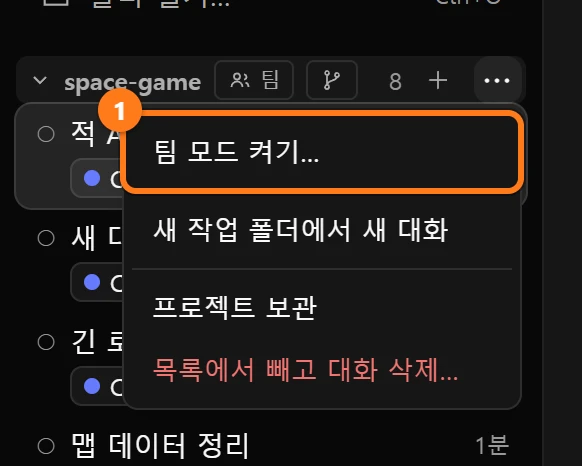

, ②에서 영역 폴더를 둘 곳을 고른 뒤(처음 값은 프로젝트 안), ③의 켜기를 눌러요.")

. 왼쪽 사이드바에는 팀 메인과 영역 셋이 생겼어요.")

**요약 카드 읽는 법**

| 카드 줄 | 뜻 |
|---|---|
| `영역 3개: 화면 · 게임 로직 · 네트워크.` | 만든 영역이에요 |
| `모든 영역이 팀 메인(GPT-5.5 · 기본)과 '가볍게 나눠 쓰기'를 써요` | 영역이 쓰는 모델과 프리셋이에요 |
| `큰 파일 폴더 1개(1MB)는 영역 폴더에 받지 않아요.` | 그림·소리 같은 큰 파일 폴더는 처음에 받지 않아요(아래 "큰 파일 폴더" 절) |
| `메인은 D:/demo/space-game 폴더에서 일해요` | 팀 메인이 일하는 메인 폴더예요 |
| `담당은 검사·설치 명령을 묻지 않고 실행해요` | 담당이 검사·설치 명령마다 멈춰 묻지 않아요. `바꾸기`는 팀 설정으로 가요 |

카드 아래 단추는 `메인과 대화하기`, `자세히`(한 일의 단계 목록과 실제 경로), `되돌리기`, `닫기`예요.

**영역이 0개일 수도 있어요.** 진행 중인 일이 보이지 않는 프로젝트는 영역 없이 켜지고 카드에 `메인에게 할 일을 말하면 영역을 나눠 맡겨요.`가 보여요. 그때는 팀 메인에게 일을 말하면 팀 메인이 영역을 만들어요. 데모 화면은 켜면서 바로 영역 3개를 만든 경우예요.

**팀 메인이 쓰는 계정과 모델.** 팀 모드를 켠 대화의 계정·모델·추론 강도를 그대로 써요. 프리셋은 그 계정 묶음의 ★ 프리셋이에요(14장). 켠 대화의 프리셋, 울트라, 속도는 물려받지 않아요.

**켠 대화에 남는 안내.** 메인 폴더의 기존 대화에는 `팀 모드가 켜졌습니다. 일을 나눠 맡기려면 '팀 메인'에서 말하세요`가 한 번 떠요. 기존 대화에는 일을 나눠 맡기는 도구가 없어요. 일을 나누려면 `열기`로 팀 메인에 가서 말하세요.

**팀 모드가 묻지 않고 하는 것과 묻는 것**

| 묻지 않고 해요(요약과 `되돌리기`) | 확인 창으로 물어요 |
|---|---|
| 프로젝트 살펴보기, 영역 나누기 | 작업 폴더 지우기 |
| 가벼운 작업 폴더와 담당 대화 만들기 | 다시 만들 수 있는 파일(설치 폴더, 빌드 결과) 지우기 |
| 메인 요청을 담당에게 넣기 | 큰 내려받기(기본 500 MB 이상), 큰 디스크 사용(기본 2 GB 이상) |
| 필요한 큰 파일 폴더 가져오기, 다 쓴 폴더 내려놓기 | 폴더 권한 같은 시스템 설정 바꾸기 |
| 검사를 통과한 영역을 본 코드에 반영하기 | 원격 저장소에 올리기 |

말로 시켜도 같은 규칙이에요. 팀 메인에게 말로 부탁한 일 중 어떤 것은 바로 하고, 어떤 것은 계획을 먼저 보여 주고 물어요(아래 "말로 시키기").

**켜기를 되돌리면.** 카드의 `되돌리기`는 이번 켜기가 만든 것만 거둬요.

- 손대지 않은 새 영역 폴더는 지워요. 사용자가 파일을 만들거나 고친 폴더는 남기고 알려 줘요.
- 만든 대화는 지우지 않고 보관만 해요.
- 저장하지 않은 작업은 어떤 경우에도 버리지 않아요.

### Git 저장소가 아닌 폴더에서

팀 모드와 작업 폴더(`⑂`)는 Git 저장소이면서 첫 저장 지점(커밋)이 있어야 써요. 그렇지 않은 폴더는 프로젝트 줄의 `팀`과 `⑂` 단추가 흐리게 보여요. 마우스를 올리면 `팀 모드는 Git 저장소인 프로젝트에서만 켤 수 있어요. 이 폴더를 Git 저장소로 만들면 쓸 수 있어요.`가 보여요. 그 폴더의 대화 머리줄 `⋯` 메뉴 아래쪽에도 `팀 모드와 작업 폴더는 Git 저장소인 프로젝트에서만 쓸 수 있어요.`가 보여요.

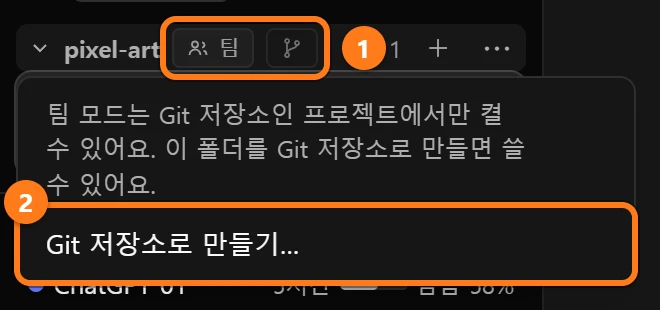

1. 흐린 `팀`(또는 `⑂`) 단추를 누르고 `Git 저장소로 만들기…`를 골라요. 이렇게 해도 돼요.
   - 그 폴더의 대화를 연 채로 대화 머리줄의 `⋯` → 안내 바로 아래의 `Git 저장소로 만들기…`
   - 프로젝트 머리줄의 `⋯` → `Git 저장소로 만들기…`
   - 명령 팔레트(`Ctrl+K`)의 `Git 저장소로 만들기… (팀 모드·작업 폴더 쓰기)`(`git init`, `깃`으로도 찾아요)
   - 새 대화 화면의 `알아 두면 좋은 것` 안내 맨 윗줄 끝
2. `Git 저장소로 만들기` 창이 폴더를 살펴본 뒤(`폴더를 살펴보는 중…`) 무엇을 할지 보여 줘요.

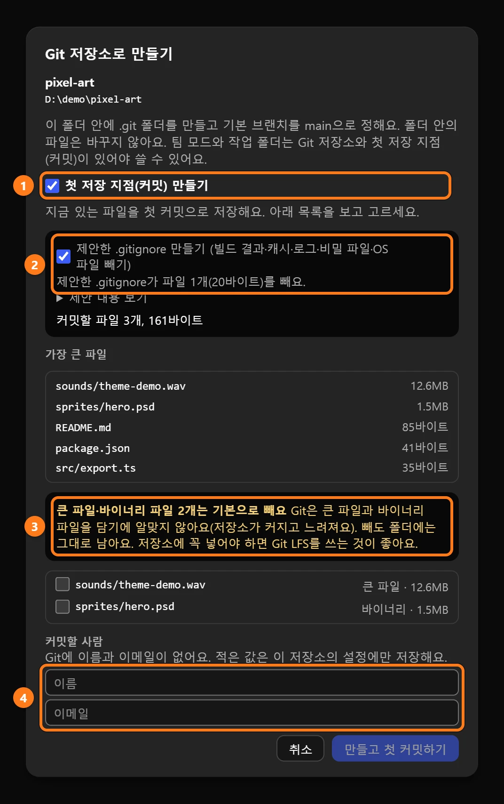

3. 내용을 확인해요.
   - ① `첫 저장 지점(커밋) 만들기`: 처음부터 켜져 있어요. 지금 있는 파일을 첫 커밋으로 남겨요. 팀 모드는 첫 저장 지점이 있어야 켜져요.
   - ② `제안한 .gitignore 만들기 (빌드 결과·캐시·로그·비밀 파일·OS 파일 빼기)`: `node_modules` 같은 설치 폴더, 빌드 결과, 비밀 파일을 커밋에서 빼는 목록을 만들어요. `제안 내용 보기`로 미리 봐요. 폴더에 `.gitignore`가 이미 있으면 그대로 써요.
   - ③ **큰 파일·바이너리 파일은 기본으로 빼요**: 10 MB 이상인 파일과 그림·소리 같은 바이너리 파일이에요. Git에 넣으면 저장소가 커지고 느려져서예요. 빼도 폴더에는 그대로 남아요. 꼭 넣을 파일은 목록에서 체크해요(Git LFS를 쓰는 것이 더 좋아요).
   - ④ `커밋할 사람`: 이 PC의 Git에 이름과 이메일이 없을 때만 보여요. 적은 값은 이 저장소의 설정에만 저장해요. 이미 있으면 `작성자: …`로 보여요.
   - 아래에 `커밋할 파일 3개, 161바이트`처럼 커밋할 양이 보여요.
4. `만들고 첫 커밋하기`를 눌러요. 첫 커밋 없이 저장소만 만들려면 ①을 끄고 `Git 저장소로 만들기`를 눌러요.
5. `Git 저장소가 되었어요. 브랜치 …, 첫 커밋 …`이 뜨면 끝이에요. 바로 이어서 `팀 모드 켜기…`를 눌러도 돼요. 대화 머리줄 `⋯`에서 시작했으면 그 대화로 켜요(대화 메뉴에서 켤 때처럼 그 대화의 폴더가 메인 폴더가 돼요). 창을 닫으면 그 대화의 `⋯`에도 `팀 모드 켜기`가 생겨요.

- 기본 브랜치는 `main`이고, 폴더 안의 파일은 바꾸지 않아요(만드는 것은 `.git` 폴더와, 고르면 `.gitignore` 하나예요).
- 안에 다른 Git 저장소가 들어 있으면 그 폴더는 커밋하지 않아요. 새 파일이 2만 개를 넘으면 저장소만 만들고 커밋은 하지 않아요.
- 이 기능은 **이 PC의 창에서만** 보여요. 휴대폰·다른 PC에서는 안내만 보여요.
- **폴더 없는 대화(기본 대화 폴더)는 Git 저장소로 만들지 않아요.** 폴더를 고르지 않고 시작한 대화가 모두 함께 쓰는 폴더라서예요. 저장소로 만들면 그 대화들이 모두 한 프로젝트로 묶이고, 첫 커밋에 다른 대화가 만든 파일까지 들어가요. 그 대화의 `⋯`와 흐린 단추에는 이유와 `프로젝트 폴더 열기…`가 보여요. 팀 모드를 쓰려면 프로젝트 폴더를 열고([4장](04-first-conversation.md)) 거기서 대화를 시작해요. 그 폴더가 Git 저장소가 아니면 위 순서로 만들어요.
- Git 저장소지만 아직 커밋이 하나도 없으면 팀 모드를 켤 때 `아직 첫 저장 지점이 없어 팀 모드를 켤 수 없어요. 첫 저장 지점을 만든 뒤 다시 켜세요`와 `첫 저장 지점 만들기…`가 떠요.

## 사이드바 팀 보기 읽는 법

팀 모드가 켜진 프로젝트는 사이드바가 **팀 보기**로 바뀌어요. 프로젝트 이름 옆에 `팀` 표시가 붙어요. 프로젝트 `⋯` 메뉴의 `팀 보기`로도 열어요.

, 팀 메인, 영역 셋이에요. ②는 답을 기다리는 영역, ③은 메인 멈춤인 영역, ④는 일하는 중인 영역이에요.")

위에서부터 이렇게 보여요.

1. `승인 기다리는 것 1개`(①): 여러 담당이 구한 셸 명령 승인 요청을 한곳에 모아요. 줄마다 `한 번 허용`, `거절`로 바로 답해요.
2. `팀 알림 1개`: 팀이 알리는 것이에요(폴더를 찾을 수 없음, 큰 파일 폴더를 가져옴, 팀 계정을 옮김 등). 줄을 누르면 그 영역의 담당 대화로 가고, `×`로 닫아요. `팀 소식이 한 시간에 12번을 넘어 42분 후까지 모아 둬요`는 남은 시간이 1분마다 줄고, 그 시각이 지나면 저절로 사라져요.
3. `메인` 표시가 붙은 `팀 메인` 행: 팀 메인 대화예요. 그 아래 `메인 폴더의 다른 대화 8`에는 메인 폴더의 예전 대화가 접혀 있어요.
4. 영역 행: 첫 줄은 영역 이름과 상태, 둘째 줄은 폴더의 짧은 경로와 `메인: …`, `프리셋: …`이에요. 내가 정한 영역에는 `내가 정한 영역`이 붙어요. 그 아래에 담당 대화가 계정 칩, 한도 %와 함께 보여요. 동료가 있으면 담당 바로 아래에 동료 대화가 보여요(예: 게임 로직 · 동료 시뮬, 아래 "동료" 절).
5. `영역 만들기…`: 영역을 직접 만들어요(아래 "영역 직접 만들기" 절).
6. `팀에 넣지 않은 작업 폴더 1`: 팀 밖의 작업 폴더예요(아래 "진행 중인 프로젝트 받아들이기" 절).

**상태 낱말**

| 상태 | 뜻 |
|---|---|
| `대기 중` | 맡은 일이 없어요 |
| `준비 중(설치 약 3분)` | 새 영역 폴더의 준비 명령(설치 등)이 도는 중이에요. 그동안 메인 요청은 기다려요 |
| `작업 중` | 담당이 일하는 중이에요 |
| `답을 기다림` | 담당이 승인이나 질문의 답을 기다려요 |
| `막힘` | 담당이 메인이나 다른 영역의 결정이 필요하다고 알렸어요 |
| `한도 대기 · 2시간 14분 후에 풀림` | 계정 한도를 다 썼어요. 풀리면 이어 가요. 하루가 넘게 남으면 `한도 대기 · 월 오전 9:00에 풀림`처럼 요일이나 날짜로 보여요 |
| `반영 준비됨` | 담당이 일을 끝내고 반영해도 된다고 알렸어요 |
| `실패` | 실행이 실패했어요. 팀 메인이 깨어나 다음을 정해요 |
| `메인 멈춤 · 요청 1개 기다림` | 사용자가 메인 멈춤을 켰어요. 메인 요청이 기다려요 |
| `직접 작업 중 · 요청 1개 기다림` | 내가 담당 대화에서 직접 일하는 중이에요. 메인 요청은 내가 넘길 때까지 기다려요(아래 [직접 작업](#직접-작업)) |
| `요청 2개 기다림` | 메인 멈춤은 아니지만 폴더가 바빠서 요청이 기다려요(팀 메인의 요청과 다른 영역의 물음을 함께 세요) |
| `끝낼 수 있음` | 일이 모두 반영됐고 7일 동안 바뀐 것이 없어요(아래 "재구성" 절). 내가 정한 영역과 직접 작업 중인 영역에는 붙지 않아요 |
| `찾을 수 없음` | 영역 폴더가 사라졌어요(아래 "다시 만들기" 절) |
| `멈춤(폴더 정보 불일치)`, `멈춤(기록이 지워짐)`, `멈춤(다른 영역과 같은 기록)` | 밖에서 폴더나 기록이 바뀌어 앱이 그 영역을 멈췄어요. 고치면 저절로 풀려요 |

**머리줄 알약.** 대화 머리줄에도 팀 표시가 붙어요.

- 팀 메인 대화: `팀 메인 · 영역 3개`. 누르면 팀 보기로 가요.
- 담당 대화: `영역: 게임 로직 · 담당`. 누르면 그 영역의 메뉴가 열려요.
- 머리줄이 붐비면 앞말이 빠져 `영역 3개`, `게임 로직 · 담당`처럼 보여요. 마우스를 올리면 전체 글자가 보여요.

> **참고** 이 PC의 화면을 조작하는 대화가 팀 메인이나 담당이면 그 행에 `데스크톱 사용 중`이 붙어요. 컴퓨터 사용은 팀이 켜지 않아요. 대화마다 사용자가 켜요(18장).

## 메인에게 일 시키기

1. 사이드바에서 `팀 메인` 대화를 열어요.
2. 평소처럼 할 일을 말해요. 예: “적 이동 규칙을 정리하고, HUD 체력 막대를 다시 그려 줘. 로비 접속 오류도 봐 줘.”
3. 팀 메인이 일을 나눠요. 맞는 영역이 있으면 그 영역에 맡기고, 없으면 새 영역을 만들어요. 영역을 내가 정하고 싶으면 [영역 직접 만들기](#영역-직접-만들기)를 봐요.
4. 각 담당 대화에 요청이 들어가요. 대화에는 `메인이 보냄` 표시가 붙고, `원문 보기`로 팀 메인이 보낸 글 전체를 펼쳐요.
5. 담당은 일을 끝내면 팀 메인에게 알려요. 팀 메인은 반영 준비, 막힘, 실패, 모두 끝남처럼 결정이 필요할 때만 깨어나요.
6. 담당끼리도 바로 물어봐요. 다른 영역에 물을 것이 있으면 팀 메인을 거치지 않고 묻고 답해요(아래 [영역끼리 묻고 답하기](#영역끼리-묻고-답하기)).

**나누기 전에 상의하기.** “로비랑 매치메이킹 만들고 싶어. 어떻게 나눌지 먼저 같이 정하자”처럼 말하면 팀 메인이 영역을 만들기 전에 나누는 안을 보여 줘요. 영역 이름, 맡을 일, 순서, 서로 겹칠 파일이 보이고, 방법이 여럿이면 2–3개를 견주어 보여 줘요. 이때는 아무것도 만들지 않아요. 하나를 고르거나 “좋아”라고 답하면 그때 만들어요. “알아서 해”라고 하면 묻지 않고 바로 나눠요. 새 아이디어나 큰 일이라 나누는 방법이 분명하지 않을 때는 팀 메인이 먼저 상의하자고 할 때도 있어요.

**빈 팀 메인 대화의 예시.** 아직 아무 말도 없는 팀 메인 대화에는 `팀 메인에게 이렇게 말해 보세요` 아래 예시 문장이 보여요(예: `팀 상태 알려 줘.`, `지금 있는 작업 폴더를 보고 팀을 다시 짜 줘. 바꾸기 전에 먼저 보여 줘.`). 누르면 입력창에 들어가기만 하고 보내지 않아요. 다른 예시를 누르면 앞 예시가 넣은 글만 바뀌어요. 입력창에 다른 글(팀 모드를 켤 때 적은 할 일로 들어간 상의 글, 내가 쓴 글)이 있으면 예시는 숨어요. 입력창을 비우면 다시 보여요.

**있는 작업 폴더로 팀 다시 짜기.** 팀 메인은 팀에 넣지 않은 작업 폴더를 알아요. “지금 있는 작업 폴더를 보고 팀을 다시 짜 줘”라고 하면 그 폴더들을 보고 어떻게 넣을지 먼저 보여 줘요.

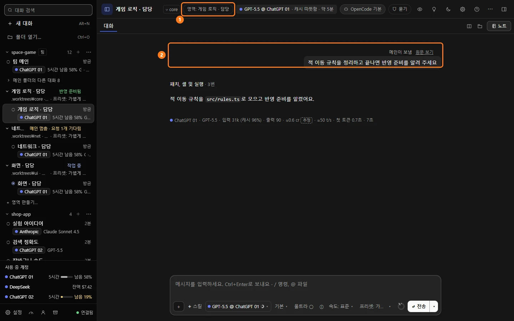

**팀 메인 대화에서 보는 소식.** 담당들의 보고는 팀 메인 대화에 `팀 소식 · 반영 준비 1, 진행 중 1`처럼 한 줄로 접혀 보여요. `원문 보기`를 누르면 영역마다의 상황이 펼쳐져요.

**한 영역에는 한 번에 요청 하나.** 메인 요청은 그 영역 폴더가 쉴 때만 하나씩 들어가요. 담당이나 동료, 같은 폴더의 다른 대화가 일하는 동안에는 기다려요. 같은 폴더를 두 에이전트가 동시에 고치면 서로의 편집을 덮어쓰기 때문이에요.

**기다리는 요청 보기.** 영역 `⋯` 메뉴의 `기다리는 메인 요청 보기`를 눌러요. 요청마다 기다리는 이유가 보여요.

- `메인 멈춤이 켜져 있어 기다려요`
- `담당이나 같은 폴더의 다른 대화가 일하는 중이라 기다려요`
- `이 영역을 손보는 중이라 기다려요`

필요 없는 요청은 `지우기`로 지워요.

**담당 대화가 바뀌는 때.** 담당 대화는 길어졌다는 이유로 바뀌지 않아요. 길어지면 자동 압축이 처리해요(13장). 이럴 때만 새 대화로 이어 가요.

- 팀 메인이 지금 하던 일과 관계없는 새 일을 맡길 때.
- 사용자가 영역 메뉴의 `새 대화로 이어가기`를 누를 때. 누르면 `'게임 로직' 담당을 새 대화로 이어갈까요? 지금 대화는 '지난 대화'로 남고, 인계 메모를 받은 새 대화가 이어서 일해요`처럼 한 번 물어요. `이어가기`를 누르면 시작해요.
- 영역의 계정을 바꿀 때.

바뀔 때는 옛 담당이 인계 메모를 쓰고, 새 대화가 그 메모로 시작해요. 옛 대화는 `지난 대화`로 남고, 그 대화 위에 `이 영역은 새 대화로 이어졌어요`와 `새 대화로 가기`가 보여요. 팀 메인을 새로 시작하려면 프로젝트 메뉴의 `팀 메인을 새 대화로 이어가기`를 눌러요.

- 담당을 멈췄을 때 그 대화의 대기열에 남은 내 입력은 옛 대화에 그대로 남아요. 이때는 옛 담당에게 인계 턴을 돌리지 않고 앱이 인계 메모를 써요. 그 입력이 곧 바뀔 대화에서 돌지 않게 하려는 거예요. 알림에 “지난 대화에 보내지 않은 입력 1개가 남아 있어요”처럼 적혀요. 팀 메인을 새 대화로 이어갈 때도 옛 팀 메인에 남은 입력을 같은 알림으로 알려 줘요.
- 옛 담당이 인계 메모를 15분 안에 쓰지 못하면 앱이 그 턴을 멈추고 인계 메모를 대신 써요. 그 대화에 내가 입력했으면 멈추지 않고 기다리며, 작업 카드의 `바로 진행`으로 멈출 수 있어요.

**오래 기다리는 팀 작업.** 새 대화로 이어가기, 계정 바꾸기, 재구성 같은 팀 작업은 영역이 쉴 때까지 기다리기도 해요. 그동안 팀 메인 위 작업 카드에 `단계 1/5 · 게임 로직: 실행 중인 명령이 끝나기를 기다려요: 'bun run dev' · 3분째`처럼 무엇을 왜 언제부터 기다리는지 보여요.

- `취소`: 기다리는 작업을 그만둬요. 이미 한 단계는 그대로예요. 새 일 때문에 하던 새 대화로 이어가기를 취소하면 그 일은 지금 담당 대화에 가요.
- `바로 진행`: 기다리지 않고 다른 길로 가요. 예를 들어 인계 메모를 앱이 대신 쓰거나, 실행 중인 명령은 그대로 두고 이어 가요. 영역에서 대화가 일하는 중이거나 승인·질문을 기다리면 이 단추는 나오지 않아요. 무엇이 폴더를 쓰는지 아직 살펴보는 중일 때도 나오지 않아요. 그 일 아래에서 대화를 바꾸지 않으려는 거예요. 그때는 일이 끝나기를 기다리거나 `취소`를 눌러요.
- `명령 멈추고 진행`: 영역 폴더에서 돌고 있는 명령(개발 서버, 지켜보기)이나 열린 터미널을 멈추고 이어 가요.
- `대화 열기`: 기다리는 대화를 열어요.
- 5분 넘게 기다리면 알림 `팀 작업이 5분 넘게 기다려요`가 남아요. 팀 메인에게 물어도 무엇을 기다리는지 알려 줘요.
- 팀 메인이 새 일로 담당 대화를 바꾸려는데 개발 서버처럼 돌고 있는 명령만 5분 넘게 폴더를 쓰면, 새 대화 없이 지금 담당 대화에 그 일을 보내요. 명령은 그대로 돌아요.

**묻지 않고 실행하는 명령.** 팀 메인과 담당은 프로젝트의 검사·설치 명령과 읽기만 하는 Git 명령을 묻지 않고 실행해요. 그 밖의 셸 명령은 평소처럼 승인을 구하고, 그 요청은 팀 보기 맨 위 `승인 기다리는 것`에 모여요.

> **팁** 일을 맡길 때 "어디까지 하면 끝인지"를 함께 말하면 좋아요. 예: “테스트가 통과하면 반영 준비를 알려 줘.”

> **주의** 팀이 혼자 끝까지 가지 못하는 때가 둘 있어요. 셸 명령 승인을 기다릴 때, 그리고 계정 한도를 다 썼을 때예요. 한도는 팀 보기의 계정 칩에 보여요. 구독 계정은 한도가 차도 자동으로 다른 계정으로 바꾸지 않고 `한도 대기 · 2시간 14분 후에 풀림`처럼 기다려요.

## 영역 직접 만들기

영역을 팀 메인에게 맡기지 않고 내가 정할 수도 있어요. 예를 들어 게임을 만들면서 몬스터 에셋, 아이템 에셋, 시뮬레이션 영역을 두고 영역마다 맡을 일을 적어 둬요. 팀 메인은 그 구성 안에서 일을 나눠 맡겨요.

**여는 곳**

- 사이드바 팀 보기에서 영역 목록 맨 아래의 `영역 만들기…`. 영역이 아직 없는 팀에도 있어요.
- 프로젝트 `⋯` 메뉴의 `영역 만들기…`.
- 새 대화의 `작업 위치`에서 `새 영역`.

**`영역 만들기` 창에 적는 것**

| 칸 | 적는 것 |
|---|---|
| `이름` | 사이드바에 보일 영역 이름이에요(40자까지). |
| `역할` | 이 영역이 맡을 일이에요(1,000자까지. 넘으면 몇 자 넘었는지 보여 주고 저장되지 않아요). `예시`의 `기능 개발`, `에셋 담당`, `시뮬레이션 담당`, `리뷰어`를 누르면 글이 채워지고, 고쳐 써도 돼요. 담당 대화가 이 글을 자기 역할로 받아요. |
| `작업 폴더` | `새 작업 폴더`는 이 팀의 영역 폴더(팀 모드를 켤 때 고른 곳, 처음 값은 메인 폴더 안 `.worktrees`)에 이 영역의 폴더를 새로 만들어요. `있는 작업 폴더`는 팀에 넣지 않은 작업 폴더를 이 영역으로 써요. 영역 이름은 `이름`에 적은 것이고 기록 이름은 그 폴더 이름 그대로예요. 그 폴더의 대화와 모델은 그대로예요. |
| `폴더·기록 이름` | 새 작업 폴더의 이름이자 그 영역의 기록 이름이에요. 이름을 적으면 저절로 채워지고, 영문 소문자·숫자·`-`로 32자까지 고칠 수 있어요. 처음과 끝에는 `-`를 쓰지 않고, `-`를 두 개 잇지 않아요. 아래에 `만들 곳:`과 실제로 만들 폴더 경로가 보여요. 같은 기록 이름이나 파일이 든 같은 이름의 폴더가 이미 있으면 뒤에 `-2`를 붙여 만들고, 그 까닭도 보여요(예: `같은 기록 이름이 있어서 'main-2'로 만들어요`). |
| `시작점` | `프로젝트 본 코드`에서 시작하거나, 다른 영역의 작업(예: `'게임 로직' 영역의 작업`)에서 이어 시작해요. |
| `모델` | 새 작업 폴더일 때 골라요. `팀과 같게`면 팀 메인의 모델을 따라가요. `고르기…`를 누르면 모델 고르는 창이 떠요. 팀에 넣을 수 없는 계정(같은 회사의 다른 구독)은 목록에 없고, `고르기`를 눌러도 지금 대화의 모델은 바뀌지 않아요. |
| `에이전트 방식` | 새 작업 폴더일 때 골라요. 담당 대화가 일하는 방식이에요([10.12](10-conversation-tools.md)). `기본(Codex 방식)`처럼 맨 위 값은 `설정`의 처음 값이에요. |

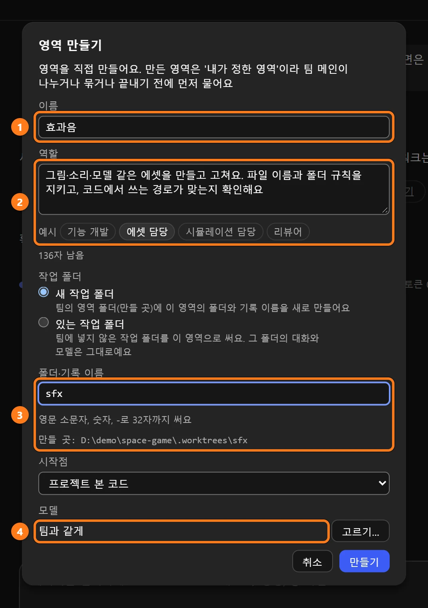

`만들기`를 누르면 창이 닫히고 `'몬스터 에셋' 영역을 만드는 중이에요. 결과는 팀 메인 위 카드에 나와요`가 떠요. 다 되면 팀 메인 위 결과 카드에 `'몬스터 에셋' 영역을 만들었어요`가 보이고, 그 줄의 `동료 추가…`로 바로 동료를 붙일 수 있어요([동료](#동료-영역에-대화-더-두기)).

- 팀에서 다른 일(다른 영역 준비 등)이 도는 중이면 `팀에서 다른 작업(새 영역 준비 등)이 끝나면 다시 만들어 주세요`가 보이고 창은 그대로예요.
- 고른 모델을 팀에 넣을 수 없으면 `만들지 못했어요: 같은 회사의 다른 구독 계정은 팀에 넣을 수 없어요`가 보여요.

**내가 정한 영역.** 이렇게 만든 영역은 사이드바 영역 행에 `내가 정한 영역`이 붙어요.

- 팀 메인은 그 영역에 평소처럼 일을 맡기고, 영역 안에서 일을 나누는 것도 알아서 해요.
- 그 영역의 **구성**(이름 바꾸기, 나누기, 묶기, 파일 모양 바꾸기, 영역 끝내기, 새 동료 만들기)을 바꿀 때는 먼저 계획을 보여 주고 **내 다음 메시지**를 기다려요([말로 시키기](#말로-시키기)). 예를 들어 팀 메인이 “아이템 에셋을 몬스터 에셋에 묶습니다”처럼 바꿀 것을 보여 주면, 내가 “좋아, 묶어 줘”라고 답해야 묶어요. 답하기 전에는 아무것도 바뀌지 않아요.
- 팀 메인의 계획에는 그 제안이 하는 일이 모두 한 줄씩 나와요. 내가 답하면 그 줄들이 다 돌아요. 다만 영역의 모델, 에이전트 방식, 있는 작업 폴더를 넣는 줄의 `내가 정한 영역` 표시는 나만 정하는 것이라 팀 메인의 제안으로는 붙지 않고(내가 계속 두라고 한 영역의 표시는 붙어요), 대화 옮기기도 팀 메인의 제안으로는 하지 않고 결과 카드에 제안으로만 올려요(계획의 그 줄에 그렇게 적혀요).
- 찾을 수 없거나 끝낸 내가 정한 영역을 팀 메인이 다시 만들 때도 먼저 물어요. 내가 답하면 새 영역에 `내가 정한 영역`이 이어져요.
- `팀 구성 다시 보기…`에서도 내가 정한 영역을 바꾸는 줄은 체크되지 않은 채 `· 내가 정한 영역`이 붙어요. 찾을 수 없거나 끝낸 내가 정한 영역을 다시 만드는 줄도 그래요(고르면 새 영역에 `내가 정한 영역`이 이어져요). 고른 줄만 돌고, 팀 메인이 제안에 적은 모델, 에이전트 방식, `내가 정한 영역` 표시는 붙지 않아요.
- 팀 메인이 만든 영역에도 붙일 수 있어요. 영역 `⋯` 메뉴의 `설정` 묶음에서 `내가 정한 영역`을 눌러 켜고 꺼요(`메인이 구성을 바꾸기 전에 물어요`).
- 말로도 붙여요. 팀 메인이나 그 영역의 담당에게 “보스 영역은 계속 둘 거야”처럼 말하면 그 차례에 바로 `내가 정한 영역`이 돼요. “맵 공방, 형상공방, 보스 담당을 계속 두고 싶어. 팀을 그렇게 짜줘”처럼 말하면 팀 메인은 새로 만드는 영역에도, 이미 있는 영역에도 표시를 붙여요. 이미 있는 영역의 이름을 바꿔 다른 일에 다시 쓸 때는 역할도 함께 바꿔요(예: 화면 → 형상공방이면 역할도 형상 일로). 표시를 빼 달라고 하면 계획을 보여 주고 내 다음 메시지를 기다려요.

**역할 바꾸기.** 영역 `⋯` 메뉴의 `역할 바꾸기…`에서 역할 글을 고치고 `저장`을 눌러요. 담당 대화에는 바로 알려지고, 팀 메인은 팀 소식(`원문 보기`)의 영역 줄에서 역할과 내가 정한 영역인지를 봐요.

**말로 역할 바꾸기.** 팀 메인이나 그 영역의 담당에게 “이 영역이 보스 아이템 그림도 맡게 해 줘”처럼 말해도 영역의 역할(맡는 범위)을 바꿔요. 팀 메인이 만든 영역은 내가 말한 차례에 바로 바꾸고, 내가 정한 영역이면 지금 역할과 바뀐 뒤 역할을 보여 주고 내 다음 메시지를 기다려요. 메인 멈춤이나 직접 작업 중인 영역은 내가 팀 메인에게 바꾸라고 한 차례에만 바꿔요. 같은 역할 안의 다음 일(예: 보스 A 다음 보스 B)은 역할을 바꾸지 않고 그 영역에 그냥 맡겨요. 맞는 영역이 없지만 가까운 영역이 앞으로도 맡을 일이면 팀 메인이 그 영역의 역할을 넓히자고 제안해요.

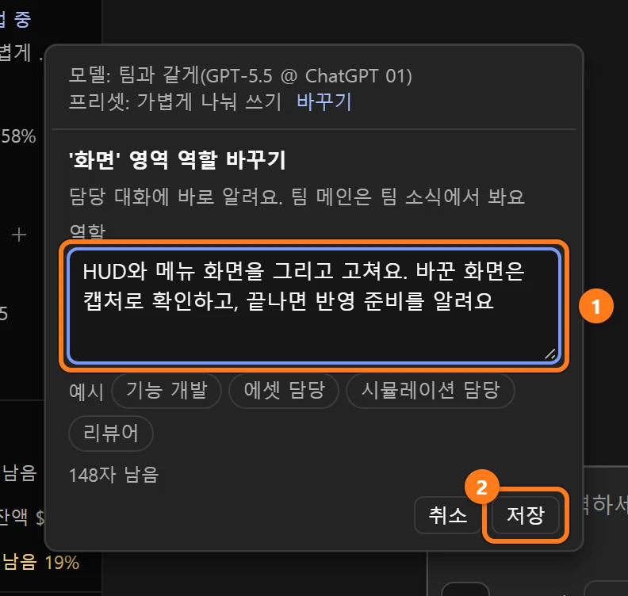

> **팁** 큰 구조는 내가 정하고 세부는 팀 메인에게 맡기면 좋아요. 일을 하다 팀 메인이 “아이템 에셋은 몬스터 에셋에 합치는 게 낫겠어요”처럼 구성 변경을 제안해도, 내가 답하기 전에는 바뀌지 않아요.

> **참고** 영역의 에이전트 방식은 그 영역의 다음 담당 대화(새 대화로 이어가기, 나누기로 생긴 영역)와 새로 만든 동료도 이어받아요. 담당 대화에서 방식을 바꾸면 다음 대화도 그 방식으로 시작해요. 휴대폰·다른 PC에서는 `관리` 권한이 있을 때만 `영역 만들기…`, `역할 바꾸기…`, `내가 정한 영역`이 보여요. 원격 PC의 앱이 이 기능을 모르는 이전 버전이면 `영역 만들기` 창에 이름, 역할, 새 작업 폴더만 있고, 창 맨 위에 그 까닭이 적혀요. 그렇게 만든 영역에는 `내가 정한 영역`이 붙지 않아요.

## 말로 시키기

팀 화면의 단추로 하는 일 대부분은 팀 메인에게 말로 부탁해도 돼요. 예를 들면 이래요.

- “네트워크 영역은 내가 직접 할게. 잠깐 멈춰 줘.”
- “게임 로직 영역은 Claude 구독으로 돌려 줘.”
- “네트워크 영역은 끝났으니 정리해 줘.”
- “게임 로직에 시뮬 동료를 하나 붙여 줘. 규칙을 바꾸면 시뮬레이션을 돌려 보는 역할이야.”

팀 메인은 부탁을 듣고 **바로 하거나**, **계획을 먼저 보여 주고 물어요.**

| 바로 해요 | 계획을 보여 주고 먼저 물어요 |
|---|---|
| 영역의 메인 멈춤 켜기, `모든 영역 멈추기` | 메인 멈춤 풀기, `다시 시작` |
| 기다리는 메인 요청 지우기 | 영역의 모델·프리셋 바꾸기, 팀 계정 바꾸기 |
| 담당을 새 대화로 이어가기 | 반영 되돌리기와 기다리는 되돌리기 취소, 대화 옮기기 |
| 큰 파일 폴더 가져오기 | 팀에서 빼기, 팀 모드 끄기, 메인 폴더 바꾸기 |
| 팀 메인 새 대화 | 원격 저장소에 올리기, 팀 설정 바꾸기 |
| 새 동료 만들기(내가 정한 영역 빼고) | 확인 단계에 `하기`로 답하기, 영역 끝내기 |
| 영역 역할 바꾸기(팀 메인이 만든 영역) | 내가 정한 영역의 역할 바꾸기 |
| `내가 정한 영역` 붙이기(내가 말한 차례에) | `내가 정한 영역` 빼기 |
| 직접 작업 중인 영역 넘겨받기(내가 팀 메인에게 그 영역을 넘겨받으라고 했을 때) | 새 영역을 한 번에 5개 이상 만들기 |
| | 직접 작업 중인 영역 반영하기 |
| | 있는 대화를 동료로 등록·역할 바꾸기·동료에서 빼기 |
| | 담당 대화 바꾸기(있는 대화를 담당으로) |
| | 내가 정한 영역의 구성 바꾸기(이름, 나누기, 묶기, 파일 모양, 끝내기)와 새 동료 |
| | 영역의 마지막 저장 지점까지 반영하기 |

- 메인 멈춤인 영역이면 새 대화로 이어가기와 큰 파일 폴더 가져오기도 먼저 물어요.
- 물을 때는 팀 메인이 대화에 계획(무엇을 바꾸고, 무엇이 남고, 어떻게 되돌리는지)을 보여 줘요. **내가 다음 메시지로** “응, 그렇게 해 줘”라고 답해야 실행해요.
- 같은 메시지에 함께 적은 말은 답으로 치지 않아요. 예를 들어 “영역 끝내 주고, 바로 해도 돼”라고 한 번에 써도 계획을 보여 주고 다음 메시지를 기다려요. 팀 소식이 깨운 차례나 다른 대화의 말로도 실행되지 않아요.
- 계획은 대화마다 하나예요. 새 계획을 세우면 앞 계획은 버려요. 10분이 지나면 다시 계획해요.
- **팀 모드 켜기는 말로 하지 않아요.** 언제나 `팀 모드 켜기…` 단추로 켜요.

**담당에게 말로 시키기.** 담당 대화에서도 **자기 영역**의 메인 멈춤 켜기·풀기, 새 대화로 이어가기, 모델·프리셋 바꾸기, 역할 바꾸기, `내가 정한 영역` 붙이기·빼기, 메인에게 넘기기를 말로 부탁할 수 있어요. 역할 바꾸기는 팀 메인이 만든 영역이면 바로, 내가 정한 영역이면 계획을 먼저 보여 줘요. 메인 요청 지우기는 팀 메인에게 말해요. 동료 대화에서는 이런 팀 동작을 쓰지 않아요.

**담당 대화에서 팀 일을 부탁하면.** 담당이나 동료 대화에서 “테스트 부분은 따로 떼 줘”처럼 팀 메인만 할 수 있는 일(새 영역, 나누기, 묶기, 영역 끝내기, 팀에서 빼기, 대화 옮기기, 다른 영역에 맡길 일)을 말하면, 담당이 직접 하지 않고 내 말 그대로 팀 메인에게 “사용자 부탁”으로 전해요. 담당은 “팀 메인에게 전했어요”라고 알려 주고, 그 영역의 상태는 그대로예요. 긴 부탁도 자르지 않고 그대로 전해요. 팀 소식에는 앞부분만 보이고 팀 메인은 필요하면 전문을 읽어요. 팀 메인이 곧 깨어나 처리하고, 계획이 필요한 일(예: 영역 끝내기)이면 **팀 메인 대화에서** 물어요. 그때는 팀 메인 대화에 답해요.

**휴대폰·다른 PC에서 말로 시키면.** 그 기기의 권한으로 답할 수 있는 것만 실행돼요.

| 기기 | 답할 수 있는 것 |
|---|---|
| 처음 권한의 기기 | 멈춤, 새 대화로 이어가기, 영역의 모델·프리셋, 팀 계정 |
| `관리` 권한이 있는 기기 | 위에 더해 팀 끄기, 팀에서 빼기, 되돌리기, 메인 폴더 바꾸기, 대화 옮기기, 반영, 영역 끝내기, 내가 정한 영역의 구성 바꾸기, 영역 역할 바꾸기, `내가 정한 영역` 붙이기·빼기, 동료 등록·바꾸기·빼기 |
| 이 PC의 창에서만 | 원격 저장소에 올리기, 팀 설정 바꾸기, 확인 단계에 답하기 |

권한이 모자라면 팀 메인이 “PC에서 다시 말하거나 화면 단추를 쓰세요”라고 알려 줘요.

## 직접 작업

한 영역을 내가 직접 맡고 싶으면 그 영역의 담당 대화를 열고 그냥 말하면 돼요. 그러면 그 영역은 `직접 작업 중`이 되고, 팀 메인은 내가 넘길 때까지 그 영역에 새 일을 넣지 않고 기다려요. 따로 켜는 것은 없어요.

**언제 시작해요?** 담당 대화에 내가 메시지를 보내면 시작해요. 담당이 팀 메인의 요청을 처리하는 중이면 그 일에 끼워 넣는 말이라 시작하지 않아요. 동료 대화나 같은 폴더의 다른 대화에 말하는 것으로는 시작하지 않아요(그때는 아래 `메인 멈춤`을 켜요).

**그동안 이렇게 돼요**

- 사이드바 영역 줄이 `직접 작업 중`이 돼요. 기다리는 요청이 있으면 `직접 작업 중 · 요청 1개 기다림`이에요.
- 담당 대화 위에 `직접 작업 중 · 메인 요청 1개 기다림`과 `메인에게 넘기기` 단추가 보여요. 기다리는 요청이 없으면 `이 영역에서 직접 일하는 중이에요. 메인에게 넘기기 전에는 메인의 새 요청이 이 대화에 오지 않아요`가 보여요.
- 팀 메인의 새 요청과 다른 영역의 물음은 대기함에서 기다려요(`기다리는 메인 요청 보기`에 `내가 직접 작업 중이라 기다려요`). 팀 메인은 대화에서 그 영역이 직접 작업 중이라 기다린다고 한 줄로 알려 줘요.
- 담당과 동료의 보고는 팀 메인을 깨우지 않고 모아 둬요. 막혀서 정할 일이 생긴 보고도 마찬가지예요. 그때는 담당이 이 대화에서 나에게 물어요. 팀 메인만 할 수 있는 일을 전하는 "사용자 부탁"만은 바로 가요.
- 폴더에 내가 직접 고친, 아직 저장 지점에 넣지 않은 파일이 있거나 팀 메인의 요청과 어긋나는 일이 있으면 담당이 팀 메인 대신 이 대화에서 나에게 물어요.
- 반영은 내가 시킬 때만 해요. 담당은 이 대화에서 내가 "반영해 줘"라고 한 차례에만 반영하고, 팀 메인은 이 영역을 반영하기 전에 언제나 계획을 보여 주고 내 다음 메시지를 기다려요. 영역 메뉴의 `반영하기` 단추는 그대로 돼요.
- 앱이 알아서 하는 정리(새 대화로 바꾸기, 큰 파일 폴더 내려놓기, 반영 뒤 맞추기, 팀 메인이 제안한 재구성)는 이 영역을 건너뛰어요. 직접 작업 전에 시작해 기다리던 반영도 넘길 때까지 기다려요.
- `끝낼 수 있음`은 붙지 않아요.
- 담당 대화를 `중단`으로 멈춰도 메인 멈춤이 켜지지 않아요. 메인은 이미 기다리고 있어요.

**시간이 지나도 저절로 끝나지 않아요.** 밤새 두어도 그대로예요. `다시 시작`이나 `모든 영역 멈추기`를 눌러도 그대로예요.

**넘기는 방법**

- 담당 대화 위 배너의 `메인에게 넘기기`.
- 영역 `⋯` 메뉴의 `메인 요청` 묶음 맨 앞의 `메인에게 넘기기`(`기다리던 메인 요청이 들어가고, 그동안의 보고가 메인에게 가요`).
- 담당 대화에서 “메인한테 넘겨”라고 말해요. 담당이 한 일을 한 번 정리해 보고한 뒤 넘겨요. 내가 “다 했어”라고 하면 담당이 메인에게 넘길지 한 번 물어요.
- 팀 메인에게 “네트워크 영역 넘겨받아”나 “네트워크 영역 다시 맡아 줘”처럼 넘겨받으라고 분명히 말해도 팀 메인이 넘겨받아요. “그 일 네트워크에 시켜 줘”처럼 일만 시키면 팀 메인은 그 일이 기다린다고 한 줄로 알리고 넘겨받지 않아요.
- 그 영역의 메인 멈춤을 끄거나, 팀 설정의 `내가 영역에서 직접 일하면 메인은 기다리기`를 꺼도 끝나요.

**넘기면** 팀 메인에게 한 줄이 가요. 언제부터 언제까지 직접 했는지, 그동안의 보고 수, 반영할 후보가 있는지, 본 코드에 아직 없는 저장 지점 수, 저장하지 않은 변경이 있는지, 마지막 보고가 실려요. 팀 메인은 그동안의 보고 전문을 읽고 다음 일을 정해요. 그동안 보고가 하나도 없었으면 반영하거나 새 일을 주기 전에 나에게 무엇을 할지 먼저 물어요. 기다리던 메인 요청은 담당이 쉴 때 하나씩 들어가요.

> **참고** 동료와 한동안 길게 일하거나 같은 폴더의 다른 대화에서 일할 때는 `메인 멈춤`을 켜요. 그 대화들은 직접 작업을 시작하지 않아요.

> **참고** 직접 작업 중에 `이 대화를 담당으로`로 담당 대화를 바꿔도 직접 작업은 그대로예요. 새 담당 대화에 배너가 보여요.

> **팁** 예전처럼 담당에게 말해도 메인이 기다리지 않게 하려면 `설정` > `팀 모드`의 `내가 영역에서 직접 일하면 메인은 기다리기`를 꺼요(아래 [팀 설정](#팀-설정)). 그러면 메인 요청이 쉬는 틈에 들어갈 수 있으니 직접 일할 때 `메인 멈춤`을 켜요.

## 담당과 직접 대화하기와 메인 멈춤

**담당에게 직접 말해도 돼요.** 사이드바에서 아무 담당 대화나 열고 바로 입력하면 돼요. 사용자 말이 메인 요청보다 먼저예요. 담당 대화에 말하면 그 영역은 [직접 작업](#직접-작업)이 되어 메인 요청이 내가 넘길 때까지 기다려요.

팀 메인은 다음 팀 소식에서 그 영역이 `직접 작업 중`인 것을 봐요. 동료 대화에 말하면 팀 메인은 그 동료 줄에서 "사용자가 직접 대화함"을 봐요. 이것은 정보일 뿐, 메인 요청을 막지는 않아요.

> **주의** `내가 영역에서 직접 일하면 메인은 기다리기`를 꺼 두었거나 동료 대화에서 일할 때 메인 멈춤 없이 직접 일하면, 담당이 내 말에 답한 바로 뒤처럼 폴더가 잠깐 쉬는 틈에 메인 요청이 시작할 수 있어요. 대화에 `메인이 보냄`이 보이면 입력창의 `중단`(또는 `Esc` 두 번)으로 멈추세요. 멈추면 메인 멈춤이 저절로 켜져요.

**메인 멈춤이란.** 한 영역에서 한동안 혼자 일하고 싶을 때 켜는 스위치예요. 방문에 "지금은 제가 직접 합니다" 팻말을 거는 것과 같아요. 영역마다 하나씩 있어요. 직접 작업은 담당 대화에 말하면 저절로 시작하지만, 메인 멈춤은 내가 켜고 끄는 스위치예요. 동료 대화나 같은 폴더의 다른 대화에서 오래 일할 때, 말하기 전에 미리 막아 두고 싶을 때 써요.

**켜는 방법**

- 담당 대화 머리줄의 `⋯` 메뉴에서 `메인 멈춤`.
- 사이드바 영역 행의 `⋯` 메뉴에서 `메인 멈춤`.
- 담당 대화를 `중단`으로 멈추면 저절로 켜져요(직접 작업 중일 때는 빼고요). 이때 `멈춰서 이 영역의 메인 멈춤을 켰어요. 메인에게 다시 맡기려면 끄세요`가 떠요.
- 휴대폰에서도 켜고 끌 수 있어요.

**켜져 있는 동안**

- 머리줄 알약이 `영역: 네트워크 · 메인 멈춤`, 사이드바 상태가 `메인 멈춤 · 요청 1개 기다림`으로 바뀌어요.
- 담당 대화 위에 `메인 멈춤 · 요청 1개 기다림`과 `메인 멈춤 끄기`, `보기`가 보여요.
- 새 메인 요청과 다른 영역의 물음은 들어가지 않고 기다려요. 이 담당이 다른 영역에 물어서 받은 **답**과 앱의 **안내**만은 기다리지 않고, 담당이 쉴 때 들어가요(아래 [영역끼리 묻고 답하기](#영역끼리-묻고-답하기)).
- 앱이 알아서 하는 정리(새 대화로 바꾸기, 큰 파일 폴더 내려놓기, 반영 뒤 맞추기, 팀 메인이 제안한 재구성)도 이 영역은 건너뛰어요.
- 사용자가 직접 고른 동작(영역 메뉴의 반영, 끝내기 등)은 그대로 돼요.

**끄면** 기다리던 메인 요청이 순서대로 들어가요. 담당 대화의 대기열에 멈춰 있던 메시지가 있으면 그것부터 이어서 돌아요. 끄기 전에 `보기`에서 필요 없는 요청을 지워 두세요.

> **주의** 메인 멈춤은 저절로 풀리지 않아요. 시간이 지나도 그대로예요. 다 끝났으면 `메인 멈춤 끄기`를 눌러 주세요.

> **주의** 메인 멈춤을 켜기 전에 이미 시작한 메인 요청은 계속 돌아요. 멈추려면 그 대화의 `중단`을 누르세요.

**모두 멈추기.** 프로젝트 `⋯` 메뉴의 `모든 영역 멈추기`는 모든 영역의 메인 멈춤을 켜고, 일하던 담당을 모두 멈춰요(`일하던 담당을 멈추고 모든 영역에 메인 멈춤을 켰어요`). `다시 시작`은 `모든 영역 멈추기`가 켠 것만 꺼요. 사용자가 따로 켠 영역의 메인 멈춤은 그대로 둬요.

**같은 폴더의 다른 대화.** 영역 폴더에서 담당이 아닌 대화를 새로 열 수도 있어요. 그 대화 위에는 `이 대화는 담당과 같은 폴더를 써요. 이 대화가 일하는 동안 메인 요청은 기다려요`가 보여요. 담당이 메인 요청을 처리하는 중이면 `담당이 지금 이 폴더에서 메인 요청을 처리 중이에요`와 `담당 대화 열기`, `메인 멈춤`이 보여요. 이런 대화를 아예 담당으로 삼을 수도 있어요(아래 [담당 대화 바꾸기](#담당-대화-바꾸기)).

## 동료: 영역에 대화 더 두기

> **용어** 동료: 영역 폴더에서 담당 옆에 두는 이름과 역할이 있는 대화예요. 예를 들어 “시뮬”(규칙을 바꾸면 시뮬레이션을 돌려 결과를 알림), “리뷰어”(바뀐 코드를 읽고 문제를 알림) 같은 것이에요. 영역마다 4개까지 둘 수 있어요.

담당은 영역의 일을 맡고 반영까지 책임져요. 동료는 그 옆에서 정해진 역할만 해요. 팀 메인은 담당뿐 아니라 동료에게도 일을 보낼 수 있어요.

**동료 두는 법**

- **새 대화로**: 영역 `⋯` 메뉴의 `동료 추가…`. `이름`과 `역할`을 적고 `추가`를 눌러요. 영역 폴더에 새 대화가 생기고, 영역의 모델과 프리셋으로 시작해요.
- **있는 대화를**: 영역 폴더의 대화(담당이 아닌 것)에서 대화 `⋯` 메뉴나 사이드바 줄의 `⋯` → `동료로 등록…`. 그 대화의 모델과 프리셋은 그대로이고, 팀 메인이 처음 일을 보낼 때 팀 도구와 동료 역할이 붙어요.
- **말로**: 팀 메인에게 “게임 로직에 시뮬 동료를 붙여 줘”라고 해요(위 "말로 시키기").

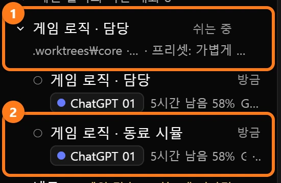

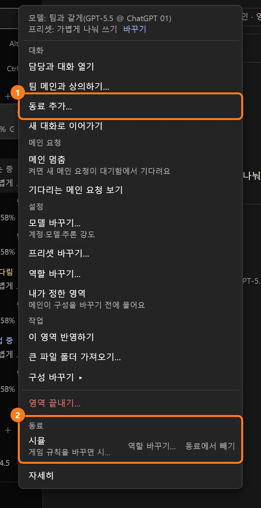

**동료가 하는 일과 하지 않는 일**

- 팀 메인은 동료가 누구인지와 역할을 보고, 맞는 일을 그 동료에게 보내요. 동료 대화에는 `메인이 보냄`이 붙어요.
- 동료는 팀 메인에게 진행, 끝남, 막힘을 알려요. **반영 준비와 반영은 담당만 해요.** 동료가 만든 변경도 담당이 정리해 반영해요.
- 같은 폴더라서 **한 번에 한 대화만** 메인 요청을 받아요. 동료가 일하는 동안 담당에게 갈 요청은 기다리고, 그 반대도 같아요. 두 대화가 같은 파일을 동시에 고치지 않게 하려는 것이에요.
- 동료 대화에서 내가 직접 말해도 팀 메인이 담당에게 일을 보내는 것을 막지 않아요. 팀 메인은 “사용자가 직접 대화함”을 그 동료 줄에서 봐요.

**동료 대화 알아보기.** 머리줄 알약이 `영역: 게임 로직 · 동료(시뮬)`이고, 대화 위에 `이 대화는 '게임 로직' 영역의 동료(시뮬)예요. 메인이 이 대화에 요청을 보낼 수 있고, 이 폴더에서는 한 번에 한 대화만 메인 요청을 받아요`가 보여요.

**바꾸고 빼기.** 영역 메뉴의 동료 줄에서 `역할 바꾸기…`로 이름과 역할을 고치고, `동료에서 빼기`로 빼요. 빼도 대화는 그대로 남고(팀 도구와 동료 역할만 떼요), 그 동료를 기다리던 메인 요청은 보내지 않아요.

> **참고** 동료 메뉴는 이 PC의 창에서만 보여요. 휴대폰·다른 PC에서는 팀 메인에게 말로 부탁해요(`관리` 권한이 필요해요). 팀 메인과 같은 회사의 다른 구독 계정을 쓰는 대화는 동료로 등록할 수 없어요.

## 담당 대화 바꾸기

> **용어** 담당 대화 바꾸기: 영역 폴더에 이미 있는 다른 대화를 그 영역의 담당으로 삼는 것이에요. 담당은 여전히 영역마다 하나예요.

영역 폴더에서 내가 직접 연 대화와 오래 일하다 보면, 그 대화가 담당보다 그 일을 더 잘 알게 돼요. 그럴 때 그 대화를 담당으로 바꿔요. `새 대화로 이어가기`가 빈 새 대화로 넘어가는 것이라면, 이것은 이미 아는 대화에게 자리를 주는 것이에요.

**바꾸는 법**

1. 담당으로 삼을 대화의 `⋯` 메뉴(사이드바 줄이나 영역 메뉴의 `팀과 이야기하는 대화` 묶음)에서 `이 대화를 담당으로`를 눌러요.
2. `'게임 로직' 영역의 담당을 '충돌 판정 고치기' 대화(GPT-5.5)로 바꿀까요?`가 보이면 `바꾸기`를 눌러요.
3. `지금 일이 끝나면 바꿔요`가 떠요. 두 대화가 모두 쉬면 바로 바뀌고, 누가 일하는 중이면 그 일이 끝날 때까지 기다려요.
4. 끝나면 `'충돌 판정 고치기' 대화가 이제 '게임 로직' 담당이에요`가 떠요. 마음이 바뀌면 그 알림의 `다시 …(으)로`를 눌러 되돌려요.

말로도 돼요. 팀 메인에게 “게임 로직 담당을 충돌 판정 고치기 대화로 바꿔 줘”라고 하면 계획을 보여 주고, 내가 다음 메시지로 답해야 바꿔요. 동료는 이름으로 불러도 돼요(“게임 로직 담당을 동료 리뷰어로 바꿔 줘”).

**바뀌는 것과 그대로인 것**

- 새 담당 대화는 자기 모델, 프리셋, 지금까지 나눈 대화를 그대로 가져요. 영역 메뉴 맨 위의 모델과 프리셋도 그 대화의 것으로 바뀌어요. 전에 `팀과 같게`였어도 그래요. 되돌리려면 `모델 바꾸기…`에서 `팀과 같게`를 골라요.
- 옛 담당에게 가려고 기다리던 메인 요청과 다른 영역의 물음은 새 담당에게 가요. 옛 담당이 다른 영역에 물어 둔 것의 답도 새 담당이 받아요.
- 옛 담당이 받아 놓고 아직 답하지 않은 물음은 답 없이 끝나고, 물은 쪽에 안내가 가요.
- 팀 메인은 다음 팀 소식에서 담당이 바뀌었다는 한 줄을 봐요. 깨어나지는 않고, 일은 전처럼 그 영역으로 보내요.
- 옛 담당 대화는 지워지지도 보관되지도 않아요. 보통 대화로 남고, 위에 `이 대화는 이제 담당이 아니에요`와 `담당 대화로 가기`, `다시 담당으로`가 보여요. 앱이 그 대화에 메시지를 보내거나 인계 문서를 쓰게 하지 않아요.
- 메인 멈춤이 켜져 있었으면 그대로 켜져 있어요. 바꾼 뒤에 `'게임 로직' 영역은 메인 멈춤이 켜져 있어요. 끄기 전에는 메인의 요청이 새 담당에게 가지 않아요` 알림이 하나 더 뜨고, 그 알림이나 새 담당 대화 위의 `메인 멈춤 끄기`를 한 번 누르면 꺼져요. 새 담당 대화 위에는 기다리는 요청이 아직 없어도 `메인 멈춤이 켜져 있어요. 끄기 전에는 메인의 요청이 이 대화에 오지 않아요`가 보여요.

**담당이 될 수 있는 대화**

| 돼요 | 안 돼요 |
|---|---|
| 그 영역 폴더(하위 폴더 포함)에서 연 대화 | 다른 폴더의 대화(`이 영역의 폴더에 있는 대화만 담당이 될 수 있어요`) |
| 그 영역의 동료(담당이 되면 동료 목록에서 빠져요. 나중에 `동료로 등록…`으로 다시 넣을 수 있어요) | 하위 대화(`하위 대화는 담당이 될 수 없어요`) |
| 전 담당 대화, 보관해 둔 대화 | 팀 메인(`팀 메인은 영역 담당이 될 수 없어요`) |
| | 팀과 같은 회사의 다른 구독 계정을 쓰는 대화. 그 대화의 계정을 바꾼 뒤 다시 골라요 |
| | 모델을 아직 고르지 않은 대화(`이 대화의 계정을 확인할 수 없어요. 모델을 고른 뒤 다시 해 주세요`) |

> **주의** 일하는 대화를 끊고 바꾸지는 않아요. 기다리는 동안 작업 카드의 `취소`를 누르면 아무것도 바뀌지 않아요. 급하면 일하는 대화를 `중단`으로 멈추세요. 바꾸는 동안 멈춘 것은 메인 멈춤을 켜지 않아요.

> **참고** 바꾸려는 바로 그때 옛 담당이 기다리던 요청을 받아 갔으면 바꾸지 않고, 옛 담당 대화가 그사이 요청을 받았으니 그 일이 끝난 뒤 다시 하라고 알려요. 그 요청은 옛 담당이 해요. 끝난 뒤 다시 바꾸세요. 고른 대화가 받아 갔을 때는 고른 대화가 그사이 요청을 받았다고 알려요. `이 대화의 계정을 지금 확인할 수 없어요. 잠시 뒤 다시 해 주세요`가 보이면 조금 있다가 다시 누르면 돼요.

**담당 메모.** 영역 메뉴의 `팀과 이야기하는 대화` 묶음에는 담당이 맨 위에, 동료가 그 아래에 보여요. 담당 줄의 `메모 바꾸기…`로 이 담당이 팀에서 맡은 일을 적어 둘 수 있어요(1,024자까지). 영역에 동료가 있으면 담당과 동료가 서로의 메모와 역할을 보고 누구에게 물을지 알아요. 동료가 없는 영역에서는 쓰이지 않아요. 메모는 담당 대화를 바꿔도 그대로 남아요. 담당 메모와 동료의 역할은 1,024자까지예요.

> **참고** 팀 메인 자리는 이렇게 옮길 수 없어요. 팀 메인은 프로젝트 메뉴의 `메인 새 대화`로만 바꿔요.

## 영역끼리 묻고 답하기

> **용어** 영역 메시지: 담당이나 동료가 팀 메인을 거치지 않고 다른 영역에 보내는 것이에요. **물음**, **답**, **쪽지**가 있고, 앱이 보내는 **안내**가 있어요.

예전에는 “세이브 v3의 저장 형식이 바뀌나요?” 같은 것을 물으려면 팀 메인이 깨어나 묻고, 또 깨어나 답을 전해야 했어요. 이제 담당끼리 바로 물어봐요. 팀 메인은 깨어나지 않고, 다음 팀 소식에서 무슨 말이 오갔는지 봐요. 팀 메인은 여전히 일을 나누고 정하는 쪽이에요.

**물음과 답.** 담당이 다른 영역에 물으면 그 영역 담당 대화에 새 요청처럼 들어가요. 대화에는 `'게임 로직' 담당이 보냄`(동료가 보냈으면 `'게임 로직' 동료 시뮬이 보냄`)이 붙어요. 받은 담당이 답하면 물은 담당 대화에 `'네트워크' 담당의 답`이 붙어 들어오고, 물은 담당이 이어서 일해요. 받은 담당이 따로 답을 보내지 않고 차례를 마치면, 그 차례의 마지막 답이 그대로 답으로 가요.

- 메인 요청처럼 그 영역 폴더가 쉴 때 하나씩 들어가요. 일하는 대화에 끼어들지 않아요.
- 한 영역 안에서도 돼요. 예를 들어 담당이 리뷰어 동료에게 물어볼 수 있어요.
- 기다리는 물음은 `기다리는 메인 요청 보기`에 보낸 담당의 이름과 `물음` 표시로 보이고, `지우기`로 지울 수 있어요. 지우면 물은 담당에게 `안내`가 가요.

**쪽지.** 알리기만 할 것은 쪽지로 남겨요. 쪽지는 받는 대화를 깨우지 않고, 그 대화에 다음 요청이 들어갈 때 함께 가요. 대화에는 `쪽지 1개 함께 옴`이 붙고, `원문 보기`로 쪽지까지 펼쳐 봐요. 아직 가지 않은 쪽지는 `기다리는 메인 요청 보기` 아래 `받은 쪽지 1개 · 다음 요청과 함께 가요`에 보여요.

**준비되면 깨워 달라고 하기.** 담당은 “네트워크가 반영 준비되면 알려 줘”처럼 다른 영역을 지켜볼 수 있어요. 그 영역이 반영 준비를 마치거나 프로젝트 본 코드에 반영되면 지켜본 담당에게 `안내`가 한 번 가요. 12시간 안에 일어나지 않으면 조용히 사라져요.

**길이.** 물음, 답, 보고는 한 번에 20,000자까지예요. 팀 소식에는 앞부분만 보이고 끝이 `…`로 표시되며, 팀 메인은 필요하면 전문을 읽어요.

**팀 메인이 보는 것.** 팀 메인은 영역 메시지 때문에 깨어나지 않아요. 다음 팀 소식(`원문 보기`) 끝에 "영역 메시지 2건"처럼 몇 건인지와, 누가 누구에게 무엇을 보냈는지가 한 줄씩 실려요.

**메인 멈춤은 그대로예요.** 메인 멈춤이 켜진 영역에는 다른 영역의 물음과 쪽지도 들어가지 않고 기다려요. 메인 요청과 함께 `기다리는 메인 요청 보기`에서 보고 지워요. 단, 그 영역 담당이 스스로 물어서 받는 답과 앱의 안내는 사용자가 켠 메인 멈춤을 지나 들어가요. 내가 멈춘 담당에게 “네트워크에 물어봐”라고 했는데 답이 영영 안 오는 일이 없게 하려는 것이에요. `모든 영역 멈추기`를 켰으면 답도 기다려요.

**한도.** 같은 대화끼리는 답이 오기 전에 다시 묻지 못해요. 물음은 묻는 대화마다 한 시간에 10개, 팀 전체로 40개까지예요. 넘으면 그 물음은 보내지 않고 어느 한도에 걸렸는지 알려 주며, 팀 메인이 한 시간에 한 번 깨어나 두 영역에 할 일을 정해 줘요.

> **참고** 다른 영역의 메시지는 내 말이 아니에요. 그래서 팀 메인이 보여 준 계획을 승인하거나, 권한·설정을 허용하는 답이 되지 않아요. 컴퓨터 사용도 그 차례에는 쓰지 않아요. 담당은 내 말을 먼저, 그다음 팀 메인의 말을, 그다음 다른 영역의 물음을 따라요.

## 영역의 모델과 프리셋, 팀 계정

영역 `⋯` 메뉴를 열면 맨 위에 그 영역의 설정 한 줄이 보여요. 예: `모델: 팀과 같게(GPT-5.5 @ ChatGPT 01)`와 `프리셋: 가볍게 나눠 쓰기`, 그리고 `바꾸기`.

- **`모델: 팀과 같게`**: 그 영역의 담당이 팀 메인 입력창의 계정·모델·추론 강도를 따라가요. 팀 메인에서 모델을 바꾸면 영역도 다음 쉬는 때에 따라 바꿔요.
- **`모델 바꾸기…`**(`계정·모델·추론 강도`): 영역마다 다른 계정이나 모델을 골라요. 맨 위에는 `팀과 같게`가 있어요.
  - 다른 회사 구독, API 키, 로컬 LLM을 고를 수 있어요.
  - 같은 회사의 다른 구독 계정은 목록에 없어요(`다른 ChatGPT 계정은 팀에 넣을 수 없어 목록에 없어요`).
  - 예외가 하나 있어요. 팀 계정과 **같은 ChatGPT 로그인**으로 만든 Sign in with ChatGPT 계정은 같은 구독으로 쳐서 영역의 모델로 고를 수 있어요. 다른 로그인의 계정은 언제나 안 돼요.
  - 계정을 바꾸면 `계정을 바꾸면 담당이 쉴 때 새 대화로 이어 가요`. 지금 대화에서 바로 바꾸려면 `지금 바꾸기`를 눌러요(전환 비용 창이 떠요, 11장).
  - 모델이나 추론 강도만 바꾸면 대화는 그대로예요.
- **담당 대화의 입력창**에서 계정이나 모델을 바꿔도 그 영역의 모델이 바뀌어요. 이때는 `팀과 같게`가 풀리고, 지금 대화에서 바로 바뀌어요(비용 창).
- **`프리셋 바꾸기…`**(또는 담당 입력창의 프리셋 단추): 하위 에이전트를 어디서 얼마나 쓸지 정해요(14장). 비용이 없고 대화도 그대로이며 바로 적용돼요. 새 영역의 처음 프리셋은 그 계정 묶음의 ★ 프리셋이에요.
- **말로 바꾸기**: 팀 메인에게 “게임 로직 영역은 Claude 구독으로 돌려 줘”처럼 말해도 돼요. 영역의 모델·프리셋과 팀 계정을 말로 바꿀 때는 언제나 계획을 먼저 보여 주고 내 답을 기다려요.
- **에이전트 방식**은 영역을 만들 때 고른 방식(고르지 않았으면 처음 값)으로 담당이 시작하고, 새 대화로 이어 가도 그대로예요. 바꾸려면 담당 대화의 에이전트 방식 알약을 눌러요([10.12](10-conversation-tools.md)). `omo (원본)`으로 돌리는 팀 대화는 남은 할 일을 혼자 이어서 하지 않아요. 다음 일은 팀 메인의 요청과 팀 소식이 정해요.
- **울트라와 속도**는 대화마다예요. 영역에 저장되지 않아요. `팀과 같게`도 속도는 따라가지 않고, 새 담당 대화는 언제나 표준 속도로 시작해요(15장, 16장).

**팀 계정 바꾸기.** 팀 메인 입력창에서 같은 회사의 다른 구독 계정(예: ChatGPT 01 → ChatGPT 02)을 고르면 보통 전환 대신 `팀 계정 바꾸기` 창이 떠요. `팀 전체(메인과 영역 3개)를 ChatGPT 02로` 옮긴다는 줄과 지금 일하는 대화 수가 보여요.

- `끝나면 바꾸기`: 옛 계정에서 하던 일이 모두 끝나고 영역마다 인계 메모를 쓴 뒤 함께 옮겨요.
- `멈추고 바꾸기`: 일하던 것을 바로 멈추고, 앱이 인계 메모를 만들어 옮겨요.

끝나면 `팀이 ChatGPT 02로 옮겼어요 · 영역 3개 새 대화`가 알림에 떠요. Claude 계정이 여럿이면 이 알림과 결과 카드는 팀 메인이 실제로 도는 Claude 계정(예: `팀이 AC-02로 옮겼어요`)을 적어요.

팀 계정 바꾸기를 `취소`하면 아직 걸려 있는 팀 메인의 전환도 함께 거둬요. 팀 메인이 이미 새 계정으로 넘어가는 중이었으면 그대로 넘어가고, 그때는 영역들이 뒤따라 새 계정으로 옮겨요. 팀이 두 계정에 나뉜 채로 남지 않아요.

> **참고** 한 팀은 회사마다 구독 하나만 써요. 같은 회사 구독 둘을 한 팀에서 함께 돌리면 약관상 한도 우회로 볼 수 있어서예요(12장). 같은 ChatGPT 로그인으로 만든 ChatGPT 구독 계정과 Sign in with ChatGPT 계정은 구독 하나로 쳐요. 그래서 팀 계정은 언제나 팀 전체가 함께 옮겨요. 다른 회사 구독, API 키, 로컬 LLM은 섞어 써도 돼요. Claude 구독 계정이 여러 개여도 한 팀은 Claude 계정 하나를 함께 써요([20장](20-account-kinds.md)).

> **주의** `팀과 같게`인 영역은 모두 팀 계정의 한도를 함께 써요. 영역에 무거운 프리셋(`적극적으로`)을 고르거나 울트라를 켜면 `영역 4개 × (담당 1 + 하위 에이전트 동시 3) = 최대 16개 동시 실행` 같은 줄이 보여요. 앱은 막지 않으니 한도를 보며 정하세요.

**영역이 많아지면.** 영역 수 제한은 없어요. 다만 새 영역마다 작업 폴더가 하나씩 생기고 준비 명령(설치)이 돌아 디스크와 시간이 들고, 함께 일하는 담당이 많을수록 계정 한도를 빨리 써요. 팀 메인이 새 영역을 한 번에 5개 이상 만들려 하면 먼저 계획을 보여 주고 내 답을 기다려요. 팀 모드를 켤 때는 팀 메인이 제안한 영역을 모두 만들어요. 일이 끝난 영역은 `영역 끝내기…`로 정리하세요.

## 반영하기, 되돌리기, 충돌 예상

**비유로 보면** 다 고친 방을 바로 본 건물에 붙이지 않아요. 따로 지은 견본 방에 먼저 붙여 보고, 검사를 통과하면 그때 본 건물에 붙여요. 문제가 있으면 `되돌리기`로 떼어 내요.

**반영하는 순서**

1. 담당이 일을 끝내고 반영 준비를 알리면 영역 상태가 `반영 준비됨`이 돼요.
2. 팀 메인이 깨어나 반영을 시작해요. 직접 하려면 영역 `⋯` 메뉴의 `이 영역 반영하기`를 눌러요(아래 그림 ①).
3. 앱이 영역의 작업과 본 코드를 합친 결과를 만들어요. 이때 사용자의 폴더는 건드리지 않아요.
4. 앱 전용 검사 폴더(`D:\demo\space-game\.worktrees\.verify`)에서 팀의 검사 명령(데모는 `bun run check`)을 돌려요. 진행 중에는 `게임 로직 반영하는 중`이 보이고, 검사가 여럿이면 `검사 1/2`처럼 몇 번째인지 붙어요.
5. 통과하면 프로젝트 본 코드를 앞으로 보내요. 카드에 `게임 로직 작업을 프로젝트 본 코드에 반영했어요`가 떠요.

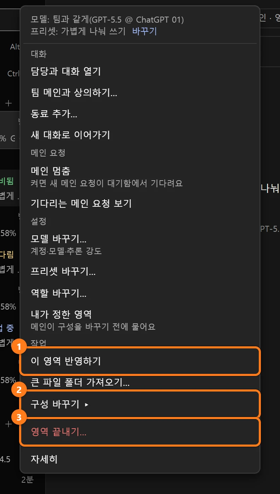

.")

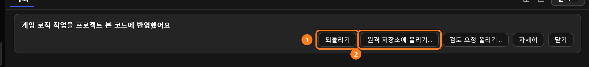

**무엇이 들어가나.** 담당이 반영 준비를 알린 그 시점까지만 들어가요. 그 뒤에 담당이 더 만든 저장 지점은 넣지 않고, 카드에 `그 뒤 저장 지점 2개는 넣지 않았어요`가 붙어요. 메뉴로 반영하는데 준비 알림이 없었으면 지금까지를 모두 넣고, 들어가는 저장 지점의 제목을 보여 줘요.

**묻지 않고 반영해요.** 처음 값은 검사를 통과하면 바로 반영하고 `되돌리기`를 보여 주는 것이에요. 반영 전에 꼭 확인하고 싶으면 `설정` > `팀 모드`의 `반영하기 전에 묻기`를 켜요. 그러면 카드의 `반영하기`를 눌러야 들어가요.

**반영이 기다리거나 멈출 때**

| 보이는 문구 | 뜻과 할 일 |
|---|---|
| `메인 폴더(space-game)에서 아직 저장 지점에 넣지 않은 파일 2개와 겹쳐요. 그 변경을 저장 지점에 넣거나 되돌린 뒤 '다시 반영'을 누르세요` | 메인 폴더에서 같은 파일을 고치고 있어요. 앱은 그 변경을 덮어쓰지 않아요. 정리한 뒤 `다시 반영`을 눌러요 |
| `메인 폴더(space-game)에서 하던 일이 끝나면 반영해요` | 메인 폴더에서 대화나 터미널이 일하는 중이에요. 그 일이 끝나면 `다시 반영`을 눌러요. 팀 메인이 다시 시도하기도 해요 |
| `메인 폴더(space-game)에서 하던 기록 정리가 끝나면 반영해요` | 진행 중인 Git 작업이 끝나면 저절로 다시 반영해요 |
| `검사가 실패해서 반영하지 않았어요` | `로그 보기`로 이유를 봐요. 팀 메인이 깨어나 다음을 정해요 |
| `프로젝트 본 코드의 새 변경과 겹쳐서 담당에게 정리를 맡겼습니다` | 아래 "충돌" 설명을 보세요 |

**되돌리기**

- 카드의 `되돌리기`는 본 코드가 그 반영 그대로일 때 돼요. 되돌리는 순간에 새로 생긴 저장 지점이 있으면 버리지 않고 지켜 둔 뒤 `되돌리는 사이에 생긴 저장 지점을 지켜 뒀어요`로 알려 줘요.
- 그 뒤 본 코드가 더 바뀌었으면 `메인에게 되돌리기 맡기기`가 보여요. 누르면 팀 메인에게 되돌려 달라는 부탁이 가요.
- 되돌리기도 사용자의 저장하지 않은 변경을 덮어쓰지 않아요. 겹치면 아무것도 잃지 않고 멈춰요.
- 메인 폴더에서 일하는 중이라 되돌리기가 기다리는 동안에는 다른 영역의 반영도 기다려요. 되돌리기가 그사이 들어온 반영까지 떼어 내지 않게 하려는 거예요. 되돌린 뒤 그 반영은 새 본 코드에서 다시 해요.
- 기다리는 동안 카드에 그 이유와 `되돌리기 취소`가 보여요. 누르면 되돌리기를 그만두고 본 코드는 반영한 그대로 남아요. 기다리던 다른 반영은 바로 이어져요. 팀 메인에게 “되돌리기 취소해 줘”라고 해도 돼요(계획을 보여 주고 내 답을 기다려요).

> **참고** 반영 카드는 그 반영을 지켜본 창에만 보여요. 창을 새로 고치거나 다른 기기에서 열면 이미 끝난 반영의 카드는 다시 나타나지 않아요. 그때 되돌리고 싶으면 팀 메인에게 “게임 로직 반영을 되돌려 줘”라고 말하세요.

**원격 저장소에 올리기.** 앱은 저절로 올리지 않아요. 카드의 `원격 저장소에 올리기…`나 `검토 요청 올리기…`를 누르면 원격 이름, 기록 이름, 실행할 명령을 먼저 보여 줘요. 처음 포커스는 `취소`에 있고, `올리기`를 눌러야 올려요. 올리기는 서비스가 도는 PC에서만 돼요. 팀 메인에게 말로 부탁해도 이 PC의 창에서 답해야 해요. 로그인이 필요하면 `원격 저장소에 로그인이 필요해요. 터미널에서 한 번 로그인해 주세요`가 떠요.

**충돌과 충돌 예상**

> **용어** 충돌: 두 쪽이 같은 파일의 같은 곳을 서로 다르게 고친 상태예요. 팀 화면에서는 "겹친 변경"이라고 불러요.

- **반영할 때 겹치면.** 처음에는 담당에게 정리를 맡겨요(`프로젝트 본 코드의 새 변경과 겹쳐서 담당에게 정리를 맡겼습니다`, `겹친 파일 3개`). 담당 대화에는 `팀이 보냄` 표시가 붙은 정리 요청이 들어가요. 담당이 정리하고 다시 준비를 알리면 다시 반영해요. 두 번째에도 겹치면 팀 메인이 깨어나 정해요.
- **충돌 예상.** 앱은 아직 반영하지 않은 영역들을 둘씩 견주어, 둘 다 반영하면 겹칠지를 미리 봐요. 겹칠 것 같으면 팀 메인이 받는 팀 소식에 “반영 때 충돌 예상: 화면 ↔ 게임 로직(src/hud.ts 외 1개)” 같은 줄이 붙어요. 팀 메인은 이것을 보고 반영 순서를 정하거나 담당에게 미리 맞추라고 할 수 있어요.
  - 사용자는 팀 메인 대화의 `팀 소식 · …` 줄에서 `원문 보기`를 눌러 이 줄을 봐요.
  - 이 줄은 알려 주기만 해요. 팀 메인을 깨우지 않고, 파일이나 기록을 바꾸지 않아요.

> **팁** 두 영역이 같은 파일을 자주 건드리면 충돌 예상이 계속 떠요. 그럴 때는 두 영역을 묶거나(아래 "재구성" 절) 팀 메인에게 한 영역이 끝난 뒤 다른 영역을 시작하라고 말하세요.

## 진행 중인 프로젝트 받아들이기

이미 작업 폴더와 대화가 여럿 있는 프로젝트에서 켜도 돼요. 앱은 새로 만들지 않고 **있는 작업 폴더를 그대로 영역으로 받아들여요.** 비유하면 이미 일하던 작업자를 짐 옮기지 않고 그 자리에서 팀에 넣는 것이에요.

1. 그 프로젝트에서 `팀 모드 켜기…`를 누르고 창의 `켜기`를 눌러요.
2. 앱이 작업 폴더마다 무엇이 진행 중인지 봐요(본 코드에 없는 저장 지점, 저장하지 않은 변경, 최근 대화).
3. 앱이 판단해서 영역으로 받아들일 폴더를 고르고, 나머지는 팀 밖에 남겨요. 팀 밖에 남긴 폴더 중 진행 중인 일이 있는 것은 카드에 따로 보여요.
4. 요약 카드에 결과가 보여요.

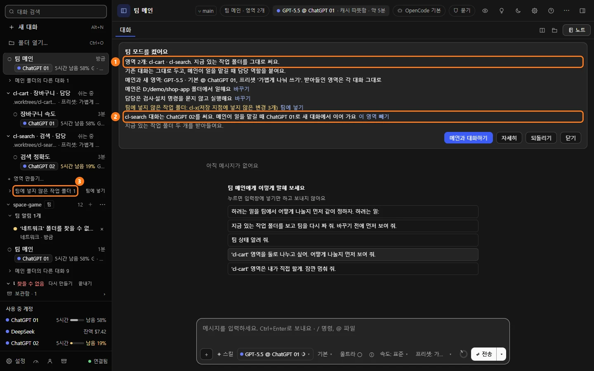

카드에는 이런 줄이 보여요.

- `영역 2개: cl-cart · cl-search.` `지금 있는 작업 폴더를 그대로 씁니다.`
- `기존 대화는 그대로 두고, 메인이 일을 맡길 때 담당 역할을 붙여요.`
- `팀에 넣지 않은 작업 폴더: cl-x(저장 지점에 넣지 않은 변경 3개)` + `팀에 넣기`

**받아들여도 바뀌지 않는 것**

- 폴더의 파일, 기록, 저장하지 않은 변경, 따로 치워 둔 변경.
- 폴더의 자리. 옮기지 않아요.
- 그 폴더의 대화. 지시, 도구, 프리셋, 승인 모드, 모델이 그대로예요. 대화가 길어도 그대로 이어 써요.

앱은 받아들인 폴더를 잠가서 다른 프로그램의 정리 기능이 지우지 못하게 해요.

**담당은 그 폴더의 가장 최근 대화예요.** 영역 이름은 폴더 이름이고, 앱이 붙인 부제가 뒤에 붙어요(예: “cl-cart · 장바구니”). 켤 때는 담당으로 적어 두기만 해요. 팀 메인이 그 영역에 **처음 일을 맡길 때** 그 대화에 담당 역할과 팀 도구를 붙여요. 그 전까지 그 대화는 사용자가 쓰던 것과 똑같아요.

**예외: 같은 회사의 다른 구독 계정.** 받아들인 대화가 팀 메인과 같은 회사의 다른 구독 계정을 쓰면 카드에 이런 줄이 붙어요(그림 ②).

`cl-search 대화는 ChatGPT 02를 써요. 메인이 일을 맡길 때 ChatGPT 01로 새 대화에서 이어 가요`

- 처음 일을 맡길 때, 앱이 인계 메모를 직접 만들어 팀 계정의 새 대화로 이어 가요. ChatGPT 02로는 아무것도 보내지 않아요.
- 옛 대화는 사용자의 `지난 대화`로 남아요.
- 이렇게 되는 것이 싫으면 `이 영역 빼기`로 그 폴더를 팀에서 빼요.

**팀에 넣지 않은 작업 폴더.** 받아들이지 않은 폴더는 사이드바 맨 아래 `팀에 넣지 않은 작업 폴더 1`에 남아요(그림 ③).

- 나중에 넣으려면 그 폴더 행의 `팀에 넣기`를 눌러요. 묶음 머리줄의 `팀에 넣기`는 묶음을 펼치기만 해요.
- 넣은 것도 결과 카드의 `되돌리기`로 되돌려요.
- 다른 도구(Claude, Codex 등)가 만든 작업 폴더와 경로에 `#`이 있는 폴더는 앱이 건드리지 않아요.

**팀에서 빼기.** 받아들인 영역의 `⋯` 메뉴에서 `팀에서 빼기`를 누르면 `'cl-x' 영역을 팀에서 뺄까요?`라고 물어요. `폴더, 기록 이름과 대화는 그대로 둬요. 기다리던 메인 요청은 보내지 않아요.` 붙였던 담당 역할과 팀 도구만 떼고 잠금을 풀어요.

**밖에서 바꾼 것 따라가기.** 영역 폴더에서 사용자가 다른 기록으로 바꾸거나 폴더를 옮기면 앱이 따라가고 팀 알림으로 알려 줘요(`'cl-cart' 영역이 다른 기록으로 바뀌어 따라갔어요`, `'cl-cart' 폴더가 옮겨져 따라갔어요`).

**새 영역 직접 만들기.** 팀이 켜진 프로젝트에서 새 대화를 열 때 `작업 위치`를 고르면 새 작업 폴더 대신 `새 영역`이 있어요. 누르면 `영역 만들기` 창이 떠요(위 "영역 직접 만들기" 절).

> **주의** 받아들인 폴더에 저장하지 않은 변경이 있어도 앱은 그 변경을 건드리지 않아요. 담당도 자기가 만들지 않은 변경은 저장하거나 지우지 않고 팀 메인에게 알려요. 남겨 둔 변경은 사용자가 직접 정리하세요.

## 큰 파일 폴더: 필요할 때만 받기

> **용어** 큰 파일 폴더: 그림, 소리, 3D 모델처럼 크고 코드 작업에는 거의 필요 없는 파일이 든 폴더예요(예: `assets`). Git LFS로 관리하는 폴더가 흔히 여기에 들어요.

게임 프로젝트는 큰 파일이 수십 GB일 수 있어요. 영역마다 그것을 한 벌씩 받으면 디스크와 시간이 많이 들어요. 그래서 새 영역 폴더는 **가벼운 폴더(큰 파일 제외)**로 만들어요. 큰 파일은 창고에 두고, 필요할 때만 가져와 쓰는 셈이에요.

**가져오기**

- 담당이 일하다 큰 파일이 필요하면 스스로 가져와요. 알림에 `화면: 큰 파일 폴더 1개(1MB)를 가져왔어요`처럼 보여요.
- 사용자가 가져오려면 영역 `⋯` 메뉴의 `큰 파일 폴더 가져오기…`를 눌러요(가벼운 폴더인 영역에만 보여요). `폴더(저장소 기준, 한 줄에 하나)`에 폴더 이름을, `이유`에 까닭을 적고 `가져오기`를 눌러요.
- 이미 이 PC의 공유 저장소에 있는 파일은 다시 내려받지 않아요.
- 내려받을 양이 500 MB를 넘거나 디스크를 2 GB 넘게 쓰면 먼저 물어요. 예: `화면 담당이 큰 파일 2.1 GB를 내려받으려 해요. 이유: …`, 단추는 `받기`와 `나중에`예요.

을 한 줄에 하나씩 적어요.")

**내려놓기는 저절로 돼요.** 따로 누를 메뉴가 없어요. 담당이 일을 끝냈다고 알릴 때, 반영한 뒤, 새 대화로 이어 간 뒤에 앱이 가져왔던 폴더를 내려놓아요.

- 그 폴더에 정리되지 않은 파일(고친 파일, 새 파일, 무시된 파일)이 하나라도 있으면 묻지 않고 그대로 둬요. 알림: `assets에 아직 정리되지 않은 파일이 있어 그대로 뒀어요`. 비용은 디스크 공간뿐이에요.
- 메인 멈춤인 영역은 건너뛰어요.

**큰 파일 폴더 목록은 프로젝트를 따라가요.** 팀을 켠 뒤에 프로젝트 본 코드에 새 큰 파일 폴더(그림, 소리, 시뮬레이션 결과처럼 코드가 아닌 큰 파일)가 생겨도 앱이 알아채요. 팀의 대화가 일을 마치거나 반영 같은 팀 동작이 끝날 때 본 코드의 새 저장 지점을 한 번씩 재요.

- 커진 폴더를 큰 파일 폴더 목록에 더하고 카드 `큰 파일 폴더 목록을 넓혔어요`를 보여 줘요. 팀 알림에도 같은 줄이 떠요.
- 가벼운 폴더가 아니던 영역 중 그 폴더가 없는 영역은 조용히 가벼운 폴더가 돼요. 파일이 바뀌지 않고 담당 대화도 새로 시작하지 않아요.
- 그 큰 파일을 만든 영역은 전체 폴더로 두고 `제안: … 폴더를 가벼운 폴더로 바꿀 수 있어요(…)`를 붙여요. 바꾸려면 영역 메뉴의 `파일 모양 바꾸기`를 써요.
- 메인 멈춤인 영역은 이번에 건너뛰고 다음에 다시 해요.
- 큰 내려받기, 큰 디스크 사용, 파일 지우기는 지금처럼 먼저 물어요.
- 카드의 `되돌리기`는 목록을 원래대로 돌리고, 바꿨던 영역을 전체 폴더로 되돌려요. 이때 내려받을 양을 먼저 보여 주고 물어요.

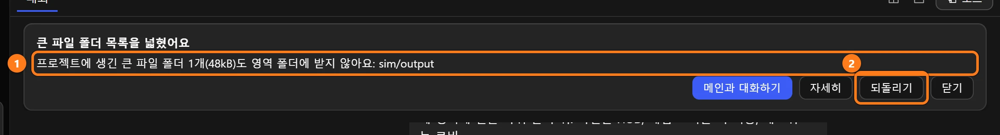

**무시된 큰 폴더 알림.** 영역 폴더 안의 Git이 무시하는 폴더(예: 게임 엔진의 `Library` 캐시)가 `이보다 많이 디스크를 쓰면 묻기`보다 커지면 팀 알림에 `화면: 무시된 폴더 Library가 3.1 GB를 써요(영역 폴더마다 따로 있어요)`처럼 한 번 알려요. 영역 폴더마다 따로 쌓이니 디스크를 확인하세요. 앱이 지우지는 않아요.

**지금 폴더 모양 보기.** 영역 메뉴의 `자세히`에 `가벼운 폴더(큰 파일 제외)`인지 `전체 폴더`인지와 `가져온 큰 파일 폴더`가 보여요.

**반영할 때의 큰 파일 검사.** 큰 파일 폴더를 바꾸는 변경이면, 반영 전에 앱 전용 전체 폴더(`D:\demo\space-game\.worktrees\.assets`)에서 큰 파일 검사 명령을 돌려요. 이 폴더를 처음 만들 때 크기가 기준을 넘으면 `확인하기…`로 물어요. 거기서 `두기`를 고르면 그 반영은 하지 않아요(`큰 파일 검사 폴더를 만들지 않아 반영하지 않았어요`). 검사가 필요 없으면 반영 카드의 `자세히`에 `큰 파일 검사는 건너뜀`이 보여요.

> **주의** 담당이 어떤 턴에 큰 파일 폴더를 가져오면 그 턴 아래에 `이 턴에 큰 파일 폴더를 가져와서 변경 표시가 빠질 수 있어요. 그 폴더 안의 변경은 되돌리기에서도 빠질 수 있어요`가 보여요. 그 폴더 안에서 바뀐 파일은 그 턴의 변경 목록에 안 나올 수 있고, 그 턴 앞으로 대화를 되돌려도 남을 수 있어요. 그 폴더 안의 변경은 리뷰 탭이나 Git으로 직접 확인하세요.

## 재구성: 나누기, 묶기, 끝내기, 모양 바꾸기

일이 진행되면 영역 구성이 맞지 않게 돼요. 한 영역이 너무 커지거나, 두 영역이 같은 파일을 건드리거나, 다 끝난 영역이 남아요. 이럴 때 영역을 다시 짜요.

**누가 하나요**

- **사용자**: 영역 `⋯` 메뉴에서 직접 골라요. 그 영역에서 일하는 대화가 있으면 쉴 때까지 기다리고, 카드에 이유를 보여 줘요.
- **팀 메인**: 필요해 보이면 스스로 제안하고 지우지 않는 단계는 바로 해요. 메인 멈춤인 영역이나 일하는 중인 영역은 건너뛰고 카드에 적어요(예: `'네트워크'는 메인 멈춤이라 이번 정리에서 건너뛰었어요`). 팀 메인도 무엇을 건너뛰었는지 말해 줘요. 카드의 그 줄에 있는 `다시 하기`를 누르면 그 일을 내가 한 동작으로 다시 해요. 그 영역이 일하는 중이면 끝난 뒤에 하고, 그동안 다른 반영은 기다려요.
- **말로**: 팀 메인에게 “네트워크 영역 끝내 줘”라고 해도 돼요. 영역 끝내기는 언제나 계획을 먼저 보여 주고 내 답을 기다려요.
- **팀 구성 다시 보기**: 프로젝트 `⋯` 메뉴의 `팀 구성 다시 보기…`를 눌러요.
  1. `어떻게 바꾸고 싶나요? (선택)`에 바라는 것을 적어요(예: `결제와 설정은 묶고, 다 끝난 로그인 영역은 끝내기`). 비워 두면 팀 메인이 알아서 살펴봐요. `제안 받기`를 누르기 전에는 아무것도 바뀌지 않아요.
  2. 팀 메인이 지금 팀을 살펴봐요(`메인이 팀 구성을 살펴보는 중…`). 바꿀 것이 줄마다 체크 상자와 함께 보여요. 확인이 필요한 것에는 `· 확인한 뒤 해요`, 하지 않는 것에는 `하지 않음:`과 이유가 붙어요.
  3. 할 것만 고르고 `고른 n개 적용`을 눌러요. 고른 것만 내가 한 동작으로 해요.
     - `영역 끝내기`는 처음에 체크되어 있지 않고 `되돌릴 수 없어요`가 붙어요.
     - 일하는 중이거나 메인 멈춤인 영역의 일도 체크되지 않은 채 보여요. 고르면 그 영역이 쉴 때 하는데, **그동안 팀의 다른 일(메인 요청, 반영)도 기다려요.** 급하지 않으면 그 영역이 쉰 뒤에 다시 보는 게 나아요.
     - 대화 옮기기 제안과 하지 않는 항목은 고를 수 없어요.
  4. 바로 정하기 어려우면 `팀 메인과 상의하기`를 눌러요. 받은 제안(`무시`로 닫은 것은 빼고)과 내가 적은 바람이 팀 메인 입력창에 들어가요(보내지 않아요).

, ③은 고른 것만 하는 고른 1개 적용이에요.")

어느 쪽이든 폴더 지우기와 큰 내려받기는 언제나 사용자가 확인해요. 결과 카드(`팀 구성을 바꿨어요`)에는 `되돌리기`가 있어요.

**영역 메뉴 읽는 법.** 영역 `⋯` 메뉴는 묶음으로 나뉘어 있어요.

| 묶음 | 항목 |
|---|---|
| `대화` | `담당과 대화 열기`, `팀 메인과 상의하기…`, `동료 추가…`, `새 대화로 이어가기` |
| `팀과 이야기하는 대화` | 담당과 동료가 한 줄씩 보여요. 담당 줄의 `메모 바꾸기…`, 동료 줄의 `역할 바꾸기…`, `동료에서 빼기`, 담당이 아닌 줄의 `이 대화를 담당으로` |
| `메인 요청` | `메인 멈춤`(`켜면 새 메인 요청이 대기함에서 기다려요`), `기다리는 메인 요청 보기` |
| `설정` | `모델 바꾸기…`, `프리셋 바꾸기…`, `역할 바꾸기…`, `내가 정한 영역` |
| `작업` | `이 영역 반영하기`, `큰 파일 폴더 가져오기…`, 폴더가 사라진 영역의 `다시 만들기…` |
| `구성 바꾸기` ▸ | 눌러서 펴요(키보드는 `Enter`, `Space`, `→`로 펴고 `←`로 접어요). 아래 표의 재구성 항목이에요 |
| 구분선 아래 빨간 글씨 | `영역 끝내기…`, `팀에서 빼기` |

`팀 메인과 상의하기…`는 그 영역을 어떻게 바꿀지 팀 메인과 상의하는 글을 팀 메인 입력창에 넣어요(보내지 않아요).

**영역 메뉴의 재구성 항목**(`구성 바꾸기` ▸ 안, `영역 끝내기…`는 맨 아래)

| 항목 | 하는 일 |
|---|---|
| `이름 바꾸기` | 영역의 `이름`과 `부제`를 바꿔요 |
| `나누기…` | 지금 작업에서 시작하는 새 영역을 하나 더 만들어요 |
| `영역 묶기…` | 다른 영역의 작업을 이 영역으로 모아요 |
| `파일 모양 바꾸기` | 가벼운 폴더와 전체 폴더 사이를 바꿔요 |
| `대화 옮기기…` | 다른 대화를 이 영역의 폴더로 옮겨요 |
| `영역 끝내기…` | 다 끝난 영역을 정리해요 |

**나누기**(`나누기…`): 한 영역의 일이 커졌을 때 써요. `이름`과 `할 일`을 적고 `나누기`를 눌러요.

- 새 영역은 원래 영역의 지금 작업에서 시작해요.
- 원래 영역의 담당이 인계 메모를 쓰고, 새 담당은 그 메모로 시작해요. 메인과 프리셋도 원래 영역과 같아요.
- 원래 영역은 그대로예요. 팀 메인이 일을 다시 나눠 맡겨요.
- 되돌리기는 새 영역을 끝내는 것이에요.

**영역 묶기**(`영역 묶기…`): 두 영역이 같은 파일을 자꾸 건드릴 때 써요. 이 영역에 묶을 영역을 골라요.

- 고른 영역의 작업, 인계 메모, 기다리던 메인 요청이 이 영역으로 와요.
- 고른 영역의 담당 대화는 `지난 대화`가 되고, 기록 이름은 남아요.
- 고른 영역의 폴더는 지우기 전에 다시 물어요.
- 고른 영역에 저장하지 않은 변경이 있으면, 그 담당에게 먼저 저장해 달라고 하고 기다려요.
- 두 영역의 변경이 겹치면 이 영역의 담당에게 정리를 맡기고 멈춰요.
- 되돌리기는 이 영역이 묶은 그대로일 때만 돼요. 그 뒤 이 영역에 새 저장 지점이 생기면 되돌릴 수 없고, 대신 묶여 들어간 영역을 그 기록으로 `다시 만들기` 할 수 있다고 카드가 알려 줘요.

**영역 끝내기**(`영역 끝내기…`): 다 끝난 영역을 정리해요. 먼저 `'게임 로직' 영역을 끝낼까요?`라고 물어요.

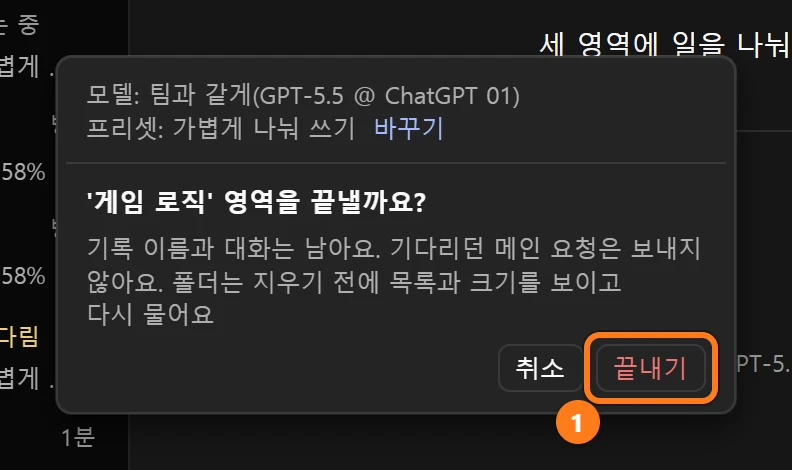

`끝내기`를 누르면 이렇게 해요.

1. 이름 없는 작업 상태의 저장 지점이 있으면 먼저 지켜 둬요.
2. 기다리던 메인 요청은 취소하고 팀 메인에게 목록을 알려요.
3. 담당 대화를 `지난 대화`로 둬요.
4. 마지막으로 폴더를 지울지 따로 물어요.

기록 이름과 대화는 지우지 않아요.

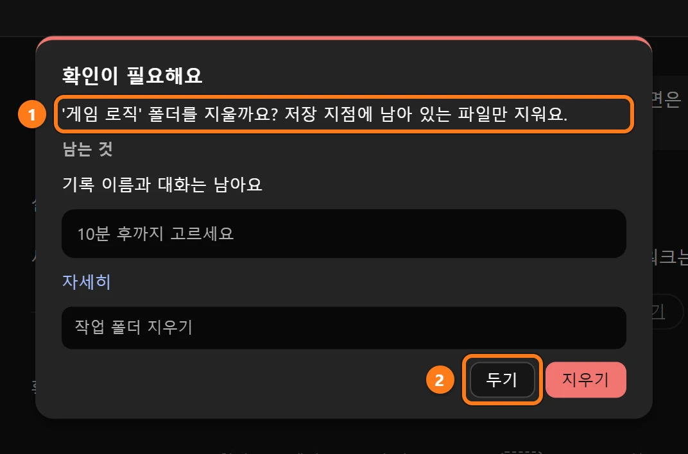

폴더 지우기 창에서 확인할 것:

- `지워지는 것`: 지울 파일 목록이에요. 큰 것부터 크기와 합계가 보여요. 다시 만들 수 없는 파일에는 `다시 만들 수 없음`이 붙어요. 데모처럼 지울 것이 추적 파일뿐이면 목록 대신 그렇다는 문장만 보여요.
- `남는 것`: `기록 이름과 대화는 남아요`. 반영하지 않은 작업이 있으면 `반영하지 않은 저장 지점 2개는 기록에 남아요`도 보여요.
- `.env` 같은 작은 설정 파일은 지우지 않고 팀 기록 폴더로 옮겨 둬요.
- 처음 포커스는 `두기`예요. `Enter`만 눌러서는 지워지지 않아요.
- `10분 후까지 고르세요`처럼 답할 시간이 있어요. 지나면 다시 물어요.
- 답하기 전에 폴더 안이 바뀌면 `그사이 목록이 바뀌었어요. 새 목록을 확인하세요`로 다시 물어요.

앱이 폴더를 지우지 않고 남기는 때:

- 저장하지 않은 변경이 있을 때.
- 안에 다른 저장소나 작업 폴더가 있을 때.
- 그 폴더에서 대화, 셸, 터미널이 돌고 있을 때.
- 다른 프로그램이 폴더를 쓰고 있을 때. 그 프로그램을 닫고 다시 해요.

저장하지 않은 변경이나 안의 다른 저장소 때문에 남겼으면 결과 카드에 `'게임 로직' 폴더에서 일한 흔적이 있어 남겼어요`가 보여요.

`두기`를 고르면 폴더는 그대로 남아요. 나중에 `영역 끝내기…`를 다시 고르면 지우기만 다시 물어요.

**끝낼 수 있음 제안.** 일이 모두 반영됐고, 폴더가 깨끗하고, 7일 동안 바뀐 것이 없는 영역은 사이드바에 `끝낼 수 있음`이 붙어요. 팀 메인 위에는 `제안: '네트워크' 영역을 끝낼 수 있어요(모두 반영됨, 7일 동안 변경 없음)`과 `끝내기…`, `무시`가 떠요. 앱은 스스로 끝내지 않아요. `무시`는 그 창에서만 숨겨요. 내가 정한 영역과 직접 작업 중인 영역에는 붙지 않아요. 팀 메인에게 “보스 담당을 계속 두고 싶어”처럼 계속 둘 역할로 만들어 달라고 하면, 팀 메인이 만든 영역도 처음부터 내가 정한 영역이 돼요.

**파일 모양 바꾸기**: 메뉴 아래 작은 글씨가 바꿀 모양이에요.

- `가벼운 폴더(큰 파일 제외)로`: 큰 파일 폴더를 이 영역에서 내려놓아요. 바뀌는 파일이 많아서 담당은 먼저 새 대화로 이어 가요. 그 폴더에 다시 만들 수 있는 파일이 있으면 지우기 전에 목록과 크기를 보이고 물어요. 저장하지 않은 변경이 있으면 하지 않아요.
- `전체 폴더로`: 큰 파일까지 모두 받아요. 내려받을 크기와 디스크 크기를 먼저 보이고 물어요. 대화는 그대로예요.

**대화 옮기기**(`대화 옮기기…`): 다른 대화를 이 영역의 폴더로 옮겨 그 폴더에서 이어 가요.

- 사용자만 할 수 있어요. 팀 메인은 제안만 해요.
- 팀 메인, 담당, 하위 에이전트 대화는 옮길 수 없어요.
- 되돌리기는 다시 원래 폴더로 옮기는 것이에요.

> **주의** 옮긴 대화는 옮기기 전 지점으로 되돌릴 수 없어요. 그 대화 위에 `이 대화는 옮기기 전 지점으로 되돌릴 수 없어요`가 보여요. 옮기기 전의 변경을 되돌려야 하면 옮기기 전에 먼저 하세요.

## 폴더가 사라진 영역 다시 만들기

영역 폴더를 탐색기에서 지웠거나, 다른 도구가 정리했거나, Git 정보 없이 옮기면 앱이 그 폴더를 찾지 못해요. 그러면 영역 행에 `찾을 수 없음`이 붙고, 팀 알림에 `'네트워크' 폴더를 찾을 수 없어요`가 떠요. 그 영역에는 메인 요청을 보내지 않아요.

**비유로 보면** 방이 무너졌어도 설계도(기록)는 남아 있어요. 그 설계도로 새 방을 다시 지으면 돼요.

1. `찾을 수 없음` 행의 `다시 만들기`를 눌러요(①). 영역 메뉴의 `다시 만들기…`도 같아요.
2. `'네트워크' 영역을 다시 만들까요?` 창이 떠요. 처음 포커스는 `취소`예요.
3. 내용을 읽고 `다시 만들기`를 눌러요(②).

과 다시 만들기 확인 창(②)이에요.")

**무엇이 일어나나**

- 그 영역의 기록에서 새 영역을 만들어요. 새 폴더와 새 담당 대화가 그 기록의 **마지막 저장 지점**에서 이어 가요.
- 이름과 할 일은 옛 영역의 것을 그대로 써요.
- 찾을 수 없는 옛 영역은 그대로 남아요. 옛 담당 대화와 기다리던 메인 요청도 그쪽에 남아요.

**정리하기.** 옛 영역이 필요 없으면 그 행의 `끝내기`를 눌러요. 폴더가 없으니 지울 것도 없어요(`폴더를 찾을 수 없어 지울 것이 없어요. 기록 이름과 대화는 남아요`). 기다리던 메인 요청은 취소되고 팀 메인에게 알려요.

> **주의** 폴더와 함께 사라진 "저장하지 않은 변경"은 되살릴 수 없어요. 다시 만들기는 마지막 저장 지점부터 시작해요. 폴더를 손으로 지우기 전에 꼭 저장 지점에 넣거나, 처음부터 `영역 끝내기…`로 정리하세요.

> **팁** 폴더를 다른 곳으로 옮겼을 뿐이면 다시 만들 필요가 없을 때도 있어요. 앱이 같은 저장소의 폴더를 찾으면 따라가고 `'네트워크' 폴더가 옮겨져 따라갔어요`를 알려 줘요. 따라가지 못했으면 원래 자리로 되돌려 놓아 보세요.

## 팀 설정

`설정` > `팀 모드`에서 바꿔요. 프로젝트 `⋯` 메뉴의 `팀 설정`으로도 열려요. 설정은 팀 모드가 켜진 **프로젝트마다** 따로예요. 위의 `프로젝트`에서 어느 프로젝트인지 확인하세요.

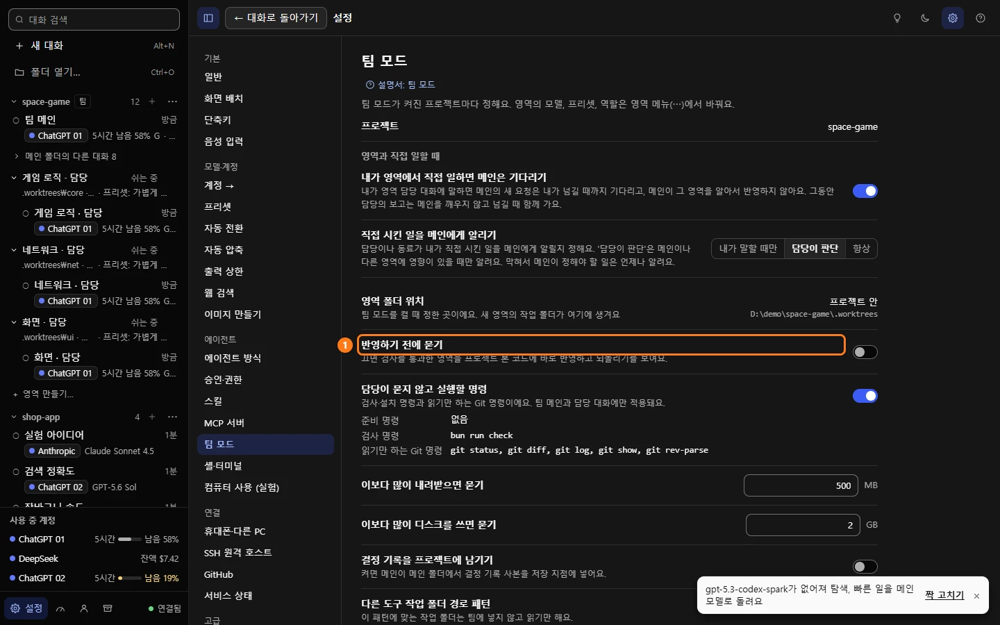

| 설정 | 처음 값 | 뜻 |
|---|---|---|
| `내가 영역에서 직접 일하면 메인은 기다리기` | 켜짐 | `영역과 직접 일할 때` 묶음이에요. 내가 영역 담당 대화에 말하면 메인의 새 요청은 내가 넘길 때까지 기다리고, 메인이 그 영역을 알아서 반영하지 않아요. 그동안 담당의 보고는 메인을 깨우지 않고 넘길 때 함께 가요(위 [직접 작업](#직접-작업)) |
| `직접 시킨 일을 메인에게 알리기` | `담당이 판단` | 담당이나 동료가 내가 직접 시킨 일을 메인에게 알릴지 정해요. `내가 말할 때만`, `담당이 판단`(메인이나 다른 영역에 영향이 있을 때만), `항상` 중에 골라요. 막혀서 메인이 정해야 할 일은 언제나 알려요 |
| `영역 폴더 위치` | `프로젝트 안` | 새 영역의 작업 폴더가 생기는 곳이에요(`프로젝트 안` 또는 `프로젝트 옆 폴더`와 그 경로). 팀 모드를 켤 때 정하고, 여기서는 보기만 해요 |
| `반영하기 전에 묻기` | 꺼짐 | 켜면 검사를 통과해도 카드의 `반영하기`를 눌러야 반영해요 |
| `담당이 묻지 않고 실행할 명령` | 켜짐 | `준비 명령`, `검사 명령`, `읽기만 하는 Git 명령`을 묻지 않고 실행해요. 팀 메인과 담당 대화에만 적용돼요. 끄면 `묻지 않고 실행하지 않기`가 보이고 매번 물어요 |
| `이보다 많이 내려받으면 묻기` | 500 MB | 큰 파일을 이만큼 넘게 내려받으면 먼저 물어요 |
| `이보다 많이 디스크를 쓰면 묻기` | 2 GB | 큰 파일 폴더가 디스크를 이만큼 넘게 쓰면 먼저 물어요 |
| `결정 기록을 프로젝트에 남기기` | 꺼짐 | 켜면 팀 메인이 결정 기록 사본을 메인 폴더에 저장 지점으로 남겨요 |
| `다른 도구 작업 폴더 경로 패턴` | — | 이 패턴에 맞는 작업 폴더는 팀에 넣지 않고 읽기만 해요. `패턴 추가`로 더해요(64개까지) |
| `팀 지시문` | `기본` | `고급` 묶음이에요. 아래 "팀 지시문"을 보세요 |

영역의 모델, 프리셋, 역할은 여기가 아니라 영역 메뉴(`⋯`)에서 바꿔요. 프리셋 자체는 `설정` > `프리셋`에서 만들어요(14장).

**팀 지시문.** `팀 지시문`을 누르면 팀 메인, 담당, 동료가 받는 지시문을 탭(`메인`, `담당`, `동료`)마다 볼 수 있어요.

- 위의 `프로그램이 정한 부분`은 모델이 받는 글 그대로이고 고칠 수 없어요. 앱이 지키는 규칙(요청을 기다리는 법, 반영하는 길, 화면 낱말 등)이라서요. 담당과 동료 탭의 `'…'` 자리에는 영역마다 다른 값이 들어가요.
- 아래 `일하는 방식` 칸은 고칠 수 있어요(역할마다 2,000자까지, `{n} / 2,000자`로 세요). 고치면 `고쳐 씀`, 그대로면 `기본`이 보여요. `저장`을 누르면 그 팀의 대화들에 한 번 새로 알려져요. `기본으로 되돌리기`로 처음 글로 돌아가요.
- 일하는 방식이 위 규칙과 어긋나면 위 규칙이 이겨요. 2,000자를 넘거나 `</context>`, `<context key=`, `Today's date:`로 시작하는 줄이 있으면 저장되지 않고 그 까닭이 보여요. 몰래 자르지 않아요.

프로젝트에 맞춘 규칙은 여기에 한 줄씩 더하면 좋아요. 예를 들면 이래요(내 프로젝트에 맞게 고쳐 쓰세요).

```text
메인:
- 반영이 끝나면 생성 파일을 다시 만들고, DEBUG 실행으로 확인하고, 기록 문서에 적는다. LIVE와 원격 올리기는 사용자가 따로 승인한다.
- 메인만 고치는 파일: CHANGELOG.md, docs/registry.md. 담당에게 이 파일을 고치라고 하지 않는다.
담당:
- 긴 납품 글은 파일로 남기고 보고에는 그 경로를 적는다.
- 메인만 고치는 파일: CHANGELOG.md, docs/registry.md. 바꿀 내용은 보고에 적는다.
```

> **참고** 팀 지시문은 이 PC의 창에서만 고쳐요. 팀 메인에게 말로 고쳐 달라고 해도 고치지 않아요.

> **참고** 팀 설정은 서비스가 도는 PC에서만 바꿀 수 있어요. 휴대폰이나 다른 기기에서는 `DEMO-PC에서 바꾸세요`처럼 보이기만 해요. 팀 메인에게 말로 부탁해도 이 PC의 창에서 답해야 바뀌어요.

## 그 밖에 알아 두면 좋아요

**결정 기록.** 팀이 정한 것(예: “저장 파일의 필드 이름은 snake_case로”)을 남겨 두는 곳이에요.

- 팀 메인이 스스로 적기도 하고, 사용자가 프로젝트 `⋯` 메뉴의 `결정 적기`로 적기도 해요. `제목`과 `내용`(무엇을 정했고 왜)을 쓰고 `적기`를 누르면 `결정 기록 4번을 적었습니다`처럼 번호가 붙어요.
- 기록은 작업 폴더 밖의 팀 기록 폴더에 있어서 반영할 때 겹치지 않아요. 사용자가 적은 기록은 다음 팀 소식으로 팀 메인에게 가요.

**팀 모드 끄기.** 프로젝트 `⋯` 메뉴의 `팀 모드 끄기`를 눌러요.

- `그대로 두고 끄기`: 대화, 작업 폴더, 기록을 모두 그대로 둬요.
- `끝난 영역 정리하고 끄기`: 다 반영된 깨끗한 영역을 함께 끝내고, 폴더 지우기를 한 번에 물어요(예: `끝난 영역 3개 정리(7.5 GB)`). 답하면 팀 모드를 꺼요.
- 어느 쪽이든 기다리던 메인 요청은 보내지 않아요. 담당 대기열에 남은 요청은 카드의 `담당 대기열의 메인 요청 2개 지우기`로 지워요.
- 다시 켜면 같은 팀으로 이어 가요.

**휴대폰에서.** 휴대폰이나 다른 PC에서도 팀 보기, 상태, 메인 멈춤 켜고 끄기, `메인에게 넘기기`, 담당과의 대화, 반영 카드 보기, `결정 적기`가 돼요(24장). 폴더 지우기 같은 확인, 원격 저장소에 올리기, 팀 설정 바꾸기는 PC에서만 해요. 기기에는 `DEMO-PC에서 확인하세요`처럼 보여요. 휴대폰에서 팀 메인에게 말로 시키면 그 기기 권한으로 답할 수 있는 것만 실행되고, 나머지는 PC에서 답해야 해요(위 "말로 시키기").

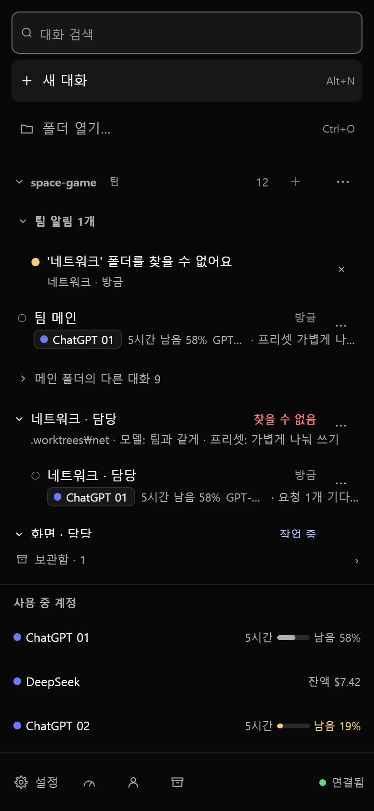

**원격 호스트에서.** SSH로 연결한 Linux 호스트의 프로젝트에서도 팀 모드를 켤 수 있어요. 영역 폴더는 그 호스트에 생겨요(23장).

## 조심하세요

> **주의** 팀 메인은 검사를 통과한 영역을 **묻지 않고** 프로젝트 본 코드에 반영해요. 반영마다 확인하고 싶으면 `반영하기 전에 묻기`를 켜세요.

> **주의** `메인 멈춤`은 저절로 풀리지 않아요. 직접 일을 마쳤으면 꼭 끄세요. 꺼야 기다리던 메인 요청이 들어가요.

> **주의** `직접 작업 중`도 저절로 끝나지 않아요. 다 했으면 `메인에게 넘기기`를 누르거나 담당에게 “메인한테 넘겨”라고 하세요. 넘겨야 기다리던 메인 요청이 들어가고 팀 메인이 그동안의 일을 받아요.

> **주의** 영역 폴더를 탐색기에서 직접 지우지 마세요. 저장하지 않은 변경이 함께 사라져요. 정리는 `영역 끝내기…`로 하세요. 앱은 저장하지 않은 변경이 있는 폴더를 지우지 않아요.

> **주의** 같은 계정을 쓰는 영역은 그 계정의 한도를 함께 써요. 영역이 많고 프리셋이 무거우면 한도가 빨리 줄어요. 팀 보기의 계정 칩과 한도 %를 보며 쓰세요.

> **주의** 원격 저장소에 올리기는 앱이 절대 저절로 하지 않아요. 올리기 창에서 명령을 확인하고 `올리기`를 누를 때만 올라가요.

## 더 알아보기

- 프리셋과 ★, 하위 에이전트: [14장](14-presets.md)
- 전환 비용과 캐시: [11장](11-cache-switch-cost.md)
- 같은 회사의 여러 계정과 자동 전환 규칙: [12장](12-multiple-accounts.md)
- 자동 압축: [13장](13-auto-compaction.md)
- 컴퓨터 사용: [18장](18-computer-use.md)
- 원격 서버에서 팀 모드: [23장](23-remote-team.md)
- 휴대폰·다른 PC: [24장](24-phone-other-pc.md)
- 설계 문서: `own/docs/06-team-worktrees.md`
