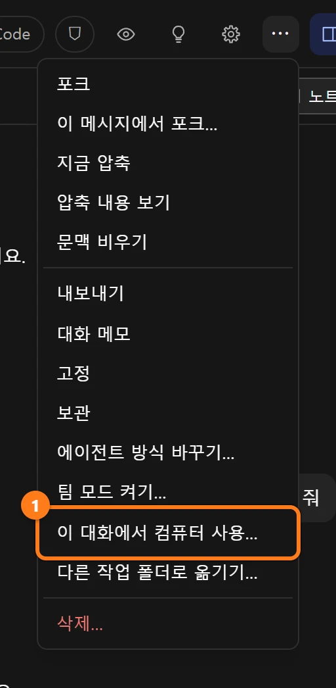
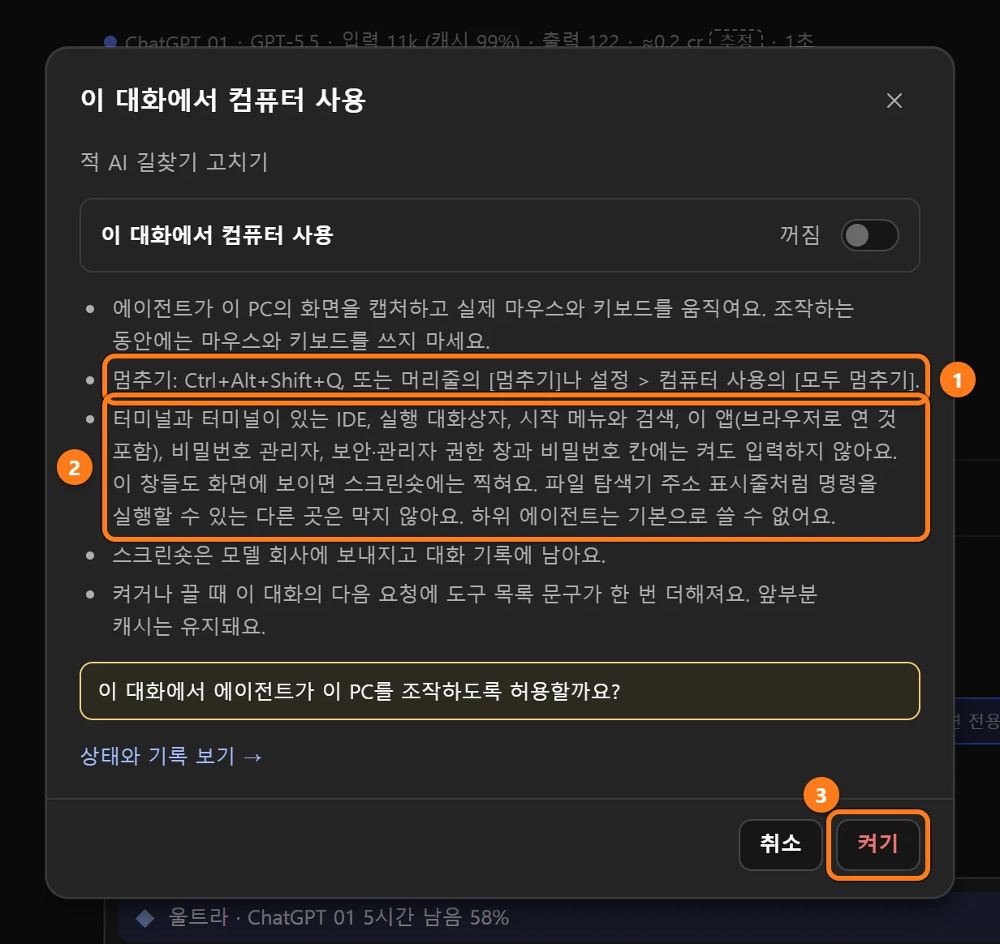
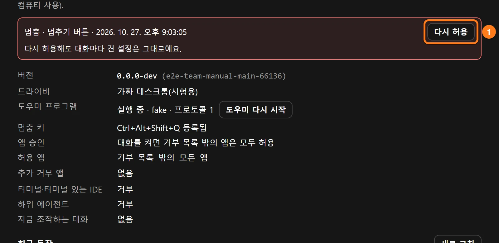

# 18. 컴퓨터 사용

**한 줄 요약** — 에이전트가 Windows 화면을 보고, 진짜 마우스와 키보드로 다른 앱을 조작하게 하는 기능이에요. 세션마다 따로 켜고, `Ctrl+Alt+Shift+Q`를 누르면 언제든 모두 멈춰요.

> **용어** 컴퓨터 사용: 에이전트가 화면을 찍어(스크린숏) 보고, 마우스를 움직이고 글자를 입력해서 앱을 다루는 것이에요. 사람이 PC 앞에 앉아 하는 일을 대신 하는 셈이에요.

## 왜 필요해요?

- 어떤 일은 명령어나 파일만으로는 못 해요. 예를 들면 그림 편집 앱에서 아이콘을 다듬기, 만든 게임을 실행해 화면을 확인하기, 설정 창의 체크 상자를 누르기 같은 일이에요.
- 컴퓨터 사용을 켜면 에이전트가 이런 일을 사람처럼 화면을 보며 해요.
- 대신 에이전트가 **진짜** 마우스와 키보드를 움직여요. 그래서 켜는 것도, 멈추는 것도 사용자가 분명히 정하도록 만들었어요.

### 앱 안 브라우저와 무엇이 달라요?

| | 앱 안 브라우저 ([19장](19-browser-pane.md)) | 컴퓨터 사용 (이 장) |
|---|---|---|
| 다루는 곳 | 앱 안의 브라우저 탭 | Windows 화면 전체와 다른 앱 |
| 마우스·키보드 | 쓰지 않아요(탭 안에서만 동작) | 진짜 마우스·키보드를 움직여요 |
| 켜는 법 | 데스크톱 앱이면 처음부터 있어요 | 세션마다 직접 켜고 동의해요 |
| 그동안 내가 PC 쓰기 | 돼요 | 조작하는 동안은 손을 떼야 해요 |

비유하면 앱 안 브라우저는 "유리 상자 안에서만 움직이는 로봇 팔"이에요. 컴퓨터 사용은 "내 자리에 앉아 내 마우스를 잡는 대리인"이에요. 웹 페이지만 다룰 일이면 앱 안 브라우저가 더 안전해요.

## 이렇게 써요

### 1. 세션에서 켜기

1. 컴퓨터 사용을 맡길 세션을 열어요.
2. 세션 머리줄 오른쪽의 `⋯`를 누르고 `이 대화에서 컴퓨터 사용…`을 골라요(그림 ①).

3. 창이 열려요. 위쪽 스위치 `이 대화에서 컴퓨터 사용`이 `꺼짐`으로 보여요.
4. 스위치 아래 안내를 읽어요. 무엇을 하는지, 멈추는 법(그림 ①), 입력하지 않는 곳(그림 ②), 스크린숏이 어디로 가는지, 캐시 이야기가 있어요.
5. 스위치를 누르면 노란 상자에 `이 대화에서 에이전트가 이 PC를 조작하도록 허용할까요?`가 떠요.
6. `켜기`(그림 ③)를 누르면 켜져요. **이 확인이 곧 동의예요.** 마음이 바뀌면 `취소`를 눌러요.

- 끌 때는 묻지 않아요. 같은 창에서 스위치를 다시 누르면 바로 꺼져요.
- 이 설정은 **그 세션 하나에만** 걸려요. 다른 세션은 그대로 꺼져 있어요.
- 새로 만든 세션은 언제나 꺼진 채로 시작해요. 다만 켜 둔 세션을 포크하면 그 설정이 함께 복사될 수 있어요. 포크한 세션은 머리줄 칩을 한 번 확인하세요.

> **참고** 켜거나 끌 때 이 세션의 다음 요청에 도구 목록 문구가 한 번 더해져요. 대화 앞부분 캐시는 그대로라 비용은 작아요.

> **참고** 컴퓨터 사용은 **그림을 볼 수 있는 모델**에서만 돼요. 에이전트가 스크린숏을 봐야 화면을 다룰 수 있기 때문이에요. 대화의 모델이 그림을 못 보면(그림 입력이 꺼진 로컬 모델 등) 스위치가 잠기고 `이 대화의 모델은 그림을 볼 수 없어서 컴퓨터 사용을 켤 수 없어요.`로 시작하는 안내가 보여요. 그림을 볼 수 있는 모델로 바꾸면 켤 수 있어요. 화면을 글자로 대신 읽어 주는 방법은 없어요. 로컬 모델의 `그림 입력`은 [20장](20-account-kinds.md) 20.6에 있어요.

### 2. 일 맡기기와 머리줄 칩 읽기

켜고 나면 평소처럼 부탁하면 돼요. 예: “메모장을 열고 오늘 할 일을 적어 줘.”

세션 머리줄에 작은 칩이 생겨요. 칩을 누르면 켜기 창이 다시 열려요. 머리줄이 붐비면(팀 메인 대화에서 사이드바와 작업 패널을 함께 열 때 등) 칩이 화면 모양 아이콘만 남고 `멈추기`는 빨간 네모가 돼요. 마우스를 올리면 지금 상태가 보여요([5장](05-screen-tour-theme.md)).

| 칩 | 뜻 |
|---|---|
| `컴퓨터 사용` | 이 세션은 켜져 있어요. 지금은 조작하지 않아요 |
| `PC 조작 중 · …` | 방금 그 앱을 조작했어요(점 뒤가 앱 이름) |
| `컴퓨터 사용 멈춤` | 비상 정지가 걸려 있어요. 아래 4절을 보세요 |
| `컴퓨터 사용 · 이 모델로는 안 돼요` | 켜 둔 채 그림을 못 보는 모델로 바꿨어요. 이 모델로는 조작하지 않아요. 그림을 볼 수 있는 모델로 바꾸거나, 칩을 눌러 꺼요 |

 ② “멈추기”는 모든 세션의 조작을 멈춰요")

켜 둔 대화의 모델을 그림을 못 보는 모델로 바꾸면 `바꾼 모델은 그림을 볼 수 없어서 이 대화의 컴퓨터 사용이 동작하지 않아요.`로 시작하는 알림이 한 번 떠요. 그 모델이 컴퓨터 도구를 부르면 앱이 거절하고, 에이전트는 그 이유를 전해요.

> **팁** 에이전트가 조작하는 동안에는 마우스와 키보드에서 손을 떼세요. 사람과 에이전트가 동시에 움직이면 엉뚱한 곳을 누를 수 있어요.

### 3. 멈추기: 비상 정지

언제든, 어느 창에 있든 멈출 수 있어요. 방법은 세 가지이고, 어느 것을 써도 **모든 세션**이 한꺼번에 멈춰요.

<figure class="diagram">
<svg class="dg-wide" viewBox="0 0 680 236" role="img" aria-label="Ctrl, Alt, Shift, Q를 함께 누르면 어느 창에서든 모든 세션의 컴퓨터 사용이 멈춘다. 진행 중인 동작을 끊고, 눌린 키와 버튼을 놓고, 다시 허용할 때까지 어떤 세션도 조작하지 못한다" xmlns="http://www.w3.org/2000/svg" font-family="inherit" style="width:100%;height:auto;max-width:680px">
<defs><marker id="d18-arrow" viewBox="0 0 10 10" refX="9" refY="5" markerWidth="7" markerHeight="7" orient="auto"><path d="M0,0 L10,5 L0,10 z" fill="currentColor"/></marker></defs>
<g fill="currentColor" fill-opacity="0.08" stroke="currentColor" stroke-opacity="0.6" stroke-width="1.6">
<rect x="10" y="20" width="76" height="54" rx="9"/>
<rect x="110" y="20" width="76" height="54" rx="9"/>
<rect x="210" y="20" width="86" height="54" rx="9"/>
<rect x="320" y="20" width="54" height="54" rx="9"/>
</g>
<g fill="currentColor" font-size="17" font-weight="700" text-anchor="middle" style="font-family:'Segoe UI',system-ui,sans-serif">
<text x="48" y="53">Ctrl</text>
<text x="148" y="53">Alt</text>
<text x="253" y="53">Shift</text>
<text x="347" y="53">Q</text>
</g>
<g fill="currentColor" font-size="18" text-anchor="middle" fill-opacity="0.7"><text x="98" y="53">+</text><text x="198" y="53">+</text><text x="308" y="53">+</text></g>
<line x1="384" y1="47" x2="420" y2="47" stroke="currentColor" stroke-width="1.8" marker-end="url(#d18-arrow)"/>
<rect x="426" y="16" width="244" height="62" rx="10" fill="#d64545" fill-opacity="0.12" stroke="#d64545" stroke-width="2"/>
<text x="548" y="42" font-size="14.5" font-weight="700" text-anchor="middle" fill="currentColor">모든 세션이 바로 멈춰요</text>
<text x="548" y="63" font-size="12" text-anchor="middle" fill="currentColor" fill-opacity="0.8">어느 창에서 눌러도 돼요</text>
<text x="10" y="114" font-size="13" fill="currentColor" fill-opacity="0.8">멈추면 이렇게 돼요</text>
<g fill="currentColor" fill-opacity="0.06" stroke="currentColor" stroke-opacity="0.45" stroke-width="1.5">
<rect x="10" y="126" width="196" height="64" rx="10"/>
<rect x="242" y="126" width="196" height="64" rx="10"/>
<rect x="474" y="126" width="196" height="64" rx="10"/>
</g>
<g stroke="currentColor" stroke-width="1.6"><line x1="208" y1="158" x2="238" y2="158" marker-end="url(#d18-arrow)"/><line x1="440" y1="158" x2="470" y2="158" marker-end="url(#d18-arrow)"/></g>
<g fill="currentColor" font-size="13" text-anchor="middle">
<text x="108" y="153">진행 중인 동작을</text>
<text x="108" y="173">끊어요</text>
<text x="340" y="153">눌려 있던 키와</text>
<text x="340" y="173">마우스 버튼을 놓아요</text>
<text x="572" y="153">'다시 허용' 전까지</text>
<text x="572" y="173">아무 세션도 조작 못 해요</text>
</g>
<text x="10" y="222" font-size="12" fill="currentColor" fill-opacity="0.75">같은 일을 하는 단추: 세션 머리줄의 '중지', 설정 > 컴퓨터 사용의 '모두 중지'</text>
</svg>
<svg class="dg-narrow" viewBox="0 0 320 404" role="img" aria-label="Ctrl, Alt, Shift, Q를 함께 누르면 어느 창에서든 모든 세션의 컴퓨터 사용이 멈춘다. 진행 중인 동작을 끊고, 눌린 키와 버튼을 놓고, 다시 허용할 때까지 어떤 세션도 조작하지 못한다" xmlns="http://www.w3.org/2000/svg" font-family="inherit" style="width:100%;height:auto;max-width:360px">
<defs><marker id="d18n-arrow" viewBox="0 0 10 10" refX="9" refY="5" markerWidth="7" markerHeight="7" orient="auto"><path d="M0,0 L10,5 L0,10 z" fill="currentColor"/></marker></defs>
<g fill="currentColor" fill-opacity="0.08" stroke="currentColor" stroke-opacity="0.6" stroke-width="1.6">
<rect x="6" y="10" width="62" height="48" rx="8"/>
<rect x="86" y="10" width="56" height="48" rx="8"/>
<rect x="160" y="10" width="76" height="48" rx="8"/>
<rect x="254" y="10" width="56" height="48" rx="8"/>
</g>
<g fill="currentColor" font-size="15" font-weight="700" text-anchor="middle" style="font-family:'Segoe UI',system-ui,sans-serif">
<text x="37" y="40">Ctrl</text>
<text x="114" y="40">Alt</text>
<text x="198" y="40">Shift</text>
<text x="282" y="40">Q</text>
</g>
<g fill="currentColor" font-size="15" text-anchor="middle" fill-opacity="0.7"><text x="77" y="40">+</text><text x="151" y="40">+</text><text x="245" y="40">+</text></g>
<line x1="160" y1="62" x2="160" y2="84" stroke="currentColor" stroke-width="1.8" marker-end="url(#d18n-arrow)"/>
<rect x="10" y="88" width="300" height="58" rx="10" fill="#d64545" fill-opacity="0.12" stroke="#d64545" stroke-width="2"/>
<text x="160" y="112" font-size="14.5" font-weight="700" text-anchor="middle" fill="currentColor">모든 세션이 바로 멈춰요</text>
<text x="160" y="133" font-size="12" text-anchor="middle" fill="currentColor" fill-opacity="0.8">어느 창에서 눌러도 돼요</text>
<text x="10" y="176" font-size="12.5" fill="currentColor" fill-opacity="0.8">멈추면 이렇게 돼요</text>
<g fill="currentColor" fill-opacity="0.06" stroke="currentColor" stroke-opacity="0.45" stroke-width="1.5">
<rect x="10" y="186" width="300" height="42" rx="10"/>
<rect x="10" y="244" width="300" height="42" rx="10"/>
<rect x="10" y="302" width="300" height="42" rx="10"/>
</g>
<g stroke="currentColor" stroke-width="1.6"><line x1="160" y1="229" x2="160" y2="242" marker-end="url(#d18n-arrow)"/><line x1="160" y1="287" x2="160" y2="300" marker-end="url(#d18n-arrow)"/></g>
<g fill="currentColor" font-size="13" text-anchor="middle">
<text x="160" y="212">진행 중인 동작을 끊어요</text>
<text x="160" y="270">눌려 있던 키와 마우스 버튼을 놓아요</text>
<text x="160" y="328">'다시 허용' 전까지 아무 세션도 조작 못 해요</text>
</g>
<g fill="currentColor" font-size="11.5" fill-opacity="0.75">
<text x="10" y="372">같은 일을 하는 단추: 세션 머리줄의 '중지',</text>
<text x="10" y="391">설정 > 컴퓨터 사용의 '모두 중지'</text>
</g>
</svg>
<figcaption>그림: 비상 정지 키와 멈춘 뒤의 일이에요(실제 화면이 아니에요). 멈춘 상태는 앱이나 서비스를 다시 켜도 그대로예요.</figcaption>
</figure>

멈추는 방법 세 가지예요.

1. **키보드**: `Ctrl+Alt+Shift+Q`. 어느 창에 있든 눌러도 돼요.
2. 세션 머리줄 칩 옆의 `멈추기` 단추(머리줄이 붐비면 빨간 네모).
3. `설정` > `컴퓨터 사용 (실험)`의 `모두 멈추기` 단추.

- 멈춘 상태는 앱이나 서비스를 다시 시작해도 그대로예요. 실수로 풀리지 않아요.
- 세션마다 켜 둔 스위치는 지워지지 않아요. 멈춘 동안은 그냥 아무 조작도 못 할 뿐이에요.
- 멈춘 뒤에는 머리줄 칩이 `컴퓨터 사용 멈춤`으로 바뀌어요.

### 4. 다시 허용하기

1. `설정 > 컴퓨터 사용`을 열어요.
2. 빨간 상자에 `멈춤 · … · …`처럼 누가 언제 멈췄는지 보여요. 이유는 `Ctrl+Alt+Shift+Q`, `멈추기 버튼`, `도우미 프로그램이 예기치 않게 끝남` 중 하나예요.
3. `다시 허용`(그림 ①)을 누르면 다시 조작할 수 있어요.

> **주의** `도우미 프로그램이 예기치 않게 끝남`이 보이면 앱이 스스로 안전하게 멈춘 거예요. 에이전트가 무엇을 하던 중이었는지 대화에서 먼저 확인하고 다시 허용하세요.

## 에이전트가 입력하지 않는 곳(금지 앱)

컴퓨터 사용을 켜도 아래 창에는 **글자도, 클릭도 보내지 않아요.** 이 창들이 명령을 실행하거나 보안 설정을 바꿀 수 있기 때문이에요.

| 막는 곳 | 왜 막나요 |
|---|---|
| 터미널, 터미널이 있는 IDE(VS Code 등) | 아무 명령이나 실행할 수 있어요 |
| 실행 대화상자(`Win+R`), 시작 메뉴와 검색 | 이름을 치고 Enter만 눌러도 프로그램이 실행돼요 |
| 이 앱(브라우저로 연 것 포함) | 에이전트가 자기 권한을 스스로 바꾸지 못하게 해요 |
| 다른 에이전트 앱(Claude, ChatGPT·Codex 앱, Codex 관리 앱) | 그 앱의 승인 단추를 누르면 에이전트가 스스로를 허락할 수 있어요 |
| 비밀번호 관리자 | 비밀번호를 지켜요 |
| 보안 창, 관리자 권한 창, 레지스트리·작업 관리자 같은 관리 도구 | 시스템 설정을 지켜요 |
| 비밀번호 칸 | Tab·Enter·화살표 같은 이동 키만 보내요. 붙여넣기도 막아요 |

- `Win+R`, `Win+X`, `Ctrl+Alt+Delete`, 그리고 멈춤 키 자체도 보내지 않아요.
- 에이전트가 글자를 치는 도중에 앞의 창이 바뀌어 금지 앱이 되면, 남은 글자는 보내지 않고 멈춰요.
- 더 막고 싶은 앱이 있으면 설정 파일의 `own-computer-use` 항목에 추가 거부 앱으로 넣을 수 있어요. 어렵다면 Claude에게 맡겨도 돼요([부록 C](92-claude-and-you.md)).

> **주의** 금지 앱이라도 **화면에 떠 있으면 스크린숏에는 찍혀요.** 비밀번호나 개인 정보가 보이는 창은 미리 닫거나 최소화하세요.

> **주의** 파일 탐색기의 주소 표시줄처럼 명령을 실행할 수 있는 곳 중 일부는 막지 않아요. 컴퓨터 사용은 믿는 일에만, 지켜보면서 쓰세요.

## 상태와 기록: `설정 > 컴퓨터 사용`

`설정 > 컴퓨터 사용`의 컴퓨터 사용 부분에서 지금 상태와 최근 동작을 봐요. 켜기 창의 `상태와 기록 보기`로도 열려요.

”으로 보여요(실제 설치에서는 “Windows 내장 드라이버”). 데모 빌드의 버전 줄과 helper 줄은 그림에서 뺐어요.")

| 줄 | 뜻 |
|---|---|
| `사용 가능` / `사용할 수 없음` | 쓸 수 있는지. 쓸 수 없으면 이유가 함께 보여요([26장](26-troubleshooting.md)) |
| `멈춤 키` | `Ctrl+Alt+Shift+Q 등록됨`이어야 정상이에요 |
| `앱 승인` | 기본은 `대화를 켜면 거부 목록 밖의 앱은 모두 허용`이에요 |
| `허용 앱`, `추가 거부 앱` | 설정 파일에서 정한 목록이에요 |
| `터미널·터미널 있는 IDE`, `하위 에이전트` | 기본은 둘 다 `거부`예요 |
| `지금 조작하는 대화` | 한 번에 한 세션만 화면을 써요. 지금 그 세션이 보여요 |
| `최근 동작` | 시각·세션·동작·앱·결과 표. `새로 고침`으로 다시 읽어요 |

> **참고** `최근 동작`에는 입력한 글자, 창 제목, 스크린숏을 남기지 않아요. 글자 수와 창 제목을 알아볼 수 없게 바꾼 값만 남겨요.

## 알아 두면 좋아요

- **한 번에 한 세션만** 화면을 써요. 두 세션이 동시에 마우스를 다투지 않아요. 한 세션의 일이 끝나면 바로, 일하는 중이라도 2분쯤 조작이 없으면 다른 세션이 이어받을 수 있어요. 일이 끝날 때 그 세션이 누른 채 둔 마우스 버튼도 놓아요.
- **스크린숏 뒤에 새 창이 뜨면 누르지 않아요.** 에이전트가 화면을 찍은 뒤 그 자리에 알림이나 다른 프로그램의 창이 새로 뜨면, 그 창을 누르지 않고 화면을 다시 찍어요. 같은 앱의 메뉴나 대화상자는 그대로 눌러요.
- **긴 작업 중에 대화가 압축돼도** 사용자가 시킨 일이면 컴퓨터 사용을 이어 가요.
- **하위 에이전트는 기본으로 못 써요.** 부모 세션에서 켜도 하위 에이전트에게는 넘어가지 않아요.
- **그림을 못 보는 모델에서는 쓰지 않아요.** 켜 두었어도 그 모델로는 조작하지 않아요.
- **팀 모드**([17장](17-team-mode.md))는 컴퓨터 사용을 켜지 않아요. 팀 메인이나 팀 소식이 시작한 턴에서는 켜져 있어도 쓰지 않아요. 같은 담당 대화라도 사용자가 직접 시킨 일에서는 써요. 사이드바 영역 행에 `데스크톱 사용 중`이 보이면 그 영역이 지금 화면을 쓰는 중이에요.
- **휴대폰이나 다른 PC**([24장](24-phone-other-pc.md))에서는 켤 수 없어요. 상태를 보고 멈추는 것만 돼요.
- **SSH 원격 세션**([22장](22-ssh-remote.md))에는 컴퓨터 사용이 없어요. 원격 서버에는 조작할 화면이 없기 때문이에요.
- 잠금 화면, 사용자 계정 컨트롤(UAC) 창이 떠 있을 때, 원격 데스크톱 창을 최소화했을 때는 조작할 수 없어요.
- 앱마다 처음 조작할 때 묻는 방식(`앱마다 처음 조작할 때 묻기(실험)`)도 있지만, 아직 실험 단계예요. 기본 방식을 권해요.

## 조심하세요

> **주의** 스크린숏은 모델 제공자(OpenAI, Anthropic 등)에게 보내지고 세션 기록에 남아요. 회사 기밀이나 개인 정보가 보이는 화면에서는 켜지 마세요.

> **주의** 다른 프로그램이 `Ctrl+Alt+Shift+Q`를 이미 쓰고 있으면 앱이 이 키를 등록하지 못해요. 그동안은 안전을 위해 **입력 동작이 모두 거부돼요.** `설정 > 컴퓨터 사용`의 `멈춤 키` 줄에 경고가 보이면 그 프로그램을 끄세요.

> **주의** 에이전트가 앱을 조작하는 동안 자리를 오래 비우지 마세요. 이상하면 망설이지 말고 `Ctrl+Alt+Shift+Q`를 누르세요. 멈춰도 잃는 것은 없어요.

## 더 알아보기

- 설계: [01 구성 §10.2 Computer use](../01-architecture.md), 화면 문구: [03 화면 §4.4](../03-ui-ux.md)
- 앱 안 브라우저: [19장](19-browser-pane.md), 팀 모드와의 관계: [17장](17-team-mode.md)
- 이미지 만들기 도구: [10.17](10-conversation-tools.md#1017-이미지-만들기-그림-만들기와-고치기). 전에는 이 장과 같은 설정 페이지에 있었고, 지금은 `설정 > 이미지 만들기`에 따로 있어요.
