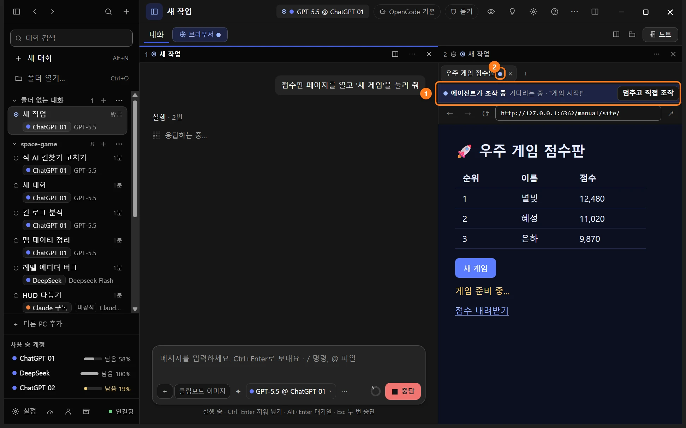
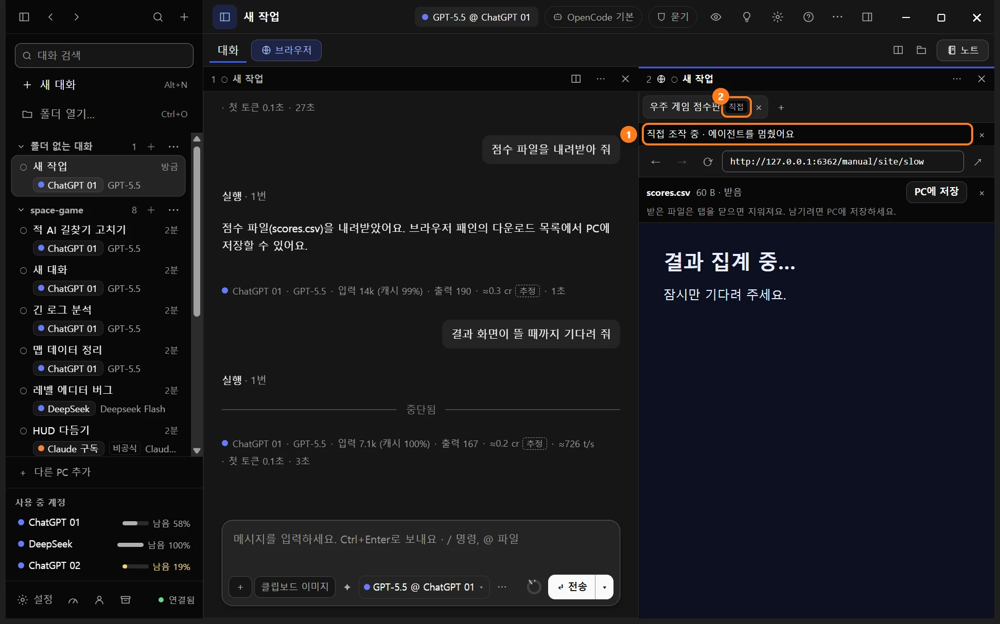
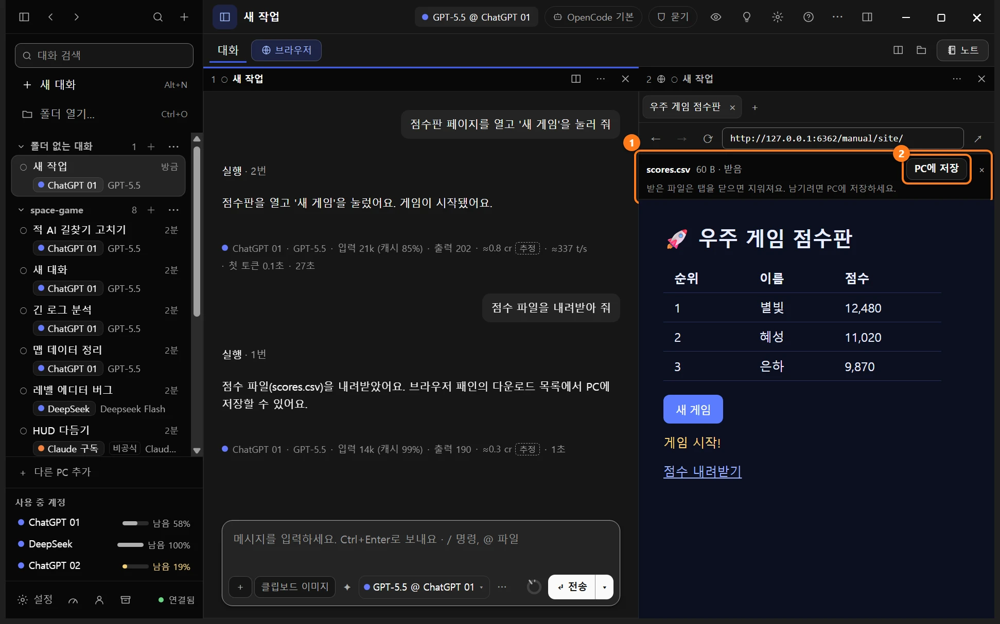

# 19. 앱 안 브라우저와 분할 화면

**한 줄 요약** — 데스크톱 앱 안에 에이전트 전용 브라우저가 있어요. 대화 **옆 칸**에 열어 에이전트가 웹 페이지를 열고 누르고 읽는 모습을 그대로 보고, 필요하면 `멈추고 직접 조작`으로 넘겨받아요. 한 창을 4칸까지 나눠 여러 대화와 브라우저를 나란히 볼 수도 있어요. 연결해 둔 휴대폰이나 다른 PC에서도 이 브라우저를 보고 조작할 수 있어요(아래 7). SSH 원격 대화에서도 똑같이 쓰고, 그때 `localhost`는 그 서버예요(아래 8).

> **용어** 브라우저 패인: 앱 화면 안에 들어 있는 작은 웹 브라우저예요. 세션마다 따로 있고, 에이전트가 쓰는 도구예요. 이 설명서에서는 "앱 안 브라우저"라고 불러요.

## 왜 필요해요?

- 에이전트가 만든 웹 화면이 제대로 보이는지 직접 열어 확인하게 할 수 있어요. 예: “개발 서버를 띄우고 점수판 페이지에서 새 게임 버튼이 되는지 확인해 줘.”
- 에이전트가 하는 일을 눈으로 볼 수 있어요. 무엇을 누르는지, 어디서 막혔는지 바로 알아요.
- 진짜 마우스와 키보드를 쓰지 않아요. 그래서 에이전트가 브라우저를 쓰는 동안에도 사용자는 PC로 다른 일을 해도 돼요. 화면 전체를 다루는 [컴퓨터 사용(18장)](18-computer-use.md)보다 안전한 이유예요.

## 이렇게 써요

### 1. 브라우저 열기

1. 데스크톱 앱에서 세션을 열어요.
2. 대화 위 줄의 `브라우저` 단추를 누르거나 `Ctrl+Shift+B`를 눌러요. 그 대화의 브라우저가 **대화 옆 칸**에 열려요. 한 번 더 누르면 닫혀요.
3. 에이전트에게 웹 페이지를 열어 달라고 하거나, 위쪽 주소 칸(`주소나 검색어 입력`)에 직접 넣고 `Enter`를 눌러요. 열린 탭이 없어도 돼요. 새 탭으로 열려요.

주소 칸에는 이런 것을 넣어요.

- **주소**: `example.com`, `https://…`. `localhost:3000`이나 `127.0.0.1:5173`처럼 대화가 도는 컴퓨터의 주소는 `http://`로 열어요(이 PC의 대화면 이 PC, SSH 원격 대화면 그 서버, 아래 8).
- **검색어**: 주소가 아닌 글(띄어쓰기가 있는 글 등)은 Google 검색으로 열어요. 예: “solid js 문서”.
- **열지 않는 것**: `C:\…` 같은 PC의 파일 경로, `file://`, `javascript:` 같은 주소는 열지 않고 `이 주소는 열 수 없어요. http·https 주소나 검색어를 넣어 주세요.`를 보여요. 파일 경로를 검색 서비스로 보내지 않으려는 거예요.
- 한글을 입력하는 중에 누른 `Enter`는 글자를 마치는 데만 쓰여요. 한 번 더 누르면 열려요.

> **참고** 브라우저는 **대화마다** 따로 있어요. 대화를 열지 않은 화면(새 대화 화면 등)에서는 주소 칸이 회색이고 `대화를 열면 여기에 주소를 넣을 수 있어요`가 보여요. 대화를 열거나, 새 대화에서 첫 메시지를 보낸 뒤에 주소를 넣어요.

- `설정` > `화면 배치` > `워크스페이스 보기`를 `탭으로 보기`로 바꾸면 예전처럼 `대화`과 `브라우저`가 탭이 돼요. 그때 `Ctrl+Shift+B`는 두 탭을 오가요.
- 창이 좁으면 나란히 놓을 자리가 없어서 저절로 탭으로 보여요(`창이 좁아 탭으로 보여요`).

> **참고** 앱 안 브라우저는 **이 PC의 데스크톱 앱에서** 돌아요. 연결한 휴대폰과 다른 PC에서는 대화의 `⋯` > `브라우저`로 그 화면을 봐요(아래 7). `own open --browser`로 연 보통 웹 브라우저 화면(브라우저 폴백)에는 `브라우저`가 없어요. 대화 칸 나누기(아래 6)는 웹 브라우저로 연 화면에서도 돼요.

### 2. 에이전트가 조작하는 모습 보기

에이전트가 브라우저를 쓰기 시작하면 이렇게 보여요.

- 페이지 위 막대에 `에이전트가 조작 중`과 지금 하는 동작이 보여요(그림 ①). 동작은 `클릭`, `입력`, `스크롤`, `이동`, `화면 읽기`, `스크린숏`, `기다리는 중` 같은 낱말로 보여요.
- 에이전트가 쓰는 탭에는 작은 점이 붙어요(그림 ②). 점에 마우스를 올리면 `에이전트가 쓰는 탭`이라고 나와요.
- 대화 위 `브라우저` 단추에도 점이 보여요. 브라우저 칸을 닫아 두어도 에이전트가 브라우저를 쓰는 중인지 알 수 있어요.
- 탭 줄의 `+`로 새 탭을, `×`로 탭을 닫아요. 주소 칸 왼쪽은 `뒤로`, `앞으로`, `새로 고침`이에요.
- 주소 칸 오른쪽 화살표(↗)는 `외부 브라우저로 열기`예요. 지금 페이지를 평소 쓰는 브라우저(Edge 등)로 열어요.

### 3. 직접 넘겨받기

에이전트가 엉뚱한 곳을 누르거나, 내가 직접 해 보고 싶을 때 써요.

1. 막대 오른쪽의 `멈추고 직접 조작`을 눌러요.
2. 이 세션의 턴이 멈춰요. 막대가 `직접 조작 중 · 에이전트를 멈췄어요`로 바뀌어요(그림 ①).
3. 탭에는 `직접` 표시가 붙어요(그림 ②). 이제 마우스로 페이지를 마음대로 다뤄도 돼요.
4. 에이전트에게 다시 맡기려면 입력창에서 이어서 부탁해요. 예: “지금 열린 결과 페이지에서 이어서 확인해 줘.”

> **팁** 넘겨받은 탭에서 한 일은 에이전트가 모를 수 있어요. 다시 맡길 때 무엇을 바꿨는지 한 줄로 알려 주면 좋아요.

### 4. 받은 파일 저장하기

에이전트(또는 내가)가 페이지에서 파일을 내려받으면 페이지 위에 목록이 생겨요.

- 받은 파일은 처음에 **임시 폴더**에만 있어요. 에이전트는 이 파일을 읽을 수 있어요.
- 내 PC에 남기려면 `PC에 저장`을 누르고 저장할 곳을 골라요.
- 저장하지 않은 파일이 있는 탭을 닫으려 하면 `저장하지 않은 파일 …개가 지워져요`가 떠요. `PC에 저장` 또는 `그냥 닫기`를 골라요.
- 한 파일은 5 MB까지만 받아요. 더 크면 받기가 취소돼요.

### 5. “브라우저 도구 없이 시작했어요”가 보일 때

브라우저 칸과 대화 위에 `이 대화는 브라우저 도구 없이 시작했어요.`가 보일 수 있어요. 대화 위 안내에는 브라우저 칸과 같은 말이 이어져요: 켤 수 있으면 `브라우저 칸의 ‘이 대화에서 켜기’로 여기서 켤 수 있어요. 대화 앞부분 캐시는 유지돼요.`, 켤 수 없으면 그 이유예요.

- **왜 그런가요?** 에이전트가 쓸 수 있는 도구 목록은 세션을 만들 때 정해져요. 도중에 저절로 바뀌면 캐시가 흔들리기 때문이에요. 브라우저를 맡을 데스크톱 앱이 없을 때 만든 세션은 처음부터 브라우저 도구가 없어요: 보통 웹 브라우저(브라우저 폴백)에서 만든 세션, 그리고 **PC의 데스크톱 앱이 꺼져 있을 때** 휴대폰이나 다른 PC에서 만든 세션이에요.
- **휴대폰에서 만든 세션은요?** PC의 데스크톱 앱이 켜져 있으면(트레이에 숨어 있어도 돼요) 휴대폰에서 만든 세션도 처음부터 브라우저 도구가 있어요. 데스크톱에서 만든 세션을 휴대폰에서 이어 갈 때도 에이전트가 브라우저를 써요. 예전 판에서 휴대폰으로 만든 세션은 도구 없이 시작했으니 아래처럼 한 번 켜 주세요.
- **어떻게 하나요?** 데스크톱 앱에서 그 세션을 열고 `이 대화에서 켜기` → `켜기`를 눌러요. 휴대폰에서는 대화의 `⋯` > `브라우저`에 같은 `이 대화에서 켜기`가 있어요(`메시지 보내기` 권한이 있을 때). 다음 요청에 도구 목록 문구가 한 번 더해지지만, 대화 앞부분 캐시는 그대로예요.
- **주소 칸에 바로 넣어도 돼요.** 주소나 검색어를 넣고 `Enter`를 누르면 `‘solid 문서’를 열려면 이 대화에서 브라우저 도구를 먼저 켜야 해요.`처럼 묻고 `켜고 열기`가 보여요. 누르면 도구를 켜고 그 주소를 새 탭으로 열어요. `취소`하면 아무것도 열지 않아요.
- **켜지 않고 내 탭만 열 수는 없어요.** 앱 안 브라우저의 탭은 에이전트의 브라우저 도구와 한 묶음이라, 탭이 생기면 도구도 목록에 올라가요. 그래서 먼저 켜는지 물어요.
- 버튼이 없으면 켤 수 없는 이유가 한 줄로 보여요(대화 위 안내도 같은 말이에요). 이때 주소 칸은 회색이고 `브라우저 도구가 없어 주소를 열 수 없어요`가 보여요.
  - `승인 모드가 ‘사용자 지정’이라 이 대화에서는 켤 수 없어요. 필요하면 새 대화를 만드세요.`: 승인 규칙을 직접 고친 대화예요. 승인 모드를 `묻기` 같은 모드로 바꾸면 버튼이 생겨요([8장](08-approvals.md)). 아니면 새 대화를 만들어요.
  - `서비스가 답하지 않아 지금은 켤 수 없어요. 다시 연결되면 켤 수 있어요.`: 서비스와 다시 연결되면 버튼이 생겨요.
  - `다른 규칙이 이 대화의 브라우저 도구를 막고 있어요.`: 누군가 일부러 넣은 규칙이 막고 있어요. 새 대화를 만들어요.
  - 그 밖의 이유(서비스 버전, 연결 권한)도 같은 식으로 보여요. 필요하면 새 대화를 만들어요. 데스크톱 앱에서 만든 새 대화는 처음부터 브라우저 도구가 있어요.

> **참고** 브라우저 도구는 데스크톱 앱이 그 대화의 브라우저를 **붙들고 있는 동안에만** 에이전트 목록에 있어요. 앱을 `앱 종료`로 끄면 에이전트는 브라우저를 쓸 수 없고, 다시 켜면 돌아와요. 붙거나 떨어질 때마다 그 대화의 다음 요청에 도구 목록 문구가 한 번 더해져요(앞부분 캐시는 그대로).

### 6. 분할: 여러 대화를 한 창에 나란히

한 창을 **4칸까지** 나눠 여러 대화(와 그 대화의 브라우저)를 나란히 봐요. `설정` > `화면 배치` > `워크스페이스 보기`가 `나란히 (기본)`일 때 돼요.

, ② 칸 메뉴, ③ 칸 사이 경계(끌어서 크기를 바꿔요).")

**칸 여는 법**

- 대화 위 줄의 `오른쪽에 분할` 단추, 또는 `Ctrl+Alt+\`(오른쪽), `Ctrl+Alt+Shift+\`(아래): 지금 칸 옆에 같은 프로젝트의 새 대화 화면을 열어요.
- 사이드바 세션 줄을 `Ctrl`+클릭하거나 `⋯` → `분할해서 열기`: 그 세션을 지금 칸 옆에 열어요.
- 사이드바 세션 줄을 칸으로 **끌어다 놓기**: 칸의 가장자리에 놓으면 그쪽에 새 칸으로(`오른쪽에 열기` 등), 가운데에 놓으면 그 칸에 열어요.

**칸 다루기**

- ① 칸 머리줄에는 번호, 상태 기호(○는 쉬는 중), 제목이 보여요. 머리줄을 끌어 다른 칸 가장자리에 놓으면 옮기고, 가운데에 놓으면 두 칸이 자리를 바꿔요(`여기와 자리 바꾸기`).
- ② 칸 메뉴(`분할 메뉴`): `오른쪽에 분할`, `아래로 분할`, `브라우저 열기`/`브라우저 닫기`, `분할 닫기`. 칸 머리줄 오른쪽의 `×`도 `분할 닫기`예요(`Ctrl+Alt+W`).
- ③ 칸 사이 경계를 끌어 크기를 바꿔요.
- `Ctrl+Alt+1`–`Ctrl+Alt+4`로 그 번호의 칸으로 가요(위에서 아래, 왼쪽에서 오른쪽 순서). `F6`/`Shift+F6`은 사이드바 → 칸들 → 작업 패널 순으로 옮겨요.
- 4칸이 넘으면 `분할은 4개까지예요`, 더 나눌 수 없는 방향이면 `이 분할은 그 방향으로 더 나눌 수 없어요`가 떠요.
- 헤더와 작업 패널은 **지금 칸**(테두리가 밝은 칸)의 대화를 따라가요.

**칸마다 브라우저**(데스크톱 앱)

- 브라우저 칸은 옆 채팅 칸의 세션을 따라가요. 칸 메뉴의 `이 대화에 고정`을 고르면 지금 세션에 붙어 있어요(`옆 대화 따라가기`로 되돌려요).
- 한 세션의 브라우저는 한 칸에만 보여요. 다른 칸에 같은 세션을 열면 `이 대화의 브라우저는 다른 분할에 열려 있어요`와 `여기로 옮기기`가 보여요.
- 칸마다 브라우저의 로그인과 쿠키가 따로예요. 한 칸에서 로그인해도 다른 칸은 로그인하지 않은 상태예요. 앱을 다시 켜면 모두 사라져요.

> **팁** 칸 배치는 창마다 기억해요. 창이 좁아지면 탭으로 보였다가, 다시 넓히면 나란히 돌아와요.

### 7. 휴대폰·다른 PC에서 보기

밖에서 휴대폰으로 일을 시켜 놓고, 에이전트가 브라우저에서 무엇을 하는지 그 자리에서 봐요. 브라우저는 여전히 이 PC에서 돌고, 그 화면이 기기로 가요. 자세한 화면은 [24장](24-phone-other-pc.md)의 "휴대폰에서 앱 안 브라우저 보기"에 있어요.

1. **PC에서 한 번 켜요.** `설정` > `휴대폰·다른 PC` > `연결된 기기`에서 그 기기의 `권한 바꾸기` → `브라우저`를 켜고 `저장`. 기본은 꺼져 있어요.
2. **기기에서 열어요.** 대화의 `⋯` > `브라우저`. 탭, 주소 칸, 뒤로·앞으로·새로 고침과 지금 화면이 보여요.
3. **직접 조작해요.** 화면을 누르고 밀어요. 글자는 `⌨` 단추로 키보드를 올려 넣어요(한글도 돼요). 에이전트가 쓰는 중이면 데스크톱처럼 `멈추고 직접 조작`을 먼저 눌러요. 그 전에는 눌러도 페이지에 가지 않아요.

- **PC 앱은 켜져 있어야 해요.** 창을 최소화했거나, X로 트레이에 숨겼거나, 창이 다른 대화를 보여 주고 있어도 돼요. `앱 종료`로 껐다면 기기에 `PC의 데스크톱 앱이 꺼져 있어요.`가 보여요.
- **`휴대폰 크기로 보기`**: 기기의 `⋯`에서 켜면 PC의 브라우저가 그 휴대폰 화면 크기로 바뀌어요. 에이전트가 만든 화면이 휴대폰에서 어떻게 보이는지 볼 때 써요. 켜 둔 동안에는 PC 창의 브라우저와 에이전트도 그 크기로 봐요. 끄거나 보기를 닫으면 PC 크기로 돌아와요.
- **보이는 동안만 보내요.** 기기에서 보기를 닫거나 다른 앱으로 가면 화면 보내기가 멈춰요. 페이지가 그대로면 보내는 것도 없어요.
- **기기로 넘어가지 않는 것**: 받은 파일은 지금처럼 PC의 임시 폴더에 있고 `PC에 저장`은 PC에서 해요. 페이지가 파일 선택 창을 열면 기기에는 `파일 선택은 PC에서 해 주세요.`만 보여요. 카메라·마이크 같은 페이지 권한은 언제나 거절이에요. PC의 클립보드는 기기에서 읽거나 바꿀 수 없어요.
- **SSH 원격 대화**도 같은 방법으로 봐요. 그 대화의 브라우저도 이 PC의 데스크톱 앱에 있어요(아래 8).

> **주의** `브라우저` 권한을 준 기기에는 앱 안 브라우저에 **로그인해 둔 페이지 화면**이 그대로 가요. 꼭 필요한 기기에만 켜고, 기기를 잃어버리면 `연결 끊기`를 누르세요. 권한을 끄거나 연결을 끊으면 보내던 화면이 바로 멈춰요.

### 8. SSH 원격 대화의 브라우저

[SSH 원격 대화](22-ssh-remote.md)에서도 브라우저가 이 PC의 데스크톱 앱 안에 열려요. 여는 법, 에이전트가 조작하는 모습, `멈추고 직접 조작`, `휴대폰 크기로 보기`가 모두 이 PC의 대화와 같아요. 다른 점은 **주소가 어느 컴퓨터를 뜻하는지**예요.

- **`localhost`는 그 서버예요.** 서버에서 개발 서버를 띄웠다면(에이전트가 띄웠든 내가 터미널에서 띄웠든) 주소 칸에 `localhost:3000`이나 `127.0.0.1:5173`을 넣으면 **서버의** 그 화면이 열려요. `ssh -L` 같은 포트 전달을 따로 할 필요가 없어요. `[::1]`, `0.0.0.0`도 같아요.
- **서버의 이름도 서버를 거쳐요.** 호스트를 추가할 때 쓴 이름(ssh 설정의 별칭, 직접 넣은 주소, ssh가 실제로 접속하는 주소)으로 연 주소는 서버가 대신 열어요.
- **그 밖의 주소는 이 PC에서 바로 열려요.** `example.com`, 회사 사이트, 검색 같은 주소는 서버를 거치지 않아요. 평소 이 PC의 브라우저로 여는 것과 같은 곳에서 나가요.
- **에이전트도 같은 브라우저를 써요.** 서버에서 도는 에이전트가 이 PC의 데스크톱 앱이 켜져 있는 동안(트레이에 숨어 있어도 돼요) 브라우저 도구로 페이지를 열고 읽어요. 예: “개발 서버를 띄우고 localhost:5173에서 로그인 화면이 뜨는지 확인해 줘.” 앱을 `앱 종료`로 끄면 그동안 에이전트는 브라우저를 쓸 수 없어요.
- **휴대폰에서도 봐요.** 그 대화의 `⋯` > `브라우저`로 PC의 이 브라우저를 보고 조작해요(위 7, [24장](24-phone-other-pc.md)).
- **로그인은 대화마다 따로예요.** 이 PC의 대화와도, 같은 서버의 다른 대화와도 쿠키·로그인을 나누지 않아요. 앱을 다시 켜면 사라져요.
- **서버 쪽에 따로 할 것은 없어요.** 이 기능은 PC의 앱만 바뀌었어요. PC 앱을 새 판으로 바꾼 뒤 호스트에 `업데이트 필요`가 보이면, 늘 하듯 `업데이트`로 판만 맞추면 돼요([22장](22-ssh-remote.md)의 "업데이트").

**연결이 끊기면**

- SSH 연결이 끊기면 브라우저 칸에 `SSH 연결이 끊겼어요`와 `… 다시 연결되면 탭을 다시 열어요.`가 보여요. 아직 한 번도 연결되지 않았으면 `SSH 서버에 아직 연결되지 않았어요`예요. 그동안 이 대화의 페이지는 열 수 없어요.
- 다시 연결되면 탭이 저절로 다시 열리고 페이지를 새로 불러와요. 끊기기 전에 페이지에 써 둔 내용은 남지 않을 수 있어요.
- 연결은 살아 있는데 서버에서 개발 서버가 꺼져 있으면 `페이지를 열 수 없어요`와 `서버 …에서 localhost:3000에 연결하지 못했어요. 그 서버에서 개발 서버가 켜져 있는지 확인한 뒤 새로 고침하세요.`가 보여요. 개발 서버를 켠 뒤 `새로 고침`을 누르세요.

> **참고** 끊기고 다시 붙을 때마다 에이전트의 도구 목록 문구가 그 대화의 다음 요청에 한 번씩 더해질 수 있어요. 앞부분 캐시는 그대로예요(위 5의 참고와 같아요).

## 알아 두면 좋아요

- **세션마다 따로예요.** 세션 A의 탭은 세션 B에서 보이지 않아요. 같은 세션을 다른 창에서 열면 그 창으로 옮겨 가고, 앞 창에는 `이 대화의 브라우저가 다른 창에서 열렸어요.`가 보여요.
- **평소 브라우저와 분리돼 있어요.** Edge나 Chrome의 로그인, 쿠키, 저장한 비밀번호를 쓰지 않아요. 앱 안 브라우저에서 한 로그인도 앱을 다시 켜면 사라져요. 분할한 칸끼리도 로그인이 따로예요.
- **`localhost`는 대화가 도는 컴퓨터예요.** 이 PC의 대화에서는 이 PC의 개발 서버(`http://localhost:3000` 같은 주소)를, SSH 원격 대화에서는 그 서버의 개발 서버를 그대로 열어요(위 8).
- 페이지를 불러오지 못하면 브라우저 칸에 `페이지를 열 수 없어요`와 이유가 보여요. 주소와 연결을 확인하고 `새로 고침`을 누르세요.
- **웹 페이지 권한은 주지 않아요.** 카메라, 마이크, 위치, 알림 같은 권한 요청은 묻지 않고 모두 거절해요(`이 브라우저는 카메라·마이크·위치 권한을 주지 않아요.`).
- **팝업은 새 탭으로 열려요.** 페이지의 개발자 도구는 꺼져 있어요.
- 한동안 쓰지 않으면 `브라우저 연결이 쉬는 중이에요. 탭을 누르거나 에이전트가 쓰면 다시 연결해요.`가 보여요. 정상이에요. 탭을 누르면 다시 붙어요.
- 휴대폰이나 다른 PC가 브라우저를 보는 동안에는, PC 창을 최소화하거나 숨겨도 그 페이지는 화면에 보이는 것처럼 돌아요(애니메이션, 영상).

## 조심하세요

> **주의** 받은 파일은 **탭이나 창을 닫으면 지워져요.** 남길 파일은 닫기 전에 `PC에 저장`하세요.

> **주의** 앱 안 브라우저에 진짜 계정의 비밀번호를 넣지 마세요. 에이전트가 페이지 내용을 읽고, 그 내용이 모델 제공자에게 가요. 로그인이 필요한 확인은 시험용 계정으로 하세요.

> **참고** 승인 규칙에 따라 에이전트가 브라우저를 쓰기 전에 승인 요청 상자(입력창 위)에서 허락을 물을 수 있어요([8장](08-approvals.md)). 허락을 기다리는 동안 대상 탭이 바뀌면 그 동작은 하지 않아요.

> **주의** 에이전트가 브라우저를 쓰는 중에 앱 창을 닫으면 “에이전트가 브라우저를 쓰는 중이에요.”라고 한 번 확인해요. 닫아도 턴은 계속되지만 브라우저 탭이 닫히고 브라우저 동작은 실패해요.

## 더 알아보기

- 설계: [05 데스크톱과 모바일 §8 네이티브 브라우저 패인](../05-desktop-and-mobile.md)(SSH 원격 대화는 §8.6, 휴대폰에서 보기는 §8.10), [04 SSH 원격 §7.6](../04-ssh-remote.md), [03 화면 §4.1.1 분할](../03-ui-ux.md)
- 휴대폰에서 보는 화면과 기기 권한: [24장 휴대폰·다른 PC](24-phone-other-pc.md)
- 분할 단축키 전체: [부록 B](91-shortcuts.md)
- 화면 전체를 다루는 기능: [18장 컴퓨터 사용](18-computer-use.md)
