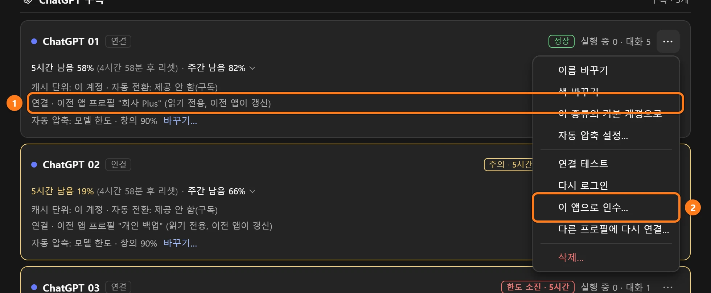
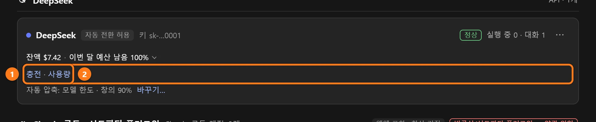
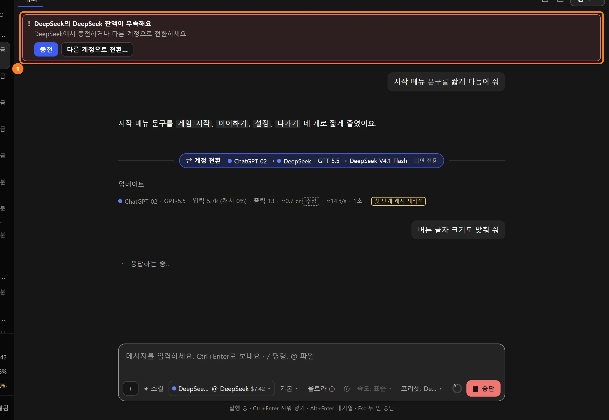
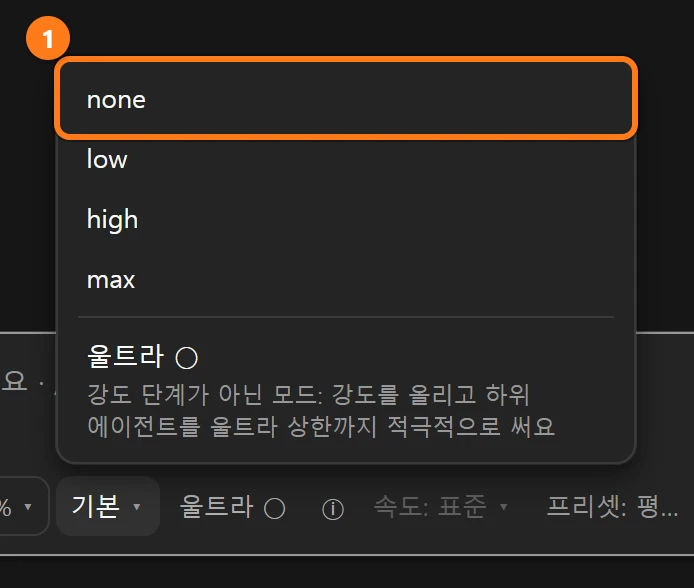
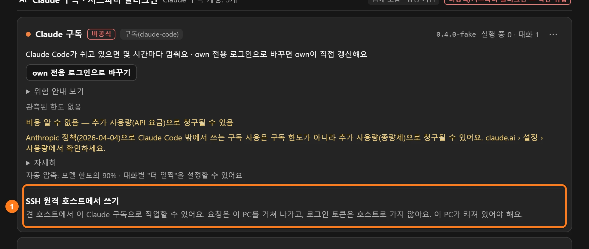
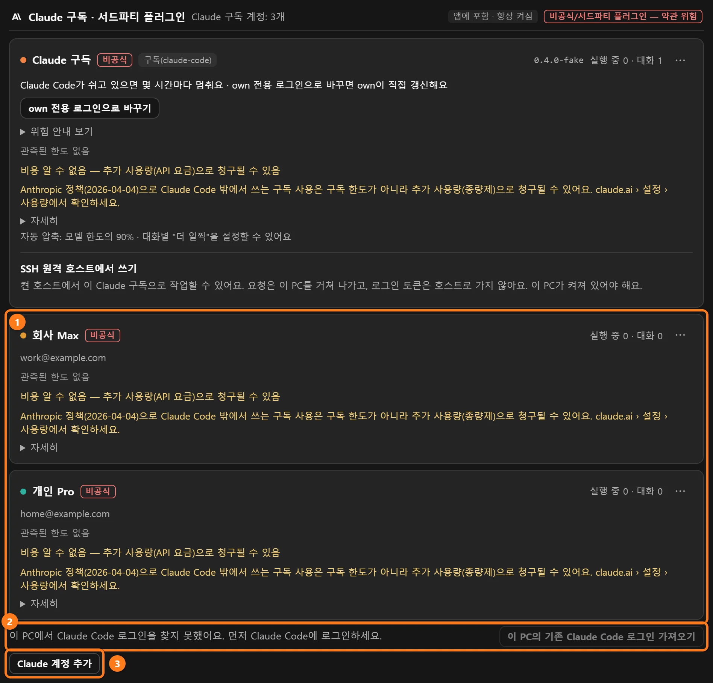

# 20. 계정 종류별로 알아 둘 것

**한 줄 요약**: 계정 종류마다 돈 내는 방식, 한도 보이는 방식, 캐시가 남는 시간이 달라요. 이 장은 ChatGPT 구독, Sign in with ChatGPT, 이전 앱 로그인 가져오기, **DeepSeek**, 그 밖의 API 키, Claude 구독, **Claude Agent**(내 PC의 Claude Code)의 특징과 문제 해결을 모았어요. 추가하는 기본 순서는 [3장](03-first-account.md)에 있어요.

## 20.1 한눈에 보는 표

| 종류 | 돈 내는 방식 | 한도로 보이는 것 | 캐시 유지(대략) | 자동 전환 | 속도 |
|---|---|---|---|---|---|
| ChatGPT 구독 | 월정액 구독(앱은 credits로 추정) | `5시간`, `주간` | 적어도 약 5분 | 안 해요 | Fast, 일부 Ultrafast |
| Sign in with ChatGPT | 같은 ChatGPT 요금제 사용량 | `5시간`, `주간`(응답이 알려 줄 때) | 몰라요 | 안 해요 | Fast(`확인 전`일 수 있음) |
| OpenAI API 키 | 쓴 만큼 달러 | `이번 달 예산`, 분당 요청 | 약 30분 | API 키끼리 | 모델에 따라 Fast |
| Anthropic API 키 | 쓴 만큼 달러 | `이번 달 예산`, 분당 요청·토큰 | 약 5분 | API 키끼리 | Fast |
| DeepSeek | 미리 충전한 잔액에서 달러 | `잔액`, `이번 달 예산` | 몇 시간~며칠 | API 키끼리 | 없음 |
| xAI, OpenRouter | 쓴 만큼 | `이번 달 예산` | 몰라요 | API 키끼리 | 없음 |
| 기타 OpenAI 호환 | 직접 적은 요율(없으면 토큰만) | `이번 달 예산` | 몰라요 | API 키끼리 | 없음 |
| 로컬 모델 | 무료 | 없음 | 서버가 정해요 | — | 없음 |
| Claude 구독(비공식) | 구독, 또는 추가 사용량 | `5시간`, `주간` | 약 5분 | 이 PC의 Claude 계정끼리만 | Fast(추가 사용량) |
| Claude Agent | Claude Code로 로그인한 구독 | `5시간`, `주간`, 모델별 주간, 추가 사용량 | Claude Code가 정해요 | 안 해요(손으로만) | — |

- 한도와 태그 읽는 법은 [7장](07-usage.md), 캐시와 전환 비용은 [11장](11-cache-switch-cost.md), 자동 전환은 [12장](12-multiple-accounts.md), 속도는 [16장](16-speed.md)에 있어요.

## 20.2 ChatGPT 구독 (Plus · Pro · Business)

- 로그인 방식은 `코드로 로그인`(기본), `브라우저로 로그인`, `Sign in with ChatGPT` 중에서 골라요([3장](03-first-account.md)). 앞의 둘이 "ChatGPT 구독" 계정을 만들어요.
- 로그인 정보는 이 PC에 암호화해 두고, **이 앱이 알아서 갱신**해요.
- 카드에는 `캐시 단위: 이 계정 · 자동 전환: 제공 안 함(구독)`이 보여요.
- 한도 `5시간`·`주간`은 그 계정으로 요청할 때 응답에 실려 와요. 쉬는 계정은 곧 `오래됨`이 되는데 정상이에요.
- 값은 credits(`≈… cr`)로 추정해요. 실제 구독 요금이 더 나가지는 않지만, 한도를 얼마나 쓰는지 가늠할 수 있어요.

**로그인이 풀렸을 때**

1. 계정 `⋯` → `다시 로그인`을 눌러요.
2. 같은 ChatGPT 계정으로 로그인하면 `기존 계정 로그인 갱신`이 돼요. 끝나면 `"ChatGPT 01"의 로그인을 갱신했어요.`
3. **다른** ChatGPT 계정으로 로그인하면 거절해요: `다른 계정으로 로그인되었어요. "ChatGPT 01"의 로그인은 바뀌지 않았어요.`

> **참고** 이 앱의 ChatGPT 로그인은 Codex CLI(`~/.codex`)나 Codex 앱의 로그인과 **따로**예요. 서로의 로그인을 건드리지 않아요. 다만 `브라우저로 로그인`은 Codex CLI 로그인과 같은 포트(1455)를 써서, 둘을 동시에 하면 부딪힐 수 있어요.

### 새 Codex 모델 받기

새 GPT 모델은 Codex 새 버전과 함께 나와요. ChatGPT는 모델 정보(창 크기, 추론 강도, 속도 같은 것)를 그 Codex 버전 이상에게만 알려 줘요. 그래서 이 앱이 Codex 최신 버전 번호를 **하루 한 번** 스스로 확인하고, 그 버전으로 모델 정보를 받아요. 이 앱을 업데이트하지 않아도 새 모델의 정보가 들어와요.

- 켜고 끄는 곳: `설정` > `프리셋` > `ChatGPT` 탭의 `Codex 최신 모델 자동 확인`(기본 `켬`). 아래에 `지금 Codex 0.171.0 기준으로 목록을 받아요 · 마지막 확인 3시간 전`처럼 지금 쓰는 버전이 보여요.
- `끔`으로 두면 이 앱에 들어 있는 버전으로만 받아요(`own에 들어 있는 버전이에요`). 확인 요청도 보내지 않아요.
- 확인할 때 보내는 곳은 npm 공개 저장소(`registry.npmjs.org`) 한 곳이고, 버전 번호만 받아 와요. 로그인 정보나 계정, 이메일은 보내지 않아요. ChatGPT 구독 계정이 없으면 확인하지 않아요.
- 확인이 실패해도(인터넷 없음 등) 괜찮아요. 마지막으로 확인한 버전을 그대로 써요. 이 앱에 들어 있는 버전보다 낮게는 받지 않아요.

**새 Codex 모델은 업데이트 없이 바로 써요**

ChatGPT가 알려 주는 모델 정보에는 그 모델의 지시문과 도구 방식까지 들어 있어요. 이 앱의 Codex 방식은 그 정보를 받아서, Codex가 그 모델에 보내는 것과 똑같이 보내요. 그래서 새 모델이 나와도 이 앱을 업데이트하지 않고 바로 고를 수 있어요. 이미 아는 모델도 ChatGPT가 알려 준 최신 지시문으로 보내요.

- ChatGPT가 지시문을 주지 않은 모델은 이름이 가장 비슷한 모델의 지시문으로 돌아요. 그때는 `서버가 지시문을 주지 않은 모델은 비슷한 모델의 지시문으로 돌아요: gpt-6.9-sol ← gpt-6.2-sol`처럼 보여요.
- SSH 원격 호스트의 대화도 같아요. 호스트는 모델 목록을 직접 받지 않고, 이 PC가 받은 정보를 넘겨받아요(로그인 정보는 넘기지 않아요).
- 공개 모델 카탈로그에 아직 없는 새 모델도 모델 고르기 창에 나와요. 그 모델 아래에는 `모델 정보 일부는 서버 목록 기준이에요`가 흐리게 보여요. 이름, 창 크기, 추론 강도를 ChatGPT가 알려 준 대로 써요.

**`own이 아직 못 돌리는 Codex 모델은 빠졌어요: … · own 업데이트가 필요해요`가 떴어요**

새 모델 가운데 이 앱의 Codex 방식이 아직 따라 하지 못하는 방식(새 도구 형식이나 새 셸 방식 같은 것)을 쓰는 모델이 있다는 뜻이에요. 그런 모델은 Codex와 다르게 보내게 되므로 빼 둬요. 어떤 모델이 어떤 값 때문에 빠졌는지 함께 보여요. 예: `gpt-7 (tool_mode "code_mode")`. 계정 카드와 `설정` > `프리셋` > `ChatGPT` 탭에 보여요. 그 방식을 다루는 새 버전으로 이 앱을 업데이트하면 사라져요([2장](02-install-update.md)). 이미 아는 모델의 이름을 늘린 것(예: 끝에 `-fast`가 붙은 이름)은 그 모델로 알아봐요. Codex가 이미 내려놓은 옛 모델(예: `gpt-5.4`)은 세지 않고 정보도 그대로 받아요. 예전 서비스에서는 이유 없이 `own이 아직 모르는 Codex 모델 2개는 빠졌어요 · own 업데이트가 필요해요`로 보여요.

**`새 Codex 0.172.0 출시 · 새 모델은 바로 쓰고, 새 도구와 형식은 own 업데이트가 필요해요`**

`Codex 최신 모델 자동 확인`이 이 앱이 따르는 것보다 새 Codex를 찾으면 `ChatGPT` 탭에 보여요. 새 모델은 위처럼 바로 써요. Codex가 새로 만든 도구나 요청 형식은 그것을 옮긴 이 앱 업데이트가 나와야 써요. 그 업데이트는 개발 쪽에서 만들어요. 이 앱이 PC에서 스스로 무언가를 빌드하거나 설치하지는 않아요.

> **참고** 모델 목록은 공개 모델 카탈로그를 따르고, 카탈로그에 아직 없는 Codex 모델은 ChatGPT가 알려 준 정보로 더해요. 이 설정은 그 모델들의 창 크기와 속도 같은 정보를 정확하게 받게 해 줘요.

## 20.3 Sign in with ChatGPT

OpenAI가 공식으로 만든 연동이에요. ChatGPT 요금제 사용량으로 동작해요(`OpenAI 공식 연동 · ChatGPT 요금제 사용량으로 동작해요(Plus · Pro). 별도 계정으로 추가돼요.`).

1. `ChatGPT 구독` 카드 → `로그인 방식`에서 `Sign in with ChatGPT`를 골라요.
2. 브라우저가 열리면 ChatGPT에 로그인하고, **이 앱의 요금제 사용을 허용**해요(`브라우저에서 ChatGPT에 로그인하고 이 앱의 요금제 사용을 허용하세요…`).
   - 허용하지 않으면 `ChatGPT 요금제 사용이 허용되지 않았어요. …`와 `동의 후 다시 시도`가 보여요.
3. 처음 연결하면 `ChatGPT 요금제로 연결됨` 안내가 한 번 떠요.

알아 둘 것

- 카드에 `ChatGPT 요금제 사용` · `사용량 관리` 줄이 붙어요. `사용량 관리`를 누르면 ChatGPT 설정의 사용량 페이지가 열려요. 앱별 한도와 허용은 거기서 관리해요.
- **한도**: 지금까지 이 로그인 방식의 응답에는 요금제 한도(`5시간`, `주간`)가 오지 않아서 보통 막대가 없어요. 카드와 작업 패널 `계정·한도` 탭에 `아직 받은 한도 정보가 없어요 · 이 로그인 방식(토큰 공유)은 한도를 알려 주지 않는 것으로 보여요 · ChatGPT 설정 > 사용량에서 확인하세요`가 보여요. 남은 양은 `사용량 관리`에서 봐요. 한도에 닿았을 때 ChatGPT가 리셋 시각을 알려 주면 `사용량 한도` 막대와 대화의 띠에 그 시각이 보여요.
- **속도**: `Fast`·`Ultrafast`는 `ChatGPT 구독`과 똑같이 고른 속도 그대로 보내요. 응답이 처리 속도를 알려 주지 않아도(늘 `default`) 내리지 않아요([16장](16-speed.md)).
- **추론 강도만 바꿔도 대화가 계속돼요.** 예전에는 이 계정으로 대화 도중 강도만 바꾸면 그 뒤 요청이 모두 실패했어요. 이제는 고쳐졌고, 그렇게 막혔던 대화도 다음 요청부터 다시 돼요. 다만 이 계정은 **강도만 바꿔도 캐시를 새로 써요**(`이 모델은 추론 강도를 바꿔도 캐시를 새로 써요.`).
- 대화에 이 계정이 받지 않는 항목이 들어 있으면 “이 대화에는 ChatGPT 구독 공유가 지원하지 않는 항목(…)이 있습니다. 다른 계정으로 바꾸거나 이 항목을 빼고 다시 시도하세요.”가 떠요. 다른 계정으로 바꿔요.
- 한도에 닿으면 그 대화에 `ChatGPT 사용량 한도에 도달했어요` 띠가 떠요. `ChatGPT 설정에서 사용량과 이 앱의 한도를 확인하세요. 다른 계정으로 전환할 수도 있어요.` 단추는 `사용량 관리`, `다른 계정으로 전환…`이에요. 언제 풀리는지는 약속하지 않아요.
- 같은 ChatGPT 로그인을 `ChatGPT 구독`(코드·브라우저)으로도 추가했다면 **계정이 두 개**예요. 캐시도 따로라서 둘 사이 전환에도 비용이 들어요.
- 이 계정을 `삭제…`하면 OpenAI에 로그인 토큰을 무효로 해 달라고 요청해요. 확인이 안 되면 ChatGPT 설정에서 이 앱의 연결을 직접 해제하라고 알려 줘요.

## 20.4 이전 앱(codex-multi-provider) 로그인 가져오기

순서는 [3장](03-first-account.md)에 있어요. 여기서는 **연결과 인수의 차이, 그리고 문제 해결**을 자세히 봐요.

은 이전 앱이 계속 갱신하고, ② 인수는 이 앱이 넘겨받아요. ③ 이전 앱의 API 키는 연결만 돼요.")

### 연결과 인수

**열쇠 비유**: `연결`은 이전 앱이 관리하는 열쇠를 **복사하지 않고 함께 보기만** 해요. `인수`는 열쇠를 **넘겨받아** 이 앱이 관리해요.

| | `연결 (권장)` | `인수` |
|---|---|---|
| 로그인 정보 | 이전 앱 파일을 **읽기만** 해요. 복사하지 않아요 | 이 PC 보관함에 한 번 복사해요. 그 뒤 이전 파일은 안 읽어요 |
| 누가 갱신해요? | **이전 앱만** | **이 앱만** |
| 이전 앱에 미치는 영향 | 없어요. 이전 앱을 계속 쓰면 돼요 | 이 앱이 처음 갱신하면 이전 앱의 그 프로필은 다시 로그인해야 할 수 있어요 |
| 이전 앱을 오래 안 켜면 | 로그인이 만료돼 이 계정이 멈춰요(`이전 앱 갱신 대기`) | 상관없어요 |
| 이 앱에서 지우면 | `이전 앱의 로그인 파일은 건드리지 않아요` | 이 앱의 보관함에서만 지워요 |
| 이럴 때 | 이전 앱도 계속 쓸 때 | 이전 앱을 그만 쓰거나 거의 안 켤 때 |

### 연결 계정의 카드와 메뉴

- 카드 줄: `연결 · 이전 앱 프로필 "회사 Plus" (읽기 전용, 이전 앱이 갱신)`. 인수한 계정은 `인수 · 이전 앱 프로필 "…"에서 가져옴 (이 앱이 갱신)`.
- 카드 이름 옆에 `연결` 또는 `인수` 작은 배지가 붙어요.
- `⋯` 메뉴
  - `이 앱으로 인수…`: 연결을 인수로 바꿔요.
  - `다른 프로필에 다시 연결…`: 이전 앱의 다른 프로필을 읽게 바꿔요.
  - `다시 로그인`: 연결 계정에서 이 앱으로 새로 로그인하면 **인수와 같아져요**(`이 앱에서 새로 로그인하면 인수와 같아요 — 이 앱이 갱신해요`).

### `이전 앱 갱신 대기`가 떴어요

연결 계정은 이전 앱이 로그인을 갱신해 줘야 해요. 이전 앱을 오래 켜지 않으면 로그인이 만료돼 멈춰요.

- 카드와 `계정·한도` 탭에 `이전 앱 갱신 대기`가 보여요.
- 그 계정을 쓰는 대화에는 `"회사 Plus" 로그인이 만료되었고, 이전 앱이 아직 갱신하지 않았어요.` 띠가 떠요.
  - `이 계정은 이전 앱(codex-multi-provider)이 갱신하는 로그인을 읽기만 해요. 이전 앱에서 이 프로필을 열면 1분 안에 다시 동작해요.`

할 일

1. **이전 앱을 열고 그 프로필을 한 번 열어요.** 이전 앱이 로그인을 갱신해요.
2. 이 앱에서 `다시 확인`을 눌러요.
   - `원본이 갱신되어 다시 동작해요.` → 끝이에요.
   - `아직 갱신되지 않았어요. 이전 앱에서 이 프로필을 여세요.` → 이전 앱에서 조금 더 기다려요.
3. 기다리기 싫으면 `다른 계정으로 전환…`으로 이 대화를 다른 계정에 옮겨요.

> **팁** 이게 자주 생기면 그 계정을 `⋯` → `이 앱으로 인수…`로 바꾸세요. 그 뒤로는 이 앱이 직접 갱신해서 멈추지 않아요.

### 가져오기 창에서 보이는 문제 문구

| 문구 | 뜻과 할 일 |
|---|---|
| `토큰이 만료되었어요 — 이전 앱에서 이 프로필을 한 번 열어 갱신하세요` | 이전 앱에서 그 프로필을 열고 `다시 찾기` |
| `이미 가져온 계정과 다른 ChatGPT 계정이에요` | 이전 앱의 그 프로필이 다른 ChatGPT 계정으로 바뀌었어요. 앱은 섞어 쓰지 않으려고 멈춰요 |
| `ChatGPT 로그인이 아니에요(API 키 방식)` | 그 프로필은 API 키 방식이에요. 아래 "이전 앱의 API 키"를 보세요 |
| `이미 가져옴 · 연결 → "ChatGPT 01"` | 이미 가져왔어요 |
| `이전 앱(codex-multi-provider)을 찾지 못했어요.` | 이 PC에서 이전 앱 자료를 못 찾았어요 |

### 이전 앱의 API 키(DeepSeek 등)

가져오기 창 아래 `API 키`에 이전 앱이 저장한 키가 보여요. `연결…` → 이름 확인 → `연결하기`.

- **연결만 돼요.** 키를 복사하지 않고, 요청할 때마다 이전 앱의 암호화된 키 파일을 읽어요(`연결만 할 수 있어요. 키는 이 앱에 복사하지 않고, …`).
- 카드 줄: `이전 앱 키 연결 · DeepSeek (읽기 전용 — 이전 앱에서 키를 바꾸면 여기서도 바뀌어요)`.
- 이 계정에는 `키 교체`가 없어요. 키는 이전 앱에서 바꿔요.
- 이전 앱에서 키를 지우면 이 계정은 멈춰요(`설정 오류`).
- 이 앱에서 지워도 `이전 앱의 키 파일은 건드리지 않아요. 이 앱의 연결만 지워요.`
- 같은 키를 이미 쓰는 계정이 있으면 새로 연결하지 않아요(`이미 같은 키를 쓰는 계정 "…"(이)가 있어 새로 연결하지 않아요.`).

## 20.5 DeepSeek

DeepSeek는 **미리 충전한 잔액**에서 돈이 빠지는 API 키예요. 몇 가지가 다른 계정과 달라요.

### 카드 보기

- `잔액`: 남은 돈이에요. 앱이 DeepSeek 공식 주소에 직접 물어봐요. 잔액 조회가 켜져 있으면 계정마다 15분에 한 번 묻고, 그 계정을 쓰는지와는 상관없어요.
  - 프로모션으로 받은 크레딧이 있으면 “보너스” 줄이 따로 보여요. 잔액에 이미 들어 있는 돈이라 두 번 세지 않아요.
  - 묻지 않게 하려면 `⋯` → `잔액·키 조회 끄기`.
- `이번 달 예산`: 예산을 정했을 때만 보여요(이 PC가 센 지출, [7장](07-usage.md)).
- ① `충전` · `사용량`: 누르면 DeepSeek 사이트의 충전 페이지와 사용량 페이지가 브라우저로 열려요. 계정 정보를 함께 보내지 않아요. 로그인은 그 사이트에서 직접 해요.
- `자동 압축: 모델 한도 · 창의 85%`: 1M 창이면 850k에서 압축해요([13장](13-auto-compaction.md)).

### 잔액이 떨어졌을 때

- 대화 위에 띠가 떠요: `DeepSeek의 DeepSeek 잔액이 부족해요` / `DeepSeek에서 충전하거나 다른 계정으로 전환하세요.`
  - 앞의 "DeepSeek"는 계정 이름이에요. 계정 이름을 “회사 DS”로 했다면 `회사 DS의 DeepSeek 잔액이 부족해요`처럼 보여요.
- 카드에는 빨간 `잔액 부족`이 붙어요.
- 할 일
  1. `충전`을 눌러 DeepSeek 사이트에서 충전해요. 충전한 뒤 다음 요청부터 다시 돼요.
  2. 또는 `다른 계정으로 전환…`으로 이 대화를 다른 계정으로 옮겨요.
- 같은 계정으로 계속 다시 보내도 소용없어요. 충전이 먼저예요.
- 다른 API 키 계정에도 `자동 전환 허용`을 켜 두었다면, 앱이 저절로 그 계정으로 넘어가요([12장](12-multiple-accounts.md)).

### 캐시가 아주 오래 남아요

- DeepSeek의 캐시(책갈피)는 **몇 시간에서 며칠** 남아요. 캐시로 읽는 부분은 정가의 수십 분의 1이에요.
- 그래서 DeepSeek에서 **다른 곳으로 갈 때** "캐시가 식을 때까지 기다리기"가 소용없어요. 전환 비용 창에도 `DeepSeek 캐시는 수 시간~수일 유지되어 기다리는 이점이 없어요`가 보여요.
- 반대로 다른 곳에서 **DeepSeek로 올 때**는 처음 한 번 대화 전체를 정가로 읽어요. 대화가 길면 전환 비용 창에서 선택지마다의 값을 비교해 보고 골라요([11장](11-cache-switch-cost.md)).
- 이 오래 남는 캐시 덕분에, DeepSeek 대화는 며칠 쉬었다가 이어 가도 싸게 읽혀요.

### 시간대에 따라 값이 달라요

- **평일 한국 시간 오전 10시–오후 1시, 오후 3시–7시**가 붐비는 시간(피크)이에요. 이때는 정가예요.
- **그 밖의 시간**(주말, 이른 아침, 점심 직후, 저녁·밤)에는 **모든 단가가 절반**이에요.
- 앱의 추정 금액도 요청한 시각의 단가로 계산해요. 같은 일도 시간에 따라 금액이 다르게 보여요.
- 공휴일은 따로 따지지 않고 평일처럼 계산해요. 실제로 공휴일 할인이 있는지는 DeepSeek에서 확인하세요.

> **팁** 급하지 않은 긴 작업(큰 리팩터링, 로그 분석)은 피크 밖 시간에 돌리면 값이 반이에요.

참고로 2026년 10월 초 공식 가격표(100만 토큰당, 피크 기준)는 이랬어요. 바뀔 수 있으니 DeepSeek 사이트에서 확인하세요.

| 모델 | 입력 | 캐시 읽기 | 출력 |
|---|---|---|---|
| Flash 계열 | $0.30 | $0.006 | $1.20 |
| Pro 계열 | $1.32 | $0.044 | $3.96 |

### 추론 강도

- `none`, `low`, `high`, `max` 중에서 골라요. 단추에 `기본`이 보이면 모델이 정한 값이에요.
- `none`(생각 끄기)일 때 DeepSeek 서버는 원래 답을 8K 토큰에서 자르는데, 그러면 긴 답이나 파일 쓰기가 조용히 끊겨요. 그래서 앱이 **출력 한도를 64K로 넉넉히 잡아** 보내요.
- 울트라를 켜거나 다른 모델의 `xhigh`를 DeepSeek에 맞추면 `max`가 돼요([15장](15-ultra.md)).
- DeepSeek는 **추론 강도만 바꿔도 캐시를 새로 써요.** 긴 대화에서 강도를 바꾸면 처음부터 다시 읽는 값이 들어요([6장](06-model-account.md)).

### 그 밖에

- DeepSeek에는 빠른 속도가 없어요. 속도 단추는 회색이고 `이 계정 종류에는 빠른 속도가 없어요`가 보여요([16장](16-speed.md)).
- 앱은 두 키가 같은 DeepSeek 계정의 것인지 알 수 없어요. 키마다 별도 계정으로 다뤄요.
- 같은 대화를 DeepSeek ↔ 다른 회사로 오가면, 다른 회사로 갔다 돌아와도 DeepSeek 캐시가 살아 있을 가능성이 커요. 돌아오는 전환이 대개 싸요.

## 20.6 그 밖의 API 키

| 카드 | 더 적는 칸 | 알아 둘 것 |
|---|---|---|
| `OpenAI API 키` | `조직 ID (선택)`, `프로젝트 ID (선택)` | 한도와 지출 상한은 조직 단위예요. 같은 조직의 키를 더 넣어도 여유는 늘지 않아요 |
| `Anthropic API 키` | `워크스페이스 이름 (선택)` | **Claude를 쓰는 공식 방법**이에요(`권장` 배지). 워크스페이스는 `표시용이에요. 워크스페이스는 첫 요청 응답에서 확정돼요.` 캐시는 약 5분이라 금방 식어요 |
| `xAI` | 없음 | 캐시 유지 시간을 몰라요 |
| `OpenRouter` | 없음 | 여러 회사 모델을 한 키로 써요. 오류 문구가 모델마다 다를 수 있어요 |
| `기타 OpenAI 호환` | `Base URL`, `모델`, `문맥 한도(토큰)`, `그림 입력`, `도구`, `요율 (선택, $/1M 토큰: 입력 · 캐시 읽기 · 출력)` | 아래를 보세요 |

**기타 OpenAI 호환(Ollama 같은 로컬 서버, 사내 서버)**

- `모델`은 `목록에서 고르기 (…/models)`로 서버 목록에서 고르거나, `모델 id 직접 입력`으로 적어요. `모델 추가`로 여러 개를 넣을 수 있어요.
- `문맥 한도(토큰)`는 **꼭** 적어야 해요. 이 값이 없으면 자동 압축이 일어나지 않아요. **서버가 실제로 쓰는 창**을 정확히 적어요.
- 요율을 비우면 `요율 없음 — 토큰만 표시`예요. 금액 대신 토큰 수만 보여요.
- 자동 압축은 창의 **90%** 지점에서 해요(작은 로컬 창에서 너무 일찍 압축하지 않게).
- 카드에 `넘침 자동 복구 확인 안 됨 · 서버 창을 정확히 적으세요`가 붙을 수 있어요. 서버가 "너무 길다"고 거절할 때 쓰는 문구가 달라, 앱이 자동 복구를 못 할 수 있다는 뜻이에요. 창 크기를 정확히 적어 두면 거기까지 가지 않아요.

**그림 입력과 도구 (로컬 모델이 할 수 있는 것)**

모델마다 `그림 입력`(그림을 볼 수 있는지)과 `도구`(파일 읽기, 명령 실행 같은 도구를 쓸 수 있는지)를 `자동` · `켬` · `끔` 중에서 골라요. 처음에는 둘 다 `자동`이에요.

- `자동`이면 앱이 서버에 물어서 정해요. 계정을 추가할 때 한 번 묻고, 이 기능이 생기기 전에 추가한 계정은 서비스가 시작할 때 한 번 물어요.

| 서버 | 앱이 보는 것 |
|---|---|
| Ollama | 모델 정보(`/api/show`)의 `vision`(그림), `tools`(도구). Ollama 0.6.4 이상만 알려 줘요 |
| LM Studio | 모델 목록(`/api/v1/models`)의 그림 처리 여부와 도구 학습 여부. 옛 버전은 `/api/v0/models`의 `vlm` 표시를 봐요 |
| llama.cpp 서버 | `/props`: 그림 처리 모듈(`--mmproj`)을 불러왔는지, 채팅 템플릿이 도구 호출을 다루는지 |
| vLLM, 그 밖의 서버 | 알려 주지 않아요 |

- 서버가 알려 주지 않으면 그림 입력은 `끔`, 도구는 `켬`으로 둬요. 그림을 보는 모델인데 알려 주지 않는 서버라면 `그림 입력`을 `켬`으로 바꿔요.
- LM Studio는 도구를 따로 배우지 않은 모델에도 도구를 보내 줘요. 그래서 그런 모델도 도구는 `켬`이에요.
- 카드의 `모델 기능:` 줄에 모델마다 켬·끔과 어디서 정했는지가 보여요. `서버 값`은 서버가 알려 준 것, `직접 정함`은 내가 고른 것, `모름`은 서버가 알려 주지 않아 기본값을 쓴 것이에요.
- 나중에 바꾸려면 카드의 `⋯` → `모델 기능…`을 골라요. 창에 모델마다 서버가 알려 준 값(`서버: 그림을 볼 수 있어요` 등)이 보여요. 바꾸고 `저장`을 눌러요.
- 서버에서 모델을 바꿔 불러왔으면(예: llama.cpp를 `--mmproj`와 함께 다시 시작) `모델 기능…`의 `서버에서 다시 읽기`나 `⋯` → `연결 확인`을 눌러요. 서버에 다시 물어요.
- 바꾸면 그 계정을 쓰는 대화의 다음 요청에서 캐시를 한 번 새로 쌓아요. 모델이 받는 내용이 달라지기 때문이에요.

**켜고 끈 결과**

- `그림 입력`이 켜진 모델: 입력창에 붙인 그림과 컴퓨터 사용의 스크린숏이 그림 그대로 가요.
- `그림 입력`이 꺼진 모델: 붙인 그림은 파일 경로로 가요. 칩에 `이 모델은 이미지를 읽지 못해요. 파일 경로로 보내요.`가 보여요. 컴퓨터 사용은 켤 수 없어요([18장](18-computer-use.md)).
- `도구`가 꺼진 모델: 대화만 해요. 앱이 도구 목록을 보내지 않아서 파일을 읽거나 명령을 실행하지 못해요. 입력창 아래에 `이 모델은 도구를 쓰지 못해요. 파일을 읽거나 명령을 실행하지 않고 대화만 해요.`가 보여요. 하위 에이전트로도 고르지 않아요.

> **주의** Ollama는 GIF 그림을 받지 않아요(PNG, JPEG, WebP만 받아요). 그래서 앱은 Ollama 모델에 GIF를 보내지 않고, 모델에게 읽을 수 없는 그림이라고 알려요. 그림을 보여 주려면 PNG나 JPEG로 붙이세요.

**모든 API 키 공통**

- 키는 `키는 이 PC에 지금 Windows 사용자로만 열리게 암호화해 저장해요. OpenCode 데이터베이스에는 저장하지 않아요.`
- 한 번 넣은 키는 다시 보이지 않아요. 카드에는 `키 sk-...0001`처럼 끝 4자리만 보여요.
- 키를 바꾸려면 `⋯` → `키 교체`. 계정과 기록은 그대로예요.
- 예산은 `⋯` → `예산 설정…`([7장](07-usage.md)).

## 20.7 Claude 구독 (서드파티 플러그인)

> **주의** Claude Pro·Max **구독**을 이 앱에서 쓰는 것은 **공식 방법이 아니에요.** 다른 사람이 만든 플러그인으로 쓰는 "빈자리(슬롯)"예요. Anthropic 약관 위반으로 **계정이 제한되거나 정지될 수 있어요.** Claude를 쓰는 공식 방법은 `Anthropic API 키`예요.

연결 순서와 위험 안내 10가지는 [3장](03-first-account.md)에 있어요. 여기서는 쓰면서 알아 둘 점을 모았어요.

**플러그인은 앱에 들어 있어요**

- 플러그인 `opencode-claude-auth-v2`는 앱에 들어 있고 **늘 켜져 있어요.** 카드 머리에 `앱에 포함 · 항상 켜짐`과 `비공식/서드파티 플러그인 — 약관 위험`이 붙어요.
- 앱을 만들 때 정해진 버전을 넣고, 무결성을 확인하고, 이 앱의 수정(Claude 계정 여러 개, 대화마다 정한 계정 하나만 씀, 다른 계정의 토큰을 빌리지 않음)을 미리 넣어 둬요. **내 PC에서는 아무것도 받거나 설치하거나 고치지 않아요.** 새 버전은 앱 업데이트로만 들어와요.
- 따로 동의를 받지 않아요. 위험 안내는 카드의 `위험 안내 보기`를 펼쳐 다시 봐요. 그 아래에 `이 플러그인은 앱에 들어 있고 늘 켜져 있어요. 따로 동의를 받지 않으며, Claude 계정을 연결하기 전에는 아무 요청도 보내지 않아요.`가 적혀 있어요.
- 플러그인은 뺄 수 없어요. Claude를 쓰지 않으려면 계정을 연결하지 않거나, 더한 계정을 `계정 빼기…`로 빼요. 로그인이 없으면 슬롯은 아무것도 보내지 않아요.

`설정` > `플러그인`의 `서드파티 · Claude 구독`에서 플러그인 상태를 볼 수 있어요.

| 줄 | 보이는 것 |
|---|---|
| 패키지 | `opencode-claude-auth-v2` |
| 상태 | `앱에 포함 · 0.4.0-beta.5 · 동작 중`이면 정상이에요. `… · 불러와지지 않음`이면 서비스를 다시 시작해요. `이 빌드에 없음`이면 앱을 다시 설치해요 |
| 무결성 | `앱의 기록과 일치`면 정상이에요. `앱에 든 Claude 구독 플러그인의 파일이 기록과 달라요`면 앱을 다시 설치해요 |
| 순서 | `정상` |

- 그 아래에 `앱에 고정 버전이 들어 있고 늘 켜져 있어요. 새 버전은 이 앱의 업데이트로만 들어와요(@latest는 쓰지 않아요).`가 있어요. `위험 안내 보기`로 위험 안내를 펼치고, `Claude 계정 관리` 링크로 `계정` 화면에 가요.

**어디서나 다르게 보여요**

- 계정, 전환기, 사이드바 어디서나 `비공식` 배지가 붙어요.
- 값은 `비용 알 수 없음 — 추가 사용량(API 요금)으로 청구될 수 있음`이에요. 요청이 구독 한도가 아니라 추가 사용량으로 청구될 수 있어서, 앱이 금액을 장담하지 않아요.
- 한도 `5시간`·`주간`(그 계정의 응답이 알려 주면 모델 하나의 주간 한도 `주간 · Fable`도)과 `추가 사용량` 상태는 응답이 알려 줄 때 보여요. 아직 받은 게 없으면 `관측된 한도 없음`이에요.
- 5시간 한도가 없는 계정(인증된 Ultra 요금제)은 `주간`만 보여요. 계정끼리 자동으로 옮길 때도 그 계정은 주간 한도로 견줘요.
- SSH 원격 호스트에서는 켠 호스트에서만 써요. 요청은 이 PC를 거쳐 나가므로 이 PC가 켜져 있고 연결되어 있어야 해요. 원격 세션에서는 `PC 경유` 칩이 붙어요([22장](22-ssh-remote.md)).

**추가 사용량 경고와 확인하기(2026-10-19)**

> **주의** Anthropic은 2026-04-04 낮 12시(미국 태평양 시간)부터 Claude Code 밖(이 앱 같은 서드파티 도구)에서 쓰는 구독 사용을 구독 한도가 아니라 **추가 사용량**(종량제, 지금 이름은 사용량 크레딧)으로 청구한다고 알렸어요. 그래서 이 앱의 Claude 구독 요청에도 **따로 돈이 나갈 수 있어요.**

- Claude 카드마다 이 줄이 늘 보여요. 닫을 수 없어요.
  `Anthropic 정책(2026-04-04)으로 Claude Code 밖에서 쓰는 구독 사용은 구독 한도가 아니라 추가 사용량(종량제)으로 청구될 수 있어요. claude.ai › 설정 › 사용량에서 확인하세요.`
- 그 아래 `자세히`를 펼치면 바뀐 날짜, 이 앱이 알 수 있는 것과 없는 것, 확인하는 법, 출처가 있어요.
- 한편 Anthropic 도움말은 2026-06-15·2026-10-07에 서드파티 앱 사용이 구독 한도에서 나간다고 적었어요. 그런데 그 뒤에도 서드파티 요청이 추가 사용량 오류로 거절된 일이 보고됐어요. 그래서 앱은 어느 쪽인지 장담하지 않고, 직접 확인하게 해요.

응답이 알려 주면 카드에 한 줄이 더 떠요.

| 줄 | 뜻 | 이렇게 해요 |
|---|---|---|
| `이 계정은 지금 추가 사용량으로 청구되고 있어요` | 응답의 한도 정보가 이 계정이 추가 사용량으로 넘어갔다고 알려 줬어요(예: 구독 한도를 다 쓴 뒤) | 원하지 않으면 claude.ai에서 추가 사용량(사용량 크레딧)을 끄거나, 다른 계정이나 `Anthropic API 키`를 써요 |
| `추가 사용량이 꺼져 있어 거절됐어요 · claude.ai에서 켜거나 API 키를 쓰세요` | Anthropic이 요청을 서드파티 사용으로 보고 추가 사용량에서 내려 했지만, 꺼져 있거나 모자라 거절했어요. 이 요청에는 돈이 나가지 않았어요. 다 써서 거절됐을 때도 같은 줄이 떠요 | 이 계정으로 계속 쓰려면 claude.ai에서 추가 사용량을 켜거나 채워요(돈이 나가요). 아니면 `Anthropic API 키` 계정으로 바꿔요 |

- 줄 끝의 `3분 전 응답 기준`은 그 판정을 준 응답의 시각이에요. 같은 계정의 요청이 다시 성공하면 거절 줄은 사라져요.
- 그 밖에는 응답만으로 알 수 없어서 줄이 없어요. 줄이 없다고 해서 구독 한도로만 계산된다는 뜻은 아니에요.

**직접 확인하기**

1. 그 계정으로 짧은 메시지를 하나 보내요(예: “안녕”).
2. 브라우저에서 claude.ai에 로그인하고 `설정` › `사용량`(Settings › Usage)을 열어요. 카드 `자세히`의 `claude.ai 사용량 열기`를 눌러도 돼요.
3. `사용량 크레딧`(Usage credits, 예전 이름 추가 사용량) 칸의 금액을 봐요. `결제`(Billing)에도 청구가 보여요.
4. 방금 쓴 만큼 금액이 늘었으면 이 앱의 요청은 **추가 사용량으로 청구되고** 있어요. 금액은 그대로이고 구독 사용량만 늘었으면 구독 한도로 계산된 거예요.

> **참고** claude.ai에서 추가 사용량을 켜 두지 않았으면 이 앱의 요청은 돈이 나가는 대신 거절될 수 있어요. 그때 카드에 `추가 사용량이 꺼져 있어 거절됐어요 · …`가 떠요.

**계정마다 첫 요청 알림**

- 어떤 Claude 계정으로 처음 요청을 보내면 입력창 위에 `이 계정의 첫 Claude 요청이에요 · 추가 사용량으로 청구될 수 있어요`와 `계속`·`취소`가 떠요. 요청이 실제로 나가고 답이 오기 시작할 때 떠요. 로그인을 새로 고치지 못해 보내지 못한 요청에는 뜨지 않아요.
- 요청은 이미 보내는 중이에요. `계속`은 알림만 닫고, `취소`는 그 턴을 멈춰요(턴이 도는 동안만 보여요).
- 계정마다 한 번만 떠요. 서비스가 기억하므로 다시 시작해도 또 뜨지 않아요. 앱을 업데이트한 뒤에는 이미 쓰던 계정도 다음 요청에서 한 번 떠요.

- `SSH 원격 호스트에서 쓰기`는 첫째 계정의 카드 안이 아니라, **모든 Claude 구독 계정 카드 아래**에 따로 있어요(2.2.6-own.17부터). 스위치는 호스트마다 하나이고, 켜면 그 호스트에서 이 PC의 **모든** Claude 구독 계정을 쓸 수 있어요. 계정마다 따로 켜는 스위치는 없어요. 어느 계정을 쓸지는 그 호스트 대화의 전환기에서 골라요.
- Claude Agent 계정과 로컬 모델은 이 스위치와 상관없어요. 따로 켜지 않고, 호스트의 계정 범위에 들어 있으면 이 PC를 거쳐 써요([22장](22-ssh-remote.md)).
- 그 칸에 이 PC의 SSH 호스트가 한 줄씩 보여요. 스위치로 켜고 꺼요. 처음 켤 때 `원격 호스트에서 Claude 구독 쓰기` 고지가 한 번 더 떠요. 원격 사용은 약관 위험이 더 크다는 내용이에요. 읽고 `위 내용을 이해했으며, 본인 책임으로 사용합니다.`에 체크한 뒤 `동의하고 켜기`를 눌러요. 이 원격 사용 동의는 이 PC에 기록돼요.
- 플러그인은 호스트로 가지 않아요. 호스트의 요청을 이 PC가 받아 대신 보내요.
- 호스트 줄의 상태: `사용 중`, `꺼짐`, `이 호스트의 계정 범위에 Claude 구독이 없어요`(호스트의 `계정 범위`에 넣어야 해요), `원격 사용 동의가 필요해요`, `이 PC의 Claude 구독이 준비되지 않았어요(플러그인·로그인)`, `호스트와 연결되어 있지 않아요` 등이에요.
- 그 호스트의 에이전트와 하위 에이전트가 이 구독을 써요. 한도(5시간·주간)는 이 PC에서 쓰는 것과 함께 줄어요.
- 응답 도중 연결이 끊기면 그 응답은 거기서 끝나요. 호스트를 끄면 진행 중인 응답도 멈춰요.
- 스위치는 이 PC의 창에서만 바꿔요. 휴대폰·다른 PC에서는 상태만 보여요.

**못 하는 것**

- 다른 회사 계정과의 자동 전환: 이 계정에서 다른 회사 계정으로 나가지도, 다른 회사 계정에서 들어오지도 않아요(`Claude 구독 슬롯으로` `끄기` 고정). Claude 계정끼리는 아래 "Claude 계정 여러 개"의 `Claude 계정 사이`를 따라요.
- 자동 압축은 `자동 압축: 모델 한도의 85% · 대화별 "더 일찍"을 설정할 수 있어요`로 고정이에요.
- 같은 회사(Anthropic)의 다른 구독을 하위 에이전트로 쓰지 않아요([14장](14-presets.md)).

**슬롯 카드**

- 아직 연결하지 않았으면 카드에 `연결 없음`과 `연결…`이 보여요. `연결…`을 누르면 위험 안내와 `Claude Code 구독 가져오기`가 열려요. `계정 추가` → `Claude 구독`과 같아요.
- 카드 `⋯` 메뉴
  - `이름 바꾸기`, `색 바꾸기`
  - `구독 다시 가져오기`: Claude Code에서 다시 로그인했다면 눌러요.
  - `다시 로그인`: 이 계정의 Claude Code 로그인을 다시 해요(아래 "로그인이 풀렸을 때"). 이 계정이 Claude Code의 로그인 폴더를 함께 쓰면 `own 전용 로그인으로 바꾸기`가 돼요(아래 "Claude Code와 같은 로그인을 쓰는 계정").
- 예전 메뉴의 “위험 고지 보기…”, “계정 소스 변경…”, “플러그인 제거…”는 없어졌어요. 위험 안내는 카드의 `위험 안내 보기`에 있어요.

**Fast를 켜면** 구독 한도가 아니라 **추가 사용량**(별도 요금)으로만 내요. 처음 한 번 동의 카드가 떠요([16장](16-speed.md)).

**이런 띠가 뜨면**

- `Claude 구독 슬롯이 환경 변수 API 키로 바뀌었어요 — 요금이 API로 청구돼요.`: 서비스 환경에 Anthropic 키가 잡혀 구독 대신 API로 나가고 있어요. 의도한 게 아니면 환경 변수를 정리하고 서비스를 다시 시작하세요.
- 전환기에서 Claude 구독 줄에 `플러그인 없음`이 보이면 앱에 든 플러그인이 불러와지지 않은 거예요. 서비스를 다시 시작해요. 그래도 그대로면 아래 "카드의 플러그인 알림"을 보세요.
- `Claude 구독 슬롯의 계정 정보가 바뀌었을 수 있어요. Claude Code 로그인 상태를 확인하세요.`: Claude Code에서 다른 계정으로 로그인했을 수 있어요. 확인하고 `구독 다시 가져오기`.

**카드의 플러그인 알림**

평소에는 아무것도 보이지 않아요. 문제가 있을 때만 Claude 카드에 떠요.

| 알림 | 이렇게 해요 |
|---|---|
| `앱에 든 Claude 구독 플러그인이 아직 쓰이지 않고 있어요. 서비스를 다시 시작하면 불러와져요.` | `지금 다시 시작`을 눌러요(데스크톱 앱). 예전 버전에서 업데이트한 직후 서비스를 아직 다시 시작하지 않았거나, 예전 설치가 아직 불러와져 있을 때 보여요. 브라우저로 연 화면에서는 `own restart` 명령을 알려 줘요 |
| `앱에 든 것이 아닌 Claude 플러그인(예전 설치)이 불러와져 있어요` | 위와 같아요. 서비스를 다시 시작해요 |
| `앱에 든 Claude 구독 플러그인이 불러와지지 않았어요. 서비스를 다시 시작하세요.` | 서비스를 다시 시작해요(`own restart`) |
| `앱에 든 Claude 구독 플러그인 파일이 바뀌었어요(무결성 불일치). 앱을 다시 설치하세요.` | 앱 설치 파일을 탐색기에서 다시 실행해요([2장](02-install-update.md)) |
| `이 앱 설치에 Claude 구독 플러그인이 없어요. 앱을 다시 설치하세요.` | 위와 같아요 |

- 실행 중인 대화가 있으면 다시 시작이 막힐 수 있어요(`다른 버전의 서비스가 대화를 실행 중이에요 — 턴이 끝난 뒤 서비스를 다시 시작해야 해요.`). 턴이 끝난 뒤 다시 눌러요.

### Claude 계정 여러 개

Claude 구독 계정을 여러 개(예: 회사 Max, 개인 Pro) 등록하고 대화마다 다른 계정을 쓸 수 있어요. 따로 준비할 것은 없어요.

**계정 더하기**

1. `Claude 계정 추가` → `로그인 시작`을 눌러요.
2. **이 PC에** Claude Code 로그인 창이 열려요. 브라우저에서 Claude에 로그인만 마치면 돼요. 앱은 비밀번호나 토큰을 보지 않아요. 그동안 `로그인 기다리는 중… (창을 닫으면 취소돼요)`가 보여요.
3. `추가했어요: …`가 뜨면 끝이에요. 창을 닫으면 취소되고, 10분 안에 끝내지 않으면 저절로 닫혀요. 이미 있는 계정으로 로그인하면 `이미 추가된 계정이에요.`가 떠요.

- Claude Code가 이 PC에 없으면 설치 명령을 알려 줘요. 설치는 PowerShell에서 **직접** 해요.
- 이 PC의 Claude Code에 이미 로그인해 둔 계정은 `이 PC의 기존 Claude Code 로그인 가져오기`로 가져와요(`찾은 로그인: …`).
- 로그인 추가는 이 PC의 창에서만 돼요. 휴대폰·다른 PC에서는 `로그인 추가는 이 PC의 창에서만 할 수 있어요.`가 보여요.
- `Claude 계정 추가` 단추는 앱에 든 플러그인이 불러와져 있을 때 보여요. 안 보이면 카드의 알림대로 서비스를 다시 시작해요.
- 새로 더한 계정은 이 앱 전용 로그인 폴더를 써요. Claude Code의 로그인과 겹치지 않아요.

**대화마다 계정 고르기**

- 전환기(`Ctrl+.`)에 Claude 계정이 `Claude · …`(예: Claude · 회사 Max)처럼 하나씩 보여요. 고르면 그 대화(와 그 대화의 하위 에이전트)가 그 계정을 써요. 고른 계정이 새 대화의 기본이 돼요.
- 카드에 `기본` 표시가 있는 계정이 새 대화의 기본이에요. 카드 `⋯` → `새 대화의 기본으로`로 바꿔요.
- **팀 모드**에서는 팀 전체가 Claude 계정 하나를 써요([17장](17-team-mode.md)).
- 계정을 바꾸면 캐시는 처음부터 다시 쌓여요. 캐시는 Claude 계정마다 따로 기억해요. 그래서 전환기의 다른 Claude 계정 줄은 그 계정의 캐시로 비용을 셈하고(이 대화를 그 계정에서 돌린 적이 없으면 처음부터 다시 쓰는 값), 수명 안에 원래 계정으로 돌아가면 그 계정의 캐시를 다시 읽어요. 계정을 바꾼 바로 뒤의 압축도 새 계정에는 캐시가 없는 것으로 보고 앞부분만 보내요([13장](13-auto-compaction.md)).
- 대화의 전환 표시, 하위 에이전트 화면의 역할 줄, 팀의 결과 카드는 그때 실제로 쓴 Claude 계정(예: “AC-03 → 개인 Pro”, “모델 전환 · AC-02”)을 보여요.

**한도가 차면 다른 Claude 계정으로**

- 이 자동 전환은 처음에는 꺼져 있어요. 새로 설치하면 `설정` > `자동 전환`의 `Claude 계정 사이`가 `끄기`예요(2026-10-31부터). 전부터 쓰던 앱에 저장된 값은 바뀌지 않아요. 켜지 않으면 한도가 찬 대화는 전환기(`Ctrl+.`)에서 직접 다른 Claude 계정을 고르거나 리셋까지 기다려요.
- `Claude 계정 사이`를 `자동`으로 켜 두면, 한 Claude 계정의 한도가 차자마자 이 PC의 다른 Claude 계정으로 바꿔요. 알림 “Claude 한도 소진 — 회사 Max에서 개인 Pro로 바꿨습니다 (캐시 새로 쌓임)”이 떠요. 미리 바꾸지는 않고, 1시간에 2번까지만 바꿔요. 고를 때는 그 대화의 모델을 막는 한도만 봐요: 다른 계정의 `주간 · Fable`이 다 찼어도 Sonnet 대화는 그 계정으로 갈 수 있어요. `추가 사용량`이 꺼져 있다는 것만으로는 계정을 빼지 않아요.
- 모델 하나의 주간 한도(`주간 · Fable`, `주간 · Opus`, `주간 · Sonnet`)가 차서 거절되면, 앱은 그 모델만 그 한도의 리셋까지 막힌 것으로 기억해요. 같은 계정의 다른 모델 대화는 그대로 쓰고, 계정을 한도 소진으로 알리지 않아요(휴대폰 알림도 없어요). 그 대화에서 `리셋까지 대기`를 고르면 그 주간 한도가 풀리는 시각(예: 월요일 오전 9시)까지 기다려요.
- 그런 거절로 다른 Claude 계정으로 옮긴 대화는 그 모델로만 원래 계정에 돌아가지 않아요. 예를 들어 Opus 주간이 차서 계정 1에서 계정 2로 옮긴 뒤 Sonnet으로 이어 가다 계정 2의 5시간이 차면, 계정 1로 돌아가요. Opus로는 계정 1의 Opus 주간이 풀릴 때까지 돌아가지 않아요.
- 계정은 대화 전체(하위 에이전트까지)가 함께 옮겨요. 그래서 메인이 Opus를 쓰는 대화라면, Sonnet 하위 에이전트가 계정 2의 5시간에 막혀도 계정 1로 돌아가지 않아요. 돌아가면 메인이 계정 1의 Opus 주간에 막히기 때문이에요. 그때는 계정 2에서 5시간이 풀리기를 기다려요.
- 다시 끄려면 `끄기`를 골라요([12장](12-multiple-accounts.md)).

**더한 계정의 카드 `⋯`**

- `이름 바꾸기`, `색 바꾸기`
- `새 대화의 기본으로`: 이미 기본인 계정에는 보이지 않아요.
- `다시 로그인`: 아래 "로그인이 풀렸을 때".
- `계정 빼기…`: 이 계정을 쓰던 대화는 기본 계정으로 옮겨져요(캐시는 새로 쌓여요). `로그인 폴더도 지우기`에 체크하면 이 앱이 만든 로그인 폴더도 지워요.

**로그인이 풀렸을 때: `다시 로그인`**

로그인이 없거나 만료된 계정의 카드에는 `이 계정의 로그인이 없거나 만료됐어요 — [다시 로그인]을 누르세요.`와 `다시 로그인` 단추가 보여요. 카드 `⋯`에도 `다시 로그인`이 있어요(슬롯 카드도 같아요).

1. `다시 로그인`을 눌러요. `다시 로그인: …` 창에 `PC에 열린 창에서 이 계정의 Claude Code 로그인을 다시 해요. 브라우저에서 로그인만 마치세요. 앱은 비밀번호나 토큰을 보지 않아요.`가 보여요.
2. `로그인 시작`을 누르고, 이 PC에 열린 창에서 브라우저 로그인을 마쳐요.
3. `다시 로그인했어요: …`가 뜨면 끝이에요. 그 계정의 로그인 폴더에 다시 로그인한 거라서 계정과 대화는 그대로예요.

- `다시 로그인`도 이 PC의 창에서만 돼요.

**로그인 새로 고침 줄**

이 앱이 직접 새로 고치는 계정(더한 계정, own 전용 로그인으로 바꾼 AC-01)의 카드에는 로그인 새로 고침이 어떻게 됐는지 한 줄이 보여요. 계정 1이든 더한 계정이든 똑같아요. Claude Code와 같은 로그인을 쓰는 계정에는 이 줄 대신 아래 "Claude Code와 같은 로그인을 쓰는 계정"의 줄이 보여요.

| 카드의 줄 | 뜻 | 이렇게 해요 |
|---|---|---|
| `로그인 토큰이 만료됐어요 · 다음 요청에서 새로 고쳐요`(흐린 글씨) | 로그인 토큰은 몇 시간마다 만료돼요. 아직 아무도 새로 고쳐 보지 않았을 뿐이고, 문제가 아니에요 | 그대로 쓰면 돼요. 다음 요청이 먼저 새로 고쳐요 |
| `로그인 새로 고침이 잠시 막혔어요(…) · 다음 요청에서 다시 해요` | Claude 로그인 서버가 잠깐 막았거나(HTTP 429), 서버나 인터넷이 잠깐 안 됐어요. 괄호 안이 서버가 한 말이에요. 로그인은 그대로예요 | 잠시 뒤 다시 보내요. `다시 로그인`은 하지 않아도 돼요 |
| `로그인을 새로 고치지 못했어요(…) · 다시 로그인하세요.`와 `다시 로그인` | Claude 로그인 서버가 이 로그인의 새로 고침을 거절했어요(HTTP 400·401·403, 예: `invalid_grant`). 기다려도 풀리지 않아요 | 그 카드의 `다시 로그인`. 다시 로그인하면 이 줄은 곧 사라져요 |

**Claude Code와 같은 로그인을 쓰는 계정**

`이 PC의 기존 Claude Code 로그인 가져오기`로 가져온 계정(보통 AC-01)은 Claude Code의 로그인 폴더(`%USERPROFILE%\.claude`)를 함께 써요. 계정 소스로 다른 Claude Code 폴더를 정했다면 그 폴더도 같아요. 다른 계정이라도 그 폴더로 이어지는 바로 가기(정션)나 링크를 쓰면 같아요. 그런 계정 카드에는 모두 `Claude Code가 쉬고 있으면 몇 시간마다 멈춰요 · own 전용 로그인으로 바꾸면 own이 직접 갱신해요`가 보여요.

- 로그인 토큰은 몇 시간마다 새로 고쳐야 하고, 새로 고칠 때마다 이전 갱신 토큰은 못 쓰게 돼요. 이 앱과 Claude Code가 같은 토큰을 따로 새로 고치면 늦은 쪽의 로그인이 풀려요. 그래서 이 앱은 이 계정의 로그인을 **읽기만 하고 새로 고치지 않아요.** Claude Code의 로그인도 건드리지 않아요.
- **그래서 Claude Code가 쉬고 있으면 AC-01은 몇 시간마다(토큰이 만료될 때마다) 멈춰요.** Claude Code를 다시 쓰기 전까지는 풀리지 않아요. 그동안 카드에 “AC-01은 Claude Code와 같은 로그인을 쓰는데, 그 로그인이 만료돼 멈췄어요. Claude Code에서 요청을 한 번 보내면 Claude Code가 새로 고쳐서 다시 돼요. …”가 뜨고, 이 계정을 쓰는 대화는 요청을 보내지 않아요. 전환기와 `계정·한도` 탭에는 `Claude Code에서 요청을 한 번 보내거나 own 전용 로그인으로 바꿔요`가 보여요. 기다리기만 해서는 풀리지 않아요.
- **진짜 해결은 `own 전용 로그인으로 바꾸기`예요.** 이 앱 전용 폴더에 같은 Claude 계정으로 따로 로그인해서, 그다음부터는 이 앱이 그 로그인을 직접 새로 고쳐요. Claude Code가 쉬고 있어도 멈추지 않고, Claude Code와 더는 겹치지 않아요.
- 당장 한 번만 풀려면 **Claude Code에서 요청을 한 번 보내요.** Claude Code가 로그인을 새로 고치면 이 앱이 15초 안에 알아채고 카드가 원래대로 돌아와요. 다음 요청부터 그대로 보내져요. 하지만 몇 시간 뒤 또 멈춰요.
- Claude Code에서 요청을 보내도 Claude Code가 로그인하라고 하면, Claude Code에서 `/login`을 하세요. 예전 판의 이 앱이 같은 갱신 토큰을 먼저 써 버렸으면 Claude Code의 로그인도 풀렸을 수 있어요.

`own 전용 로그인으로 바꾸기`

1. 카드의 `own 전용 로그인으로 바꾸기`(또는 카드 `⋯` → `다시 로그인`)를 눌러요. `own 전용 로그인으로 바꾸기: AC-01` 창에 왜 바꾸는지와 `이름, 색, 대화, 기록은 그대로예요. Claude Code의 로그인은 건드리지 않아요.`가 보여요.
2. `로그인 시작`을 누르고, 이 PC에 열린 Claude Code 로그인 창에서 브라우저 로그인을 마쳐요. 같은 Claude 계정으로 로그인하면 돼요.
3. `own 전용 로그인으로 바꿨어요: AC-01`이 뜨면 끝이에요. 서비스를 다시 시작하지 않아도 돼요.

- 이름, 색, 이 계정을 쓰던 대화, 한도와 사용 기록은 그대로예요. 계정만 이 앱 전용 로그인 폴더로 옮겨 가요.
- Claude Code는 원래 로그인을 그대로 써요. 같은 Claude 계정에 로그인이 둘(Claude Code의 것, 이 앱의 것) 생기는 것이라 두 PC에서 따로 로그인한 것과 같아요. 서로의 새로 고침을 방해하지 않아요.
- 이 PC의 다른 Claude 계정으로 로그인하면 `이미 추가된 계정이에요.`가 뜨고 아무것도 바뀌지 않아요. 창을 닫아도 그대로예요.
- 이 PC에 없는 **다른** Claude 계정으로 로그인하면 `다른 Claude 계정으로 로그인했어요 · 같은 계정으로 다시 로그인하거나 계정을 새로 추가하세요`가 뜨고 아무것도 바뀌지 않아요. 계정 이름과 대화가 다른 구독으로 넘어가지 않게 막는 거예요. 같은 계정으로 다시 해 보거나, 그 계정을 따로 쓰려면 창의 `새 계정으로 추가`를 눌러요(그 창이 `Claude 계정 추가`가 돼요).

**대화에 이런 오류가 뜨면**

Claude 계정을 쓸 수 없으면 앱은 **다른 계정의 로그인으로 대신 보내지 않고** 요청을 멈춰요. 오류에 계정 이름과 할 일이 적혀 있어요.

| 오류(앞부분) | 이렇게 해요 |
|---|---|
| “Claude 계정 …의 로그인을 이 PC에서 읽을 수 없어 요청을 보내지 않았습니다. …” | `계정` 화면에서 그 계정의 `다시 로그인` |
| “Claude 계정 …의 로그인을 새로 고치지 못했어요(HTTP 400 invalid_grant) · own-open-code의 계정 화면에서 그 계정의 [다시 로그인]을 누르세요. …” | 그 계정의 `다시 로그인`. 괄호 안은 Claude 로그인 서버가 한 말이에요(HTTP 400·401·403). 기다리지 않고 바로 알려 줘요 |
| “Claude 로그인 서버가 로그인 새로 고침을 잠시 막았어요(HTTP 429 …) · 40초 뒤 다음 요청에서 다시 새로 고쳐요. …” | 로그인은 그대로예요. 적힌 시간이 지난 뒤 직접 다시 보내요. `다시 로그인`은 하지 않아도 돼요 |
| “Claude 로그인 서버가 잠시 답하지 못했어요(HTTP 503) · …” 또는 “Claude 로그인 서버에 연결하지 못했어요(연결 실패) · …” | Claude 쪽 서버나 인터넷이 잠깐 안 되는 거예요. 로그인은 그대로라서, 잠시 뒤 직접 다시 보내요 |
| “Claude 계정 …의 로그인이 만료되었고 새로 고치지 못해 요청을 보내지 않았습니다. …” | 드물어요(다른 프로그램이 같은 로그인을 새로 고치는 중이었어요). 잠시 뒤 다시 보내고, 또 뜨면 그 계정의 `다시 로그인` |
| “Claude 계정 목록을 아직 준비하지 못했어요 · 잠시 뒤 다시 시도해요. …” | 서비스가 막 시작했거나 앱을 업데이트한 직후에 잠깐 보일 수 있어요. 잠시 뒤 직접 다시 보내요. 계속 뜨면 서비스를 다시 시작해요 |
| “AC-01은 Claude Code와 같은 로그인을 써요. 그 로그인이 만료됐어요. Claude Code에서 요청을 한 번 보내거나, own 전용 로그인으로 바꾸세요. …” | 당장은 Claude Code에서 요청을 한 번 보내요. 멈추지 않게 하려면 그 계정의 `own 전용 로그인으로 바꾸기`(위 "Claude Code와 같은 로그인을 쓰는 계정"). Claude Code도 로그아웃됐다면 Claude Code에서 `/login` |
| “이 대화의 Claude 계정(…)에 이 PC의 로그인이 없습니다 — 요청을 보내지 않았습니다. …” | 그 계정의 `다시 로그인` |
| “이 대화의 Claude 계정(…)을 이 PC에서 쓸 수 없습니다 — 요청을 보내지 않았습니다. …” | 전환기(`Ctrl+.`)에서 다른 Claude 계정을 골라요 |
| “이 대화는 Claude 계정 …로 정해져 있지만, 앱에 든 Claude 구독 플러그인을 확인할 수 없어 계정 하나만 씁니다 — 요청을 보내지 않았습니다. …” | 서비스를 다시 시작해요 |
| “이 대화에 정해진 Claude 계정이 없어 요청을 보내지 않았습니다. …” | 전환기(`Ctrl+.`)에서 Claude 계정을 골라요 |

> **참고** 2.0.32-own.3까지는 이 앱이 직접 새로 고치는 Claude 계정이 **모두 같은 까닭으로** 멈췄어요. 로그인 토큰이 만료된 뒤 보내는 요청마다 50초쯤 기다리다 “Claude 로그인 서버에 잠시 연결하지 못했어요 · 잠시 뒤 다시 시도해요. …”가 떴어요. 이 앱의 새로 고침 요청 모양을 Claude 로그인 서버가 계속 거절(HTTP 429)했기 때문이고, 계정 1(AC-01)만 다르게 다룬 곳은 없었어요. AC-01이 달라 보인 것은 예전에 Claude Code와 같은 로그인을 썼고 그때마다 다른 문구를 봤기 때문이에요. 이제는 Claude Code와 똑같은 모양으로 새로 고치고, 실패하면 서버가 한 말을 그대로 보여 줘요.

> **참고** 예전에는 더한 계정을 쓰는 대화에 영어 오류 “Claude OAuth refresh failed. Run claude to re-authenticate.”가 뜰 때가 있었어요. 다른 계정의 로그인 갱신이 실패하면 이 대화의 요청까지 함께 실패하던 문제였고, 고쳐졌어요. 이제 더한 계정에는 이 문구가 뜨지 않아요.

> **주의** Claude 계정 여러 개를 함께 쓰고 자동으로 바꾸는 것은 Anthropic이 알아챌 수 있어요. 한도를 피하는 행위로 보여 **여러 계정이 함께** 제한·정지될 수 있어요. 정지되면 곤란한 계정이라면 쓰지 마세요.

## 20.8 Claude Agent (내 PC의 Claude Code)

Claude Agent는 내 PC에 설치된 **Claude Code를 그대로** 써서 Claude 구독(Pro·Max)으로 일하는 길이에요. 로그인은 Claude Code가 직접 하고, 이 앱은 비밀번호나 토큰을 보지 않아요. 플러그인을 고쳐 쓰는 `Claude 구독` 슬롯(20.7)과 달리 손대지 않은 Claude Code를 그대로 쓰므로 `비공식` 배지가 붙지 않아요. 카드에는 `구독`이 붙어요.

> **참고** Claude Code가 이 PC에 설치되어 있어야 해요. 이 앱은 Claude Code를 설치하지 않아요. 없으면 [Claude Code 설치 안내](https://code.claude.com/docs/en/setup)를 따라 직접 설치해요.

### 추가하기

1. `계정` → `계정 추가` → `Claude Agent` 카드를 눌러요. 카드에 `내 PC에 설치된 Claude Code를 그대로 써요`가 적혀 있어요.
2. 창 위쪽에 이 길의 특징 네 가지가 있어요. 그 아래에서 앱이 이 계정만 쓰는 **전용 로그인 폴더**를 만들고 `로그인 폴더`와 경로를 보여 줘요. 이 폴더는 기존 `Claude 구독` 슬롯의 로그인과 섞이지 않아요.
3. Claude Code가 없으면 `이 PC에서 Claude Code를 찾지 못했어요…`가 떠요. `Claude Code 설치 방법 보기`로 설치한 뒤 `다시 확인`을 눌러요.

### 로그인하기

로그인은 둘 중 편한 쪽으로 해요.

- **창으로**: `로그인 창 열기`를 누르면 이 PC에 Claude Code의 로그인 창이 열리고 브라우저가 떠요. 브라우저에서 로그인을 마치면 앱 창에 로그인한 이메일(가려진 모양)과 요금제가 `로그인했어요: …`로 보여요. 기다리는 동안은 `로그인 기다리는 중…`이에요.
- **터미널로**: 창의 `터미널에서 직접 하려면 이 명령을 실행해요.` 아래에 명령이 둘 있어요. **명령 프롬프트(cmd)** 를 쓰면 `명령 프롬프트(cmd)에서` 아래 명령을, **PowerShell** 을 쓰면 `PowerShell에서` 아래 명령을 `복사`해서 붙여 넣고 실행해요. 두 명령은 문법이 달라서 서로 바꿔 쓰면 실패해요(명령 프롬프트용 `set "…" && …`는 PowerShell에서 안 돼요). 명령에 전용 로그인 폴더가 들어 있어요. 로그인을 마치면 앱이 1~2초 안에 알아채요.

- 로그인 창이 이미 열려 있으면 `로그인 창이 이미 열려 있어요. 그 창에서 로그인을 마치세요.`가 떠요.
- 로그인이 실패하거나 시간이 지나면 `로그인하지 못했어요. 다시 해 보세요.`나 `로그인할 시간이 지났어요. 다시 해 보세요.`가 떠요. 다시 `로그인 창 열기`를 눌러요.
- 로그인했으면 `이 계정으로 새 대화`로 바로 새 대화를 시작하거나 `닫기`를 눌러요.
- 추가, 로그인, 빼기는 **이 PC의 앱 창**에서만 돼요. 휴대폰·다른 PC 창에서는 `로그인과 빼기는 이 PC의 창에서만 할 수 있어요.`가 보여요.

### 계정 여러 개

- Claude 계정이 둘 이상이면(예: 개인 Max와 회사 Max) Claude Agent 계정도 여럿 둘 수 있어요. `계정` 화면 `Claude Agent` 묶음 아래 `Claude Agent 계정 추가`를 누르면 로그인 폴더를 하나 더 만들고 같은 로그인 창이 떠요. `계정 추가` → `Claude Agent` 카드로 다시 들어가도 돼요(로그인하지 않은 계정이 있으면 그 계정부터 로그인해요).
- 모든 Claude Agent 계정은 **대화 기록을 함께** 써요. 그래서 대화를 다른 계정으로 옮겨도 Claude가 같은 대화를 그대로 이어 가요. 캐시만 새로 쌓여요.
- 새 대화는 `새 대화의 기본` 표시가 붙은 계정으로 시작해요. 다른 카드의 `새 대화의 기본으로`로 바꿔요. 전환기에서 마지막으로 고른 계정도 기본이 돼요.
- 한 대화(하위 에이전트 포함)와 한 팀은 언제나 Claude Agent 계정 하나만 써요. 기본을 바꿔도 이미 시작한 대화는 그대로예요.

### 카드 읽기

`계정` 화면의 `Claude Agent` 묶음에 계정마다 카드가 있어요. 카드 위쪽 `⋯` → `이름 바꾸기`로 다른 계정처럼 이름을 바꿔요. 바꾼 이름은 전환기, `계정·한도`, 사이드바의 `사용 중 계정`, 프리셋, 팀 화면에 그대로 보여요. 로그인 폴더와 로그인은 그대로예요.

| 줄 | 보이는 것 |
|---|---|
| 상태 | `준비됨`, `로그인 필요`(로그인이 없거나 풀렸어요), `Claude Code 없음`(이 PC에서 Claude Code를 찾지 못했어요) |
| 이메일 · 요금제 | 가려진 이메일과 Claude Code가 알려 준 요금제(예: `Max 요금제`, API 키로 로그인했으면 `API 키`) |
| `로그인 폴더` | 앱이 만든 폴더 경로. `복사`로 가져가요 |
| 한도 | `5시간`, `주간`, 모델별 주간 한도, 추가 사용량. 5시간 한도가 없는 계정(인증된 Ultra 요금제)은 `5시간` 없이 주간만이에요. 읽는 법은 [7장](07-usage.md)과 같아요 |
| 자동 압축 | `자동 압축: 모델 한도 · 창의 85%`처럼 이 계정의 자동 압축 기준. `바꾸기`를 누르면 `설정` → `자동 압축`의 이 계정 줄로 가요([13장](13-auto-compaction.md)) |
| 단추 | `로그인`, `한도 새로 읽기`, `새 대화의 기본으로`(기본이 아닌 계정), `빼기` |

- 한도는 Claude Code가 알려 준 값이에요. `한도 새로 읽기`를 누르면 Claude Code에게 지금 값을 다시 물어요. 그 계정으로 돌고 있는 Claude Code가 있으면 그쪽이 답하고, 없으면 메시지를 보내지 않는 짧은 확인으로 물어요. 그래서 쉬고 있는 계정의 한도도 읽혀요. 다 읽으면 `한도를 새로 읽었어요.`가 떠요. `준비됨`이 아니면 누를 수 없어요.
- `대화 기록 연결이 끊겼어요` 줄이 보이면 그 계정 폴더의 대화 기록 연결을 앱이 고치지 못한 거예요. 다음 요청 전에 다시 고쳐 보고, 그래도 안 되면 요청을 보내지 않고 대화에 까닭을 적어요(예: 그 자리에 파일이 있을 때). 적힌 대로 정리한 뒤 다시 보내요.
- `로그인`은 로그인이 풀렸을 때 같은 폴더에 다시 로그인해요. 창과 터미널 명령은 추가할 때와 같아요.
- 로그인이 풀린 계정은 `로그인 필요`가 되고 대화를 보내지 않아요. 이 PC에 다른 Anthropic 로그인(`ant auth login`이나 Anthropic Console 로그인)이 있어도 Claude Code가 그쪽으로 넘어가 그 조직에 요금을 매기는 일은 없어요. 계정마다 로그인 폴더 안의 빈 자리만 보게 해 두었어요.
- 카드 아래에 `자동 전환 없음 · 계정은 손으로만 바꿔요`가 있어요.

### 모델 이름과 버전

- Claude Agent의 모델은 Claude Code의 별칭(`opus`, `fable`, `sonnet`, `haiku`)이에요. 별칭은 Claude Code가 정한 그 계열의 기본 모델로 돌아요. 그래서 Claude Code를 업데이트하면 같은 `Fable`이 더 새 버전으로 바뀔 수 있어요.
- 전환기와 대화 화면에는 별칭 옆에 **지금 실제로 도는 모델**이 붙어요. 예: `Opus · Opus 5.5`, `Fable · Fable 5.2`, `Sonnet · Sonnet 5.5`, `Haiku · Haiku 5.5`(2026-11-22, Claude Code 2.1.329 기준). 이 버전은 Claude Code가 직접 알려 준 값이라 업데이트하면 저절로 따라가요.
- 아주 오래된 Claude Code는 별칭이 어느 모델인지 알려 주지 않아요. 그때는 모델 줄에 `버전은 첫 사용 뒤에 보여요`가 붙고, 그 모델로 한 번 대화하면 Claude Code가 답에 적은 모델로 채워져요.

### 문맥 창과 자동 압축

- 모델마다의 문맥 창은 Claude Code가 알려 준 값이에요. 지금 Claude Code에서 `opus`·`sonnet`·`haiku`·`fable`은 모두 1M(100만) 토큰이에요(Anthropic의 모델 정보와도 같아요). 오래된 Claude Code는 `haiku`가 Haiku 4.5(200k)일 수 있어요. 전환기의 모델 줄(`창 1M · 자동 압축 850k`)에서 확인해요. 모델 줄과 아래 `선택:` 줄의 창은 언제나 같은 값이에요.
- Claude Code가 새 별칭을 내놓거나(업데이트 뒤) 창을 아직 알려 주지 않은 모델이 있으면, 앱이 서비스를 켤 때 그 모델들만 한 번 물어봐요(메시지는 보내지 않아요). 그전에는 그 모델의 창을 200k로 보고 일찍 압축할 수 있어요. 그 모델로 한 번 대화하면 Claude Code가 알려 준 창으로 바로 바뀌어요.
- 자동 압축 기준은 다른 계정처럼 정해요. `설정` → `자동 압축`의 `Claude Agent` 종류 줄이 모든 Claude Agent 계정의 기본이고, 계정 줄에서 계정마다 `직접 정하기`로 더 일찍 압축하게 할 수 있어요. 대화는 그 대화가 쓰는 계정의 기준을 따라요.
- 압축은 이 앱이 해요. Claude Code 자신의 자동 압축은 꺼 두었어요.
- Claude Code 2.1.311부터 `opus[1m]` 같은 모델 이름에서 `[1m]`이 빠졌어요(지금은 `opus`가 1M이에요). 예전 이름으로 하던 대화는 그대로 이어져요. 고르기 화면에는 새 이름만 보여요. 예전 이름을 고정해 둔 프리셋은 수리 알림이 새 이름을 제안하니 `고치기`를 눌러요.
- Claude Code 버전을 확인하지 못해도 대화는 그대로 돼요. Claude Code가 너무 오래됐을 때만(2.1.248보다 낮을 때) 대화가 멈추고 Claude Code 버전이 너무 오래됐다는 안내가 보여요. 이 앱은 이 PC에 설치된 Claude Code를 쓰므로, `설정 > 업데이트`의 `업데이트`(또는 터미널의 `claude update`)로 업데이트한 뒤 다시 보내요. 앱에서 업데이트하면 걸린 시간과 내려받는 크기가 보이고, 큰 업데이트는 몇 분 걸릴 수 있어요. 창을 닫아도 업데이트는 계속돼요([2장](02-install-update.md) 2.9).

### 속도(Fast)와 비용 줄

- Claude Code가 Fast를 주는 모델(지금은 `Opus · Opus 5.5`와 `Fable · Fable 5.2`)에는 `속도`에 `Fast · 추가 사용량 $8/$40`가 보여요. Fast는 같은 모델을 더 빠르게 돌리는 Claude Code의 기능이에요.
- Fast는 요금제 한도가 아니라 **추가 사용량(usage credits)** 으로만 과금돼요. 처음 켤 때 `Claude 구독에서 Fast` 안내가 한 번 뜨고, `이해했고 Fast 켜기`를 눌러야 켜져요(Claude 구독 슬롯과 같은 동의예요).
- 추가 사용량이 꺼져 있거나 Claude Code가 그 모델에 Fast를 주지 않으면 Claude Code가 표준 속도로 돌리고, 앱은 그 계정·모델의 Fast를 `쓸 수 없음`으로 표시한 뒤 다음 턴부터 표준으로 보내요. Fast 한도에 걸리면 잠시 표준으로 보내고 다시 Fast로 돌아와요. 계정은 바뀌지 않아요.
- Fast가 없는 모델(`Sonnet`, `Haiku`)에서는 `이 계정과 모델에는 지금 Fast가 없어요(요금제·모델 목록에 없음)`가 보여요.
- 전환기 아래 비용 줄은 Claude Agent 계정이 목적지면 토큰 요금 대신 구독 한도로 말해요. 한도 영향을 알면 `5시간 남은 한도 −0–2%`처럼, 모르면 `토큰 요금 없이 구독 한도에서 써요`라고 적어요. `요율을 몰라 일부 비용을 계산하지 못했어요`는 Claude Agent에는 뜨지 않아요(원래 토큰 요율이 없는 길이에요).

### 에이전트 방식

- Claude Agent 계정의 모델로 새 대화를 시작하면 에이전트 방식이 `Claude Agent 기본`이 돼요. Claude Code가 보내는 Claude의 기본 지시문으로, 이 앱의 도구를 써서 일해요([10.12](10-conversation-tools.md)).
- 새 대화 화면의 에이전트 방식 알약에서 다른 방식(`Codex 방식`, `Pi 방식`, `DeepSeek 방식`, `OpenCode 기본`)을 고르면 그 방식으로 시작해요. 그때는 그 방식의 지시문이 Claude에게 가요.
- `Claude Agent 기본`은 Claude Agent 계정의 모델에서만 메뉴에 보여요. 그 방식으로 쓰던 대화에서는 계속 보여요. 지시문(`원본`·`개선판`·`내 지시문`)은 고를 수 없어요.

### 계정 바꾸기는 손으로만

- 자동 전환이 없어요. 한도가 차도 앱이 다른 계정으로 바꾸지 않아요.
- 바꾸는 길은 둘이에요.
  - 전환기(모델·계정 고르기, [6장](06-model-account.md))에서 다른 Claude Agent 계정 줄을 골라요.
  - 작업 패널 `계정·한도` 탭에서 그 계정 줄을 펼치고 `이 대화를 여기로 전환`을 눌러요.
- 대화의 계정이 한도에 가까우면(85% 이상) 또는 막히면 `계정·한도` 탭의 그 계정 줄 아래에 `5시간 87% · CA2는 12%예요`처럼 여유 있는 다른 계정을 알려 주고 `CA2로 옮기기`를 둬요. 5시간 한도가 없는 계정은 주간 사용률로 견주고 알려 줘요. 누르면 그 계정을 고른 전환기가 열릴 뿐, 저절로 옮기지는 않아요.
- 옮기면 그 대화와 하위 에이전트, 팀이면 팀 전체가 새 계정으로 가요. 돌고 있는 턴은 원래 계정으로 끝까지 하고, 다음 턴부터 새 계정이에요. 대화는 그대로 이어지고 캐시만 새로 쌓여요.

### 다른 모델에서 넘어올 때와 되돌리기

- 다른 모델(ChatGPT, DeepSeek 등)로 하던 대화를 Claude Agent 계정의 모델로 바꾸면, 그때까지의 대화가 Claude Code의 대화 기록으로 그대로 들어가요. Claude는 앞 모델이 부른 도구와 그 결과를 자기 대화처럼 이어 받고, 새로 보낸 메시지만 받아요.
- 다른 모델과 번갈아 써도 Claude 쪽 대화는 하나로 이어져요. 그사이 다른 모델이 한 일이 그 대화 끝에 덧붙어요.
- 앞 모델의 생각(추론 요약)은 Claude에게 글로 가요. 다른 회사의 서명은 넘어가지 않아요.
- `문맥 비우기`를 되돌리면 비우기 전의 Claude 대화를 그대로 이어 받아요. 캐시가 남아 있으면 그것도 쓰여요.
- 압축 뒤에는 요약이 새 Claude 대화의 맨 앞에 한 번만 들어가요.
- 대화 기록 파일은 앱이 대화에서 다시 만들 수 있는 사본이에요. 파일이 없어지거나 누가 고쳤으면 다음 요청 전에 알아채고 대화에서 새로 만들어요. 이때는 캐시가 새로 쌓여요. 어디에도 쓰이지 않는 옛 기록 파일은 앱이 지워요.

### 동시에 띄우는 Claude 수

- Claude Agent 대화마다 이 PC에 Claude Code 프로세스가 하나씩 떠요(하나에 약 300 MB). 너무 많아지지 않게 동시에 띄우는 수에 상한이 있어요. 기본은 8개예요.
- `계정` 화면 `Claude Agent` 묶음 아래에 `실행 중인 Claude 3/8`처럼 지금 수와 상한이 보여요. `바꾸기`를 누르면 상한(1–64)과 계정마다 미리 띄워 둘 예비(0–2)를 바꿔요. 예비가 있으면 새 대화가 조금 빨리 시작해요. 처음에는 꺼져 있어요.
- 상한에 닿으면 가장 오래 쉰 Claude Code부터 닫아요. 그 대화로 돌아가면 같은 대화를 이어 받아요. 처음 응답이 1–2초 늦을 뿐 대화와 캐시는 그대로예요.
- 일하는 중이거나 도구 결과(하위 에이전트, 권한 질문 등)를 기다리는 Claude Code는 닫지 않아요. 모두 그렇다면 새 대화는 자리가 날 때까지 기다리고, 입력창 위에 `Claude Agent 프로세스가 모두 일하는 중이라 자리가 나기를 기다리고 있어요 (8/8)`가 보여요. 팀 모드에서 영역이 상한보다 많아도 같아요.
- 상한의 절반 이상을 쓰는 동안에는 쉬는 Claude Code가 5분이 아니라 2분 뒤에 닫혀요.

### SSH 원격 호스트에서

- 원격 호스트의 대화에서도 Claude Agent 계정을 써요([22장](22-ssh-remote.md)). Claude Code는 이 PC에서 돌고 도구는 호스트에서 돌아요. 호스트에는 Claude Code도 로그인도 필요 없어요.
- 호스트의 계정 범위(`원격 호스트` 설정)에 든 Claude Agent 계정만 그 호스트에서 보여요.
- 호스트 대화의 계정은 그 대화에서 손으로 골라요. 계정 추가·로그인·빼기, `한도 새로 읽기`, 상한 바꾸기는 이 PC의 `계정` 화면에서만 해요.

### Claude 로그인 폴더 나누기

- 같은 로그인 폴더를 `Claude 구독`(20.7)과 Claude Agent가 함께 쓰면 두 쪽이 같은 로그인을 갱신하다 서로 로그아웃시킬 수 있어요. 그래서 **한 폴더는 한 쪽에서만** 써요.
- `계정` 화면 `Claude Agent` 묶음 아래 `Claude 로그인 폴더 나누기`를 펼치면 이 PC의 Claude 로그인 폴더가 어느 쪽 것인지 보여요.
  - `Claude Agent로 옮기기`: 이 앱이 만든 `Claude 구독` 계정의 폴더를 로그인째 Claude Agent 계정으로 옮겨요. 그 계정으로 하던 `Claude 구독` 대화는 `Claude 구독`의 기본 계정으로 가요.
  - `Claude 구독으로 옮기기`: Claude Agent 계정의 폴더를 `Claude 구독` 계정으로 옮겨요. 이 앱의 Claude 구독 연결이 계정 여러 개를 쓸 때만 돼요.
  - 옮길 수 없는 폴더는 까닭이 보여요: `Claude Code가 쓰는 폴더라 옮길 수 없어요`, `Claude 구독의 계정 1이라 옮길 수 없어요`, `own이 만든 폴더가 아니라 옮길 수 없어요`, `이 폴더의 대화가 도는 중이에요. 끝난 뒤에 옮겨요`.
- 옮기기는 이 PC의 앱 창에서만 돼요.

### 빼기

1. 카드의 `빼기`를 눌러요.
2. `로그인 폴더도 지우기`는 처음부터 체크되어 있어요. 체크한 채로 빼면 그 폴더 안의 Claude Code 로그인도 함께 지워져요. 체크를 풀면 폴더와 로그인은 남아요.
3. 창의 `빼기`를 누르면 끝나요. 그 계정으로 하던 대화는 기본 계정으로 옮겨져요(창에 `이 계정의 대화는 …로 옮겨요.`가 보여요). 대화 기록은 모두 남아요. 마지막 계정을 빼면 Claude Agent 모델은 더 쓸 수 없어요. 다시 쓰려면 새로 추가하고 로그인해요.

> **주의** 로그인은 Claude Code의 것이고 **내가 직접** 해요. 이 앱은 폴더에 로그인이 있는지와 가려진 이메일만 읽어요. 비밀번호나 토큰을 Claude에게 대신 입력해 달라고 하지 마세요.

## 20.9 로컬 모델 (내 PC나 집 안 서버)

Ollama, LM Studio, llama.cpp, vLLM처럼 **내 PC나 집 안 네트워크에서 도는 모델 서버**는 `로컬 모델` 카드로 추가해요. `기타 OpenAI 호환`과 다른 점은 이래요.

- 키가 없어도 돼요. 서버가 키를 요구할 때만 적어요.
- 돈이 들지 않는 모델로 봐요. 요율·예산·종량제 동의가 없고, 도우미(하위 에이전트) 고르기에서 `로컬 LLM` 아래에 `로컬 · 무료`로 나와요.
- 서버가 받는 **추론 강도**(effort)를 고를 수 있어요. 대화의 강도 단추와 도우미 강도에 그대로 나와요.

**추가하기**

1. `계정 추가` → `로컬 모델`을 눌러요.
2. `서버`에서 `Ollama :11434`, `LM Studio :1234`, `llama.cpp :8080`, `vLLM :8000` 중 하나를 누르거나 `서버 주소(Base URL)`를 직접 적어요. 주소는 `…/v1`로 끝나요. 예: `http://localhost:64644/v1`.
3. `API 형식`을 골라요. 모르면 `OpenAI 호환`이에요.

   | API 형식 | 이런 서버 |
   |---|---|
   | `OpenAI 호환` | 거의 모든 로컬 서버(Chat Completions) |
   | `OpenAI Responses` | Responses API를 받는 서버(vLLM 등) |
   | `Anthropic 호환` | Anthropic Messages API를 받는 서버(llama.cpp, LM Studio, Ollama 새 버전 등) |
   | `Ollama` | Ollama. 모델 정보를 Ollama에서 직접 더 읽어요 |

4. 서버가 키를 요구하면 `키(선택)`에 적어요.
5. `서버에서 불러오기`를 눌러요. 서버의 모델 목록이 창 크기, 그림·도구, 추론 단계와 함께 나와요. 쓸 모델을 체크해요. 목록을 못 받으면 `모델 직접 추가`로 id를 적어요.
6. 모델마다 `문맥 한도(토큰)`를 확인해요. 서버가 알려 준 값이 미리 들어가 있어요. `그림 입력`·`도구`·`추론 강도`도 여기서 정할 수 있어요.
7. `연결 확인 후 추가`를 눌러요. `로컬 모델을 추가했어요. 비용은 들지 않아요.`가 보이면 끝이에요.

**추론 강도(effort)**

모델마다 `자동` · `끔` · `단계` · `켬·끔`(Anthropic 호환은 `생각 예산`도) 중에서 골라요.

- `자동`이면 서버가 알려 준 대로 해요. 모델 목록에 단계를 적어 주는 서버(예: `low, high, xhigh, max`), Ollama의 생각하는 모델, LM Studio가 알려 줘요. vLLM이나 llama.cpp는 알려 주지 않으니 직접 골라요.
- `단계`에는 서버가 받는 단계 이름을 쉼표로 적어요. 예: `low, medium, high`.
- 대화에서는 입력창의 강도 단추로 골라요. 고르지 않으면 강도를 보내지 않고 서버 기본값을 써요.
- 보내는 값은 형식마다 달라요. `OpenAI 호환`은 `reasoning_effort`, `OpenAI Responses`는 `reasoning.effort`, `켬·끔`은 `chat_template_kwargs.enable_thinking`(Ollama는 `reasoning_effort` none·high), `Anthropic 호환`은 생각 예산(`thinking.budget_tokens`)이에요.
- 도우미(하위 에이전트)는 대화의 모델과 강도를 그대로 물려받아요. 프리셋에서 도우미 강도를 따로 정할 수도 있어요([14장](14-presets.md)).
- 나중에 바꾸려면 카드의 `⋯` → `모델 기능…`에서 모델마다 `추론 강도`를 바꿔요.

**카드 읽는 법**

- `로컬 모델 · OpenAI 호환 · 키 없음 · 비용 없음`: 형식, 키가 없는지, 비용이 없다는 뜻이에요.
- `추론 강도: local-flash-model-q4-0001 low · high · xhigh · max(서버 값)`: 고를 수 있는 단계와 어디서 정했는지예요.
- 형식을 바꾸려면 `⋯` → `API 형식 바꾸기…`. `기타 OpenAI 호환으로 되돌리기`도 거기 있어요. 형식을 바꾸면 그 계정 대화의 다음 요청에서 캐시를 한 번 새로 쌓아요.

**이미 `기타 OpenAI 호환`으로 추가했다면**

- 주소가 이 PC나 집 안 네트워크(`localhost`, `127.0.0.1`, `192.168.…` 같은 주소)이고 요율을 적지 않았다면, 앱이 다음에 시작할 때 **로컬 모델로 알아서 바꿔요**. 키와 모델 설정은 그대로예요.
- 요율을 적었거나 다른 주소면 카드에 `로컬 모델로 바꾸기`가 보여요. 누르고 형식을 골라 `바꾸기`를 눌러요.
- 되돌린 계정은 다시 알아서 바꾸지 않아요.

> **참고** 키 없이 추가한 로컬 모델은 `기타 OpenAI 호환`으로 되돌리기 전에 `⋯` → `키 교체`로 키를 넣어야 해요.

**SSH 서버의 대화에서 쓰기**

- 로컬 모델은 SSH 원격 호스트의 대화에서도 그대로 골라 써요. 따로 켜지 않아요. 서버의 요청이 SSH 연결을 타고 이 PC로 돌아와 이 PC의 모델 서버로 가요(전환기에 `PC 경유`). 키는 서버로 가지 않아요.
- 이 PC가 꺼져 있거나 연결이 끊기면 서버 대화에서 답할 수 없어요. 자세한 것은 [22장](22-ssh-remote.md)의 "PC의 로컬 모델을 서버에서 쓰기"를 보세요.

## 알아 두면 좋아요

- 같은 대화 안에서도 계정 종류가 바뀌면 값의 단위(credits, 달러, 한도 %)가 바뀌어요. 턴 아래 줄에서 그 턴의 단위를 보면 돼요.
- 구독 계정(ChatGPT, Claude)은 쓰는 만큼 돈이 더 나가지는 않지만 **한도**가 줄어요. API 키는 한도 대신 **돈**이 나가요.
- 계정 카드의 `템플릿 갱신 있음`은 모델 이름·추론 강도 같은 목록이 새로 나왔다는 뜻이에요. `갱신`을 누르면 새 대화와 압축 직후부터 적용되고, 지금 대화는 그대로예요.

## 조심하세요

> **주의** 실제 API 키 입력, ChatGPT 로그인, Claude Code 로그인, 이전 앱 가져오기는 **내가 직접** 해요. 실제 키나 비밀번호를 Claude에게 대신 입력해 달라고 하지 마세요.

> **주의** 연결한 이전 앱 계정은 **이전 앱이 살아 있어야** 동작해요. 이전 앱을 지울 계획이면 먼저 `이 앱으로 인수…`로 바꾸세요. 이전 앱 키 연결(DeepSeek 등)은 인수가 없으니, 이전 앱을 지우기 전에 같은 키로 새 `DeepSeek` 계정을 추가해 두세요.

> **주의** DeepSeek 1M 창을 꽉 채운 대화는 캐시가 없을 때 첫 요청이 비쌀 수 있어요. 피크 시간이면 더 그래요. 걱정되면 DeepSeek 계정에 자동 압축 `상한 (토큰)`을 두세요([13장](13-auto-compaction.md)).

> **주의** `Claude 구독` 슬롯은 약관 위험과 추가 요금 위험이 있어요. 2026-04-04부터 이 앱의 요청은 추가 사용량으로 청구되거나 거절될 수 있어요(위 "추가 사용량 경고와 확인하기"). 정지되면 곤란하거나 요금이 걱정되는 Claude 계정이라면 `Anthropic API 키`를 쓰세요.

## 더 알아보기

- 첫 계정 추가 순서: [3장](03-first-account.md)
- 에이전트 방식 `Claude Agent 기본`: [10.12](10-conversation-tools.md)
- 한 회사에 계정 여러 개, 자동 전환: [12장](12-multiple-accounts.md)
- 설계 문서: [02 §3 로그인과 자격 증명, §6.2 요율과 캐시, §7 한도](../02-accounts-providers-cache.md), [03 §5.4 계정 관리](../03-ui-ux.md)
