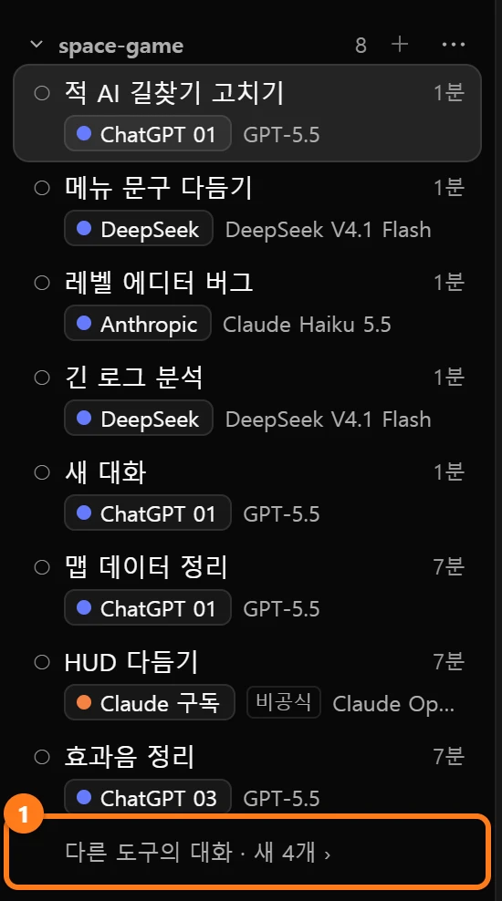
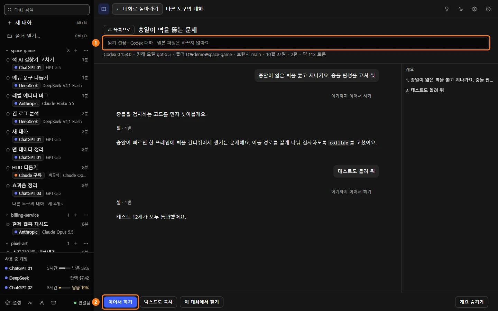
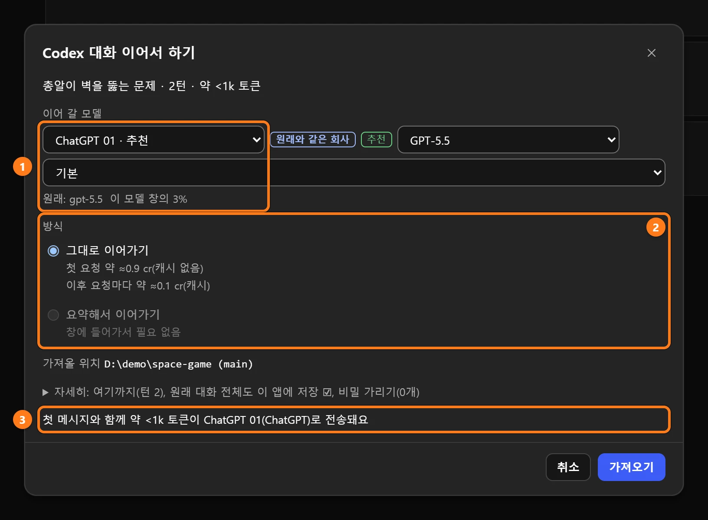
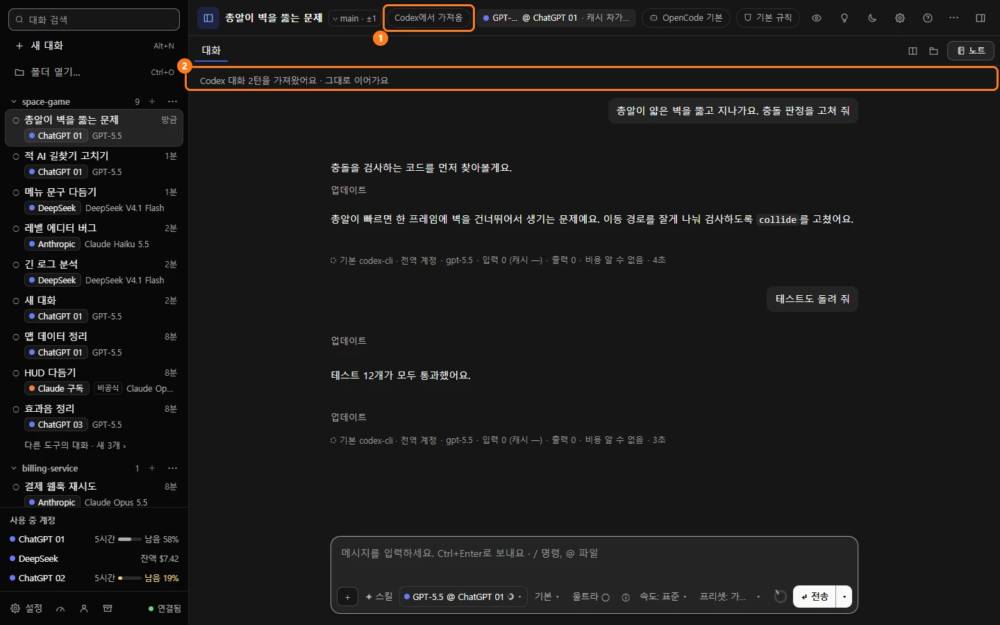

# 21. 다른 도구의 대화: Codex·Claude Code에서 가져오기

**한 줄 요약**: 같은 프로젝트 폴더에서 **Codex**나 **Claude Code**로 나눈 대화를 이 앱이 이 PC 안에서 찾아 보여 줘요. 보기는 공짜이고 원본 파일은 읽기만 해요. 이어서 하고 싶으면 `이어서 하기`로 이 앱의 대화로 옮겨요.

> **참고** 이 장은 **대화**를 가져오는 기능이에요. 이전 앱(codex-multi-provider)의 **로그인**을 가져오는 것은 다른 기능이에요([3장](03-first-account.md), [20장](20-account-kinds.md)).

## 왜 필요해요?

- Codex나 Claude Code로 하던 일을 이 앱에서 계속하고 싶을 때, 처음부터 다시 설명하지 않아도 돼요.
- "그때 무슨 얘기를 했더라?"를 확인할 때, 그 도구를 다시 켜지 않고 이 앱에서 읽기만 해도 돼요.
- Claude Code는 처음 설정으로 **30일 지난 기록을 지워요.** 남겨 두고 싶은 대화를 이 앱으로 옮겨 둘 수 있어요.

## 21.1 어디서 찾나요?

프로젝트를 사이드바에서 펼치면, 그 폴더에서 아직 가져오지 않은 대화가 있을 때 목록 끝에 `다른 도구의 대화 · 새 4개` 줄이 보여요.

다른 길도 있어요.

- 프로젝트 머리줄 `⋯` → `다른 도구의 대화…`(Git 저장소가 아닌 폴더에도 있어요).
- 명령 팔레트(`Ctrl+K`)의 `다른 도구의 대화 열기`.
- 그 폴더의 빈 새 대화 화면에 `이 폴더에 아직 가져오지 않은 Codex·Claude Code 대화 4개가 있어요`와 `보기`가 한 번 보여요.

**어느 대화가 보이나요?**

- 앱이 찾는 곳은 Codex의 `%USERPROFILE%\.codex`와 Claude Code의 `%USERPROFILE%\.claude`예요(환경 변수 `CODEX_HOME`, `CLAUDE_CONFIG_DIR`을 바꿨다면 그 폴더).
- 그 대화를 시작한 폴더가 **이 프로젝트 폴더이거나 그 아래**인 대화만 보여요.
- 다른 곳에 있는 저장소(예전 앱의 프로필 폴더 등)는 `설정` > `다른 도구의 대화`의 `찾을 곳 더하기`로 더해요(이 PC의 창에서만).
- 줄을 끄고 싶으면 `설정` > `다른 도구의 대화`의 `사이드바에 보이기`를 꺼요(그 창에만 적용돼요).

## 21.2 목록 읽기

와 이어서 하기(옮기기)예요.")

- 줄마다 제목, 그 아래 첫 요청 한 줄, 오른쪽에 도구(Codex / Claude Code), 마지막 활동, `원래: gpt-5.5` 같은 원래 모델이 보여요.
- 거르기: `전체` / `Codex` / `Claude Code`, `이 폴더` / `모든 폴더`, `더 보이기`의 `하위 에이전트`·`보관됨`·`자동 실행`.
- 검색 칸은 제목을 찾아요. `내용까지`를 켜면 내가 쓴 글과 모델의 답도 찾아요(도구 출력은 찾지 않아요).

줄에 붙는 표시

| 표시 | 뜻 |
|---|---|
| `가져옴` | 이미 이 앱으로 옮긴 대화예요. 그 뒤로 원본이 길어졌으면 `원본에 새 턴 2개`처럼 붙어요 |
| `진행 중일 수 있음` | 그 도구가 2분 안에 쓴 대화예요. 가져오면 지금까지만 들어와요 |
| `폴더 없음` | 원래 작업 폴더가 지워졌어요. 가져오면 프로젝트 폴더로 와요 |
| `읽을 수 없음` | 원본 파일이 없거나 형식을 읽지 못했어요. 마우스를 올리면 이유가 보여요 |
| `5일 뒤 원본이 지워질 수 있음` | 아직 가져오지 않은 Claude Code 대화가 마지막 활동 뒤 30일이 되기까지 7일 이하로 남았어요. Claude Code가 30일 지난 기록을 지우기 때문이에요. 0일이면 `곧 원본이 지워질 수 있음`이에요. 남기려면 지금 가져오세요 |

## 21.3 읽기 전용으로 보기 (공짜)

줄의 `열기`를 누르면 그 대화가 이 앱의 대화 화면처럼 보여요.

- 맨 위 띠: `읽기 전용 · Codex 대화 · 원본 파일은 바꾸지 않아요`.
- 그 아래: 도구와 버전, 원래 모델, 폴더, 브랜치, 날짜, 턴 수, 크기(약 몇 토큰).
- 실행한 명령과 바꾼 파일도 보여요. 그 도구가 압축한 자리에는 `Codex가 여기서 대화를 압축했어요`와 `요약 보기`가 있어요. Codex의 원격 압축은 요약이 암호화돼 있어 `요약 내용을 읽을 수 없음(암호화) · …`로 보여요.
- 오른쪽 `개요`에 턴 목록이 있어요. 아래 단추로 `텍스트로 복사`, `이 대화에서 찾기`(`Ctrl+F`, 도구 출력까지 찾아요)를 써요.
- **보기는 모델을 부르지 않아서 사용량이 들지 않고, 대화 내용이 PC 밖으로 나가지 않아요.**
- API 키나 토큰처럼 보이는 값은 `[redacted:API key]`처럼 가려서 보여요(원본은 그대로예요).

## 21.4 이어서 하기 (이 앱의 대화로 옮기기)

목록이나 보기의 `이어서 하기`, 또는 보기에서 내 메시지 옆 `여기까지 이어서 하기`(그 턴까지만)를 누르면 창이 열려요.

**① 이어 갈 모델**

- 원래 도구와 **같은 회사의 계정**이 있으면 그 계정이 처음 값이고 `원래와 같은 회사`가 붙어요(Codex → ChatGPT, Claude Code → Claude 구독). 없으면 그 폴더의 새 대화와 같은 조합이에요.
- 계정이 둘 이상인 종류마다, 남은 사용량이 가장 넉넉한 계정에 `추천`이 붙어요. **표시일 뿐**, 앱이 계정을 바꾸지 않아요. 남은 사용량은 그 계정을 고르면 이어 갈 모델로 봐요(내가 고른 모델이 그 계정에 있으면 그 모델, 없으면 그 계정 묶음의 기본 모델). 계정을 바꿔도 내가 고른 모델은 그대로예요.
- Claude 구독 계정이 여럿이면 고른 계정 그대로 이어 가요. 값, 남은 사용량, 아래 전송 안내 줄도 고른 계정으로 다시 매겨요. 가져오기를 누르면 그 계정이 새 대화의 Claude 계정이 돼요(전환기에서 새 대화의 계정을 고를 때와 같아요).
- 그 계정으로 정하지 못하면 아무것도 가져오지 않고 `이 Claude 계정으로 정하지 못해서 가져오지 않았어요`가 떠요. `계정 화면 열기`로 그 계정을 확인하거나, `다른 계정 고르기`로 다른 계정을 골라요.
- 옆에 `원래: gpt-5.5`와 `이 모델 창의 3%`처럼 대화가 새 모델 창을 얼마나 채우는지 보여요.

**② 방식**

| 방식 | 하는 일 | 값 | 처음 값이 되는 때 |
|---|---|---|---|
| `그대로 이어가기` | 대화를 그대로 옮겨요. 모델은 원래 모델이 마지막에 보던 것(그 도구가 압축했다면 그 요약과 그 뒤)을 봐요 | 가져올 때는 공짜. 첫 메시지 때 그 부분이 캐시 없이 한 번 전송돼요 | 고른 모델의 창에 들어갈 때 |
| `요약해서 이어가기` | 창에 들어가는 만큼 최근 대화를 원문으로 두고, 들어가지 않는 앞부분만 요약해요 | `이어 갈 모델로 요약`은 요약 값이 들어요. `LLM 없이`는 `무료`예요(그 도구의 요약, 프로그램이 뽑은 사실, 내 요청 목록) | 창에 들어가지 않을 때 |

- 고를 수 없는 방식은 흐리게, 이유와 함께 보여요(예: `창에 들어가서 필요 없음`).
- `이어 갈 모델로 요약`은 요약할 계정의 5시간·주간 한도에 남은 양보다 요약이 더 쓸 것 같으면(또는 그 계정의 한도를 이미 다 썼으면) `남은 사용량 부족`과 함께 흐려져요. 그때는 `남은 사용량이 넉넉한 계정`과 `…로 바꾸기` 단추가 함께 보여요. 이 목록도 계정마다 이어 갈 모델로 보고, 그 모델의 한도를 이미 다 쓴 계정(예: Opus로 이어 갈 때 `주간 · Opus`가 찬 계정)은 넣지 않아요.
- Codex 원격 압축이 있는 대화에서는 요약 줄 이름이 `전체 기록 요약`이에요.
- 줄마다 `첫 요청 약 …(캐시 없음)`, `이후 요청마다 약 …(캐시)`처럼 값이 보여요.
- 창에 들어가는 대화를 가볍게 시작하고 싶으면 `그대로` 가져온 뒤 평소처럼 압축하면 돼요([13장](13-auto-compaction.md)).

**그 밖의 칸**

- `가져올 위치`: 처음 값은 그 대화의 마지막 작업 폴더(와 브랜치)예요.
- `자세히`: `여기까지(턴 2)`, `원래 대화 전체도 이 앱에 저장`(처음 켬), `비밀 가리기(0개)`(처음 켬). 휴대폰·다른 PC에서는 `비밀 가리기`를 끌 수 없어요.

**③ 무엇이 어디로 가나요?** 단추 위에 늘 이런 줄이 보여요: `첫 메시지와 함께 약 <1k 토큰이 ChatGPT 01(ChatGPT)로 전송돼요`. 이어 갈 모델로 요약하면 지금 요약하려고 보내는 양도 함께 보여요. 원래 도구와 다른 회사로 가면 `다른 회사`가 붙어요.

**실행**: `가져오기`(요약이면 `요약하고 가져오기`)를 눌러요. `원본 읽는 중` → `요약 중` → `대화 만드는 중`이 보이고, 대화를 만들기 전까지는 `취소`할 수 있어요. 창을 닫아도 계속되고 끝나면 알림이 떠요. 한 번에 하나씩 가져와요.

## 21.5 가져온 대화

- 새 대화가 열리고 헤더에 `Codex에서 가져옴`이 붙어요. 누르면 원본, 가져온 때, 가져온 턴, 방식, 이어 가는 자리, 요약 모델, 가린 값 수, `원본 보기`가 보여요.
- 첫 화면에 `Codex 대화 2턴을 가져왔어요 · 그대로 이어가요` 같은 한 줄이 보여요.
- 그다음은 **보통 대화와 같아요.** 압축, 계정 전환, 프리셋 모두 평소대로예요.
- 같은 대화를 다시 가져오면 먼저 `열기` / `새로 가져오기`를 물어요. 다시 가져오면 언제나 새 대화가 되고 앞서 가져온 대화는 그대로예요.

## 알아 두면 좋아요

- **다른 도구의 파일은 읽기만 해요.** 쓰지도, 옮기지도, 지우지도 않아요. 로그인 파일(`auth.json`, `.credentials.json`)은 열지 않고, `codex`나 `claude` 프로그램을 실행하지도 않아요.
- **대화 내용이 PC 밖으로 나가는 때는 둘뿐이에요.** `이어 갈 모델로 요약`을 실행할 때, 그리고 가져온 대화로 메시지를 보낼 때예요. 둘 다 실행 전에 창에 보여요.
- 가져온 대화는 사용 통계에 **원래 날짜의 활동**으로 들어가요. 토큰과 값은 0이에요.
- 휴대폰·다른 PC에서는 `읽기` 권한이 있으면 **연 프로젝트의** 대화 목록·보기·검색, `메시지 보내기` 권한도 있으면 `이어서 하기`까지 돼요. 다른 프로젝트의 대화는 보이지 않아요. `모든 폴더` 보기, 찾는 곳 바꾸기, `비밀 가리기` 끄기는 이 PC의 창에서만 돼요([24장](24-phone-other-pc.md)).
- SSH 원격 호스트에는 이 기능이 없어요. 이 PC에 있는 Codex·Claude Code 기록만 읽어요.

## 잘 안 될 때

| 증상 | 이렇게 해요 |
|---|---|
| 사이드바 줄이 안 보여요 | 그 폴더에 가져오지 않은 대화가 없거나, `사이드바에 보이기`를 껐을 수 있어요. 프로젝트 `⋯`에 `다른 도구의 대화…`도 없으면 서비스에 이 기능(own-import)이 빠진 거예요([26장](26-troubleshooting.md)) |
| 찾는 대화가 없어요 | 대화를 시작한 폴더가 다른 곳일 수 있어요. 목록의 `모든 폴더`(이 PC의 창에서만)를 보거나 `찾을 곳 더하기`를 써요. 처음 열면 `아직 찾는 중이에요. 찾는 대로 목록에 더해요.`가 보이다가 채워져요 |
| 줄에 `읽을 수 없음` | 원본이 지워졌거나 형식을 읽지 못했어요. 원본은 그대로이고 다른 대화는 계속 보여요 |

## 조심하세요

> **주의** `이어 갈 모델로 요약`은 요약할 부분을 그 계정(회사)으로 보내고 값이 들어요. 회사 밖으로 나가면 안 되는 대화라면 `LLM 없이`를 고르거나, 같은 회사 계정으로 이어 가세요.

> **주의** 가져온 대화의 첫 메시지는 옮긴 대화 전체를 캐시 없이 한 번 읽어요. 긴 대화면 첫 요청이 비쌀 수 있어요. 창에 보이는 값을 확인하고 보내세요.

> **주의** Claude Code 대화는 30일이 지나면 원본이 지워질 수 있어요. 앱이 저절로 옮겨 두지 않아요. 남기고 싶으면 그 전에 `이어서 하기`로 가져오세요.

## 더 알아보기

- 설계 문서: [09 다른 도구의 대화](../09-session-import.md)
- 첫 계정 연결(로그인 가져오기와 다른 기능): [3장](03-first-account.md)
- Codex·Claude Code의 **스킬** 가져오기(대화와 다른 기능): [10장](10-conversation-tools.md)
