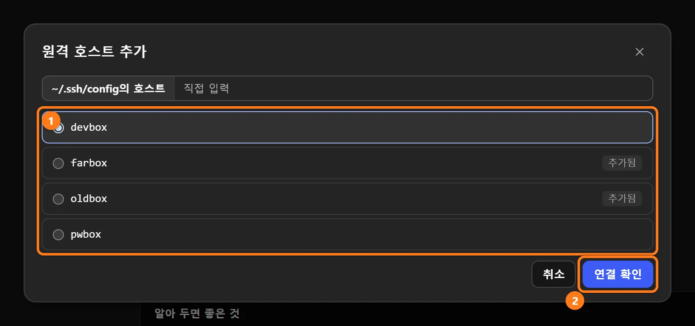
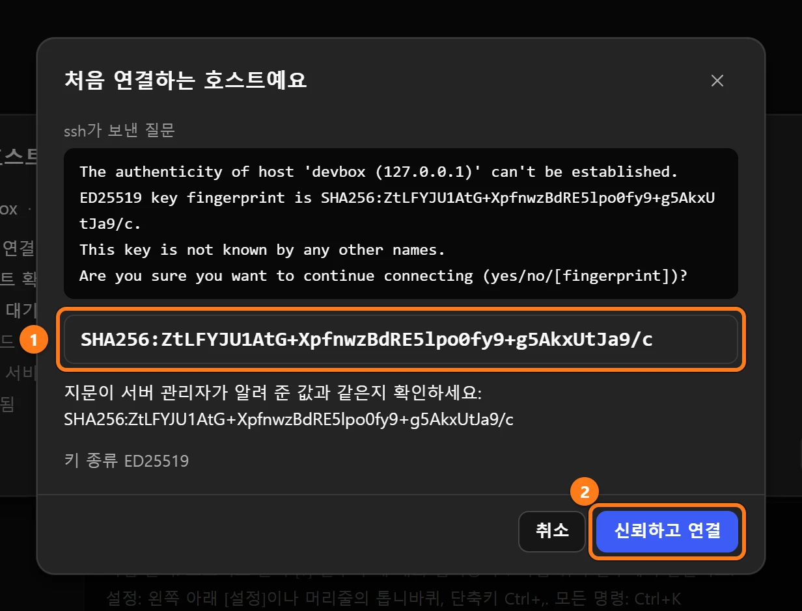
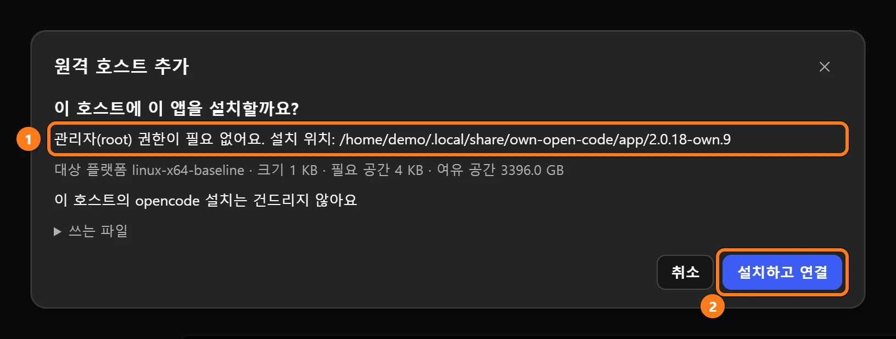
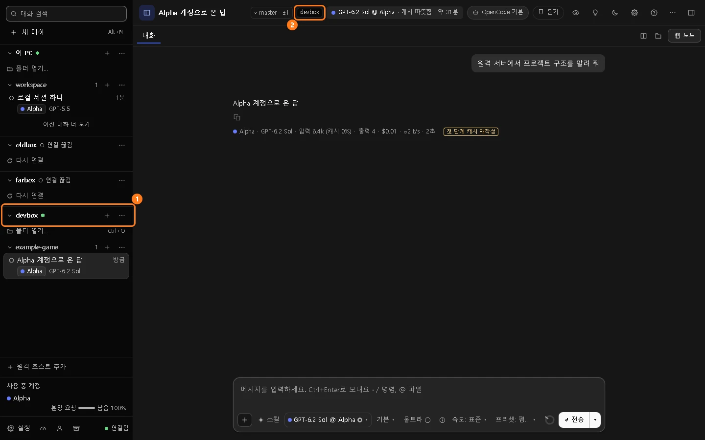
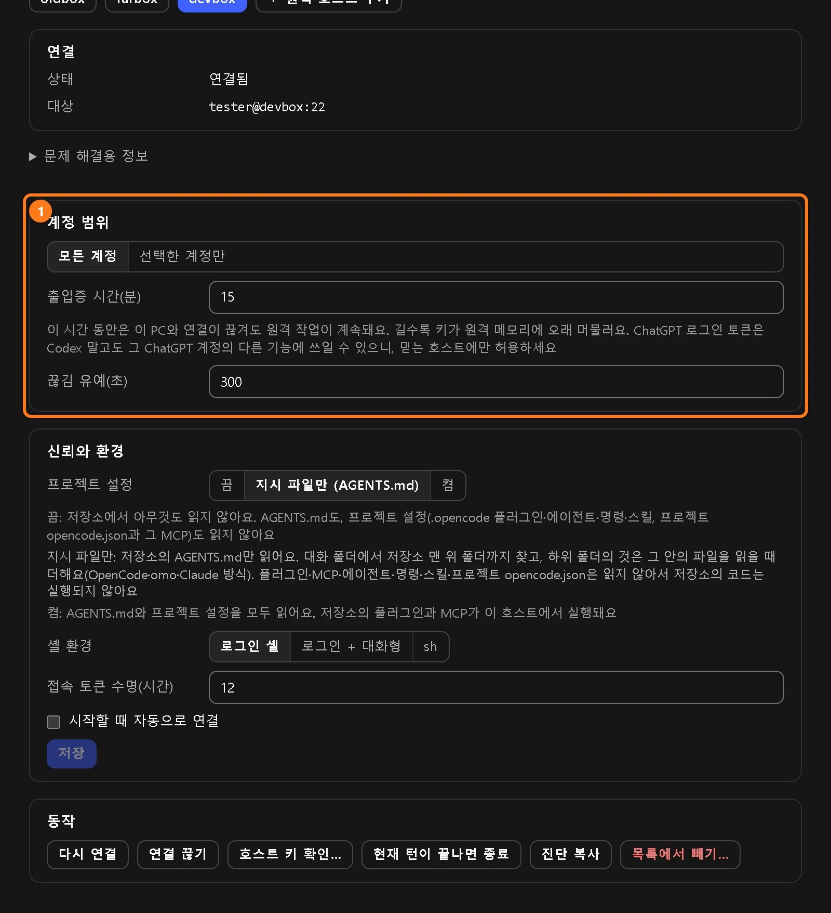
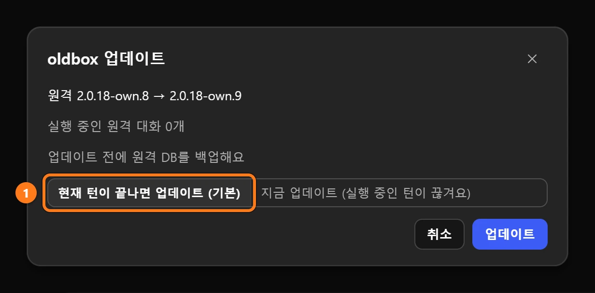

# 22. SSH 원격 프로젝트

**한 줄 요약** — 코드가 Linux 서버에 있어도 이 앱에서 그대로 일할 수 있어요. 에이전트·셸·터미널은 서버에서 돌고, 계정과 한도는 이 PC의 것을 써요. 계정 키는 서버에 남기지 않아요.

> **용어** SSH: 다른 컴퓨터(주로 Linux 서버)에 안전하게 접속하는 표준 방법이에요. **원격 호스트**(또는 호스트)는 그렇게 접속하는 서버 한 대를 말해요.

> **참고** 이 장의 화면은 원격 기능용 데모라서 계정 이름(`Alpha`)과 버전 숫자가 다른 장과 달라요. 서버 이름 `devbox`, `oldbox`도 가짜예요.

## 왜 필요해요?

- 큰 프로젝트는 성능 좋은 서버나 회사 개발 서버에 있는 경우가 많아요. 파일을 PC로 옮기지 않고 그 자리에서 고치고 빌드하고 시험할 수 있어요.
- 계정은 한곳(이 PC)에서만 관리해요. 서버마다 로그인하거나 API 키를 복사할 필요가 없어요.
- 비유하면 이래요. **일꾼은 서버의 작업장에서 일하고, 지갑(계정 키)은 내 PC 금고에 둬요.** 일꾼이 돈을 쓸 일이 생길 때마다 PC가 15분짜리 출입증만 잠깐 빌려 줘요.

## 준비할 것

| 어디 | 필요한 것 |
|---|---|
| 서버 | Linux(x64 또는 arm64). `sh`, `tar`, `mktemp`만 있으면 돼요. 관리자(root) 권한은 필요 없어요 |
| 이 PC | Windows의 선택 기능 "OpenSSH Client". 대부분 이미 켜져 있어요 |
| 접속 정보 | 서버 주소와 사용자 이름. `~/.ssh/config`에 적어 두면 목록에서 고를 수 있어요 |

- 앱은 SSH 키를 만들거나 복사하지 않고, `known_hosts`도 고치지 않아요. 키 준비는 평소 SSH를 쓰던 방식 그대로 해요.
- 암호문구가 걸린 키를 매번 입력하기 싫으면 ssh-agent를 직접 켜고 키를 올려 두세요(관리자 PowerShell, 사용자가 직접).
- 앱 안에서는 비밀번호·암호문구를 물을 때 창이 떠요(예: `devbox 비밀번호`). 입력한 값은 보낸 뒤 바로 지워요.

## 이렇게 써요

### 1. 호스트 추가

1. 사이드바 맨 아래의 `원격 호스트 추가`를 눌러요(좁은 사이드바에서는 `원격 호스트`). `설정` → `SSH 원격 호스트`에서도 돼요.
2. 위쪽에서 방법을 골라요.
   - `~/.ssh/config의 호스트`: 목록에서 서버를 골라요(그림 ①). 이미 추가한 서버에는 `추가됨`이 붙어요.
   - `직접 입력`: `대상 (user@host 또는 user@host:port)`과 `표시 이름`을 넣어요.
3. `연결 확인`(그림 ②)을 눌러요.

### 2. 호스트 키 지문 확인

처음 접속하는 서버라면 `처음 연결하는 호스트예요` 창이 떠요.

> **용어** 지문(fingerprint): 서버가 가진 열쇠의 고유 번호예요. `SHA256:`으로 시작하는 긴 글자예요. 이 번호가 맞으면 "진짜 그 서버"라는 뜻이에요.

1. 큰 글씨의 지문(그림 ①)을 봐요.
2. **서버 관리자가 알려 준 지문과 한 글자도 다르지 않은지** 비교해요. 내가 관리하는 서버라면 서버에서 직접 확인한 값과 비교해요.
3. 같을 때만 `신뢰하고 연결`(그림 ②)을 눌러요. 다르거나 모르겠으면 `취소`해요.

> **주의** 지문을 확인하지 않고 누르면, 중간에서 가로채는 가짜 서버에 연결될 수 있어요. 그러면 그 서버로 가는 대화와 출입증이 새어 나갈 수 있어요.

- 이 질문은 호스트를 추가할 때와 호스트 메뉴의 `호스트 키 확인…`에서만 떠요. 앱이 뒤에서 다시 연결할 때 모르는 키를 만나면 묻지 않고 멈춰서 기다려요(`호스트 키 확인 필요`).
- `호스트 키가 바뀌었어요. 중간자 공격일 수 있으니 서버 관리자에게 확인한 뒤 known_hosts를 직접 고치세요.`가 뜨면 앱은 고쳐 주지 않아요. 관리자에게 확인한 뒤 직접 고쳐요.

### 3. 설치하고 연결

서버에 아직 앱이 없으면 `이 호스트에 이 앱을 설치할까요?`가 떠요.

- 설치는 **서버의 내 홈 폴더 안에만** 해요. 관리자(root) 권한도, 서버의 인터넷도 필요 없어요. 이 PC에 들어 있는 파일을 SSH로 올리기만 해요.
- 서버에 원래 있던 `opencode`는 건드리지 않아요.
- `쓰는 파일`을 펼치면 서버에 쓰는 파일 목록이 보여요.
- `설치하고 연결`을 누르면 `업로드` → `검증` → `원격 서비스 시작` 순서로 진행돼요.
- 끝나면 `연결되었어요`와 함께 `에이전트 셸에서 찾은 도구`, `에이전트 셸 PATH`, 그리고 `프로젝트 설정: 지시 파일만 (AGENTS.md)`과 세 상태의 설명이 보여요. `바꾸기…`를 누르면 호스트 설정이 열려요("프로젝트 설정 세 가지"). `대화형 셸에만 있는 PATH가 있어요`가 보이면 `대화형 셸 설정 쓰기`를 눌러 두세요. `.bashrc`에만 등록한 도구(예: nvm으로 깐 node)를 에이전트도 찾게 돼요.

### 4. 폴더 열고 세션 시작

1. 완료 창의 `폴더 열기`를 누르거나, 사이드바에서 그 호스트 바로 아래 줄의 `폴더 열기…`를 눌러요. `이 PC`와 같은 자리예요. 호스트를 보고 있을 때는 `Ctrl+O`도 그 호스트의 폴더를 열어요.
2. `devbox에서 폴더 열기` 창에서 서버의 절대 경로를 넣고 Enter를 눌러요(예: `/home/me/work/app`, 홈 폴더 기준 `~/work/app`도 돼요). `홈으로`를 누르면 홈 폴더부터 볼 수 있어요.
   - 아직 없는 폴더면 목록 아래 `새 폴더`를 눌러 이름을 적고 `만들기`(또는 Enter)를 눌러요. 지금 보는 폴더 안에 서버가 만들고 바로 그 폴더를 열어요. 한글 이름도 돼요. 같은 이름이 있으면 `같은 이름이 이미 있어요.`와 `그 폴더 열기`가 떠요.
   - 흐린 `🔒` 폴더는 서버의 내 계정이 읽을 권한이 없는 폴더예요. 마우스를 올리면(휴대폰은 길게 누르면) `읽을 권한이 없어요 (소유자: root)`처럼 누구 것인지 보여요. 열면 `이 폴더는 읽을 권한이 없어요 (소유자: root).`라고 알려 줘요. 경로가 틀린 게 아니에요.
   - 디스크 맨 위나 마운트 지점의 `lost+found`는 숨겨요. 디스크 검사(fsck)가 쓰는 복구 폴더라 프로젝트가 될 수 없고 root만 읽어요. 아래 줄에 시스템 폴더를 몇 개 숨겼는지 적혀요. 경로를 직접 넣으면 열 수는 있어요.
3. `이 폴더에서 새 대화`을 눌러요.

**폴더 없이 대화하기**: 폴더를 고르지 않아도 돼요. 새 대화 화면 입력창 아래 줄 맨 앞의 서버 단추(`이 PC`, 앞에 ⌂)에서 호스트를 고르고 바로 보내요. 그 호스트의 **새 대화 폴더**에서 일해요. 새 호스트는 `~/own-chats`예요. 사이드바에서 그 호스트 머리줄의 `+`를 눌러도 돼요. 그 호스트의 대화를 보고 있으면 `새 대화`(`Alt+N`)도 그 호스트에서 시작해요([4장](04-first-conversation.md)).

이제 평소처럼 대화하면 돼요. 에이전트의 파일 읽기·고치기·명령 실행, 작업 패널의 터미널이 모두 **서버에서** 돌아요. 모델 @ 계정 고르기, 한도, 전환 비용 창은 이 PC와 똑같아요.

- **서버의 개발 서버 보기**: 대화 옆 `브라우저`(`Ctrl+Shift+B`)를 열고 주소 칸에 `localhost:3000`처럼 넣으면 **서버의** 그 포트가 열려요. 브라우저 칸은 이 PC의 앱에 있지만, 이 대화의 `localhost`·`127.0.0.1`·서버 이름은 SSH 연결을 거쳐 서버에서 열려요. `ssh -L`은 필요 없어요. 다른 사이트는 이 PC에서 바로 열려요. 에이전트도 같은 브라우저를 써요(이 PC의 데스크톱 앱이 켜져 있는 동안). 자세한 것은 [19장 8](19-browser-pane.md)이에요.

- 연결한 직후에 첫 메시지를 보내면 `원격 호스트가 이 PC의 계정을 받는 중이에요. 받으면 보내요`가 뜰 수 있어요. 서버가 이 PC의 계정 목록을 아직 받는 중이라는 뜻이에요. 받으면 대화가 만들어지고 메시지가 그대로 가요. 1분이 지나도 못 받으면 `원격 호스트에 이 모델이 아직 없어요. 연결을 확인하고 다시 보내 주세요`가 뜨고 입력한 글은 입력창에 남아요. 기다리는 동안 입력창에는 글을 쓸 수 없어요. 그 사이 다른 화면으로 가면 대화를 만들지 않고 `화면을 옮겨서 새 대화를 만들지 않았어요. 쓴 글은 입력 기록(↑)에 있어요`가 떠요. 보내려던 글은 입력창에서 ↑로 다시 불러와요.

## 키는 서버에 남지 않아요: 인증 브로커

> **용어** 인증 브로커: 이 PC에서 계정 키를 지키고, 서버가 모델을 부를 때마다 필요한 출입증만 잠깐 빌려 주는 부분이에요. 화면에서도 이 잠깐 빌려 주는 열쇠를 출입증이라고 불러요.

<figure class="diagram">
<svg class="dg-wide" viewBox="0 0 680 250" role="img" aria-label="계정 키는 이 PC의 금고에 있고, 서버가 모델을 부를 때마다 브로커가 SSH 연결 안으로 출입증만 잠깐 빌려 준다. 출입증은 서버 메모리에만 있고, 연결이 끊긴 채 출입증이 끝나면 서버는 모델을 부르지 않고 멈춘다" xmlns="http://www.w3.org/2000/svg" font-family="inherit" style="width:100%;height:auto;max-width:680px">
<defs>
<marker id="d22-arrow" viewBox="0 0 10 10" refX="9" refY="5" markerWidth="7" markerHeight="7" orient="auto"><path d="M0,0 L10,5 L0,10 z" fill="currentColor"/></marker>
<marker id="d22-arrow-accent" viewBox="0 0 10 10" refX="9" refY="5" markerWidth="7" markerHeight="7" orient="auto"><path d="M0,0 L10,5 L0,10 z" fill="#E8711A"/></marker>
</defs>
<g fill="currentColor" fill-opacity="0.06" stroke="currentColor" stroke-opacity="0.5" stroke-width="1.5">
<rect x="10" y="20" width="200" height="150" rx="12"/>
<rect x="470" y="20" width="200" height="150" rx="12"/>
</g>
<rect x="28" y="92" width="164" height="60" rx="8" fill="#E8711A" fill-opacity="0.12" stroke="#E8711A" stroke-width="1.5"/>
<g fill="currentColor" text-anchor="middle">
<text x="110" y="48" font-size="15" font-weight="700">이 PC</text>
<text x="110" y="70" font-size="12" fill-opacity="0.75">계정 관리는 여기서만</text>
<text x="110" y="117" font-size="13" font-weight="700">금고(계정 키·로그인)</text>
<text x="110" y="138" font-size="12" fill-opacity="0.8">+ 인증 브로커</text>
<text x="570" y="48" font-size="15" font-weight="700">서버(원격 호스트)</text>
<text x="570" y="72" font-size="12" fill-opacity="0.8">에이전트·셸·터미널이 일해요</text>
<text x="570" y="116" font-size="13" font-weight="700">출입증(lease)</text>
<text x="570" y="137" font-size="12" fill-opacity="0.8">기본 15분 · 메모리에만</text>
</g>
<rect x="214" y="58" width="252" height="100" rx="30" fill="currentColor" fill-opacity="0.04" stroke="currentColor" stroke-opacity="0.35" stroke-dasharray="6 4"/>
<text x="340" y="50" font-size="12" text-anchor="middle" fill="currentColor" fill-opacity="0.75">SSH 연결 (이 안으로만 오가요)</text>
<text x="340" y="82" font-size="12.5" text-anchor="middle" fill="currentColor">① “모델을 부를게요”</text>
<line x1="460" y1="90" x2="222" y2="90" stroke="currentColor" stroke-width="1.6" marker-end="url(#d22-arrow)"/>
<line x1="222" y1="122" x2="460" y2="122" stroke="#E8711A" stroke-width="1.8" marker-end="url(#d22-arrow-accent)"/>
<text x="340" y="141" font-size="12.5" text-anchor="middle" fill="#E8711A">② 그 요청에 쓸 출입증만 빌려 줌</text>
<text x="340" y="200" font-size="13" text-anchor="middle" fill="currentColor">연결이 끊긴 채 출입증이 끝나면 → 모델을 부르지 않고 안전하게 멈춰요</text>
<text x="340" y="226" font-size="12" text-anchor="middle" fill="currentColor" fill-opacity="0.75">API 키와 로그인 토큰은 서버 디스크에 가지 않아요</text>
</svg>
<svg class="dg-narrow" viewBox="0 0 320 430" role="img" aria-label="계정 키는 이 PC의 금고에 있고, 서버가 모델을 부를 때마다 브로커가 SSH 연결 안으로 출입증만 잠깐 빌려 준다. 출입증은 서버 메모리에만 있고, 연결이 끊긴 채 출입증이 끝나면 서버는 모델을 부르지 않고 멈춘다" xmlns="http://www.w3.org/2000/svg" font-family="inherit" style="width:100%;height:auto;max-width:360px">
<defs>
<marker id="d22n-arrow" viewBox="0 0 10 10" refX="9" refY="5" markerWidth="7" markerHeight="7" orient="auto"><path d="M0,0 L10,5 L0,10 z" fill="currentColor"/></marker>
<marker id="d22n-arrow-accent" viewBox="0 0 10 10" refX="9" refY="5" markerWidth="7" markerHeight="7" orient="auto"><path d="M0,0 L10,5 L0,10 z" fill="#E8711A"/></marker>
</defs>
<g fill="currentColor" fill-opacity="0.06" stroke="currentColor" stroke-opacity="0.5" stroke-width="1.5">
<rect x="10" y="10" width="300" height="96" rx="12"/>
<rect x="10" y="244" width="300" height="96" rx="12"/>
</g>
<rect x="60" y="50" width="200" height="46" rx="8" fill="#E8711A" fill-opacity="0.12" stroke="#E8711A" stroke-width="1.5"/>
<g fill="currentColor" text-anchor="middle">
<text x="160" y="36" font-size="15" font-weight="700">이 PC</text>
<text x="160" y="70" font-size="13" font-weight="700">금고(계정 키·로그인)</text>
<text x="160" y="88" font-size="12" fill-opacity="0.8">+ 인증 브로커</text>
<text x="160" y="270" font-size="15" font-weight="700">서버(원격 호스트)</text>
<text x="160" y="292" font-size="12" fill-opacity="0.8">에이전트·셸·터미널이 일해요</text>
<text x="160" y="314" font-size="13" font-weight="700">출입증(lease)</text>
<text x="160" y="332" font-size="12" fill-opacity="0.8">기본 15분 · 메모리에만</text>
</g>
<rect x="96" y="110" width="128" height="130" rx="20" fill="currentColor" fill-opacity="0.04" stroke="currentColor" stroke-opacity="0.35" stroke-dasharray="6 4"/>
<text x="160" y="176" font-size="11" text-anchor="middle" fill="currentColor" fill-opacity="0.7">SSH 연결</text>
<line x1="128" y1="238" x2="128" y2="112" stroke="currentColor" stroke-width="1.6" marker-end="url(#d22n-arrow)"/>
<line x1="192" y1="112" x2="192" y2="238" stroke="#E8711A" stroke-width="1.8" marker-end="url(#d22n-arrow-accent)"/>
<g font-size="12">
<text x="10" y="150" fill="currentColor">① 모델을</text>
<text x="10" y="167" fill="currentColor">부를게요</text>
<text x="230" y="150" fill="#E8711A">② 출입증만</text>
<text x="230" y="167" fill="#E8711A">빌려 줌</text>
</g>
<g fill="currentColor" font-size="12.5">
<text x="10" y="372">연결이 끊긴 채 출입증이 끝나면</text>
<text x="10" y="391">→ 모델을 부르지 않고 안전하게 멈춰요</text>
</g>
<text x="10" y="418" font-size="11.5" fill="currentColor" fill-opacity="0.75">키와 로그인 토큰은 서버 디스크에 가지 않아요</text>
</svg>
<figcaption>그림: 원격 서버가 계정을 빌려 쓰는 방식이에요(실제 화면이 아니에요). 지갑은 내 PC에, 서버에는 잠깐 쓰는 출입증만 가요.</figcaption>
</figure>

- API 키, 로그인 토큰은 서버 디스크에 가지 않아요. 로그인을 새로 고치는 토큰은 이 PC를 떠나지 않아요.
- 이 PC와 연결이 끊긴 채 출입증이 끝나면 원격 턴은 멈추고 오류 카드에 “PC와 연결이 끊겨 이 모델을 부를 수 없어요. PC에서 앱이 켜져 있고 SSH 연결이 살아 있는지 확인한 뒤 다시 보내 주세요.”가 떠요. 카드 아래 `다시 보내기`를 누르거나, 다시 연결한 뒤 이어서 부탁하면 돼요.
- Claude 구독 계정은 출입증을 받지 않아요. 대신 그 서버의 Claude 요청이 이 PC로 돌아와 이 PC의 Claude 로그인으로 나가요. 로그인 토큰은 서버에 가지 않아요. 그래서 이 PC가 켜져 있고 연결되어 있어야 하고, 연결이 끊기면 쓰던 답이 거기서 끝나요. 호스트마다 계정 화면의 Claude 구독 계정 카드들 **아래**에 있는 `SSH 원격 호스트에서 쓰기`에서 켜요. 이 스위치는 이 PC의 **모든** Claude 구독 계정에 함께 적용돼요([20장](20-account-kinds.md)).
- **이 PC의 로컬 모델**도 서버의 대화에서 써요. 아래 "PC의 로컬 모델을 서버에서 쓰기"를 보세요.
- **Claude Agent 계정**(내 PC의 Claude Code, [20.8](20-account-kinds.md))도 서버의 대화에서 써요. Claude Code는 서버가 아니라 **이 PC에서** 돌고, 파일 읽기·명령·편집 같은 도구는 서버에서 돌아요. 서버에는 Claude Code를 설치하지 않고 로그인도 하지 않아요. 로그인과 토큰은 이 PC의 Claude Code에만 있어요. 따로 켜는 스위치는 없어요. 호스트의 계정 범위에 든 Claude Agent 계정이면 서버의 모델 목록에 `Claude Agent` 모델이 보여요.
  - 서버의 대화마다 Claude Agent 계정을 고를 수 있어요(전환기, 손으로만). 다른 계정으로 옮겨도 같은 Claude 대화가 이어져요.
  - 서버 대화의 Claude Code도 이 PC의 `실행 중인 Claude` 수에 들어가요. 자리가 없으면 기다리고, 서버 대화의 입력창 위에도 그 줄이 보여요.
  - 한도는 이 PC의 그 계정 한도에 쌓여요.
  - 연결이 끊기면 하던 답은 거기서 끝나요. 다시 연결한 뒤 이어서 부탁하면 Claude가 같은 대화를 이어 받아요.
  - 권한 질문과 쓰기 질문은 평소처럼 서버 대화에 떠요.

## PC의 로컬 모델을 서버에서 쓰기

이 PC에서 돌리는 모델 서버(LM Studio, Ollama, llama.cpp 같은 `로컬 모델` 계정, [20장](20-account-kinds.md))를 서버(원격 호스트)의 대화에서도 그대로 써요. 따로 켜는 스위치는 없어요.

- **이 PC를 거쳐 가요.** 서버에서 보면 `127.0.0.1`은 서버 자신이라, 서버는 이 PC의 모델 서버에 바로 닿을 수 없어요. 그래서 서버의 요청은 이미 있는 SSH 연결을 타고 이 PC로 돌아와, 이 PC가 계정에 적힌 주소의 모델 서버로 보내요. 답은 오는 대로 흘러가요(스트리밍).
- 전환기에서 그 모델 옆에 `PC 경유`가 붙어요. 설정 > SSH 원격 호스트의 호스트 칸에도 `로컬 모델 · 이 PC를 거쳐 써요`가 보여요.
- **키는 서버로 가지 않아요.** 키가 있는 로컬 모델이면 이 PC가 요청에 키를 붙여요. 서버에는 키도 출입증도 가지 않아요.
- **요청은 이 PC의 대화와 같은 모양이에요.** 서버가 요청을 만들고 이 PC는 그대로 전해 주기만 해요. 그래서 모델 서버의 캐시(앞부분 재사용)도 평소처럼 맞아요.
- **새 연결 창을 열지 않아요.** 이 PC나 서버 어디에도 네트워크에서 닿는 새 포트를 열지 않아요. 요청마다 이 PC만 아는 서명이 붙어서, 같은 서버의 다른 사용자나 다른 프로그램은 이 PC의 모델을 쓸 수 없어요.
- `기타 OpenAI 호환` 계정이라도 주소가 이 PC 자신(`127.0.0.1`, `localhost`)이면 같은 방식으로 이 PC를 거쳐 가요. 집 안 네트워크 주소(`192.168…`) 같은 다른 주소의 `기타 OpenAI 호환` 계정은 지금처럼 서버가 직접 불러요.
- 어떤 호스트에서 어떤 로컬 모델을 쓸지는 호스트의 계정 범위로 정해요(설정 > SSH 원격 호스트 > 계정 범위). 범위 밖인 계정은 그 서버의 모델 목록에 나오지 않아요.

> **주의** 이 PC가 꺼져 있거나 SSH 연결이 끊기면 이 모델은 서버 대화에서 답할 수 없어요. 답하는 도중 끊기면 그 답은 거기서 끝나고, 쓰던 부분은 남아요. 다시 연결한 뒤 `다시 보내기`나 이어서 부탁하면 돼요.

**오류가 뜨면** 오류 카드에 까닭과 할 일이 한국어로 떠요(전에는 `own_broker_unavailable`만 보였어요). 카드 아래 단추로 바로 고칠 수 있어요.

| 카드의 문장(앞부분) | 뜻 | 할 일 |
|---|---|---|
| “PC와 연결이 끊겨 이 모델을 부를 수 없어요” | 이 PC와 서버의 연결이 끊겼어요 | 연결되면 `다시 보내기` |
| “PC가 로컬 모델 서버에 연결하지 못했어요” | 이 PC의 모델 서버가 꺼져 있어요 | 모델 서버를 켜고 `다시 보내기` |
| “이 로컬 모델은 이 SSH 서버에서 쓰지 않게 되어 있어요” | 호스트의 계정 범위 밖이에요 | `SSH 원격 호스트 설정`에서 범위에 넣거나 `다른 모델로 바꾸기` |
| “이 PC의 로컬 모델을 SSH 서버에서 쓰려면 PC 앱이 2.2.6-own.17 이상이어야 해요” | PC 앱이 옛 버전이에요 | PC 앱 업데이트 |
| “SSH 서버의 own 서비스가 이 요청을 보내지 않았어요…” | 서버 쪽 own 서비스가 옛 버전이에요 | 설정 > SSH 원격 호스트에서 호스트 `업데이트` |
| “이 요청에 PC 계정의 자격 증명을 넣지 않아 보내지 않았어요” | 이 폴더의 프로젝트 설정(플러그인)이 막았어요 | 프로젝트 설정 확인([프로젝트 설정 세 가지](#프로젝트-설정-세-가지)) |

다른 계정(출입증을 쓰는 계정, Claude 구독)의 거절도 같은 방식으로 까닭이 떠요. 예: “이 계정은 이 SSH 서버에서 쓰지 않게 되어 있어요”, “PC에서 이 계정에 다시 로그인해야 해요”, “PC에서 이 SSH 서버의 Claude 구독 사용이 꺼져 있어요”.

## 연결이 끊기면

**끊김은 중지가 아니에요.** SSH가 끊기거나 이 PC의 앱을 닫아도, 서버의 원격 서비스와 진행 중인 턴은 출입증이 남은 동안 계속 돌아요. 다시 연결하면 결과가 그대로 있어요. 끊긴 동안 대화 화면에는 `원격 대화는 호스트에 그대로 있어요. 다시 연결하는 중…`이 보여요. 열어 둔 브라우저 칸에는 `SSH 연결이 끊겼어요`가 보이고, 다시 연결되면 탭이 다시 열려요. 그동안 에이전트는 브라우저를 쓸 수 없어요.

**소리 없이 끊겨도 12초 안에 알아요.** 와이파이를 바꾸거나, 노트북이 잠들었다 깨거나, 공유기나 LTE가 끊기면 연결이 "끊겼다"는 신호 없이 그냥 조용해져요. 앱은 서버에서 아무것도 오지 않은 지 12초가 되면 끊긴 것으로 보고 위 화면으로 바꾼 뒤 저절로 다시 연결해요. PC가 깨어난 직후에는 기다리지 않고 바로 확인해요(답이 없으면 4초 안에 끊김으로 봐요).

- 네트워크가 돌아오지 않는 동안에도 10분까지는 계속 다시 연결해요(30초마다). 그 뒤에도 안 되면 멈추고 `다시 연결`을 기다려요.
- 끊긴 줄 모르고 보낸 메시지는 서버에 가지 않아요. 끊김을 알아채면 글이 입력 칸으로 돌아오니, 다시 연결된 뒤 한 번 더 보내요. 한 번만 들어가요.
- 끊긴 동안 서버가 쓴 답은 다시 연결되면 그대로 보여요. 두 번 보이지 않아요.
- 긴 답을 받는 중이거나 큰 파일을 내려받는 중이어도, 무언가 오고 있으면 끊김으로 보지 않아요. 다만 아주 느린 링크(약 100 kbit/s 이하)로 큰 것을 계속 **올리면** 끊김으로 볼 수 있어요.

사이드바의 호스트 이름 옆에 상태가 보여요.

| 상태 | 뜻 | 할 일 |
|---|---|---|
| `연결됨` | 정상이에요 | — |
| `연결 중…` | 연결하는 중이에요 | 기다려요 |
| `연결 끊김` | 지금은 붙어 있지 않아요. `저장해 둔 목록`이 보이면 그때 받아 둔 세션 목록이에요 | 호스트 아래 첫 줄의 `다시 연결` |
| `인증 필요` | 비밀번호·암호문구가 필요해요 | 호스트 `⋯` → `인증하고 연결` |
| `호스트 키 확인 필요` | 모르는 호스트 키를 만나 멈췄어요 | 호스트 `⋯` → `호스트 키 확인…` |
| `업데이트 필요` | 이 PC와 서버의 버전이 달라요 | 아래 "업데이트" |
| `다른 PC가 관리 중` | 다른 PC의 앱이 이 서버를 관리해요 | 필요하면 호스트 `⋯` → `이 PC로 가져오기` |
| `현재 턴이 끝나면 종료` | 중지를 예약했어요 | — |

> **주의** `이 호스트는 SSH가 끊기면 원격 작업도 멈춰요. 계속 돌게 하려면 관리자가 linger를 켜야 해요` 경고가 보이면, 그 서버는 끊김이 곧 중지예요. 서버 관리자에게 linger 설정을 부탁하세요.

서버의 일을 정말 멈추고 싶으면 호스트 `⋯` → `현재 턴이 끝나면 종료`를 골라요. 원격 세션과 기록은 서버에 그대로 남아요.

## 호스트 상태와 설정

호스트 `⋯` → `호스트 상태`(또는 `설정` → `SSH 원격 호스트` → 호스트 이름)를 열면 자세한 상태와 설정이 보여요.

| 항목 | 뜻 |
|---|---|
| `계정 범위` | `모든 계정` 또는 `선택한 계정만`. 이 서버가 빌려 쓸 수 있는 계정을 정해요 |
| `출입증 시간(분)` | 출입증 한 장의 길이(기본 15분). 길수록 끊겨도 오래 일하지만, 키가 서버 메모리에 오래 머물러요 |
| `끊김 유예(초)` | 연결이 잠깐 끊겼을 때 기다려 주는 시간(기본 300초) |
| `Claude 구독` | 사용 중 / 꺼짐 / 계정 범위에 없음 / 동의 필요. PC의 Claude 카드에서 켜고 꺼요 |
| `새 대화 폴더` | 이 서버에서 폴더 없이 시작한 대화가 일하는 폴더예요. 새 호스트는 `~/own-chats`예요. 아래 "새 대화 폴더"를 보세요 |
| `프로젝트 설정` | 서버 저장소에서 무엇을 읽을지 정해요: `끔`, `지시 파일만 (AGENTS.md)`, `켬`. 새로 추가한 호스트는 `지시 파일만 (AGENTS.md)`이에요. 아래 "프로젝트 설정 세 가지"를 보세요 |
| `셸 환경` | 에이전트 셸이 어떤 설정 파일을 읽을지(`로그인 셸`, `로그인 + 대화형`, `sh`) |
| `시작할 때 자동으로 연결` | 앱을 열 때 이 서버에 바로 연결해요 |
| 동작 버튼 | `다시 연결`, `연결 끊기`, `호스트 키 확인…`, `현재 턴이 끝나면 종료`, `진단 복사`, `목록에서 빼기…` |

- `진단 복사`는 문제를 물어볼 때 붙여 넣기 좋은 요약을 복사해요. 비밀 값은 들어가지 않아요.
- 설정을 바꾸면 `저장`을 눌러요. `설정 대기 (원격 재시작 필요)`가 보이면 원격 서비스가 다시 시작할 때 적용돼요.

### 새 대화 폴더

폴더를 고르지 않고 이 서버에서 시작한 대화가 일하는 폴더예요. 서버마다 따로이고, 그 서버에 저장돼서 휴대폰이나 다른 창에서도 같아요.

- 처음 값: 서버의 홈 바로 아래 `~/own-chats`. 숨김 폴더가 아니고, 띄어쓰기가 없어서 서버 터미널에서 `cd ~/own-chats`로 바로 들어가요. 처음 보낼 때 만들어져요.
- 예전 기본값 폴더(`~/Documents/Own OpenCode`, 또는 `~/Own OpenCode`)가 이미 있는 서버는 그 폴더를 계속 써요. 그 대화들도 그대로 `폴더 없는 대화`예요. 옮기고 싶으면 아래처럼 바꿔요.
- 바꾸기: `설정` > `SSH 원격 호스트` > 호스트 이름 > `새 대화 폴더`의 `바꾸기…` → 경로를 적고 `저장`. 절대 경로(`/home/me/chats`)나 홈 기준(`~/projects/own-chats`)으로 적어요. 서버가 폴더를 만들고 쓸 수 있는지 확인해요. 홈 폴더 자체, 디스크 맨 위, 이 앱이 쓰는 폴더는 고를 수 없어요.
- `기본값으로`를 누르면 처음 값으로 돌아가요. 고른 폴더와 그 안의 파일은 그대로 있어요.
- 바꾸면 그 전 폴더의 대화는 폴더 이름의 보통 프로젝트로 보여요(대화는 그대로예요).
- 호스트가 연결되어 있을 때만 바꿀 수 있어요. 끊겨 있으면 `호스트에 연결하면 보고 바꿀 수 있어요.`가 보여요.
- 서버를 이 버전으로 업데이트해야 `~/…`와 새 기본값이 돼요(호스트 패널의 `업데이트 필요`).

### 프로젝트 설정 세 가지

`프로젝트 설정`은 **서버에서 여는 저장소 안의 파일 가운데 무엇을 읽을지** 정해요. 호스트마다 따로 정하고, 호스트 설정 화면과 연결 확인 카드에 세 상태의 설명이 함께 보여요.

| 상태 | 저장소의 `AGENTS.md` | 플러그인·MCP·에이전트·명령·스킬, 프로젝트 `opencode.json` | 언제 써요 |
|---|---|---|---|
| `끔` | 읽지 않아요 | 읽지 않아요 | 저장소의 지시도 믿지 않을 때 |
| `지시 파일만 (AGENTS.md)` | 읽어요 | 읽지 않아요. 저장소의 코드는 실행되지 않아요 | 보통 이것을 써요. 새로 추가한 호스트의 기본값이에요 |
| `켬` | 읽어요 | 읽어요. 저장소의 플러그인과 MCP가 서버에서 실행돼요 | 믿는 저장소만 여는 서버 |

- **`AGENTS.md`를 읽는다는 것은** 대화 폴더에서 저장소 맨 위 폴더까지 올라가며 있는 `AGENTS.md`를 모두 지시문에 넣는다는 뜻이에요. 어느 에이전트 방식에서나 같아요.
- **하위 폴더의 `AGENTS.md`**(대화 폴더 아래 폴더에 있는 것)는 그 폴더의 파일을 읽을 때 더해져요. `OpenCode 기본`, `omo (원본)`, `Claude Agent 기본` 방식에서만 그래요. `Pi 방식`, `Codex 방식`, `DeepSeek 방식`은 원래 도구처럼 대화 폴더에서 위쪽만 봐서, `켬`이어도 하위 폴더의 것은 받지 않아요([10장](10-conversation-tools.md)).
- `끔`에서는 이 둘 다 들어가지 않아요.
- **프로젝트 스킬**(`.opencode/skills`, `.claude/skills`, `.agents/skills`)은 `켬`에서만 읽어요. 스킬은 실행할 스크립트를 함께 담을 수 있어서 플러그인과 같이 다뤄요.
- `CLAUDE.md`는 어느 상태에서도 읽지 않아요.
- 상태와 상관없이 **서버 자신의 전역 파일**은 읽어요: 서버의 `~/.config/own-open-code/AGENTS.md`와 그 폴더의 `skills`·`commands`·`agents`, `~/.claude/skills`, `~/.agents/skills`. 모든 저장소에 적용할 지시는 서버의 `~/.config/own-open-code/AGENTS.md`에 적어 두면 돼요. 이 PC의 전역 `AGENTS.md`는 서버로 복사되지 않아요.
- **예전부터 쓰던 호스트는 저장된 값 그대로예요.** 이전 버전에서 추가한 호스트는 그때 기본값인 `끔`으로 남아 있어서(직접 `켬`으로 바꾼 호스트는 `켬`) 저장소의 `AGENTS.md`를 읽지 않아요. `지시 파일만 (AGENTS.md)`으로 바꾸고 `저장`을 누르면 `설정 대기 (원격 재시작 필요)`가 되고, 원격 서비스가 다시 시작할 때 적용돼요. 바로 적용하려면 동작 버튼의 `현재 턴이 끝나면 종료`로 원격 서비스를 멈춘 뒤 `다시 연결`을 눌러요.
- 서버의 앱이 이 PC보다 예전 버전이면 `지시 파일만 (AGENTS.md)`은 `끔`처럼 동작해요. 서버를 업데이트하면 적용돼요(아래 "업데이트").

> **주의** `프로젝트 설정`을 `켬`으로 두면 그 서버에서 여는 저장소의 플러그인이 원격 작업에 쓰이는 계정 키를 읽을 수 있어요. 믿는 저장소만 여는 서버에서만 켜세요. `AGENTS.md`만 필요하면 `지시 파일만 (AGENTS.md)`으로 충분해요.

## 업데이트

이 PC의 앱을 새 버전으로 바꾸면 서버들은 `업데이트 필요`가 돼요. 원격 세션을 열려면 서버도 같은 버전으로 맞춰야 해요.

1. 호스트 `⋯` → `업데이트…`를 눌러요.
2. 창에 버전(`원격 … → …`), 실행 중인 원격 세션 수가 보여요.
3. 방법을 골라요.
   - `현재 턴이 끝나면 업데이트 (기본)`: 도는 일이 끝나기를 기다렸다가 바꿔요. 보통 이것을 골라요.
   - `지금 업데이트 (실행 중인 턴이 끊겨요)`: 급할 때만 써요.
4. `업데이트`를 눌러요. 업데이트 전에 원격 DB를 백업하고, 실패하면 되돌려요.

## 호스트 제거

호스트 `⋯` → `목록에서 빼기…`를 골라요.

- 기본으로는 이 PC에 있는 그 서버의 기록, 목록, 브로커 키만 지워요. 서버는 건드리지 않아요.
- `원격 설치도 지우기 (원격 DB와 backup/은 남아요)`를 고르면 서버에 깐 앱 파일도 지워요.
- `이 호스트를 더 믿지 않는다면 다음 API 키를 교체하세요` 아래에 그 서버에 출입증을 빌려 준 API 키 목록이 보여요. 서버를 더 믿을 수 없다면 그 키를 프로바이더 콘솔에서 새로 바꾸세요.
- 그 서버에서 큰 파일(Git LFS) 저장소로 팀 모드를 썼다면 먼저 [23장](23-remote-team.md)의 주의를 읽으세요.

## SSH 파일 탐색기 프로그램

SSH 호스트에서 하는 대화의 작업 폴더나 파일을, 내가 쓰는 Windows용 SSH 파일 탐색기 프로그램으로 바로 열 수 있어요. 데스크톱 앱에서만 돼요.

### 프로그램 정하기

1. `설정` → `SSH 원격 호스트`를 열고 맨 아래 `SSH 파일 탐색기` 칸으로 가요.
2. `프로그램 고르기…`를 누르고 프로그램의 `.exe` 파일을 골라요. 예를 들어 `ssh-explorer`를 쓴다면 `ssh-explorer.exe`를 골라요.
3. `실행 인자`는 그대로 둬요. 기본값 `--open {host} {path}`가 `ssh-explorer`가 받는 형식이에요.

이 설정은 **이 PC의 것**이에요. 호스트마다 따로 정하지 않고, 서버로 보내지도 않아요.

### 쓰기

- SSH 호스트에서 하는 대화의 헤더 `⋯` → `탐색기에서 열기`: 그 대화의 작업 폴더를 프로그램으로 열어요. 명령 팔레트(`Ctrl+K`)의 `탐색기에서 열기`, 사이드바 프로젝트 줄 `⋯`의 `탐색기에서 열기`도 같아요.
- 파일 탭에서 파일 줄을 오른쪽 클릭 → `탐색기에서 보기`: 그 파일이 든 폴더를 열고 파일을 골라 줘요. 폴더 줄은 `탐색기에서 열기`예요([9장](09-work-panel.md)).
- 프로그램을 아직 고르지 않았으면 `SSH 호스트의 폴더를 열 프로그램을 아직 고르지 않았어요`라고 알리고, 알림의 `설정 열기`가 위 칸으로 데려가요.

### `{host}`와 `{path}`가 무엇으로 바뀌나요

| 자리 | 바뀌는 값 |
|---|---|
| `{host}` | 호스트를 추가할 때 `~/.ssh/config의 호스트`에서 골랐다면 그 **별칭**(예: `devbox`). `직접 입력`했다면 적은 대상의 `user@host` 부분(예: `dev@devbox`) |
| `{path}` | 서버의 폴더나 파일 경로. 언제나 `/`로 시작하는 전체 경로예요(예: `/home/dev/app`) |

- 이름에 공백, 따옴표, `&` 같은 글자가 있어도 자리 하나는 **인자 하나로만** 전달돼요. 서버의 파일 이름이 프로그램에 다른 옵션을 끼워 넣거나 명령을 실행할 수 없어요.
- 다른 프로그램을 쓴다면 그 프로그램의 형식에 맞게 고쳐요. 예: `sftp://{host}{path}`. 실행 인자에는 `{path}`가 꼭 있어야 하고, 쓸 수 있는 자리는 `{host}`와 `{path}`뿐이에요. `기본값으로`를 누르면 처음 값으로 돌아가요.

> **주의** 기본 포트(22)가 아니거나 점프 호스트를 거치는 서버는 **`~/.ssh/config`에 별칭을 만들고 그 별칭으로 호스트를 추가하세요.** `직접 입력`으로 포트나 옵션을 같이 적은 호스트는 `{host}`에 `user@host`만 들어가서, 프로그램이 다른 포트로 붙지 못해요. 별칭이면 프로그램도 같은 `~/.ssh/config`를 읽어 같은 설정으로 붙어요.

### 안 열릴 때

| 알림 | 뜻과 할 일 |
|---|---|
| `프로그램을 찾지 못했어요` | 고른 파일이 옮겨졌거나 지워졌어요. `설정 열기`로 가서 다시 골라요 |
| `Windows가 프로그램 실행을 막았어요` | 서명되지 않은 프로그램을 스마트 앱 컨트롤 같은 Windows 보호 기능이 막았을 수 있어요. 앱은 이 보호를 건너뛰지 않아요. 프로그램을 직접 한 번 실행해 보고 Windows가 무엇이라고 하는지 확인하세요 |
| `실행 인자가 잘못돼서 프로그램을 시작하지 않았어요` | `설정 열기`로 가서 실행 인자를 고치거나 `기본값으로`를 눌러요 |
| `데스크톱 앱이 이 화면보다 오래돼서 아직 쓸 수 없어요` | 새 설치 파일로 데스크톱 앱을 다시 설치하세요 |

- 프로그램은 앱과 따로 떠요. 앱은 프로그램을 시작만 하고 기다리거나 닫지 않아요.
- 사람이 누를 때만 실행돼요. 에이전트는 이 프로그램을 실행할 수 없어요.
- 브라우저로 연 화면, 휴대폰, `원격 PC` 창에는 이 항목과 설정 칸이 없어요.

## 이 PC의 MCP 서버를 서버에서 쓰기

이 PC의 MCP 서버(외부 도구)는 서버의 대화에 저절로 가지 않아요. `설정` > `MCP 서버`의 `SSH 호스트에서 쓰기`에서 호스트를 골라 설치해요([10.15](10-conversation-tools.md)의 "SSH 호스트에도 설치하기"). 바로 되는 서버는 한 번에 설치하고, 준비가 필요한 서버는 `AI에게 설치 맡기기`로 그 서버의 새 대화에서 AI가 설치를 도와요(시작하기 전에 그 대화의 모델 @ 계정을 골라요. 지난번 모델이 골라져 있어요). 상태 폴더 같은 비밀이 아닌 값은 AI가 그 서버에 맞게 정해요. 키 같은 값은 `이 키를 <호스트>에 보내기`를 누를 때만 가고, 서버의 디스크에는 남지 않아요. 이 화면의 호스트 칸에도 `MCP 서버: 설치됨 N · 이 PC에 있고 호스트에 없는 서버 M`과 `MCP 서버 설치…`가 있어요.

## 알아 두면 좋아요

- 호스트 대화에서 만드는 작업 폴더(워크트리)는 호스트 프로젝트 안 `.worktrees` 폴더에 생기고, "워크트리에서 해 줘"로 시작한 새 대화도 호스트에서 돌아요([10.19](10-conversation-tools.md)).
- 원격 세션의 원본 기록은 **서버의 DB**에 있어요. 이 PC는 목록을 받아 보여 줘요.
- 원격 서비스도 서버 안(`127.0.0.1`)에서만 열리고, 이 PC와는 SSH 연결 안으로만 이어져요. 서버에 새 포트를 열지 않아요.
- 프리셋(하위 에이전트를 어디서 얼마나 쓸지, [14장](14-presets.md))은 이 PC의 것이 원격 대화에도 따라가요.
- 원격 서버에서도 팀 모드를 쓸 수 있어요([23장](23-remote-team.md)).
- 원격 세션에는 컴퓨터 사용([18장](18-computer-use.md))이 없어요. 앱 안 브라우저는 있어요: 이 PC의 데스크톱 앱에 열리고, 그 대화의 `localhost`는 서버예요([19장 8](19-browser-pane.md)). 서버에 새 포트를 열거나 이 PC에 포트를 끌어오지 않아요. 페이지 연결은 원격 서비스와 이어진 SSH 연결 안으로 가요.
- 에이전트가 못 여는 파일·폴더([8.5](08-approvals.md))는 서버마다 따로예요. 기본 목록은 그 서버의 홈 폴더를 기준으로 하고, 내 목록은 `설정` > `승인·권한`에서 `서버`를 그 호스트로 골라 더해요.
- 휴대폰이나 다른 PC에서도 원격 세션을 보고 이어서 쓸 수 있어요. 휴대폰은 SSH 키를 받지 않고, 서버에 직접 붙지도 않아요([24장](24-phone-other-pc.md)).

## 조심하세요

> **주의** 계정 범위를 넓게 두면 그 서버의 다른 사용자나 프로그램이 내 계정 출입증을 쓸 위험이 커져요. 여러 사람이 쓰는 서버라면 `선택한 계정만`으로 필요한 계정만 허용하세요.

> **주의** ChatGPT 로그인 출입증은 Codex 말고도 그 ChatGPT 계정의 다른 기능에 쓰일 수 있어요. 믿는 서버에만 허용하세요.

> **팁** `ssh를 찾을 수 없어요. Windows 선택적 기능 "OpenSSH Client"를 설치하세요`가 뜨면 Windows 설정에서 그 기능을 직접 켜세요. 시스템 설정이라 앱이나 Claude가 대신 바꾸지 않아요.

## 더 알아보기

- 설계: [04 SSH 원격](../04-ssh-remote.md)
- 원격 서버의 팀 모드: [23장](23-remote-team.md)
- 연결 문제: [26장 증상별 해결](26-troubleshooting.md)
