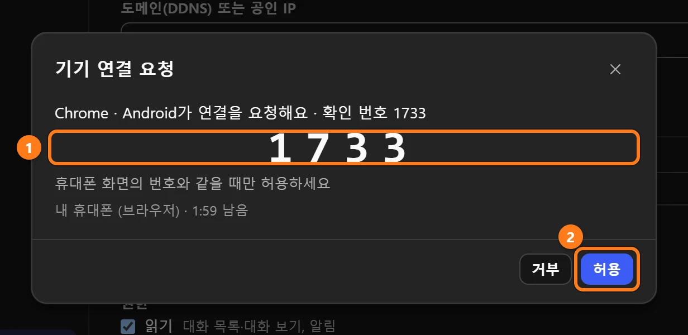
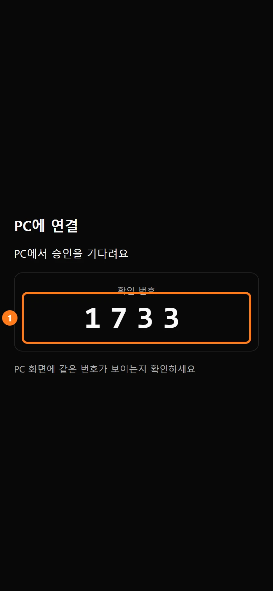
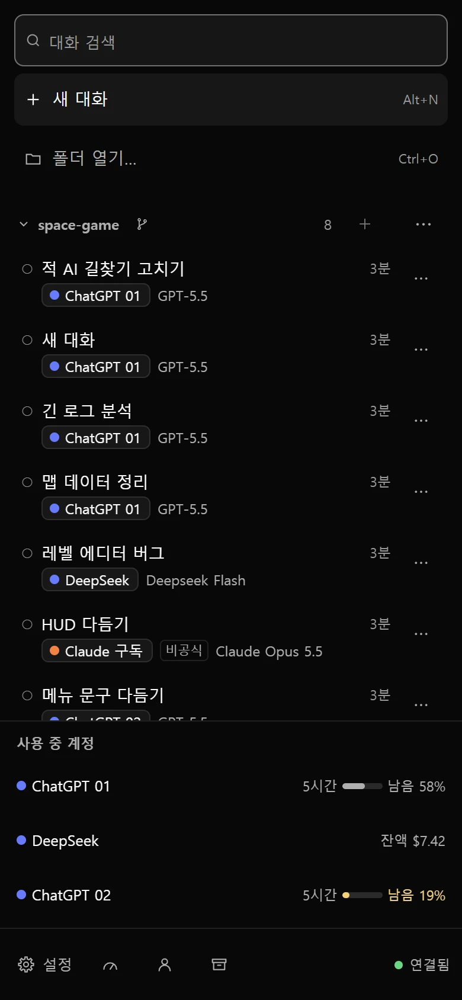
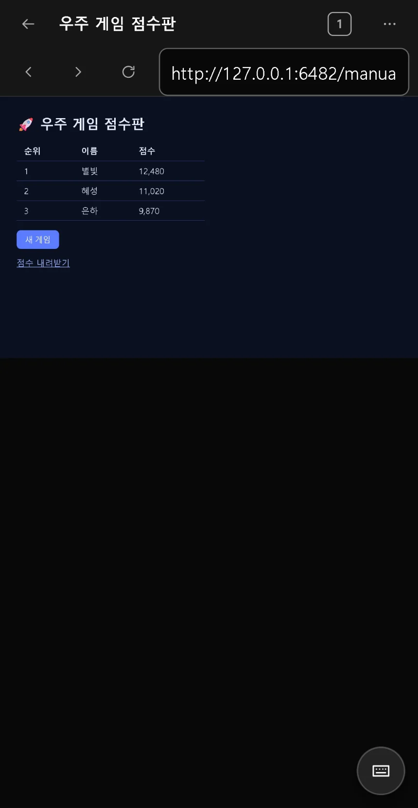
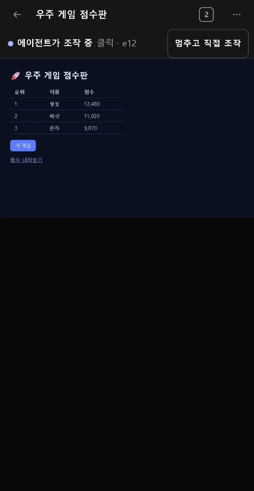
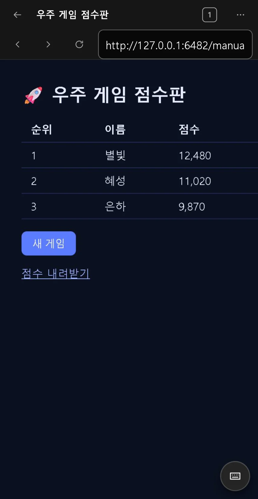
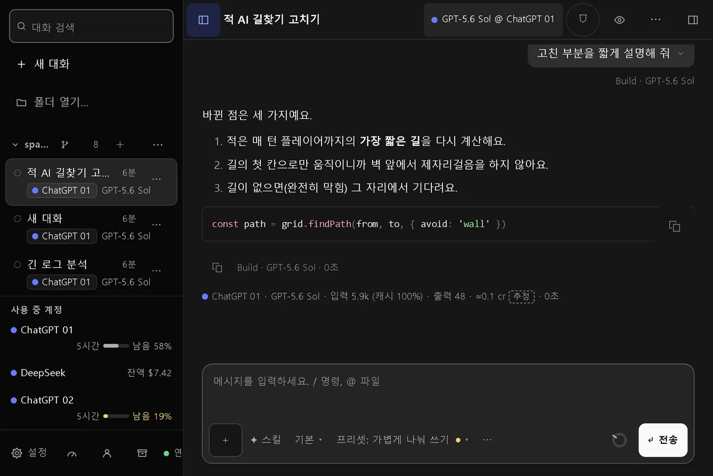
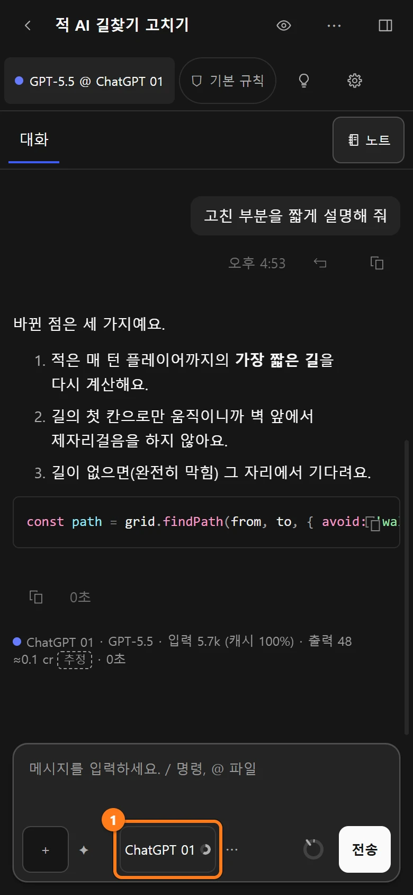
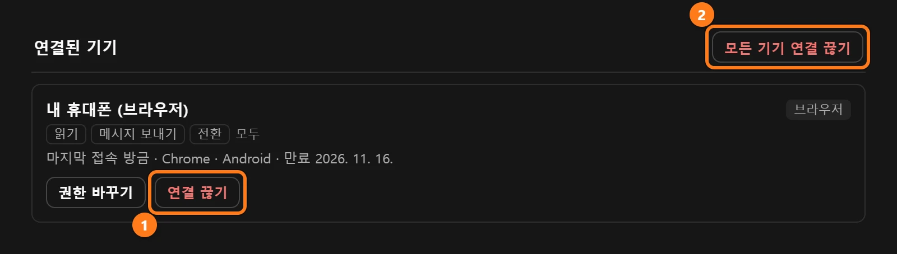

# 24. 휴대폰·다른 PC에서 쓰기

**한 줄 요약** — 이 PC에서 돌고 있는 대화를 휴대폰(Android 앱)이나 다른 PC의 데스크톱 앱에서 보고 이어서 쓸 수 있어요. 처음 한 번 QR로 연결하고, **양쪽 확인 번호가 같을 때만** PC에서 `허용`해요.

> **참고** 이 장의 화면은 연결 기능용 데모예요. 포트 번호, 계정 이름(`Alpha`), PC 이름(`DEMO-PC`)이 실제와 다를 수 있어요.

## 왜 필요해요?

- 긴 작업을 맡겨 두고 밖에 나가도, 휴대폰으로 진행 상황을 보고 승인 요청에 답할 수 있어요.
- 노트북에서 집 PC의 대화를 그대로 이어 쓸 수 있어요. 계정, 한도, 파일은 모두 집 PC에 있어요.
- 휴대폰이나 노트북은 "리모컨"이에요. 실제 일은 언제나 이 PC(또는 이 PC가 연결한 서버)에서 해요.

## 먼저 알아 둘 것: 길 세 가지

> **용어** 게이트웨이: 다른 기기가 이 PC의 대화에 붙는 입구예요. 이 PC 안(`127.0.0.1`)에서만 열려요. 밖에서 닿게 하는 길은 사용자가 따로 준비해요.

> **용어** 앱 연결: Android 앱과 다른 PC의 데스크톱 앱이 쓰는 전용 입구예요. 앱은 **이 PC가 만든 인증서의 지문**만 믿어요. 중간의 어떤 회사(Tailscale, DDNS 업체, 인증 기관)도 믿지 않아요.

<figure class="diagram">
<svg class="dg-wide" viewBox="0 0 680 280" role="img" aria-label="Android 앱과 다른 PC의 데스크톱 앱은 Tailscale 경로나 DDNS 경로로 이 PC의 앱 연결(127.0.0.1:28540)에 붙고 인증서 지문으로 이 PC를 확인한다. 휴대폰 브라우저는 Tailscale serve를 거쳐 게이트웨이(127.0.0.1:28539)에 붙는다. 어느 길이든 이 PC에서 확인 번호를 보고 허용해야 연결된다" xmlns="http://www.w3.org/2000/svg" font-family="inherit" style="width:100%;height:auto;max-width:680px">
<defs><marker id="d24r-a" viewBox="0 0 10 10" refX="9" refY="5" markerWidth="7" markerHeight="7" orient="auto"><path d="M0,0 L10,5 L0,10 z" fill="currentColor"/></marker></defs>
<text x="10" y="18" font-size="13.5" font-weight="700" fill="#E8711A">[권장] 앱 경로</text>
<rect x="10" y="30" width="170" height="80" rx="10" fill="currentColor" fill-opacity="0.06" stroke="currentColor" stroke-opacity="0.5" stroke-width="1.5"/>
<text x="95" y="64" fill="currentColor" text-anchor="middle" font-size="14" font-weight="700">Android 앱</text>
<text x="95" y="86" fill="currentColor" text-anchor="middle" font-size="12.5">다른 PC의 데스크톱 앱</text>
<rect x="240" y="28" width="190" height="36" rx="10" fill="currentColor" fill-opacity="0.06" stroke="currentColor" stroke-opacity="0.5" stroke-width="1.5"/>
<text x="335" y="51" fill="currentColor" text-anchor="middle" font-size="13">Tailscale 경로</text>
<rect x="240" y="72" width="190" height="44" rx="10" fill="currentColor" fill-opacity="0.06" stroke="currentColor" stroke-opacity="0.5" stroke-width="1.5"/>
<text x="335" y="91" fill="currentColor" text-anchor="middle" font-size="13">DDNS 경로</text>
<text x="335" y="108" fill="currentColor" text-anchor="middle" font-size="11.5" fill-opacity="0.8">공유기 28541 → 이 PC</text>
<rect x="490" y="28" width="180" height="88" rx="10" fill="currentColor" fill-opacity="0.06" stroke="currentColor" stroke-opacity="0.5" stroke-width="1.5" stroke="#E8711A" stroke-opacity="1"/>
<text x="580" y="54" fill="currentColor" text-anchor="middle" font-size="14" font-weight="700">앱 연결</text>
<text x="580" y="75" fill="currentColor" text-anchor="middle" font-size="12.5" style="font-family:Consolas,'Cascadia Mono',monospace">127.0.0.1:28540</text>
<text x="580" y="99" fill="currentColor" text-anchor="middle" font-size="11.5" fill-opacity="0.85">지문으로 진짜 내 PC 확인</text>
<line x1="182" y1="60" x2="236" y2="46" stroke="currentColor" stroke-width="1.6" marker-end="url(#d24r-a)"/>
<line x1="182" y1="80" x2="236" y2="94" stroke="currentColor" stroke-width="1.6" marker-end="url(#d24r-a)"/>
<line x1="432" y1="46" x2="486" y2="60" stroke="currentColor" stroke-width="1.6" marker-end="url(#d24r-a)"/>
<line x1="432" y1="94" x2="486" y2="84" stroke="currentColor" stroke-width="1.6" marker-end="url(#d24r-a)"/>
<text x="10" y="160" font-size="13.5" font-weight="700" fill="currentColor">브라우저 경로</text>
<rect x="10" y="172" width="170" height="48" rx="10" fill="currentColor" fill-opacity="0.06" stroke="currentColor" stroke-opacity="0.5" stroke-width="1.5"/>
<text x="95" y="201" fill="currentColor" text-anchor="middle" font-size="13.5" font-weight="700">휴대폰 브라우저</text>
<rect x="240" y="172" width="190" height="48" rx="10" fill="currentColor" fill-opacity="0.06" stroke="currentColor" stroke-opacity="0.5" stroke-width="1.5"/>
<text x="335" y="201" fill="currentColor" text-anchor="middle" font-size="13">Tailscale serve</text>
<rect x="490" y="168" width="180" height="56" rx="10" fill="currentColor" fill-opacity="0.06" stroke="currentColor" stroke-opacity="0.5" stroke-width="1.5"/>
<text x="580" y="192" fill="currentColor" text-anchor="middle" font-size="14" font-weight="700">게이트웨이</text>
<text x="580" y="212" fill="currentColor" text-anchor="middle" font-size="12.5" style="font-family:Consolas,'Cascadia Mono',monospace">127.0.0.1:28539</text>
<line x1="182" y1="196" x2="236" y2="196" stroke="currentColor" stroke-width="1.6" marker-end="url(#d24r-a)"/>
<line x1="432" y1="196" x2="486" y2="196" stroke="currentColor" stroke-width="1.6" marker-end="url(#d24r-a)"/>
<text x="340" y="262" fill="currentColor" text-anchor="middle" font-size="12.5" fill-opacity="0.85">어느 길이든 이 PC에서 확인 번호를 보고 ‘허용’해야 연결돼요</text>
</svg>
<svg class="dg-narrow" viewBox="0 0 320 500" role="img" aria-label="Android 앱과 다른 PC의 데스크톱 앱은 Tailscale 경로나 DDNS 경로로 이 PC의 앱 연결(127.0.0.1:28540)에 붙고 인증서 지문으로 이 PC를 확인한다. 휴대폰 브라우저는 Tailscale serve를 거쳐 게이트웨이(127.0.0.1:28539)에 붙는다. 어느 길이든 이 PC에서 확인 번호를 보고 허용해야 연결된다" xmlns="http://www.w3.org/2000/svg" font-family="inherit" style="width:100%;height:auto;max-width:360px">
<defs><marker id="d24rn-a" viewBox="0 0 10 10" refX="9" refY="5" markerWidth="7" markerHeight="7" orient="auto"><path d="M0,0 L10,5 L0,10 z" fill="currentColor"/></marker></defs>
<text x="10" y="16" font-size="13.5" font-weight="700" fill="#E8711A">[권장] 앱 경로</text>
<rect x="10" y="26" width="300" height="48" rx="10" fill="currentColor" fill-opacity="0.06" stroke="currentColor" stroke-opacity="0.5" stroke-width="1.5"/>
<text x="160" y="47" fill="currentColor" text-anchor="middle" font-size="14" font-weight="700">Android 앱</text>
<text x="160" y="66" fill="currentColor" text-anchor="middle" font-size="12.5">다른 PC의 데스크톱 앱</text>
<line x1="85" y1="76" x2="85" y2="94" stroke="currentColor" stroke-width="1.6" marker-end="url(#d24rn-a)"/>
<line x1="235" y1="76" x2="235" y2="94" stroke="currentColor" stroke-width="1.6" marker-end="url(#d24rn-a)"/>
<rect x="10" y="96" width="145" height="50" rx="10" fill="currentColor" fill-opacity="0.06" stroke="currentColor" stroke-opacity="0.5" stroke-width="1.5"/>
<text x="82" y="126" fill="currentColor" text-anchor="middle" font-size="13">Tailscale 경로</text>
<rect x="165" y="96" width="145" height="50" rx="10" fill="currentColor" fill-opacity="0.06" stroke="currentColor" stroke-opacity="0.5" stroke-width="1.5"/>
<text x="237" y="117" fill="currentColor" text-anchor="middle" font-size="13">DDNS 경로</text>
<text x="237" y="136" fill="currentColor" text-anchor="middle" font-size="11.5" fill-opacity="0.8">공유기 28541</text>
<line x1="85" y1="148" x2="85" y2="166" stroke="currentColor" stroke-width="1.6" marker-end="url(#d24rn-a)"/>
<line x1="235" y1="148" x2="235" y2="166" stroke="currentColor" stroke-width="1.6" marker-end="url(#d24rn-a)"/>
<rect x="10" y="168" width="300" height="70" rx="10" fill="currentColor" fill-opacity="0.06" stroke="currentColor" stroke-opacity="0.5" stroke-width="1.5" stroke="#E8711A" stroke-opacity="1"/>
<text x="160" y="192" fill="currentColor" text-anchor="middle" font-size="13.5" font-weight="700">앱 연결  127.0.0.1:28540</text>
<text x="160" y="216" fill="currentColor" text-anchor="middle" font-size="12">인증서 지문으로 진짜 내 PC인지 확인</text>
<text x="10" y="276" font-size="13.5" font-weight="700" fill="currentColor">브라우저 경로</text>
<rect x="10" y="286" width="300" height="40" rx="10" fill="currentColor" fill-opacity="0.06" stroke="currentColor" stroke-opacity="0.5" stroke-width="1.5"/>
<text x="160" y="311" fill="currentColor" text-anchor="middle" font-size="13.5" font-weight="700">휴대폰 브라우저</text>
<line x1="160" y1="328" x2="160" y2="344" stroke="currentColor" stroke-width="1.6" marker-end="url(#d24rn-a)"/>
<rect x="10" y="346" width="300" height="40" rx="10" fill="currentColor" fill-opacity="0.06" stroke="currentColor" stroke-opacity="0.5" stroke-width="1.5"/>
<text x="160" y="371" fill="currentColor" text-anchor="middle" font-size="13">Tailscale serve</text>
<line x1="160" y1="388" x2="160" y2="404" stroke="currentColor" stroke-width="1.6" marker-end="url(#d24rn-a)"/>
<rect x="10" y="406" width="300" height="44" rx="10" fill="currentColor" fill-opacity="0.06" stroke="currentColor" stroke-opacity="0.5" stroke-width="1.5"/>
<text x="160" y="433" fill="currentColor" text-anchor="middle" font-size="13.5" font-weight="700">게이트웨이  127.0.0.1:28539</text>
<text x="160" y="476" fill="currentColor" text-anchor="middle" font-size="12" fill-opacity="0.85">어느 길이든 이 PC에서 확인 번호를 보고</text>
<text x="160" y="494" fill="currentColor" text-anchor="middle" font-size="12" fill-opacity="0.85">‘허용’해야 연결돼요</text>
</svg>
<figcaption>그림: 휴대폰과 다른 PC가 이 PC에 닿는 길이에요(실제 화면이 아니에요). 이 PC의 입구는 언제나 127.0.0.1에서만 열리고, 바깥 길은 내가 직접 준비해요.</figcaption>
</figure>

| 길 | 무엇으로 | 밖에서 닿는 방법 | 무엇을 믿나요 |
|---|---|---|---|
| 앱(권장) | Android 앱, 다른 PC의 데스크톱 앱 | Tailscale 또는 DDNS | 이 PC 인증서의 지문 하나 |
| 브라우저 | 휴대폰 브라우저(홈 화면에 추가 가능) | Tailscale serve | Tailscale이 준 인증서와 Tailscale 서버 |

> **용어** Tailscale: 내 기기들끼리만 보이는 사설 네트워크를 만들어 주는 프로그램이에요. 같은 Tailscale 계정에 로그인한 기기끼리만 서로 닿아요.

> **용어** DDNS: 집 인터넷 주소가 바뀌어도 늘 같은 이름(예: `myhome.iptime.org`)으로 찾아오게 해 주는 서비스예요. 공유기의 **포트 전달**(밖에서 온 연결을 집 안 PC로 넘겨주는 설정)과 함께 써요.

어떤 길이든 기기는 **이 PC에서 확인 번호를 보고 허용해야만** 연결돼요. QR 코드나 링크만으로는 연결되지 않아요.

## 1단계: PC에서 게이트웨이와 앱 연결 켜기

1. `설정 > 휴대폰·다른 PC`를 열어요.
2. `원격 접근 게이트웨이`의 `켜기`를 누르고, `게이트웨이를 켤까요?`에서 다시 `켜기`를 눌러요. 상태가 `켜짐 · http://127.0.0.1:28539`로 바뀌어요(그림 ①).
3. 앱(Android, 다른 PC)으로 쓸 거라면 아래 `앱 연결 (Android 앱 · 다른 PC의 데스크톱 앱)`에서 `앱 연결 켜기` → `앱 연결을 켤까요?` → `켜기`를 눌러요. `켜짐 · 127.0.0.1:28540 (TLS)`와 `인증서 지문`이 보여요(그림 ③).

과 달라요")

- 두 입구 모두 이 PC 안에서만 열려요. 그래서 Windows 방화벽 허용 창이 뜨지 않아요. 떠도 허용할 필요가 없어요.
- 게이트웨이를 켜 두면 다음에 서비스가 시작될 때도 저절로 켜져요.

## 2단계: 밖에서 닿는 길 준비하기 (사용자가 직접)

앱은 Tailscale이나 공유기를 대신 설치하거나 설정하지 않아요. 화면이 알려 주는 명령을 **사용자가 직접** 실행해요. 둘 다 준비하면 앱이 경로를 차례로 시도해요. 경로마다 3초까지 기다리고, **지난번에 연결된 경로부터** 먼저 써요. 처음 연결할 때는 Tailscale 경로가 먼저예요.

### Tailscale 경로

1. 이 PC와 휴대폰(또는 노트북)에 Tailscale을 설치하고, **같은 Tailscale 계정**으로 로그인해요. 설치 안 됐으면 화면에 `Tailscale 받기`가 보여요.
2. `설정 > 휴대폰·다른 PC`의 Tailscale 줄이 `Tailscale 연결됨 · …`으로 바뀌어요.
3. 앱 연결의 `Tailscale 경로`에 보이는 명령을 `복사`해서 PowerShell에서 한 번 실행해요.

```powershell
tailscale serve --bg --tcp=28540 tcp://localhost:28540
```

- Tailscale은 바이트만 전달해요. 암호화는 앱과 이 PC 사이에서만 풀려요.

### DDNS 경로 (Tailscale 없이)

1. 공유기나 DDNS 업체에서 내 집 주소 이름을 준비해요(예: `myhome.iptime.org`).
2. `도메인(DDNS) 또는 공인 IP`에 그 이름을, `외부 포트`에 `28541`(기본값)을 넣고 `저장`해요.
3. 화면에 나온 두 줄을 복사해 **관리자 PowerShell**에서 한 번 실행해요. 포트 전달 규칙과 방화벽 허용 규칙을 만드는 명령이에요. 방화벽 규칙은 "개인" 네트워크에만 걸려요.
4. 공유기 설정에서 외부 TCP `28541`을 이 PC의 내부 IP `28541`로 포워딩해요.
5. 화면에 `포트 전달 규칙이 있어요`가 보이면 PC 쪽 준비가 끝났어요.

- 되돌리려면 `되돌리는 명령`(관리자 PowerShell)을 실행하고 공유기 규칙을 지워요. Tailscale 경로는 `tailscale serve --tcp=28540 off`로 꺼요.

> **주의** DDNS 경로는 포트 하나를 인터넷에 열어요. 승인 없이는 아무도 연결할 수 없지만, 연결할 때마다 확인 번호를 꼭 비교하세요. Tailscale Funnel(공개 인터넷 공개)이나 LAN 전체 공개는 쓰지 마세요.

## 3단계: 기기 연결하기

### Android 앱

1. `설정 > 휴대폰·다른 PC` → `새 기기 연결`에서 `기기 종류`를 `Android 앱`으로 골라요(그림 ①).
2. `기기 이름`을 정하고 `권한`을 확인해요(그림 ②). 기본값(`읽기`, `메시지 보내기`, `전환`)을 권해요.
3. `볼 수 있는 서버`(`모두` 또는 `고르기`)와 `만료`(`7일`, `30일`, `90일`)를 골라요. 그리고 `QR 만들기`를 눌러요.

")

4. QR이 나와요. QR은 **한 번만** 쓸 수 있고 5분 뒤 만료돼요(`한 번만 쓸 수 있고 … 뒤 만료돼요`). 만료되면 `다시 만들기`를 눌러요.

![만든 QR 코드와 그 아래 “Own OpenCode 앱에서 [PC 추가] → QR 스캔”, ownpc:// 로 시작하는 링크, 복사 버튼, “한 번만 쓸 수 있고 5:00 뒤 만료돼요”](images/23-new-device-qr.webp "QR 화면. ① 휴대폰 앱으로 스캔할 QR. QR을 못 쓰면 아래 링크를 복사해 보내도 돼요")

5. 휴대폰에서 Own OpenCode 앱을 열고 `PC 추가` → `QR 코드 스캔`으로 QR을 찍어요. 카메라를 쓸 수 없으면 `링크 붙여넣기`를 써요.

<figure class="diagram">
<svg class="dg-wide" viewBox="0 0 680 352" role="img" aria-label="Android 앱의 세 화면. 처음 PC 목록에는 연결된 PC가 없다는 안내와 PC 추가 단추가 있다. PC 추가를 누르면 QR 코드 스캔과 링크 붙여넣기 중에서 고른다. 연결하면 확인 번호가 크게 보이고, PC 화면의 번호와 같으면 PC에서 허용을 누르라고 안내한다" xmlns="http://www.w3.org/2000/svg" font-family="inherit" style="width:100%;height:auto;max-width:680px">
<defs><marker id="d24p-a" viewBox="0 0 10 10" refX="9" refY="5" markerWidth="7" markerHeight="7" orient="auto"><path d="M0,0 L10,5 L0,10 z" fill="currentColor"/></marker></defs>
<text x="110" y="24" fill="currentColor" text-anchor="middle" font-size="13" font-weight="700">① PC 목록(처음)</text>
<g transform="translate(10,40)">
<rect x="0" y="0" width="200" height="300" rx="22" fill="currentColor" fill-opacity="0.05" stroke="currentColor" stroke-opacity="0.55" stroke-width="1.6"/>
<line x1="8" y1="48" x2="192" y2="48" stroke="currentColor" stroke-opacity="0.25"/>
<text x="100" y="35" fill="currentColor" text-anchor="middle" font-size="13" font-weight="700">Own OpenCode</text>
<text x="100" y="116" fill="currentColor" text-anchor="middle" font-size="12.5" font-weight="700">연결된 PC가 없습니다.</text>
<text x="100" y="146" fill="currentColor" text-anchor="middle" font-size="10.5" fill-opacity="0.8">PC의 Own OpenCode에서</text>
<text x="100" y="162" fill="currentColor" text-anchor="middle" font-size="10.5" fill-opacity="0.8">설정 &gt; 휴대폰·다른 PC &gt; 새 기기 연결(앱)로</text>
<text x="100" y="178" fill="currentColor" text-anchor="middle" font-size="10.5" fill-opacity="0.8">QR을 띄운 뒤 [PC 추가]를</text>
<text x="100" y="194" fill="currentColor" text-anchor="middle" font-size="10.5" fill-opacity="0.8">누르세요.</text>
<rect x="50" y="236" width="100" height="36" rx="18" fill="#E8711A"/>
<text x="100" y="259" fill="#ffffff" text-anchor="middle" font-size="13" font-weight="700">PC 추가</text>
</g>
<text x="340" y="24" fill="currentColor" text-anchor="middle" font-size="13" font-weight="700">② PC 추가 → 고르기</text>
<g transform="translate(240,40)">
<rect x="0" y="0" width="200" height="300" rx="22" fill="currentColor" fill-opacity="0.05" stroke="currentColor" stroke-opacity="0.55" stroke-width="1.6"/>
<line x1="8" y1="48" x2="192" y2="48" stroke="currentColor" stroke-opacity="0.25"/>
<text x="100" y="35" fill="currentColor" text-anchor="middle" font-size="13" font-weight="700">Own OpenCode</text>
<text x="100" y="116" fill="currentColor" text-anchor="middle" font-size="12.5" fill-opacity="0.35">연결된 PC가 없습니다.</text>
<rect x="8" y="170" width="184" height="122" rx="14" fill="currentColor" fill-opacity="0.12" stroke="currentColor" stroke-opacity="0.4"/>
<rect x="16" y="186" width="168" height="38" rx="8" fill="none" stroke="#E8711A" stroke-width="2"/>
<rect x="28" y="196" width="18" height="18" rx="3" fill="none" stroke="currentColor" stroke-width="1.6"/>
<text x="58" y="210" fill="currentColor" font-size="13">QR 코드 스캔</text>
<line x1="20" y1="236" x2="180" y2="236" stroke="currentColor" stroke-opacity="0.25"/>
<rect x="28" y="248" width="18" height="18" rx="3" fill="none" stroke="currentColor" stroke-width="1.6"/>
<text x="58" y="262" fill="currentColor" font-size="13">링크 붙여넣기</text>
</g>
<text x="570" y="24" fill="currentColor" text-anchor="middle" font-size="13" font-weight="700">③ 확인 번호</text>
<g transform="translate(470,40)">
<rect x="0" y="0" width="200" height="300" rx="22" fill="currentColor" fill-opacity="0.05" stroke="currentColor" stroke-opacity="0.55" stroke-width="1.6"/>
<line x1="8" y1="48" x2="192" y2="48" stroke="currentColor" stroke-opacity="0.25"/>
<text x="100" y="35" fill="currentColor" text-anchor="middle" font-size="13" font-weight="700">PC 연결</text>
<text x="100" y="80" fill="currentColor" text-anchor="middle" font-size="11.5" fill-opacity="0.7">PC에 연결하는 중…</text>
<text x="100" y="116" fill="currentColor" text-anchor="middle" font-size="12.5">확인 번호</text>
<text x="100" y="160" fill="#E8711A" text-anchor="middle" font-size="32" font-weight="700" letter-spacing="6">6261</text>
<text x="100" y="200" fill="currentColor" text-anchor="middle" font-size="10.5" fill-opacity="0.85">확인 번호 6261 —</text>
<text x="100" y="216" fill="currentColor" text-anchor="middle" font-size="10.5" fill-opacity="0.85">PC 화면의 번호와 같으면</text>
<text x="100" y="232" fill="currentColor" text-anchor="middle" font-size="10.5" fill-opacity="0.85">PC에서 [허용]을 누르세요</text>
</g>
<line x1="214" y1="190" x2="236" y2="190" stroke="currentColor" stroke-width="1.6" marker-end="url(#d24p-a)"/>
<line x1="444" y1="190" x2="466" y2="190" stroke="currentColor" stroke-width="1.6" marker-end="url(#d24p-a)"/>
</svg>
<svg class="dg-narrow" viewBox="0 0 320 1012" role="img" aria-label="Android 앱의 세 화면. 처음 PC 목록에는 연결된 PC가 없다는 안내와 PC 추가 단추가 있다. PC 추가를 누르면 QR 코드 스캔과 링크 붙여넣기 중에서 고른다. 연결하면 확인 번호가 크게 보이고, PC 화면의 번호와 같으면 PC에서 허용을 누르라고 안내한다" xmlns="http://www.w3.org/2000/svg" font-family="inherit" style="width:100%;height:auto;max-width:360px">
<defs><marker id="d24pn-a" viewBox="0 0 10 10" refX="9" refY="5" markerWidth="7" markerHeight="7" orient="auto"><path d="M0,0 L10,5 L0,10 z" fill="currentColor"/></marker></defs>
<text x="160" y="20" fill="currentColor" text-anchor="middle" font-size="13" font-weight="700">① PC 목록(처음)</text>
<g transform="translate(60,32)">
<rect x="0" y="0" width="200" height="300" rx="22" fill="currentColor" fill-opacity="0.05" stroke="currentColor" stroke-opacity="0.55" stroke-width="1.6"/>
<line x1="8" y1="48" x2="192" y2="48" stroke="currentColor" stroke-opacity="0.25"/>
<text x="100" y="35" fill="currentColor" text-anchor="middle" font-size="13" font-weight="700">Own OpenCode</text>
<text x="100" y="116" fill="currentColor" text-anchor="middle" font-size="12.5" font-weight="700">연결된 PC가 없습니다.</text>
<text x="100" y="146" fill="currentColor" text-anchor="middle" font-size="10.5" fill-opacity="0.8">PC의 Own OpenCode에서</text>
<text x="100" y="162" fill="currentColor" text-anchor="middle" font-size="10.5" fill-opacity="0.8">설정 &gt; 휴대폰·다른 PC &gt; 새 기기 연결(앱)로</text>
<text x="100" y="178" fill="currentColor" text-anchor="middle" font-size="10.5" fill-opacity="0.8">QR을 띄운 뒤 [PC 추가]를</text>
<text x="100" y="194" fill="currentColor" text-anchor="middle" font-size="10.5" fill-opacity="0.8">누르세요.</text>
<rect x="50" y="236" width="100" height="36" rx="18" fill="#E8711A"/>
<text x="100" y="259" fill="#ffffff" text-anchor="middle" font-size="13" font-weight="700">PC 추가</text>
</g>
<text x="160" y="356" fill="currentColor" text-anchor="middle" font-size="13" font-weight="700">② PC 추가 → 고르기</text>
<g transform="translate(60,368)">
<rect x="0" y="0" width="200" height="300" rx="22" fill="currentColor" fill-opacity="0.05" stroke="currentColor" stroke-opacity="0.55" stroke-width="1.6"/>
<line x1="8" y1="48" x2="192" y2="48" stroke="currentColor" stroke-opacity="0.25"/>
<text x="100" y="35" fill="currentColor" text-anchor="middle" font-size="13" font-weight="700">Own OpenCode</text>
<text x="100" y="116" fill="currentColor" text-anchor="middle" font-size="12.5" fill-opacity="0.35">연결된 PC가 없습니다.</text>
<rect x="8" y="170" width="184" height="122" rx="14" fill="currentColor" fill-opacity="0.12" stroke="currentColor" stroke-opacity="0.4"/>
<rect x="16" y="186" width="168" height="38" rx="8" fill="none" stroke="#E8711A" stroke-width="2"/>
<rect x="28" y="196" width="18" height="18" rx="3" fill="none" stroke="currentColor" stroke-width="1.6"/>
<text x="58" y="210" fill="currentColor" font-size="13">QR 코드 스캔</text>
<line x1="20" y1="236" x2="180" y2="236" stroke="currentColor" stroke-opacity="0.25"/>
<rect x="28" y="248" width="18" height="18" rx="3" fill="none" stroke="currentColor" stroke-width="1.6"/>
<text x="58" y="262" fill="currentColor" font-size="13">링크 붙여넣기</text>
</g>
<text x="160" y="692" fill="currentColor" text-anchor="middle" font-size="13" font-weight="700">③ 확인 번호</text>
<g transform="translate(60,704)">
<rect x="0" y="0" width="200" height="300" rx="22" fill="currentColor" fill-opacity="0.05" stroke="currentColor" stroke-opacity="0.55" stroke-width="1.6"/>
<line x1="8" y1="48" x2="192" y2="48" stroke="currentColor" stroke-opacity="0.25"/>
<text x="100" y="35" fill="currentColor" text-anchor="middle" font-size="13" font-weight="700">PC 연결</text>
<text x="100" y="80" fill="currentColor" text-anchor="middle" font-size="11.5" fill-opacity="0.7">PC에 연결하는 중…</text>
<text x="100" y="116" fill="currentColor" text-anchor="middle" font-size="12.5">확인 번호</text>
<text x="100" y="160" fill="#E8711A" text-anchor="middle" font-size="32" font-weight="700" letter-spacing="6">6261</text>
<text x="100" y="200" fill="currentColor" text-anchor="middle" font-size="10.5" fill-opacity="0.85">확인 번호 6261 —</text>
<text x="100" y="216" fill="currentColor" text-anchor="middle" font-size="10.5" fill-opacity="0.85">PC 화면의 번호와 같으면</text>
<text x="100" y="232" fill="currentColor" text-anchor="middle" font-size="10.5" fill-opacity="0.85">PC에서 [허용]을 누르세요</text>
</g>
</svg>
<figcaption>그림: Android 앱에서 PC를 처음 연결하는 세 화면을 단순하게 그린 것이에요(실제 화면이 아니에요). 글자는 앱에 보이는 문구 그대로예요.</figcaption>
</figure>

6. 앱이 `이 PC에 연결할까요? PC 화면에 연결 QR을 띄운 것이 본인일 때만 연결하세요.`를 물어요. `연결`을 눌러요.
7. 휴대폰에 확인 번호가 보이고, 같은 때 이 PC에 `기기 연결 요청` 창이 떠요.
8. **두 번호가 같을 때만** PC에서 `허용`을 눌러요(2분 안에). 다르면 `거부`해요.



> **용어** 확인 번호: 연결할 때 PC와 기기 양쪽에 똑같이 보이는 숫자 4개예요. 두 숫자가 같으면 "지금 내 기기가 내 PC와 직접 이야기하고 있다"는 뜻이에요. 다르면 누군가 중간에 끼어든 거예요.

**Android 앱(APK) 설치하기**

- 설치 파일은 빌드 폴더의 `own\.out\build\<VERSION>\android\own-opencode-<VERSION>.apk`에 있어요(`<VERSION>` 자리는 버전 숫자예요). USB나 클라우드 드라이브로 휴대폰에 옮겨요.
- 휴대폰에서 파일을 열어요. 처음이면 그 앱(파일 관리자 등)에 "출처를 알 수 없는 앱 설치"를 허용해야 해요. Play 프로텍트 경고가 뜨면 "무시하고 설치"를 눌러요. 스토어 앱이 아니라서 뜨는 경고예요. 이 단계는 사용자가 직접 해요.
- 업데이트는 새 APK를 그대로 설치하면 돼요. 단, **같은 PC에서 빌드한 APK만** 덮어 설치돼요.
- 지금 버전의 알림은 앱이 열려 있을 때만 화면 안에 보여요. 앱이 꺼져 있을 때 오는 푸시 알림은 아직 없어요.

### 다른 PC의 데스크톱 앱

1. 이 PC의 `새 기기 연결`에서 `기기 종류`를 `다른 PC (데스크톱 앱)`으로 골라요. 기본 권한에 `파일`이 더 들어 있어요.
2. `QR 만들기`를 누르면 `ownpc://`로 시작하는 링크가 나와요. `복사`해서 다른 PC로 보내요(5분 안에, 한 번만).

![“새 기기 연결”에서 다른 PC용 링크. “다른 PC의 Own OpenCode에서 [다른 PC 추가]를 누르고 이 링크를 붙여 넣으세요” 안내와 ownpc://pair… 링크, 복사 버튼](images/23-other-pc.webp "다른 PC용 연결 링크. ① 이 링크를 복사해 다른 PC에 붙여 넣어요")

3. 다른 PC의 Own OpenCode 사이드바 맨 아래에서 `다른 PC 추가`(좁은 사이드바에서는 `다른 PC`)를 누르고 `연결 링크`에 붙여 넣은 뒤 `연결`을 눌러요.
4. 다른 PC에 `확인 번호 … · …에서 이 번호가 보이면 [허용]을 누르세요`가 보여요. 이 PC의 `기기 연결 요청`에서 같은 번호인지 보고 `허용`해요.
5. 다른 PC의 사이드바에 이 PC가 묶음 하나로 생겨요(이름 앞에 `↗`). 누르면 이 PC 전용 창이 열려요. 끌어서 순서를 바꿀 수 있어요.

- 다른 PC 창은 이 PC의 화면을 그대로 보여 줘요. 그래서 두 PC의 앱 버전이 달라도 돼요.
- 다른 PC 창에는 앱 안 브라우저, 폴더 고르기 창 같은 데스크톱 전용 기능이 없어요.
- 다른 PC 항목의 상태는 `연결됨`, `연결할 수 없음`, `다시 연결 필요` 중 하나예요. 메뉴에는 `열기`, `다시 연결…`, `목록에서 빼기…`가 있어요.

> **주의** `터미널` 권한은 다른 PC에서 이 PC에 아무 명령이나 실행할 수 있게 해요. 그래서 기본으로 꺼져 있어요. 켜면 `이 기기를 잃어버리거나 다른 사람이 쓰게 되면 그 사람이 이 PC에서 아무 명령이나 실행하고 설정을 바꿀 수 있어요` 경고가 보여요.

### 휴대폰 브라우저 (Tailscale 필요)

앱을 깔기 어려울 때 쓰는 길이에요.

1. 이 PC와 휴대폰에 Tailscale을 설치하고 같은 계정으로 로그인해요.
2. `설정 > 휴대폰·다른 PC`의 Tailscale 줄에 보이는 명령을 PowerShell에서 한 번 실행해요.

```powershell
tailscale serve --bg --https=443 http://127.0.0.1:28539
```

3. `tailscale serve가 이 게이트웨이를 tailnet에 열고 있어요: …`가 보이면 준비됐어요.
4. `새 기기 연결` → `기기 종류` `브라우저` → `QR 만들기`. 휴대폰 카메라로 QR을 열어요.
5. 휴대폰에 `PC에 연결` · `PC에서 승인을 기다려요`와 `확인 번호`가 보여요. PC의 번호와 같으면 PC에서 `허용`해요.



6. `연결을 마치는 중…` 뒤에 세션 목록이 열려요. 브라우저 메뉴의 "홈 화면에 추가"로 앱처럼 쓸 수 있어요.

- Tailscale이 없으면 QR에 `Tailscale이 없어 이 PC에서만 열리는 주소예요`가 붙어요. 그 QR은 휴대폰에서 열리지 않아요.
- 이 길은 Tailscale 서버를 믿어요. 그래서 Tailscale의 **Tailnet Lock**을 켜 두길 권해요. 꺼져 있으면 `설정 > 휴대폰·다른 PC`에 경고와 `Tailnet Lock 켜는 방법`이 보여요. 켜는 일은 Tailscale에서 사용자가 직접 해요.

## 휴대폰에서 보이는 화면

휴대폰에서는 첫 화면이 세션 목록이에요. 세션마다 계정과 모델이 보이고, 아래에 `사용 중 계정`의 한도가 보여요.



세션을 누르면 대화가 열려요. 머리줄 둘째 줄의 모델 @ 계정 알약으로 모델과 계정을 바꿀 수 있어요(`전환` 권한이 있을 때).

- 대화 화면의 머리줄은 두 줄이에요. 첫 줄에 `‹`, 대화 제목, `⋯`이 있고, 둘째 줄에 모델 @ 계정 알약과 승인 모드 표시가 와요. 모델 @ 계정은 휴대폰 화면의 하나뿐인 모델 단추라서 입력창에는 따로 없어요(새 대화 화면에만 입력창에 있어요).
- 승인 모드는 휴대폰에서 표시만 작게 보여요. `⚠`(노란색)은 `전체 허용`, `⛉`은 그 밖의 모드예요. 누르면 모드 이름과 고르는 메뉴가 열려요.
- 대화 화면에는 아이디어 노트와 설정 단추가 머리줄에 없어요. 대화의 `⋯`에서 `아이디어 노트`, `설정`을 골라요.
- 키보드가 올라오면 대화 머리줄은 첫 줄만 남아요. 대화를 더 보이게 하려는 거예요. 키보드를 내리면 둘째 줄이 다시 보여요.
- 답 아래의 사용량 줄은 한 줄로 줄여 보여요(입력과 캐시 비율, 출력, 비용, 속도, 걸린 시간). 줄을 누르면 계정·모델·첫 토큰 같은 나머지와 단계 표가 펼쳐져요. 첫 단계에서 캐시를 다시 쓴 답은 `입력` 글자가 노란색이고, 펼치면 이유(`첫 단계 캐시 재작성`, `계정이 바뀌어서 캐시가 비었어요`)가 보여요.
- 계정·한도·설정 같은 페이지의 머리줄은 한 줄이에요. `‹`, 페이지 이름, 아이디어 노트·설정·설명서 단추가 나란히 있어요. 설정의 한 페이지에서는 그 아래 `← 설정`으로 목록에 돌아가요.
- 켜고 끄는 스위치는 손가락으로 누르기 쉽게 스위치 둘레까지 눌려요. 모양과 크기는 PC와 같아요.
- 대화 위의 `대화` 탭 줄은 휴대폰에서 보이지 않아요. 프로젝트 노트는 대화의 `⋯` > `프로젝트 노트`로 열어요. 노트를 열면 `대화 | 노트` 탭이 생겨서 둘 사이를 오갈 수 있어요.
- 새 대화 화면에도 `‹`가 있어요. 누르면 대화 목록으로 돌아가요.

### 휴대폰에서 입력하고 고르기

- **입력창의 `⋯`**: 추론 강도, 울트라, 속도, 프리셋이 입력창 아래 줄에 펼쳐져요. 위 줄의 `전송`은 그대로 오른쪽에 있어요.
- **곁질문**: 대화 위쪽의 `⋯` > `곁질문…`을 누르면 일을 멈추지 않고 이 대화에 대해 묻는 창이 아래에서 올라와요([10.18](10-conversation-tools.md)).
- **모델 @ 계정**: 머리줄의 모델 @ 계정 알약(새 대화 화면에서는 입력창의 계정 칩)을 누르면 아래에서 시트가 올라와요. 위쪽은 계정, 아래쪽은 고른 계정의 모델이에요. 시트를 열거나 줄을 눌러도 키보드는 올라오지 않아요. 검색하려면 검색 칸을 직접 눌러요. 추론 강도와 속도는 아래쪽의 큰 버튼으로 골라요.
- **실행 중**: 입력창 아래에 `실행 중 · 보내면 지금 답에 끼워 넣어요 · 멈추려면 [중단]`이 보여요. 키보드 단축키 안내는 휴대폰에서 나오지 않아요.
- **알림**: 바꿨다는 알림 같은 짧은 알림은 화면 위쪽에 잠깐 보여요. `전송`을 가리지 않아요.
- **입력창 단추**: `+`(첨부), `✦`(스킬), 마이크(음성 입력을 켰을 때), `⋯`, 문맥 고리, `전송`이 한 줄에 엄지 크기로 놓여요. 표시는 모두 단추 한가운데에 있어요. 녹음하는 동안의 막대는 단추 아래 자기 줄에 보여요.

### 밀어서 오가기(스와이프)

손가락으로 밀어서 화면을 오갈 수 있어요. 화면 가장자리에서 시작하지 않아도 돼요.

| 어디서 | 어느 쪽으로 | 무엇이 돼요 |
|---|---|---|
| 대화 | 오른쪽 | 대화 목록이 손가락을 따라 나와요. 휴대폰은 목록 화면, 세로로 세운 폴드8은 왼쪽 서랍이에요 |
| 휴대폰의 대화 목록 | 왼쪽 | 방금 보던 대화로 돌아가요 |
| 열린 서랍 | 왼쪽 | 서랍이 닫혀요 |
| 작업 패널 | 오른쪽 | 패널이 닫혀요 |
| 설정의 한 페이지 | 오른쪽 | 설정 목록으로 돌아가요 |
| 모델 @ 계정 시트 | 아래 | 시트가 닫혀요(손잡이나 제목을 잡거나, 목록이 맨 위일 때) |

- 반쯤 못 미치게 천천히 밀다 놓으면 제자리로 돌아가요. 빠르게 튕기면 짧게 밀어도 돼요.
- 위아래로 밀면 늘 스크롤이에요. 코드 블록이나 표처럼 옆으로 스크롤되는 곳에서 밀면 그 안이 스크롤돼요. 입력창에서 민 것도 스와이프가 아니에요.
- 목록이 대화 옆에 늘 있는 넓은 화면(가로로 편 폴드8)에는 목록을 여는 스와이프가 없어요. 다만 브라우저가 대화 옆 칸을 쓰는 동안에는 목록이 서랍이 되어, 대화를 오른쪽으로 밀거나 `☰`를 누르면 대화 위로 나와요.
- 브라우저 보기 안에서 민 것은 앱의 스와이프가 아니라 PC 페이지의 스크롤과 터치예요.
- Android의 뒤로는 열린 시트·메뉴, 그다음 열린 서랍이나 작업 패널을 먼저 닫아요.
- 대화를 지우거나 보관하는 스와이프는 없어요. 잘못 밀어서 일이 사라지지 않게 했어요.

### 휴대폰에서 앱 안 브라우저 보기

에이전트가 PC의 앱 안 브라우저([19장](19-browser-pane.md))에서 하는 일을 휴대폰에서 그대로 보고, 직접 눌러 볼 수 있어요. 브라우저는 여전히 PC에서 돌고, 휴대폰에는 그 화면이 와요.

**먼저 PC에서 한 번 켜요.** `브라우저` 권한은 기본으로 꺼져 있어요.

1. PC의 앱 창에서 `설정` > `휴대폰·다른 PC` > `연결된 기기`에서 그 기기의 `권한 바꾸기`를 눌러요.
2. `브라우저`를 켜고 `저장`을 눌러요. 그 기기의 연결이 잠깐 끊겼다가 저절로 다시 붙어요.

예요")

**휴대폰에서 열어요.**

1. 대화를 열고 머리줄의 `⋯` > `브라우저`를 눌러요.
2. 위 줄에 `←`(닫기), 페이지 제목, 탭 수 단추, `⋯`(보기 설정)이 있고, 둘째 줄에 뒤로(`‹`)·앞으로(`›`)·새로 고침과 주소 칸이 있어요. 그 아래, 막대 바로 밑에 PC 브라우저의 지금 화면이 보여요.
3. 닫으려면 `←`나 휴대폰의 뒤로 버튼을 눌러요. 대화는 보던 자리 그대로예요.



- 에이전트가 브라우저를 쓰기 시작하면 대화 화면에 `브라우저 사용 중 · 보기`가 보여요. 누르면 바로 열려요.
- **PC의 앱은 켜져 있어야 해요.** 창을 최소화했거나, X로 트레이에 숨겼거나, PC 창이 다른 대화를 보여 주고 있어도 돼요. 트레이에서 `앱 종료`를 했다면 `PC의 데스크톱 앱이 꺼져 있어요. PC에서 Own OpenCode를 열어 두면 여기서 볼 수 있어요.`가 보여요.
- **탭**: 탭 수 단추를 누르면 탭 목록이 올라와요. 눌러서 고르고, `×`로 닫고, `새 탭`으로 열어요. 에이전트가 쓰는 탭에는 PC처럼 점이 붙어요.
- **주소 칸**: PC와 같은 규칙이에요. 주소나 검색어를 넣어요. `localhost`는 휴대폰이 아니라 **PC**예요. 그래서 PC에서 띄운 개발 서버(`localhost:3000`)가 그대로 열려요.

**직접 조작해요**(`메시지 보내기` 권한도 있을 때).

- 화면을 누르면 PC 브라우저의 그 자리를 눌러요. 밀면 스크롤돼요.
- 글자를 넣으려면 먼저 페이지의 입력 칸을 누르고, 오른쪽 아래 `⌨` 단추로 키보드를 올려요. 한글도 조합되는 모습 그대로 들어가요. `Enter`도 돼요. 화면을 누를 때마다 키보드가 튀어나오지 않게 단추를 따로 두었어요.
- 붙여넣기는 **휴대폰의** 클립보드예요. 붙여 넣은 글의 줄바꿈은 `Enter`로 치지 않고 글로 들어가요. PC의 클립보드는 기기에서 읽거나 바꿀 수 없어서, 하드웨어 키보드의 `Ctrl+C`·`Ctrl+X`는 아무 일도 하지 않아요(`Ctrl+A`·`Ctrl+Z`·`Ctrl+Y`는 페이지로 가요).
- 에이전트가 조작하는 중이면 주소 칸 자리에 `에이전트가 조작 중`과 지금 동작(예: "클릭 · e12", 동작과 누른 요소), `멈추고 직접 조작`이 보여요. 그동안에는 화면을 눌러도 페이지에 가지 않고 `직접 조작하려면 ‘멈추고 직접 조작’을 누르세요`가 보여요. 지켜보다 닿은 손가락이 에이전트의 일을 흔들지 않게 한 거예요. `멈추고 직접 조작`을 누르면 PC에서와 같이 그 대화의 턴이 멈추고 내가 조작해요.
- 페이지가 확인 창(`alert`·`confirm`·`prompt`)을 띄우면 휴대폰에 그 내용과 `확인`·`취소`가 보여요. 답해야 다음 조작이 페이지에 가요.
- `메시지 보내기` 권한이 없는 기기에는 `보기 전용이에요`가 보이고, PC에서 이미 열려 있는 브라우저만 볼 수 있어요.



**보기 설정(`⋯`)**

- `휴대폰 크기로 보기`: PC의 브라우저를 이 휴대폰 화면 크기로 바꿔요. 에이전트가 만든 화면이 휴대폰에서 어떻게 보일지 그 자리에서 확인해요. 끄거나 보기를 닫으면 PC 크기로 돌아가요. 켜 둔 동안에는 PC 창의 브라우저도, 에이전트도 그 크기로 봐요. 사용자 에이전트를 보고 화면을 고르는 사이트는 새로 고쳐야 모바일 화면으로 바뀌어요.
- `데이터 절약`: 덜 선명하지만 데이터를 덜 써요. 휴대폰이 데이터 절약 모드면 처음부터 켜져 있어요.
- PC 크기로 볼 때는 두 손가락으로 벌려 크게 보고 옮겨요. 이 확대는 휴대폰에서만 일어나고 페이지에는 가지 않아요.



**알아 둘 것**

- **보이는 동안만 화면이 와요.** 보기를 닫거나, 다른 앱으로 가거나, 화면을 끄면 바로 멈춰요. 페이지가 바뀌는 동안은 빠른 화면이, 멈추면 선명한 화면 한 장이 와요. 페이지가 그대로면 데이터를 쓰지 않아요.
- **받은 파일과 파일 선택은 PC에서 해요.** 페이지에서 파일을 받으면 `파일을 받았어요. PC의 데스크톱 앱에서 저장할 수 있어요.`, 파일 선택 창이 열리면 `파일 선택은 PC에서 해 주세요.`만 보여요.
- **브라우저 도구 없이 시작한 대화**에는 화면 대신 `이 대화는 브라우저 도구 없이 시작했어요.`와 `이 대화에서 켜기`가 보여요(`메시지 보내기` 권한이 있을 때. 없으면 `PC의 데스크톱 앱에서 켜 주세요.`). 예전 판에서 휴대폰으로 만든 대화가 그래요.
- **휴대폰에서 만든 새 대화도 에이전트가 브라우저를 써요.** PC의 데스크톱 앱이 켜져 있을 때 만든 대화라면 그래요. 앱이 꺼져 있을 때 만든 대화는 도구 없이 시작하니 위처럼 켜 주세요([19장](19-browser-pane.md)의 5).
- **SSH 원격 대화도 돼요.** 서버에서 도는 대화의 브라우저도 PC의 데스크톱 앱에 있으니, 같은 `⋯` > `브라우저`로 보고 조작해요. 그 대화의 `localhost`는 서버라서, 에이전트가 서버에서 띄운 개발 서버 화면을 휴대폰에서 바로 확인할 수 있어요([19장](19-browser-pane.md)의 8). `브라우저` 권한과 그 서버를 볼 권한(기기 권한의 서버 범위)이 둘 다 있어야 해요. 서버의 SSH 연결이 끊긴 동안에는 화면이 오지 않아요.
- 연결한 **다른 PC**(원격 PC 창)에서도 같은 `⋯` > `브라우저`예요. 거기서는 마우스와 키보드로 조작하고, 브라우저가 대화 옆 칸에 열려요.

### 접는 휴대폰(갤럭시 Z 폴드8)에서

- **접었을 때**: 바깥 화면은 휴대폰과 똑같아요. 위에 적은 화면 그대로예요.
- **펼쳤을 때**: 넓은 안쪽 화면에서는 대화 목록이 대화 옆에 늘 있어요(가로로 펼친 폴드8, 폴드8 울트라). 목록에서 다른 대화를 누르면 옆에서 바로 열려요. 머리줄 왼쪽의 사이드바 단추로 목록을 접거나 다시 펼 수 있어요. 폴드8을 세로로 세우면 폭이 좁아서 목록은 머리줄 왼쪽 `☰`로 여닫아요.
- 펼쳐도 모델 @ 계정은 머리줄의 알약 하나로 바꿔요. 아이디어 노트와 설정은 대화의 `⋯`에 있어요. 설명서는 `설정`에서 열어요.
- 키보드를 올려도 목록과 머리줄은 그대로예요. 위쪽의 `대화` 탭 줄과 브라우저 도구 안내가 없어서 대화가 더 보여요.
- **브라우저**: 가로로 펼친 화면에서는 `⋯` > `브라우저`가 대화 **옆 칸**에 열려요. 왼쪽에 대화, 오른쪽에 브라우저예요. 그동안 대화 목록은 자리를 내주고(머리줄의 목록 단추로 대화 위에 서랍처럼 열 수 있어요), 브라우저를 닫으면 돌아와요. 접은 화면과 세로로 세운 화면에서는 휴대폰처럼 화면 가득 열려요.
- **접고 펴기**: 대화를 연 채 접거나 펴도 쓰던 글, 보던 자리, 열어 둔 모델 @ 계정 시트가 그대로예요. 열어 둔 `⋯` 메뉴는 단추 옆으로 따라와요. 메뉴가 화면보다 길면 메뉴 안에서 밀어 올려요.



### 승인 요청에 답하기

- 승인 요청 카드의 `거절…`과 `한 번 허용`은 엄지로 누르기 쉬운 큰 버튼이에요. 휴대폰에는 `항상 허용`이 없어요(이 PC의 창에서만 골라요).
- 휴대폰에서 시작한 대화도 새 대화 화면의 승인 모드(기본 `묻기`)를 따라요. 그래서 파일을 고치거나 명령을 실행하기 전에 휴대폰에서 물어요.
- 대화 머리줄의 승인 모드 알약에서 `읽기 전용`, `묻기`, `전체 허용`을 모두 고를 수 있어요(`메시지 보내기` 권한). `전체 허용`은 PC처럼 한 번 더 확인해요(`전체 허용으로 바꾸기`). 휴대폰의 뒤로 버튼을 누르면 확인만 닫혀요.

### 결과 카드 보기

- 이미지 만들기 결과의 그림을 누르면 화면 가득 크게 보여요. 화면을 누르거나 `닫기`, 휴대폰의 뒤로 버튼으로 닫아요. `먼저 시도한 계정`은 접혀 있어요. 눌러서 펼쳐요.
- 코드 블록 오른쪽 위의 복사 단추는 늘 보여요. 그 자리의 코드는 단추 밑으로 지나가요. 옆으로 밀면 이어서 보여요.
- 팀 모드의 `승인 기다리는 것`에 있는 `한 번 허용`·`거절`도 휴대폰에서는 큰 버튼이에요. 팀 대화의 머리줄 둘째 줄에는 팀 알약이 들어가요. 제목이 이미 말하는 앞말은 휴대폰에서 빠져요(`영역: 게임 로직 · 담당` → `게임 로직 · 담당`, `팀 메인 · 영역 3개` → `영역 3개`).

### 휴대폰에서 바꿀 수 없는 설정

설정 목록 맨 아래의 `PC에서 바꾸는 설정`에 이름만 보여요(`PC에서 바꿀 수 있어요`). `휴대폰·다른 PC`, `다른 도구의 대화`, `확장 (코드 플러그인 포함)`, `업데이트`, 그리고 휴대폰에서는 쓸 일이 없는 `화면 배치`, `단축키`예요. 이런 설정은 서비스가 도는 PC의 앱 창에서 바꿔요. 설정 > 일반의 `보내는 키`도 휴대폰에서는 보이지 않아요(휴대폰은 `전송` 버튼으로 보내요).

### Android 앱에서 달라지는 것

- **뒤로 버튼**: 열려 있는 시트·메뉴·창(폴더 고르기, 크게 본 그림 포함)을 먼저 닫아요. 화면이 아직 불러오는 중이어도 뒤로 가요. 닫을 것이 없으면 앞 화면으로, 대화 목록에서는 PC 목록으로 가요.
- **화면 위·아래 막대**: 상태 표시줄과 아래 내비게이션 막대가 앱 화면 색을 따라가요. 밝은 테마에서는 막대도 밝고 아이콘은 어두워요.
- **다크 모드**: 설정 > 일반 > 테마가 `시스템 설정 따름`이면 휴대폰의 다크 모드를 따라가요.
- **키보드**: 입력창은 키보드 바로 위에 붙어요.
- **연결 확인 화면**: `취소`와 `연결`이 화면 아래쪽의 넓은 버튼이에요. `PC에 연결할 수 없어요` 화면의 `목록으로`·`다시 시도`도 넓은 버튼이에요.
- **잠깐 끊겼을 때**: PC가 잠시 답하지 않으면 대화 위에 `연결이 끊겼어요 — 다시 연결하는 중`이 보이고, PC가 돌아오면 저절로 다시 붙어요. 휴대폰이 잠들어 있던 동안 끊겼다면 화면을 켤 때 다시 붙어요.
- 앱이 꺼져 있을 때 받는 알림과, 다른 앱에서 `공유`로 글이나 그림을 보내는 기능은 아직 없어요.

`새 대화`를 누르면 PC의 기본 대화 폴더에서 폴더 없이 대화해요([4장](04-first-conversation.md)). 프로젝트에서 시작하려면 그 프로젝트 줄의 `+`를 눌러요. 기본 대화 폴더는 `설정` > `일반`에서 경로를 적어 바꿀 수 있어요(`관리` 권한이 있을 때).



## 기기 권한

`새 기기 연결`과 기기의 `권한 바꾸기`에서 골라요.

| 권한 | 할 수 있는 것 | 기본 |
|---|---|---|
| `읽기` | 세션 목록·대화 보기, 알림 | 켬 |
| `메시지 보내기` | 메시지 보내기(예전 이름은 `프롬프트`였어요. "말 걸기" 권한이에요), 중단, 승인 요청에 한 번 허용·거절, 질문 답, 승인 모드 바꾸기(`전체 허용`은 확인 뒤), 노트·아이디어 쓰기·지우기, 세션 보관, 음성 입력([10장](10-conversation-tools.md)), 곁질문 묻기·멈추기·지우기(지난 곁질문 보기는 `읽기`) | 켬 |
| `전환` | 모델·계정 전환 | 켬 |
| `파일` | 파일과 변경 보기(바뀐 줄을 비교해 보여 주는 화면), 첨부 올리기 | 끔(다른 PC는 켬) |
| `터미널` | 터미널, 셸 명령 | 끔 |
| `브라우저` | 대화의 앱 안 브라우저 보기. `메시지 보내기`도 있으면 직접 조작(누르기, 글자 넣기, 주소·탭, `멈추고 직접 조작`) | 끔 |
| `관리` | 계정 점검, 정책·요금표 변경, 호스트 연결·끊기, 세션·프로젝트 삭제, 스킬·MCP 서버 켜고 끄기 | 끔 |

**어떤 권한으로도 다른 기기에서 할 수 없는 것** — 이런 일은 이 PC의 창에서만 해요.

- 계정 추가(`Claude 계정 추가` 포함), 키 바꾸기, 이전 앱에서 가져오기, 음성 입력 전용 키 넣기
- 스킬 가져오기·설치·지우기, MCP 서버 추가·가져오기·찾아서 설치·고치기·지우기·연결 시험, `Git 저장소로 만들기…`
- 프로젝트 플러그인 승인, `항상 허용`(휴대폰의 승인 요청 상자에는 이 버튼이 없어요), `에이전트가 못 여는 파일·폴더` 목록 바꾸기(보기만 돼요)
- SSH 비밀번호 입력, 호스트 키 확인
- 기기·게이트웨이 관리, 컴퓨터 사용 켜기
- 팀 모드의 확인 단계(반영 확인, 폴더 지우기 등). 기기에는 PC에서 확인하라는 안내가 보여요. 팀 메인에게 말로 부탁한 원격 저장소에 올리기, 팀 설정 바꾸기도 이 PC의 창에서 답해야 해요([17장](17-team-mode.md))

## 기기 관리: 권한 바꾸기·연결 끊기·만료

`설정 > 휴대폰·다른 PC`의 `연결된 기기`에 연결한 기기가 모두 보여요. 이름, 권한, 마지막 접속, 만료 날짜가 함께 나와요.



- **권한 바꾸기**: 권한을 바꾸면 그 기기의 연결이 잠깐 끊겼다가 새 권한으로 다시 붙어요. 보고 있던 브라우저 화면도 그때 닫혔다가 다시 열려요(`브라우저`를 껐다면 `이 기기에서는 브라우저를 볼 수 없어요.`).
- **연결 끊기**: 휴대폰을 잃어버렸다면 바로 `연결 끊기`를 눌러요. 그 기기의 연결이 곧바로 끊겨요. 다른 기기와 PC는 그대로예요. 걱정되면 `모든 기기 연결 끊기`를 눌러요.
- **만료**: 고른 기간(기본 30일)이 지나거나, `14일 동안 쓰지 않아도 만료돼요`. 만료됐거나 연결이 끊긴 기기에는 `이 기기의 연결이 만료됐거나 끊겼어요. PC의 설정 > 휴대폰·다른 PC에서 다시 연결하세요.`가 보여요. QR부터 다시 연결하면 돼요.
- **게이트웨이 끄기**: `설정 > 휴대폰·다른 PC`에서 `끄기`. 연결된 기기가 모두 끊기지만 등록은 남아요. 다시 켜면 다시 붙어요.

## 알아 두면 좋아요

- SSH 원격 서버의 세션([22장](22-ssh-remote.md))도 다른 기기에서 볼 수 있어요. 기기는 SSH 키를 받지 않고 서버에 직접 붙지도 않아요. 이 PC가 중간에서 전해 줘요.
- 기기가 꺼져 있던 동안의 일(턴 완료, 승인 요청 등)은 다시 연결하면 알림으로 받아요. 끊긴 동안 쓴 초안은 저절로 보내지 않아요.
- 앱 경로로 들어온 접속은 기기 목록에 모두 `127.0.0.1`에서 온 것으로 보여요. 포트 전달이나 Tailscale을 거치기 때문이에요. 정상이에요.
- 도메인이나 포트를 바꿔도 앱을 다시 연결할 필요는 없어요. 앱이 접속할 때마다 새 경로를 받아 둬요.
- 휴대폰 없이 Android 앱 화면을 보고 싶다면 [25장 모바일 미리보기](25-mobile-preview.md)를 써요.

## 조심하세요

> **주의** **확인 번호가 다르면 절대 `허용`하지 마세요.** 누군가 QR이나 링크를 바꿔치기했을 수 있어요. `거부`하고 QR을 새로 만드세요.

> **주의** PC가 잠들거나 꺼지면 어떤 기기도 붙을 수 없어요. 밖에서 쓸 계획이면 PC의 절전 설정을 확인하세요.

> **주의** `관리`와 `터미널` 권한은 꼭 필요한 기기에만 주세요. 휴대폰을 잃어버리면 그 권한으로 이 PC에서 명령을 실행하거나 설정을 바꿀 수 있어요.

> **주의** `브라우저` 권한을 준 기기에는 앱 안 브라우저에 **로그인해 둔 페이지 화면**이 그대로 가고, 그 기기에서 넣은 글자가 페이지에 들어가요. 진짜 계정의 비밀번호는 PC에서와 같이 넣지 마세요([19장](19-browser-pane.md)). 권한을 끄거나 `연결 끊기`를 누르면 보내던 화면이 바로 멈춰요.

> **팁** 회사·공공 Wi-Fi가 DDNS 포트를 막으면 Tailscale 경로를 쓰세요. 두 경로를 다 준비해 두면 앱이 알아서 되는 쪽을 골라요.

## 더 알아보기

- 설계: [08 앱 연결](../08-app-access.md), [05 데스크톱과 모바일 §13](../05-desktop-and-mobile.md)
- 휴대폰 없이 미리 보기: [25장](25-mobile-preview.md), 연결 문제: [26장](26-troubleshooting.md)
