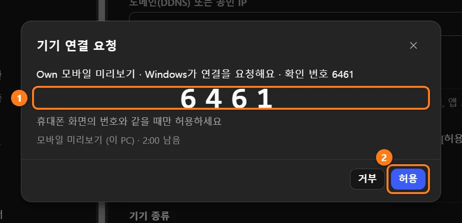
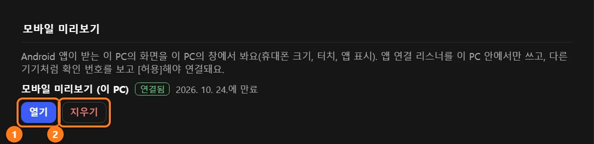

# 25. 모바일 미리보기

**한 줄 요약** — 휴대폰 없이, Android 앱이 받는 이 PC의 화면을 휴대폰 크기 창 하나로 봐요. 설치할 것도, 바깥 연결 준비도 필요 없어요.

> **용어** 모바일 미리보기: 데스크톱 앱이 이 PC 안에서 "가상의 휴대폰 기기"를 하나 만들어, Android 앱과 같은 방식으로 이 PC에 연결해 보여 주는 창이에요.

## 왜 필요해요?

- 휴대폰에서 어떻게 보일지 PC에서 바로 확인할 수 있어요. 예를 들어 세션 목록이 좁은 화면에서 잘 보이는지, 승인 버튼을 누르기 쉬운지요.
- 휴대폰을 꺼내거나 Tailscale·DDNS를 준비하지 않아도 돼요. 연결은 이 PC 안에서만 오가요.
- 다른 기기와 똑같이 확인 번호를 보고 `허용`해야 연결돼요. 그래서 "진짜 연결"이 어떻게 동작하는지 미리 연습해 볼 수도 있어요.

## 이렇게 써요

1. `설정 > 휴대폰·다른 PC`에서 게이트웨이와 앱 연결을 켜요([24장 1단계](24-phone-other-pc.md)). Tailscale이나 DDNS 경로는 없어도 돼요.
   - 꺼져 있으면 `게이트웨이를 먼저 켜세요.` 또는 `앱 연결을 먼저 켜세요.`가 보여요.
2. 같은 화면 아래의 `모바일 미리보기`로 내려가요. 처음에는 `아직 미리보기 기기가 없어요.`가 보여요.
3. `만료`(`7일` 또는 `30일`)를 고르고 `미리보기 기기 만들기`를 눌러요.
4. 섹션에 `확인 번호 … · 이 창에 뜬 기기 연결 요청에서 같은 번호를 확인하고 [허용]을 누르세요.`가 보이고, 곧바로 `기기 연결 요청` 창이 떠요.
5. 두 번호가 같으면 `허용`을 눌러요(그림 ②). 저절로 허용되지 않아요.

6. `미리보기 기기를 만들었어요. [열기]로 창을 열어요.`가 보이면 `열기`(그림 ①)를 눌러요.

7. 휴대폰 크기의 창이 열리고, Android 앱에서 보이는 것과 같은 화면이 나와요.

과 프로젝트가 다른 장과 달라요. 창의 메뉴 막대는 이 그림에서 잘려 있어요")

## 창 메뉴

미리보기 창 위쪽 메뉴에서 모양을 바꿔요.

| 메뉴 | 항목 | 하는 일 |
|---|---|---|
| `기기` | `작은 휴대폰`, `Pixel`, `Galaxy`, `폴더블 (펼침)`, `태블릿` | 화면 크기를 바꿔요(각각 크기 숫자가 함께 보여요) |
| | `회전` (`Ctrl+Shift+O`) | 세로·가로를 바꿔요 |
| | `키보드` (`Ctrl+K`) | 화면 키보드가 올라온 높이를 흉내 내요 |
| `보기` | `뒤로` (`Alt+←`), `새로 고침` (`F5`) | 앱의 뒤로 가기, 다시 불러오기 |
| | `시스템 설정`, `라이트`, `다크` | 미리보기 화면의 테마 |
| | `개발자 도구` (`F12`) | 화면을 자세히 살펴볼 때 써요 |
| `미리보기` | `미리보기 기기 지우기…` | 미리보기 기기를 없애고 창을 닫아요 |

## 끝내기와 다시 만들기

- 다 봤으면 섹션이나 창 메뉴에서 `지우기`를 눌러요. 이 PC에서 미리보기 기기의 연결을 끊고, 창과 저장된 로그인을 지워요.
- `설정 > 휴대폰·다른 PC`의 `연결된 기기` 목록에서 `연결 끊기`해도 같아요. 목록에서는 `이 PC 미리보기` 표시가 붙은 앱 기기로 보여요.
- 만료됐거나 연결이 끊겼거나 앱 연결 인증서가 바뀌면 섹션에 `다시 만들기 필요`가 보여요. `다시 만들기`를 누르면 돼요.

## 알아 두면 좋아요

- 권한은 `읽기`, `메시지 보내기`, `전환`이에요(Android 앱 기본값, 터미널 없음). 바꾸려면 기기 목록의 `권한 바꾸기`를 써요.
- 미리보기 창은 **데스크톱 앱의 Chromium**으로 그려요. Android 앱 자체의 화면(PC 목록, QR 스캔)이나 휴대폰의 글꼴·WebView 차이까지는 보이지 않아요. 그것까지 보려면 실제 휴대폰이나 Android 에뮬레이터를 써요.
- 미리보기는 데스크톱 앱에만 있어요. 보통 웹 브라우저로 연 화면에는 이 섹션이 없어요.
- 미리보기 창도 손가락 화면처럼 그려요. 페이지의 머리줄이 한 줄인지, 단추와 스위치가 누르기 쉬운 크기인지 여기서 확인할 수 있어요([24장](24-phone-other-pc.md)).

## 조심하세요

> **주의** 미리보기 기기의 로그인 정보는 이 PC의 데스크톱 앱 데이터 폴더에 있어요. 그 폴더가 복사되면 다른 경로로도 쓰일 수 있어요. 만료는 짧게(7일) 두고, 쓰지 않을 때는 `지우기`하세요.

## 더 알아보기

- 설계: [08 앱 연결 §4.3](../08-app-access.md)
- 실제 휴대폰·다른 PC 연결: [24장](24-phone-other-pc.md)
