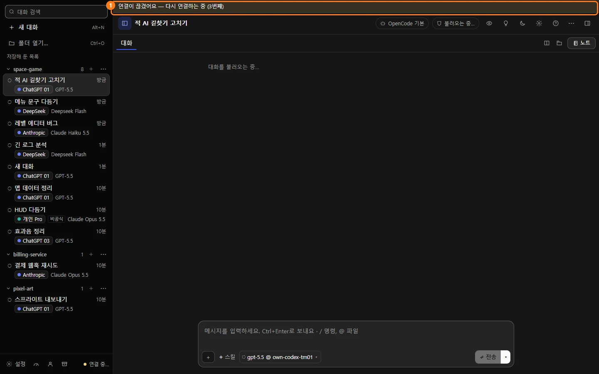
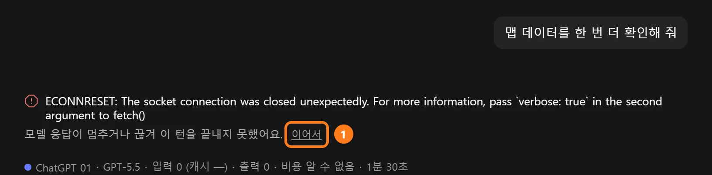

# 26. 증상별 해결

문제가 생겼을 때 화면에 보이는 문구나 증상으로 찾아보세요. 표는 "증상 → 왜 그래요 → 이렇게 해요" 순서예요.

> **팁** 이 설명서 HTML의 검색 상자에 화면에 보인 문구 일부를 넣으면 이 장의 해당 줄을 바로 찾을 수 있어요.

## 먼저 해 볼 것 세 가지

1. **PowerShell에서 `own status`를 실행해요.** 서비스가 도는지, 어느 버전이 깔렸는지 보여요. 멈춰 있으면 `own start`로 켜요.
2. **앱을 껐다가 다시 열어요.** 트레이 아이콘을 오른쪽 클릭해 `앱 종료 (서비스는 계속 실행)`을 고른 뒤 시작 메뉴에서 다시 열어요. 서비스와 진행 중인 턴은 계속 돌아요. 결과는 그대로 있어요.
3. **업데이트 직후에 생긴 문제라면** `own rollback`으로 직전 버전으로 돌아가요([2장](02-install-update.md)).

> **참고** `own` 명령은 **Claude 데스크톱 앱 밖의** PowerShell 창에서 실행하세요. 시작 메뉴에서 PowerShell을 새로 열면 돼요. 이유는 아래 "설치·서비스"에 있어요.

## 설치·서비스

| 증상 | 왜 그래요 | 이렇게 해요 |
|---|---|---|
| `Own OpenCode가 설치되지 않았어요` | 설치 파일을 Claude 데스크톱 앱의 터미널이나 에이전트 안에서 실행했을 가능성이 커요. 그 앱 안에서 쓴 파일은 그 앱 전용 폴더로 들어가서, 실제 앱에서는 안 보여요 | 설치 파일을 **탐색기에서 두 번 눌러** 실행해요([2장](02-install-update.md)) |
| 설치 파일이 “이 설치 파일이 다른 앱(예: Claude 데스크톱 앱의 터미널이나 에이전트) 안에서 실행됐어요”라고 알림, 또는 `own`이 종료 코드 5로 끝남 | 위와 같은 경우를 설치 파일이 알아챘어요. **아무것도 바꾸지 않았어요** | 탐색기에서 다시 실행해요. `own` 명령은 Claude 앱과 무관한 PowerShell 창에서 실행해요 |
| 설치 파일이 “Own OpenCode 서비스를 설치하지 못했어요(종료 코드 …)” | 서비스 부분 설치가 실패했어요. 이전 버전이 있었다면 그대로 돌아요 | 안내된 기록 파일(`install.log`)의 마지막 실패 줄을 보고 고친 뒤 다시 실행해요. 어려우면 Claude에게 기록을 보여 주세요([부록 C](92-claude-and-you.md)) |
| `서비스를 시작하지 못했어요.` | 서비스가 뜨다가 실패했어요 | `own status`, `own start`로 오류를 봐요. 업데이트 직후라면 `own rollback` |
| `서비스를 시작하는 중이에요…`에서 오래 멈춤 | 첫 시작이거나 PC가 바빠요 | 1분쯤 기다려요. 그래도 그대로면 `own status`를 봐요 |
| `앱 셸과 화면 버전이 맞지 않아요.` | 데스크톱 앱과 설치된 서비스의 버전이 달라요(업데이트를 미뤘거나 되돌린 뒤) | `own status`에 보이는 설치 버전과 같은 버전의 설치 파일을 실행해요. 그동안은 `브라우저로 열기`로 써요 |
| `서비스 버전(…)과 설치된 버전(…)이 달라요` 또는 `이 앱이 관리하지 않는 서비스가 돌고 있어요` | 버전을 바꾼 뒤 서비스를 아직 다시 시작하지 않았어요 | `설정` > `서비스 상태` > `서비스 다시 시작`, 또는 `own restart` |
| `다른 버전의 서비스가 대화를 실행 중이에요` | 옛 서비스가 아직 턴을 돌리고 있어요 | 턴이 끝난 뒤 `own restart` |
| 새 PowerShell 창에서 `own`을 찾을 수 없음 | 설치 전에 연 창이거나, 사용자 PATH에 등록이 빠졌어요 | PowerShell을 새로 열어요. 그래도 없으면 설치 파일을 다시 실행해요 |
| Windows 방화벽 허용 창이 뜸 | 서비스, 게이트웨이, 원격 연결은 모두 이 PC 안(`127.0.0.1`)에서만 열려요. 바깥 연결이 필요 없어요 | **허용하지 않아도 돼요.** 취소해요 |
| 환경 변수에 넣은 API 키(`OPENAI_API_KEY` 등)가 쓰이지 않음 | 일부러 그래요. 서비스는 환경 변수의 키를 받지 않아요 | 앱에서 계정으로 추가해요([3장](03-first-account.md)) |
| 보통 웹 브라우저에서 `서비스에 연결하려면 연결 링크가 필요해요. 이 PC에서 브라우저 창을 다시 여세요.` | 브라우저용 1회용 링크(5분)가 만료됐어요 | `own open --browser`를 다시 실행해요 |
| OS 알림이 뜨지 않음 | 설치 파일로 설치한 앱에서만 안정적으로 떠요 | `설정` → `데스크톱 앱` → `테스트 알림`으로 확인해요 |
| X를 눌렀는데 앱이 꺼지지 않음 | X는 창을 트레이로 숨겨요. 앱은 알림 영역에서 계속 돌아요 | 트레이 아이콘을 오른쪽 클릭해 `앱 종료` 또는 `완전 종료…`를 골라요. X로 바로 끄고 싶으면 `설정` → `데스크톱 앱` → `창을 닫으면` → `앱 종료`([5.10](05-screen-tour-theme.md)) |
| 트레이 아이콘이 안 보임 | Windows 11은 새 아이콘을 숨겨진 아이콘 칸에 넣어요 | 작업 표시줄 오른쪽의 `^`를 눌러요. 늘 보이게 하려면 Windows `설정` → 개인 설정 → 작업 표시줄 → 기타 시스템 트레이 아이콘에서 `Own OpenCode`를 켜요 |
| `완전 종료`가 `이 서비스는 끄지 않아요` 또는 `개발 서비스는 끄지 않아요`라고 함 | 돌고 있는 서비스가 설치된 버전이 아니거나 개발용이에요. 앱이 띄운 서비스만 꺼요 | `앱만 종료`로 앱만 끄고, 서비스는 PowerShell에서 `own stop`으로 꺼요 |
| `서비스를 끄지 못했어요` | `own stop`이 실패했어요(아래 줄에 이유) | `앱만 종료`를 고른 뒤 PowerShell에서 `own status`, `own stop`을 실행해요 |

> **주의** 설치 파일 실행, Windows 보안 창(방화벽, 사용자 계정 컨트롤, SmartScreen) 응답은 **사용자가 직접** 해요. Claude에게 맡기지 마세요.

## 연결과 화면

| 증상 | 왜 그래요 | 이렇게 해요 |
|---|---|---|
| `연결이 끊겼어요 — 다시 연결하는 중 (…번째)` | 서비스가 멈췄거나 다시 시작하는 중이에요 | 잠시 기다려요. 계속되면 PowerShell에서 `own status`, 멈춰 있으면 `own start` |
| 사이드바에 `저장해 둔 목록` | 연결이 끊긴 동안 마지막으로 받아 둔 세션 목록을 보여 줘요 | 연결이 돌아오면 저절로 바뀌어요 |
| `기본 대화 폴더를 만들지 못했어요: …` 또는 `기본 대화 폴더에 파일을 쓸 수 없어요: …` | 폴더 없이 시작한 대화가 일할 폴더를 만들거나 쓰지 못했어요. Windows 보안의 “제어된 폴더 액세스”가 문서 폴더를 막고 있거나, 드라이브가 없거나 권한이 없어요 | `설정` > `일반` > `기본 대화 폴더`의 `바꾸기…`로 다른 폴더를 골라요(예: `D:\chats`). 적은 글은 입력창에 남아 있어요 |
| `폴더 열기` 창이 늘 다운로드 폴더에서 열려요 | 2.0.28-own.1까지는 Windows가 마지막으로 보인 곳에서 열었어요 | 지금은 마지막으로 연 폴더의 상위 폴더에서 열려요. 늘 같은 곳에서 열려면 `설정` > `일반` > `폴더 열기 시작 위치`에서 `직접 지정`을 골라요 |
| `이 프로젝트에 승인되지 않은 플러그인이 있어 계정 인증을 보내지 않아요.` | 프로젝트 폴더에 처음 보는 플러그인이 있어요. 키가 새지 않게 막았어요 | 믿는 플러그인이면 `설정` → `플러그인`에서 승인해요. 믿을 수 없는 저장소면 `own restart --untrusted`([8장](08-approvals.md)) |

## 계정·한도

| 증상 | 왜 그래요 | 이렇게 해요 |
|---|---|---|
| 연결한 ChatGPT 계정이 `이전 앱 갱신 대기` | 이전 앱(codex-multi-provider)이 로그인을 새로 고치지 않았어요 | 이전 앱에서 그 프로필을 한 번 열어요. 자주 생기면 계정 `⋯` → `이 앱으로 인수…`([20장](20-account-kinds.md)) |
| 연결한 API 키 계정이 `설정 오류` | 이전 앱에서 키가 지워졌거나, 이 Windows 사용자로 열 수 없어요 | 이전 앱에서 키를 다시 저장해요. 1분 안에 돌아와요 |
| `…의 DeepSeek 잔액이 부족해요` | DeepSeek 잔액이 바닥났어요 | 배너의 `충전`으로 DeepSeek에서 충전하거나, 다른 계정으로 전환해요([20장](20-account-kinds.md)) |
| 한도 숫자 옆에 `오래됨 · …` | 그 계정을 한동안 쓰지 않아 새 값을 못 받았어요. 쉬는 구독이면 정상이에요 | 그 계정으로 한 번 보내면 새로 고쳐져요([7장](07-usage.md)) |
| 한도가 `남음 62%`처럼 보이는데 쓴 양으로 보고 싶음 | 처음 값이 남은 양이에요 | `설정` > `일반` > `한도 표시`에서 `쓴 양`([7장](07-usage.md)) |
| Sign in with ChatGPT 계정 카드에 `아직 받은 한도 정보가 없어요 · …` | 정상이에요. 지금까지 이 로그인 방식의 응답에는 요금제 한도가 오지 않았어요 | `사용량 관리`로 ChatGPT 설정에서 봐요([20장](20-account-kinds.md)) |
| 구독 계정(ChatGPT, Claude)이 한도에 닿았는데 다른 회사·다른 ChatGPT 계정으로 저절로 안 바뀜 | 일부러 그래요. 구독 계정을 한도 때문에 자동으로 돌리면 약관상 한도 우회로 볼 수 있어서, 구독은 자동 전환을 하지 않아요. 이 PC의 Claude 계정끼리만 예외인데, `Claude 계정 사이`를 `자동`으로 켰을 때만이에요(처음 값은 `끄기`) | `Ctrl+.`로 직접 다른 계정을 고르거나, 리셋 시각까지 기다려요([11장](11-cache-switch-cost.md), [12장](12-multiple-accounts.md)) |
| API 키 계정끼리도 저절로 안 바뀜 | 넘나들 계정 **모두**에 `자동 전환 허용`이 켜져 있어야 하고, `설정` > `자동 전환`의 `API 키 → API 키`가 `자동`이어야 해요. 잠깐 걸리는 요청 한도로는 바꾸지 않아요 | 두 설정을 확인해요([12장](12-multiple-accounts.md)) |
| `자동 전환을 30분 동안 멈췄어요` | 1시간에 자동 전환이 2번을 넘었어요. 너무 자주 바꾸면 매번 처음부터 다시 읽느라 돈만 들어서 스스로 멈춰요 | 30분 기다리거나 직접 고르세요 |
| 새 대화가 기본으로 정한 계정으로 시작하지 않음 | 그 폴더에서 마지막으로 쓴 조합이 먼저예요. 기본 계정은 그 폴더에 대화가 없을 때, 가장 최근 대화의 회사 종류에만 쓰여요 | 새 대화에서 전환기로 직접 골라요(값이 들지 않아요, [6장](06-model-account.md)) |

## Claude 구독(비공식 슬롯)

| 증상 | 왜 그래요 | 이렇게 해요 |
|---|---|---|
| 전환기의 Claude 구독 줄에 `플러그인 없음` | 앱에 든 Claude 구독 플러그인이 불러와지지 않았어요 | 서비스를 다시 시작해요(`own restart`). 그래도 그대로면 Claude 카드의 알림을 봐요([20장](20-account-kinds.md)) |
| `Claude 구독 슬롯이 환경 변수 API 키로 바뀌었어요 — 요금이 API로 청구돼요.` | 서비스 환경에 Anthropic API 키가 잡혀서, 구독 대신 API 요금으로 나가고 있어요 | 의도한 게 아니면 그 환경 변수를 지우고 `own restart` |
| `Claude 구독 슬롯의 계정 정보가 바뀌었을 수 있어요. Claude Code 로그인 상태를 확인하세요.` | Claude Code에서 다른 계정으로 로그인했을 수 있어요 | Claude Code 로그인을 확인하고, 슬롯 `⋯` → `구독 다시 가져오기` |
| 값이 늘 `비용 알 수 없음` | 이 슬롯은 구독 한도가 아니라 추가 사용량으로 청구될 수 있어서 앱이 금액을 장담하지 않아요 | 정상이에요. 실제 청구는 claude.ai › 설정 › 사용량에서 봐요([20장](20-account-kinds.md)의 "직접 확인하기") |
| 카드에 `추가 사용량이 꺼져 있어 거절됐어요 · claude.ai에서 켜거나 API 키를 쓰세요` | Anthropic이 이 앱의 요청을 서드파티 사용으로 보고 추가 사용량에서 내려 했지만, 꺼져 있거나 모자라 거절했어요. 돈은 나가지 않았어요 | claude.ai에서 추가 사용량을 켜거나 채워요(돈이 나가요). 아니면 `Anthropic API 키` 계정으로 바꿔요 |
| 카드에 `이 계정은 지금 추가 사용량으로 청구되고 있어요` | 응답이 이 계정이 추가 사용량으로 넘어갔다고 알려 줬어요 | 원하지 않으면 claude.ai에서 추가 사용량을 끄거나 다른 계정으로 바꿔요 |
| 입력창 위에 `이 계정의 첫 Claude 요청이에요 · …` | 그 Claude 계정으로 처음 요청을 보냈어요. 계정마다 한 번만 떠요 | `계속`을 누르면 닫혀요. 멈추려면 `취소`([20장](20-account-kinds.md)) |
| 카드에 `이 계정의 로그인이 없거나 만료됐어요 — [다시 로그인]을 누르세요.` | 그 계정의 로그인 폴더에 로그인이 없거나 만료됐어요 | 그 카드의 `다시 로그인`(카드 `⋯`에도 있어요). 이 PC에 열린 창에서 브라우저 로그인만 마쳐요([20장](20-account-kinds.md)) |
| 카드에 `로그인을 새로 고치지 못했어요(…) · 다시 로그인하세요.` | Claude 로그인 서버가 이 로그인의 새로 고침을 거절했어요(괄호 안: HTTP 400·401·403과 서버의 오류 이름) | 그 줄의 `다시 로그인`([20장](20-account-kinds.md)의 "로그인 새로 고침 줄") |
| 카드에 `로그인 새로 고침이 잠시 막혔어요(…) · 다음 요청에서 다시 해요` | Claude 로그인 서버가 잠깐 막았거나(HTTP 429) 서버·인터넷이 잠깐 안 됐어요. 로그인은 그대로예요 | 잠시 뒤 다시 보내요 |
| 카드에 `로그인 토큰이 만료됐어요 · 다음 요청에서 새로 고쳐요` | 몇 시간마다 있는 일이에요. 문제가 아니에요 | 그대로 써요. 다음 요청이 새로 고쳐요 |
| 대화가 “Claude 계정 …의 로그인을 이 PC에서 읽을 수 없어 요청을 보내지 않았습니다. …”에서 멈춤 | 대화에 정한 Claude 계정의 로그인을 읽지 못했어요. 다른 계정의 로그인으로 대신 보내지 않아요 | `계정` 화면에서 그 계정의 `다시 로그인` |
| 대화가 “Claude 계정 …의 로그인을 새로 고치지 못했어요(HTTP …) · …”에서 멈춤 | Claude 로그인 서버가 그 계정의 로그인 새로 고침을 거절했어요. 기다려도 풀리지 않아요 | 그 계정의 `다시 로그인` |
| 대화가 “Claude 로그인 서버가 로그인 새로 고침을 잠시 막았어요(HTTP 429 …) · …초 뒤 다음 요청에서 다시 새로 고쳐요. …”에서 멈춤 | 로그인 서버가 잠깐 막았어요. 로그인은 그대로예요 | 적힌 시간이 지난 뒤 다시 보내요. 계속되면 `OWN_HOME\logs\own-accounts.log`의 `claude_refresh_failed` 줄을 봐요([27장](27-data-logs-uninstall.md)) |
| 모든 Claude 계정(AC-01, AC-02, …)이 50초쯤 기다린 뒤 “Claude 로그인 서버에 잠시 연결하지 못했어요 · 잠시 뒤 다시 시도해요. …” | 2.0.32-own.3까지의 문제였어요. 이 앱의 로그인 새로 고침 요청을 Claude 로그인 서버가 계속 거절(HTTP 429)했어요. 계정마다 다르게 다룬 곳은 없었어요 | 앱을 업데이트해요([2장](02-install-update.md)) |
| 대화가 “Claude 계정 …의 로그인이 만료되었고 새로 고치지 못해 요청을 보내지 않았습니다. …”에서 멈춤 | 드물어요. 다른 프로그램이 같은 로그인을 새로 고치는 중이었어요 | 잠시 뒤 다시 보내고, 또 뜨면 그 계정의 `다시 로그인` |
| 대화가 “이 대화의 Claude 계정(…)에 이 PC의 로그인이 없습니다 — 요청을 보내지 않았습니다. …”에서 멈춤 | 그 계정의 로그인 폴더에 로그인이 없어요 | 그 계정의 `다시 로그인` |
| 대화가 “이 대화의 Claude 계정(…)을 이 PC에서 쓸 수 없습니다 — 요청을 보내지 않았습니다. …”에서 멈춤 | 그 계정을 이 PC에서 쓸 수 없어요(예: 빠진 계정) | 전환기(`Ctrl+.`)에서 다른 Claude 계정을 골라요 |
| 대화가 “… 앱에 든 Claude 구독 플러그인을 확인할 수 없어 계정 하나만 씁니다 — 요청을 보내지 않았습니다. 서비스를 다시 시작하세요.”에서 멈춤 | 다른 Claude 계정으로 정한 대화인데, 지금 불러온 플러그인이 앱에 든 것이 아니거나 아직 불러와지지 않았어요(예: 업데이트 뒤 서비스를 아직 다시 시작하지 않음) | 서비스를 다시 시작해요(Claude 카드의 `지금 다시 시작` 또는 `own restart`) |
| 대화가 “이 대화에 정해진 Claude 계정이 없어 요청을 보내지 않았습니다. …”에서 멈춤 | 이 대화에 쓸 Claude 계정이 정해지지 않았어요 | 전환기(`Ctrl+.`)에서 Claude 계정을 골라요 |
| 대화가 “Anthropic이 이 요청을 거절했어요(HTTP 400 claude_code_version_too_old) · …”에서 멈춤 | 앱에 든 Claude 구독 플러그인은 요청에 Claude Code 버전을 적어 보내요. Anthropic이 그 버전을 이 모델(또는 조직 정책)이 요구하는 최소 버전보다 낮다고 봤어요. 괄호 안 원문에 두 버전이 있어요 | 앱을 업데이트해요([2장](02-install-update.md)). 최신인데도 뜨면 다음 업데이트까지 다른 Claude 모델이나 `Anthropic API 키` 계정을 써요 |
| 카드에 `앱에 든 Claude 구독 플러그인이 아직 쓰이지 않고 있어요. 서비스를 다시 시작하면 불러와져요.` 또는 `앱에 든 것이 아닌 Claude 플러그인(예전 설치)이 불러와져 있어요` | 예전 버전에서 업데이트한 뒤 서비스를 아직 다시 시작하지 않았거나, 예전 설치가 아직 불러와져 있어요 | `지금 다시 시작`(데스크톱 앱) 또는 `own restart`. 실행 중인 대화가 있으면 턴이 끝난 뒤에 해요 |
| 카드에 `앱에 든 Claude 구독 플러그인이 불러와지지 않았어요. 서비스를 다시 시작하세요.` | 서비스가 플러그인을 불러오지 못했어요 | `own restart` |
| 카드에 `앱에 든 Claude 구독 플러그인 파일이 바뀌었어요(무결성 불일치). 앱을 다시 설치하세요.` 또는 `이 앱 설치에 Claude 구독 플러그인이 없어요. 앱을 다시 설치하세요.` | 앱에 든 플러그인 파일이 바뀌었거나 없어요 | 앱 설치 파일을 탐색기에서 다시 실행해요([2장](02-install-update.md)) |
| `Claude 계정 추가`가 없음 | 이 PC의 창이 아니거나(`로그인 추가는 이 PC의 창에서만 할 수 있어요.`), 앱에 든 플러그인이 아직 불러와지지 않았어요 | 이 PC의 창에서 해요. 카드에 플러그인 알림이 있으면 서비스를 다시 시작해요 |
| 더한 계정의 대화에 영어 `Claude OAuth refresh failed. …` | 예전 버전의 문제였어요. 다른 계정의 로그인 갱신이 실패하면 이 대화의 요청까지 함께 실패했어요. 고쳐졌어요 | 앱을 업데이트해요([2장](02-install-update.md)). 그래도 보이면 그 계정의 `다시 로그인`을 해요 |

## 속도·자동 압축

| 증상 | 왜 그래요 | 이렇게 해요 |
|---|---|---|
| 속도 배지가 회색이고 `마지막 요청은 모델 회사가 표준 속도로 처리했어요` | 서버가 Fast 요청을 표준으로 처리했어요. 요금도 표준이에요 | 할 일은 없어요. 계속되면 그 모델·요금제가 Fast를 지원하는지 봐요([16장](16-speed.md)) |
| `더 빠른 속도가 거절되어 …로 보내요. 계정은 그대로예요` | 고른 속도를 지금 쓸 수 없어 한 단계 느린 속도로 보냈어요 | 계정은 바뀌지 않아요. `…까지 쉼`이 보이면 그 시각 뒤에 다시 돼요 |
| 속도 배지에 `확인 전` | 그 계정에서 그 속도를 쓸 수 있는지 아직 확인하지 못했어요 | 한 번 써 보면 확인돼요 |
| 자동 압축이 생각보다 늦게 일어남 | 기본값 `모델 한도`는 모델의 전체 창을 쓰고, 응답용으로 15%(창이 32k 이상이면 최소 16K)만 남겨요. 예: ChatGPT 구독의 GPT-5.6 Sol(872k 창)은 약 741k, OpenAI API 키의 GPT-5.5(922k 창)는 약 784k에서 압축해요 | 정상이에요. 더 일찍 하고 싶으면 문맥 계기의 `이 대화 압축 설정…` 또는 `설정` → `자동 압축`([13장](13-auto-compaction.md)) |
| `이 서버는 문맥 비우기를 아직 몰라요 · 앱을 업데이트하면 쓸 수 있어요` | 그 대화의 서버(주로 업데이트하지 않은 SSH 원격 호스트)가 문맥 비우기를 모르는 버전이에요 | 그 서버의 서비스를 업데이트해요([22장](22-ssh-remote.md)). 그때까지는 새 대화를 열어 시작해요 |
| 문맥 비우기 줄에 `되돌리기`가 없음 | 그 뒤에 압축했거나(`그 뒤에 압축해서 되돌릴 수 없어요`), 그 뒤에 다시 비웠거나, 복원 대기 중이에요 | 압축했으면 `이 지점 전으로 포크`로 앞 대화를 새 대화에서 이어 가요. 다시 비웠으면 나중 것부터 되돌려요. 복원 대기면 먼저 확정하거나 취소해요([10.14](10-conversation-tools.md)) |
| `이 연결에는 문맥을 비울 권한이 없어요` | 이 기기 연결에 `메시지 보내기` 권한이 없어요(휴대폰·다른 PC) | 연결한 PC의 `설정 > 휴대폰·다른 PC`에서 그 기기의 `권한 바꾸기`로 `메시지 보내기`를 켜거나, 권한 있는 기기에서 비워요([24장](24-phone-other-pc.md)) |
| `서버에 닿지 못했어요 · 연결을 확인하고 다시 해 보세요` | 문맥 비우기 요청이 서버에 닿지 않았거나 서버가 오류로 답했어요 | 연결 상태(창 아래 연결 표시)를 보고 다시 해 봐요 |
| `/compact`를 눌렀는데 `문맥 비우기가 기다리고 있어서 압축하지 않아요` | 문맥 비우기가 턴이 끝나기를 기다리고 있어요. 비우면 압축할 것이 남지 않아요 | 그대로 두면 턴이 끝날 때 비워요. 비우지 않고 압축하려면 알림의 `비우기 취소하고 압축`을 눌러요 |
| 압축 칩이 사라지고 `대화 제목 — 문맥을 비워서 기다리던 압축은 하지 않았어요` | 그 압축이 시작하기 전에 그 대화의 문맥 비우기가 됐어요. 비우기 전에 넣은 압축도, 비우기를 기다리는 동안 다른 곳(TUI, 계정 전환)에서 넣은 압축도 그래요. 비운 문맥에는 요약할 것이 없어요 | 할 일은 없어요. 비운 뒤 대화가 길어지면 그때 압축해요([10.14](10-conversation-tools.md)) |
| 문맥을 비웠는데 대기 목록의 메시지가 돌지 않음 | 멈춘 뒤에 남은 대기 목록은 저절로 돌지 않아요. 비우기는 그 앞에서 먼저 됐어요 | 대기 목록에서 그 메시지의 `지금 보내기`를 누르거나 새 메시지를 보내면 새 문맥에서 돌아요 |
| 자동 압축이 생각보다 일찍 일어남 | `직접 정하기`나 세션 설정으로 기준을 낮췄거나, 설정 파일에 `compaction.buffer`가 있어요(`이 앱의 설정 파일에 compaction.buffer가 있어 자동 압축 기준이 맞지 않아요`) | `설정` → `자동 압축`에서 출처 표시를 봐요. 설정 파일의 그 줄은 지워요 |

## 응답이 멈추거나 끊겼을 때

모델의 응답이 오다가 멈추거나 연결이 끊기면, 앱이 그 시도를 끊고 **저절로 다시 보내요.** 기다리기만 하면 되는 경우가 대부분이에요.

- 응답이 **5분** 동안 한 글자도 진행되지 않으면 끊고 다시 보내요. 에이전트가 도구 호출을 적는 중이면 **120초**예요. ChatGPT·OpenAI 계열은 한 번 시도가 **15분**을 넘어도 끊어요.
- 멈춰서 끊은 것은 3번까지, 연결이 끊긴 것은 10번까지 다시 보내요. 그래도 안 되면 그 턴을 끝내고 대화에 오류와 `이어서` 단추를 보여 줘요.

| 화면 | 이렇게 해요 |
|---|---|
| `모델 응답이 멈추거나 끊겨 이 턴을 끝내지 못했어요.` + `이어서` | `이어서`를 누르면 "계속"을 보내 그 자리부터 이어 가요. 그동안 고친 파일은 그대로 남아 있어요 |
| `오랫동안 진행이 없어 이 턴을 멈췄어요.` + `이어서` | 위와 같아요 |
| `이어서` 뒤에도 계속 멈춤 | 회사 쪽이 혼잡하거나 장애예요. 잠시 뒤 다시 하거나 `Ctrl+.`로 다른 계정·모델로 바꿔요 |
| `이어서 보내지 못했어요` | 서비스와 연결이 끊겼어요. 다시 연결된 뒤 눌러요 |

> **참고** Claude 구독 슬롯은 이 자동 끊기를 쓰지 않아요.

## 프리셋·하위 에이전트

| 증상 | 왜 그래요 | 이렇게 해요 |
|---|---|---|
| 프리셋 단추에 점이 붙고, `설정` > `프리셋` 목록에 `고칠 것 있음` | 프리셋에 고정해 둔 모델이 사라졌어요. 그 역할은 다음 대상이나 `메인과 같게`로 돌고 있어요 | `고치기`(제안된 모델로 바꿈) 또는 `직접 고르기`([14장](14-presets.md)) |
| 대화에 ⊘ 칩 “하위 에이전트 대기: 3개 실행 중” | 동시에 도는 도우미 수가 상한에 닿았어요. 오류가 아니에요 | 기다리면 메인이 다시 맡겨요. 늘 모자라면 프리셋 `자세히`에서 상한을 올려요 |
| ⊘ 칩 “하위 에이전트 대기: 메시지 하나당 최대 6개” | 내 메시지 하나가 상한보다 많이 시켰어요 | 턴이 도는 동안 `이번 메시지만 늘리기` |
| ⊘ 칩 “하위 에이전트 요청을 막았어요: … 이 프리셋에 없어요” | 메인이 프리셋에 없는 모델을 불렀어요 | 필요하면 `하위 에이전트에 추가…`로 편집기를 열고 `저장`, 아니면 `그대로` |
| ChatGPT가 메인인데 도우미를 거의 안 씀 | GPT 모델은 시키지 않으면 도우미를 잘 쓰지 않아요(`모델 기본`) | 프리셋의 맡기는 정도를 `도움될 때` 이상으로 |
| 도우미 대상 목록에 ChatGPT 02, 03이 없음 | 같은 회사의 다른 구독은 약관 때문에 도우미로 쓰지 않아요 | 같은 회사 모델은 `메인 계정의 더 가벼운 모델`로 고르세요([14장](14-presets.md)) |
| 원격 대화에 `이 원격 서버에는 아직 프리셋이 없어 평소대로만 써요` | 그 호스트가 이 PC의 프리셋을 아직 받지 못했어요 | 호스트와 연결된 상태로 잠시 기다려요([22장](22-ssh-remote.md)) |

## 팀 모드

| 증상 | 왜 그래요 | 이렇게 해요 |
|---|---|---|
| 프로젝트 줄의 `팀`·`⑂` 단추가 흐림, 또는 메뉴에 `팀 모드와 작업 폴더는 Git 저장소인 프로젝트에서만 쓸 수 있어요.` | 그 폴더가 Git 저장소가 아니에요 | 흐린 `팀` 단추 → `Git 저장소로 만들기…`로 저장소와 첫 커밋을 만들어요([17장](17-team-mode.md)). 이 PC의 창에서만 돼요 |
| `아직 첫 저장 지점이 없어 팀 모드를 켤 수 없어요. 첫 저장 지점을 만든 뒤 다시 켜세요` | Git 저장소지만 커밋이 하나도 없어요 | 알림의 `첫 저장 지점 만들기…` |
| 반영이 `메인 폴더(space-game)에서 아직 저장 지점에 넣지 않은 파일 2개와 겹쳐요. 그 변경을 저장 지점에 넣거나 되돌린 뒤 '다시 반영'을 누르세요`에서 멈춤 | 메인 폴더에서 같은 파일을 고치는 중이에요. 앱은 그 변경을 덮어쓰지 않아요 | 그 변경을 저장 지점에 넣거나 되돌린 뒤 `다시 반영` |
| `검사가 실패해서 반영하지 않았어요` | 팀의 검사 명령이 실패했어요 | `로그 보기`로 이유를 봐요. 팀 메인이 깨어나 다음을 정해요 |
| 반영 카드가 `메인 폴더(…)에서 하던 일이 끝나면 되돌려요`인 채로 멈춰 있고, 다른 영역의 반영도 들어가지 않음 | 메인 폴더에서 일하는 중이라 되돌리기가 기다려요. 그동안 같은 본 코드로 가는 반영도 함께 기다려요 | 그 폴더의 일이 끝나면 저절로 되돌려요. 되돌리지 않기로 했으면 카드의 `되돌리기 취소`를 눌러요(또는 팀 메인에게 “되돌리기 취소해 줘”). 본 코드는 반영한 그대로 남고 기다리던 반영이 이어져요([17장](17-team-mode.md)) |
| 영역이 `메인 멈춤 · 요청 1개 기다림`인 채로 일이 안 들어감 | 메인 멈춤은 시간이 지나도 저절로 풀리지 않아요. 담당 대화를 `중단`해도 저절로 켜져요 | 담당 대화 위의 `메인 멈춤 끄기` |
| 영역 행에 `찾을 수 없음` | 영역 폴더가 지워졌거나, Git 정보 없이 옮겨졌어요 | 그 행의 `다시 만들기`(마지막 저장 지점부터) 또는 `끝내기`([17장](17-team-mode.md)) |
| 영역이 `한도 대기 · 2시간 14분 후에 풀림` | 팀이 쓰는 구독 계정의 한도를 다 썼어요. 구독은 자동으로 다른 계정으로 바꾸지 않아요 | 풀릴 때까지 기다리거나, 팀 메인 입력창에서 팀 계정 바꾸기 |
| 영역의 `모델 바꾸기…` 목록에 다른 ChatGPT 계정이 없음(`다른 ChatGPT 계정은 팀에 넣을 수 없어 목록에 없어요`) | 한 팀은 회사마다 구독 하나만 써요 | 다른 회사 구독, API 키, 로컬 LLM을 고르거나 팀 계정 전체를 바꿔요 |
| 알림 `팀 작업이 5분 넘게 기다려요`, 또는 팀 메인이 “메인 요청 1개 기다림(새 대화로 이어가기 op_… 때문 · 17분째)”이라고 함 | 팀 작업이 영역이 쉬기를 기다려요(일하는 대화, 대기열, 승인, 돌고 있는 명령이나 터미널) | 팀 메인 위 작업 카드에서 무엇을 기다리는지 봐요. 대화가 일하는 중이거나 승인을 기다리면 끝나기를 기다리거나 `취소`, 개발 서버 같은 명령 때문이면 `명령 멈추고 진행`이나 `바로 진행`, 인계 메모를 기다리면 `바로 진행`([17장](17-team-mode.md)) |
| 팀 메인이 “다른 프로세스(pid 1234)가 팀 서비스를 잡고 있어 지금은 기록할 수 없습니다”라고 함, 팀 단추가 `팀 서비스에 닿을 수 없어요` | 같은 데이터 폴더를 쓰는 서비스가 둘 떠 있어요(개발용 서비스를 함께 띄웠거나, 멈춘 옛 서비스가 남음) | 하나를 끄거나 서비스를 다시 시작해요. 로그 `own-team.log`의 `controller_lock_waiting` 줄이 그 프로세스를 적어요([27장](27-data-logs-uninstall.md)) |

## 다른 도구의 대화

| 증상 | 왜 그래요 | 이렇게 해요 |
|---|---|---|
| 사이드바에 `다른 도구의 대화 · 새 3개` 같은 줄이 없음 | 그 폴더에 아직 가져오지 않은 대화가 없거나, `사이드바에 보이기`를 껐어요 | 프로젝트 `⋯` → `다른 도구의 대화…`로 열어 봐요. 그 항목도 없으면 서비스 설정 파일에 own-import가 빠진 거예요. Claude에게 확인을 맡겨요([21장](21-import-other-tools.md)) |
| 찾는 대화가 목록에 없음 | 대화를 시작한 폴더가 이 프로젝트 밖이거나, 저장소가 다른 곳에 있어요 | 목록의 `모든 폴더`를 보거나 `설정` > `다른 도구의 대화`의 `찾을 곳 더하기` |
| 줄에 `읽을 수 없음` | 원본이 지워졌거나 형식을 읽지 못했어요 | 원본은 그대로예요. 마우스를 올려 이유를 봐요 |

## SSH 원격 호스트

| 증상 | 왜 그래요 | 이렇게 해요 |
|---|---|---|
| `ssh를 찾을 수 없어요. Windows 선택적 기능 "OpenSSH Client"를 설치하세요` | 이 PC에 SSH 프로그램이 없어요 | Windows 설정의 선택적 기능에서 "OpenSSH Client"를 직접 켜요 |
| `이 서비스에는 SSH 원격 호스트 기능이 없어요.` | 설정 파일의 플러그인 목록에 원격 기능이 빠졌어요(옛 설정 파일) | Claude에게 설정 파일 확인을 맡겨요([부록 C](92-claude-and-you.md)). 설정 파일 위치는 [27장](27-data-logs-uninstall.md)에 있어요 |
| 호스트가 `인증 필요`에서 멈춤 | 다시 연결할 때 비밀번호·암호문구가 필요해요. 앱은 뒤에서 묻지 않아요 | 호스트 `⋯` → `인증하고 연결` |
| 호스트가 `호스트 키 확인 필요` | 모르는 호스트 키를 만났어요 | 호스트 `⋯` → `호스트 키 확인…`에서 지문을 비교해요([22장](22-ssh-remote.md)) |
| `호스트 키가 바뀌었어요. 중간자 공격일 수 있으니 서버 관리자에게 확인한 뒤 known_hosts를 직접 고치세요.` | 서버의 열쇠가 바뀌었어요. 서버를 다시 설치했거나, 누군가 가로채는 중일 수 있어요 | 서버 관리자에게 꼭 확인한 뒤 `known_hosts`를 직접 고쳐요. 앱은 고쳐 주지 않아요 |
| `업데이트 필요` | 이 PC와 서버의 버전이 달라요 | 호스트 `⋯` → `업데이트…` → `현재 턴이 끝나면 업데이트 (기본)` |
| `다른 PC가 관리 중` | 다른 PC의 앱이 이 서버를 관리해요 | 이 PC에서 쓰려면 호스트 `⋯` → `이 PC로 가져오기` |
| 원격 턴이 멈추고 “로컬 PC의 자격 증명 브로커에 닿지 못해 이번 턴을 멈췄습니다.” | 이 PC와 끊긴 채 출입증(lease)이 끝났어요. 안전하게 멈춘 거예요 | 다시 연결한 뒤 이어서 부탁해요 |
| `이 호스트는 SSH가 끊기면 원격 작업도 멈춰요…` | 서버 설정 때문에 끊기면 작업도 멈춰요 | 서버 관리자에게 linger를 켜 달라고 해요 |
| `대화형 셸에만 있는 PATH가 있어요` | `.bashrc`에만 등록한 도구를 에이전트가 못 찾아요 | 호스트 설정의 `셸 환경`을 `로그인 + 대화형`으로, 또는 연결 완료 창의 `대화형 셸 설정 쓰기` |
| `원격 디스크 공간이 부족해요`, `설치 위치에서 프로그램을 실행할 수 없어요(noexec)` | 서버의 디스크나 홈 폴더 설정 문제예요 | 서버를 정리하거나 서버 관리자에게 물어봐요 |

## 휴대폰·다른 PC

| 증상 | 왜 그래요 | 이렇게 해요 |
|---|---|---|
| 휴대폰이 붙지 않음, 앱에 `PC에 연결할 수 없어요` | PC가 잠들었거나, 게이트웨이·앱 연결이 꺼졌거나, 바깥 길(Tailscale·DDNS)이 준비되지 않았어요 | PC를 깨우고, `설정 > 휴대폰·다른 PC`에서 `켜짐`인지 보고, Tailscale이 켜져 있는지(휴대폰도) 확인해요 |
| `이 기기의 연결이 만료됐거나 끊겼어요. PC의 설정 > 휴대폰·다른 PC에서 다시 연결하세요.` | 만료(기본 30일, 또는 14일 동안 안 씀)됐거나 연결이 끊겼어요 | `설정 > 휴대폰·다른 PC` → `새 기기 연결`로 QR부터 다시 해요 |
| `켜지 못했어요 (…)` + `포트 …를 다른 프로그램이 쓰고 있어요` | 다른 프로그램이 그 포트를 써요 | `포트`를 다른 숫자로 바꿔 켜고, `tailscale serve` 명령도 그 포트로 다시 실행해요 |
| `QR이 만료되었어요` | QR은 5분, 한 번만 쓸 수 있어요 | `다시 만들기` |
| `시도가 너무 많아요. 1분 뒤 PC에서 QR을 다시 만드세요.` | 짧은 시간에 여러 번 시도했어요 | 1분 기다린 뒤 QR을 새로 만들어요 |
| 앱에 `보안 경고` 또는 `PC의 키가 바뀌었어요` | PC의 인증서가 처음 연결할 때와 달라요. 누군가 가로채는 중일 수도 있어요 | 그 연결을 쓰지 말고, PC에서 새 QR로 다시 연결해요 |
| `QR 스캐너를 쓸 수 없어요(Google Play 서비스 필요). [링크 붙여넣기]를 쓰세요.` | 휴대폰에 QR 스캐너가 없어요 | PC 화면의 링크를 휴대폰으로 보내 `링크 붙여넣기`로 넣어요 |
| `WebView가 너무 오래됐어요` | 휴대폰의 Android System WebView가 낡았어요 | Play 스토어에서 Android System WebView와 Chrome을 업데이트해요 |
| 다른 PC에서 `링크가 만료되었거나 이미 쓰였어요. PC에서 새 링크를 만드세요.` | 링크도 5분, 한 번만 쓸 수 있어요 | 이 PC에서 새 링크를 만들어요 |

## 컴퓨터 사용

`설정 > 컴퓨터 사용`에 `사용할 수 없음`이 보이면 그 아래 이유를 봐요.

| 화면의 이유 | 이렇게 해요 |
|---|---|
| `이 앱의 런처로 시작한 서비스에서만 동작해요.` | 서비스를 `own restart`로 다시 시작해요 |
| `플러그인이 앱 버전과 맞지 않아요. 서비스를 다시 시작하세요.` | `own restart` |
| `Windows에서만 동작해요.` | Windows PC에서만 쓸 수 있어요 |
| `플러그인 설정(options)이 올바르지 않아요. opencode.jsonc의 own-computer-use 항목을 확인하세요.` | 설정 파일의 그 항목을 고쳐요. 어려우면 Claude에게 맡겨요 |
| `컴퓨터 사용 플러그인이 응답하지 않아요…` | 설정 파일의 플러그인 목록에 `own-computer-use`가 있는지 보고 서비스를 다시 시작해요 |

| 증상 | 이렇게 해요 |
|---|---|
| 켜기 창에 `이 대화는 사용자 지정 권한 규칙을 써요…` | 머리줄에서 승인 모드(`읽기 전용`, `묻기`, `전체 허용`)를 먼저 골라요 |
| 머리줄 칩이 `컴퓨터 사용 멈춤` | 비상 정지가 걸려 있어요. `설정 > 컴퓨터 사용` → `다시 허용`([18장](18-computer-use.md)) |
| `멈춤 키` 줄에 `Ctrl+Alt+Shift+Q를 등록하지 못했어요(다른 프로그램이 쓰는 중)…` | 그 키를 쓰는 다른 프로그램을 꺼요. 그동안 입력 동작은 모두 거부돼요 |
| 에이전트가 어떤 앱에 입력하지 않음 | 그 앱이 금지 앱이에요(터미널, 시작 메뉴, 비밀번호 칸 등). 정상이에요([18장](18-computer-use.md)) |
| 하위 에이전트나 팀 메인이 컴퓨터를 쓰지 않음 | 기본으로 막혀 있어요. 같은 세션에서 직접 부탁해요 |

## 앱 안 브라우저

| 증상 | 이렇게 해요 |
|---|---|
| `브라우저` 단추가 없음 | 데스크톱 앱에만 있어요. 보통 웹 브라우저나 휴대폰에는 없어요 |
| 대화와 브라우저가 나란히 안 보이고 탭으로 보임(`창이 좁아 탭으로 보여요`) | 창이 좁아요. 창을 넓히거나 작업 패널을 닫아요. 늘 탭으로 보려면 `설정` > `화면 배치` > `워크스페이스 보기`를 `탭으로 보기`로 |
| `분할은 4개까지예요` | 한 창에는 4칸까지예요. 칸을 하나 닫고(`Ctrl+Alt+W`) 열어요 |
| `이 대화의 브라우저는 다른 분할에 열려 있어요` | 같은 세션의 브라우저가 다른 칸에 있어요. `여기로 옮기기` |
| `이 대화는 브라우저 도구 없이 시작했어요.` | 데스크톱 앱에서 `이 대화에서 켜기`(주소 칸에 주소를 넣고 `켜고 열기`도 돼요). 켤 수 없으면 그 뒤에 이유가 보여요. 그때는 새 대화를 만들어요([19장](19-browser-pane.md)) |
| 주소 칸이 회색이고 글자가 안 들어감 | 대화를 열지 않았거나(새 대화 화면), 브라우저 도구를 켤 수 없는 대화예요. 주소 칸의 회색 글이 이유예요. 대화를 열거나 첫 메시지를 보낸 뒤에 넣어요 |
| `이 주소는 열 수 없어요. …` | `http`·`https` 주소나 검색어만 열어요. PC의 파일 경로(`C:\…`)와 `file://`는 열지 않아요 |
| `브라우저 연결이 쉬는 중이에요…` | 정상이에요. 탭을 누르면 다시 붙어요 |
| `이 대화의 브라우저가 다른 창에서 열렸어요.` | 같은 세션을 다른 창에서 열었어요. 그 창에서 써요 |
| `SSH 연결이 끊겼어요` (브라우저 칸) | 그 서버와의 SSH 연결이 끊겼어요. 다시 연결되면 탭이 다시 열려요. 오래가면 사이드바의 호스트 `⋯` → `다시 연결`([22장](22-ssh-remote.md)) |
| `페이지를 열 수 없어요` · `서버 …에서 …에 연결하지 못했어요` | SSH 원격 대화의 `localhost`는 서버예요. 서버에서 개발 서버가 켜져 있는지, 포트가 맞는지 확인하고 `새로 고침`을 눌러요([19장](19-browser-pane.md)의 8) |
| 이 PC에서 띄운 개발 서버가 SSH 원격 대화의 브라우저에서 안 열림 | 정상이에요. 그 대화의 `localhost`는 서버예요. 이 PC의 개발 서버는 이 PC의 대화에서 열어요 |
| 받은 파일이 사라짐 | 탭이나 창을 닫으면 지워져요. 다음부터는 닫기 전에 `PC에 저장`해요 |

## 그래도 안 되면

- **로그를 봐요.** 로그 위치와 데이터 위치는 [27장](27-data-logs-uninstall.md)에 있어요. 로그에는 비밀 값을 남기지 않아요.
- **Claude에게 맡겨요.** 증상 문구와 `own status` 결과를 붙여 넣고 원인을 찾아 달라고 하면 돼요. 단, 설치 파일 실행과 실제 키·로그인 입력은 직접 해요([부록 C](92-claude-and-you.md)).
- SSH 호스트 문제라면 호스트 상태의 `진단 복사`로 요약을 복사해 함께 보여 주세요.
